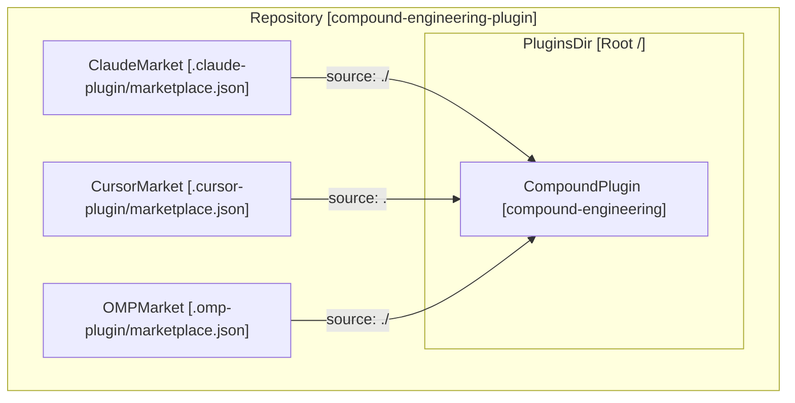
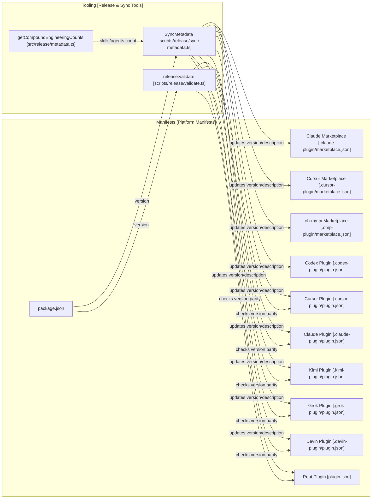

<!-- source: DeepWiki mcp.deepwiki.com · repo EveryInc/compound-engineering-plugin · page 10.1 Marketplace Catalog and Host Manifests · fetched 2026-10-30 -->

# Marketplace Catalog and Host Manifests

Relevant source files

The following files were used as context for generating this wiki page:

- [.agy/plugin.json](.agy/plugin.json)
- [.claude-plugin/CHANGELOG.md](.claude-plugin/CHANGELOG.md)
- [.claude-plugin/plugin.json](.claude-plugin/plugin.json)
- [.codex-plugin/plugin.json](.codex-plugin/plugin.json)
- [.cursor-plugin/CHANGELOG.md](.cursor-plugin/CHANGELOG.md)
- [.cursor-plugin/marketplace.json](.cursor-plugin/marketplace.json)
- [.cursor-plugin/plugin.json](.cursor-plugin/plugin.json)
- [.devin-plugin/plugin.json](.devin-plugin/plugin.json)
- [.github/.release-please-manifest.json](.github/.release-please-manifest.json)
- [.grok-plugin/plugin.json](.grok-plugin/plugin.json)
- [.kimi-plugin/plugin.json](.kimi-plugin/plugin.json)
- [.omp-plugin/marketplace.json](.omp-plugin/marketplace.json)
- [.opencode/INSTALL.md](.opencode/INSTALL.md)
- [.opencode/plugins/compound-engineering.js](.opencode/plugins/compound-engineering.js)
- [CHANGELOG.md](CHANGELOG.md)
- [index.js](index.js)
- [package.json](package.json)
- [plugin.json](plugin.json)
- [tests/opencode-plugin-commands.test.ts](tests/opencode-plugin-commands.test.ts)
- [tests/opencode-plugin.test.ts](tests/opencode-plugin.test.ts)

## Purpose and Scope

This page details the per-host `marketplace.json` and `plugin.json` files used by the `compound-engineering-plugin` repository. These files are crucial for enabling the discovery and installation of the plugin across various AI coding agent hosts, including Claude Code, Cursor, Codex, Kimi, Grok, Devin, oh-my-pi, Antigravity, Cline, OpenCode, and Pi. The page also explains the parity rules and synchronization mechanisms that ensure consistency across these host-specific manifests.

The repository maintains specific marketplace files to support different IDE ecosystems, acting as pointers to the physical source code.

**Sources:** [.claude-plugin/marketplace.json:1-29](), [.cursor-plugin/marketplace.json:1-19](), [.omp-plugin/marketplace.json:1-29]()

---

## Registry Mapping and Architecture

The catalog architecture maps platform-specific marketplace files to the underlying plugin source. This allows different platforms to consume the same codebase using their native discovery protocols.

### Registry Mapping

**Sources:** [.claude-plugin/marketplace.json:26-26](), [.cursor-plugin/marketplace.json:15-15](), [.omp-plugin/marketplace.json:26-26]()

---

## Schema Specifications

The repository maintains various marketplace and plugin schemas to ensure cross-platform parity.

### 1. Claude Marketplace (`.claude-plugin/marketplace.json`)
The Claude marketplace file follows a strict schema required for the `compound-plugin` CLI. It includes detailed author information and tags for discovery.

| Field | Type | Description |
|-------|------|-------------|
| `name` | string | Marketplace identifier (`compound-engineering-plugin`) [[.claude-plugin/marketplace.json:2-2]()] |
| `metadata` | object | Marketplace-level `description` and `version` [[.claude-plugin/marketplace.json:6-9]()] |
| `plugins` | array | List of plugin objects with `source` relative to repository root [[.claude-plugin/marketplace.json:10-28]()] |

**Sources:** [.claude-plugin/marketplace.json:1-29]()

### 2. Cursor Marketplace (`.cursor-plugin/marketplace.json`)
The Cursor marketplace file uses a structure optimized for the Cursor IDE environment, including an owner email and direct source pointers.

| Field | Type | Description |
|-------|------|-------------|
| `owner` | object | Contains `name`, `email`, and `url` [[.cursor-plugin/marketplace.json:3-7]()] |
| `metadata` | object | Marketplace-level `description` and `version` [[.cursor-plugin/marketplace.json:8-11]()] |
| `plugins` | array | List of plugin objects with `name` and `source` [[.cursor-plugin/marketplace.json:12-18]()] |

**Sources:** [.cursor-plugin/marketplace.json:1-19]()

### 3. oh-my-pi Marketplace (`.omp-plugin/marketplace.json`)
The oh-my-pi marketplace file is similar to Claude's, specifying the plugin's name, owner, metadata, and a list of plugins with their source.

| Field | Type | Description |
|-------|------|-------------|
| `name` | string | Marketplace identifier (`compound-engineering-plugin`) [[.omp-plugin/marketplace.json:2-2]()] |
| `owner` | object | Contains `name` [[.omp-plugin/marketplace.json:3-5]()] |
| `metadata` | object | Marketplace-level `description` [[.omp-plugin/marketplace.json:6-8]()] |
| `plugins` | array | List of plugin objects with `name`, `description`, `version`, `author`, `homepage`, `tags`, and `source` [[.omp-plugin/marketplace.json:9-28]()] |

**Sources:** [.omp-plugin/marketplace.json:1-29]()

### 4. Host-Specific `plugin.json` Files

Each supported host has its own `plugin.json` file, which defines the plugin's metadata in a format specific to that host. These files share common fields like `name`, `version`, `description`, `author`, `homepage`, `repository`, `license`, and `keywords`, but may also include host-specific fields.

#### Common Fields Across `plugin.json` Files
- `name`: The name of the plugin, typically "compound-engineering" [[.codex-plugin/plugin.json:2-2](), [.cursor-plugin/plugin.json:2-2](), [.claude-plugin/plugin.json:2-2](), [plugin.json:2-2](), [.kimi-plugin/plugin.json:2-2](), [.devin-plugin/plugin.json:2-2](), [.grok-plugin/plugin.json:2-2]()].
- `version`: The current version of the plugin, synchronized with `package.json` [[.codex-plugin/plugin.json:3-3](), [.cursor-plugin/plugin.json:4-4](), [.claude-plugin/plugin.json:3-3](), [plugin.json:3-3](), [.kimi-plugin/plugin.json:3-3](), [.devin-plugin/plugin.json:3-3](), [.grok-plugin/plugin.json:3-3]()].
- `description`: A brief summary of the plugin's functionality [[.codex-plugin/plugin.json:4-4](), [.cursor-plugin/plugin.json:5-5](), [.claude-plugin/plugin.json:4-4](), [plugin.json:4-4](), [.kimi-plugin/plugin.json:4-4](), [.devin-plugin/plugin.json:4-4](), [.grok-plugin/plugin.json:4-4]()].
- `author`: Information about the plugin's authors [[.codex-plugin/plugin.json:5-7](), [.cursor-plugin/plugin.json:6-8](), [.claude-plugin/plugin.json:5-7](), [plugin.json:5-7](), [.kimi-plugin/plugin.json:14-14](), [.devin-plugin/plugin.json:5-7](), [.grok-plugin/plugin.json:5-7]()].
- `homepage`: URL to the plugin's homepage [[.codex-plugin/plugin.json:8-8](), [.cursor-plugin/plugin.json:9-9](), [.claude-plugin/plugin.json:8-8](), [plugin.json:8-8](), [.kimi-plugin/plugin.json:15-15](), [.devin-plugin/plugin.json:8-8](), [.grok-plugin/plugin.json:8-8]()].
- `repository`: URL to the plugin's source code repository [[.codex-plugin/plugin.json:9-9](), [.cursor-plugin/plugin.json:10-10](), [.claude-plugin/plugin.json:9-9](), [plugin.json:9-9](), [.devin-plugin/plugin.json:9-9](), [.grok-plugin/plugin.json:9-9]()].
- `license`: The license under which the plugin is distributed [[.codex-plugin/plugin.json:10-10](), [.cursor-plugin/plugin.json:11-11](), [.claude-plugin/plugin.json:10-10](), [plugin.json:10-10](), [.kimi-plugin/plugin.json:16-16](), [.devin-plugin/plugin.json:10-10](), [.grok-plugin/plugin.json:10-10]()].
- `keywords`: A list of keywords for discovery and categorization [[.codex-plugin/plugin.json:11-19](), [.cursor-plugin/plugin.json:12-24](), [.claude-plugin/plugin.json:11-19](), [plugin.json:11-19](), [.kimi-plugin/plugin.json:5-13](), [.devin-plugin/plugin.json:11-19](), [.grok-plugin/plugin.json:11-19]()].

#### Host-Specific `plugin.json` Details

- **Codex (`.codex-plugin/plugin.json`)**: Includes an `interface` object with `displayName`, `shortDescription`, `longDescription`, `developerName`, `category`, `capabilities`, `websiteURL`, `privacyPolicyURL`, `termsOfServiceURL`, `defaultPrompt`, `brandColor`, `composerIcon`, `logo`, and `screenshots` [[.codex-plugin/plugin.json:21-44]()]. It also specifies the `skills` directory [[.codex-plugin/plugin.json:20-20]()].
- **Cursor (`.cursor-plugin/plugin.json`)**: Adds `displayName` at the top level [[.cursor-plugin/plugin.json:3-3]()].
- **Kimi (`.kimi-plugin/plugin.json`)**: Uses a top-level `author` string instead of an object, and includes an `interface` object similar to Codex, but with fewer fields [[.kimi-plugin/plugin.json:14-24]()]. It also specifies the `skills` directory [[.kimi-plugin/plugin.json:17-17]()].
- **Grok (`.grok-plugin/plugin.json`)**: Specifies the `skills` directory [[.grok-plugin/plugin.json:20-20]()].
- **Root `plugin.json`**: This file serves as a generic manifest and does not contain host-specific fields. It is explicitly tested to ensure it does not carry an Agent Plugins `$schema` to avoid issues with hosts like Codex and oh-my-pi that might misinterpret it [[tests/codex-skill-prompt-budget.test.ts:96-102]()].

**Sources:** [.codex-plugin/plugin.json:1-45](), [.cursor-plugin/plugin.json:1-25](), [.claude-plugin/plugin.json:1-20](), [plugin.json:1-20](), [.kimi-plugin/plugin.json:1-25](), [.devin-plugin/plugin.json:1-20](), [.grok-plugin/plugin.json:1-21](), [tests/codex-skill-prompt-budget.test.ts:96-102]()

---

## Metadata Synchronization and Parity

The marketplace catalogs and host-specific `plugin.json` files must stay synchronized with the root `package.json` and other metadata sources.

### Metadata Flow and Parity Enforcement

The `release:sync-metadata` script, implemented via `scripts/release/sync-metadata.ts`, is responsible for synchronizing metadata across these files. It ensures that `name`, `version`, and `description` fields are consistent. The `release:validate` script, implemented via `scripts/release/validate.ts`, performs checks to ensure version parity.

**Sources:** [scripts/release/sync-metadata.ts](), [src/release/metadata.ts](), [scripts/release/validate.ts]()

---

## Maintenance and Release Pipeline

### Version Parity
The repository utilizes a synchronization strategy to avoid version drift.
- **Drift Detection:** The `release:sync-metadata` script (which calls `syncReleaseMetadata`) checks if the version in `package.json` matches the version in platform-specific manifests like `.claude-plugin/plugin.json` and `.cursor-plugin/plugin.json` [package.json:3-3](), [.claude-plugin/plugin.json:3-3](), [.cursor-plugin/plugin.json:4-4]().
- **Constraint Enforcement:** The `release:validate` script ensures that the `version` in `package.json` is consistent with the `version` in `.claude-plugin/plugin.json`, `plugin.json`, `.kimi-plugin/plugin.json`, `.grok-plugin/plugin.json`, and `.devin-plugin/plugin.json` [package.json:3-3](), [.claude-plugin/plugin.json:3-3](), [plugin.json:3-3](), [.kimi-plugin/plugin.json:3-3](), [.grok-plugin/plugin.json:3-3](), [.devin-plugin/plugin.json:3-3](). This is part of the `release:validate` command [package.json:36-36]().

### Automated Orchestration
The `release:sync-metadata` script [package.json:35-35]() performs the following:

1.  **Component Counting:** It implicitly relies on functions like `getCompoundEngineeringCounts` (from `src/release/metadata.ts`) to count skills and agents, which are then used to generate descriptions.
2.  **Description Building:** It ensures a consistent description across all manifests: "Brainstorm, plan, debug, review, and compound learnings with AI agents" [package.json:4-4](), [.codex-plugin/plugin.json:4-4](), [.cursor-plugin/plugin.json:5-5](), [.claude-plugin/plugin.json:4-4](), [plugin.json:4-4](), [.kimi-plugin/plugin.json:4-4](), [.devin-plugin/plugin.json:4-4](), [.grok-plugin/plugin.json:4-4]().
3.  **Manifest Update:** It compares current manifest values against expected versions and descriptions, reporting or writing updates to `.claude-plugin/marketplace.json`, `.cursor-plugin/marketplace.json`, `.omp-plugin/marketplace.json`, and various `plugin.json` files.

**Sources:** [package.json:3-4](), [package.json:35-36](), [.codex-plugin/plugin.json:4-4](), [.cursor-plugin/plugin.json:5-5](), [.claude-plugin/plugin.json:3-4](), [plugin.json:3-4](), [.kimi-plugin/plugin.json:3-4](), [.devin-plugin/plugin.json:3-4](), [.grok-plugin/plugin.json:3-4]()

---

