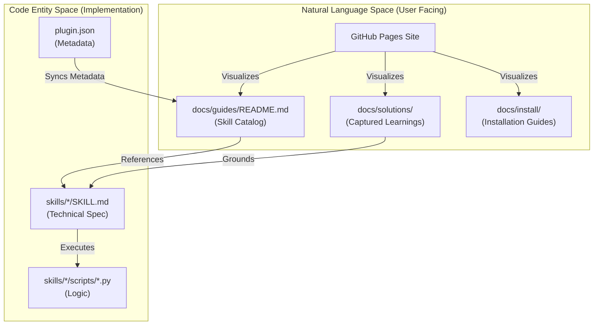
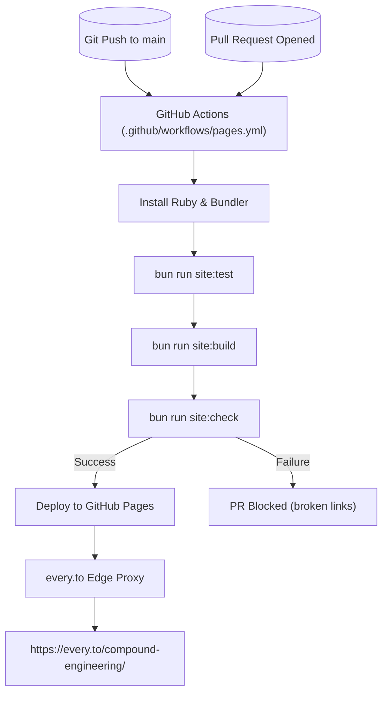

<!-- source: DeepWiki mcp.deepwiki.com · repo EveryInc/compound-engineering-plugin · page 10.2 Documentation Site · fetched 2026-10-30 -->

# Documentation Site

<details>
<summary>Relevant source files</summary>

The following files were used as context for generating this wiki page:

- [.agents/plugins/marketplace.json](.agents/plugins/marketplace.json)
- [assets/explainer/ce-explainer.js](assets/explainer/ce-explainer.js)
- [docs/development.md](docs/development.md)
- [docs/guides/README.md](docs/guides/README.md)
- [docs/guides/ce-bakeoff.md](docs/guides/ce-bakeoff.md)
- [docs/guides/ce-brainstorm.md](docs/guides/ce-brainstorm.md)
- [docs/guides/ce-plan.md](docs/guides/ce-plan.md)
- [docs/solutions/developer-experience/codex-local-skill-development-workflow.md](docs/solutions/developer-experience/codex-local-skill-development-workflow.md)
- [scripts/codex-dev.ts](scripts/codex-dev.ts)
- [site/_includes/jekyll_vitepress/head_end.html](site/_includes/jekyll_vitepress/head_end.html)
- [site/_plugins/ce_relative_urls.rb](site/_plugins/ce_relative_urls.rb)
- [site/index.md](site/index.md)
- [site/test/test_ce_relative_urls.rb](site/test/test_ce_relative_urls.rb)
- [site/test/test_ce_sources.rb](site/test/test_ce_sources.rb)
- [skills/ce-bakeoff/SKILL.md](skills/ce-bakeoff/SKILL.md)
- [skills/ce-brainstorm/references/reasoning-elevation.md](skills/ce-brainstorm/references/reasoning-elevation.md)
- [skills/ce-debug/references/bakeoff.md](skills/ce-debug/references/bakeoff.md)
- [skills/ce-plan/references/bakeoff.md](skills/ce-plan/references/bakeoff.md)
- [skills/ce-plan/references/reasoning-elevation.md](skills/ce-plan/references/reasoning-elevation.md)
- [src/dev/codex-dev.ts](src/dev/codex-dev.ts)
- [tests/codex-dev.test.ts](tests/codex-dev.test.ts)

</details>


The documentation site is a static site that serves as the public-facing reference for the `compound-engineering-plugin` and its capabilities. It provides end-user documentation for the plugin's skills, explains the "Compounding Engineering" philosophy, and serves as the authoritative catalog for the `docs/guides/` directory.

The site is built using Jekyll and the `jekyll-vitepress-theme` gem and is deployed to GitHub Pages. It is designed to be a living document, where the `docs/guides/` markdown files serve as the primary source of truth for skill behavior, while the `docs/solutions/` directory contains the institutional knowledge captured by the plugin through the `ce-compound` process.

Sources: [docs/guides/README.md:1-7](), [docs/development.md:18-19]()

## Directory Structure

The documentation is organized to separate end-user guidance from the internal knowledge base and the technical skill definitions.

```text
docs/
├── guides/               # Authoritative end-user skill reference
│   ├── README.md         # Skill catalog and core loop overview
│   ├── ce-brainstorm.md  # Detailed usage for /ce-brainstorm
│   ├── ce-plan.md        # Detailed usage for /ce-plan
│   └── ...               # Individual skill pages
├── solutions/            # Captured institutional knowledge (Compounded)
│   ├── architecture-patterns/ # Cross-platform and system patterns
│   ├── conventions/      # Repository-wide engineering standards
│   └── skill-design/     # Best practices for building skills
└── install/              # Installation and upgrade guides
    └── upgrading.md
```

**Documentation Flow Diagram**

This diagram illustrates how the documentation site bridges the "Natural Language Space" (user documentation) with the "Code Entity Space" (skill definitions and scripts).



Sources: [docs/guides/README.md:1-7](), [docs/development.md:18-19]()

## Core Loop Documentation

The documentation site centers around the **Compound Engineering Workflow**, a multi-step cycle documented across the `docs/guides/` directory. The site visualizes this loop to help users understand how skills chain together.

| Phase | Skill | Documentation Path | Purpose |
| :--- | :--- | :--- | :--- |
| **Ideate** | `/ce-ideate` | `docs/guides/ce-ideate.md` | *Optional first step*: discover grounded directions worth exploring [docs/guides/README.md:41]() |
| **Brainstorm** | `/ce-brainstorm` | `docs/guides/ce-brainstorm.md` | Define what something should become [docs/guides/README.md:42]() |
| **Plan** | `/ce-plan` | `docs/guides/ce-plan.md` | Bound execution with guardrails [docs/guides/README.md:43]() |
| **Work** | `/ce-work` | `docs/guides/ce-work.md` | Execute an implementation-ready plan [docs/guides/README.md:44]() |
| **Compound** | `/ce-compound` | `docs/guides/ce-compound.md` | Capture what was learned into `docs/solutions/` [docs/guides/README.md:45]() |

Sources: [docs/guides/README.md:19-29](), [docs/guides/README.md:35-46]()

## The `docs/guides/` Catalog

The `docs/guides/` directory is the authoritative source for end-user documentation. While each skill in the `skills/` directory has a `SKILL.md` file (the technical specification for the agent), the files in `docs/guides/` are written for humans, covering:

- **High-level purpose**: Each page covers the skill's high-level purpose, novel mechanics, use cases, and chain position relative to other skills [docs/guides/README.md:3]().
- **TL;DR Tables**: Quick reference for inputs, outputs, and next steps [docs/guides/ce-brainstorm.md:26-32](), [docs/guides/ce-plan.md:26-32]().
- **Example Invocations**: Practical examples of how to use the skill [docs/guides/ce-brainstorm.md:37-74](), [docs/guides/ce-plan.md:35-73]().
- **Novel Mechanics**: Explanations of unique features like "One question at a time" or "Named gap lenses" in `ce-brainstorm` [docs/guides/ce-brainstorm.md:93-111]() or "U-IDs that never renumber" in `ce-plan` [docs/guides/ce-plan.md:106-107]().
- **Model Elevation**: How skills like `ce-brainstorm` and `ce-plan` can elevate reasoning-heavy steps to a user-chosen model [skills/ce-brainstorm/references/reasoning-elevation.md:1-5](), [skills/ce-plan/references/reasoning-elevation.md:1-5](). This involves activation resolution (user intent, caller carrier, config) and adapter selection (native, Claude CLI, inline) [skills/ce-brainstorm/references/reasoning-elevation.md:9-28](), [skills/ce-plan/references/reasoning-elevation.md:9-28]().
- **Bake-off Integration**: How `ce-bakeoff` is integrated into `ce-brainstorm` and `ce-plan` to explore competing approaches [skills/ce-bakeoff/SKILL.md:10-11](), [skills/ce-brainstorm/references/bakeoff.md:1-9](), [skills/ce-plan/references/bakeoff.md:1-9]().

Sources: [docs/guides/README.md:3](), [docs/guides/ce-brainstorm.md:26-32](), [docs/guides/ce-plan.md:26-32](), [docs/guides/ce-brainstorm.md:93-111](), [docs/guides/ce-plan.md:106-107](), [skills/ce-brainstorm/references/reasoning-elevation.md:1-5](), [skills/ce-plan/references/reasoning-elevation.md:1-5](), [skills/ce-brainstorm/references/reasoning-elevation.md:9-28](), [skills/ce-plan/references/reasoning-elevation.md:9-28](), [skills/ce-bakeoff/SKILL.md:10-11](), [skills/ce-brainstorm/references/bakeoff.md:1-9](), [skills/ce-plan/references/bakeoff.md:1-9]()

## Jekyll Site Implementation

The documentation site is built using Jekyll, with several custom plugins to adapt the repository's structure and content for the static site generator.

### Site Structure and Symlinks

The `site/` directory contains the Jekyll configuration and site-specific files. To avoid duplicating content, it uses symlinks to pull in documentation from other parts of the repository:
- `site/_guides` symlinks to `docs/guides/`
- `site/assets` symlinks to `assets/`
- `site/install.md` symlinks to `README.md`
- `site/upgrading.md` symlinks to `docs/install/upgrading.md`

This ensures that the documentation on the site is always in sync with the source files in the repository.

Sources: [docs/development.md:18]()

### Jekyll Configuration (`_config.yml`)

The `_config.yml` file configures Jekyll, including:
- `title` and `description` for the site.
- `url` and `baseurl` to ensure correct link generation for deployment on `every.to/compound-engineering/` and GitHub Pages.
- `theme: jekyll-vitepress-theme` for the visual presentation.
- `plugins`: Specifies Jekyll plugins, including custom ones.
- `collections`: Defines the `guides` collection, mapping `docs/guides/` content to output pages with permalinks like `/guides/:name/`.
- `defaults`: Sets default layout for pages.

Example `_config.yml` snippet:
```yaml
title: Fixture Site
description: Fixture description.
url: https://example.test
theme: jekyll-vitepress-theme
plugins:
  - jekyll-vitepress-theme
collections:
  guides:
    output: true
    permalink: "/guides/:name/"
```

Sources: [site/test/test_ce_sources.rb:20-54]()

### Custom Jekyll Plugins

Three custom Ruby plugins in `site/_plugins/` adapt the repository content for Jekyll:

1.  **`ce_sources.rb`**:
    -   **Purpose**: Promotes frontmatter-less source files (like `SKILL.md` and `README.md`) into Jekyll pages and documents.
    -   **Functionality**:
        -   Parses `docs/guides/README.md` to create a catalog of skills, their descriptions, and group them for the sidebar [site/test/test_ce_sources.rb:154-168]().
        -   Derives titles, sidebar groups, homepage data, and last-updated dates from the guides catalog, `README.md`, and Git history [docs/development.md:18]().
        -   Extracts host names from `README.md` for display [site/test/test_ce_sources.rb:193-194]().
        -   Handles markdown title extraction, falling back to a provided name if the first heading is not an H1 [site/test/test_ce_sources.rb:197-202]().
    -   **Key Classes**:
        -   `CeSources::Catalog`: Parses the `docs/guides/README.md` to extract skill groups and individual skill data [site/test/test_ce_sources.rb:154-159]().
        -   `CeSources::Readme`: Extracts host names from the main `README.md` [site/test/test_ce_sources.rb:190-194]().
        -   `CeSources::Titles`: Utility for extracting titles from markdown content [site/test/test_ce_sources.rb:197-202]().

2.  **`ce_github_markdown.rb`**:
    -   **Purpose**: Rewrites GitHub-specific markdown elements (like alerts, repo-relative links, and asset paths) at render time to be compatible with the Jekyll site [docs/development.md:18]().

3.  **`ce_relative_urls.rb`**:
    -   **Purpose**: Transforms absolute URLs in the built HTML into page-relative ones.
    -   **Benefit**: Allows a single build to serve correctly from `every.to`, `github.io`, and local development servers [docs/development.md:18]().
    -   **Implementation**: Uses a `Jekyll::Hooks.register(:site, :post_write)` hook to process generated HTML files and rewrite URLs [site/_plugins/ce_relative_urls.rb:10-11](). It specifically targets `href` and `src` attributes in `<a>`, ``, `<link>`, and `<script>` tags [site/_plugins/ce_relative_urls.rb:20-23]().

Sources: [docs/development.md:18](), [site/test/test_ce_sources.rb:154-168](), [site/test/test_ce_sources.rb:193-194](), [site/test/test_ce_sources.rb:197-202](), [site/_plugins/ce_relative_urls.rb:10-11](), [site/_plugins/ce_relative_urls.rb:20-23]()

### Ruby Tests

The custom Jekyll plugins are tested using Minitest.
- `site/test/test_ce_sources.rb`: Contains tests for `ce_sources.rb`, verifying catalog parsing, guide extraction, description handling, and content processing [site/test/test_ce_sources.rb:154-187](). It also includes helpers for scaffolding a temporary Jekyll site and repository for isolated testing [site/test/test_ce_sources.rb:73-95]().
- `site/test/test_ce_relative_urls.rb`: Contains tests for `ce_relative_urls.rb`, ensuring that URLs are correctly rewritten to be relative.

Sources: [docs/development.md:27](), [site/test/test_ce_sources.rb:154-187](), [site/test/test_ce_sources.rb:73-95]()

### Rakefile

The `Rakefile` defines tasks for building, serving, testing, and checking the Jekyll site. These tasks are then invoked via `bun run` commands [docs/development.md:24-27]().

Sources: [docs/development.md:24-27]()

## Deployment Workflow

The documentation site is deployed to GitHub Pages via a GitHub Actions workflow.

**Deployment Process:**
1.  **Prerequisites**: Ruby 3.3+ and Bundler are required [docs/development.md:21]().
2.  **Build**: `bun run site:build` builds the Jekyll site into `site/_site` [docs/development.md:24]().
3.  **Testing**: `bun run site:test` runs the Minitest suite for the Jekyll plugins [docs/development.md:26]().
4.  **Link Check**: `bun run site:check` performs an internal link check on the built site [docs/development.md:27](). A broken relative link will cause this check to fail [docs/development.md:30]().
5.  **CI/CD**: The `.github/workflows/pages.yml` workflow runs these checks on every pull request and deploys the site on pushes to `main` [docs/development.md:29-30]().
6.  **Hosting**: The site is served at `https://every.to/compound-engineering/` via an edge proxy that forwards requests to the GitHub Pages build (`https://everyinc.github.io/compound-engineering-plugin/`) [docs/development.md:33-36]().

**Deployment Workflow Diagram**



Sources: [docs/development.md:21-30](), [docs/development.md:33-36]()

---

