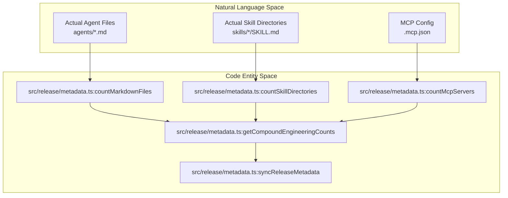
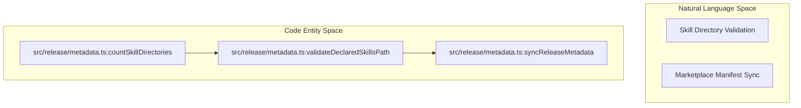
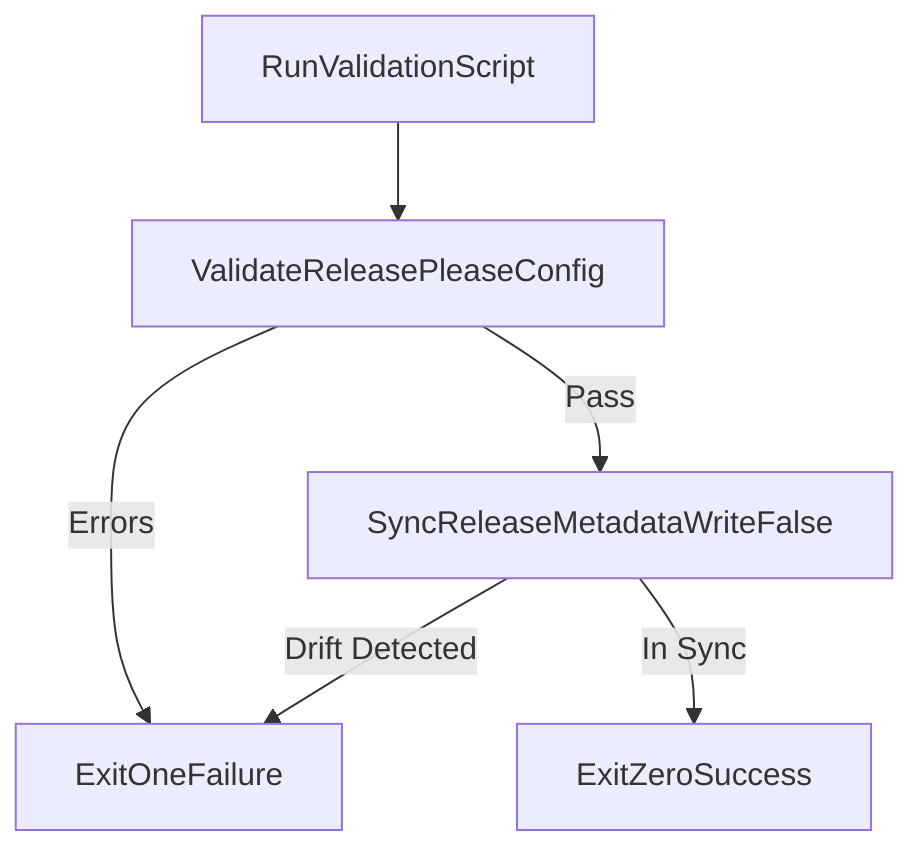

<!-- source: DeepWiki mcp.deepwiki.com · repo EveryInc/compound-engineering-plugin · page 10.3 Metadata Synchronization · fetched 2026-10-30 -->

# Metadata Synchronization

<details>
<summary>Relevant source files</summary>

The following files were used as context for generating this wiki page:

- [.claude-plugin/marketplace.json](.claude-plugin/marketplace.json)
- [.github/release-please-config.json](.github/release-please-config.json)
- [README.md](README.md)
- [src/release/components.ts](src/release/components.ts)
- [src/release/metadata.ts](src/release/metadata.ts)
- [src/release/types.ts](src/release/types.ts)
- [tests/release-components.test.ts](tests/release-components.test.ts)
- [tests/release-metadata.test.ts](tests/release-metadata.test.ts)
- [tests/release-preview.test.ts](tests/release-preview.test.ts)

</details>


## Purpose and Scope

This document details the metadata synchronization system that maintains consistency across component counts, descriptions, and semantic versions in the `compound-engineering-plugin` repository. The synchronization process uses `src/release/metadata.ts` and release scripts to update platform manifests (`plugin.json`, `marketplace.json`) and enforces version alignment and skill path correctness via `release:validate` invariants.

Sources: [src/release/metadata.ts:1-255](), [tests/release-metadata.test.ts:1-221]()

## The Synchronization Problem and Metadata Architecture

The compound-engineering plugin declares its components (agents, skills, and MCP servers) across multiple host-specific directories and platform manifests (Claude, Cursor, Codex, Kimi, Antigravity, Devin, Grok). When components are modified, descriptions or version numbers can drift. The metadata synchronization module resolves this by reading the definitive state of the filesystem and synchronizing target manifests.

### Natural Language to Code Entity: Metadata Flow



Sources: [src/release/metadata.ts:152-214](), [src/release/metadata.ts:252-255]()

## Component Counting and File Inspection

The counting logic scans the repository tree to compute precise totals for agents, skills, and MCP servers.

### Natural Language to Code Entity: Counting & Validation



Sources: [src/release/metadata.ts:176-192](), [src/release/metadata.ts:224-250]()

Key counting functions defined in `src/release/metadata.ts`:
* `countMarkdownFiles(root: string)`: Recursively scans a directory to count all `.md` files, used for tracking agents [src/release/metadata.ts:152-174]().
* `countSkillDirectories(root: string)`: Iterates through entries and verifies the presence of `SKILL.md` inside each subdirectory [src/release/metadata.ts:176-192]().
* `countMcpServers(pluginRoot: string)`: Reads `.mcp.json` and evaluates the length of the `mcpServers` object keys [src/release/metadata.ts:194-203]().
* `getCompoundEngineeringCounts(root: string)`: Aggregates counts into a `CompoundEngineeringCounts` data structure [src/release/metadata.ts:205-214]().

Sources: [src/release/metadata.ts:152-214]()

## Manifest Validation and `validateDeclaredSkillsPath`

Host manifests for platforms like Codex, Kimi, and Grok require an explicit relative path to the skills directory. The `validateDeclaredSkillsPath` function ensures that this field is present and points to an actual directory on disk.

```typescript
// Validation logic implemented in src/release/metadata.ts
```

If the `skills` field is undefined or points to a missing or non-directory path, an error is appended to the validation error accumulator [src/release/metadata.ts:224-250]().

Sources: [src/release/metadata.ts:224-250]()

## Host Manifests and Version Invariants

Version parity is strictly enforced across the project root and all host-specific plugin manifests. The function `loadCurrentVersions` in `src/release/components.ts` reads `package.json`, Claude, Antigravity, Kimi, Grok, and Devin manifests, throwing an error if any version diverges from the root package version.

| Manifest Path | Target Platform | Monitored Fields |
|---------------|-----------------|------------------|
| `package.json` | Root Project | `version` |
| `.claude-plugin/plugin.json` | Claude Code | `version`, `description` |
| `plugin.json` | Antigravity | `version` |
| `.kimi-plugin/plugin.json` | Kimi Code | `version`, `description`, `skills` |
| `.grok-plugin/plugin.json` | Grok Bot | `version`, `description`, `skills` |
| `.devin-plugin/plugin.json` | Devin CLI | `version`, `description` |

Sources: [src/release/components.ts:186-215](), [.github/release-please-config.json:53-99]()

Sources for this section: [src/release/components.ts:186-215](), [.github/release-please-config.json:53-99]()

## The `release:validate` Script and Invariants

The validation script runs checks across release-please configurations and metadata synchronization states to prevent malformed releases or version drift from landing on main branches.

### Validation Pipeline



Sources: [tests/release-metadata.test.ts:212-221](), [src/release/metadata.ts:252-255]()

---

