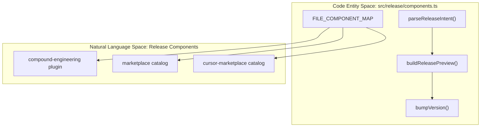
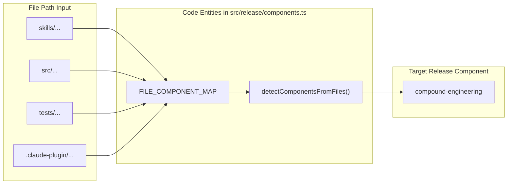
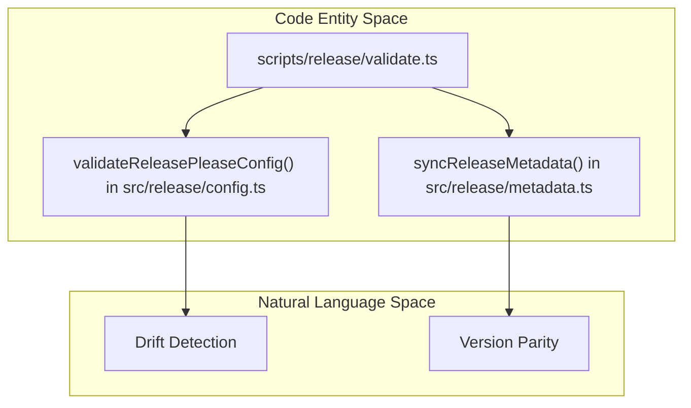

<!-- source: DeepWiki mcp.deepwiki.com · repo EveryInc/compound-engineering-plugin · page 10.4 Versioning and Release Pipeline · fetched 2026-10-30 -->

# Versioning and Release Pipeline

Relevant source files

The following files were used as context for generating this wiki page:

- [.agy/plugin.json](.agy/plugin.json)
- [.claude-plugin/marketplace.json](.claude-plugin/marketplace.json)
- [.claude-plugin/plugin.json](.claude-plugin/plugin.json)
- [.codex-plugin/plugin.json](.codex-plugin/plugin.json)
- [.cursor-plugin/plugin.json](.cursor-plugin/plugin.json)
- [.devin-plugin/plugin.json](.devin-plugin/plugin.json)
- [.github/.release-please-manifest.json](.github/.release-please-manifest.json)
- [.github/release-please-config.json](.github/release-please-config.json)
- [.github/workflows/release-pr.yml](.github/workflows/release-pr.yml)
- [.github/workflows/release-preview.yml](.github/workflows/release-preview.yml)
- [.grok-plugin/plugin.json](.grok-plugin/plugin.json)
- [.kimi-plugin/plugin.json](.kimi-plugin/plugin.json)
- [.omp-plugin/marketplace.json](.omp-plugin/marketplace.json)
- [CHANGELOG.md](CHANGELOG.md)
- [README.md](README.md)
- [docs/solutions/adding-converter-target-providers.md](docs/solutions/adding-converter-target-providers.md)
- [docs/solutions/workflow/manual-release-please-github-releases.md](docs/solutions/workflow/manual-release-please-github-releases.md)
- [package.json](package.json)
- [plugin.json](plugin.json)
- [scripts/release/validate.ts](scripts/release/validate.ts)
- [src/release/components.ts](src/release/components.ts)
- [src/release/config.ts](src/release/config.ts)
- [src/release/metadata.ts](src/release/metadata.ts)
- [src/release/types.ts](src/release/types.ts)
- [tests/release-components.test.ts](tests/release-components.test.ts)
- [tests/release-config.test.ts](tests/release-config.test.ts)
- [tests/release-metadata.test.ts](tests/release-metadata.test.ts)
- [tests/release-preview.test.ts](tests/release-preview.test.ts)

This page documents the dual versioning strategy, release components, release-please configuration, metadata synchronization, and automated release workflows for the `compound-engineering-plugin` repository.

---

## 1. Dual Versioning Architecture and Release Components

The repository manages independent version streams for the core `compound-engineering` plugin and platform-specific marketplace catalogs. Release automation relies on `release-please` configured via `.github/release-please-config.json` [package.json:1-54](), [.github/.release-please-manifest.json:1-5]().

**Diagram: Bridging Release System Names to Code Entities in src/release/components.ts**

Sources: [.github/.release-please-manifest.json:1-5](), [src/release/components.ts:1-50]()

---

## 2. Release-Please Configuration and Manifests

The release automation is driven by `.github/release-please-config.json` and `.github/.release-please-manifest.json`.

- **Manifest**: `.github/.release-please-manifest.json` tracks current release versions for components such as the root `.`, `.claude-plugin`, and `.cursor-plugin` [.github/.release-please-manifest.json:1-5]().
- **Config**: `.github/release-please-config.json` defines component packages, paths, extra files to update (e.g., manifest synchronization across `.claude-plugin/plugin.json`, `.cursor-plugin/plugin.json`, `.codex-plugin/plugin.json`, etc.), and changelog configurations [.github/release-please-config.json:1-118]().

Sources: [.github/.release-please-manifest.json:1-5](), [.github/release-please-config.json:1-118]()

---

## 3. FILE_COMPONENT_MAP and Release Components

The TypeScript release tooling in `src/release/components.ts` defines how changed files map to release components using `FILE_COMPONENT_MAP`.

**Diagram: Component Mapping via FILE_COMPONENT_MAP**

Sources: [src/release/components.ts:17-50](), [src/release/components.ts:110-126]()

---

## 4. Release Intent Parsing, Preview, and Version Bumping

Release preview and intent analysis are performed by helper functions in `src/release/components.ts`.

- **`parseReleaseIntent`**: Analyzes commit messages or branch changes to extract release intents and bump types (`major`, `minor`, `patch`) [src/release/components.ts:78-99]().
- **`buildReleasePreview`**: Synthesizes changed files and commit intents into a comprehensive preview of upcoming version changes across components [src/release/components.ts:223-234]().
- **`bumpVersion`**: Executes the semantic version increment based on resolved intents [src/release/components.ts:101-108]().

Sources: [src/release/components.ts:78-234]()

---

## 5. GitHub Actions Workflows: release-pr and release-preview

The repository automates release PR generation and previews through GitHub Actions workflows.

- **Release PR Workflow**: `.github/workflows/release-pr.yml` runs `googleapis/release-please-action` on pushes to `main` to maintain open release pull requests [.github/workflows/release-pr.yml:1-40]().
- **Release Preview Workflow**: `.github/workflows/release-preview.yml` executes `bun run release:preview` on pull requests to validate release impacts before merging [.github/workflows/release-preview.yml:1-35]().

Sources: [.github/workflows/release-pr.yml:1-40](), [.github/workflows/release-preview.yml:1-35]()

---

## 6. Metadata Synchronization and Validation

To prevent manifest drift across platforms, metadata validation and synchronization scripts enforce strict invariants.

- **Metadata Sync**: `src/release/metadata.ts` provides `syncReleaseMetadata` to align descriptions, skill counts, and manifest version properties [src/release/metadata.ts:139-257]().
- **Validation Pipeline**: `scripts/release/validate.ts` executes `bun run release:validate` in CI to catch stale release-please configurations and version drift [scripts/release/validate.ts:36-78](), [package.json:36]().

**Diagram: Validation and Metadata Synchronization Entities**

Sources: [src/release/metadata.ts:1-257](), [src/release/config.ts:1-78](), [scripts/release/validate.ts:1-78]()

---

## 7. Manual GitHub Releases Runbook

When automated release-please PRs require manual intervention or emergency releases, operators follow the runbook documented in `docs/solutions/workflow/manual-release-please-github-releases.md`.

- **Triggering Manual Releases**: Operators can manually trigger workflow dispatches or adjust release-please state files when automation is blocked.
- **Verification**: Ensure `bun run release:validate` passes successfully before publishing tags or releasing artifacts [package.json:36](), [scripts/release/validate.ts:46-53]().

Sources: [docs/solutions/workflow/manual-release-please-github-releases.md:1-47](), [package.json:36](), [scripts/release/validate.ts:46-53]()

---

