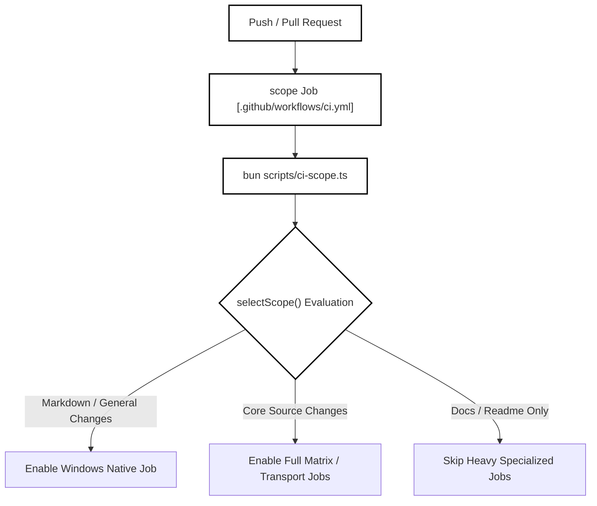
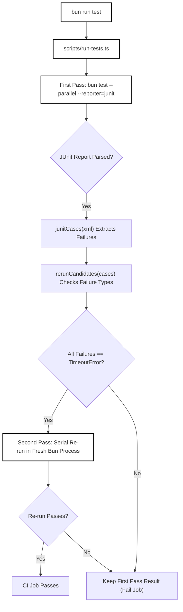

<!-- source: DeepWiki mcp.deepwiki.com · repo EveryInc/compound-engineering-plugin · page 10.5 CI Pipeline · fetched 2026-10-30 -->

# CI Pipeline

Relevant source files

The following files were used as context for generating this wiki page:

- [.github/workflows/ci.yml](.github/workflows/ci.yml)
- [docs/guides/ci.md](docs/guides/ci.md)
- [docs/plans/2026-08-15-1506-fix-refresh-instruction-layer-conflict-plan.md](docs/plans/2026-08-15-1506-fix-refresh-instruction-layer-conflict-plan.md)
- [docs/plans/2026-10-28-1746-ci-linux-test-selection-plan.md](docs/plans/2026-10-28-1746-ci-linux-test-selection-plan.md)
- [docs/solutions/developer-experience/bun-parallel-worker-loses-subprocess-exit.md](docs/solutions/developer-experience/bun-parallel-worker-loses-subprocess-exit.md)
- [docs/solutions/developer-experience/signal-during-untimed-subprocess-wait-stalls-test.md](docs/solutions/developer-experience/signal-during-untimed-subprocess-wait-stalls-test.md)
- [scripts/ci-scope.ts](scripts/ci-scope.ts)
- [scripts/run-tests.ts](scripts/run-tests.ts)
- [scripts/test-scope.ts](scripts/test-scope.ts)
- [skills/ce-compound-refresh/assets/resolution-template.md](skills/ce-compound-refresh/assets/resolution-template.md)
- [skills/ce-compound-refresh/references/schema.yaml](skills/ce-compound-refresh/references/schema.yaml)
- [skills/ce-compound-refresh/references/yaml-schema.md](skills/ce-compound-refresh/references/yaml-schema.md)
- [skills/ce-compound/assets/resolution-template.md](skills/ce-compound/assets/resolution-template.md)
- [skills/ce-compound/references/schema.yaml](skills/ce-compound/references/schema.yaml)
- [skills/ce-compound/references/yaml-schema.md](skills/ce-compound/references/yaml-schema.md)
- [tests/ci-scope.test.ts](tests/ci-scope.test.ts)
- [tests/compound-support-files.test.ts](tests/compound-support-files.test.ts)
- [tests/fixtures/peer-job-runner-windows-smoke.py](tests/fixtures/peer-job-runner-windows-smoke.py)
- [tests/peer-job-runner-retry-gate.test.ts](tests/peer-job-runner-retry-gate.test.ts)
- [tests/run-tests-script.test.ts](tests/run-tests-script.test.ts)
- [tests/test-scope.test.ts](tests/test-scope.test.ts)

This page details the Continuous Integration (CI) pipeline for the `compound-engineering-plugin` repository. It covers the GitHub Actions workflow defined in `.github/workflows/ci.yml` [.github/workflows/ci.yml:1-183](), the CI scoping logic in `scripts/ci-scope.ts` [scripts/ci-scope.ts:1-45](), cross-platform concerns (including native Windows verification), the parallel test runner wrapper (`scripts/run-tests.ts` [scripts/run-tests.ts:1-145]()), and known pitfalls with Bun's test worker processes.

## GitHub Actions Workflow and Job Scoping

The CI pipeline is orchestrated by `.github/workflows/ci.yml` [.github/workflows/ci.yml:1-183](). It defines multiple parallel and specialized jobs triggered on `push` to `main`, `pull_request` events, and `workflow_dispatch` [.github/workflows/ci.yml:3-7]().

### Scoping and Specialized Jobs

To optimize execution time and resource allocation, the `scope` job runs `scripts/ci-scope.ts` [scripts/ci-scope.ts:1-45]() against the base commit of pull requests (`CI_PR_BASE`) [.github/workflows/ci.yml:31-35](). 

The `selectScope` function [scripts/ci-scope.ts:7-20]() analyzes changed files to determine whether specialized jobs (such as native Windows execution or transport-heavy ACX tests) need to run:
- **Windows Jobs**: Triggered when markdown files or non-CLI/doc paths change, as markdown files contain shell preambles executed by the native Windows test suite [scripts/ci-scope.ts:12-14]().
- **Full Scope**: Triggered if core source files (`src/`) or untracked categories are modified [scripts/ci-scope.ts:15-17]().

Diagram: "CI Scoping Data Flow"
Sources:
- `.github/workflows/ci.yml` [.github/workflows/ci.yml:15-36]()
- `scripts/ci-scope.ts` [scripts/ci-scope.ts:1-45]()

### Core Validation Pipeline

The primary `test` job [.github/workflows/ci.yml:85-180]() runs on `ubuntu-latest` [.github/workflows/ci.yml:86]() and executes the following sequence:
1. **Dependency Installation**: Sets up Bun using `oven-sh/setup-bun@v2` [.github/workflows/ci.yml:106-110]() and installs dependencies via `bun install` [.github/workflows/ci.yml:111-112]().
2. **Release Metadata Validation**: Executes `bun run release:validate` [.github/workflows/ci.yml:114-115]() to check release component invariants.
3. **Claude Plugin Schema Validation**: Caches and installs `@anthropic-ai/claude-code` pinned to `CLAUDE_CODE_VERSION` [.github/workflows/ci.yml:97-156](), executing `claude plugin validate --strict` to verify marketplace catalogs and plugin manifests.
4. **Test Suite Execution**: Invokes the parallel test suite wrapper (`scripts/run-tests.ts` [scripts/run-tests.ts:1-145]()) using `bun run test` [.github/workflows/ci.yml:157-166]().

Sources:
- `.github/workflows/ci.yml` [.github/workflows/ci.yml:85-180]()

## Cross-Platform Concerns and Native Windows

Certain platform-specific behaviors—particularly process supervision, job objects, and file locking—cannot be fully validated under Linux. The CI pipeline incorporates specialized Windows-native validation steps to exercise Win32 APIs directly.

### Native Windows Smoke Testing

The `tests/fixtures/peer-job-runner-windows-smoke.py` [tests/fixtures/peer-job-runner-windows-smoke.py:1-192]() script verifies real Win32 process detachment, job object assignment, and orphan-grandchild teardown without mocks [tests/fixtures/peer-job-runner-windows-smoke.py:2-6](). 

Because hosted Windows runners intermittently encounter `DLL load failed while importing _ctypes` during fresh Python process spawns, the test runner harness implements a targeted retry wrapper (`_run`) that catches this specific flake and safely retries the invocation [tests/fixtures/peer-job-runner-windows-smoke.py:87-108]().

Sources:
- `tests/fixtures/peer-job-runner-windows-smoke.py` [tests/fixtures/peer-job-runner-windows-smoke.py:1-192]()

## Parallel Test Runner (`scripts/run-tests.ts`)

`scripts/run-tests.ts` [scripts/run-tests.ts:1-145]() serves as the wrapper for `bun test`. It addresses a known Bun defect ([oven-sh/bun#34069](https://github.com/oven-sh/bun/issues/34069), [#41024](https://github.com/oven-sh/bun/issues/41024)) where parallel test workers occasionally lose child process exit or pipe notifications [docs/solutions/developer-experience/bun-parallel-worker-loses-subprocess-exit.md:1-64]().

### Bun Worker Pitfall and Two-Pass Strategy

When a test worker drops a child process exit notification, subsequent subprocess invocations (`spawnSync`) block until they hit the per-test timeout, failing with `TimeoutError` [docs/solutions/developer-experience/bun-parallel-worker-loses-subprocess-exit.md:31-37](). 

To prevent these transient runner glitches from failing CI while preserving strict assertion failures, `scripts/run-tests.ts` [scripts/run-tests.ts:1-145]() implements a two-pass strategy:
1. **First Pass**: Runs `bun test --parallel` with a JUnit XML reporter output [scripts/run-tests.ts:1-114]().
2. **Analysis**: Parses the JUnit XML report using `junitCases(xml)` [scripts/run-tests.ts:31-61]() and evaluates rerun candidates via `rerunCandidates(cases)` [scripts/run-tests.ts:97-103]().
3. **Conditional Re-run**: If *every* failure across failed test files is strictly a `TimeoutError` (indicating a lost subprocess notification rather than a code assertion failure), those specific files are re-run serially in a fresh Bun process [scripts/run-tests.ts:97-103](). Any assertion failure or error skips the re-run and fails the job immediately [scripts/run-tests.ts:9-10]().

Diagram: "Parallel Test Execution and Re-run Flow"
Sources:
- `scripts/run-tests.ts` [scripts/run-tests.ts:1-145]()
- `tests/run-tests-script.test.ts` [tests/run-tests-script.test.ts:1-109]()
- `docs/solutions/developer-experience/bun-parallel-worker-loses-subprocess-exit.md` [docs/solutions/developer-experience/bun-parallel-worker-loses-subprocess-exit.md:1-64]()

### Key Functions and Modules

- `junitCases(xml: string)`: Located in `scripts/run-tests.ts` [scripts/run-tests.ts:31-61](). Scans JUnit XML reports to build an array of `JunitCase` objects, capturing file paths, describe block hierarchies, failure types, and error messages [scripts/run-tests.ts:18-61]().
- `rerunCandidates(cases: JunitCase[])`: Located in `scripts/run-tests.ts` [scripts/run-tests.ts:97-103](). Inspects grouped test files and returns a sorted array of file paths eligible for serial recovery [scripts/run-tests.ts:97-103]().
- `passthroughArgs(argv: string[])`: Located in `scripts/run-tests.ts` [scripts/run-tests.ts:105-120](). Strips wrapper-specific CLI arguments before delegating to `bun test` [scripts/run-tests.ts:105-120]().

Sources:
- `scripts/run-tests.ts` [scripts/run-tests.ts:1-145]()
- `tests/run-tests-script.test.ts` [tests/run-tests-script.test.ts:1-109]()

---

