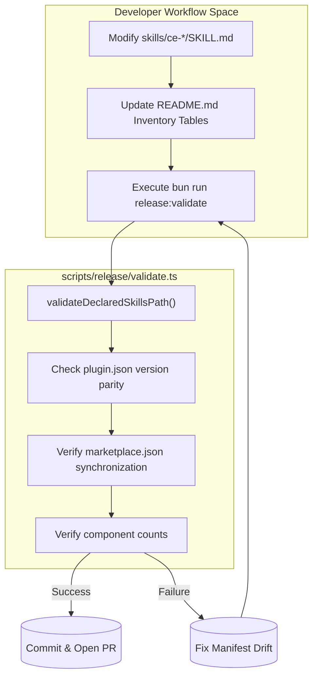

<!-- source: DeepWiki mcp.deepwiki.com · repo EveryInc/compound-engineering-plugin · page 11 Plugin Development Guide · fetched 2026-10-30 -->

# Plugin Development Guide

<details>
<summary>Relevant source files</summary>

The following files were used as context for generating this wiki page:

- [.agents/skills/ce-skill-work/SKILL.md](.agents/skills/ce-skill-work/SKILL.md)
- [.agents/skills/ce-skill-work/references/edit-skill.md](.agents/skills/ce-skill-work/references/edit-skill.md)
- [.agents/skills/ce-skill-work/references/evaluate.md](.agents/skills/ce-skill-work/references/evaluate.md)
- [.agents/skills/ce-skill-work/references/new-skill.md](.agents/skills/ce-skill-work/references/new-skill.md)
- [.agents/skills/ce-skill-work/references/respond-to-review.md](.agents/skills/ce-skill-work/references/respond-to-review.md)
- [.agents/skills/ce-skill-work/references/review-skill.md](.agents/skills/ce-skill-work/references/review-skill.md)
- [AGENTS.md](AGENTS.md)
- [CLAUDE.md](CLAUDE.md)
- [docs/solutions/skill-design/portable-agent-skill-authoring.md](docs/solutions/skill-design/portable-agent-skill-authoring.md)
- [docs/solutions/skill-design/size-driven-skill-restructure.md](docs/solutions/skill-design/size-driven-skill-restructure.md)
- [docs/specs/cursor.md](docs/specs/cursor.md)

</details>


This document provides high-level guidance for developers adding components to or customizing the compound-engineering plugin catalog, extending the TypeScript CLI target providers, and validating changes against mechanical and behavioral harnesses. 

For specific component creation instructions and deep dives, refer to the child pages:
- For checklists on adding skills, commands, or target providers, see [Adding Components and Target Providers](#11.1).
- For rules on creating or revising portable skills using `ce-skill-work`, see [Authoring Portable Skills](#11.2).
- For running the test suite, contract checks, and skill eval cell harnesses, see [Testing Infrastructure](#11.3).
- For recurring structural patterns and corpus retuning, see [Skill Design Patterns and ce-retune](#11.4).

For cross-platform CLI tool development, see [Cross-Platform CLI Tool](#9).

Sources: [AGENTS.md:1-10](), [docs/solutions/workflow/manual-release-please-github-releases.md:1-20]()

---

## Plugin Repository Structure

The repository maintains a clear separation between the TypeScript CLI source code (`src/`), release tooling (`scripts/release/`), individual plugin components (`skills/`), and validation tests (`tests/`). Specialist behavior relies on an **agentless surface**: specialist capabilities live as skill-local prompt assets (`skills/ce-*/references/`) rather than standalone agent definitions [src/utils/legacy-cleanup.ts:125-127]().

### System to Code Entity Mapping

The following diagram bridges high-level natural language system concepts to concrete file and configuration entities in the codebase.

```mermaid
graph TB
    subgraph Root["Repository Root Space"]
        MarketplaceClaude[".claude-plugin/marketplace.json<br/>Claude Plugin Catalog"]
        MarketplaceCursor[".cursor-plugin/marketplace.json<br/>Cursor Plugin Catalog"]
        RootPkg["package.json<br/>CLI version configuration"]
        ReleaseConfig[".github/release-please-config.json<br/>Release Automation Config"]
    end
    
    subgraph PluginCore["Plugin Component Space"]
        PluginJSONClaude[".claude-plugin/plugin.json<br/>Claude Plugin Metadata"]
        PluginJSONCursor[".cursor-plugin/plugin.json<br/>Cursor Plugin Metadata"]
        PluginJSONCodex[".codex-plugin/plugin.json<br/>Codex Plugin Metadata"]
        SkillRoot["skills/<br/>ce-*/SKILL.md"]
        SkillAssets["skills/ce-*/references/<br/>Specialist Prompt Assets"]
    end
    
    subgraph ValidationSpace["Validation & Docs Space"]
        ReleaseValidate["scripts/release/validate.ts<br/>Parity & Metadata Guard"]
        SkillConventions["tests/skill-conventions.test.ts<br/>Invariants & Structure Tests"]
        DocsSolutions["docs/solutions/<br/>Architecture & Design Guides"]
    end
    
    MarketplaceClaude -->|lists| PluginJSONClaude
    MarketplaceCursor -->|lists| PluginJSONCursor
    PluginJSONClaude -->|metadata for| SkillRoot
    SkillRoot -->|includes| SkillAssets
    
    ReleaseConfig -- "defines components" --> RootPkg
    ReleaseConfig -- "defines components" --> PluginJSONClaude
    ReleaseConfig -- "defines components" --> PluginJSONCursor
    ReleaseConfig -- "defines components" --> PluginJSONCodex
    
    ReleaseValidate -->|enforces parity| PluginJSONClaude
    SkillConventions -->|tests| SkillRoot
    DocsSolutions -->|contains| "portable-agent-skill-authoring.md"
```
Sources: [AGENTS.md:43-56](), [docs/solutions/workflow/manual-release-please-github-releases.md:47](), [src/utils/legacy-cleanup.ts:125-170]()

---

## Versioning and Release Process

Releases are managed via a structured `release-please` workflow with explicit component ownership separating the root package/plugin from platform marketplace catalogs [docs/solutions/workflow/manual-release-please-github-releases.md:27-33](). Developers must follow strict guidelines to prevent version drift and broken release PRs.

### Key Principles and Contributor Rules

*   **Manual Release Trigger:** Releases are triggered by merging generated release pull requests, not by individual feature pushes [docs/solutions/workflow/manual-release-please-github-releases.md:47]().
*   **Automated Manifest Maintenance:** A standing release PR automatically accumulates changes on pushes to `main` [docs/solutions/workflow/manual-release-please-github-releases.md:47]().
*   **GitHub Releases as Canonical:** GitHub Releases serve as the official record for release notes. Root `CHANGELOG.md` files act as pointers to release artifacts [docs/solutions/workflow/manual-release-please-github-releases.md:47]().
*   **No Manual Version Bumps:** Developers must never manually bump versions in `package.json`, `.claude-plugin/plugin.json`, or marketplace manifests during routine feature PRs [docs/solutions/plugin-versioning-requirements.md:30-38]().

For details, see [Adding Components and Target Providers](#11.1).

Sources: [AGENTS.md:33-43](), [docs/solutions/workflow/manual-release-please-github-releases.md:19-44](), [docs/solutions/plugin-versioning-requirements.md:27-43]()

---

## Metadata Synchronization and Validation

The plugin ecosystem requires strict parity between declared components, descriptions, counts, and platform metadata files. The release validation script (`scripts/release/validate.ts`) enforces these invariants in CI and local pre-commit checks [AGENTS.md:16-16]().

### Pre-Commit Checklist

Before submitting changes affecting skills or CLI components, verify consistency across manifests:

| Requirement | Target File / Script |
| :--- | :--- |
| No manual version bumps | Root package and platform plugin manifests [docs/solutions/plugin-versioning-requirements.md:50-50]() |
| No manual release entries | Root `CHANGELOG.md` [docs/solutions/plugin-versioning-requirements.md:52-52]() |
| README inventory tables updated | Root `README.md` and `docs/skills/README.md` [docs/solutions/plugin-versioning-requirements.md:53-54]() |
| Validation harness passes | Run `bun run release:validate` [docs/solutions/plugin-versioning-requirements.md:56-56]() |

### Validation Flow Architecture

The following diagram maps the developer validation pipeline from local code modifications to automated metadata verification.


Sources: [AGENTS.md:33-41](), [docs/solutions/plugin-versioning-requirements.md:45-57](), [src/release/metadata.ts:1-50]()

---

## Adding Components and Target Providers

Adding new capabilities involves distinct paths depending on whether you are contributing an agent skill or extending the CLI target conversion architecture. 

For adding new skills, developers must follow structured checklists covering metadata synchronization, README inventory tables, and release documentation. For adding CLI target providers, developers implement the phased target-provider pattern (`src/converters/`, `src/writers/`, and type definitions).

For detailed checklists and step-by-step guidance, see [Adding Components and Target Providers](#11.1).

Sources: [docs/solutions/adding-converter-target-providers.md:13-32](), [AGENTS.md:33-41]()

---

Authoring Portable Skills

Skills represent the core execution units of the plugin catalog. Writing portable skills requires balancing strict outcome definitions against model prompt constraints across diverse harnesses (Claude Code, Codex, Grok, and Cursor).

The repo-local skill `ce-skill-work` governs skill authoring, editing, review, and response workflows [tests/repo-local-ce-skill-work.test.ts:5-11](). Authors must adhere to the portable skill standard (`docs/solutions/skill-design/portable-agent-skill-authoring.md`), establishing clear outcome spines, hard protocols, size-driven restructuring under host prompt budgets (such as Codex's 8,000-byte limit), proper `SKILL_DIR` anchors, and shell safety rules.

For detailed authoring standards and guidelines, see [Authoring Portable Skills](#11.2).

Sources: [docs/solutions/skill-design/portable-agent-skill-authoring.md:29-55](), [docs/solutions/skill-design/size-driven-skill-restructure.md:28-35](), [.agents/skills/ce-skill-work/SKILL.md:1-35]()

---

## Testing Infrastructure

The repository maintains an extensive test suite under `tests/` covering skill conventions, prompt budget compliance, scratch-root contracts, and CLI conversion accuracy [AGENTS.md:15-18](). 

Behavioral changes in skills are evaluated using the repo-owned **Skill-Eval Cell Harness** (`tests/skill-eval-cell/`), which injects on-disk skills into fresh agent contexts, runs named scenarios, and inspects resulting actions and trailers [tests/skill-eval-cell/hosts.ts:1-1]().

For detailed test execution commands and cell runner documentation, see [Testing Infrastructure](#11.3).

Sources: [tests/skill-conventions.test.ts:1-114](), [AGENTS.md:15-18](), [.agents/skills/ce-skill-work/references/evaluate.md:1-24]()

---

## Skill Design Patterns and ce-retune

Recurring architectural patterns and optimization techniques are documented under `docs/solutions/skill-design/`. These include script-first architectures, bundled script path resolution across harnesses, inline post-menu routing, detector ranking, rendering floors, and paired injection evals.

Additionally, `ce-retune` provides a measurement-first framework for corpus retuning, establishing noise floors, cut passes, and evaluation metrics to systematically refine agent skills.

For detailed design patterns and tuning methodologies, see [Skill Design Patterns and ce-retune](#11.4).

Sources: [docs/solutions/skill-design/bundled-script-path-resolution-across-harnesses.md:1-1](), [docs/solutions/skill-design/size-driven-skill-restructure.md:30-35]()

---

