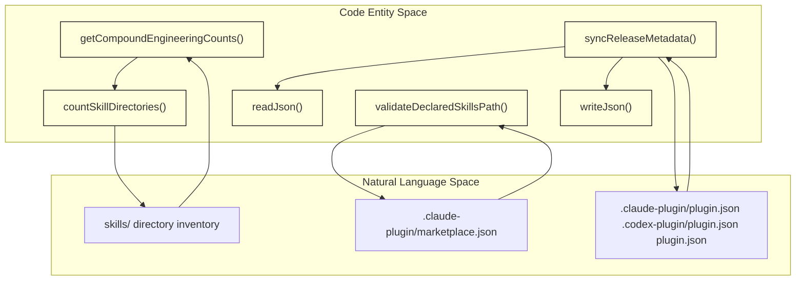
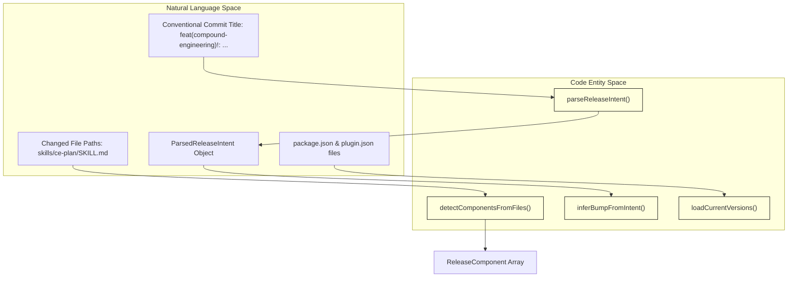
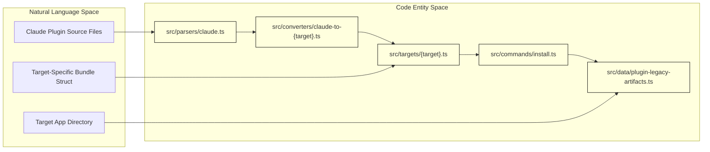

<!-- source: DeepWiki mcp.deepwiki.com · repo EveryInc/compound-engineering-plugin · page 11.1 Adding Components and Target Providers · fetched 2026-10-30 -->

# Adding Components and Target Providers

<details>
<summary>Relevant source files</summary>

The following files were used as context for generating this wiki page:

- [.claude-plugin/marketplace.json](.claude-plugin/marketplace.json)
- [.github/release-please-config.json](.github/release-please-config.json)
- [.github/workflows/release-pr.yml](.github/workflows/release-pr.yml)
- [.github/workflows/release-preview.yml](.github/workflows/release-preview.yml)
- [README.md](README.md)
- [docs/solutions/adding-converter-target-providers.md](docs/solutions/adding-converter-target-providers.md)
- [docs/solutions/workflow/manual-release-please-github-releases.md](docs/solutions/workflow/manual-release-please-github-releases.md)
- [scripts/release/validate.ts](scripts/release/validate.ts)
- [src/release/components.ts](src/release/components.ts)
- [src/release/config.ts](src/release/config.ts)
- [src/release/metadata.ts](src/release/metadata.ts)
- [src/release/types.ts](src/release/types.ts)
- [tests/release-components.test.ts](tests/release-components.test.ts)
- [tests/release-config.test.ts](tests/release-config.test.ts)
- [tests/release-metadata.test.ts](tests/release-metadata.test.ts)
- [tests/release-preview.test.ts](tests/release-preview.test.ts)

</details>


## Overview and Scope

This page defines the technical procedures and architectural checklists required to add new skills (components) to the `compound-engineering` plugin and to extend the cross-platform CLI tool with new target providers. The repository relies on a dual-release model spanning a native plugin surface (`skills/` and host manifests) and a Bun/TypeScript CLI tool (`src/`) that converts and distributes plugins across diverse agent environments [README.md:15-17](), [src/release/components.ts:10-41]().

Sources: [README.md:15-17](), [src/release/components.ts:10-41]()

---

## Component Location and Inventory Architecture

Skills reside as self-contained directories under the root `skills/` folder [src/release/metadata.ts:205-214](). Each skill directory contains a `SKILL.md` kernel and optional skill-local prompt assets or references [src/release/metadata.ts:176-192](). The release metadata synchronization system (`src/release/metadata.ts`) enforces inventory parity across host-specific manifests and marketplace catalogs.



**Diagram: Natural Language to Code Entity mapping for inventory counting and manifest synchronization [src/release/metadata.ts:176-255]().**

Sources: [src/release/metadata.ts:176-255]()

---

## Adding a Skill Checklist

When introducing a new skill (e.g., `ce-[skill-name]`), developers must execute a strict sequence of structural, documentation, and validation steps.

### Step-by-Step Checklist

| Step | Action | Code Entity / File Target |
| :--- | :--- | :--- |
| **1. Directory Creation** | Create the skill directory | `skills/ce-[skill-name]/` [src/release/metadata.ts:176-192]() |
| **2. Kernel Authoring** | Create `SKILL.md` with frontmatter and outcome spine | `skills/ce-[skill-name]/SKILL.md` |
| **3. Documentation** | Add user guide in guides directory | `docs/guides/ce-[skill-name].md` [tests/release-metadata.test.ts:223-228]() |
| **4. Inventory Update** | Register skill in README overview | `README.md` [tests/release-metadata.test.ts:228-231]() |
| **5. Metadata Validation** | Run metadata sync and validation checks | `bun run release:validate` [src/release/metadata.ts:252-255]() |

Sources: [src/release/metadata.ts:176-192](), [tests/release-metadata.test.ts:223-231](), [src/release/metadata.ts:252-255]()

---

## Release Automation and Versioning Constraints

The repository uses `release-please` with manifest mode (`.github/release-please-config.json`, `github/.release-please-manifest.json`) [src/release/components.ts:10-50](). File paths determine which components are bumped via `FILE_COMPONENT_MAP` [src/release/components.ts:17-41]().



**Diagram: Release Intent Parsing and Component Detection mapping [src/release/components.ts:78-126]().**

Sources: [src/release/components.ts:78-126](), [.github/release-please-config.json:1-53]()

---

## CLI Extension: The 6-Phase Target Provider Pattern

Adding a new platform target to the `compound-plugin` CLI requires implementing a structured set of modules [docs/solutions/adding-converter-target-providers.md:17-17]().



**Diagram: CLI Target Extension Pipeline and Module Data Flow [docs/solutions/adding-converter-target-providers.md:17-17]().**

Sources: [docs/solutions/adding-converter-target-providers.md:17-17]()

### Target Provider Implementation Phases

| Phase | Module / File Path | Responsibility |
| :--- | :--- | :--- |
| **1. Types** | `src/types/{target}.ts` | Define `{Target}Bundle` and component manifest structures. |
| **2. Converter** | `src/converters/claude-to-{target}.ts` | Transform `ClaudePlugin` into `{Target}Bundle` with name normalization. |
| **3. Writer** | `src/targets/{target}.ts` | Implement filesystem persistence and backup logic. |
| **4. CLI Wiring** | `src/commands/install.ts` | Register target in `install` and `--to` CLI routing logic. |
| **5. Cleanup** | `src/data/plugin-legacy-artifacts.ts` | Register legacy artifacts for the `cleanup` command. |
| **6. Testing** | `tests/{target}-writer.test.ts` | Write contract and conversion regression tests in Bun test suite. |

Sources: [docs/solutions/adding-converter-target-providers.md:17-33]()

---

## Testing Infrastructure and Validation

All additions must pass the automated validation and test suites before merging [tests/release-metadata.test.ts:212-221](). Developers should run the test runner via Bun:

```bash
bun run test
bun run release:validate
```

Sources: [.github/workflows/release-pr.yml:44-46](), [tests/release-metadata.test.ts:212-221]()

---

