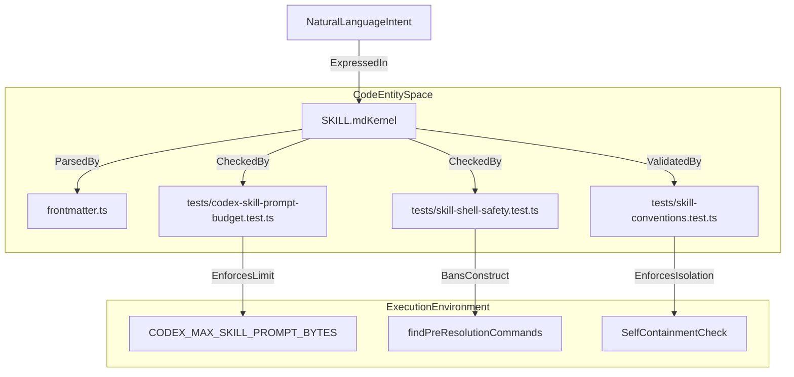
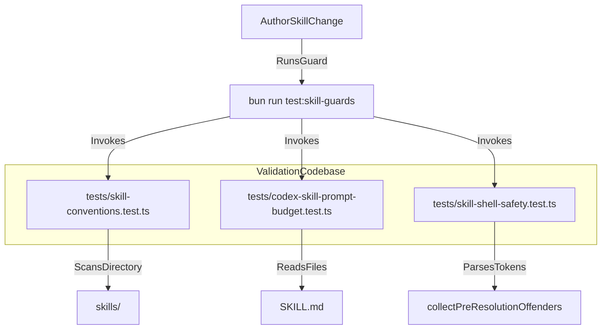

<!-- source: DeepWiki mcp.deepwiki.com · repo EveryInc/compound-engineering-plugin · page 11.2 Authoring Portable Skills · fetched 2026-10-30 -->

# Authoring Portable Skills

<details>
<summary>Relevant source files</summary>

The following files were used as context for generating this wiki page:

- [.agents/skills/ce-skill-work/SKILL.md](.agents/skills/ce-skill-work/SKILL.md)
- [.agents/skills/ce-skill-work/references/edit-skill.md](.agents/skills/ce-skill-work/references/edit-skill.md)
- [.agents/skills/ce-skill-work/references/evaluate.md](.agents/skills/ce-skill-work/references/evaluate.md)
- [.agents/skills/ce-skill-work/references/new-skill.md](.agents/skills/ce-skill-work/references/new-skill.md)
- [.agents/skills/ce-skill-work/references/respond-to-review.md](.agents/skills/ce-skill-work/references/respond-to-review.md)
- [.agents/skills/ce-skill-work/references/review-skill.md](.agents/skills/ce-skill-work/references/review-skill.md)
- [.cursor/BUGBOT.md](.cursor/BUGBOT.md)
- [AGENTS.md](AGENTS.md)
- [CLAUDE.md](CLAUDE.md)
- [CODING_STANDARDS.md](CODING_STANDARDS.md)
- [docs/plans/2026-08-06-001-fix-agent-plugins-manifest-conformance-plan.md](docs/plans/2026-08-06-001-fix-agent-plugins-manifest-conformance-plan.md)
- [docs/solutions/conventions/verify-externally-attributed-constraints-at-the-source.md](docs/solutions/conventions/verify-externally-attributed-constraints-at-the-source.md)
- [docs/solutions/integrations/agent-plugins-schema-is-a-host-routing-switch.md](docs/solutions/integrations/agent-plugins-schema-is-a-host-routing-switch.md)
- [docs/solutions/skill-design/portable-agent-skill-authoring.md](docs/solutions/skill-design/portable-agent-skill-authoring.md)
- [docs/solutions/skill-design/size-driven-skill-restructure.md](docs/solutions/skill-design/size-driven-skill-restructure.md)
- [docs/specs/agent-plugins.md](docs/specs/agent-plugins.md)
- [docs/specs/antigravity.md](docs/specs/antigravity.md)
- [docs/specs/cursor.md](docs/specs/cursor.md)
- [skills/CODING_STANDARDS.md](skills/CODING_STANDARDS.md)
- [src/commands/cleanup.ts](src/commands/cleanup.ts)
- [tests/CODING_STANDARDS.md](tests/CODING_STANDARDS.md)
- [tests/codex-skill-prompt-budget.test.ts](tests/codex-skill-prompt-budget.test.ts)
- [tests/docs-root-literals.test.ts](tests/docs-root-literals.test.ts)
- [tests/real-plugin-conversion.test.ts](tests/real-plugin-conversion.test.ts)
- [tests/repo-local-ce-skill-work.test.ts](tests/repo-local-ce-skill-work.test.ts)
- [tests/skill-conventions.test.ts](tests/skill-conventions.test.ts)
- [tests/skill-shell-safety.test.ts](tests/skill-shell-safety.test.ts)
- [tests/skills/task-visibility-contract.test.ts](tests/skills/task-visibility-contract.test.ts)
- [tests/skills/user-facing-skill-invocation-rendering.test.ts](tests/skills/user-facing-skill-invocation-rendering.test.ts)

</details>


This page details the principles and practices for authoring portable skills within the `compound-engineering` plugin (`https://github.com/EveryInc/compound-engineering-plugin`). It covers the `ce-skill-work` repo-local skill for managing skill development, the `portable-agent-skill-authoring` standard, considerations for host prompt budgets, `SKILL_DIR` anchors, shell safety, and self-containment rules derived from `AGENTS.md` and `CLAUDE.md`. The goal is to create skills that function reliably across various agent hosts and models.

Sources: [AGENTS.md:1-44](), [docs/solutions/skill-design/portable-agent-skill-authoring.md:1-83]()

## The `ce-skill-work` Repo-Local Skill

The `ce-skill-work` skill `[skills/ce-skill-work/SKILL.md:1-35]()` is a meta-skill designed to guide the authoring, editing, reviewing, and responding to feedback on other skills within the repository. It enforces the `portable-agent-skill-authoring` standard as a procedure.

The core philosophy of `ce-skill-work` is that skills are goals, not state machines `[skills/ce-skill-work/SKILL.md:7-8]()`. A skill provides the agent with the objective, the completion criteria, safe failure modes, and essential facts, then allows the agent to execute.

`ce-skill-work` operates in several modes:
- **New Skill**: Guides the creation of a skill from scratch `[.agents/skills/ce-skill-work/references/new-skill.md]()`.
- **Edit Skill**: Provides a framework for modifying an existing skill, emphasizing adherence to the standard and careful consideration of existing provenance `[.agents/skills/ce-skill-work/references/edit-skill.md:1-44]()`.
- **Review Skill**: Facilitates the review of skill changes, focusing on protocol, judgment, and cross-model behavior `[.agents/skills/ce-skill-work/references/review-skill.md]()`.
- **Respond to Review**: Helps address feedback on skills, ensuring changes align with the authoring standard `[.agents/skills/ce-skill-work/references/respond-to-review.md]()`.

The skill's outcome is that "the skill files you touch state their conditions rather than enumerate cases, carry nothing that does not change behavior, and put each mechanism at the layer that owns it; and the change is validated in the way its risk warrants" `[skills/ce-skill-work/SKILL.md:10]()`.

Key rules enforced by `ce-skill-work` across all modes include:
- **Conditions, not cases**: Avoid enumerating specific cases; instead, state the underlying condition `[skills/ce-skill-work/SKILL.md:24]()`.
- **Prescribe mechanisms only where owned**: Commands and state transitions belong to the skill that owns the mechanic `[skills/ce-skill-work/SKILL.md:25]()`.
- **Sediment first**: Before adding new content, remove what the standard dictates should not be there, checking for provenance (tests, `docs/solutions/` learnings, commit history) `[skills/ce-skill-work/SKILL.md:26]()`.
- **Every instruction must earn its cost**: A line earns its place by stating a falsifiable constraint, countering a demonstrated tendency, or supplying a non-derivable fact `[skills/ce-skill-work/SKILL.md:28]()`.
- **Sol-first portability**: For multi-model skills, prioritize the Sol (GPT-5.6) form when Fable (Claude) optimal brevity would compromise Sol-critical determinism `[skills/ce-skill-work/SKILL.md:34]()`.

Sources: [skills/ce-skill-work/SKILL.md:1-35](), [.agents/skills/ce-skill-work/references/edit-skill.md:1-44]()

## Portable Agent Skill Authoring Standard

The `docs/solutions/skill-design/portable-agent-skill-authoring.md` document is the canonical guide for authoring skills that must work across multiple models and agent harnesses. The core principle is to start with the outcome and intent, adding only the smallest protocol needed to protect that outcome across runtimes `[docs/solutions/skill-design/portable-agent-skill-authoring.md:28-31]`.

Skills are structured in layers, ordered by importance and necessity:

| Layer | What belongs there | When to include it |
|---|---|---|
| Outcome spine | Result or decision, next consumer, done condition, and non-obvious intent | Always first; a small skill may express it in one sentence |
| Hard protocol | Falsifiable scope, gates, state, evidence, coverage, authority, and failure behavior | Only when omission can produce a wrong path or unsafe action |
| Load-bearing workflow | Sequence whose order materially changes correctness | Only for invariant ordering |
| Useful context | Domain facts, schemas, examples, specialist payloads, and late routes | Conditionally, when it can change judgment |
| Adapters and techniques | Harness capability detection, verified tool adapters, path mechanics, and optional methods | As defaults or heuristics, never as the portable core |

Sources: [docs/solutions/skill-design/portable-agent-skill-authoring.md:36-45]()

### Outcome Spine and Hard Protocol

The **outcome spine** defines the primary goal and completion criteria of a skill. It is the minimal form of a skill. The **hard protocol** adds falsifiable rules, gates, and boundaries to protect the outcome from producing incorrect or unsafe actions `[docs/solutions/skill-design/portable-agent-skill-authoring.md:41]()`. This includes defining scope, state, evidence requirements, and failure behavior.

The standard emphasizes that every instruction must earn its cost `[docs/solutions/skill-design/portable-agent-skill-authoring.md:52-54]()`. Instructions should add falsifiable protocol, counter demonstrated model/harness tendencies, or supply domain knowledge that changes a decision. Vague quality language (e.g., "Be thorough", "Produce high-quality work") is discouraged in favor of observable rules `[docs/solutions/skill-design/portable-agent-skill-authoring.md:56-62]()`.

For multi-model skills, the standard prioritizes Sol-first and Fable-acceptable portability. This means that if Fable (Claude) guidance for brevity conflicts with Sol (GPT-5.6) guidance for preserving known-good commands or required report content, the Sol form is preferred `[docs/solutions/skill-design/portable-agent-skill-authoring.md:66-67]()`.

Sources: [docs/solutions/skill-design/portable-agent-skill-authoring.md:41-67]()

## Size-Driven Restructuring Under Host Prompt Budgets

Agent hosts impose various prompt budget limitations that necessitate careful skill design and restructuring.

### Codex's 8000-byte Prompt Bound
Codex versions >= 0.147 inject only the first 8000 bytes of each `SKILL.md` file `[tests/codex-skill-prompt-budget.test.ts:9-10]()`. This is a critical constraint, and skills exceeding this limit are truncated. The `tests/codex-skill-prompt-budget.test.ts` test ratchets down the `OVER_BUDGET` set, aiming to bring all skills under this limit `[tests/codex-skill-prompt-budget.test.ts:47-51]()`.

### Claude Code's 5000-token Compaction
Claude Code auto-compacts invoked skills, keeping only the first 5000 tokens of each, within a 25,000-token combined budget `[tests/codex-skill-prompt-budget.test.ts:23-25]()`. Both Codex's byte bound and Claude's token bound keep the start of the file, making body ordering load-bearing: put what must survive above what may be cut `[tests/codex-skill-prompt-budget.test.ts:34-35]()`.

### Restructuring Strategy
The procedure for restructuring large skills is detailed in `[.agents/skills/ce-skill-work/references/edit-skill.md]()` and `[docs/solutions/skill-design/size-driven-skill-restructure.md:1-73]()`. Key strategies include:
- **Extracting to References**: Move less critical or conditionally needed information into `references/` files. Agents reliably follow required reads named at the point of use `[docs/solutions/skill-design/size-driven-skill-restructure.md:50-51]()`.
- **Identifying the Floor**: Some skills have a minimum size due to shared blocks (e.g., `## Setup` context fence, `ce-docs-root` parity block) that are essential for safety and functionality `[docs/solutions/skill-design/size-driven-skill-restructure.md:64-67]()`.
- **No Compression of Wording**: When a body must get smaller, move coherent blocks to references or delete genuine redundancy; never compress wording to fit `[skills/ce-skill-work/SKILL.md:33]()`.

Sources: [tests/codex-skill-prompt-budget.test.ts:9-51](), [docs/solutions/skill-design/size-driven-skill-restructure.md:1-73](), [skills/ce-skill-work/SKILL.md:33]()

## SKILL_DIR Anchors, Shell Safety, and Self-Containment Rules

Skills must be self-contained and portable across different execution environments.

### SKILL_DIR Anchors
To reference bundled scripts or assets within a skill's directory, the `SKILL_DIR` anchor pattern is used. This typically involves a shell variable like `${CLAUDE_SKILL_DIR}` with a fallback to the current directory (`.`) to ensure compatibility across platforms `[tests/skill-conventions.test.ts:62-66]()`.

```bash
bash "${CLAUDE_SKILL_DIR:-.}/scripts/my-script.sh"
```
This ensures that the script `my-script.sh` located in the `scripts/` subdirectory of the skill is correctly invoked, regardless of how the skill is loaded by the host `[tests/skill-conventions.test.ts:62-67]()`.

### Shell Safety
The use of `!`cmd`` pre-resolution (where a command is executed at skill load time and its stdout inlined) is banned in this repository `[tests/skill-shell-safety.test.ts:6-10]()`. This construct is Claude-Code-only, inert on other platforms, and can abort skill loading if the command exits non-zero `[tests/skill-shell-safety.test.ts:11-18]()`.

Instead, context should be gathered at runtime using single, argv-style shell commands. The agent then interprets the exit status as control flow `[tests/skill-shell-safety.test.ts:27-32]`. Shell operators like `;`, `&&`, `||`, pipes, and parameter expansion are avoided in initial context gathering to maintain portability `[tests/skill-shell-safety.test.ts:20-25]()`.

### Self-Containment Rules
A skill must not reference files outside its own directory tree (e.g., no `../other-skill/script.sh`) `[tests/skill-conventions.test.ts:24-41]()`. This rule ensures that skills are independent and can be easily moved or distributed without breaking dependencies.

All local paths mentioned in a skill's markdown (links, backticks, `@`-includes) must exist within the skill's directory `[tests/skill-conventions.test.ts:49-60]()`. This is validated by the `tests/skill-conventions.test.ts` suite.

Sources: [tests/skill-conventions.test.ts:24-66](), [tests/skill-shell-safety.test.ts:6-32]()

## Bridging Natural Language to Code Entities

### Skill Component Mapping
This diagram illustrates how natural language intent translates into concrete repository code entities and mechanical validators.


Sources: [tests/skill-conventions.test.ts:1-113](), [tests/codex-skill-prompt-budget.test.ts:1-103](), [tests/skill-shell-safety.test.ts:1-146]()

### Skill Execution and Validation Flow
This diagram maps skill lifecycle validation and execution routes to their corresponding test modules and script paths.


Sources: [tests/skill-conventions.test.ts:1-113](), [tests/codex-skill-prompt-budget.test.ts:1-103](), [tests/skill-shell-safety.test.ts:1-146]()

## Compliance Checklist for Custom Skills

When creating a new skill, verify against these requirements:

| Category | Requirement | Source |
| :--- | :--- | :--- |
| **Naming** | Must start with `ce-` prefix | [tests/skill-conventions.test.ts:33-34]() |
| **Metadata** | Description <= 1024 chars, Name <= 64 chars | [tests/skill-conventions.test.ts:95-99]() |
| **Safety** | No `!`cmd`` load-time pre-resolution allowed | [tests/skill-shell-safety.test.ts:124-126]() |
| **Safety** | No shell operators (`;`, `&&`) in context-gathering commands | [tests/skill-shell-safety.test.ts:20-25]() |
| **Isolation** | No references to files outside the skill directory | [tests/skill-conventions.test.ts:23-24]() |
| **Anchoring** | Use `${CLAUDE_SKILL_DIR:-.}` for bundled scripts | [tests/skill-conventions.test.ts:62-66]() |
| **Handoff** | Use native skill-invocation tools for follow-on skills | [tests/skills/user-facing-skill-invocation-rendering.test.ts:161-164]() |
| **Budget** | `SKILL.md` body should ideally be <= 8000 bytes (Codex) | [tests/codex-skill-prompt-budget.test.ts:37]() |
| **Budget** | `SKILL.md` body ordering is load-bearing (start survives truncation) | [docs/solutions/skill-design/size-driven-skill-restructure.md:34-36]() |
| **Content** | State conditions, not enumerated cases | [skills/ce-skill-work/SKILL.md:24]() |
| **Content** | Every instruction must earn its cost (falsifiable, counters tendency, non-derivable fact) | [skills/ce-skill-work/SKILL.md:28]() |
| **Portability** | Sol-first portability for multi-model skills | [skills/ce-skill-work/SKILL.md:34]() |

Sources: [tests/skill-conventions.test.ts:23-99](), [tests/skill-shell-safety.test.ts:20-126](), [tests/codex-skill-prompt-budget.test.ts:37](), [docs/solutions/skill-design/size-driven-skill-restructure.md:34-36](), [skills/ce-skill-work/SKILL.md:24-34]()

---

