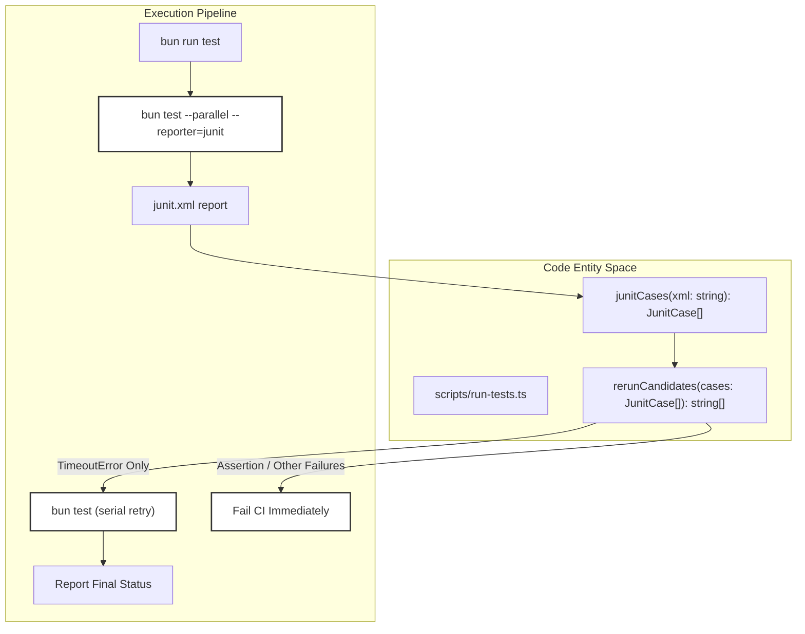

<!-- source: DeepWiki mcp.deepwiki.com · repo EveryInc/compound-engineering-plugin · page 11.3 Testing Infrastructure · fetched 2026-10-30 -->

# Testing Infrastructure

Relevant source files

The following files were used as context for generating this wiki page:

- [.github/workflows/ci.yml](.github/workflows/ci.yml)
- [docs/guides/ci.md](docs/guides/ci.md)
- [docs/plans/2026-08-06-001-fix-agent-plugins-manifest-conformance-plan.md](docs/plans/2026-08-06-001-fix-agent-plugins-manifest-conformance-plan.md)
- [docs/plans/2026-09-27-1745-fix-test-stall-watchdog-plan.md](docs/plans/2026-09-27-1745-fix-test-stall-watchdog-plan.md)
- [docs/plans/2026-10-28-1746-ci-linux-test-selection-plan.md](docs/plans/2026-10-28-1746-ci-linux-test-selection-plan.md)
- [docs/solutions/conventions/verify-externally-attributed-constraints-at-the-source.md](docs/solutions/conventions/verify-externally-attributed-constraints-at-the-source.md)
- [docs/solutions/integrations/agent-plugins-schema-is-a-host-routing-switch.md](docs/solutions/integrations/agent-plugins-schema-is-a-host-routing-switch.md)
- [docs/specs/agent-plugins.md](docs/specs/agent-plugins.md)
- [docs/specs/antigravity.md](docs/specs/antigravity.md)
- [scripts/ci-scope.ts](scripts/ci-scope.ts)
- [scripts/run-tests.ts](scripts/run-tests.ts)
- [scripts/test-scope.ts](scripts/test-scope.ts)
- [src/commands/cleanup.ts](src/commands/cleanup.ts)
- [tests/ci-scope.test.ts](tests/ci-scope.test.ts)
- [tests/codex-skill-prompt-budget.test.ts](tests/codex-skill-prompt-budget.test.ts)
- [tests/fixtures/peer-job-runner-windows-smoke.py](tests/fixtures/peer-job-runner-windows-smoke.py)
- [tests/helpers/process.ts](tests/helpers/process.ts)
- [tests/peer-job-runner-retry-gate.test.ts](tests/peer-job-runner-retry-gate.test.ts)
- [tests/real-plugin-conversion.test.ts](tests/real-plugin-conversion.test.ts)
- [tests/run-tests-script.test.ts](tests/run-tests-script.test.ts)
- [tests/skill-conventions.test.ts](tests/skill-conventions.test.ts)
- [tests/skills/ce-brainstorm-visual-probe-server.test.ts](tests/skills/ce-brainstorm-visual-probe-server.test.ts)
- [tests/skills/ce-work-unit-workspace-transport.test.ts](tests/skills/ce-work-unit-workspace-transport.test.ts)
- [tests/skills/ce-work-unit-workspace-verification.test.ts](tests/skills/ce-work-unit-workspace-verification.test.ts)
- [tests/skills/helpers/ce-work-workspace-harness.test.ts](tests/skills/helpers/ce-work-workspace-harness.test.ts)
- [tests/skills/helpers/ce-work-workspace-harness.ts](tests/skills/helpers/ce-work-workspace-harness.ts)
- [tests/skills/helpers/run-in-group.py](tests/skills/helpers/run-in-group.py)
- [tests/skills/task-visibility-contract.test.ts](tests/skills/task-visibility-contract.test.ts)
- [tests/skills/user-facing-skill-invocation-rendering.test.ts](tests/skills/user-facing-skill-invocation-rendering.test.ts)
- [tests/test-scope.test.ts](tests/test-scope.test.ts)

## Purpose and Scope

The `compound-engineering-plugin` repository employs a multi-layered testing infrastructure to ensure the correctness of its skills, the fidelity of its CLI distribution converters, and the integrity of its release metadata. The test suite spans contract tests for individual skills, automated prompt-budget enforcement, scratch-root isolation checks, cross-platform process supervision smoke tests, and a robust parallel test runner designed to mitigate flaky worker exits.

Sources: [.github/workflows/ci.yml:1-183](), [tests/codex-skill-prompt-budget.test.ts:1-55](), [tests/skill-conventions.test.ts:1-25]()

---

## Test Suite Structure

The verification logic is consolidated under the `tests/` directory and executed via the Bun test runner [.github/workflows/ci.yml:105](). 

| Category | Description | Key Files |
| :--- | :--- | :--- |
| **Skill Contracts** | Asserts structural requirements, shell safety, and execution boundaries in `SKILL.md`. | `tests/skill-shell-safety.test.ts`, `tests/scratch-root-contract.test.ts` |
| **Conventions & Budgets** | Enforces repo naming rules, file reference integrity, and host prompt-size limits. | `tests/skill-conventions.test.ts`, `tests/codex-skill-prompt-budget.test.ts` |
| **Cross-Platform Primitives** | Verifies POSIX and native Windows process supervision, file locking, and signal handling. | `tests/fixtures/peer-job-runner-windows-smoke.py`, `tests/skills/helpers/ce-work-workspace-harness.test.ts` |
| **CLI & Conversion** | Validates plugin converters, target registries, and manifest schema compliance. | `tests/real-plugin-conversion.test.ts` |
| **Parallel Runner** | Orchestrates parallel execution and intelligent JUnit-based serial re-runs for lost child exits. | `scripts/run-tests.ts`, `tests/run-tests-script.test.ts` |

Sources: [.github/workflows/ci.yml:157-178](), [tests/codex-skill-prompt-budget.test.ts:76-103](), [tests/skill-conventions.test.ts:1-50](), [scripts/run-tests.ts:1-20]()

---

## Skill Contracts, Conventions, and Prompt Budgets

Because the core logic of the plugin is expressed in Markdown prose, the test suite relies heavily on automated static checks and contract tests to prevent regressions.

- **Prompt Budgets**: `tests/codex-skill-prompt-budget.test.ts` enforces that skill prompts stay within host limitations (such as Codex's 8,000-byte prompt bound) and maintains a shrink-only ratchet for over-budget exceptions [tests/codex-skill-prompt-budget.test.ts:37-51]().
- **Skill Conventions**: `tests/skill-conventions.test.ts` checks self-containment, reference integrity (ensuring referenced scripts and markdown references actually exist inside the skill directory), and frontmatter limits [tests/skill-conventions.test.ts:24-110]().
- **Scratch-Root Security**: `tests/scratch-root-contract.test.ts` verifies that skills establish secure UID-scoped scratch directories (`SCRATCH_ROOT`) and enforce safe `umask` defaults.

Sources: [tests/codex-skill-prompt-budget.test.ts:1-103](), [tests/skill-conventions.test.ts:1-110]()

---

## Cross-Platform Verification

Specialized tests and fixtures handle differences between POSIX environments and native Windows (Git Bash). For example, `tests/fixtures/peer-job-runner-windows-smoke.py` exercises Job Object process trees, orphan teardowns, and file-locking primitives directly against Win32 APIs [tests/fixtures/peer-job-runner-windows-smoke.py:1-40](). Shell primitives are required to be executed rather than merely shape-checked in CI to ensure compatibility across execution backends [tests/skills/helpers/ce-work-workspace-harness.test.ts:47-88]().

Sources: [tests/fixtures/peer-job-runner-windows-smoke.py:1-75](), [tests/skills/helpers/ce-work-workspace-harness.test.ts:45-126]()

---

## Parallel Test Runner (`scripts/run-tests.ts`)

To work around known issues where Bun test workers occasionally lose child process exit or pipe notifications (`TimeoutError`-only failures on healthy tasks), the test runner implements a two-pass strategy [scripts/run-tests.ts:1-10]().

### Execution Flow
1. **First Pass**: Executes all tests in parallel, generating a JUnit XML report [scripts/run-tests.ts:31-61]().
2. **Analysis**: Inspects failures using `junitCases()` and `rerunCandidates()` [scripts/run-tests.ts:31-103](). If any failures are exclusively `TimeoutError`, their enclosing files are flagged for retry [scripts/run-tests.ts:97-103]().
3. **Serial Re-run**: Re-runs flagged files serially in a fresh Bun process to confirm outcomes without masking real assertion errors [scripts/run-tests.ts:1-10]().

Diagram: Test Runner Architecture

Sources: [scripts/run-tests.ts:1-120](), [tests/run-tests-script.test.ts:1-48]()

---

## Skill-Eval Cell Harness

For detailed scenario-based testing, grading, path-shimming, and reproducible skill interactions, the repository uses a dedicated evaluation framework located under `tests/skill-eval-cell/`. 

For details on Scenario and Grade types, SCENARIOS catalogs, pack/run mechanics, calibration corpora, and grading hosts, see [Skill-Eval Cell Harness](#11.3.1).

Sources: [tests/skill-conventions.test.ts:1-10]()

---

