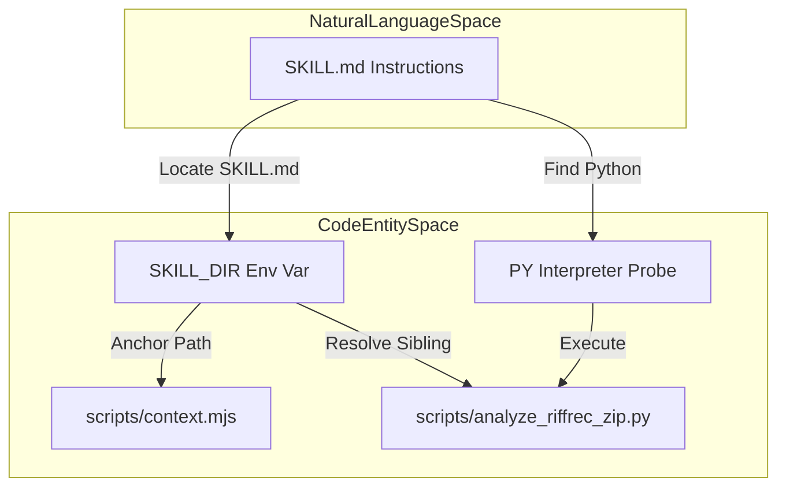
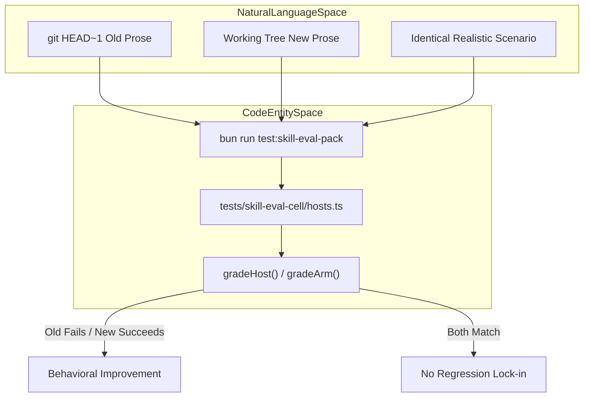
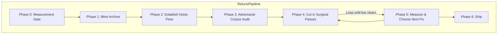

<!-- source: DeepWiki mcp.deepwiki.com · repo EveryInc/compound-engineering-plugin · page 11.4 Skill Design Patterns and ce-retune · fetched 2026-10-30 -->

# Skill Design Patterns and ce-retune

<details>
<summary>Relevant source files</summary>

The following files were used as context for generating this wiki page:

- [docs/guides/ce-retune.md](docs/guides/ce-retune.md)
- [docs/solutions/architecture-patterns/posix-process-supervision-on-native-windows.md](docs/solutions/architecture-patterns/posix-process-supervision-on-native-windows.md)
- [docs/solutions/conventions/shell-primitives-must-be-executed-not-shape-checked.md](docs/solutions/conventions/shell-primitives-must-be-executed-not-shape-checked.md)
- [docs/solutions/integrations/native-plugin-install-strategy.md](docs/solutions/integrations/native-plugin-install-strategy.md)
- [docs/solutions/skill-design/paired-old-vs-new-injection-skill-evals.md](docs/solutions/skill-design/paired-old-vs-new-injection-skill-evals.md)
- [docs/solutions/skill-design/pass-paths-not-content-to-subagents.md](docs/solutions/skill-design/pass-paths-not-content-to-subagents.md)
- [docs/solutions/skill-design/post-menu-routing-belongs-inline.md](docs/solutions/skill-design/post-menu-routing-belongs-inline.md)
- [docs/solutions/workflow/stale-local-base-contamination.md](docs/solutions/workflow/stale-local-base-contamination.md)
- [skills/ce-retune/SKILL.md](skills/ce-retune/SKILL.md)
- [skills/ce-retune/references/baseline-mining.md](skills/ce-retune/references/baseline-mining.md)
- [skills/ce-retune/references/corpus-audit.md](skills/ce-retune/references/corpus-audit.md)
- [skills/ce-retune/references/cut-passes.md](skills/ce-retune/references/cut-passes.md)
- [skills/ce-retune/references/halt-taxonomy.md](skills/ce-retune/references/halt-taxonomy.md)
- [skills/ce-retune/references/noise-floor.md](skills/ce-retune/references/noise-floor.md)
- [skills/ce-retune/references/workflow-shapes.md](skills/ce-retune/references/workflow-shapes.md)
- [tests/skill-eval-cell/packs/ce-ideate-run-scaling/collect.ts](tests/skill-eval-cell/packs/ce-ideate-run-scaling/collect.ts)

</details>


This page documents the core design patterns and best practices for developing skills within the `compound-engineering-plugin`. These patterns ensure skills are robust, portable across different agent harnesses (Claude Code, Cursor, Codex), and maintain high quality through systematic evaluation and modernization methodologies.

## Script-First Architecture

Skills in this repository follow a **script-first architecture**. Instead of embedding complex logic directly into the `SKILL.md` prompt, logic is moved into standalone scripts (Python, Bash, or Node.js). The prompt's role is reduced to orchestration: gathering arguments, setting environment variables, and invoking the scripts.

**Key Benefits:**
- **Testability:** Scripts can be unit-tested independently of the LLM.
- **Portability:** The same logic runs identically across different platforms.
- **Reliability:** LLMs are prone to hallucinating complex multi-step shell logic; scripts provide a deterministic execution path.

**Implementation Pattern:**
1. Identify a multi-step or complex logic block.
2. Move the logic to a script within the skill's `scripts/` directory.
3. In `SKILL.md`, use a simple shell block to invoke the script [skills/ce-compound-refresh/SKILL.md:15-23]().

Sources: [skills/ce-compound-refresh/SKILL.md:11-23](), [docs/solutions/skill-design/bundled-script-path-resolution-across-harnesses.md:28-35]()

## Bundled Script Path Resolution

A challenge with script-first architecture is that different harnesses mount or resolve plugin directories differently. The plugin uses a tiered model to ensure scripts and assets resolve correctly [docs/solutions/skill-design/bundled-script-path-resolution-across-harnesses.md:38-52]().

### The Tiered Resolution Model
1. **Tier 1 (Read-time):** Bare relative paths (e.g., `references/schema.yaml`) for files the agent reads into its context [docs/solutions/skill-design/bundled-script-path-resolution-across-harnesses.md:40-44]().
2. **Tier 2 (Prose Pointers):** Bare relative path plus an explicit "from this skill's directory" cue for files the agent acts on but does not execute [docs/solutions/skill-design/bundled-script-path-resolution-across-harnesses.md:46-50]().
3. **Tier 3 (Executed Shell):** The model-filled `SKILL_DIR` anchor pattern [docs/solutions/skill-design/bundled-script-path-resolution-across-harnesses.md:52]().

**Resolution Logic:**
Skills determine their own absolute path at runtime by looking for the directory containing the `SKILL.md` currently being read. This path is then exported as `SKILL_DIR` for all subsequent script calls [skills/ce-compound-refresh/SKILL.md:16-19]().

### Python Interpreter Probing
To support native Windows environments where `python3` may be a Microsoft Store stub, skills must probe for a working interpreter rather than hardcoding a name [docs/solutions/conventions/resolve-python-interpreter-not-python3.md:17-55]().

```bash
PY="$(for c in python3 python py; do command -v "$c" >/dev/null 2>&1 && "$c" -c '' >/dev/null 2>&1 && { echo "$c"; break; }; done)"; [ -n "$PY" ] || { echo "no working Python 3 interpreter on PATH" >&2; exit 1; };
"$PY" "$SKILL_DIR/scripts/..."
```
Sources: [docs/solutions/conventions/resolve-python-interpreter-not-python3.md:53-55](), [skills/ce-retune/SKILL.md:24-29](), [skills/ce-sweep/references/agents/media-analyzer.md:18-21]()

### Diagram: Script Path and Interpreter Resolution Flow (Natural Language to Code Entity Space)


Sources: [skills/ce-compound-refresh/SKILL.md:15-23](), [docs/solutions/conventions/resolve-python-interpreter-not-python3.md:109-115](), [skills/ce-sweep/references/agents/media-analyzer.md:15-21]()

## Post-Menu Routing Inline

When a skill presents a menu to the user and expects a selection to trigger a subsequent action, the routing logic for that action must be present in the `SKILL.md` body itself, or in a reference file explicitly named as a **required read at the step** that states **what only it carries** [docs/solutions/skill-design/post-menu-routing-belongs-inline.md:29-30]().

**Problem:** If routing is only in a casually mentioned reference, the agent may render the menu, capture the selection, and then stop, acknowledging the next action in prose instead of invoking the skill [docs/solutions/skill-design/post-menu-routing-belongs-inline.md:26](). This happens because references load on demand, and an agent that renders past a "load now" line might not have the routing in its context.

**Solution:**
- **Inline Routing:** For simple menu-driven actions, the routing (e.g., `Call /ce-work with the plan path`) should be directly in `SKILL.md`.
- **Required-Read Pointer:** If the routing is complex and warrants a separate file, the `SKILL.md` must explicitly instruct the agent to "STOP. Read `references/plan-handoff.md`" [docs/solutions/skill-design/post-menu-routing-belongs-inline.md:30](). This ensures the reference is loaded before the agent attempts to act on the selection.
- **Platform-Explicit Routing:** The routing line must name the skill-invocation primitive and the argument shape, explicitly stating not to merely tell the user to type it [docs/solutions/skill-design/post-menu-routing-belongs-inline.md:32-33]().

**Measurements:**
- An experiment with `ce-debug` showed that extracting post-fix tail routing to a reference with a paraphrasing stub resulted in 0/5 successful invocations of `ce-commit-push-pr` with `branding:on`, compared to 3/3 when inline [docs/solutions/skill-design/post-menu-routing-belongs-inline.md:44-48]().
- A `ce-explain` experiment demonstrated that a pointer explicitly naming what only the reference carries achieved 48/48 successful invocations, with all references opened [docs/solutions/skill-design/post-menu-routing-belongs-inline.md:53-58]().

Sources: [docs/solutions/skill-design/post-menu-routing-belongs-inline.md:1-68]()

## Detector Ranking

When a skill needs to detect specific conditions or flags from user input, it should reason over the user's prompt directly rather than relying on `$ARGUMENTS` substitution tokens.

**Problem:** The `$ARGUMENTS` token is reliably substituted inside `SKILL.md` bodies only on Claude Code. Other platforms (Codex, Cursor, Kiro) either do not support it or have inconsistent behavior [docs/solutions/skill-design/arguments-token-is-claude-only-in-skill-bodies.md:31-32](). Relying on it can lead to silent failures where flags are missed, and the skill falls back to defaults [docs/solutions/skill-design/arguments-token-is-claude-only-in-skill-bodies.md:49]().

**Solution:**
- **Reason over the user's prompt:** For flag detection (e.g., `output:`, `mode:`), instruct the agent to scan the user's prompt for the intent, honoring both shorthand tokens and plain language [docs/solutions/skill-design/arguments-token-is-claude-only-in-skill-bodies.md:40-41]().
- **Input Binding:** For input injection, bind the input in prose as "the input this skill was invoked with, present in the current prompt or conversation" [docs/solutions/skill-design/arguments-token-is-claude-only-in-skill-bodies.md:41-42]().
- **Avoid "user's request" for binding:** Binding to "the user's request" can cause pipeline-delegated skills to ignore the caller's payload and parse an empty input [docs/solutions/skill-design/arguments-token-is-claude-only-in-skill-bodies.md:44-45]().

Sources: [docs/solutions/skill-design/arguments-token-is-claude-only-in-skill-bodies.md:1-54]()

## Rendering Floors

Rendering floors define the minimum acceptable output quality or completeness for a skill. For example, `ce-doc-review` has a rendering floor that ensures a bulk preview is always generated, even if the model struggles with deeper analysis [skills/ce-doc-review/references/decision-primer.md:1-10](). This prevents the skill from failing silently or producing an empty result.

**Example: `ce-doc-review`'s Rendering Floor**
- The skill must always produce a bulk preview of the document, regardless of whether it can perform a full review [skills/ce-doc-review/references/decision-primer.md:1-10]().
- This ensures that even if deeper analysis fails, the user still receives a useful artifact.

Sources: [skills/ce-doc-review/references/decision-primer.md:1-10]()

## Paired Old/New Injection Evals

To rigorously prove that a skill's prose change actually moved behavior (rather than being a no-op or introducing regressions), the plugin uses **paired old-vs-new blind injection** evaluations [docs/solutions/skill-design/paired-old-vs-new-injection-skill-evals.md:39-40]().

**Methodology:**
1. **Extract Real Excerpts:** Use `git HEAD~1` for the pre-change prose and the working tree for the post-change prose. Do not paraphrase [docs/solutions/skill-design/paired-old-vs-new-injection-skill-evals.md:50-51]().
2. **Blind Dispatch:** Dispatch two subagents, one with each version, both blind to which version they hold and to the expected answer. Provide an identical, realistic scenario [docs/solutions/skill-design/paired-old-vs-new-injection-skill-evals.md:51-53]().
3. **Concrete Decisions + Artifacts:** Each subagent must return a concrete decision plus an artifact, not an opinion [docs/solutions/skill-design/paired-old-vs-new-injection-skill-evals.md:53-54]().
4. **Compare Outcomes:**
   - If both produce the same correct decision: **no-regression only** [docs/solutions/skill-design/paired-old-vs-new-injection-skill-evals.md:55]().
   - If old fails and new succeeds: **improvement** [docs/solutions/skill-design/paired-old-vs-new-injection-skill-evals.md:56]().
5. **New-Only Restraint Negatives:** Ensure that a plain case with no triggering condition does *not* emit the new field or note [docs/solutions/skill-design/paired-old-vs-new-injection-skill-evals.md:58]().
6. **Standardize Field Names:** When skill outputs are consumed by other skills, standardize the field `NAME` [docs/solutions/skill-design/paired-old-vs-new-injection-skill-evals.md:63-65]().
7. **Prove Parity Test Failure:** Create parity tests that cross-check shared facts maps between producer and consumer skills, and intentionally test one-sided drift [docs/solutions/skill-design/paired-old-vs-new-injection-skill-evals.md:67-68]().
8. **Seal the Injection:** Prevent leaks where the agent finds the answer from sources other than the prose under test [docs/solutions/skill-design/paired-old-vs-new-injection-skill-evals.md:83-84]().

Sources: [docs/solutions/skill-design/paired-old-vs-new-injection-skill-evals.md:39-89]()

### Diagram: Paired Old/New Injection Evaluation Flow (Natural Language to Code Entity Space)


Sources: [docs/solutions/skill-design/paired-old-vs-new-injection-skill-evals.md:39-89](), [tests/skill-eval-cell/packs/ce-ideate-run-scaling/collect.ts:1-25]()

## `ce-retune`: Measurement-First Corpus Retuning

The `ce-retune` skill provides a systematic, measurement-first approach to updating a skill corpus for new models [skills/ce-retune/SKILL.md:8-14](). It ensures that changes are attributable and that the corpus's measured behavior clears a pre-registered bar.

### `ce-retune` Phases

The `ce-retune` workflow consists of sequential phases, each with a specific goal and orchestration shape [skills/ce-retune/SKILL.md:31-40]().

#### Phase 0: The Measurement Gate
Before any changes, `ce-retune` verifies the existence of measurement infrastructure:
1. **Run Archive/Harness:** A system producing per-run logs with tool-call traces, token counts, and final messages [skills/ce-retune/SKILL.md:20-22]().
2. **Build Selector:** The harness can point to specific source checkouts for A/B comparison [skills/ce-retune/SKILL.md:23-24]().
3. **Repeatable Task:** A task the corpus executes end-to-end [skills/ce-retune/SKILL.md:25]().

Sources: [skills/ce-retune/SKILL.md:19-29]()

#### Phase 1: Mine the Archive (Baseline Mining)
Extracts data from historical runs without incurring model costs [skills/ce-retune/references/baseline-mining.md:3-4](). Classifies runs into categories like `broken`, `complete`, `done-but-thin`, and `bail-early` [skills/ce-retune/references/baseline-mining.md:61-71]().

Sources: [skills/ce-retune/references/baseline-mining.md:1-87]()

#### Phase 2: Establish the Noise Floor
Runs the harness against **two identical copies** of the corpus to quantify inherent run-to-run variance [skills/ce-retune/references/noise-floor.md:1-3](). A performance bar is registered *in writing* before any changes are made [skills/ce-retune/SKILL.md:36-37]().

Sources: [skills/ce-retune/references/noise-floor.md:1-3](), [skills/ce-retune/SKILL.md:35-37]()

#### Phase 3: Adversarial Corpus Audit
Identifies potential cuts and regressions through a two-wave adversarial process (Proposers and Defenders) [skills/ce-retune/references/corpus-audit.md:1-24](). Defenders must cite project learnings, test suites, or git history for any kept lines [skills/ce-retune/references/corpus-audit.md:68-87]().

Sources: [skills/ce-retune/references/corpus-audit.md:1-87]()

#### Phase 4: Cut in Surgical Passes
Edits are applied in focused, surgical passes, one problem class at a time, ensuring disjoint file ownership to avoid edit collisions [skills/ce-retune/references/cut-passes.md:1-26]().

Sources: [skills/ce-retune/references/cut-passes.md:1-94]()

### Diagram: `ce-retune` Workflow


Sources: [skills/ce-retune/SKILL.md:1-40](), [skills/ce-retune/references/baseline-mining.md:1-87](), [skills/ce-retune/references/noise-floor.md:1-3](), [skills/ce-retune/references/corpus-audit.md:1-87](), [skills/ce-retune/references/cut-passes.md:1-94]()

---

