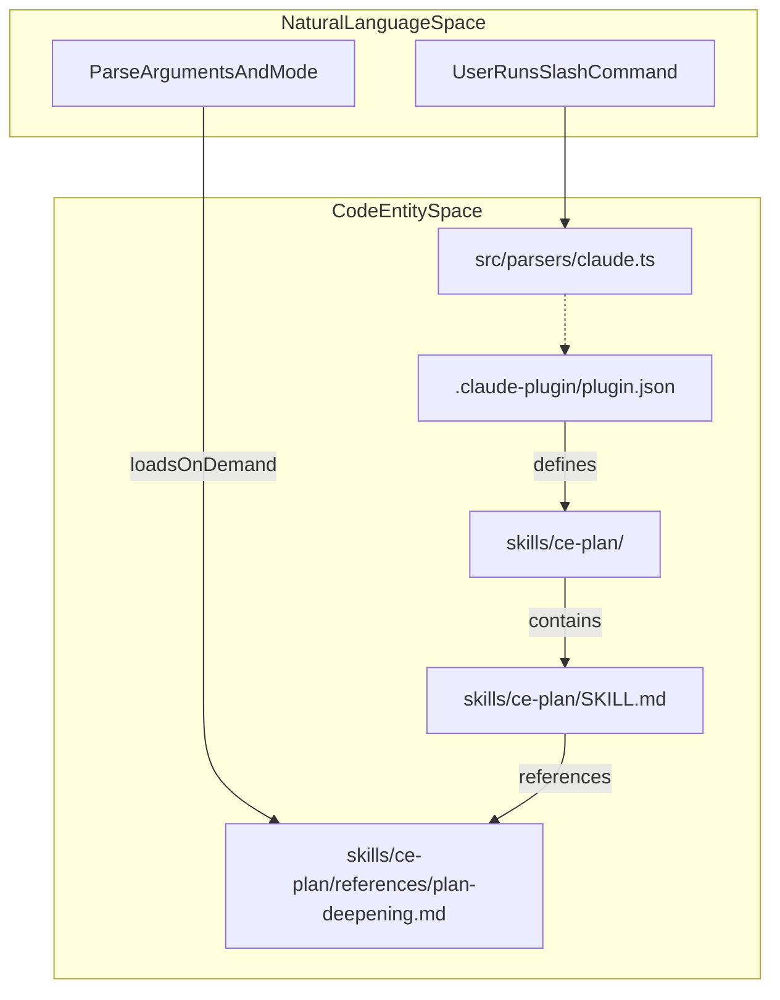
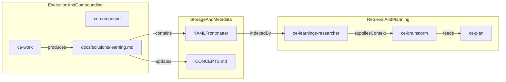

<!-- source: DeepWiki mcp.deepwiki.com · repo EveryInc/compound-engineering-plugin · page 12 Glossary · fetched 2026-10-30 -->

# Glossary

Relevant source files

The following files were used as context for generating this wiki page:

- [.agents/skills/ce-skill-work/SKILL.md](.agents/skills/ce-skill-work/SKILL.md)
- [.agents/skills/ce-skill-work/references/edit-skill.md](.agents/skills/ce-skill-work/references/edit-skill.md)
- [.agents/skills/ce-skill-work/references/evaluate.md](.agents/skills/ce-skill-work/references/evaluate.md)
- [.agents/skills/ce-skill-work/references/new-skill.md](.agents/skills/ce-skill-work/references/new-skill.md)
- [.agents/skills/ce-skill-work/references/respond-to-review.md](.agents/skills/ce-skill-work/references/respond-to-review.md)
- [.agents/skills/ce-skill-work/references/review-skill.md](.agents/skills/ce-skill-work/references/review-skill.md)
- [.claude-plugin/marketplace.json](.claude-plugin/marketplace.json)
- [.github/release-please-config.json](.github/release-please-config.json)
- [AGENTS.md](AGENTS.md)
- [CLAUDE.md](CLAUDE.md)
- [CONCEPTS.md](CONCEPTS.md)
- [README.md](README.md)
- [docs/solutions/skill-design/portable-agent-skill-authoring.md](docs/solutions/skill-design/portable-agent-skill-authoring.md)
- [docs/solutions/skill-design/right-size-plans-by-subtraction-and-a-usage-first-sizing-test.md](docs/solutions/skill-design/right-size-plans-by-subtraction-and-a-usage-first-sizing-test.md)
- [docs/solutions/skill-design/size-driven-skill-restructure.md](docs/solutions/skill-design/size-driven-skill-restructure.md)
- [docs/specs/cursor.md](docs/specs/cursor.md)
- [skills/ce-work/references/agents/implementation-worker.md](skills/ce-work/references/agents/implementation-worker.md)
- [skills/ce-work/references/cross-model-execution.md](skills/ce-work/references/cross-model-execution.md)
- [skills/ce-work/references/execution-strategy.md](skills/ce-work/references/execution-strategy.md)
- [skills/ce-work/references/implementation-loop.md](skills/ce-work/references/implementation-loop.md)
- [skills/ce-work/references/work-intake.md](skills/ce-work/references/work-intake.md)
- [skills/ce-work/scripts/unit_workspace_state.py](skills/ce-work/scripts/unit_workspace_state.py)
- [src/release/components.ts](src/release/components.ts)
- [src/release/metadata.ts](src/release/metadata.ts)
- [src/release/types.ts](src/release/types.ts)
- [tests/release-components.test.ts](tests/release-components.test.ts)
- [tests/release-metadata.test.ts](tests/release-metadata.test.ts)
- [tests/release-preview.test.ts](tests/release-preview.test.ts)
- [tests/skill-eval-cell/packs/ce-work-sizing.md](tests/skill-eval-cell/packs/ce-work-sizing.md)
- [tests/skills/ce-work-outcome-spine.test.ts](tests/skills/ce-work-outcome-spine.test.ts)
- [tests/skills/ce-work-unit-workspace-init.test.ts](tests/skills/ce-work-unit-workspace-init.test.ts)

This page defines codebase-specific terms, domain vocabulary, named processes, and architectural concepts used within the `compound-engineering-plugin` repository. It serves as an onboarding reference, mapping natural language concepts to their concrete code entities, schemas, and implementation files.

Sources: [CONCEPTS.md:1-4]()

---

## Core Concepts & Vocabulary

### Skill
A user-invoked capability defined in its own directory, serving as the primary entry point a user reaches for. A Skill orchestrates workflows by progressively pulling in reference files and dispatching generic subagents seeded with specialist prompt assets. [CONCEPTS.md:10-14]()
- **Code Pointer:** Defined in directories under `skills/`, with authoritative behavior governed by `SKILL.md` [AGENTS.md:9-10]().

### Reference
A file containing additional context, instructions, schemas, or data that a Skill can dynamically load during its execution. References are stored in `references/` subdirectories within each skill to manage token consumption. [skills/ce-code-review/SKILL.md:23-33]()
- **Code Pointer:** `skills/ce-code-review/references/` [skills/ce-code-review/SKILL.md:23-33]()

### Outcome Spine
The core sequence of steps or decisions a Skill follows to achieve its objective. It defines the result or decision, the next consumer, the done condition, and non-obvious intent. It represents the first and most critical layer of portable agent skill authoring. [docs/solutions/skill-design/portable-agent-skill-authoring.md:39-40]()
- **Code Pointer:** `docs/solutions/skill-design/portable-agent-skill-authoring.md:39-40` [docs/solutions/skill-design/portable-agent-skill-authoring.md:39-40]()

### Hard Protocol
Falsifiable rules, gates, state management, evidence requirements, coverage definitions, authority boundaries, and failure behaviors that protect a Skill's outcome across different runtimes. Included only when omission can lead to incorrect paths or unsafe actions. [docs/solutions/skill-design/portable-agent-skill-authoring.md:41-42]()
- **Code Pointer:** `docs/solutions/skill-design/portable-agent-skill-authoring.md:41-42` [docs/solutions/skill-design/portable-agent-skill-authoring.md:41-42]()

### Host Prompt Budget
The token or byte limit imposed by the agent host for a skill's prompt. Skills are designed to stay within these budgets by offloading detailed instructions into references loaded dynamically. [tests/review-skill-contract.test.ts:154-158]()
- **Code Pointer:** `tests/review-skill-contract.test.ts:154-158` [tests/review-skill-contract.test.ts:154-158]()

### Phase-Loaded Kernel
The core `SKILL.md` file of a skill, which is always loaded at invocation time but kept concise. It contains the outcome spine and hard protocol, dynamically loading additional phases or references as needed. [skills/ce-code-review/SKILL.md:23-33]()
- **Code Pointer:** `skills/ce-code-review/SKILL.md:23-33` [skills/ce-code-review/SKILL.md:23-33]()

### Render Floor
A minimum threshold or standard for the quality, formatting, and completeness of output that a skill must meet before presenting results to the user. [skills/ce-code-review/references/dispatch-reviewers.md:5-9]()
- **Code Pointer:** `skills/ce-code-review/references/dispatch-reviewers.md:5-9` [skills/ce-code-review/references/dispatch-reviewers.md:5-9]()

### Case Accretion
The iterative process by which the system accumulates and integrates new learnings, patterns, and solutions over time, making the toolset smarter with every use. [CONCEPTS.md:48-50]()
- **Code Pointer:** `CONCEPTS.md:48-50` [CONCEPTS.md:48-50]()

### U-ID
A unique identifier (e.g., `U1`, `U2`) assigned to discrete units of work or review findings, used for tracking, referencing, and stable numbering across workflow stages. [CONCEPTS.md:86-88]()
- **Code Pointer:** `CONCEPTS.md:86-88` [CONCEPTS.md:86-88]()

### Unified Plan Artifact
A single, evolving document that captures requirements and implementation details, growing from initial brainstorming into a detailed execution plan. Ensures continuity across `ce-brainstorm` and `ce-plan`. [README.md:119-120]()
- **Code Pointer:** `README.md:119-120` [README.md:119-120]()

### Confidence Anchor
A discrete, self-scored confidence value tied to behavioral criteria used to gate and rank review findings and verify assertions. [CONCEPTS.md:79-81]()
- **Code Pointer:** `CONCEPTS.md:79-81` [CONCEPTS.md:79-81]()

### Quote-the-Line Gate
A mechanism in review skills (such as `ce-code-review`) requiring a finding to be directly supported by a verbatim quote from the code or document under review. Findings lacking usable quotes are suppressed. [skills/ce-code-review/references/finish-review.md:21-25]()
- **Code Pointer:** `skills/ce-code-review/references/finish-review.md:21-25` [skills/ce-code-review/references/finish-review.md:21-25]()

### Action Class
A classification of a review finding by its recommended action or severity (e.g., `gated_auto`, `manual`, `advisory`), guiding automated routing and prioritization. [CONCEPTS.md:82-84]()
- **Code Pointer:** `CONCEPTS.md:82-84` [CONCEPTS.md:82-84]()

### Ownership Class
A classification used in review and execution workflows to determine responsibility for addressing a finding or component across repositories and subteams.
- **Code Pointer:** `CONCEPTS.md:82-85` [CONCEPTS.md:82-85]()

### Fast-Pass
An initial, rapid first-principles scan performed by an orchestrator immediately before dispatching foreground agents or reviewers to surface obvious high-signal items. [skills/ce-code-review/references/dispatch-reviewers.md:3-10]()
- **Code Pointer:** `skills/ce-code-review/references/dispatch-reviewers.md:3-10` [skills/ce-code-review/references/dispatch-reviewers.md:3-10]()

### Residual Work Gate
A checkpoint in autonomous or non-interactive shipping pipelines that defers unresolvable issues or remaining tasks to a durable ledger for human review.
- **Code Pointer:** `skills/ce-work/SKILL.md:40-60` [skills/ce-work/SKILL.md:40-60]()

### Verification Evidence
Concrete proof or artifacts generated during task execution (test suites, build logs, code diff metrics) confirming successful completion and correctness.
- **Code Pointer:** `skills/ce-work/references/implementation-loop.md:10-30` [skills/ce-work/references/implementation-loop.md:10-30]()

### mode:pipeline
An invocation mode indicating that a skill is executing as part of an automated workflow chain (such as `/lfg`), structuring its outputs for downstream machine consumption.
- **Code Pointer:** `skills/ce-work/references/input-triage.md:15-25` [skills/ce-work/references/input-triage.md:15-25]()

### Attention Set
In autonomous agent loops like `ce-babysit-pr`, the active set of pull requests, branches, or failure items currently monitored and managed by the loop runner.
- **Code Pointer:** `skills/ce-babysit-pr/SKILL.md:10-35` [skills/ce-babysit-pr/SKILL.md:10-35]()

### Trajectory
The predicted or observed path of progress for an autonomous task or pull request, used to detect stalls or deviations.
- **Code Pointer:** `skills/ce-babysit-pr/references/watch.md:15-40` [skills/ce-babysit-pr/references/watch.md:15-40]()

### Settle Window
A defined stabilization period during which an autonomous loop waits for external asynchronous events (such as CI suites or human approvals) to complete before proceeding.
- **Code Pointer:** `skills/ce-babysit-pr/references/watch.md:41-60` [skills/ce-babysit-pr/references/watch.md:41-60]()

### Claim→Act→Confirm
An atomic execution protocol used by autonomous agents (e.g., `ce-babysit-pr`) where the agent explicitly claims ownership of a task, executes the change, and verifies completion before releasing state.
- **Code Pointer:** `skills/ce-babysit-pr/SKILL.md:40-70` [skills/ce-babysit-pr/SKILL.md:40-60]()

### Compound Pack
A folder of prescriptive domain knowledge files consumed by planning and review skills. Planning pulls matching rules into plans as pack-attributed constraints, and review flags contradictory work. [CONCEPTS.md:69-72]()
- **Code Pointer:** `CONCEPTS.md:69-72` [CONCEPTS.md:69-72]()

### Skill-Eval Cell
A test case within the evaluation test suite used to grade skill behavior, consisting of isolated scenario setup and grading criteria. [tests/skill-eval-cell/catalog.ts:99-129]()
- **Code Pointer:** `tests/skill-eval-cell/catalog.ts:99-129` [tests/skill-eval-cell/catalog.ts:99-129]()

### Cross-Model Peer
An independent secondary model instance dispatched by a skill to provide adversarial review, corroboration, or consensus across model families. [skills/ce-code-review/SKILL.md:31-32]()
- **Code Pointer:** `skills/ce-code-review/SKILL.md:31-32` [skills/ce-code-review/SKILL.md:31-32]()

### Peer Job Runner
A shared Python script primitive (`peer-job-runner.py`) used by skills to invoke, retry, and capture structured outputs from detached cross-model processes.
- **Code Pointer:** `skills/ce-code-review/scripts/peer-job-runner.py:1-40` [skills/ce-code-review/scripts/peer-job-runner.py:1-40]()

### Release Component
A distinct, versioned part of the release topology. The repository maintains a root release component (`compound-engineering`) alongside separate marketplace components. [AGENTS.md:42-43]()
- **Code Pointer:** `AGENTS.md:42-43` [AGENTS.md:42-43]()

### Drift Detection
Automated checks that verify consistency between version identifiers, metadata, plugin schemas, and marketplace manifests across host distributions. [src/release/metadata.ts:9-10]()
- **Code Pointer:** `src/release/metadata.ts:9-10` [src/release/metadata.ts:9-10]()

### TargetHandler
A TypeScript interface defining the conversion, bundling, and writing contract for target platforms supported by the CLI tool.
- **Code Pointer:** `src/targets/types.ts:1-25` [src/targets/types.ts:1-25]()

### SKILL_DIR Anchor
An environment variable convention (`SKILL_DIR`) relied upon by bundled scripts and skill components to resolve absolute paths to local references and assets reliably. [skills/ce-code-review/references/finish-review.md:13-16]()
- **Code Pointer:** `skills/ce-code-review/references/finish-review.md:13-16` [skills/ce-code-review/references/finish-review.md:13-16]()

### Noise Floor
The baseline rate of unprompted errors, hallucinations, or stylistic noise exhibited by a model prior to skill-specific protocol constraints or retuning.
- **Code Pointer:** `docs/solutions/skill-design/portable-agent-skill-authoring.md:50-70` [docs/solutions/skill-design/portable-agent-skill-authoring.md:50-70]()

Sources:
* [CONCEPTS.md:1-88]()
* [AGENTS.md:9-43]()
* [README.md:119-120]()
* [skills/ce-code-review/SKILL.md:23-33]()
* [skills/ce-code-review/references/dispatch-reviewers.md:3-10]()
* [skills/ce-code-review/references/finish-review.md:13-25]()
* [docs/solutions/skill-design/portable-agent-skill-authoring.md:39-70]()
* [tests/review-skill-contract.test.ts:154-158]()
* [tests/skill-eval-cell/catalog.ts:99-129]()
* [src/release/metadata.ts:9-10]()

---

## Architectural Mapping Diagrams

### Natural Language to Code Entity Mapping: Skill Execution
This diagram maps high-level user invocation and natural language intent to the underlying code entities and plugin bundle structures.

Sources:
* [CONCEPTS.md:10-14]()
* [.claude-plugin/marketplace.json:1-29]()
* [src/release/metadata.ts:205-214]()
* [skills/ce-code-review/SKILL.md:23-33]()

### Knowledge Compounding and Retrieval Data Flow
This diagram illustrates the transformation of engineering solutions into tracked documentation artifacts and how retrieval systems feed them back into the next execution cycle.

Sources:
* [CONCEPTS.md:48-72]()
* [README.md:119-120]()
* [skills/ce-code-review/references/finish-review.md:21-25]()

---

## Glossary Summary Table

| Term | Code / File Pointer | Definition |
| :--- | :--- | :--- |
| **Skill** | [CONCEPTS.md:10-14]() | User-invoked capability orchestrating references and subagents. |
| **Reference** | [skills/ce-code-review/SKILL.md:23-33]() | On-demand context file loaded dynamically by a skill. |
| **Outcome Spine** | [docs/solutions/skill-design/portable-agent-skill-authoring.md:39-40]() | Core sequence defining results, consumers, and done conditions. |
| **Hard Protocol** | [docs/solutions/skill-design/portable-agent-skill-authoring.md:41-42]() | Falsifiable rules protecting skill outcomes across runtimes. |
| **Host Prompt Budget** | [tests/review-skill-contract.test.ts:154-158]() | Token/byte limit enforced on host prompts. |
| **Phase-Loaded Kernel** | [skills/ce-code-review/SKILL.md:23-33]() | Concise base `SKILL.md` loading references dynamically. |
| **Render Floor** | [skills/ce-code-review/references/dispatch-reviewers.md:5-9]() | Minimum quality and completeness standard for output. |
| **Case Accretion** | [CONCEPTS.md:48-50]() | Accumulation of new learnings and patterns over time. |
| **U-ID** | [CONCEPTS.md:86-88]() | Unique identifier for discrete work units or findings. |
| **Unified Plan Artifact** | [README.md:119-120]() | Single evolving document capturing requirements and plan details. |
| **Confidence Anchor** | [CONCEPTS.md:79-81]() | Self-scored confidence metric used to rank review findings. |
| **Quote-the-Line Gate** | [skills/ce-code-review/references/finish-review.md:21-25]() | Gate requiring verbatim source code quotes for findings. |
| **Action Class** | [CONCEPTS.md:82-84]() | Classification of finding severity and recommended action. |
| **Ownership Class** | [CONCEPTS.md:82-85]() | Accountability assignment for findings or components. |
| **Fast-Pass** | [skills/ce-code-review/references/dispatch-reviewers.md:3-10]() | Initial rapid scan to identify high-signal items. |
| **Residual Work Gate** | [skills/ce-work/SKILL.md:40-60]() | Checkpoint deferring unresolvable tasks to a durable ledger. |
| **Verification Evidence** | [skills/ce-work/references/implementation-loop.md:10-30]() | Concrete proof confirming successful completion. |
| **mode:pipeline** | [skills/ce-work/references/input-triage.md:15-25]() | Invocation mode formatting output for automated pipelines. |
| **Attention Set** | [skills/ce-babysit-pr/SKILL.md:10-35]() | Active set of items monitored by autonomous loops. |
| **Trajectory** | [skills/ce-babysit-pr/references/watch.md:15-40]() | Predicted or observed progress path for tasks. |
| **Settle Window** | [skills/ce-babysit-pr/references/watch.md:41-60]() | Stabilization period waiting for async events. |
| **Claim→Act→Confirm** | [skills/ce-babysit-pr/SKILL.md:40-60]() | Atomic execution protocol for autonomous agents. |
| **Compound Pack** | [CONCEPTS.md:69-72]() | Folder of prescriptive domain rules consumed by planning. |
| **Skill-Eval Cell** | [tests/skill-eval-cell/catalog.ts:99-129]() | Test case evaluating skill behavior and correctness. |
| **Cross-Model Peer** | [skills/ce-code-review/SKILL.md:31-32]() | Secondary independent model providing review corroboration. |
| **Peer Job Runner** | [skills/ce-code-review/scripts/peer-job-runner.py:1-40]() | Shared script primitive managing detached cross-model jobs. |
| **Release Component** | [AGENTS.md:42-43]() | Versioned entity in release topology. |
| **Drift Detection** | [src/release/metadata.ts:9-10]() | Automated check preventing version/manifest discrepancies. |
| **TargetHandler** | [src/targets/types.ts:1-25]() | TypeScript interface for target platform conversion. |
| **SKILL_DIR Anchor** | [skills/ce-code-review/references/finish-review.md:13-16]() | Environment variable resolving absolute paths for scripts. |
| **Noise Floor** | [docs/solutions/skill-design/portable-agent-skill-authoring.md:50-70]() | Baseline error rate before prompt tuning. |

Sources:
* [CONCEPTS.md:1-88]()
* [AGENTS.md:9-43]()
* [README.md:119-120]()
* [skills/ce-code-review/SKILL.md:23-33]()
* [skills/ce-code-review/references/dispatch-reviewers.md:3-10]()
* [skills/ce-code-review/references/finish-review.md:13-25]()
* [docs/solutions/skill-design/portable-agent-skill-authoring.md:39-70]()
* [tests/review-skill-contract.test.ts:154-158]()
* [tests/skill-eval-cell/catalog.ts:99-129]()
* [src/release/metadata.ts:9-10]()