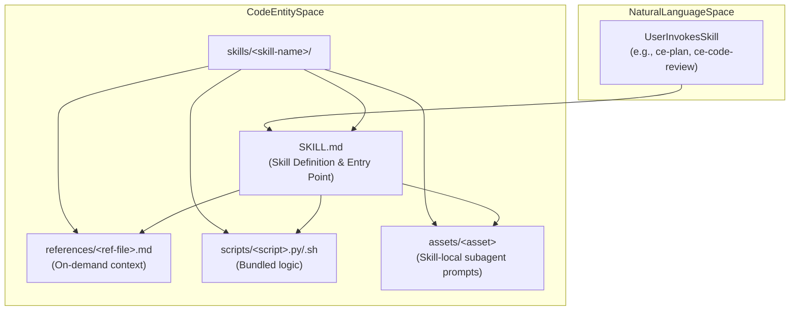
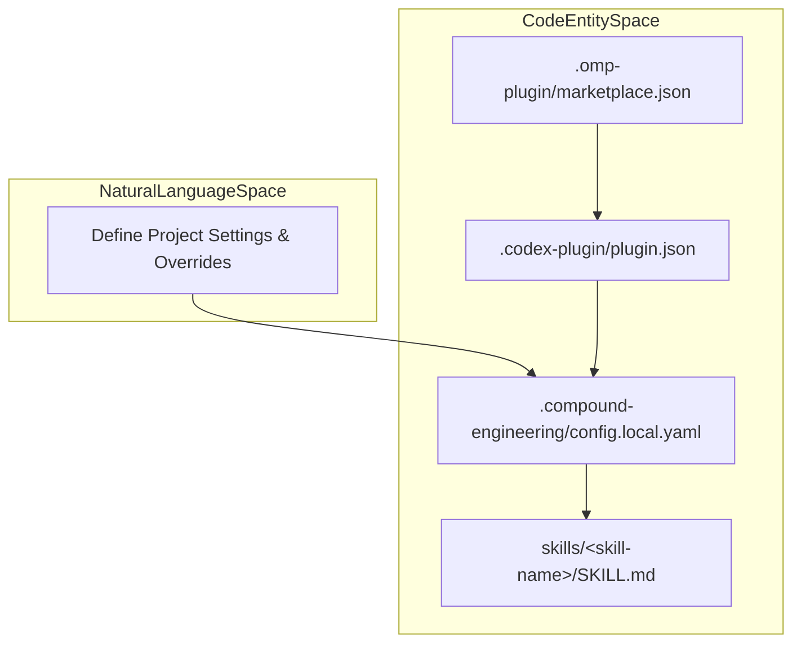

<!-- source: DeepWiki mcp.deepwiki.com · repo EveryInc/compound-engineering-plugin · page 2 Compound Engineering Plugin · fetched 2026-10-30 -->

# Compound Engineering Plugin

Relevant source files

The following files were used as context for generating this wiki page:

- [.agy/plugin.json](.agy/plugin.json)
- [.claude-plugin/plugin.json](.claude-plugin/plugin.json)
- [.codex-plugin/plugin.json](.codex-plugin/plugin.json)
- [.cursor-plugin/plugin.json](.cursor-plugin/plugin.json)
- [.devin-plugin/plugin.json](.devin-plugin/plugin.json)
- [.github/.release-please-manifest.json](.github/.release-please-manifest.json)
- [.grok-plugin/plugin.json](.grok-plugin/plugin.json)
- [.kimi-plugin/plugin.json](.kimi-plugin/plugin.json)
- [.omp-plugin/marketplace.json](.omp-plugin/marketplace.json)
- [CHANGELOG.md](CHANGELOG.md)
- [CONCEPTS.md](CONCEPTS.md)
- [docs/solutions/skill-design/right-size-plans-by-subtraction-and-a-usage-first-sizing-test.md](docs/solutions/skill-design/right-size-plans-by-subtraction-and-a-usage-first-sizing-test.md)
- [package.json](package.json)
- [plugin.json](plugin.json)
- [skills/ce-work/references/agents/implementation-worker.md](skills/ce-work/references/agents/implementation-worker.md)
- [skills/ce-work/references/cross-model-execution.md](skills/ce-work/references/cross-model-execution.md)
- [skills/ce-work/references/execution-strategy.md](skills/ce-work/references/execution-strategy.md)
- [skills/ce-work/references/implementation-loop.md](skills/ce-work/references/implementation-loop.md)
- [skills/ce-work/references/work-intake.md](skills/ce-work/references/work-intake.md)
- [skills/ce-work/scripts/unit_workspace_state.py](skills/ce-work/scripts/unit_workspace_state.py)
- [tests/skill-eval-cell/packs/ce-work-sizing.md](tests/skill-eval-cell/packs/ce-work-sizing.md)
- [tests/skills/ce-work-outcome-spine.test.ts](tests/skills/ce-work-outcome-spine.test.ts)
- [tests/skills/ce-work-unit-workspace-init.test.ts](tests/skills/ce-work-unit-workspace-init.test.ts)

## Purpose and Scope

This document introduces the `compound-engineering` plugin, a comprehensive AI-powered development toolkit designed to automate and enhance software development workflows. The plugin provides a suite of specialized skills that implement a circular development lifecycle where each unit of work makes the next easier.

For the compounding engineering philosophy and workflow concepts, see [Core Concepts and Philosophy](#2.1). For detailed component architecture, see [Plugin Architecture](#2.2). For configuration and metadata details, see [Plugin Metadata and Configuration](#2.3).

---

## Plugin Identity and Purpose

The `compound-engineering` plugin is a self-contained development automation package designed to invert the traditional accumulation of technical debt. It implements an 80/20 ratio where 80% of effort is focused on planning and review, and 20% on execution.

The plugin is distributed through marketplace catalogs and can be installed directly in native environments (Claude Code, Cursor, Codex) or converted for platforms like OpenCode, Pi, Kimi, and Antigravity using the `compound-engineering` CLI tool [CONCEPTS.md:21-24]().

**Current Version**: `3.33.2` [package.json:3]()

**Component Inventory**:
- **Skills**: The plugin ships a robust inventory of skills. Specialist behavior (review, research, etc.) lives inside the owning skills as skill-local prompt assets rather than standalone agents [CONCEPTS.md:10-18]().
- **CLI**: A cross-platform tool for plugin distribution and format conversion [package.json:20-24]().

Sources: [package.json:3](), [package.json:20-24](), [CONCEPTS.md:10-18](), [CONCEPTS.md:21-24]()

---

## Plugin Architecture Overview

The plugin follows a modular architecture where **Skills** act as the primary entry points. Specialist behavior is managed as internal assets by the skill.

### Plugin Component Relationships

Sources: [CONCEPTS.md:10-12](), [CONCEPTS.md:16-18]()

### Bridging User Intent to Code Entities

The relationship between user intent and code entities is defined by the skill directory structure and naming conventions:

| Component | Location | File Format | Role |
|-----------|----------|-------------|------|
| **Skill** | `skills/<skill-name>/SKILL.md` | Markdown + Frontmatter | Primary entry point and orchestrator [CONCEPTS.md:10-12](). |
| **Specialist Prompt Asset** | `skills/<skill-name>/assets/<asset-name>` | Markdown, Text | Internal prompt file defining a specialist persona or role for a generic subagent [CONCEPTS.md:16-18](). |
| **Bundled Script** | `skills/<skill-name>/scripts/<script-name>.py/.sh` | Python, Bash | Portable logic invoked by the skill for mechanical tasks. |
| **On-demand Reference** | `skills/<skill-name>/references/<ref-name>.md` | Markdown | Contextual information progressively pulled in by the skill as needed. |

For a detailed breakdown of skill composition, including `SKILL.md` kernels, `references/`, `scripts/`, `assets/`, and cross-skill invocation contracts, see [Plugin Architecture](#2.2).

Sources: [CONCEPTS.md:10-12](), [CONCEPTS.md:16-18]()

---

## Shared Vocabulary and Core Concepts

The plugin operates on a shared vocabulary defined in `CONCEPTS.md`. This document establishes project-specific meanings for entities, named processes, and status concepts, ensuring consistent communication and behavior across skills.

### Key Vocabulary Terms
- **Skill**: A user-invoked capability that orchestrates its own references and dispatches subagents [CONCEPTS.md:10-12]().
- **Agent (Subagent)**: A specialized, single-purpose worker performing scoped work, often seeded with a **Specialist prompt asset** [CONCEPTS.md:13-18]().
- **Target**: A destination coding-agent platform (e.g., OpenCode, Codex, Pi) that the plugin supports [CONCEPTS.md:21-24]().
- **Compound Engineering**: The methodology of structuring engineering work to capture reusable knowledge, making future work easier [CONCEPTS.md:48-50]().
- **Pipeline**: The chained progression of skills that carries work through strategy, ideation, brainstorm, plan, execution, review, and learning capture [CONCEPTS.md:51-53]().
- **Compound Pack**: A folder of prescriptive domain knowledge files consumed by planning and review skills [CONCEPTS.md:69-71]().

For a comprehensive explanation of these and other core concepts like outcome spine, host prompt budget, phase-loaded kernel, render floor, confidence anchors, and case accretion, see [Core Concepts and Philosophy](#2.1).

Sources: [CONCEPTS.md:1-7](), [CONCEPTS.md:10-12](), [CONCEPTS.md:13-18](), [CONCEPTS.md:21-24](), [CONCEPTS.md:48-50](), [CONCEPTS.md:51-53](), [CONCEPTS.md:69-71]()

---

## Configuration Surface

The plugin's behavior can be configured at various levels, from global marketplace metadata to project-specific settings.

### Configuration Mapping Architecture

Sources: [.omp-plugin/marketplace.json:1-29](), [.codex-plugin/plugin.json:1-45]()

### Configuration Keys and Files
- **Plugin Manifests**: Files like `.claude-plugin/plugin.json`, `.codex-plugin/plugin.json`, `.cursor-plugin/plugin.json`, and `.kimi-plugin/plugin.json` define the plugin's name, version, description, author, and keywords for specific hosts [package.json:3](), [.codex-plugin/plugin.json:1-45](), [.cursor-plugin/plugin.json:1-25](), [.claude-plugin/plugin.json:1-19](), [.kimi-plugin/plugin.json:1-24]().
- **Marketplace Catalogs**: Files like `.omp-plugin/marketplace.json` list available plugins and their versions for distribution [.omp-plugin/marketplace.json:1-29]().
- **Project-level Configuration**: The `.compound-engineering/config.local.yaml` file allows project-specific overrides and settings that skills can consume.
- **Skill-level Configuration**: Parameters and behaviors can be defined directly within a skill's `SKILL.md` file using frontmatter.

For detailed information on `plugin.json` shapes, marketplace catalogs, agent-plugins spec conformance rules, and project-level `.compound-engineering` config keys, see [Plugin Metadata and Configuration](#2.3).

Sources: [package.json:3](), [.codex-plugin/plugin.json:1-45](), [.cursor-plugin/plugin.json:1-25](), [.claude-plugin/plugin.json:1-19](), [.kimi-plugin/plugin.json:1-24](), [.omp-plugin/marketplace.json:1-29]()

---

## Versioning and Release

The plugin uses semantic versioning, synchronized across platform manifests and the CLI.

| Version Surface | Management |
|-----------------|------------|
| `package.json` | Root version source for the repository (`"version": "3.33.2"`) [package.json:3]() |
| `.release-please-manifest.json` | Tracks individual component versions for release automation (e.g., `".": "3.33.2"`, `".claude-plugin": "1.0.3"`) [.github/.release-please-manifest.json:1-5]() |
| `marketplace.json` | Updated to reflect new plugin availability for distribution [.omp-plugin/marketplace.json:1-29]() |
| `CHANGELOG.md` | Automatically generated changelog detailing features and bug fixes for each version [CHANGELOG.md:1-136]() |

**Validation**: The command `release:validate` enforces version invariants across manifests to prevent drift [package.json:36](). The `release:sync-metadata` script ensures metadata consistency [package.json:35]().

Sources: [package.json:3](), [package.json:35](), [package.json:36](), [.github/.release-please-manifest.json:1-5](), [CHANGELOG.md:1-136](), [.omp-plugin/marketplace.json:1-29]()

---

