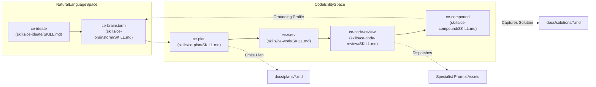
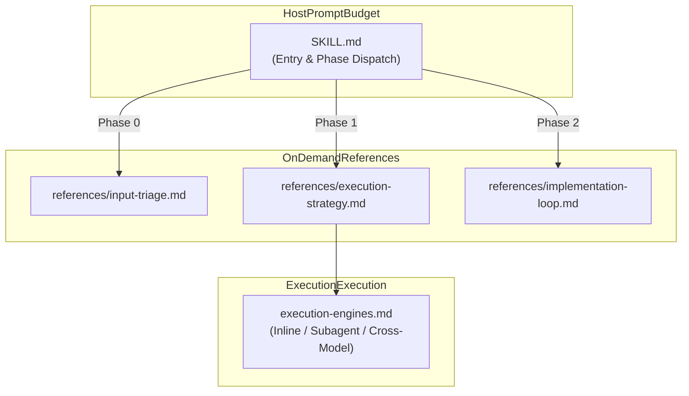

<!-- source: DeepWiki mcp.deepwiki.com · repo EveryInc/compound-engineering-plugin · page 2.1 Core Concepts and Philosophy · fetched 2026-10-30 -->

# Core Concepts and Philosophy

Relevant source files

The following files were used as context for generating this wiki page:

- [CONCEPTS.md](CONCEPTS.md)
- [docs/solutions/skill-design/right-size-plans-by-subtraction-and-a-usage-first-sizing-test.md](docs/solutions/skill-design/right-size-plans-by-subtraction-and-a-usage-first-sizing-test.md)
- [skills/ce-brainstorm/scripts/packs-resolve.py](skills/ce-brainstorm/scripts/packs-resolve.py)
- [skills/ce-code-review/scripts/packs-resolve.py](skills/ce-code-review/scripts/packs-resolve.py)
- [skills/ce-compound/scripts/packs-resolve.py](skills/ce-compound/scripts/packs-resolve.py)
- [skills/ce-doc-review/scripts/packs-resolve.py](skills/ce-doc-review/scripts/packs-resolve.py)
- [skills/ce-dogfood/scripts/packs-resolve.py](skills/ce-dogfood/scripts/packs-resolve.py)
- [skills/ce-plan/scripts/packs-resolve.py](skills/ce-plan/scripts/packs-resolve.py)
- [skills/ce-setup/references/pack-scaffold.md](skills/ce-setup/references/pack-scaffold.md)
- [skills/ce-setup/scripts/packs-resolve.py](skills/ce-setup/scripts/packs-resolve.py)
- [skills/ce-work/references/agents/implementation-worker.md](skills/ce-work/references/agents/implementation-worker.md)
- [skills/ce-work/references/cross-model-execution.md](skills/ce-work/references/cross-model-execution.md)
- [skills/ce-work/references/execution-strategy.md](skills/ce-work/references/execution-strategy.md)
- [skills/ce-work/references/implementation-loop.md](skills/ce-work/references/implementation-loop.md)
- [skills/ce-work/references/work-intake.md](skills/ce-work/references/work-intake.md)
- [skills/ce-work/scripts/unit_workspace_state.py](skills/ce-work/scripts/unit_workspace_state.py)
- [tests/skill-eval-cell/packs/ce-work-sizing.md](tests/skill-eval-cell/packs/ce-work-sizing.md)
- [tests/skills/ce-packs-resolver.test.ts](tests/skills/ce-packs-resolver.test.ts)
- [tests/skills/ce-setup-pack-scaffold.test.ts](tests/skills/ce-setup-pack-scaffold.test.ts)
- [tests/skills/ce-work-outcome-spine.test.ts](tests/skills/ce-work-outcome-spine.test.ts)
- [tests/skills/ce-work-unit-workspace-init.test.ts](tests/skills/ce-work-unit-workspace-init.test.ts)

## Purpose and Scope

This document details the core architectural concepts, design philosophy, and domain vocabulary underlying the `compound-engineering-plugin`. It covers the Compounding Engineering methodology, the execution of the compound loop, and technical definitions codified in `CONCEPTS.md`. The design ensures that engineering tasks progressively simplify future work by capturing reusable knowledge, maintaining stringent planning-to-execution ratios, and operating reliably across diverse agent host platforms.

Sources: [CONCEPTS.md:1-50](), [docs/guides/README.md:1-25]()

---

## The Compounding Engineering Methodology

Compounding Engineering inverts traditional development patterns where technical debt accumulates over time. Instead, each unit of work is structured so that subsequent tasks become easier by codifying reusable knowledge into persistent artifacts (`docs/solutions/`, compound packs) [CONCEPTS.md:46-50]().

### Core Terminology and Vocabulary

The system relies on explicit vocabulary defined in `CONCEPTS.md` to govern agent coordination and knowledge persistence:

| Term | Technical Definition | Code / File Pointer |
| :--- | :--- | :--- |
| **Compounding Engineering** | Structuring engineering work so each unit makes the next one easier, capturing reusable knowledge as you go [CONCEPTS.md:46-50](). | `CONCEPTS.md` |
| **Compound Loop** | The chained progression of Skills carrying work from strategy through ideation, brainstorm, plan, execution, review, and compound learning capture [CONCEPTS.md:51-53](). | [docs/guides/README.md:13-29]() |
| **Outcome Spine** | The structured sequence of intent, results, consumer handoffs, and verification milestones maintained across execution [tests/skills/ce-work-outcome-spine.test.ts:39-54](). | [skills/ce-work/SKILL.md:1-50]() |
| **Host Prompt Budget** | The token limit imposed by the host execution environment, influencing plugin architecture toward modular, on-demand loading [docs/guides/skill-design.md:1-20](). | `docs/guides/skill-design.md` |
| **Phase-Loaded Kernel** | The core `SKILL.md` entry point that loads detailed `references/` files only when specific phase execution demands it [docs/guides/skill-design.md:1-20](). | `skills/ce-work/SKILL.md` |
| **Render Floor** | The minimum structural and formatting standard required for generated artifacts (e.g., plans, reviews) to ensure human and agent readability [docs/guides/ce-doc-review.md:1-50](). | `docs/guides/ce-doc-review.md` |
| **Confidence Anchors** | Discrete, self-scored qualitative or quantitative indicators used to gate, rank, and evaluate findings (e.g., in code reviews) [CONCEPTS.md:90-92](). | `CONCEPTS.md` |
| **Case Accretion** | The continuous accumulation and refinement of solution patterns and knowledge through repeated session executions [CONCEPTS.md:3-3](). | `CONCEPTS.md` |
| **Compound Pack** | A folder of prescriptive domain knowledge files consumed by planning and review skills as constraints or validation rules [CONCEPTS.md:69-71](). | [skills/ce-plan/scripts/packs-resolve.py:1-57]() |

Sources: [CONCEPTS.md:3-92](), [docs/guides/README.md:13-29](), [tests/skills/ce-work-outcome-spine.test.ts:39-54](), [skills/ce-plan/scripts/packs-resolve.py:1-57]()

---

## The Compound Loop and Workflow Architecture

The execution model bridges upstream human intent (Natural Language Space) with downstream deterministic code transformations (Code Entity Space) via a structured pipeline of Skills and durable artifacts.

### Diagram: Natural Language Space to Code Entity Space

**Diagram: Workflow bridge from natural language exploration to code-grounded execution nodes.**

Sources: [docs/guides/README.md:13-45](), [CONCEPTS.md:51-66]()

---

## Architectural Design Principles

To maintain determinism across different agent harnesses (Claude Code, Codex, Cursor, etc.), the plugin enforces strict architectural invariants:

### Phase-Loaded Kernels and Host Prompt Budgets
Because AI hosts enforce strict token limits on prompts (`Host Prompt Budget`), skills cannot load all instructions simultaneously. Instead, they use a `Phase-Loaded Kernel` pattern:
1. `SKILL.md` contains the minimal routing logic, outcome definitions, and phase selectors [tests/skills/ce-work-outcome-spine.test.ts:39-54]().
2. Detailed operational rules are isolated in `references/` directories (e.g., `skills/ce-work/references/execution-strategy.md`) and loaded explicitly only when entering that phase [skills/ce-work/references/execution-strategy.md:1-5]().

### Diagram: Phase-Loaded Kernel Data Flow

**Diagram: On-demand loading of reference assets to conserve Host Prompt Budgets.**

Sources: [skills/ce-work/SKILL.md:1-50](), [skills/ce-work/references/execution-strategy.md:1-10](), [skills/ce-work/references/implementation-loop.md:1-15]()

### Compound Packs Resolution
Compound Packs supply prescriptive domain rules declared in `.compound-engineering/config.yaml` [skills/ce-plan/scripts/packs-resolve.py:1-10](). The resolver script (`packs-resolve.py`) parses configuration layers, validates paths or Git URLs, caches remote repositories securely in owner-private scratch roots, and makes rules available for planning and review [skills/ce-plan/scripts/packs-resolve.py:40-57]().

Sources: [CONCEPTS.md:69-71](), [skills/ce-plan/scripts/packs-resolve.py:1-57]()

---

