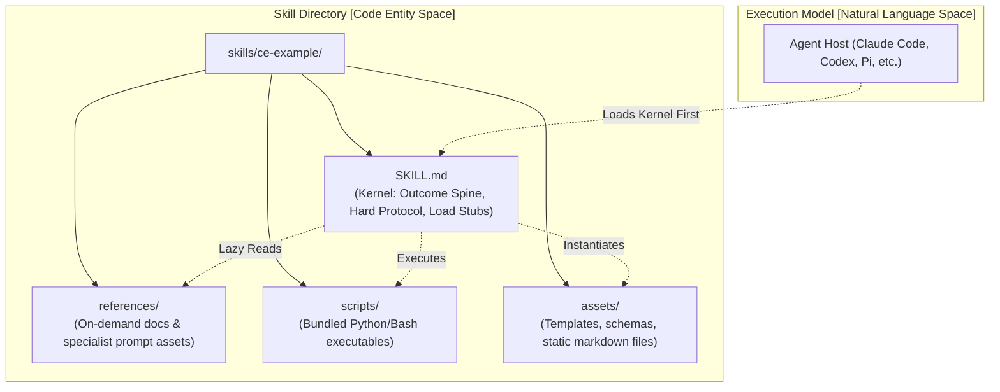
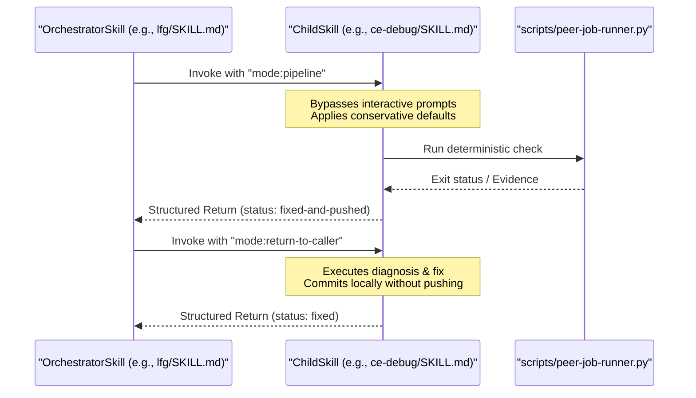

<!-- source: DeepWiki mcp.deepwiki.com · repo EveryInc/compound-engineering-plugin · page 2.2 Plugin Architecture · fetched 2026-10-30 -->

# Plugin Architecture

Relevant source files

The following files were used as context for generating this wiki page:

- [.agents/skills/ce-skill-work/SKILL.md](.agents/skills/ce-skill-work/SKILL.md)
- [.agents/skills/ce-skill-work/references/edit-skill.md](.agents/skills/ce-skill-work/references/edit-skill.md)
- [.agents/skills/ce-skill-work/references/evaluate.md](.agents/skills/ce-skill-work/references/evaluate.md)
- [.agents/skills/ce-skill-work/references/new-skill.md](.agents/skills/ce-skill-work/references/new-skill.md)
- [.agents/skills/ce-skill-work/references/respond-to-review.md](.agents/skills/ce-skill-work/references/respond-to-review.md)
- [.agents/skills/ce-skill-work/references/review-skill.md](.agents/skills/ce-skill-work/references/review-skill.md)
- [AGENTS.md](AGENTS.md)
- [CLAUDE.md](CLAUDE.md)
- [docs/plans/2026-08-06-001-fix-agent-plugins-manifest-conformance-plan.md](docs/plans/2026-08-06-001-fix-agent-plugins-manifest-conformance-plan.md)
- [docs/solutions/conventions/verify-externally-attributed-constraints-at-the-source.md](docs/solutions/conventions/verify-externally-attributed-constraints-at-the-source.md)
- [docs/solutions/integrations/agent-plugins-schema-is-a-host-routing-switch.md](docs/solutions/integrations/agent-plugins-schema-is-a-host-routing-switch.md)
- [docs/solutions/skill-design/portable-agent-skill-authoring.md](docs/solutions/skill-design/portable-agent-skill-authoring.md)
- [docs/solutions/skill-design/size-driven-skill-restructure.md](docs/solutions/skill-design/size-driven-skill-restructure.md)
- [docs/specs/agent-plugins.md](docs/specs/agent-plugins.md)
- [docs/specs/antigravity.md](docs/specs/antigravity.md)
- [docs/specs/cursor.md](docs/specs/cursor.md)
- [skills/ce-brainstorm/references/agents/slack-researcher.md](skills/ce-brainstorm/references/agents/slack-researcher.md)
- [skills/ce-compound/references/agents/best-practices-researcher.md](skills/ce-compound/references/agents/best-practices-researcher.md)
- [skills/ce-compound/references/agents/framework-docs-researcher.md](skills/ce-compound/references/agents/framework-docs-researcher.md)
- [skills/ce-compound/references/agents/session-historian.md](skills/ce-compound/references/agents/session-historian.md)
- [skills/ce-optimize/references/agents/repo-research-analyst.md](skills/ce-optimize/references/agents/repo-research-analyst.md)
- [skills/ce-plan/references/agents/best-practices-researcher.md](skills/ce-plan/references/agents/best-practices-researcher.md)
- [skills/ce-plan/references/agents/framework-docs-researcher.md](skills/ce-plan/references/agents/framework-docs-researcher.md)
- [skills/ce-plan/references/agents/repo-research-analyst.md](skills/ce-plan/references/agents/repo-research-analyst.md)
- [skills/ce-plan/references/agents/slack-researcher.md](skills/ce-plan/references/agents/slack-researcher.md)
- [skills/ce-plan/references/agents/web-researcher.md](skills/ce-plan/references/agents/web-researcher.md)
- [src/commands/cleanup.ts](src/commands/cleanup.ts)
- [tests/codex-skill-prompt-budget.test.ts](tests/codex-skill-prompt-budget.test.ts)
- [tests/real-plugin-conversion.test.ts](tests/real-plugin-conversion.test.ts)
- [tests/skill-conventions.test.ts](tests/skill-conventions.test.ts)
- [tests/skills/task-visibility-contract.test.ts](tests/skills/task-visibility-contract.test.ts)
- [tests/skills/user-facing-skill-invocation-rendering.test.ts](tests/skills/user-facing-skill-invocation-rendering.test.ts)

## Purpose and Scope

This document details the internal structural composition of individual skills within the `compound-engineering` plugin. A skill is not a monolithic script or a rigid state machine; rather, it is a modular package composed of a lightweight `SKILL.md` kernel, on-demand reference documentation (`references/`), bundled execution scripts (`scripts/`), static templates/fixtures (`assets/`), and skill-local subagent prompt assets. Furthermore, this page outlines the cross-skill invocation contracts (`mode:pipeline` and `mode:return-to-caller`) that allow orchestrator skills to chain specialized capabilities safely and deterministically across different host runtimes. [AGENTS.md:1-9](), [docs/solutions/skill-design/portable-agent-skill-authoring.md:39-42]()

Sources: [AGENTS.md:1-9](), [docs/solutions/skill-design/portable-agent-skill-authoring.md:39-42]()

---

## Skill Anatomy and Composition

Every skill in the catalog resides in its own directory under `skills/` (e.g., `skills/ce-plan/`, `skills/ce-work/`, `skills/ce-debug/`) and follows a standardized directory layout designed to maintain strict self-containment and portability.

Sources: [tests/skill-conventions.test.ts:23-39]()

### 1. The `SKILL.md` Kernel
The `SKILL.md` file serves as the primary entry point for a skill. It starts with YAML frontmatter defining its name, description, and execution flags (`argument-hint`, `disable-model-invocation`). The body is structured around an **Outcome Spine** (result, next consumer, done condition, and non-obvious intent) followed by any required **Hard Protocols** and **Load-Bearing Workflows**.
*   **Prompt Budget Awareness:** To respect host constraints (such as Codex's 8,000-byte prompt budget for Agent Plugins or Claude Code's auto-compaction limits), critical stop conditions and routing rules are placed at the very top of the kernel. [tests/codex-skill-prompt-budget.test.ts:37-37](), [docs/specs/agent-plugins.md:27-28]()
*   **Load Stubs:** When detailed procedures or reference information are offloaded to external files to save token space, the kernel retains explicit load stubs instructing the model to read the specific reference file precisely when that phase is entered. [docs/solutions/skill-design/size-driven-skill-restructure.md:32-36]()

Sources: [skills/ce-debug/SKILL.md:1-5](), [tests/codex-skill-prompt-budget.test.ts:37-37](), [docs/specs/agent-plugins.md:27-28](), [docs/solutions/skill-design/size-driven-skill-restructure.md:32-36]()

### 2. On-Demand `references/`
The `references/` subdirectory houses deep-dive documentation, extended schemas, and workflow guides. 
*   **Pointer Following:** Models load these files dynamically via tool calls only when specific phases or edge cases require them. 
*   **Specialist Prompt Assets:** Within `references/` (or specialized subdirectories like `references/agents/`), the skill stores prompt templates and personas (e.g., repo-research analysts, adversarial reviewers) used to seed subordinate subagents. This encapsulates specialist logic within the owning skill rather than relying on global system agents. [skills/ce-compound/references/agents/session-historian.md:1-5]()

Sources: [skills/ce-compound/references/agents/session-historian.md:1-5](), [docs/solutions/skill-design/size-driven-skill-restructure.md:32-36]()

### 3. Bundled `scripts/`
Deterministic work, data transformations, state validations, and complex formatting are delegated to executable scripts located in the skill's local `scripts/` directory (or shared global scripts). 
*   Skills reference these scripts using platform-safe environment variables (e.g., `bash "${CLAUDE_SKILL_DIR:-.}/scripts/validator.sh"`).
*   Delegating mechanical verification to scripts ensures consistency across different model families and prevents hallucinations during validation checks. [tests/skill-conventions.test.ts:51-66]()

Sources: [tests/skill-conventions.test.ts:51-66]()

### 4. `assets/` and Static Files
The `assets/` directory stores static templates, markdown schemas, and default configuration structures that are copied, rendered, or instantiated during the skill's execution (such as output plan formats or issue triage templates).

Sources: [tests/skill-conventions.test.ts:23-39]()

---

## Cross-Skill Invocation Contracts

To support complex orchestrations (such as `/lfg`, `ce-sweep`, and `ce-babysit-pr`), individual skills can be invoked programmatically by other skills using explicit invocation modes. These contracts govern execution flow, interactivity, and return payloads.

Sources: [skills/ce-debug/SKILL.md:19-22](), [skills/ce-work/SKILL.md:56-61](), [skills/lfg/SKILL.md:39-40]()

### `mode:pipeline`
*   **Purpose:** Used when an orchestrator skill chains multiple child skills fully non-interactively into an end-to-end autonomous pipeline (e.g., plan → work → review → compound).
*   **Behavior:** Suppresses interactive confirmation prompts, substitutes conservative default decisions for ambiguous branches, and wraps execution in a strict protocol.
*   **Return Payload:** The child skill concludes by emitting a structured return payload containing a precise `status` enum (e.g., `fixed-and-pushed`, `diagnosed-no-fix`, `flaky-infra`, `needs-human`) which the parent orchestrator parses to decide subsequent workflow routing. [skills/ce-debug/SKILL.md:19-20]()

Sources: [skills/ce-debug/SKILL.md:19-20](), [skills/lfg/SKILL.md:39-40]()

### `mode:return-to-caller`
*   **Purpose:** Used when a child skill performs a dedicated subset of work (such as debugging or code review) but leaves post-processing, shipping, or polish to the calling parent skill.
*   **Behavior:** The child skill executes its core investigative and transactional loop non-interactively, commits changes locally (without pushing or opening PRs prematurely), and skips downstream wrap-up actions.
*   **Return Payload:** Returns control back to the caller along with a standardized status object (`fixed`, `diagnosed-no-fix`, `needs-human`, `blocked`), allowing the caller to take ownership of final integration and reporting. [skills/ce-debug/SKILL.md:21-22]()

Sources: [skills/ce-debug/SKILL.md:21-22](), [skills/ce-work/SKILL.md:56-61]()

---

## Storage, Persistence, and State Management

Skills interact with distinct filesystem storage tiers to separate durable institutional memory from transient execution data.

| Storage Tier | Path Convention | Purpose | Lifecycle |
| :--- | :--- | :--- | :--- |
| **Durable Repo Artifacts** | `docs/plans/`, `docs/solutions/` | Long-term plans, technical specifications, and captured learnings. | Committed to git; persists across sessions. |
| **Throwaway Temp** | `/tmp/` (via `mktemp`) | Single-run intermediate files, logs, and raw diff patches. | Cleared by OS or cleanup routines. |
| **Reusable Scratch Space** | `/tmp/compound-engineering-<uid>/<skill>/` | Cross-invocation caches designed to survive context compaction and subagent handoffs. | Ephemeral to the active engineering workflow. |

Sources: [AGENTS.md:43-46]()

---

