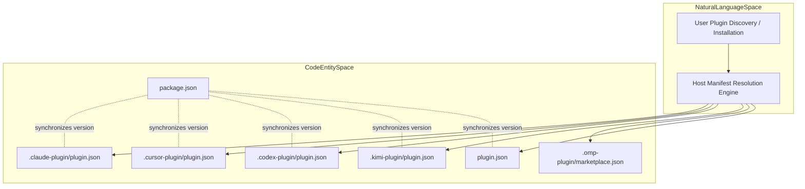
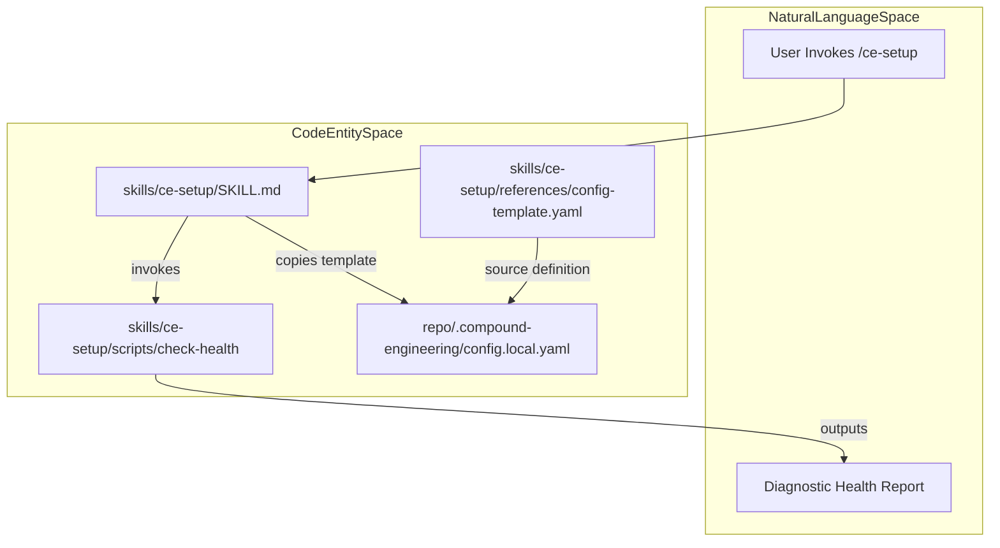

<!-- source: DeepWiki mcp.deepwiki.com · repo EveryInc/compound-engineering-plugin · page 2.3 Plugin Metadata and Configuration · fetched 2026-10-30 -->

# Plugin Metadata and Configuration

Relevant source files

The following files were used as context for generating this wiki page:

- [.agy/plugin.json](.agy/plugin.json)
- [.claude-plugin/plugin.json](.claude-plugin/plugin.json)
- [.codex-plugin/plugin.json](.codex-plugin/plugin.json)
- [.compound-engineering/config.example.yaml](.compound-engineering/config.example.yaml)
- [.cursor-plugin/plugin.json](.cursor-plugin/plugin.json)
- [.devin-plugin/plugin.json](.devin-plugin/plugin.json)
- [.github/.release-please-manifest.json](.github/.release-please-manifest.json)
- [.grok-plugin/plugin.json](.grok-plugin/plugin.json)
- [.kimi-plugin/plugin.json](.kimi-plugin/plugin.json)
- [.omp-plugin/marketplace.json](.omp-plugin/marketplace.json)
- [CHANGELOG.md](CHANGELOG.md)
- [docs/guides/configuration.md](docs/guides/configuration.md)
- [docs/plans/2026-08-06-001-fix-agent-plugins-manifest-conformance-plan.md](docs/plans/2026-08-06-001-fix-agent-plugins-manifest-conformance-plan.md)
- [docs/solutions/conventions/verify-externally-attributed-constraints-at-the-source.md](docs/solutions/conventions/verify-externally-attributed-constraints-at-the-source.md)
- [docs/solutions/integrations/agent-plugins-schema-is-a-host-routing-switch.md](docs/solutions/integrations/agent-plugins-schema-is-a-host-routing-switch.md)
- [docs/specs/agent-plugins.md](docs/specs/agent-plugins.md)
- [docs/specs/antigravity.md](docs/specs/antigravity.md)
- [package.json](package.json)
- [plugin.json](plugin.json)
- [skills/ce-setup/references/config-template.yaml](skills/ce-setup/references/config-template.yaml)
- [src/commands/cleanup.ts](src/commands/cleanup.ts)
- [tests/codex-skill-prompt-budget.test.ts](tests/codex-skill-prompt-budget.test.ts)
- [tests/real-plugin-conversion.test.ts](tests/real-plugin-conversion.test.ts)
- [tests/skill-conventions.test.ts](tests/skill-conventions.test.ts)
- [tests/skills/task-visibility-contract.test.ts](tests/skills/task-visibility-contract.test.ts)
- [tests/skills/user-facing-skill-invocation-rendering.test.ts](tests/skills/user-facing-skill-invocation-rendering.test.ts)

## Purpose and Scope

This document details the metadata architecture, host-specific manifest shapes (`plugin.json`), marketplace catalogs, agent-plugins specification conformance policies, and project-level configuration schemas consumed by the skills in the `compound-engineering-plugin` repository.

---

## Plugin Metadata File Structure

The compound-engineering plugin defines its identity, capabilities, and metadata through manifest files (`plugin.json` or `marketplace.json`) located in platform-specific dot-directories [package.json:1-54](). These manifests support discovery, installation, and native host integration across Claude Code, Cursor, Codex, Kimi, Grok, Devin, oh-my-pi, and Antigravity.

### Core Metadata Schema

Each host manifest shares a common metadata subset specifying identity (`name`), version (`version`), description (`description`), authorship (`author`), license (`license`), repository pointers (`repository`), and keyword taxonomies (`keywords`) [.claude-plugin/plugin.json:1-20](), [.cursor-plugin/plugin.json:1-25](), [.codex-plugin/plugin.json:1-45]().

**Diagram: Cross-Platform Plugin Metadata Manifest Structure**

Sources:
[.claude-plugin/plugin.json:1-20](),
[.cursor-plugin/plugin.json:1-25](),
[.codex-plugin/plugin.json:1-45](),
[plugin.json:1-20](),
[package.json:1-54]()

---

## Agent Plugins Specification Conformance

The `agent-plugins` specification standardizes AI agent extensions, but strict conformance to its `$schema` at the root manifest level is intentionally omitted to avoid host-specific breakage [tests/codex-skill-prompt-budget.test.ts:15-38](). 

Host-specific constraints govern this behavior:
- **Codex Prompt Budget:** Codex >= 0.147 truncates each Agent Plugin `SKILL.md` to `8000` bytes (`CODEX_MAX_SKILL_PROMPT_BYTES`) [tests/codex-skill-prompt-budget.test.ts:9-37](). Skills exceeding this threshold are cataloged in the `OVER_BUDGET` set [tests/codex-skill-prompt-budget.test.ts:48-51]().
- **oh-my-pi Frontmatter Restrictions:** oh-my-pi rejects any `SKILL.md` containing frontmatter keys outside its closed set (disallowing Claude Code specific keys such as `argument-hint` and `disable-model-invocation`) [tests/codex-skill-prompt-budget.test.ts:13-15]().

Consequently, the root `plugin.json` intentionally omits the `agent-plugins` `$schema` prefix to prevent strict validation rejections on unsupported hosts [tests/codex-skill-prompt-budget.test.ts:96-102](). Version synchronization and metadata consistency are enforced via release automation scripts [package.json:33-36]().

Sources:
[tests/codex-skill-prompt-budget.test.ts:9-51](),
[tests/codex-skill-prompt-budget.test.ts:96-102](),
[package.json:33-36]()

---

## Repository-Local Configuration

Project-level configuration is managed via machine-local YAML files stored under `.compound-engineering/config.local.yaml`, which should be excluded from version control [skills/ce-setup/SKILL.md:50-51]().

### Configuration Keys Consumed by Skills

Skills reference local settings to govern model dispatch, artifact paths, and feedback integrations:

| Category | Key | Purpose |
| :--- | :--- | :--- |
| **Model Routing** | `plan_model` / `brainstorm_model` | Assigns dedicated models for planning and brainstorming sessions [tests/skills/ce-setup-check-health.test.ts:114-115](). |
| **Execution Engine** | `work_engine_mode` | Controls execution isolation behavior for `ce-work` [tests/skills/ce-setup-check-health.test.ts:141](). |
| **Artifact Storage** | `docs_root` | Configures the destination root for solutions, plans, and ideation directories [skills/ce-setup/SKILL.md:22](). |
| **Feedback Sweep** | `feedback_sources` | Defines external integration sources for `ce-sweep` [tests/skills/ce-setup-check-health.test.ts:92](). |

Sources:
[skills/ce-setup/SKILL.md:15-25](),
[tests/skills/ce-setup-check-health.test.ts:72-141]()

---

## Environment Initialization and Health Check Integration

The initialization workflow is orchestrated by the `ce-setup` skill, which verifies configuration health, validates requirements, and migrates legacy layouts.

**Diagram: Setup Command to Configuration Templates and Health Scripts**

Sources:
[skills/ce-setup/SKILL.md:27-60](),
[skills/ce-setup/SKILL.md:97-103](),
[tests/skills/ce-setup-check-health.test.ts:20-39]()

---

