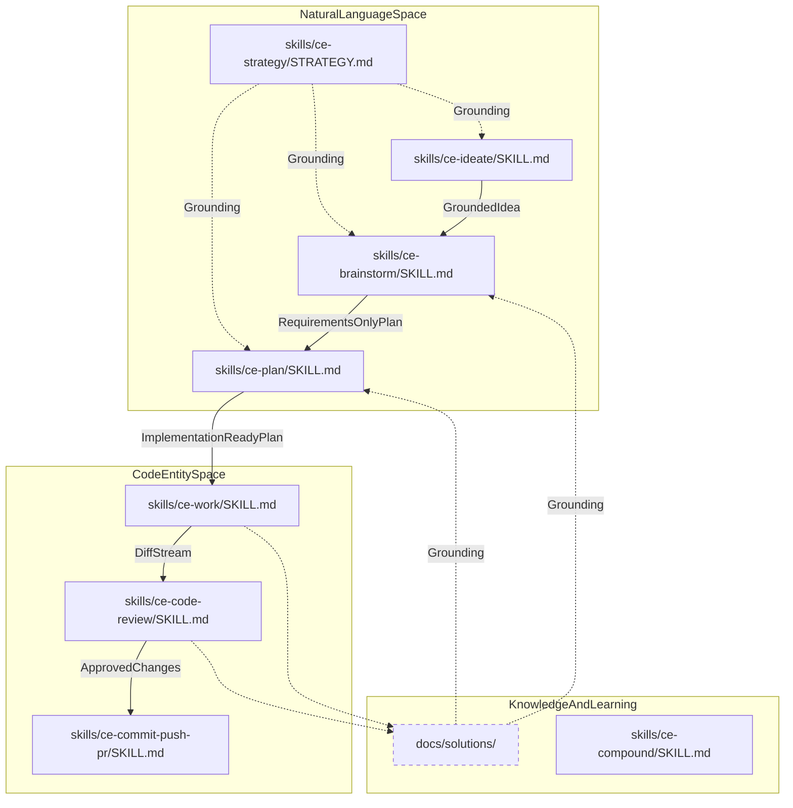

<!-- source: DeepWiki mcp.deepwiki.com · repo EveryInc/compound-engineering-plugin · page 3 Skills — Core Workflow · fetched 2026-10-30 -->

# Skills — Core Workflow

Relevant source files

The following files were used as context for generating this wiki page:

- [docs/guides/README.md](docs/guides/README.md)
- [docs/guides/ce-bakeoff.md](docs/guides/ce-bakeoff.md)
- [docs/guides/ce-brainstorm.md](docs/guides/ce-brainstorm.md)
- [docs/guides/ce-plan.md](docs/guides/ce-plan.md)
- [skills/ce-bakeoff/SKILL.md](skills/ce-bakeoff/SKILL.md)
- [skills/ce-brainstorm/SKILL.md](skills/ce-brainstorm/SKILL.md)
- [skills/ce-brainstorm/references/reasoning-elevation.md](skills/ce-brainstorm/references/reasoning-elevation.md)
- [skills/ce-compound/SKILL.md](skills/ce-compound/SKILL.md)
- [skills/ce-debug/references/bakeoff.md](skills/ce-debug/references/bakeoff.md)
- [skills/ce-plan/SKILL.md](skills/ce-plan/SKILL.md)
- [skills/ce-plan/references/bakeoff.md](skills/ce-plan/references/bakeoff.md)
- [skills/ce-plan/references/reasoning-elevation.md](skills/ce-plan/references/reasoning-elevation.md)
- [skills/ce-pov/SKILL.md](skills/ce-pov/SKILL.md)
- [skills/ce-pov/references/cross-model-panel.md](skills/ce-pov/references/cross-model-panel.md)
- [skills/ce-pov/references/method.md](skills/ce-pov/references/method.md)
- [skills/ce-strategy/SKILL.md](skills/ce-strategy/SKILL.md)
- [skills/ce-sweep/SKILL.md](skills/ce-sweep/SKILL.md)
- [skills/ce-sweep/references/interview.md](skills/ce-sweep/references/interview.md)
- [tests/pov-skill-contract.test.ts](tests/pov-skill-contract.test.ts)

Overview of the compound-engineering skill catalog organized by lifecycle phase (`strategy/ideate` → `brainstorm` → `plan` → `work/debug` → `review` → `compound`). As a parent page, this document summarizes the high-level architecture and routing rules across the core phases. For detailed reference material, see the child pages linked throughout.

Sources: `[docs/guides/README.md:13-30]()`, `[skills/ce-plan/SKILL.md:9-10]()`

## Core Lifecycle and Architecture

The following diagram illustrates the lifecycle progression from natural language intent to code entities and durable knowledge repositories.

**Diagram: Lifecycle Pipeline from Natural Language to Code Entity Space**

Sources: `[docs/guides/README.md:13-46]()`, `[skills/ce-strategy/SKILL.md:9-10]()`

---

## 3.1 Ideation and Strategy Skills

These upstream skills establish project direction, product strategy, and scope gates before execution begins. 

*   **`ce-strategy`**: Creates and maintains `STRATEGY.md`, serving as the primary upstream anchor for ideation, brainstorming, and planning `[skills/ce-strategy/SKILL.md:9-10]()`.
*   **`ce-ideate`**: Executes divergent and convergent ideation, issue intelligence, and web research caching `[docs/guides/README.md:41-41]()`.
*   **`ce-product-pulse`**: Generates time-windowed observation reports on usage, performance, and errors `[docs/guides/README.md:56-56]()`.
*   **`ce-pov`**: Evaluates external-adoption questions, document takes, and approach sets against project and external grounding floors, returning structured verdicts (`Adopt`, `Trial`, `Hold`, `Reject`, `Not-our-problem`) `[skills/ce-pov/SKILL.md:9-15]()`, `[skills/ce-pov/references/method.md:44-48]()`.

For details, see [Ideation and Strategy Skills](#3.1).

Sources: `[skills/ce-strategy/SKILL.md:9-10]()`, `[skills/ce-pov/SKILL.md:9-15]()`, `[docs/guides/README.md:41-56]()`

---

## 3.2 Brainstorm and Plan Skills

These skills define **WHAT** needs to be built through structured dialogue, scoping tiers, and comprehensive planning artifacts.

*   **`ce-brainstorm`**: Explores vague ideas via interactive dialogue, visual probes, and scoping gates, producing a requirements-only unified plan artifact `[skills/ce-brainstorm/SKILL.md:9-15]()`.
*   **`ce-plan`**: Enriches requirements into a durable implementation-ready plan containing atomic Implementation Units (U-IDs), test scenarios, and dependency mappings `[docs/guides/ce-plan.md:28-30]()`.
*   **Reasoning Elevation**: Both skills support delegating reasoning-heavy tasks (approach generation or plan authoring) to a user-chosen, higher-capability model via `references/reasoning-elevation.md` `[skills/ce-brainstorm/references/reasoning-elevation.md:1-5]()`.
*   **`ce-bakeoff`**: Independently develops and compares competing solutions when technical choices remain open `[docs/guides/README.md:68-68]()`.

For details, see [Brainstorm and Plan Skills](#3.2).

Sources: `[skills/ce-brainstorm/SKILL.md:9-15]()`, `[docs/guides/ce-plan.md:28-30]()`, `[skills/ce-brainstorm/references/reasoning-elevation.md:1-5]()`, `[docs/guides/README.md:68-68]()`

---

## 3.3 Work and Debug Skills

This phase executes implementation-ready plans and troubleshoots runtime failures.

*   **`ce-work`**: Manages input triage, execution strategies, the implementation loop, and shipping workflows `[skills/ce-work/SKILL.md:3-4]()`.
*   **`ce-debug`**: Investigates root causes, executes fixes in pipeline mode, and coordinates post-fix handoffs `[skills/ce-debug/SKILL.md:3-4]()`.
*   **`/lfg`**: Orchestrates autonomous multi-phase pipelines linking planning, execution, review, and compounding `[docs/guides/README.md:104-104]()`.

For details, see [Work and Debug Skills](#3.3).

Sources: `[skills/ce-work/SKILL.md:3-4]()`, `[skills/ce-debug/SKILL.md:3-4]()`, `[docs/guides/README.md:104-104]()`

---

## 3.4 Review and Quality Skills

Quality assurance and review-family skills validate code and documentation against explicit standards.

*   **`ce-code-review`**: Executes a multi-stage review pipeline using persona catalogs, confidence anchors, and quote-the-line gates `[skills/ce-code-review/SKILL.md:40]()`.
*   **`ce-doc-review`**: Applies multi-lens analysis to requirements and plan documents `[docs/guides/README.md:74-74]()`.
*   **`ce-simplify-code` & `ce-optimize`**: Refine changed code and pursue metric-driven optimization loops `[docs/guides/README.md:75-76]()`.
*   **`ce-noslop`**: Enforces strict prose standards across written output `[docs/guides/ce-proof.md:1-2]()`.

For details, see [Review and Quality Skills](#3.4).

Sources: `[skills/ce-code-review/SKILL.md:40]()`, `[docs/guides/README.md:74-76]()`, `[docs/guides/ce-proof.md:1-2]()`

---

## 3.5 Knowledge and Learning Skills

Captures institutional memory and maintains session continuity across interactions.

*   **`ce-compound`**: Records verified solved problems into durable solution files under `<root>/solutions/` with grounding validation `[skills/ce-compound/SKILL.md:9-11]()`.
*   **`ce-compound-refresh`**: Manages solution lifecycles (Keep, Update, Consolidate, Replace, Delete) `[docs/guides/README.md:58-58]()`.
*   **`ce-explain` & `ce-handoff`**: Provide deep evidence-backed explanations and cross-session continuity `[docs/guides/README.md:70-70]()`, `[docs/guides/ce-handoff.md:1-2]()`.

For details, see [Knowledge and Learning Skills](#3.5).

Sources: `[skills/ce-compound/SKILL.md:9-11]()`, `[docs/guides/README.md:58-70]()`

---

## 3.6 Git, Collaboration, and Utility Skills

Handles version control operations, PR management, and prototyping helpers.

*   **`ce-commit` & `ce-commit-push-pr`**: Manage local commits, branch creation, and PR description generation `[docs/guides/README.md:93-94]()`.
*   **`ce-babysit-pr` & `ce-sweep`**: Handle autonomous PR observation, CI debugging, and feedback pipeline sweeping `[docs/guides/README.md:95-95]()`, `[skills/ce-sweep/SKILL.md:3-4]()`.
*   **`ce-prototype`, `ce-dogfood`, `ce-test-browser`, `ce-retune`**: Support UI craft loops, QA workflows, browser automation, and model retuning `[docs/guides/README.md:71-85]()`.

For details, see [Git, Collaboration, and Utility Skills](#3.6).

Sources: `[docs/guides/README.md:93-95]()`, `[skills/ce-sweep/SKILL.md:3-4]()`, `[docs/guides/README.md:71-85]()`

---

