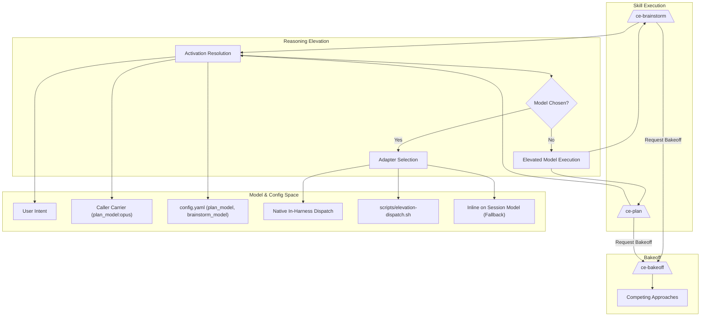

<!-- source: DeepWiki mcp.deepwiki.com · repo EveryInc/compound-engineering-plugin · page 3.2 Brainstorm and Plan Skills · fetched 2026-10-30 -->

# Brainstorm and Plan Skills

<details>
<summary>Relevant source files</summary>

The following files were used as context for generating this wiki page:

- [docs/guides/README.md](docs/guides/README.md)
- [docs/guides/ce-bakeoff.md](docs/guides/ce-bakeoff.md)
- [docs/guides/ce-brainstorm.md](docs/guides/ce-brainstorm.md)
- [docs/guides/ce-plan.md](docs/guides/ce-plan.md)
- [docs/solutions/skill-design/confirmations-filter-by-salience-not-length-caps.md](docs/solutions/skill-design/confirmations-filter-by-salience-not-length-caps.md)
- [skills/ce-bakeoff/SKILL.md](skills/ce-bakeoff/SKILL.md)
- [skills/ce-brainstorm/SKILL.md](skills/ce-brainstorm/SKILL.md)
- [skills/ce-brainstorm/references/approaches.md](skills/ce-brainstorm/references/approaches.md)
- [skills/ce-brainstorm/references/dialogue.md](skills/ce-brainstorm/references/dialogue.md)
- [skills/ce-brainstorm/references/interaction-rules.md](skills/ce-brainstorm/references/interaction-rules.md)
- [skills/ce-brainstorm/references/phase-0.md](skills/ce-brainstorm/references/phase-0.md)
- [skills/ce-brainstorm/references/plan-write.md](skills/ce-brainstorm/references/plan-write.md)
- [skills/ce-brainstorm/references/reasoning-elevation.md](skills/ce-brainstorm/references/reasoning-elevation.md)
- [skills/ce-brainstorm/references/settled-decisions.md](skills/ce-brainstorm/references/settled-decisions.md)
- [skills/ce-brainstorm/references/synthesis-summary.md](skills/ce-brainstorm/references/synthesis-summary.md)
- [skills/ce-brainstorm/references/universal-brainstorming.md](skills/ce-brainstorm/references/universal-brainstorming.md)
- [skills/ce-compound/SKILL.md](skills/ce-compound/SKILL.md)
- [skills/ce-debug/references/bakeoff.md](skills/ce-debug/references/bakeoff.md)
- [skills/ce-doc-review/references/dispatch.md](skills/ce-doc-review/references/dispatch.md)
- [skills/ce-doc-review/references/subagent-template.md](skills/ce-doc-review/references/subagent-template.md)
- [skills/ce-explain/references/orchestration.md](skills/ce-explain/references/orchestration.md)
- [skills/ce-plan/SKILL.md](skills/ce-plan/SKILL.md)
- [skills/ce-plan/references/bakeoff.md](skills/ce-plan/references/bakeoff.md)
- [skills/ce-plan/references/deepening-workflow.md](skills/ce-plan/references/deepening-workflow.md)
- [skills/ce-plan/references/final-review.md](skills/ce-plan/references/final-review.md)
- [skills/ce-plan/references/intake.md](skills/ce-plan/references/intake.md)
- [skills/ce-plan/references/reasoning-elevation.md](skills/ce-plan/references/reasoning-elevation.md)
- [skills/ce-plan/references/research.md](skills/ce-plan/references/research.md)
- [skills/ce-plan/references/settled-decisions.md](skills/ce-plan/references/settled-decisions.md)
- [skills/ce-plan/references/structure.md](skills/ce-plan/references/structure.md)
- [skills/ce-plan/references/synthesis-summary.md](skills/ce-plan/references/synthesis-summary.md)
- [skills/ce-pov/SKILL.md](skills/ce-pov/SKILL.md)
- [skills/ce-pov/references/cross-model-panel.md](skills/ce-pov/references/cross-model-panel.md)
- [skills/ce-pov/references/grounding.md](skills/ce-pov/references/grounding.md)
- [skills/ce-pov/references/method.md](skills/ce-pov/references/method.md)
- [skills/ce-strategy/SKILL.md](skills/ce-strategy/SKILL.md)
- [skills/ce-sweep/SKILL.md](skills/ce-sweep/SKILL.md)
- [skills/ce-sweep/references/interview.md](skills/ce-sweep/references/interview.md)
- [skills/ce-sweep/references/run.md](skills/ce-sweep/references/run.md)
- [tests/pov-skill-contract.test.ts](tests/pov-skill-contract.test.ts)
- [tests/skills/ce-plan-handoff-routing.test.ts](tests/skills/ce-plan-handoff-routing.test.ts)

</details>


The `ce-brainstorm` and `ce-plan` skills form the critical bridge between a vague idea and executable code. While `ce-brainstorm` focuses on the **WHAT** (collaborative definition and requirements), `ce-plan` focuses on the **HOW** (technical decisions, implementation units, and test scenarios) [skills/ce-plan/SKILL.md:9-11](). Together, they produce a **Unified Plan** artifact that evolves from `requirements-only` to `implementation-ready` [docs/guides/ce-plan.md:30-30]().

For details on the shared contract, requirements schema, U-IDs, contract tests, and rendering rules across these skills, see [Unified Plan Artifact Contract](#3.2.1).

---

## ce-brainstorm: Scoping and Definition

`ce-brainstorm` is a collaborative thinking partner that clarifies scope and pressure-tests premises before any code is considered [docs/guides/ce-brainstorm.md:5-7](). It operates on a "one question at a time" principle to ensure high-quality, focused dialogue [skills/ce-brainstorm/SKILL.md:46-48]().

### Phase 0: Output, Resume, and Scope
The initial phase of `ce-brainstorm` involves determining the output mode, checking for existing plans to resume, and classifying the task domain (`references/phase-0.md`). This phase sets the skill's trajectory, including whether to route to universal brainstorming for non-software tasks [skills/ce-brainstorm/SKILL.md:54-55]().

### Dialogue
The core of `ce-brainstorm` is its structured dialogue (`references/dialogue.md`), which aims to understand the user's idea, pressure-test assumptions, and identify blindspots [skills/ce-brainstorm/SKILL.md:56-56](). The skill asks one question at a time, prioritizing blocking questions through the host's tools [skills/ce-brainstorm/references/interaction-rules.md:1-12]().

### Visual Probes
For decisions that are spatial or behavioral, the skill can launch a **visual probe**—a disposable, low-fidelity sketch or local server that allows the user to judge a rough layout or flow in the browser rather than reading prose [docs/guides/ce-brainstorm.md:84-85](). This is governed by specific tripwires in Phase 0.1–0.4 [skills/ce-brainstorm/SKILL.md:55-55]().

### Universal Brainstorming
When `ce-brainstorm` identifies a task as non-software, it routes to `references/universal-brainstorming.md` [skills/ce-brainstorm/SKILL.md:17-18](). This path replaces standard software phases, focusing on a facilitation mode for non-software topics like events, business decisions, or strategic roadmaps [docs/guides/ce-brainstorm.md:7-9]().

### Handoff
Upon completion, `ce-brainstorm` presents a mandatory handoff menu in Phase 4 (`references/handoff.md`) [skills/ce-brainstorm/SKILL.md:59-60](). This menu allows the user to choose the next step, such as creating an implementation plan with `ce-plan` or shipping autonomously with `/lfg` [skills/ce-brainstorm/references/handoff.md:88-90](). In `mode:return-to-caller`, the result is returned directly to the calling skill without presenting a menu [skills/ce-brainstorm/references/handoff.md:10-31]().

```mermaid
graph TD
    subgraph "Natural Language Space"
        UserIdea["User Idea / Problem"]
    end

    subgraph "ce-brainstorm Workflow"
        A[/"ce-brainstorm"\]
        B["Phase 0: Output, Resume, Scope""]
        C["Dialogue (references/dialogue.md)""]
        D{"Is it non-software?"}
        E["Universal Brainstorming (references/universal-brainstorming.md)""]
        F["Visual Probes (references/visual-probes.md)""]
        G["Phase 2: Approaches, Synthesis, Verification""]
        H["Phase 3: Write Plan (references/brainstorm-sections.md)""]
        I["Phase 4: Handoff (references/handoff.md)""]
    end

    subgraph "Code & Artifact Space"
        UnifiedPlanArtifact["Unified Plan Artifact (requirements-only)"]
        VisualProbeServer["scripts/visual-probe-server.js"]
    end

    UserIdea --> A
    A --> B
    B --> C
    C --> D
    D -- "Yes" --> E
    D -- "No" --> F
    F --> G
    E --> G
    G --> H
    H --> UnifiedPlanArtifact
    H --> I
    F -- "Visual decision needed" --> VisualProbeServer
```
Sources: [skills/ce-brainstorm/SKILL.md:1-68](), [skills/ce-brainstorm/references/dialogue.md:1-12](), [skills/ce-brainstorm/references/handoff.md:1-185](), [skills/ce-brainstorm/references/phase-0.md:1-15](), [skills/ce-brainstorm/references/universal-brainstorming.md:1-12](), [skills/ce-brainstorm/references/visual-probes.md:1-12](), [docs/guides/ce-brainstorm.md:1-270]()

---

## ce-plan: Technical Strategy and Guardrails

`ce-plan` enriches the Unified Plan with execution guardrails. It focuses on capturing the technical "what" and "how" (files, units, test scenarios) without pre-writing implementation code [skills/ce-plan/SKILL.md:11-14]().

### Intake
The `ce-plan` skill begins with intake (Phase 0.2) defined in `references/intake.md` [skills/ce-plan/SKILL.md:43-46](). This involves finding and preserving upstream artifacts, routing out to bootstrap work if necessary, handling blocking questions, and executing scoping synthesis (`references/synthesis-summary.md`) [skills/ce-plan/references/synthesis-summary.md:1-15]().

### Research
Phases 1–4 of `ce-plan` are dedicated to research and composition [skills/ce-plan/SKILL.md:45-50](). `references/research.md` guides the gathering of local context via `repo-research-analyst`, external documentation searches, and Compound Pack resolution (`scripts/packs-resolve.py`) [skills/ce-plan/references/research.md:1-56]().

### Plan Sections
The plan is composed from `references/plan-sections.md`, which defines the structure and content of the implementation-ready Unified Plan artifact, including stable U-IDs for implementation units, technical design notes, and verification contracts [skills/ce-plan/SKILL.md:49-51]().

### Deepening
After the initial plan is written, `ce-plan` enters a deepening phase (Phase 5.3.2) as part of its final review workflow (`references/deepening-workflow.md`) [skills/ce-plan/SKILL.md:51-57](). This involves refining the plan based on confidence checks and dispatching parallel sub-agents to explore edge cases and integration boundaries.

### Final Review
Phase 5 of `ce-plan` focuses on review, writing, deepening, and handoff (`references/final-review.md`) [skills/ce-plan/SKILL.md:51-57](). It defines pre-write reviews, metadata validation, confidence modes, and final user handoffs.

### Resume
`ce-plan` supports resuming existing plans (`references/resume.md`), enriching requirements-only plans into implementation-ready plans, and deepening existing specs [skills/ce-plan/SKILL.md:43-44]().

```mermaid
graph TD
    subgraph "Natural Language Space"
        UserRequest["User Request / Brainstorm Artifact"]
    end

    subgraph "ce-plan Workflow"
        A[/"ce-plan"\]
        B["Phase 0: Output, Resume, Scope (references/resume.md, references/intake.md)""]
        C["Phases 1-4: Research & Compose (references/research.md, references/plan-sections.md)""]
        D["Phase 5: Review, Write, Deepen, Handoff (references/final-review.md, references/deepening-workflow.md)""]
        E["Final Review & Confidence Check"]
        F["Handoff / Resume"]
    end

    subgraph "Code & Artifact Space"
        UnifiedPlanArtifact["Unified Plan Artifact (implementation-ready)"]
        RepoCode["Repository Code"]
        DocsSolutions["docs/solutions/ (Learnings)"]
    end

    UserRequest --> A
    A --> B
    B --> C
    C --> D
    D --> E
    E --> F
    C -- "Research" --> RepoCode
    C -- "Research" --> DocsSolutions
    D --> UnifiedPlanArtifact
```
Sources: [skills/ce-plan/SKILL.md:1-57](), [skills/ce-plan/references/deepening-workflow.md:1-15](), [skills/ce-plan/references/final-review.md:1-15](), [skills/ce-plan/references/research.md:1-56](), [skills/ce-plan/references/resume.md:1-15](), [docs/guides/ce-plan.md:1-30]()

---

## Reasoning Elevation and Bakeoff

Both `ce-brainstorm` and `ce-plan` leverage **reasoning elevation** (`references/reasoning-elevation.md`) to handle reasoning-heavy tasks by dispatching more capable models or specialized prompt adapters [skills/ce-brainstorm/SKILL.md:57-58]().

### Reasoning Elevation
The elevated steps include:
- **`ce-plan`**: Interpreting complex research findings and authoring architectural plans [skills/ce-plan/SKILL.md:54-55]().
- **`ce-brainstorm`**: Generating diverse and robust approach options [skills/ce-brainstorm/SKILL.md:57-58]().

Activation resolution follows a clear precedence: explicit user instructions, caller-provided carriers (such as `/lfg` passing `plan_model:<alias>`), and workspace configuration keys (`plan_model` or `brainstorm_model`) [skills/ce-plan/SKILL.md:54-55]().

### Bakeoff
A **bakeoff** (`ce-bakeoff`) independently develops and selects competing implementation approaches to improve brainstorming and planning decisions [docs/guides/ce-bakeoff.md:1-5](). Planning runs it automatically when a costly technical choice remains unconstrained, while brainstorming invokes it on explicit request or complex branch points [docs/guides/ce-bakeoff.md:6-10]().


Sources: [skills/ce-brainstorm/SKILL.md:54-59](), [skills/ce-plan/SKILL.md:54-57](), [docs/guides/ce-bakeoff.md:1-15]()

---

