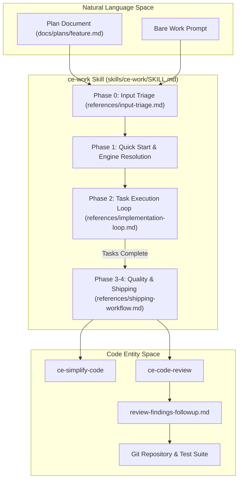
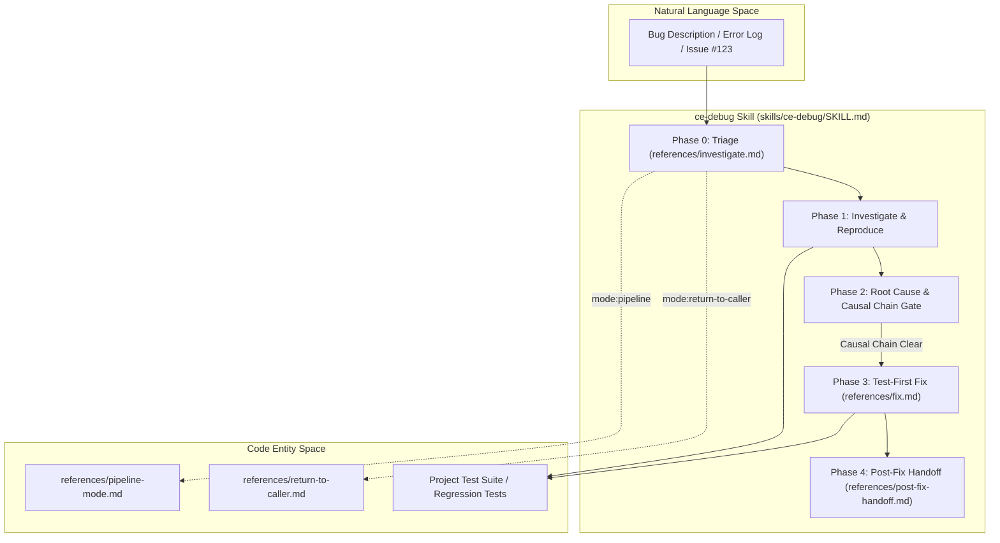

<!-- source: DeepWiki mcp.deepwiki.com · repo EveryInc/compound-engineering-plugin · page 3.3 Work and Debug Skills · fetched 2026-10-30 -->

# Work and Debug Skills

Relevant source files

The following files were used as context for generating this wiki page:

- [CONCEPTS.md](CONCEPTS.md)
- [docs/guides/ce-debug.md](docs/guides/ce-debug.md)
- [docs/solutions/skill-design/right-size-plans-by-subtraction-and-a-usage-first-sizing-test.md](docs/solutions/skill-design/right-size-plans-by-subtraction-and-a-usage-first-sizing-test.md)
- [skills/ce-debug/SKILL.md](skills/ce-debug/SKILL.md)
- [skills/ce-debug/references/fix.md](skills/ce-debug/references/fix.md)
- [skills/ce-debug/references/investigate.md](skills/ce-debug/references/investigate.md)
- [skills/ce-debug/references/pipeline-mode.md](skills/ce-debug/references/pipeline-mode.md)
- [skills/ce-debug/references/post-fix-handoff.md](skills/ce-debug/references/post-fix-handoff.md)
- [skills/ce-debug/references/return-to-caller.md](skills/ce-debug/references/return-to-caller.md)
- [skills/ce-work/SKILL.md](skills/ce-work/SKILL.md)
- [skills/ce-work/references/agents/implementation-worker.md](skills/ce-work/references/agents/implementation-worker.md)
- [skills/ce-work/references/cross-model-execution.md](skills/ce-work/references/cross-model-execution.md)
- [skills/ce-work/references/execution-strategy.md](skills/ce-work/references/execution-strategy.md)
- [skills/ce-work/references/implementation-loop.md](skills/ce-work/references/implementation-loop.md)
- [skills/ce-work/references/review-findings-followup.md](skills/ce-work/references/review-findings-followup.md)
- [skills/ce-work/references/shipping-workflow.md](skills/ce-work/references/shipping-workflow.md)
- [skills/ce-work/references/work-intake.md](skills/ce-work/references/work-intake.md)
- [skills/ce-work/scripts/unit_workspace_state.py](skills/ce-work/scripts/unit_workspace_state.py)
- [skills/lfg/SKILL.md](skills/lfg/SKILL.md)
- [skills/lfg/references/debug-return.md](skills/lfg/references/debug-return.md)
- [tests/pipeline-review-contract.test.ts](tests/pipeline-review-contract.test.ts)
- [tests/skill-eval-cell/fixtures/debug-caller-edits/SPEC.md](tests/skill-eval-cell/fixtures/debug-caller-edits/SPEC.md)
- [tests/skill-eval-cell/fixtures/debug-caller-edits/package.json](tests/skill-eval-cell/fixtures/debug-caller-edits/package.json)
- [tests/skill-eval-cell/fixtures/debug-caller-edits/src/seat-cap.js](tests/skill-eval-cell/fixtures/debug-caller-edits/src/seat-cap.js)
- [tests/skill-eval-cell/fixtures/debug-caller-edits/tests/seat-cap.check.js](tests/skill-eval-cell/fixtures/debug-caller-edits/tests/seat-cap.check.js)
- [tests/skill-eval-cell/fixtures/debug-sibling-consumer/DIAGNOSIS.md](tests/skill-eval-cell/fixtures/debug-sibling-consumer/DIAGNOSIS.md)
- [tests/skill-eval-cell/packs/ce-work-sizing.md](tests/skill-eval-cell/packs/ce-work-sizing.md)
- [tests/skills/ce-work-outcome-spine.test.ts](tests/skills/ce-work-outcome-spine.test.ts)
- [tests/skills/ce-work-unit-workspace-init.test.ts](tests/skills/ce-work-unit-workspace-init.test.ts)
- [tests/skills/lfg-intake-contract.test.ts](tests/skills/lfg-intake-contract.test.ts)

This page details the **Work** and **Debug** execution skills within the `compound-engineering-plugin`: `ce-work` and `ce-debug`. These skills represent the core execution phase of the engineering lifecycle, transforming validated plans or bug reports into verified code and structured delivery artifacts [skills/ce-work/SKILL.md:3](), [skills/ce-debug/SKILL.md:3]().

---

## ce-work: Execution and Implementation

`ce-work` is the primary execution engine. It takes a plan (ideally from `ce-plan`), a specification path, or a clear build request and executes the implementation against defined guardrails [skills/ce-work/SKILL.md:3](). It treats plans as decision artifacts, allowing the agent to determine the best implementation path while strictly respecting the plan's scope, task boundaries, and verification criteria [skills/ce-work/SKILL.md:14]().

For deep technical details on unit workspace python helpers, workspace isolation policies, execution engines, and cross-model scripts, see [Unit Workspaces and Cross-Model Execution](#3.3.1).

### Input Triage, Outcome Spine, and Execution Strategy
Before execution, `ce-work` performs **Phase 0: Input Triage**, checking for direct recovery activations (`run_id`) or parsing modes (`standalone` vs `mode:return-to-caller`) [skills/ce-work/SKILL.md:22-30](). Its **Outcome Spine** defines the exact deliverable, next consumer, done conditions, and intent, ensuring that workers receive bounded units while host orchestrators retain canonical integration authority [skills/ce-work/SKILL.md:9-15](). 

Execution strategy and engine selection balance inline execution for trivial work against parallel subagent waves for structured multi-unit plans, governed by safety and independence checks [skills/ce-work/references/execution-strategy.md:5-15]().

Sources: [skills/ce-work/SKILL.md:9-30](), [skills/ce-work/references/execution-strategy.md:1-25]()

### Implementation Loop and Shipping Workflow
Once tasks start, `SKILLS/ce-work/references/implementation-loop.md` dictates task ordering, test-first or characterization-first evidence selection, incremental commits, and test verification [skills/ce-work/references/implementation-loop.md:3-13](). 

For standalone runs, Phase 3-4 invokes the **Shipping Workflow** (`skills/ce-work/references/shipping-workflow.md`), which enforces core quality checks, conditional simplification via `ce-simplify-code`, mandatory code review via `ce-code-review`, a strict code-review completion gate, and residual findings tracking [skills/ce-work/references/shipping-workflow.md:7-45](). Any review findings needing follow-up are routed through `skills/ce-work/references/review-findings-followup.md`.

Sources: [skills/ce-work/references/implementation-loop.md:1-34](), [skills/ce-work/references/shipping-workflow.md:1-47]()

#### Diagram: ce-work Execution and Shipping Flow

**Sources:** [skills/ce-work/SKILL.md:1-61](), [skills/ce-work/references/shipping-workflow.md:1-47]()

---

## ce-debug: Systematic Investigation and Fix Loop

`ce-debug` is the investigation-first skill for diagnosing failing behavior, test failures, or bug reports [skills/ce-debug/SKILL.md:3](). It enforces rigorous causal chains before proposing or applying repairs [skills/ce-debug/SKILL.md:11]().

### Investigation, Fix, and Pipeline Mode
The debugging lifecycle moves through five distinct phases: **0 Triage, 1 Investigate, 2 Root Cause, 3 Fix, and 4 Handoff** [skills/ce-debug/SKILL.md:46](). Phase 2 enforces a strict **Causal Chain Gate** preventing fixes until the trigger-to-symptom path is fully accounted for [skills/ce-debug/SKILL.md:56-59](). Phase 3 applies test-first discipline via `skills/ce-debug/references/fix.md`, ensuring minimal root-cause repairs without shotgun debugging [skills/ce-debug/references/fix.md:7-14]().

When invoked by orchestrators (`lfg`, `ce-babysit-pr`), `ce-debug` accepts `mode:pipeline` or `mode:return-to-caller`, running non-interactively, applying convergent fixes while deferring divergent ones, and emitting structured JSON status payloads [skills/ce-debug/SKILL.md:20-23](), [skills/ce-debug/references/pipeline-mode.md:3-48](). Post-fix handoff is governed by `skills/ce-debug/references/post-fix-handoff.md`.

Sources: [skills/ce-debug/SKILL.md:9-59](), [skills/ce-debug/references/fix.md:1-21](), [skills/ce-debug/references/pipeline-mode.md:1-57]()

#### Diagram: ce-debug Diagnostic Flow

**Sources:** [skills/ce-debug/SKILL.md:1-59](), [skills/ce-debug/references/investigate.md](), [skills/ce-debug/references/fix.md](), [skills/ce-debug/references/pipeline-mode.md]()

---

