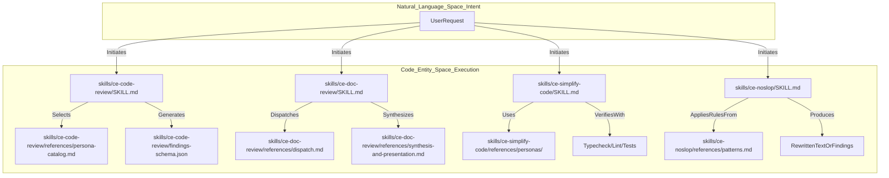

<!-- source: DeepWiki mcp.deepwiki.com · repo EveryInc/compound-engineering-plugin · page 3.4 Review and Quality Skills · fetched 2026-10-30 -->

# Review and Quality Skills

Relevant source files

The following files were used as context for generating this wiki page:

- [docs/plans/2026-07-13-001-feat-code-review-line-provenance-plan.md](docs/plans/2026-07-13-001-feat-code-review-line-provenance-plan.md)
- [docs/plans/2026-10-14-1147-feat-simplify-test-comment-pruning-plan.md](docs/plans/2026-10-14-1147-feat-simplify-test-comment-pruning-plan.md)
- [docs/solutions/skill-design/anti-poll-scope-and-async-subagent-dispatch.md](docs/solutions/skill-design/anti-poll-scope-and-async-subagent-dispatch.md)
- [docs/solutions/skill-design/cross-harness-cross-model-tool-invocation.md](docs/solutions/skill-design/cross-harness-cross-model-tool-invocation.md)
- [docs/solutions/skill-design/watch-loops-need-a-blocked-external-terminal-state.md](docs/solutions/skill-design/watch-loops-need-a-blocked-external-terminal-state.md)
- [skills/ce-code-review/SKILL.md](skills/ce-code-review/SKILL.md)
- [skills/ce-code-review/references/diff-scope.md](skills/ce-code-review/references/diff-scope.md)
- [skills/ce-code-review/references/dispatch-reviewers.md](skills/ce-code-review/references/dispatch-reviewers.md)
- [skills/ce-code-review/references/finish-review.md](skills/ce-code-review/references/finish-review.md)
- [skills/ce-code-review/references/subagent-template.md](skills/ce-code-review/references/subagent-template.md)
- [skills/ce-code-review/references/validator-batch-template.md](skills/ce-code-review/references/validator-batch-template.md)
- [skills/ce-code-review/scripts/findings-mechanics.py](skills/ce-code-review/scripts/findings-mechanics.py)
- [skills/ce-code-review/scripts/review-scope.py](skills/ce-code-review/scripts/review-scope.py)
- [skills/ce-noslop/SKILL.md](skills/ce-noslop/SKILL.md)
- [skills/ce-noslop/references/patterns.md](skills/ce-noslop/references/patterns.md)
- [skills/ce-simplify-code/SKILL.md](skills/ce-simplify-code/SKILL.md)
- [skills/ce-simplify-code/references/personas/code-quality-reviewer.md](skills/ce-simplify-code/references/personas/code-quality-reviewer.md)
- [skills/ce-simplify-code/references/personas/code-reuse-reviewer.md](skills/ce-simplify-code/references/personas/code-reuse-reviewer.md)
- [skills/ce-simplify-code/references/personas/comment-reviewer.md](skills/ce-simplify-code/references/personas/comment-reviewer.md)
- [skills/ce-simplify-code/references/personas/efficiency-reviewer.md](skills/ce-simplify-code/references/personas/efficiency-reviewer.md)
- [skills/ce-simplify-code/references/personas/test-value-reviewer.md](skills/ce-simplify-code/references/personas/test-value-reviewer.md)
- [tests/ce-code-review-mechanics.test.ts](tests/ce-code-review-mechanics.test.ts)
- [tests/review-skill-contract.test.ts](tests/review-skill-contract.test.ts)
- [tests/skill-eval-cell/fixtures/noslop-drafts/certainty.md](tests/skill-eval-cell/fixtures/noslop-drafts/certainty.md)
- [tests/skill-eval-cell/fixtures/noslop-drafts/choppy.md](tests/skill-eval-cell/fixtures/noslop-drafts/choppy.md)
- [tests/skill-eval-cell/fixtures/noslop-drafts/release-notes.md](tests/skill-eval-cell/fixtures/noslop-drafts/release-notes.md)
- [tests/skill-eval-cell/fixtures/noslop-drafts/status-update.md](tests/skill-eval-cell/fixtures/noslop-drafts/status-update.md)
- [tests/skill-eval-cell/fixtures/review-artifact-quote/correctness.json](tests/skill-eval-cell/fixtures/review-artifact-quote/correctness.json)
- [tests/skill-eval-cell/fixtures/review-artifact-quote/returns.json](tests/skill-eval-cell/fixtures/review-artifact-quote/returns.json)
- [tests/skill-eval-cell/grade.test.ts](tests/skill-eval-cell/grade.test.ts)
- [tests/skill-eval-cell/grade.ts](tests/skill-eval-cell/grade.ts)

## Purpose and Scope

Review and quality skills provide the structured verification layer of the Compound Engineering workflow. This document covers the multi-persona parallel review pipelines for code and documentation, automated code simplification, metric-driven optimization loops, and prose quality guards. These skills ensure that work produced during the execution phase meets project standards, remains maintainable, and achieves measurable performance goals.

As a parent page, this section provides a high-level overview of the review family. For comprehensive technical details on specific subsystems, refer to the child pages:
- [ce-code-review Pipeline](#3.4.1)
- [ce-optimize — Metric-Driven Optimization](#3.4.2)

Sources: [skills/ce-code-review/SKILL.md:7-12](), [skills/ce-simplify-code/SKILL.md:1-5]()

---

## Overview

The review ecosystem bridges Natural Language Space (intent) to Code Entity Space (execution) through structured verification, multi-persona analysis, and automated refactoring:

1.  **`ce-code-review`**: A multi-persona parallel pipeline for deep technical analysis of code changes. For details, see [ce-code-review Pipeline](#3.4.1).
2.  **`ce-doc-review`**: A parallel analysis pipeline for requirements, plans, and documentation [docs/guides/ce-doc-review.md:3-5]().
3.  **`ce-simplify-code`**: An automated refactoring skill using parallel tidy personas to improve clarity and efficiency without breaking behavior [docs/guides/ce-simplify-code.md:1-5]().
4.  **`ce-noslop`**: A writing skill ensuring prose is free of AI tells and easily understood [skills/ce-noslop/SKILL.md:1-3]().
5.  **`ce-optimize`**: A metric-driven iterative loop for converging on optimal solutions through experimentation. For details, see [ce-optimize — Metric-Driven Optimization](#3.4.2).

Sources: [docs/guides/ce-code-review.md:3-5](), [docs/guides/ce-doc-review.md:3-5](), [docs/guides/ce-simplify-code.md:1-5](), [skills/ce-noslop/SKILL.md:1-3]()

---

## Code Review Pipeline (`ce-code-review`)

`ce-code-review` is the deep verification skill. It analyzes a diff or PR, selects relevant reviewer personas, dispatches them in parallel, and synthesizes findings into a unified report with confidence gating and quote-the-line verification [skills/ce-code-review/SKILL.md:7-33](). 

For full architectural details—including the six-stage execution spine, scope resolution, persona catalogs, fast-pass logic, and findings mechanics—see [ce-code-review Pipeline](#3.4.1).

Sources: [skills/ce-code-review/SKILL.md:7-33]()

---

## Documentation Review (`ce-doc-review`)

`ce-doc-review` provides a multi-persona analysis pipeline for requirements, plans, or specs [docs/guides/ce-doc-review.md:1-5](). It corrects proven errors and returns worthwhile unresolved issues [docs/guides/ce-doc-review.md:3-5]().

### Doc-Content-Aware Persona Selection
`ce-doc-review` selects personas based on the document's content rather than surface keywords. For example, a `product-lens` reviewer activates when a document stakes an unsettled product position, while a `security-lens` activates for auth or sensitive data topics [docs/guides/ce-doc-review.md:85-93](). `coherence-reviewer` and `feasibility-reviewer` run on every review [docs/guides/ce-doc-review.md:94-95]().

Sources: [docs/guides/ce-doc-review.md:1-5](), [docs/guides/ce-doc-review.md:85-95]()

---

## Code Simplification (`ce-simplify-code`)

`ce-simplify-code` performs behavior-preserving refactors to improve clarity and efficiency [skills/ce-simplify-code/SKILL.md:7-8](). It targets current branch changes or user-specified files [skills/ce-simplify-code/SKILL.md:16-24]().

### Simplification Personas
The skill dispatches parallel reviewers to audit code characteristics [skills/ce-simplify-code/SKILL.md:32-41]():
*   **Reuse Reviewer**: Searches for existing utilities or platform guarantees that new code reimplements [skills/ce-simplify-code/references/personas/code-reuse-reviewer.md:1-5]().
*   **Quality Reviewer**: Flags hacky patterns, redundant state, parameter sprawl, and leaky abstractions [skills/ce-simplify-code/references/personas/code-quality-reviewer.md:1-11]().
*   **Efficiency Reviewer**: Finds wasted work, missed concurrency, and hot-path bloat [skills/ce-simplify-code/references/personas/efficiency-reviewer.md:1-7]().

Sources: [skills/ce-simplify-code/SKILL.md:7-41](), [skills/ce-simplify-code/references/personas/code-reuse-reviewer.md:1-5](), [skills/ce-simplify-code/references/personas/code-quality-reviewer.md:1-11](), [skills/ce-simplify-code/references/personas/efficiency-reviewer.md:1-7]()

---

## Writing Quality (`ce-noslop`)

`ce-noslop` is the plugin's writing skill, ensuring prose is free of AI tells and easily understood on the first read while preserving factual content [skills/ce-noslop/SKILL.md:1-3](). It evaluates sentences across multiple registers and operational modes (`author`, `edit`, `detect`) [skills/ce-noslop/SKILL.md:15-32]().

Sources: [skills/ce-noslop/SKILL.md:1-3](), [skills/ce-noslop/SKILL.md:15-32]()

---

## Metric-Driven Optimization (`ce-optimize`)

`ce-optimize` manages structured, metric-driven optimization loops to converge on performance or functional goals via experimentation. For complete details on its optimize-spec schema, measurement loops, and research/judge agents, see [ce-optimize — Metric-Driven Optimization](#3.4.2).

Sources: [docs/guides/ce-code-review.md:3-5]()

---

## System Integration

Title: Review and Quality Data Flow

Sources: [skills/ce-code-review/SKILL.md:1-40](), [skills/ce-simplify-code/SKILL.md:1-75](), [skills/ce-noslop/SKILL.md:1-44]()

### Summary of Quality Gates

| Skill | Primary Gate | Artifact | Handoff |
| :--- | :--- | :--- | :--- |
| `ce-code-review` | Confidence Anchor 75+, Quote-the-line | Structured findings report | `apply:local` or `mode:agent` JSON handoff |
| `ce-doc-review` | Persona-based findings, Coherence/Feasibility | Updated markdown/HTML document, proposed fixes | Interactive walkthrough or structured results |
| `ce-simplify-code` | Behavior preservation (typecheck, lint, tests) | Refactored code | Before review, commit, or handoff |
| `ce-noslop` | Seven prose tests (Mechanism, Portability, Actor, etc.) | Rewritten text, detected patterns | Inline invocation or direct output |

Sources: [skills/ce-code-review/SKILL.md:11-37](), [skills/ce-simplify-code/SKILL.md:52-72](), [skills/ce-noslop/SKILL.md:34-44]()

---

