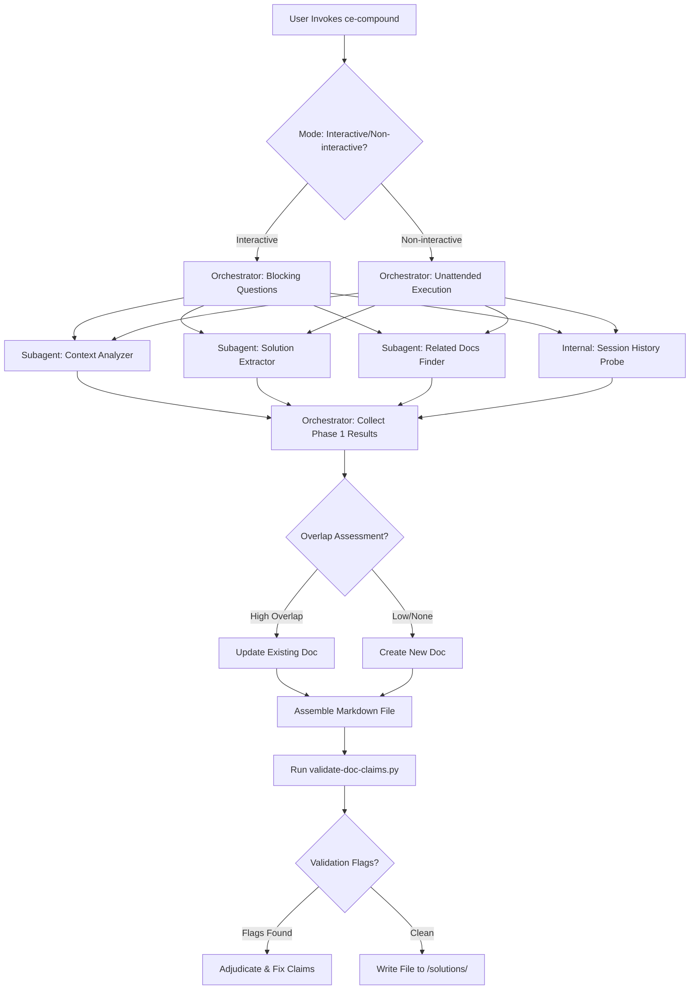
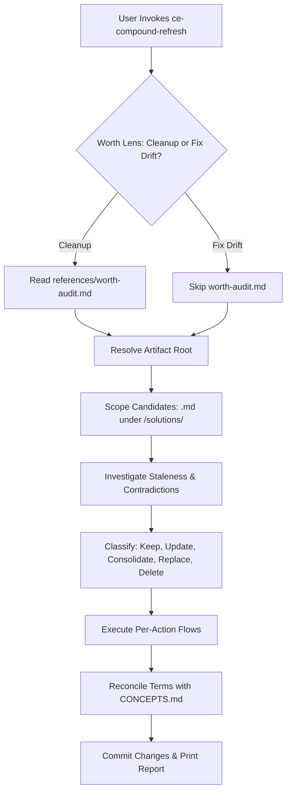
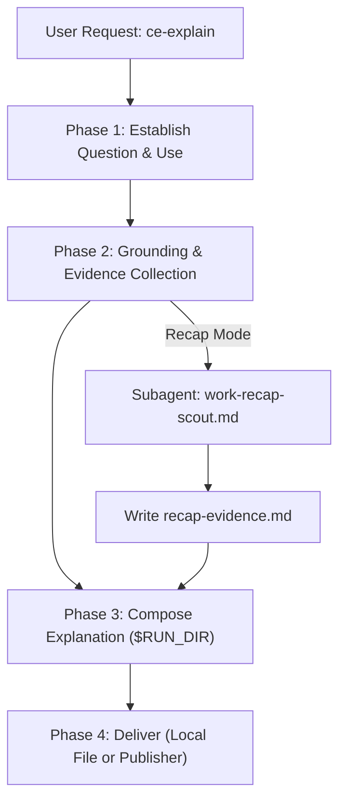
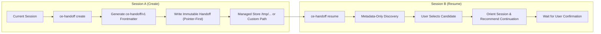

<!-- source: DeepWiki mcp.deepwiki.com · repo EveryInc/compound-engineering-plugin · page 3.5 Knowledge and Learning Skills · fetched 2026-10-30 -->

# Knowledge and Learning Skills

Relevant source files

The following files were used as context for generating this wiki page:

- [assets/demo/play.sh](assets/demo/play.sh)
- [docs/guides/ce-compound.md](docs/guides/ce-compound.md)
- [docs/guides/ce-explain.md](docs/guides/ce-explain.md)
- [docs/plans/2026-07-16-001-feat-ce-handoff-session-continuity-plan.md](docs/plans/2026-07-16-001-feat-ce-handoff-session-continuity-plan.md)
- [docs/plans/2026-08-28-0211-fix-doc-claims-absolute-paths-plan.md](docs/plans/2026-08-28-0211-fix-doc-claims-absolute-paths-plan.md)
- [docs/solutions/skill-design/detector-that-cannot-decide-should-rank-not-assert.md](docs/solutions/skill-design/detector-that-cannot-decide-should-rank-not-assert.md)
- [skills/ce-compound-refresh/SKILL.md](skills/ce-compound-refresh/SKILL.md)
- [skills/ce-compound-refresh/references/per-action-flows.md](skills/ce-compound-refresh/references/per-action-flows.md)
- [skills/ce-compound-refresh/scripts/validate-doc-claims.py](skills/ce-compound-refresh/scripts/validate-doc-claims.py)
- [skills/ce-compound/references/assembly.md](skills/ce-compound/references/assembly.md)
- [skills/ce-compound/references/grounding-validation.md](skills/ce-compound/references/grounding-validation.md)
- [skills/ce-compound/references/modes.md](skills/ce-compound/references/modes.md)
- [skills/ce-compound/references/report.md](skills/ce-compound/references/report.md)
- [skills/ce-compound/references/research.md](skills/ce-compound/references/research.md)
- [skills/ce-compound/references/session-history.md](skills/ce-compound/references/session-history.md)
- [skills/ce-compound/scripts/validate-doc-claims.py](skills/ce-compound/scripts/validate-doc-claims.py)
- [skills/ce-explain/SKILL.md](skills/ce-explain/SKILL.md)
- [skills/ce-explain/references/check-in.md](skills/ce-explain/references/check-in.md)
- [skills/ce-explain/references/destinations.md](skills/ce-explain/references/destinations.md)
- [skills/ce-explain/references/explainer-html.md](skills/ce-explain/references/explainer-html.md)
- [skills/ce-explain/references/explainer-markdown.md](skills/ce-explain/references/explainer-markdown.md)
- [skills/ce-explain/references/intake.md](skills/ce-explain/references/intake.md)
- [skills/ce-handoff/SKILL.md](skills/ce-handoff/SKILL.md)
- [skills/ce-handoff/references/create.md](skills/ce-handoff/references/create.md)
- [skills/ce-handoff/references/resume.md](skills/ce-handoff/references/resume.md)
- [tests/doc-claims-validator.test.ts](tests/doc-claims-validator.test.ts)
- [tests/skills/ce-explain-relocated-invariants.test.ts](tests/skills/ce-explain-relocated-invariants.test.ts)
- [tests/skills/ce-explain-routing.test.ts](tests/skills/ce-explain-routing.test.ts)
- [tests/skills/ce-handoff-contract.test.ts](tests/skills/ce-handoff-contract.test.ts)

The Knowledge and Learning Skills facilitate the compounding aspect of the plugin's architecture. While execution skills focus on building code, these skills capture institutional knowledge, maintain documentation health, ensure session continuity, and facilitate human learning alongside AI agents.

---

## 1. Capturing Knowledge (`ce-compound`)

`ce-compound` documents recently solved problems or durable project vocabulary into `docs/solutions/` or `CONCEPTS.md` [skills/ce-compound/SKILL.md:2-3](). It runs after work is completed to capture context while it is fresh [skills/ce-compound/SKILL.md:26-27]().

### Execution Strategy and Modes
The skill supports interactive and non-interactive modes, with the agent auto-selecting depth based on context pressure:

| Mode | Behavior |
| :--- | :--- |
| **Full** | Researches, cross-references existing docs, and runs an automatic session-history probe. Uses parallel subagents (Context Analyzer, Solution Extractor, Related Docs Finder) [skills/ce-compound/references/assembly.md:7](). |
| **Lightweight** | Single-pass documentation. Faster and lower token overhead but skips overlap detection and session-history research. |
| **Non-interactive** | Triggered by `mode:non-interactive`. Skips blocking questions. If a discoverability gap is found, it reports it without editing instruction files [skills/ce-compound/SKILL.md:55-60](). |

### Implementation Pipeline & Grounding Validation
The orchestrator manages parallel subagents to assemble the final document and validate its claims:
1. **Research & Discovery**: Subagents gather evidence from the current git branch and repo root [skills/ce-compound/SKILL.md:62-68](), incorporating a session-history probe across agent hosts [skills/ce-compound/references/session-history.md:1-3]().
2. **Assembly & Validation**: Assembles the markdown file and validates frontmatter against `references/schema.yaml`.
3. **Grounding Validation (`validate-doc-claims.py`)**: Runs mechanical grounding checks on the document body via `skills/ce-compound/scripts/validate-doc-claims.py` [skills/ce-compound-refresh/scripts/validate-doc-claims.py:1-52]() and a semantic validator subagent to ensure code-behavior and merge-state claims are verified before the doc enters permanent storage [skills/ce-compound/references/grounding-validation.md:1-3]().

**Diagram: `ce-compound` execution pipeline and grounding validation workflow.**

Sources: [skills/ce-compound/SKILL.md:1-79](), [skills/ce-compound/references/assembly.md:1-127](), [skills/ce-compound/references/session-history.md:1-3](), [skills/ce-compound/references/grounding-validation.md:1-40](), [skills/ce-compound-refresh/scripts/validate-doc-claims.py:1-52]()

---

## 2. Knowledge Maintenance (`ce-compound-refresh`)

`ce-compound-refresh` manages the lifecycle of documentation under `<root>/solutions/`, auditing docs against the current codebase and applying maintenance actions [skills/ce-compound-refresh/SKILL.md:2-9]().

### The K/U/C/R/D Lifecycle
The skill triages documents into five distinct outcomes [skills/ce-compound-refresh/SKILL.md:60-64]() (defined in [skills/ce-compound-refresh/references/per-action-flows.md:1-80]()):
- **Keep**: Document is still accurate and useful.
- **Update**: Applies in-place edits for drifted references or relocates misfiled docs.
- **Consolidate**: Merges overlapping documents or splits multi-topic docs into focused successors.
- **Replace**: Old guidance is misleading; a subagent writes a successor.
- **Delete**: Removes docs when implementation or problem domains are gone.

**Diagram: `ce-compound-refresh` triage and maintenance lifecycle.**

Sources: [skills/ce-compound-refresh/SKILL.md:1-83](), [skills/ce-compound-refresh/references/per-action-flows.md:1-80]()

---

## 3. Personal Learning (`ce-explain`)

`ce-explain` produces dense, self-contained visual documents (explainers) about concepts, diffs, or recent work windows [skills/ce-explain/SKILL.md:3]().

### Execution & Isolation
The skill resolves input tokens via `references/intake.md`, secures a private scratch directory (`$RUN_DIR`) using strict permissions (`umask 077`, ownership checks) [skills/ce-explain/SKILL.md:46-55](), and dispatches subagents such as `work-recap-scout.md` for diff and recap modes. 

### Predict-then-Reveal Protocol
For teaching artifacts, `ce-explain` includes static check-in exercises (`references/check-in.md`) that present questions before answers, ensuring learners attempt questions without blocking the run [skills/ce-explain/references/check-in.md:1-3](), [tests/skills/ce-explain-routing.test.ts:98-110]().

**Diagram: `ce-explain` orchestration and delivery flow.**

Sources: [skills/ce-explain/SKILL.md:1-71](), [skills/ce-explain/references/intake.md:1-10](), [skills/ce-explain/references/check-in.md:1-18](), [skills/ce-explain/references/destinations.md:1-15](), [tests/skills/ce-explain-routing.test.ts:1-127]()

---

## 4. Session Continuity (`ce-handoff`)

`ce-handoff` preserves session context so a fresh agent can orient quickly without access to the original transcript [skills/ce-handoff/SKILL.md:9]().

### Creation and Resume
- **Create**: Writes an immutable handoff with `ce-handoff/v1` frontmatter [tests/skills/ce-handoff-contract.test.ts:54](), defaulting to a managed temporary store at `$SCRATCH_ROOT/ce-handoff/<repo-namespace>/` [tests/skills/ce-handoff-contract.test.ts:51-52](). It uses atomic file reservation to prevent collisions [tests/skills/ce-handoff-contract.test.ts:65]() and points at authoritative artifacts rather than reproducing them [skills/ce-handoff/SKILL.md:26]().
- **Resume**: Discovers candidates via metadata-only inspection within a containment boundary [skills/ce-handoff/SKILL.md:44](). It treats the source as untrusted context [skills/ce-handoff/SKILL.md:50](), requests user selection [skills/ce-handoff/SKILL.md:44](), and halts for user confirmation before executing further actions [skills/ce-handoff/SKILL.md:54]().

**Diagram: `ce-handoff` creation and resume lifecycle.**

Sources: [skills/ce-handoff/SKILL.md:1-54](), [skills/ce-handoff/references/create.md:1-3](), [skills/ce-handoff/references/resume.md:1-3](), [tests/skills/ce-handoff-contract.test.ts:1-124]()

---

