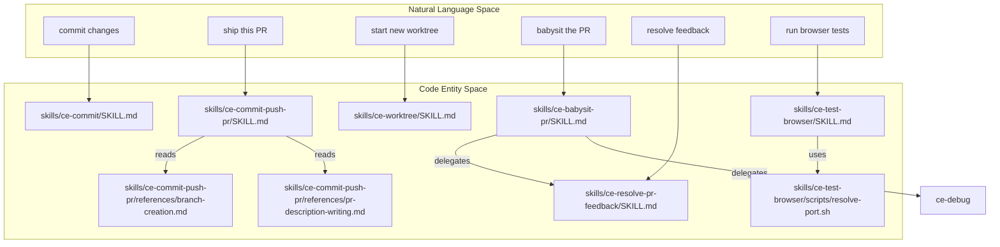
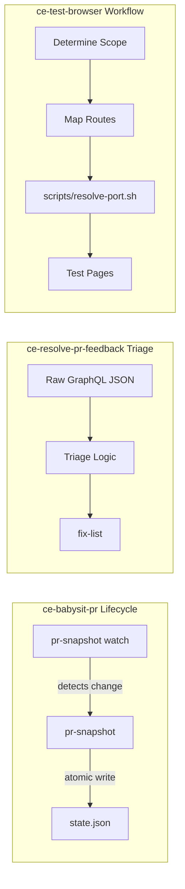

<!-- source: DeepWiki mcp.deepwiki.com · repo EveryInc/compound-engineering-plugin · page 3.6 Git, Collaboration, and Utility Skills · fetched 2026-10-30 -->

# Git, Collaboration, and Utility Skills

Relevant source files

The following files were used as context for generating this wiki page:

- [docs/guides/ce-resolve-pr-feedback.md](docs/guides/ce-resolve-pr-feedback.md)
- [docs/plans/2026-07-09-001-fix-ce-test-browser-native-driver-plan.md](docs/plans/2026-07-09-001-fix-ce-test-browser-native-driver-plan.md)
- [skills/ce-babysit-pr/references/report.md](skills/ce-babysit-pr/references/report.md)
- [skills/ce-commit-push-pr/SKILL.md](skills/ce-commit-push-pr/SKILL.md)
- [skills/ce-commit-push-pr/references/branch-creation.md](skills/ce-commit-push-pr/references/branch-creation.md)
- [skills/ce-commit-push-pr/references/commit-and-push.md](skills/ce-commit-push-pr/references/commit-and-push.md)
- [skills/ce-commit-push-pr/references/pr-description-writing.md](skills/ce-commit-push-pr/references/pr-description-writing.md)
- [skills/ce-commit-push-pr/references/stack-submit.md](skills/ce-commit-push-pr/references/stack-submit.md)
- [skills/ce-commit/SKILL.md](skills/ce-commit/SKILL.md)
- [skills/ce-doc-review/references/decision-primer.md](skills/ce-doc-review/references/decision-primer.md)
- [skills/ce-polish/SKILL.md](skills/ce-polish/SKILL.md)
- [skills/ce-polish/references/dev-server-detection.md](skills/ce-polish/references/dev-server-detection.md)
- [skills/ce-polish/references/dev-server-next.md](skills/ce-polish/references/dev-server-next.md)
- [skills/ce-polish/references/dev-server-rails.md](skills/ce-polish/references/dev-server-rails.md)
- [skills/ce-polish/references/dev-server-vite.md](skills/ce-polish/references/dev-server-vite.md)
- [skills/ce-polish/scripts/resolve-port.sh](skills/ce-polish/scripts/resolve-port.sh)
- [skills/ce-promote/SKILL.md](skills/ce-promote/SKILL.md)
- [skills/ce-resolve-pr-feedback/SKILL.md](skills/ce-resolve-pr-feedback/SKILL.md)
- [skills/ce-resolve-pr-feedback/references/evaluation-rubric.md](skills/ce-resolve-pr-feedback/references/evaluation-rubric.md)
- [skills/ce-resolve-pr-feedback/references/pipeline-mode.md](skills/ce-resolve-pr-feedback/references/pipeline-mode.md)
- [skills/ce-riffrec-feedback-analysis/SKILL.md](skills/ce-riffrec-feedback-analysis/SKILL.md)
- [skills/ce-riffrec-feedback-analysis/references/extensive-analysis.md](skills/ce-riffrec-feedback-analysis/references/extensive-analysis.md)
- [skills/ce-riffrec-feedback-analysis/references/quick-bug-report.md](skills/ce-riffrec-feedback-analysis/references/quick-bug-report.md)
- [skills/ce-test-browser/SKILL.md](skills/ce-test-browser/SKILL.md)
- [skills/ce-test-browser/references/agent-browser-driver.md](skills/ce-test-browser/references/agent-browser-driver.md)
- [skills/ce-test-browser/references/route-and-report.md](skills/ce-test-browser/references/route-and-report.md)
- [skills/ce-test-browser/scripts/resolve-port.sh](skills/ce-test-browser/scripts/resolve-port.sh)
- [skills/ce-worktree/SKILL.md](skills/ce-worktree/SKILL.md)
- [tests/ce-commit-contract.test.ts](tests/ce-commit-contract.test.ts)
- [tests/ce-test-browser-driver-policy.test.ts](tests/ce-test-browser-driver-policy.test.ts)
- [tests/commit-push-pr-contract.test.ts](tests/commit-push-pr-contract.test.ts)
- [tests/commit-push-pr-worktree-safety.test.ts](tests/commit-push-pr-worktree-safety.test.ts)
- [tests/skill-eval-cell/fixtures/resolve-feedback-adjudicate/docs/decisions/0007-retry-cap.md](tests/skill-eval-cell/fixtures/resolve-feedback-adjudicate/docs/decisions/0007-retry-cap.md)
- [tests/skill-eval-cell/fixtures/resolve-feedback-adjudicate/src/auth.ts](tests/skill-eval-cell/fixtures/resolve-feedback-adjudicate/src/auth.ts)
- [tests/skill-eval-cell/fixtures/resolve-feedback-scope/history.txt](tests/skill-eval-cell/fixtures/resolve-feedback-scope/history.txt)
- [tests/skill-eval-cell/fixtures/resolve-feedback-scope/src/export/csv.ts](tests/skill-eval-cell/fixtures/resolve-feedback-scope/src/export/csv.ts)
- [tests/skill-eval-cell/fixtures/resolve-feedback-scope/src/export/json.ts](tests/skill-eval-cell/fixtures/resolve-feedback-scope/src/export/json.ts)
- [tests/skill-eval-cell/fixtures/resolve-feedback-scope/src/export/tsv.ts](tests/skill-eval-cell/fixtures/resolve-feedback-scope/src/export/tsv.ts)
- [tests/skill-eval-cell/fixtures/resolve-feedback-scope/src/export/xlsx.ts](tests/skill-eval-cell/fixtures/resolve-feedback-scope/src/export/xlsx.ts)

This page documents the skills responsible for managing the software development lifecycle's "last mile": git operations, PR feedback resolution, automated QA, UI craft loops, and environmental utility. These skills bridge the gap between code generation and production shipping.

---

## Git and PR Workflow Skills

These skills automate the mechanics of committing code, pushing branches, and managing Pull Request (PR) lifecycles with a focus on safety and descriptive quality.

### ce-commit — Local Commit Management
The `ce-commit` skill focuses solely on creating well-crafted local git commits without pushing or creating a PR [skills/ce-commit/SKILL.md:7-8](). It ensures each logical change is committed with an explicit file list and a message that clearly states the outcome [skills/ce-commit/SKILL.md:10-10]().

*   **Context Gathering**: It gathers git context (status, diff, branch, log) using individual shell calls to ensure robustness across platforms [skills/ce-commit/SKILL.md:13-23]().
*   **Auto-Branching**: Automatically creates a feature branch if the current work is on a detached HEAD or the default branch, without asking the user [skills/ce-commit/SKILL.md:33-34]().
*   **Commit Conventions**: Adheres to project commit conventions, defaulting to `fix:` over `feat:` when ambiguous for conventional commits [skills/ce-commit/SKILL.md:36-37]().
*   **Named Files**: Explicitly stages and commits only named files, preventing accidental inclusion of unrelated changes [skills/ce-commit/SKILL.md:55-56]().

Sources: [skills/ce-commit/SKILL.md:1-60](), [tests/ce-commit-contract.test.ts:10-77]()

### ce-commit-push-pr — The Shipping Skill
The `ce-commit-push-pr` skill handles the transition from a local working tree to an open PR [skills/ce-commit-push-pr/SKILL.md:1-4](). It operates in three distinct modes based on user intent [skills/ce-commit-push-pr/SKILL.md:10-15]().

For deep technical details on branch creation, commit-and-push mechanics, adaptive PR description writing, stack-submit via `gh stack`, project publishing gates, and handoffs, see [ce-commit-push-pr — Commit, Push, PR](#3.6.1).

Sources: [skills/ce-commit-push-pr/SKILL.md:1-69](), [skills/ce-commit-push-pr/references/pr-description-writing.md:1-208](), [skills/ce-commit-push-pr/references/stack-submit.md:1-81](), [skills/ce-commit-push-pr/references/apply-and-handoff.md:1-77](), [tests/commit-push-pr-contract.test.ts:9-147]()

### ce-worktree — Isolated Development Environments
The `ce-worktree` skill sets up isolated git worktrees for new work or to isolate an existing reference [skills/ce-worktree/SKILL.md:1-4](). It prioritizes detecting existing isolation and using native harness tools before falling back to plain `git worktree add` [skills/ce-worktree/SKILL.md:12-12]().

*   **Isolation Detection**: Compares absolute git directories to determine if the current environment is already an isolated worktree or a submodule [skills/ce-worktree/SKILL.md:23-33]().
*   **Native Tool Preference**: Prefers harness-provided native worktree primitives to ensure the harness can manage the worktree lifecycle [skills/ce-worktree/SKILL.md:36-39]().
*   **Git Fallback**: When no native tool is available, it uses `git worktree add` to create new worktrees or attach to existing refs, ensuring `.worktrees/` is gitignored [skills/ce-worktree/SKILL.md:42-52]().

Sources: [skills/ce-worktree/SKILL.md:1-54]()

### ce-babysit-pr — Continuous PR Movement
`ce-babysit-pr` watches an open PR until merge-ready, reacting to review comments, CI failures, and base-branch movement [skills/ce-babysit-pr/SKILL.md:2-4]().

*   **The Watch Loop**: It runs a stateless, resumable tick driven by the harness's background-and-wake capability [skills/ce-babysit-pr/references/watch-loop.md:7-12]().
*   **Ordering Invariant**: Within a tick, it resolves comments *before* CI. After pushing comment fixes, it re-snapshots the PR to avoid fixing CI on a stale SHA [skills/ce-babysit-pr/SKILL.md:32-34]().
*   **Delegation**: It delegates comment resolution to `ce-resolve-pr-feedback` and CI failures to `ce-debug` [skills/ce-babysit-pr/SKILL.md:9-11]().
*   **Settle Window**: It declares "looks ready" only after a quiet window (default 5 minutes) and checking for in-progress review signals like the "eyes" (👀) emoji [skills/ce-babysit-pr/SKILL.md:24-30]().

Sources: [skills/ce-babysit-pr/SKILL.md:1-40](), [skills/ce-babysit-pr/references/watch-loop.md:1-45]()

### ce-resolve-pr-feedback — Feedback Loop
This skill automates the resolution of PR comments and review threads [skills/ce-resolve-pr-feedback/references/full-mode.md:1-6]().

*   **Triage Gate**: It fetches all unresolved threads and classifies them into actionable code changes, replies, or human-escalation items [skills/ce-resolve-pr-feedback/references/full-mode.md:48-60]().
*   **Targeted vs. Full Mode**: It can process an entire PR or a single specific comment URL [skills/ce-resolve-pr-feedback/references/targeted-mode.md:3-9]().
*   **Fixer Subagents**: Validated fixes are dispatched to specialized `pr-comment-resolver` subagents which implement the requested changes without re-judging their validity [skills/ce-resolve-pr-feedback/references/full-mode.md:82-88]().

Sources: [skills/ce-resolve-pr-feedback/references/full-mode.md:1-88]()

---

## Automated QA and Feedback Analysis

### ce-dogfood — Autonomous Browser QA
`ce-dogfood` acts as an autonomous QA engineer, performing diff-scoped browser testing of the active branch [skills/ce-dogfood/SKILL.md:2-4](). It isolates execution using `ce-worktree`, analyzes branch diffs, generates test matrices, and drives browser automation to validate affected routes.

Sources: [skills/ce-dogfood/SKILL.md:1-60]()

### ce-sweep — Recurring Feedback Pipeline
The `ce-sweep` skill provides a recurring pipeline for sweeping feedback sources (Slack, GitHub Issues) and generating actionable work plans [docs/skills/ce-sweep.md:1-10](). It tracks the lifecycle of feedback items in a durable YAML state file.

Sources: [docs/skills/ce-sweep.md:1-15]()

### ce-riffrec-feedback-analysis — Feedback Recording Analysis
Analyzes RiffRec feedback recordings via subagents to identify recurring patterns and surface actionable engineering tasks [skills/ce-riffrec-feedback-analysis/SKILL.md:1-5](). It structures identified issues using bug report references [skills/ce-riffrec-feedback-analysis/references/quick-bug-report.md:1-10]().

Sources: [skills/ce-riffrec-feedback-analysis/SKILL.md:1-10](), [skills/ce-riffrec-feedback-analysis/references/quick-bug-report.md:1-10]()

### ce-test-browser — Browser-based UI Testing
The `ce-test-browser` skill runs end-to-end browser tests on pages affected by a PR or branch [skills/ce-test-browser/SKILL.md:3-4](). It selects the best available browser driver and maps changed files to routes for testing [skills/ce-test-browser/SKILL.md:19-24]().

*   **Driver Policy**: Prioritizes host-native integrated browsers, falling back to `agent-browser` if necessary, and explicitly forbids third-party browser automation tools [skills/ce-test-browser/SKILL.md:21-24]().
*   **Workflow**: Resolves the dev server port using `scripts/resolve-port.sh` [skills/ce-test-browser/SKILL.md:33-35](), verifies the server is running, and exercises affected pages [skills/ce-test-browser/SKILL.md:30-46]().

Sources: [skills/ce-test-browser/SKILL.md:1-50](), [skills/ce-test-browser/references/route-and-report.md:1-129](), [skills/ce-test-browser/scripts/resolve-port.sh:1-20](), [tests/ce-test-browser-driver-policy.test.ts:1-100]()

### ce-test-xcode — Xcode-based Testing
The `ce-test-xcode` skill provides automated test execution within Xcode environments for Apple platform targets.

Sources: [skills/ce-test-xcode/SKILL.md:1-10]()

---

## Utility, UI Craft, and Tuning Skills

### ce-setup — Health and Configuration
The `ce-setup` skill is a lightweight diagnostic tool for the Compound Engineering environment [skills/ce-setup/SKILL.md:3-5](). It checks optional tools via `scripts/check-health` and bootstraps configuration templates [skills/ce-setup/SKILL.md:31-103]().

Sources: [skills/ce-setup/SKILL.md:1-103]()

### ce-polish and ce-prototype — UI Craft Loops
`ce-polish` and `ce-prototype` manage rapid UI prototyping, preview environments, live annotations, and dev-server detection rails for Vite, Next.js, and Rails. For complete details, see [ce-prototype and ce-polish — UI Craft Loops](#3.6.2).

Sources: [skills/ce-polish/SKILL.md:1-21](), [skills/ce-prototype/SKILL.md:1-20]()

### ce-proof — Collaborative Document Editing
The `ce-proof` skill facilitates human-in-the-loop collaborative markdown editing and prose refinement.

Sources: [skills/ce-proof/SKILL.md:1-10]()

### ce-promote — Code Promotion
The `ce-promote` skill handles environment and branch promotion workflows.

Sources: [skills/ce-promote/SKILL.md:1-10]()

### ce-retune — Model Upgrade Corpus Tuning
`ce-retune` provides a measurement-first approach for retuning a codebase's prompt/instruction corpus when upgrading to a new frontier model [skills/ce-retune/SKILL.md:2-5](). It uses baseline mining and noise-floor analysis to detect and prevent regressions [skills/ce-retune/references/baseline-mining.md:1-10]().

Sources: [skills/ce-retune/SKILL.md:1-20](), [skills/ce-retune/references/baseline-mining.md:1-10]()

---

## Collaboration Workflow Mapping

Diagram mapping natural language invocation intents to core code entities and modules across git, review, and QA subsystems.

Sources: [skills/ce-commit/SKILL.md:1-60](), [skills/ce-commit-push-pr/SKILL.md:1-69](), [skills/ce-worktree/SKILL.md:1-54](), [skills/ce-babysit-pr/SKILL.md:1-40](), [skills/ce-resolve-pr-feedback/SKILL.md:1-30](), [skills/ce-test-browser/SKILL.md:1-50]()

---

## State and Lifecycle Management

Diagram illustrating pipeline and snapshot mechanics in `ce-babysit-pr`, feedback triage in `ce-resolve-pr-feedback`, and server port resolution in `ce-test-browser`.

Sources: [skills/ce-babysit-pr/references/watch-loop.md:1-45](), [skills/ce-resolve-pr-feedback/references/full-mode.md:1-88](), [skills/ce-test-browser/scripts/resolve-port.sh:1-20]()

---

