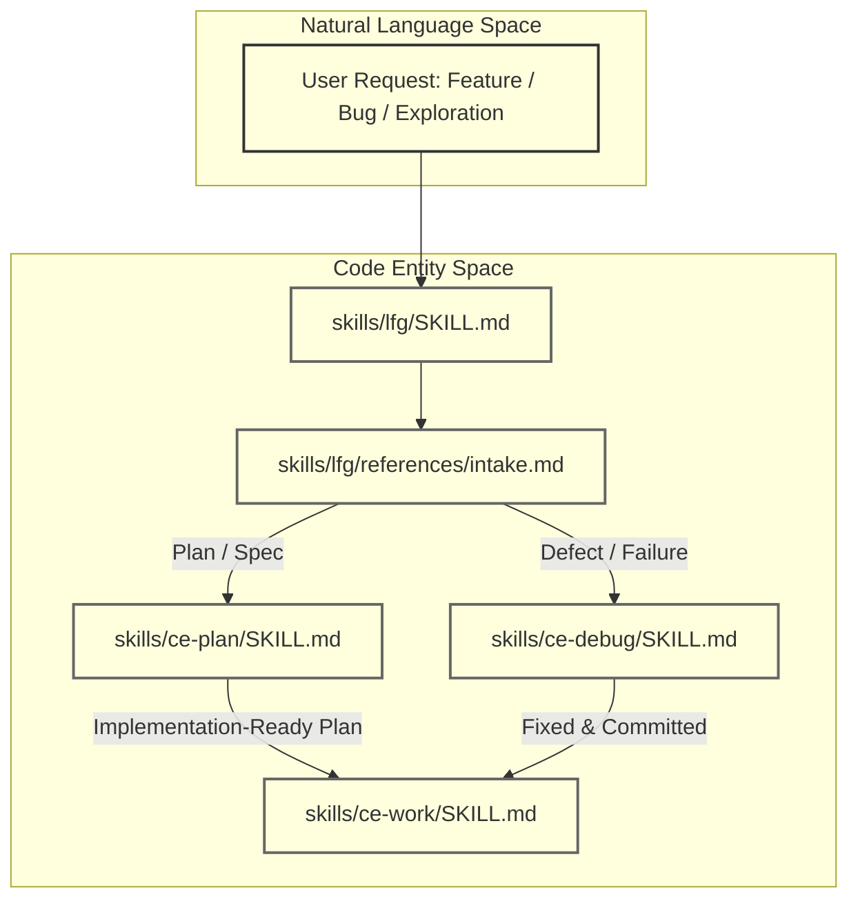
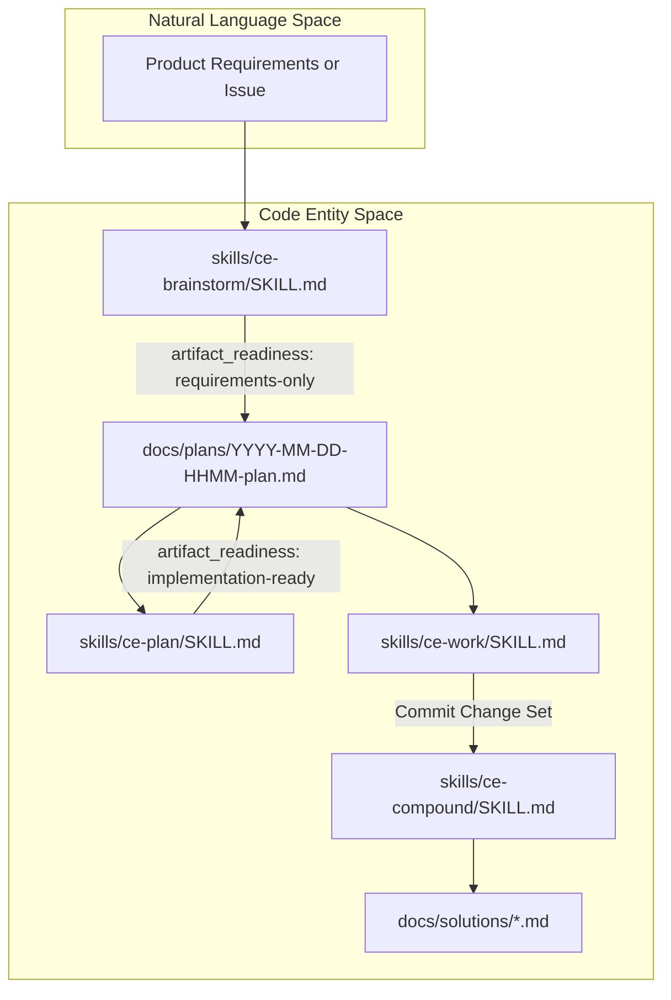

<!-- source: DeepWiki mcp.deepwiki.com · repo EveryInc/compound-engineering-plugin · page 4 The Compounding Engineering Workflow · fetched 2026-10-30 -->

# The Compounding Engineering Workflow

<details>
<summary>Relevant source files</summary>

The following files were used as context for generating this wiki page:

- [docs/guides/README.md](docs/guides/README.md)
- [docs/guides/ce-bakeoff.md](docs/guides/ce-bakeoff.md)
- [docs/guides/ce-brainstorm.md](docs/guides/ce-brainstorm.md)
- [docs/guides/ce-debug.md](docs/guides/ce-debug.md)
- [docs/guides/ce-plan.md](docs/guides/ce-plan.md)
- [skills/ce-bakeoff/SKILL.md](skills/ce-bakeoff/SKILL.md)
- [skills/ce-brainstorm/references/reasoning-elevation.md](skills/ce-brainstorm/references/reasoning-elevation.md)
- [skills/ce-debug/SKILL.md](skills/ce-debug/SKILL.md)
- [skills/ce-debug/references/bakeoff.md](skills/ce-debug/references/bakeoff.md)
- [skills/ce-debug/references/fix.md](skills/ce-debug/references/fix.md)
- [skills/ce-debug/references/investigate.md](skills/ce-debug/references/investigate.md)
- [skills/ce-debug/references/post-fix-handoff.md](skills/ce-debug/references/post-fix-handoff.md)
- [skills/ce-plan/references/bakeoff.md](skills/ce-plan/references/bakeoff.md)
- [skills/ce-plan/references/reasoning-elevation.md](skills/ce-plan/references/reasoning-elevation.md)
- [skills/ce-work/SKILL.md](skills/ce-work/SKILL.md)
- [skills/ce-work/references/review-findings-followup.md](skills/ce-work/references/review-findings-followup.md)
- [skills/ce-work/references/shipping-workflow.md](skills/ce-work/references/shipping-workflow.md)
- [skills/lfg/SKILL.md](skills/lfg/SKILL.md)
- [tests/pipeline-review-contract.test.ts](tests/pipeline-review-contract.test.ts)
- [tests/skill-eval-cell/fixtures/debug-sibling-consumer/DIAGNOSIS.md](tests/skill-eval-cell/fixtures/debug-sibling-consumer/DIAGNOSIS.md)

</details>


## Purpose and Scope

This document describes the end-to-end engineering lifecycle implemented by the `compound-engineering` plugin. The cycle chains specialized agents and deterministically managed artifacts across six core phases: **ideate → brainstorm → plan → work → review → compound**. Each phase yields concrete artifacts that pass cleanly into subsequent phases, ensuring that institutional knowledge and codebase constraints compound over time [docs/guides/README.md:13-32]().

As a parent page, this document provides a high-level architectural overview of the complete cycle and artifact handoffs. For exhaustive technical specifications, consult the per-phase child pages:
- Ideation and Brainstorming: See [Ideate and Brainstorm Phase](#4.1)
- Planning and Enrichment: See [Plan Phase](#4.2)
- Execution and Verification: See [Work Phase](#4.3)
- Quality and Review Gates: See [Review Phase](#4.4)
- Knowledge Compounding and Maintenance: See [Compound Phase](#4.5)

Sources: [docs/guides/README.md:13-32](), [skills/ce-plan/SKILL.md:11-15]()

## Workflow Architecture and Code Entity Mapping

The compounding engineering lifecycle bridges abstract intent ("Natural Language Space") with concrete plugin skills, runtime routing logic, and filesystem artifacts ("Code Entity Space"). The orchestration engine (`skills/lfg/SKILL.md`) and individual skill scripts coordinate these transitions.

### Diagram: Natural Language to Code Entity Space — Phase Routing (`lfg`)



Sources: [skills/lfg/SKILL.md:9-19](), [skills/ce-work/SKILL.md:3-5]()

## Workflow Overview and Core Phases

The lifecycle is structured around an 80/20 planning-to-execution ratio [skills/ce-plan/SKILL.md:11-15](). Thorough upfront specification via brainstorming (`skills/ce-brainstorm/SKILL.md`) and planning (`skills/ce-plan/SKILL.md`) guarantees that execution (`skills/ce-work/SKILL.md`) and review (`skills/ce-code-review`) operate against deterministic, verified units of work.

```mermaid
stateDiagram-v2
    [*] --> Ideate: "/ce-ideate"
    Ideate --> Brainstorm: "/ce-brainstorm"
    Brainstorm --> Plan: "/ce-plan"
    Plan --> Work: "/ce-work"
    Work --> Review: "skills/ce-work/references/shipping-workflow.md"
    Review --> Compound: "/ce-compound"
    Compound --> [*]: "docs/solutions/*.md"

    note right of Ideate
        "Discover grounded directions"
        "skills/ce-ideate/SKILL.md"
    end note

    note right of Brainstorm
        "Explore requirements & WHAT"
        "skills/ce-brainstorm/SKILL.md"
    end note

    note right of Plan
        "Define U-IDs & guardrails"
        "skills/ce-plan/SKILL.md"
    end note

    note right of Work
        "Execute unit workspaces"
        "skills/ce-work/SKILL.md"
    end note

    note right of Review
        "Multi-persona validation"
        "skills/ce-code-review"
    end note

    note right of Compound
        "Capture institutional memory"
        "skills/ce-compound/SKILL.md"
    end
```

Sources: [docs/guides/README.md:35-46](), [skills/ce-work/references/shipping-workflow.md:5-47]()

## Workflow State Management and Unified Plan Contract

The state of an engineering cycle is maintained through **Unified Plan** artifacts. These markdown files leverage frontmatter schemas (`ce-unified-plan/v1`) to govern artifact readiness and handoffs between phases.

### Diagram: Artifact Hand-off and Code Entity Space



### Artifact Contract States

| Phase | `artifact_readiness` | Governing Component / Script | Purpose |
|-------|----------------------|------------------------------|---------|
| **Brainstorm** | `requirements-only` | `skills/ce-brainstorm/SKILL.md` | Establishes product requirements and core questions. |
| **Plan** | `implementation-ready` | `skills/ce-plan/SKILL.md` | Adds U-IDs, file mappings, and test verification scenarios. |
| **Work** | `implementation-ready` | `skills/ce-work/SKILL.md` | Consumes plan as read-only specification while executing change sets. |

Sources: [skills/ce-brainstorm/SKILL.md:65](), [skills/ce-plan/SKILL.md:11-15](), [skills/ce-work/SKILL.md:9-15]()

## Phase 1: Ideate and Brainstorm Phase

The upstream judgment phase filters noise and establishes strict product scope. `ce-ideate` applies a divergent-then-convergent pattern to surface grounded opportunities, while `ce-brainstorm` conducts interactive requirement discovery using named gap lenses and visual probes [docs/guides/README.md:41-42]().

For detailed mechanics, scope gates, reasoning elevation, and the `ce-pov` pre-commitment verdict tool, see [Ideate and Brainstorm Phase](#4.1).

Sources: [docs/guides/README.md:41-42](), [skills/ce-ideate/SKILL.md:12-22]()

## Phase 2: Plan Phase

The planning phase (`skills/ce-plan/SKILL.md`) transforms requirements into bounded implementation units (`U-IDs`). It executes deep research, resolves technical options through structured bakeoffs, and applies model elevation for complex architectural planning.

For detailed information on implementation units, plan deepening, reasoning elevation, and handoff routing, see [Plan Phase](#4.2).

Sources: [docs/guides/README.md:43](), [skills/ce-plan/references/reasoning-elevation.md:1-15]()

## Phase 3: Work Phase

The work phase (`skills/ce-work/SKILL.md`) executes implementation-ready plans within isolated unit workspaces. It enforces test-first discipline, incremental commits keyed to U-IDs, and strict quality verification gates before handing off to review [skills/ce-work/SKILL.md:9-15](), [skills/ce-work/references/shipping-workflow.md:5-47]().

For detailed task tracking, workspace isolation policies, execution engines, and review completion gates, see [Work Phase](#4.3).

Sources: [skills/ce-work/SKILL.md:9-15](), [skills/ce-work/references/shipping-workflow.md:5-47]()

## Phase 4: Review Phase

The review phase subjects change sets to multi-persona parallel evaluation (`skills/ce-code-review`), enforcing confidence ratings, quote-the-line validation, and ownership classes before durable sinks are written [docs/guides/README.md:73](), [skills/ce-work/references/shipping-workflow.md:19-43]().

For detailed pipeline stages, persona catalogs, action-class rubrics, autofix loops, and validation passes, see [Review Phase](#4.4).

Sources: [docs/guides/README.md:73](), [skills/ce-work/references/shipping-workflow.md:19-43]()

## Phase 5: Compound Phase

The compounding phase (`skills/ce-compound/SKILL.md`) extracts durable architectural insights from session outcomes and records them as structured markdown in `docs/solutions/`. These documents ground future brainstorming and planning cycles [docs/guides/README.md:28-32]().

For documentation validation rules, refresh lifecycles (`ce-compound-refresh`), and personal learning via `ce-explain`, see [Compound Phase](#4.5).

Sources: [docs/guides/README.md:28-32](), [skills/lfg/SKILL.md:51-52]()

---

