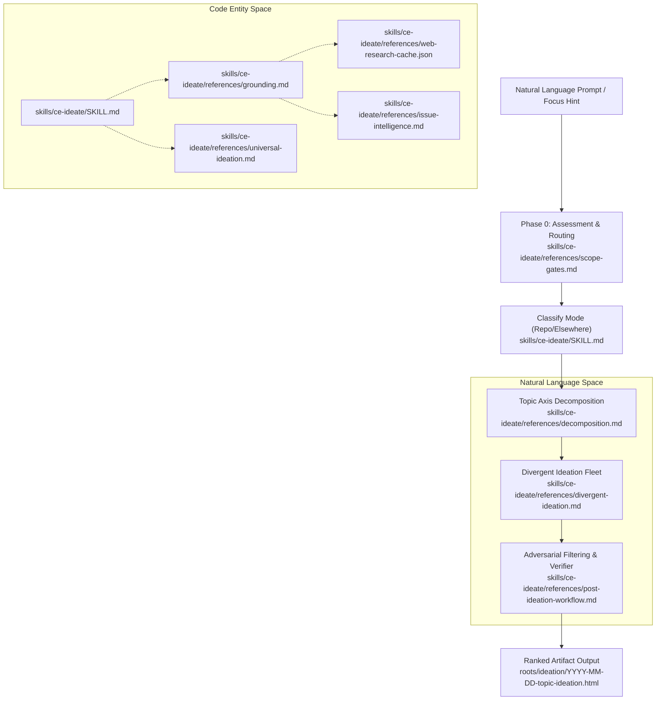
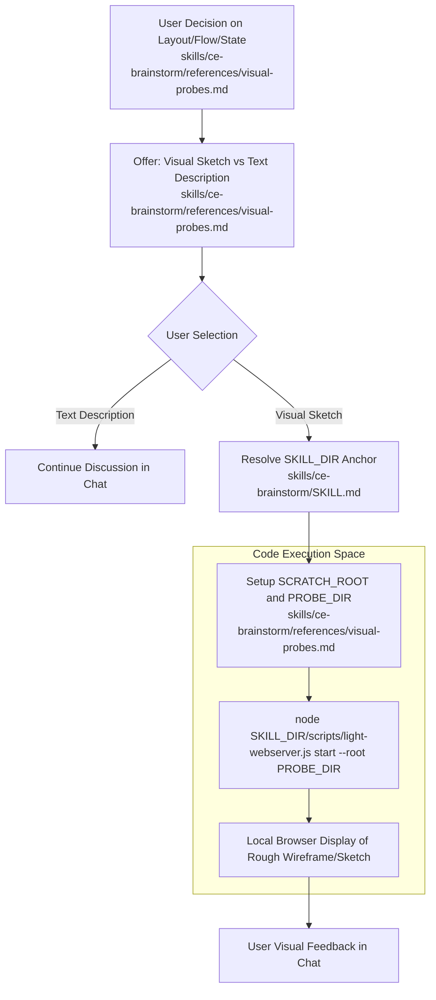

<!-- source: DeepWiki mcp.deepwiki.com · repo EveryInc/compound-engineering-plugin · page 4.1 Ideate and Brainstorm Phase · fetched 2026-10-30 -->

# Ideate and Brainstorm Phase

Relevant source files

The following files were used as context for generating this wiki page:

- [docs/guides/ce-pov.md](docs/guides/ce-pov.md)
- [skills/ce-brainstorm/references/visual-probes.md](skills/ce-brainstorm/references/visual-probes.md)
- [skills/ce-ideate/SKILL.md](skills/ce-ideate/SKILL.md)
- [skills/ce-ideate/references/decomposition.md](skills/ce-ideate/references/decomposition.md)
- [skills/ce-ideate/references/divergent-ideation.md](skills/ce-ideate/references/divergent-ideation.md)
- [skills/ce-ideate/references/grounding.md](skills/ce-ideate/references/grounding.md)
- [skills/ce-ideate/references/issue-intelligence.md](skills/ce-ideate/references/issue-intelligence.md)
- [skills/ce-ideate/references/post-ideation-workflow.md](skills/ce-ideate/references/post-ideation-workflow.md)
- [skills/ce-ideate/references/scope-gates.md](skills/ce-ideate/references/scope-gates.md)
- [skills/ce-ideate/references/universal-ideation.md](skills/ce-ideate/references/universal-ideation.md)
- [skills/ce-ideate/references/user-research-artifacts.md](skills/ce-ideate/references/user-research-artifacts.md)
- [skills/ce-ideate/references/web-research-cache.md](skills/ce-ideate/references/web-research-cache.md)
- [tests/skill-eval-cell/packs/ce-ideate-run-scaling.md](tests/skill-eval-cell/packs/ce-ideate-run-scaling.md)
- [tests/skills/ce-brainstorm-visual-probes.test.ts](tests/skills/ce-brainstorm-visual-probes.test.ts)
- [tests/skills/ce-ideate-dispatch-contracts.test.ts](tests/skills/ce-ideate-dispatch-contracts.test.ts)
- [tests/skills/ce-ideate-generation-contract-parity.test.ts](tests/skills/ce-ideate-generation-contract-parity.test.ts)

## Purpose and Scope

The **Ideate and Brainstorm Phase** is the upstream judgment stage of the Compounding Engineering workflow, bridging vague user intent and rigorous implementation plans [skills/ce-ideate/SKILL.md:10-13](). It comprises three foundational skills:

1. **`ce-ideate`**: Answers **"What's worth exploring?"** using a divergent-then-convergent pattern to generate, critique, and rank grounded ideas based on codebase context, past learnings, and external research [skills/ce-ideate/SKILL.md:3-3](), [skills/ce-ideate/SKILL.md:8-13]().
2. **`ce-brainstorm`**: Answers **"What does this need to be?"** by taking a chosen idea and exploring requirements, trade-offs, and scope boundaries through collaborative dialogue to produce a requirements-only unified plan [skills/ce-brainstorm/SKILL.md:3-3]().
3. **`ce-pov`**: Acts as a **pre-commitment verdict tool**, delivering a decisive, project-grounded verdict on external inputs, technologies, or architectural directions before committing them to the planning pipeline [docs/guides/ce-pov.md:3-5]().

Sources: `skills/ce-ideate/SKILL.md:3-13`, `skills/ce-brainstorm/SKILL.md:3-3`, `docs/guides/ce-pov.md:3-5`

---

## Ideation Phase (`ce-ideate`)

The `ce-ideate` skill executes a strict "generate many, critique all, explain survivors only" workflow [skills/ce-ideate/SKILL.md:12](). It avoids abstract product advice by grounding all suggestions in repository state or specific topic context [skills/ce-ideate/SKILL.md:16-17]().

### Execution Flow and Natural Language to Code Entity Space

The diagram below bridges natural language user prompts to the underlying codebase implementation files and scripts within `skills/ce-ideate/`.

**Diagram: `ce-ideate` Natural Language to Code Entity Mapping**

Sources: `skills/ce-ideate/SKILL.md:39-72`, `skills/ce-ideate/references/divergent-ideation.md:1-24`, `skills/ce-ideate/references/grounding.md:1-30`, `skills/ce-ideate/references/scope-gates.md:1-12`

### Divergent-then-Convergent Pattern and Fleet
`ce-ideate` dispatches parallel sub-agents across six ideation frames [skills/ce-ideate/references/divergent-ideation.md:7-11](). The default fleet consists of 5 agents:
* **3 generation-tier agents** covering evidence-driven frames: *Pain and friction*, *Inversion, removal, or automation*, and *Leverage and compounding* [skills/ce-ideate/references/divergent-ideation.md:9]().
* **2 ceiling-tier agents** covering reasoning-intensive frames: *Cross-domain analogy* and *Assumption-breaking/reframing plus constraint-flipping* [skills/ce-ideate/references/divergent-ideation.md:10]().

Adversarial filtering is performed in Phase 3 by a fresh-context verifier sub-agent that tests the basis (`direct:`, `external:`, or `reasoned:`) of every candidate against the repository evidence, followed by orchestrator arbitration [skills/ce-ideate/references/post-ideation-workflow.md:5-15]().

Sources: `skills/ce-ideate/references/divergent-ideation.md:7-22`, `skills/ce-ideate/references/post-ideation-workflow.md:5-35`

### Scope Gates and Universal Ideation
Phase 0 establishes strict scope gates defined in `skills/ce-ideate/references/scope-gates.md`, determining subject identifiability, issue-tracker intent, and tactical vs. `go deep` scaling [skills/ce-ideate/references/scope-gates.md:1-30](). For non-software domains (naming, narrative writing, personal decisions), `skills/ce-ideate/references/universal-ideation.md` takes over, replacing software frames with domain-agnostic facilitation while preserving adversarial filtering [skills/ce-ideate/references/universal-ideation.md:1-8]().

Sources: `skills/ce-ideate/references/scope-gates.md:1-47`, `skills/ce-ideate/references/universal-ideation.md:1-10`

---

## Brainstorming Phase (`ce-brainstorm`)

`ce-brainstorm` resolves product decisions through collaborative dialogue, focusing on user-facing behavior, scope boundaries, and success criteria while keeping implementation details out of the Product Contract [skills/ce-brainstorm/SKILL.md:3-3]().

### Visual Probes and Display Helper Architecture
When a decision is spatial or visual, `skills/ce-brainstorm/references/visual-probes.md` triggers an interactive offer before any text-based shape question is raised [skills/ce-brainstorm/references/visual-probes.md:7-23](). 

**Diagram: Visual Probe Workflow and Code Mapping**

Sources: `skills/ce-brainstorm/references/visual-probes.md:7-88`

### Universal Brainstorming and Requirements Contract
For non-software topics, `ce-brainstorm` routes to universal brainstorming facilitation [skills/ce-brainstorm/references/universal-brainstorming.md:1-10](). The primary deliverable across software brainstorm runs is a requirements-only unified plan stored in `<root>/plans/` featuring `artifact_readiness: requirements-only`, goal capsules, and traceable `R-IDs` [skills/ce-brainstorm/SKILL.md:3-3]().

Sources: `skills/ce-brainstorm/SKILL.md:3-3`, `skills/ce-brainstorm/references/universal-brainstorming.md:1-12`

---

## Pre-Commitment Verdict Tool (`ce-pov`)

`ce-pov` provides decisive, project-grounded points of view on external adoption, architectural documents, or supplied approaches [docs/guides/ce-pov.md:3-5]().

### Dual-Grounding Floors and Cross-Model Panel
Every verdict must clear two mandatory grounding floors defined in `skills/ce-pov/references/method.md`:
* **Project floor**: Requires verified local project evidence (`file:line`, dependency, or issue reference) [docs/guides/ce-pov.md:24-28]().
* **External floor**: Requires verified external sources or prior art when external claims carry the conclusion [docs/guides/ce-pov.md:24-28]().

When explicitly requested via `oracle` or `cross-check`, `ce-pov` dispatches independent peer models via `acpx` (Agent Client Protocol) to form a cross-model panel, reconciling divergent opinions before issuing the final verdict [docs/guides/ce-pov.md:14-18](), [docs/guides/ce-pov.md:48-52]().

Sources: `docs/guides/ce-pov.md:1-72`

---

