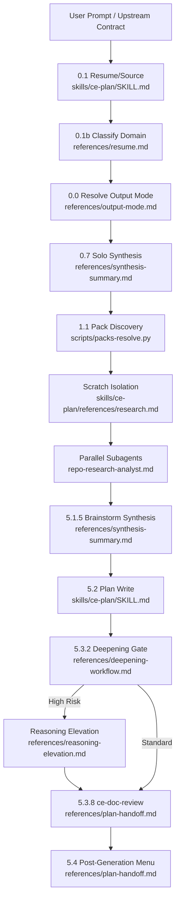
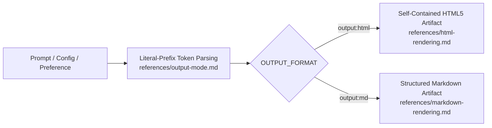

<!-- source: DeepWiki mcp.deepwiki.com · repo EveryInc/compound-engineering-plugin · page 4.2 Plan Phase · fetched 2026-10-30 -->

# Plan Phase

<details>
<summary>Relevant source files</summary>

The following files were used as context for generating this wiki page:

- [docs/solutions/skill-design/confirmations-filter-by-salience-not-length-caps.md](docs/solutions/skill-design/confirmations-filter-by-salience-not-length-caps.md)
- [skills/ce-brainstorm/references/approaches.md](skills/ce-brainstorm/references/approaches.md)
- [skills/ce-brainstorm/references/dialogue.md](skills/ce-brainstorm/references/dialogue.md)
- [skills/ce-brainstorm/references/handoff.md](skills/ce-brainstorm/references/handoff.md)
- [skills/ce-brainstorm/references/html-rendering.md](skills/ce-brainstorm/references/html-rendering.md)
- [skills/ce-brainstorm/references/settled-decisions.md](skills/ce-brainstorm/references/settled-decisions.md)
- [skills/ce-brainstorm/references/synthesis-summary.md](skills/ce-brainstorm/references/synthesis-summary.md)
- [skills/ce-doc-review/references/dispatch.md](skills/ce-doc-review/references/dispatch.md)
- [skills/ce-doc-review/references/subagent-template.md](skills/ce-doc-review/references/subagent-template.md)
- [skills/ce-explain/references/orchestration.md](skills/ce-explain/references/orchestration.md)
- [skills/ce-ideate/references/html-rendering.md](skills/ce-ideate/references/html-rendering.md)
- [skills/ce-ideate/references/ideation-sections.md](skills/ce-ideate/references/ideation-sections.md)
- [skills/ce-plan/references/deepening-workflow.md](skills/ce-plan/references/deepening-workflow.md)
- [skills/ce-plan/references/final-review.md](skills/ce-plan/references/final-review.md)
- [skills/ce-plan/references/html-rendering.md](skills/ce-plan/references/html-rendering.md)
- [skills/ce-plan/references/intake.md](skills/ce-plan/references/intake.md)
- [skills/ce-plan/references/plan-handoff.md](skills/ce-plan/references/plan-handoff.md)
- [skills/ce-plan/references/research.md](skills/ce-plan/references/research.md)
- [skills/ce-plan/references/resume.md](skills/ce-plan/references/resume.md)
- [skills/ce-plan/references/settled-decisions.md](skills/ce-plan/references/settled-decisions.md)
- [skills/ce-plan/references/structure.md](skills/ce-plan/references/structure.md)
- [skills/ce-plan/references/synthesis-summary.md](skills/ce-plan/references/synthesis-summary.md)
- [skills/ce-plan/references/universal-planning.md](skills/ce-plan/references/universal-planning.md)
- [skills/ce-pov/references/grounding.md](skills/ce-pov/references/grounding.md)
- [skills/ce-sweep/references/run.md](skills/ce-sweep/references/run.md)
- [tests/skills/ce-brainstorm-output-mode.test.ts](tests/skills/ce-brainstorm-output-mode.test.ts)
- [tests/skills/ce-ideate-output-mode.test.ts](tests/skills/ce-ideate-output-mode.test.ts)
- [tests/skills/ce-plan-handoff-routing.test.ts](tests/skills/ce-plan-handoff-routing.test.ts)
- [tests/skills/ce-plan-output-mode.test.ts](tests/skills/ce-plan-output-mode.test.ts)
- [tests/skills/html-output-invariants.test.ts](tests/skills/html-output-invariants.test.ts)

</details>


## Purpose and Scope

The Plan Phase is the central architectural and decision-making stage of the Compounding Engineering workflow, driven primarily by the `ce-plan` skill [skills/ce-plan/SKILL.md:2-3](). It transforms high-level feature ideas, raw requirements, or upstream brainstorm contracts into structured, repo-grounded implementation plans. This phase enforces an 80/20 planning-to-execution ratio, minimizing technical debt and ensuring implementation predictability.

Sources: [skills/ce-plan/SKILL.md:2-3](), [skills/ce-plan/SKILL.md:11-11]()

---

## Plan Phase Workflow & Code Entity Bridge

The planning process follows a multi-phase pipeline moving from intake and output-mode resolution through research, scoping synthesis, optional deepening, and mandatory document review.


**Diagram: Plan Phase Pipeline to Code Entities**
Sources: [skills/ce-plan/SKILL.md:13-15](), [skills/ce-plan/references/output-mode.md:1](), [skills/ce-plan/references/synthesis-summary.md:11-12](), [skills/ce-plan/references/research.md:23-52](), [skills/ce-plan/references/reasoning-elevation.md:1-5](), [skills/ce-plan/references/plan-handoff.md:6-52]()

---

## Intake and Output Resolution

Before parsing phases, `ce-plan` resolves its output format and upstream product contracts. Output is strictly exclusive: markdown (`.md`) or HTML (`.html`), never both [tests/skills/ce-plan-output-mode.test.ts:38-42]().


**Diagram: Output Mode Resolution Architecture**
Sources: [tests/skills/ce-plan-output-mode.test.ts:43-142](), [skills/ce-plan/references/html-rendering.md:1-25]()

Sources: [skills/ce-plan/references/intake.md:1-55](), [tests/skills/ce-plan-output-mode.test.ts:38-142]()

---

## Scoping Synthesis

The **Scoping Synthesis** surfaces the agent's interpretation to the user before writing the plan, preventing scope misinterpretation [skills/ce-plan/references/synthesis-summary.md:1-3]().

### Two-Stage Composition
1.  **Stage 1 (Internal Draft)**: A three-bucket thought process categorized into **Stated** (user input), **Inferred** (agent assumptions), and **Out of scope** (deliberate exclusions) [skills/ce-plan/references/synthesis-summary.md:18-24]().
2.  **Stage 2 (Chat-time Synthesis)**: A compressed, user-facing summary showing the problem frame, scope claims, and call-outs for user direction [skills/ce-plan/references/synthesis-summary.md:32-51]().

### Invocation Variants
*   **Solo Variant (Phase 0.7)**: Runs after bootstrap for solo tasks, capturing broad scope before research [skills/ce-plan/references/synthesis-summary.md:11-11]().
*   **Brainstorm-Sourced Variant (Phase 5.1.5)**: Runs after research when upstream brainstorm data exists, focusing on technical boundaries and file targets [skills/ce-plan/references/synthesis-summary.md:12-12]().

Sources: [skills/ce-plan/references/synthesis-summary.md:1-60]()

---

## Research and Pack Discovery

Planning gathers repository and external context through specialized subagents. For Durable plans, the workflow resolves compound packs and isolates scratch directories.

```bash
SKILL_DIR="<absolute path of directory>";
PY="$(for c in python3 python py; do command -v "$c" >/dev/null 2>&1 && "$c" -c '' >/dev/null 2>&1 && { echo "$c"; break; }; done)";
"$PY" "$SKILL_DIR/scripts/packs-resolve.py"
```
*   **Pack Discovery**: Executes `scripts/packs-resolve.py` to discover declared compound packs and build search roots [skills/ce-plan/references/research.md:21-29]().
*   **Scratch Isolation**: Creates a secure, permission-restricted scratch root under `/tmp/compound-engineering-$(id -u)` for research dossiers [skills/ce-plan/references/research.md:40-52]().

Sources: [skills/ce-plan/references/research.md:1-56](), [skills/ce-plan/SKILL.md:23-27]()

---

## Review and Handoff

Every plan must undergo mandatory document review and present execution handoff options.

### Document Review (`ce-doc-review`)
Plans are reviewed via `ce-doc-review` running in `mode:non-interactive` to surface structured findings without blocking the user [skills/ce-plan/references/plan-handoff.md:6-19](). It verifies coherence, feasibility, and scope alignment [skills/ce-plan/references/plan-handoff.md:21-24]().

### Post-Generation Options
Once the plan is written and reviewed, Phase 5.4 presents post-generation options [skills/ce-plan/references/plan-handoff.md:52]():
1.  **Start `ce-work`** — Invokes `ce-work` with the absolute plan path using the host's native skill-invocation mechanism [tests/skills/ce-plan-handoff-routing.test.ts:100-131]().
2.  **Ship it autonomously with `lfg`** — Hands the plan to the autonomous engineering pipeline.
3.  **Pressure-test requirements** — Dispatches reviewer agents via `ce-doc-review`.
4.  **Create Issue** / **Open in browser** — Integrates with issue trackers or renders HTML output.

Sources: [skills/ce-plan/references/plan-handoff.md:1-55](), [tests/skills/ce-plan-handoff-routing.test.ts:51-131]()

---

