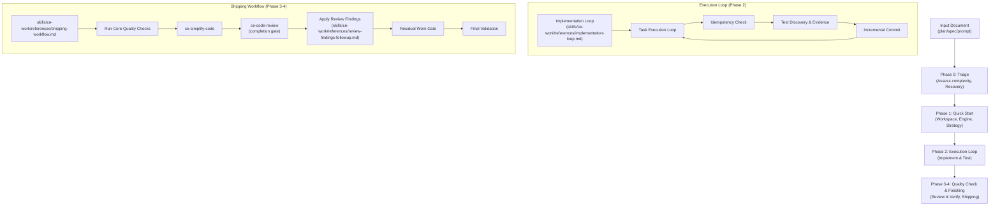
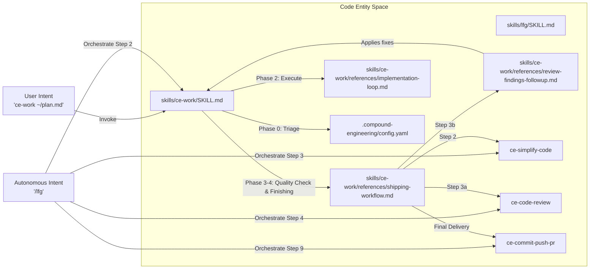

<!-- source: DeepWiki mcp.deepwiki.com · repo EveryInc/compound-engineering-plugin · page 4.3 Work Phase · fetched 2026-10-30 -->

# Work Phase

Relevant source files

The following files were used as context for generating this wiki page:

- [CONCEPTS.md](CONCEPTS.md)
- [docs/guides/ce-debug.md](docs/guides/ce-debug.md)
- [docs/solutions/skill-design/right-size-plans-by-subtraction-and-a-usage-first-sizing-test.md](docs/solutions/skill-design/right-size-plans-by-subtraction-and-a-usage-first-sizing-test.md)
- [skills/ce-debug/SKILL.md](skills/ce-debug/SKILL.md)
- [skills/ce-debug/references/fix.md](skills/ce-debug/references/fix.md)
- [skills/ce-debug/references/investigate.md](skills/ce-debug/references/investigate.md)
- [skills/ce-debug/references/post-fix-handoff.md](skills/ce-debug/references/post-fix-handoff.md)
- [skills/ce-work/SKILL.md](skills/ce-work/SKILL.md)
- [skills/ce-work/references/agents/implementation-worker.md](skills/ce-work/references/agents/implementation-worker.md)
- [skills/ce-work/references/cross-model-execution.md](skills/ce-work/references/cross-model-execution.md)
- [skills/ce-work/references/execution-strategy.md](skills/ce-work/references/execution-strategy.md)
- [skills/ce-work/references/implementation-loop.md](skills/ce-work/references/implementation-loop.md)
- [skills/ce-work/references/review-findings-followup.md](skills/ce-work/references/review-findings-followup.md)
- [skills/ce-work/references/shipping-workflow.md](skills/ce-work/references/shipping-workflow.md)
- [skills/ce-work/references/work-intake.md](skills/ce-work/references/work-intake.md)
- [skills/ce-work/scripts/unit_workspace_state.py](skills/ce-work/scripts/unit_workspace_state.py)
- [skills/lfg/SKILL.md](skills/lfg/SKILL.md)
- [tests/pipeline-review-contract.test.ts](tests/pipeline-review-contract.test.ts)
- [tests/skill-eval-cell/fixtures/debug-sibling-consumer/DIAGNOSIS.md](tests/skill-eval-cell/fixtures/debug-sibling-consumer/DIAGNOSIS.md)
- [tests/skill-eval-cell/packs/ce-work-sizing.md](tests/skill-eval-cell/packs/ce-work-sizing.md)
- [tests/skills/ce-work-outcome-spine.test.ts](tests/skills/ce-work-outcome-spine.test.ts)
- [tests/skills/ce-work-unit-workspace-init.test.ts](tests/skills/ce-work-unit-workspace-init.test.ts)

The Work Phase is the execution stage of the Compounding Engineering workflow where implementation plans are transformed into working code. This phase focuses on systematic task execution, incremental progress tracking, continuous quality verification, shipping workflow gates, code review completion gates, ship-handoff gates, and residual work gates. For information about generating implementation plans, see [Plan Phase](4.2).

## Overview

The Work Phase is primarily driven by the `ce-work` skill [skills/ce-work/SKILL.md:1-5](), which accepts a work document (plan file or specification) or a bare prompt. The execution follows a structured pipeline: Input Triage, Quick Start (setup and tasking), Execution (the implementation loop), Quality Check, and Ship It.

The process treats the plan as a **decision artifact**—authoritative for scope and units—while the agent determines the actual implementation details ("the HOW") with the code in front of it [docs/guides/ce-work.md:7-8]().

### Work Execution Flow

Sources: [skills/ce-work/SKILL.md:44-52](), [skills/ce-work/references/implementation-loop.md:1-28](), [skills/ce-work/references/shipping-workflow.md:1-56]()

## Phase 0 & 1: Triage and Quick Start

Before code is written, the system assesses complexity and prepares the environment.

### Recovery and Mode Triage
`ce-work` first checks for recovery intent. If a `run id` is supplied, it attempts to resume, inspect, reap, or clean up an existing run [skills/ce-work/SKILL.md:21-22](). This recovery path is prioritized before any other input decision [skills/ce-work/SKILL.md:20](). It also parses leading mode tokens like `mode:return-to-caller`, which signals that an outer orchestrator (such as `lfg`) owns the shipping tail [skills/ce-work/SKILL.md:26-30](). In `mode:return-to-caller`, `ce-work` performs implementation and local verification only, skipping Phase 3-4 and any standalone shipping actions [skills/ce-work/SKILL.md:57-58]().

### Complexity Routing
The agent evaluates the input to decide the execution path, guided by `skills/ce-work/references/input-triage.md` [skills/ce-work/SKILL.md:24]():
- **Trivial:** A bare prompt for one or two files with no behavioral change skips the task list but still resolves its execution engine before writing [skills/ce-work/SKILL.md:26-27]().
- **Bare Prompt:** If `ce-plan` already sized a bare prompt in the current session, it is executed, not planned again [skills/ce-work/SKILL.md:27-28]().
- **Plan Document:** A plan path or a plan `ce-plan` wrote this session takes the plan route [skills/lfg/SKILL.md:13]().

### Workspace, Engine, and Strategy
Phase 1 establishes the workspace, resolves the execution engine, and determines the execution strategy [skills/ce-work/SKILL.md:32-43]().
- **Workspace Setup:** `skills/ce-work/references/workspace-setup.md` guides writable checkout, branch placement, and pre-work inventory [skills/ce-work/SKILL.md:34](). It ensures no writing occurs without a writable canonical checkout and never on the real default branch unless explicitly directed [skills/ce-work/SKILL.md:34-35]().
- **Execution Engine:** `skills/ce-work/references/execution-engines.md` selects the engine (e.g., inline/subagent, cross-model execution) [skills/ce-work/SKILL.md:38](). If cross-model execution is chosen, `skills/ce-work/references/cross-model-execution.md` defines the protocol [skills/ce-work/SKILL.md:40]().
- **Execution Strategy:** `skills/ce-work/references/execution-strategy.md` decides scheduling (inline, parallel subagents, serial subagents), isolation, and worker lifecycle [skills/ce-work/SKILL.md:42](). Parallel dispatch of independent dependency layers is the default, not an optimization [skills/ce-work/references/execution-strategy.md:4-5]().

Sources: [skills/ce-work/SKILL.md:20-43](), [skills/ce-work/references/execution-strategy.md:1-38](), [skills/ce-work/references/input-triage.md](), [skills/ce-work/references/workspace-setup.md](), [skills/ce-work/references/execution-engines.md]()

## Phase 2: Execution Loop

The core of the work phase is an iterative loop of implementation and verification, guided by `skills/ce-work/references/implementation-loop.md` [skills/ce-work/SKILL.md:46]().

### Implementation Loop
The `Implementation Loop` executes tasks in priority order [skills/ce-work/references/implementation-loop.md:3-4]().
- **Idempotency Check:** Before execution, it checks if the unit's completion signal is already satisfied by existing code, skipping reimplementation if so [skills/ce-work/references/implementation-loop.md:7]().
- **Test Discovery:** Finds existing test files for implementation files being changed.
- **Evidence Strategy:** Chooses the appropriate proof for behavior-bearing changes (e.g., existing failing test, new failing test, characterization coverage, or a deliberate no-test exception with replacement verification) [skills/ce-work/references/implementation-loop.md:8]().
- **Incremental Commits:** Every implementation commit names only that unit's owned files, forbidding bare `git commit` to prevent absorbing pre-existing index changes [skills/ce-work/SKILL.md:48-49]().
- **Parallel Waves:** For parallel execution, the loop pauses after each canonical result for host integration, re-evaluating independence and readiness [skills/ce-work/references/implementation-loop.md:28]().

Sources: [skills/ce-work/SKILL.md:46-49](), [skills/ce-work/references/implementation-loop.md:1-34]()

## Phase 3 & 4: Quality Check, Shipping Workflow Gates, and Review Completion

After tasks and local verification are complete, standalone mode proceeds to quality checks and delivery, guided by `skills/ce-work/references/shipping-workflow.md` [skills/ce-work/SKILL.md:52]().

### Quality Gates and Shipping Workflow
1.  **Core Checks:** Always run the full test suite and linting before submitting [skills/ce-work/references/shipping-workflow.md:7-10]().
2.  **Simplify:** `ce-simplify-code` is invoked for changes with `>=30 substantive changed code lines` to refine the diff before code review. This step is skipped for purely mechanical diffs [skills/ce-work/references/shipping-workflow.md:11-17]().
3.  **Code Review:** `ce-code-review` is the single path for reviewing the diff. It self-sizes, and `depth:full` is passed only when explicitly requested [skills/ce-work/references/shipping-workflow.md:19-30]().
    -   **Code Review Completion Gate:** Shipping is **not done** until a completed review receipt from `ce-code-review` (with `status: complete`) or an explicit skip phrase (e.g., `Code review: skipped (mechanical diff)`) is recorded [tests/pipeline-review-contract.test.ts:91-126](). Mental self-review or prior findings are not substitutes [skills/ce-work/references/shipping-workflow.md:23]().
    -   **Review is not fix:** `ce-code-review` performs a read-only review (Phase 3a). The caller (orchestrator) is responsible for applying fixes (Phase 3b), guided by `skills/ce-work/references/review-findings-followup.md` [skills/ce-work/references/shipping-workflow.md:27-31]().
4.  **Residual Work Gate:** Required when `ce-code-review` ran and left justified unresolved findings. It compares findings with applied fixes, closes rejected claims, and resolves problems preventing the requested outcome. Unapplied findings are recorded in the PR body or issue tracker [skills/ce-work/references/shipping-workflow.md:35-43]().
5.  **Final Validation:** Ensures all tasks are complete, testing is addressed, and linting passes [skills/ce-work/references/shipping-workflow.md:45-47]().

### Summary of Shipping Workflow Gates
-   **Code Review Completion Gate:** Ensures a valid `ce-code-review` receipt or an authorized skip phrase is present in standalone shipping [tests/pipeline-review-contract.test.ts:91-126]().
-   **Ship-Handoff Gate:** The point at which the work is considered ready for final delivery, binding the completion gate and delivery actions [tests/pipeline-review-contract.test.ts:61-63]().
-   **Residual Work Gate:** Manages unapplied findings from code review, ensuring they are either resolved or durably recorded before final handoff [skills/ce-work/references/shipping-workflow.md:35-43]().

### Artifact Root
The `ce-docs-root` mechanism allows relocating the default `docs/` artifact folder to any repo-relative directory, configured in `.compound-engineering/config.yaml` [skills/ce-debug/SKILL.md:37-42](). This ensures artifacts are written to the correct location, especially in projects where `docs/` is already managed content.

Sources: [skills/ce-work/SKILL.md:52-55](), [skills/ce-work/references/shipping-workflow.md:1-47](), [skills/ce-work/references/review-findings-followup.md](), [skills/ce-debug/SKILL.md:37-42](), [tests/pipeline-review-contract.test.ts:1-126]()

## Code Entity Mapping

| Concept | Code Entity | File |
| :--- | :--- | :--- |
| **Work Skill** | `ce-work` | [skills/ce-work/SKILL.md]() |
| **Autonomous Pipeline** | `lfg` | [skills/lfg/SKILL.md]() |
| **Shipping Logic** | `shipping-workflow.md` | [skills/ce-work/references/shipping-workflow.md]() |
| **Implementation Loop** | `implementation-loop.md` | [skills/ce-work/references/implementation-loop.md]() |
| **Review Findings Followup** | `review-findings-followup.md` | [skills/ce-work/references/review-findings-followup.md]() |
| **Simplification Skill** | `ce-simplify-code` | [skills/ce-work/references/shipping-workflow.md:11-17]() |
| **Code Review Skill** | `ce-code-review` | [skills/ce-work/references/shipping-workflow.md:19-30]() |
| **Artifact Root Configuration** | `docs_root` in `.compound-engineering/config.yaml` | [skills/ce-debug/SKILL.md:37-42]() |

### System Interaction Diagram

This diagram bridges Natural Language intents to the specific Code Entities that handle them during the Work Phase.

Sources: [skills/ce-work/SKILL.md:1-61](), [skills/lfg/SKILL.md:1-54](), [skills/ce-work/references/shipping-workflow.md:1-47](), [skills/ce-work/references/implementation-loop.md:1-34](), [skills/ce-work/references/review-findings-followup.md](), [skills/ce-debug/SKILL.md:37-42]()

---

