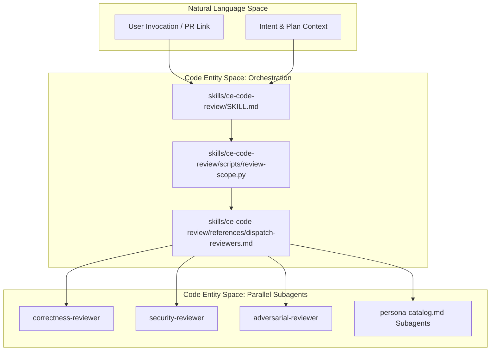
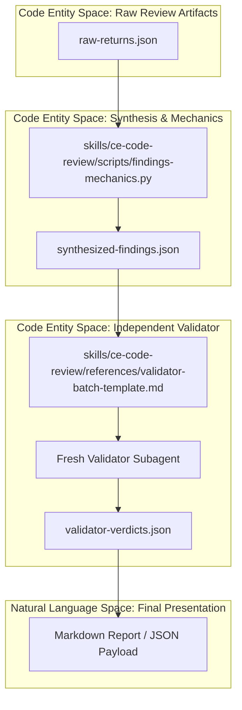

<!-- source: DeepWiki mcp.deepwiki.com · repo EveryInc/compound-engineering-plugin · page 4.4 Review Phase · fetched 2026-10-30 -->

# Review Phase

Relevant source files

The following files were used as context for generating this wiki page:

- [docs/plans/2026-07-13-001-feat-code-review-line-provenance-plan.md](docs/plans/2026-07-13-001-feat-code-review-line-provenance-plan.md)
- [docs/plans/2026-09-23-001-fix-ce-code-review-unrequested-behavior-rules-plan.md](docs/plans/2026-09-23-001-fix-ce-code-review-unrequested-behavior-rules-plan.md)
- [docs/solutions/skill-design/anti-poll-scope-and-async-subagent-dispatch.md](docs/solutions/skill-design/anti-poll-scope-and-async-subagent-dispatch.md)
- [docs/solutions/skill-design/cross-harness-cross-model-tool-invocation.md](docs/solutions/skill-design/cross-harness-cross-model-tool-invocation.md)
- [docs/solutions/skill-design/watch-loops-need-a-blocked-external-terminal-state.md](docs/solutions/skill-design/watch-loops-need-a-blocked-external-terminal-state.md)
- [skills/ce-code-review/SKILL.md](skills/ce-code-review/SKILL.md)
- [skills/ce-code-review/references/action-class-rubric.md](skills/ce-code-review/references/action-class-rubric.md)
- [skills/ce-code-review/references/diff-scope.md](skills/ce-code-review/references/diff-scope.md)
- [skills/ce-code-review/references/dispatch-reviewers.md](skills/ce-code-review/references/dispatch-reviewers.md)
- [skills/ce-code-review/references/findings-schema.json](skills/ce-code-review/references/findings-schema.json)
- [skills/ce-code-review/references/finish-review.md](skills/ce-code-review/references/finish-review.md)
- [skills/ce-code-review/references/intent-and-plan.md](skills/ce-code-review/references/intent-and-plan.md)
- [skills/ce-code-review/references/review-output-template.md](skills/ce-code-review/references/review-output-template.md)
- [skills/ce-code-review/references/subagent-template.md](skills/ce-code-review/references/subagent-template.md)
- [skills/ce-code-review/references/validator-batch-template.md](skills/ce-code-review/references/validator-batch-template.md)
- [skills/ce-code-review/scripts/findings-mechanics.py](skills/ce-code-review/scripts/findings-mechanics.py)
- [skills/ce-code-review/scripts/review-scope.py](skills/ce-code-review/scripts/review-scope.py)
- [tests/ce-code-review-mechanics.test.ts](tests/ce-code-review-mechanics.test.ts)
- [tests/review-skill-contract.test.ts](tests/review-skill-contract.test.ts)
- [tests/skill-eval-cell/fixtures/review-artifact-quote/correctness.json](tests/skill-eval-cell/fixtures/review-artifact-quote/correctness.json)
- [tests/skill-eval-cell/fixtures/review-artifact-quote/returns.json](tests/skill-eval-cell/fixtures/review-artifact-quote/returns.json)
- [tests/skill-eval-cell/fixtures/review-validator-veto/run/finish-input.json](tests/skill-eval-cell/fixtures/review-validator-veto/run/finish-input.json)
- [tests/skill-eval-cell/fixtures/review-validator-veto/run/synthesized-findings.json](tests/skill-eval-cell/fixtures/review-validator-veto/run/synthesized-findings.json)
- [tests/skill-eval-cell/fixtures/review-validator-veto/run/validator-outcome.json](tests/skill-eval-cell/fixtures/review-validator-veto/run/validator-outcome.json)

## Purpose and Scope

The Review Phase is the final quality gate in the Compounding Engineering Workflow before code is merged. It transitions work from the **Natural Language Space** (e.g., requirements documents, implementation plans, user requests) to a verified state in the **Code Entity Space** through a multi-agent parallel review pipeline. This phase encompasses:

- Persona-based parallel review dispatch managed by `skills/ce-code-review/SKILL.md` and `skills/ce-code-review/references/dispatch-reviewers.md` [skills/ce-code-review/SKILL.md:32]().
- Deterministic diff scoping via `skills/ce-code-review/scripts/review-scope.py` [tests/ce-code-review-mechanics.test.ts:51]().
- Confidence gating and rubric-driven suppression using discrete anchors (`0`, `25`, `50`, `75`, `100`) defined in `skills/ce-code-review/references/subagent-template.md` [skills/ce-code-review/references/subagent-template.md:55]().
- Structured finding deduplication and mechanical processing via `skills/ce-code-review/scripts/findings-mechanics.py` [skills/ce-code-review/references/finish-review.md:7]().
- Independent validation passes using `skills/ce-code-review/references/validator-batch-template.md` and protected-subject policies [skills/ce-code-review/references/validator-batch-template.md:3-6]().
- Action-class routing (`gated_auto`, `manual`, `advisory`) and ownership assignment (`downstream-resolver`, `human`, `release`) [skills/ce-code-review/references/findings-schema.json:54-61]().
- Safe local fix application (`apply:local`) and durable reporting sinks.

Sources: [skills/ce-code-review/SKILL.md:32](), [skills/ce-code-review/references/dispatch-reviewers.md:1-50](), [skills/ce-code-review/references/subagent-template.md:55-68](), [skills/ce-code-review/references/findings-schema.json:54-61]()

---

## Workflow Architecture and Data Flow

The review execution pipeline bridges natural language intent and configuration rules to concrete code entity validations. 

### Review Routing & Spawning (Natural Language Space to Code Entity Space)
Title: "ReviewRoutingAndSpawning"

Sources: [skills/ce-code-review/SKILL.md:23-34](), [skills/ce-code-review/references/dispatch-reviewers.md:1-50](), [skills/ce-code-review/scripts/review-scope.py:1-20]()

---

## Persona-Based Parallel Review and Scope Resolution

The review process begins by determining the diff scope using `skills/ce-code-review/scripts/review-scope.py`, which evaluates changed executable lines, path classes (such as migrations or CI workflows), and hard blocks [skills/ce-code-review/scripts/review-scope.py:1-120](). 

Once scope is resolved, `ce-code-review` reads `references/persona-catalog.md` and `references/select-and-route.md` to select the appropriate specialized reviewer subagents [skills/ce-code-review/SKILL.md:30](). 

### Reviewer Tiers and Model Assignment
- **Session Model (No Override):** `correctness-reviewer`, `security-reviewer`, and `adversarial-reviewer` inherit the parent session capability level to handle high-stakes logic, security boundaries, and failure scenarios [skills/ce-code-review/references/dispatch-reviewers.md:24-26]().
- **Mid-Tier:** All other specialized personas run on the platform's balanced mid-tier model (e.g., Sonnet in Claude Code) to reduce cost and latency [skills/ce-code-review/references/dispatch-reviewers.md:46-48]().
- **Fast-Pass Pseudo-Reviewer:** An orchestrator-level inline scan runs immediately before foreground reviewer dispatch to catch high-signal, obvious defects (e.g., SQL safety, null dereferences) [skills/ce-code-review/references/dispatch-reviewers.md:3-9](). Capped at anchor 50, it cannot trigger cross-reviewer promotion on its own [skills/ce-code-review/references/dispatch-reviewers.md:13-14]().

Sources: [skills/ce-code-review/SKILL.md:27-32](), [skills/ce-code-review/references/dispatch-reviewers.md:1-50](), [skills/ce-code-review/scripts/review-scope.py:1-120]()

---

## Confidence Gating and Soft-Bucket Demotion

Subagent findings must conform to `skills/ce-code-review/references/findings-schema.json` and utilize discrete confidence anchors defined in `skills/ce-code-review/references/subagent-template.md` [skills/ce-code-review/references/subagent-template.md:55-67]() [skills/ce-code-review/references/findings-schema.json:96-100]().

### Confidence Anchor Rubric
- **`0` (Not Confident):** False positive or pre-existing issue. Silently suppressed by personas [skills/ce-code-review/references/subagent-template.md:61]().
- **`25` (Somewhat Confident):** Uncertain or unverifiable from diff alone. Silently suppressed [skills/ce-code-review/references/subagent-template.md:62]().
- **`50` (Moderately Confident):** Verifiable concern with lower actionable priority; style preferences or narrow edge cases [skills/ce-code-review/references/subagent-template.md:63]().
- **`75` (Highly Confident):** Actionable bug, vulnerability, or contract violation confirmed to affect users or callers in normal usage [skills/ce-code-review/references/subagent-template.md:64-66](). Requires a verbatim `first_evidence` quote [skills/ce-code-review/references/subagent-template.md:37]().
- **`100` (Absolutely Certain):** Verifiable directly from code syntax (compile error, type mismatch, explicit standards violation with a quotable rule) [skills/ce-code-review/references/subagent-template.md:67]().

### Soft-Bucket Demotion and Quote-the-Line Gate
Findings carrying anchor `50` or below without independent corroboration are relegated to soft buckets or discarded during synthesis. The **Quote-the-Line Gate** mandates that any finding at anchor `75` or `100` include a valid `first_evidence` string matching the source line; otherwise, synthesis automatically demotes the finding to anchor `50` [skills/ce-code-review/references/subagent-template.md:37](), [skills/ce-code-review/references/finish-review.md:21]() [skills/ce-code-review/references/findings-schema.json:96-100]().

Sources: [skills/ce-code-review/references/subagent-template.md:37-68](), [skills/ce-code-review/references/finish-review.md:7-22](), [skills/ce-code-review/references/findings-schema.json:96-100]()

---

## Synthesis, Action-Class Rubric, and Ownership Classes

Once all subagent returns are collected, `skills/ce-code-review/scripts/findings-mechanics.py` executes schema validation, exact-fingerprint deduplication, and deterministic sorting [skills/ce-code-review/references/finish-review.md:7]().

### Action Classes (`autofix_class`)
- **`gated_auto`**: Concrete `suggested_fix` is provided; the caller may apply after human/agent verification [skills/ce-code-review/references/findings-schema.json:57]().
- **`manual`**: Requires broader design decisions or architectural input before code changes can be made [skills/ce-code-review/references/findings-schema.json:57]().
- **`advisory`**: Report-only informational items, learnings, or residual risks [skills/ce-code-review/references/findings-schema.json:57]().

### Ownership Classes (`owner`)
- **`downstream-resolver`**: Assigned to the developer or coding agent handling follow-up work [skills/ce-code-review/references/findings-schema.json:61]().
- **`human`**: Requires direct human judgment or approval [skills/ce-code-review/references/findings-schema.json:61]().
- **`release`**: Deferred to release engineering or pre-deployment checklists [skills/ce-code-review/references/findings-schema.json:61]().

Sources: [skills/ce-code-review/references/finish-review.md:1-33](), [skills/ce-code-review/references/findings-schema.json:54-63]()

---

## Validation Pass and Durable Sinks

### Synthesis & Validation Pipeline (Natural Language Space to Code Entity Space)
Title: "SynthesisAndValidationPipeline"

### Validation Pass (`Stage 5b`)
The merged findings undergo validation via an independent validator subagent initialized with `skills/ce-code-review/references/validator-batch-template.md` [skills/ce-code-review/references/validator-batch-template.md:3](). 
- **Protected Subjects:** Evaluated against eight protected policy categories (`memory-safety`, `concurrency`, `data-loss`, `authorization-authentication`, `injection`, `public-contract`, `secrets-exposure`, `cryptography`) [skills/ce-code-review/references/validator-batch-template.md:28-35]().
- **Verdicts:** The validator outputs status as `"confirmed"`, `"rejected"`, or `"unresolved"` into `{run_dir}/validator-verdicts.json` [skills/ce-code-review/references/validator-batch-template.md:56-61](). Rejection of a protected subject requires explicit refuting evidence [skills/ce-code-review/references/validator-batch-template.md:43]().

### Durable Sinks and Artifact Integrity
All review session data, raw returns, mechanical findings, validator verdicts, and final synthesis reports are persisted under the resolved artifact root (`<root>`), ensuring complete auditability [skills/ce-code-review/SKILL.md:13-21](). Core knowledge artifacts (such as plans and solutions) are protected against destructive edits or removal by any review pass [skills/ce-code-review/references/action-class-rubric.md:59-67]().

Sources: [skills/ce-code-review/SKILL.md:13-21](), [skills/ce-code-review/references/validator-batch-template.md:1-69](), [skills/ce-code-review/references/finish-review.md:1-33]()

---

