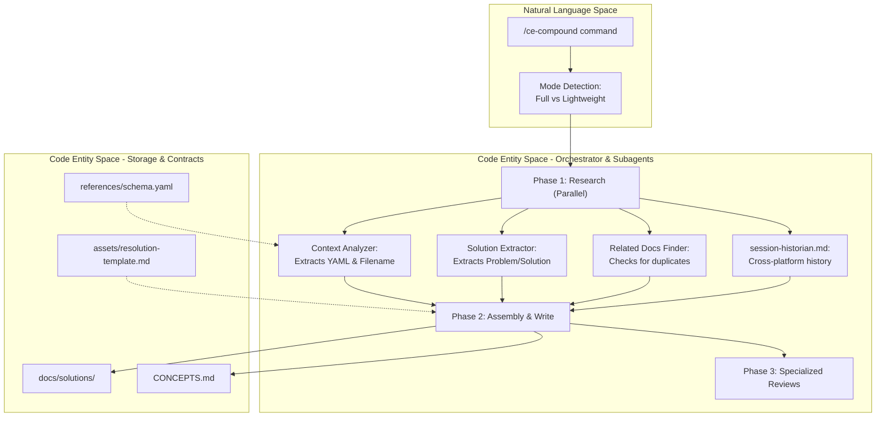
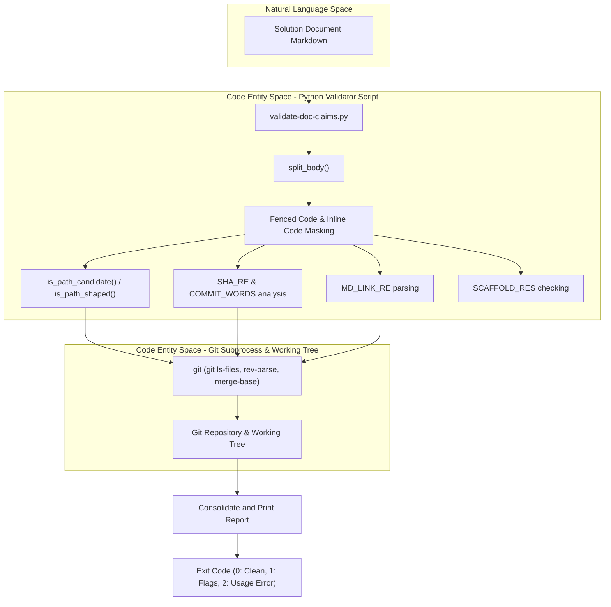
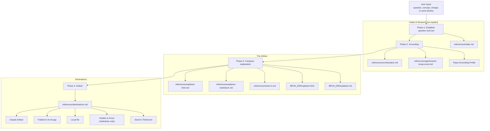

<!-- source: DeepWiki mcp.deepwiki.com · repo EveryInc/compound-engineering-plugin · page 4.5 Compound Phase · fetched 2026-10-30 -->

# Compound Phase

Relevant source files

The following files were used as context for generating this wiki page:

- [docs/guides/ce-compound-refresh.md](docs/guides/ce-compound-refresh.md)
- [docs/plans/2026-08-28-0211-fix-doc-claims-absolute-paths-plan.md](docs/plans/2026-08-28-0211-fix-doc-claims-absolute-paths-plan.md)
- [docs/plans/2026-09-23-1552-feat-learning-retirement-condition-plan.md](docs/plans/2026-09-23-1552-feat-learning-retirement-condition-plan.md)
- [docs/solutions/skill-design/detector-that-cannot-decide-should-rank-not-assert.md](docs/solutions/skill-design/detector-that-cannot-decide-should-rank-not-assert.md)
- [skills/ce-compound-refresh/SKILL.md](skills/ce-compound-refresh/SKILL.md)
- [skills/ce-compound-refresh/references/classify.md](skills/ce-compound-refresh/references/classify.md)
- [skills/ce-compound-refresh/references/concepts-vocabulary.md](skills/ce-compound-refresh/references/concepts-vocabulary.md)
- [skills/ce-compound-refresh/references/investigate.md](skills/ce-compound-refresh/references/investigate.md)
- [skills/ce-compound-refresh/references/per-action-flows.md](skills/ce-compound-refresh/references/per-action-flows.md)
- [skills/ce-compound-refresh/references/report.md](skills/ce-compound-refresh/references/report.md)
- [skills/ce-compound-refresh/scripts/validate-doc-claims.py](skills/ce-compound-refresh/scripts/validate-doc-claims.py)
- [skills/ce-compound/references/concepts-vocabulary.md](skills/ce-compound/references/concepts-vocabulary.md)
- [skills/ce-compound/references/enhancement.md](skills/ce-compound/references/enhancement.md)
- [skills/ce-compound/references/grounding-validation.md](skills/ce-compound/references/grounding-validation.md)
- [skills/ce-compound/references/lightweight.md](skills/ce-compound/references/lightweight.md)
- [skills/ce-compound/references/refresh-and-discoverability.md](skills/ce-compound/references/refresh-and-discoverability.md)
- [skills/ce-compound/scripts/validate-doc-claims.py](skills/ce-compound/scripts/validate-doc-claims.py)
- [tests/doc-claims-validator.test.ts](tests/doc-claims-validator.test.ts)
- [tests/skill-eval-cell/fixtures/retry-guidance-conflict/docs/decisions/0007-idempotent-retries.md](tests/skill-eval-cell/fixtures/retry-guidance-conflict/docs/decisions/0007-idempotent-retries.md)
- [tests/skill-eval-cell/fixtures/retry-guidance-conflict/docs/solutions/idempotent-retries.md](tests/skill-eval-cell/fixtures/retry-guidance-conflict/docs/solutions/idempotent-retries.md)
- [tests/skill-eval-cell/fixtures/retry-guidance-conflict/src/retry-request.js](tests/skill-eval-cell/fixtures/retry-guidance-conflict/src/retry-request.js)
- [tests/skill-eval-cell/fixtures/retry-guidance-conflict/tests/retry-request.check.js](tests/skill-eval-cell/fixtures/retry-guidance-conflict/tests/retry-request.check.js)
- [tests/skills/ce-compound-headless-depth.test.ts](tests/skills/ce-compound-headless-depth.test.ts)

## Purpose and Scope

The **Compound Phase** is the final stage of the Compounding Engineering workflow where solved problems are documented as structured learnings in `docs/solutions/`. This phase ensures that every unit of work makes subsequent work easier by building institutional knowledge. By capturing expertise while context is fresh, the system creates a high-leverage feedback loop: the first time a problem is solved requires research, but the next occurrence takes minutes because the solution is already codified.

This phase includes three primary workflows:
1.  **Capture**: Documenting new solutions via `ce-compound`.
2.  **Maintenance**: Refreshing and consolidating existing documentation via `ce-compound-refresh`.
3.  **Personal Learning**: Explaining recent work, technical concepts, or git diffs for personal growth via `ce-explain` [skills/ce-explain/SKILL.md:1-5]().

Sources: [skills/ce-explain/SKILL.md:1-5]()

---

## Knowledge Capture System (`ce-compound`)

The `ce-compound` skill coordinates multiple subagents in parallel to extract, validate, and store learnings. It uses a structured markdown format with YAML frontmatter to ensure searchability and machine-readability.

### Execution Pipeline

The skill operates in two modes: **Full** (research-intensive, uses parallel subagents) and **Lightweight** (fast, single-pass).

**Diagram: ce-compound Parallel Architecture Bridging Natural Language Space to Code Entity Space**

Sources: [skills/ce-compound/SKILL.md:45-48]()

### Key Components

*   **Bug vs. Knowledge Tracks**: The skill classifies work into a **Bug track** (Symptoms, Root Cause, Solution, Prevention) or a **Knowledge track** (Context, Guidance, Why This Matters, Examples) based on the `problem_type`.
*   **Overlap Detection**: The Related Docs Finder scores overlap across five dimensions: problem statement, root cause, solution approach, referenced files, and prevention rules. High overlap triggers an update to an existing doc instead of creating a duplicate.
*   **Discoverability Check**: Every run checks `AGENTS.md` or `CLAUDE.md` to ensure future agents are instructed to search `docs/solutions/`.
*   **CONCEPTS.md Integration**: `ce-compound` populates `CONCEPTS.md` as a side effect of documenting a real learning, seeding the specific domain terms surfaced during the fix [skills/ce-compound/SKILL.md:45-48]().

Sources: [skills/ce-compound/SKILL.md:45-48]()

---

## Maintenance Cycle (`ce-compound-refresh`) & Refresh Lifecycle

The `ce-compound-refresh` skill maintains the quality of `docs/solutions/` over time. It reviews existing learnings against the current state of the codebase to detect "drift"—where code has changed but the documentation remains stale [skills/ce-compound-refresh/SKILL.md:1-5]().

### The Maintenance Lifecycle

Each artifact is classified into one of five outcomes based on its accuracy relative to the current code:

| Outcome | Meaning | Default Action |
| :--- | :--- | :--- |
| **Keep** | Still accurate and useful | No file edit; summarize why it remains trustworthy [skills/ce-compound-refresh/references/per-action-flows.md:5-7](). |
| **Update** | Core solution is correct, but references (paths/names) drifted | Apply in-place edits (e.g., `git mv`, frontmatter fix) [skills/ce-compound-refresh/references/per-action-flows.md:9-20](). |
| **Consolidate** | Two or more docs overlap heavily | Merge unique content into canonical doc; delete subsumed doc [skills/ce-compound-refresh/references/per-action-flows.md:44-55](). |
| **Replace** | Old guidance is misleading; system architecture changed | Create successor via subagent; delete the old file [skills/ce-compound-refresh/references/per-action-flows.md:73-83](). |
| **Delete** | Implementation/problem domain is gone | Remove the file (git history is the archive) [skills/ce-compound-refresh/references/classify.md:41](). |

Sources: [skills/ce-compound-refresh/references/per-action-flows.md:1-85](), [skills/ce-compound-refresh/references/classify.md:41]()

### Non-interactive Mode and Stale Marking

In `mode:non-interactive`, the skill applies unambiguous actions and marks uncertain cases as **stale** [skills/ce-compound-refresh/SKILL.md:14-17]().

*   **Applied vs. Recommended**: The final report separates successfully written changes from recommendations that require human judgment or higher permissions [skills/ce-compound-refresh/references/report.md:1-3]().
*   **Stale Status**: If evidence is insufficient to replace a doc, it is marked with `status: stale`, `stale_reason`, and `stale_date` in the YAML frontmatter [skills/ce-compound-refresh/references/classify.md:41]().

Sources: [skills/ce-compound-refresh/SKILL.md:14-17](), [skills/ce-compound-refresh/references/report.md:1-3](), [skills/ce-compound-refresh/references/classify.md:41]()

---

## Doc-Claims Validator (`validate-doc-claims.py`)

The `validate-doc-claims.py` script is a crucial part of the `ce-compound-refresh` and `ce-compound` workflows, ensuring the accuracy and integrity of claims made within solution documents. It performs mechanical grounding checks on a document's body against the git tree [skills/ce-compound-refresh/scripts/validate-doc-claims.py:1-14]().

**Diagram: `validate-doc-claims.py` Execution Flow Bridging Natural Language Space to Code Entity Space**

Sources: [skills/ce-compound-refresh/scripts/validate-doc-claims.py:1-52](), [skills/ce-compound/scripts/validate-doc-claims.py:1-52](), [tests/doc-claims-validator.test.ts:124-141]()

### Validator Mechanics

The script checks for:
*   **Cited repo-relative paths**: Ensures paths mentioned in backticks or as absolute paths within the repo exist in the working tree [skills/ce-compound-refresh/scripts/validate-doc-claims.py:15-22]().
*   **Cited commit SHAs**: Verifies that 7-40 hex character SHAs resolve to actual commits and classifies them by reachability (HEAD, upstream default branch) [skills/ce-compound-refresh/scripts/validate-doc-claims.py:23-36]().
*   **Relative markdown link targets**: Confirms that internal markdown links resolve correctly from the document's location [skills/ce-compound-refresh/scripts/validate-doc-claims.py:37-38]().
*   **Dangling drafting scaffold**: Flags "Learning(s) N" numbering and unresolved `{{...}}` placeholder tokens, ensuring they are not mistaken for documented syntax [skills/ce-compound-refresh/scripts/validate-doc-claims.py:39-43]().

Flags are considered adjudication input, not hard failures, as a document might legitimately cite a path deleted by the very fix it documents. The calling agent decides whether to fix, annotate, or confirm the intentionality of each flag [skills/ce-compound-refresh/scripts/validate-doc-claims.py:44-47]().

Sources: [skills/ce-compound-refresh/scripts/validate-doc-claims.py:1-52](), [skills/ce-compound/scripts/validate-doc-claims.py:1-52](), [tests/doc-claims-validator.test.ts:124-141]()

---

## Personal Learning and Explainability (`ce-explain`)

The `ce-explain` skill focuses on personal comprehension debt. It generates dense, visual HTML explainers for four input shapes: **Work Recaps**, **Diffs**, **Concepts**, and **Ideas** [skills/ce-explain/SKILL.md:3-4]().

### The "Predict-then-Reveal" Pattern

For git diffs, `ce-explain` employs a learning-science mechanic to ensure the user internalizes the change:
1.  **Predict**: The user is shown raw diff hunks and asked to predict the behavior/intent. The turn ends here to prevent model-leakage [skills/ce-explain/references/check-in.md:1-5]().
2.  **Reveal**: After the user's response, the explainer is generated, specifically naming gaps between the prediction and reality [skills/ce-explain/references/check-in.md:13-15]().

The check-in is a static `Check yourself` section at the end of the artifact, with questions first and then their answers. It never blocks the run [skills/ce-explain/references/check-in.md:1-5](), [tests/skills/ce-explain-routing.test.ts:108-119]().

Sources: [skills/ce-explain/references/check-in.md:1-15](), [tests/skills/ce-explain-routing.test.ts:108-119]()

### Work Recap Mode

A scout subagent walks git activity, PRs, and project docs for a specific window (e.g., "since last Monday") to build a date-ordered timeline of changes and their underlying "why" [skills/ce-explain/references/orchestration.md:28-30]().

**Diagram: ce-explain Data Flow (Code Entity Space)**

Sources: [skills/ce-explain/SKILL.md:33-70](), [skills/ce-explain/references/orchestration.md:28-30](), [skills/ce-explain/references/destinations.md:1-15]()

### Artifact Invariants

Explainers follow strict rendering rules:
*   **Self-Contained**: No external CSS/JS; images as data URIs; system font stack only [skills/ce-explain/references/explainer-html.md:6-7]().
*   **Show, then Tell**: Every doc leads with a visual (SVG diagram, annotated snippet, or timeline) [skills/ce-explain/references/explainer-html.md:13-15]().
*   **Stable Metadata**: A visible header with `Date`, `Input shape`, and `Subject` for future indexing [skills/ce-explain/references/explainer-html.md:8]().
*   **Display-only**: No forms, click handlers, or interactive quizzes. The check-in is static content [skills/ce-explain/references/explainer-html.md:9]().

Sources: [skills/ce-explain/references/explainer-html.md:6-12](), [skills/ce-explain/references/check-in.md:1-5]()

---

