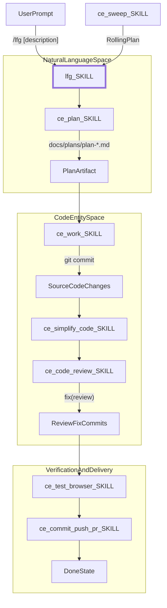
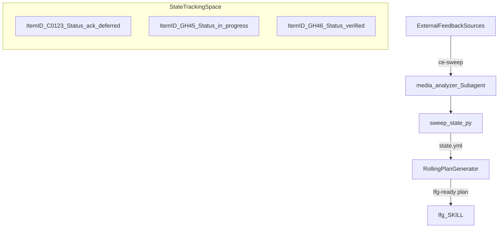

<!-- source: DeepWiki mcp.deepwiki.com · repo EveryInc/compound-engineering-plugin · page 5 Autonomous Workflows · fetched 2026-10-30 -->

# Autonomous Workflows

Relevant source files

The following files were used as context for generating this wiki page:

- [docs/guides/ce-babysit-pr.md](docs/guides/ce-babysit-pr.md)
- [docs/guides/ce-commit-push-pr.md](docs/guides/ce-commit-push-pr.md)
- [docs/guides/lfg.md](docs/guides/lfg.md)
- [skills/ce-babysit-pr/SKILL.md](skills/ce-babysit-pr/SKILL.md)
- [skills/ce-babysit-pr/references/envelope.md](skills/ce-babysit-pr/references/envelope.md)
- [skills/ce-babysit-pr/references/settle.md](skills/ce-babysit-pr/references/settle.md)
- [skills/ce-babysit-pr/references/setup.md](skills/ce-babysit-pr/references/setup.md)
- [skills/ce-babysit-pr/references/tick.md](skills/ce-babysit-pr/references/tick.md)
- [skills/ce-babysit-pr/references/watch-loop.md](skills/ce-babysit-pr/references/watch-loop.md)
- [skills/ce-babysit-pr/scripts/pr-snapshot](skills/ce-babysit-pr/scripts/pr-snapshot)
- [skills/lfg/references/plan-brief.md](skills/lfg/references/plan-brief.md)
- [skills/lfg/references/review-followup.md](skills/lfg/references/review-followup.md)
- [skills/lfg/references/work-return.md](skills/lfg/references/work-return.md)
- [tests/ce-babysit-pr-contract.test.ts](tests/ce-babysit-pr-contract.test.ts)
- [tests/ce-babysit-pr-snapshot.test.ts](tests/ce-babysit-pr-snapshot.test.ts)
- [tests/docs-root-rule-parity.test.ts](tests/docs-root-rule-parity.test.ts)

## Purpose and Scope

Autonomous workflows in the Compound Engineering plugin represent the highest level of automation, chaining together core development phases—ideate, brainstorm, plan, work, review, and compound—into unified pipelines. These workflows minimize human intervention by automating decision gates, task execution, and post-implementation verification.

This page introduces the primary autonomous entry points: the `/lfg` (Full Autonomous Engineering Workflow) command, the `ce-sweep` recurring feedback pipeline, and the `ce-babysit-pr` autonomous PR watch loop. For detailed mechanics, refer to the child pages.

Sources: [docs/guides/lfg.md:1-10](), [docs/guides/ce-babysit-pr.md:1-10]()

---

## High-Level Autonomous Orchestration

Autonomous workflows bridge Natural Language Space (user intent and feedback) and Code Entity Space (files, commits, and PRs) by managing stateful sequences of skill and script invocations.

### Diagram: Autonomous Orchestration Pipeline (Natural Language to Code Entities)

Sources: [docs/guides/lfg.md:5-20](), [skills/lfg/references/review-followup.md:9-25]()

---

## /lfg — Full Autonomous Engineering Workflow

The `/lfg` skill orchestrates sequential end-to-end execution without requiring the user to re-contextualize the agent between phases [docs/guides/lfg.md:3-7](). It enforces strict gating between planning, implementation, simplification, review, and shipping [skills/lfg/references/review-followup.md:1-15]().

For details, see [/lfg — Full Autonomous Engineering Workflow](#5.1).

Sources: [docs/guides/lfg.md:1-15](), [skills/lfg/references/review-followup.md:1-20]()

---

## ce-sweep — Recurring Feedback Pipeline

The `ce-sweep` skill automates feedback intake and triage from external sources such as Slack and GitHub Issues. It utilizes a durable YAML state managed by state scripts to track item lifecycles and emit implementation-ready plans [skills/ce-sweep/SKILL.md:1-25]().

### Diagram: Feedback Sweep Lifecycle (Natural Language to Code Entities)

Sources: [skills/ce-sweep/SKILL.md:1-30]()

For details, see [ce-sweep — Recurring Feedback Pipeline](#5.2).

---

## ce-babysit-pr — Autonomous PR Watch Loop

The `ce-babysit-pr` skill monitors open pull requests until merge-ready using the deterministic `pr-snapshot` helper script [skills/ce-babysit-pr/SKILL.md:1-15](). It coordinates reviews, CI status, and branch currency under a claim→act→confirm protocol [skills/ce-babysit-pr/scripts/pr-snapshot:1-15]().

For details, see [ce-babysit-pr — Autonomous PR Watch Loop](#5.3).

Sources: [skills/ce-babysit-pr/SKILL.md:1-20](), [skills/ce-babysit-pr/scripts/pr-snapshot:1-20]()

---

## Child Pages

- **[/lfg — Full Autonomous Engineering Workflow](#5.1)**: Sequential plan→work→review→compound pipeline, plan brief, task visibility, review followup, return-payload schema parity, gates, and residual handoff.
- **[ce-sweep — Recurring Feedback Pipeline](#5.2)**: Sweeping configured sources, `sweep-state.py` durable YAML lifecycle, media-analyzer subagent, model tiers, and plan-template outputs.
- **[ce-babysit-pr — Autonomous PR Watch Loop](#5.3)**: The `pr-snapshot` helper, atomic locked state journal, claim→act→confirm protocol, attention set, trajectory metrics, branch currency, settle window, managed stacks, needs-human residuals, and delegation routes.

---

