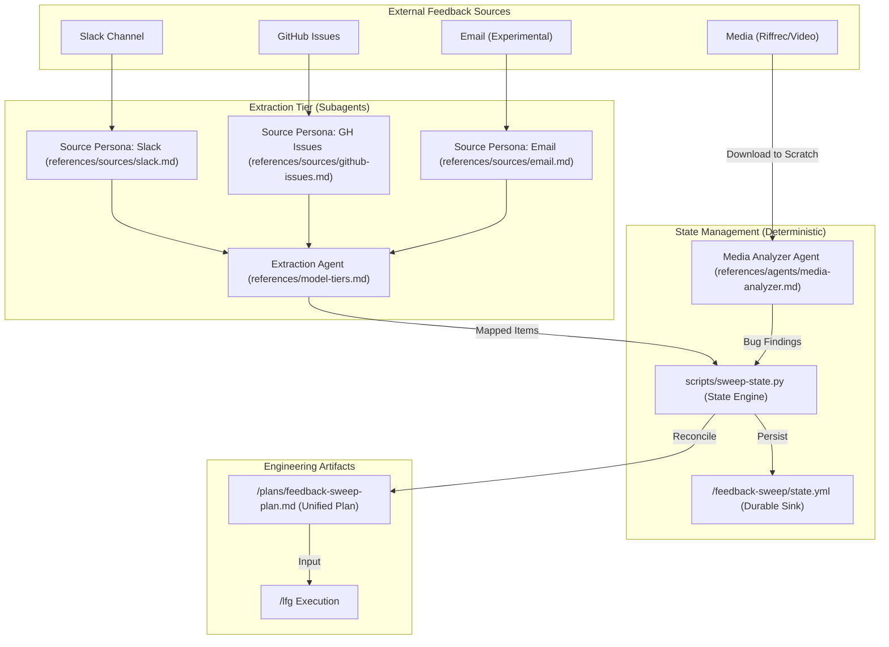
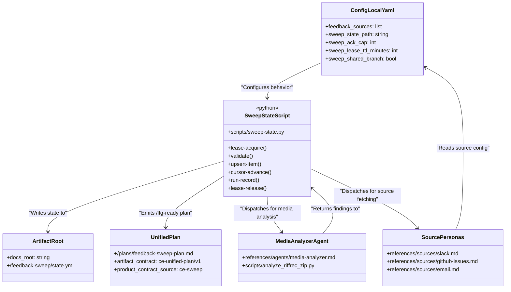

<!-- source: DeepWiki mcp.deepwiki.com · repo EveryInc/compound-engineering-plugin · page 5.2 ce-sweep — Recurring Feedback Pipeline · fetched 2026-10-30 -->

# ce-sweep — Recurring Feedback Pipeline

<details>
<summary>Relevant source files</summary>

The following files were used as context for generating this wiki page:

- [skills/ce-brainstorm/SKILL.md](skills/ce-brainstorm/SKILL.md)
- [skills/ce-brainstorm/references/dialogue.md](skills/ce-brainstorm/references/dialogue.md)
- [skills/ce-compound/SKILL.md](skills/ce-compound/SKILL.md)
- [skills/ce-doc-review/references/dispatch.md](skills/ce-doc-review/references/dispatch.md)
- [skills/ce-doc-review/references/subagent-template.md](skills/ce-doc-review/references/subagent-template.md)
- [skills/ce-explain/references/orchestration.md](skills/ce-explain/references/orchestration.md)
- [skills/ce-plan/SKILL.md](skills/ce-plan/SKILL.md)
- [skills/ce-plan/references/deepening-workflow.md](skills/ce-plan/references/deepening-workflow.md)
- [skills/ce-plan/references/research.md](skills/ce-plan/references/research.md)
- [skills/ce-pov/SKILL.md](skills/ce-pov/SKILL.md)
- [skills/ce-pov/references/cross-model-panel.md](skills/ce-pov/references/cross-model-panel.md)
- [skills/ce-pov/references/grounding.md](skills/ce-pov/references/grounding.md)
- [skills/ce-pov/references/method.md](skills/ce-pov/references/method.md)
- [skills/ce-strategy/SKILL.md](skills/ce-strategy/SKILL.md)
- [skills/ce-sweep/SKILL.md](skills/ce-sweep/SKILL.md)
- [skills/ce-sweep/references/interview.md](skills/ce-sweep/references/interview.md)
- [skills/ce-sweep/references/run.md](skills/ce-sweep/references/run.md)
- [tests/pov-skill-contract.test.ts](tests/pov-skill-contract.test.ts)

</details>


`ce-sweep` is a recurring engineering pipeline skill designed to bridge the gap between customer feedback and autonomous execution. It sweeps configured feedback sources (Slack, GitHub Issues, and experimental email), tracks the lifecycle of each item in a durable state file, analyzes media recordings using specialized subagents, and verifies that claimed fixes are actually merged to the main branch before closing items [skills/ce-sweep/SKILL.md:2-4]().

The skill's primary output is a requirements-only unified plan (`<root>/plans/feedback-sweep-plan.md`) that is ready for consumption by the `/lfg` autonomous workflow [skills/ce-sweep/SKILL.md:19-21]().

## Core Logic and Data Flow

The `ce-sweep` architecture separates deterministic state management from persona-based source extraction. The "State Engine" is a bundled Python script (`scripts/sweep-state.py`) that acts as the **only** writer of sweep state, enforcing the state contract and lease semantics [skills/ce-sweep/SKILL.md:22-24]().

### Data Flow: Feedback to Plan
The following diagram illustrates how raw feedback items are transformed into structured engineering plans.

**Diagram: Feedback Ingestion and State Lifecycle**

Sources: [skills/ce-sweep/SKILL.md:22-24](), [skills/ce-sweep/references/run.md:46-55](), [skills/ce-sweep/references/state-schema.md:13-18](), [skills/ce-sweep/references/agents/media-analyzer.md:1-40](), [skills/ce-sweep/references/model-tiers.md]()

## Media Analysis Sub-pipeline

When a feedback item includes media (recordings, videos, or audio), `ce-sweep` dispatches a specialized **Media Analyzer** subagent [skills/ce-sweep/references/run.md:74-74]().

1.  **Inputs**: The `Media Analyzer` subagent receives the item ID, origin reference, paths to downloaded media, a scratch artifact path for its findings, and a sensitive flag [skills/ce-sweep/references/agents/media-analyzer.md:5-12]().
2.  **Analysis**: It runs the bundled `analyze_riffrec_zip.py` script on each media path to extract frames and generate an initial analysis [skills/ce-sweep/references/agents/media-analyzer.md:15-24]().
3.  **Transcription & Privacy**: If an `OPENAI_API_KEY` is configured and the item is *not* sensitive, the analyzer transcribes the media. If the `sensitive` flag is `true`, transcription is explicitly suppressed to prevent leaking sensitive content to third-party services [skills/ce-sweep/references/agents/media-analyzer.md:25-28](). The subagent is instructed to summarize screen content and never transcribe verbatim sensitive text [skills/ce-sweep/references/agents/media-analyzer.md:41-46]().
4.  **Output**: The subagent writes a bug-report-shaped finding to a scratch artifact, including symptom, repro evidence (frames, transcript moments), affected surface, and a check for existing fixes on the main branch [skills/ce-sweep/references/agents/media-analyzer.md:30-38](). It then returns a compact 1-2 line summary and the artifact path to the orchestrator [skills/ce-sweep/references/agents/media-analyzer.md:39-40]().

Sources: [skills/ce-sweep/references/agents/media-analyzer.md:1-54](), [skills/ce-sweep/scripts/analyze_riffrec_zip.py](), [skills/ce-riffrec-feedback-analysis/scripts/analyze_riffrec_zip.py]()

## Durable State and Verification

The `ce-sweep` state file (`state.yml`) acts as the single source of truth for the feedback lifecycle. It can be stored locally (machine-local mode) or committed to the repository (committed mode) to allow multiple agents to share progress [skills/ce-sweep/references/interview.md:88-91](). The `scripts/sweep-state.py` script is the **only** program that writes to this file, enforcing a strict schema and lifecycle rules [skills/ce-sweep/SKILL.md:22-24]().

### State Schema and Lifecycle
The state file adheres to `references/state-schema.md` and includes top-level keys like `schema_version`, `lease`, `sources`, `items`, and `last_run` [skills/ce-sweep/references/state-schema.md:8-26]().

**Diagram: `sweep-state.py` Durable YAML Lifecycle**
```mermaid
graph TD
    A["Orchestrator (ce-sweep SKILL.md)"] -->|Calls subcommands| B("scripts/sweep-state.py")
    B -->|Acquire Lease (lease-acquire)| C{"Lease Status"}
    C -- LOCKED --> D["Record aborted-locked, Exit"]
    C -- STALE-RECLAIMED --> E["Proceed, Note Takeover"]
    C -- OK --> F["Proceed"]

    F -->|Validate State (validate)| G["Repair inconsistencies, e.g., downgrade under-evidenced 'closed' items to 'fix_pending'"]
    G -->|Fetch Sources (subagents)| H["Mapped Items"]
    H -->|Circuit Breaker (sweep_ack_cap)| I{"Proceed with Acks?"}
    I -- No --> J["Upsert as ack_deferred, Flag in Summary"]
    I -- Yes --> K["Acknowledge Items (per item)"]

    K -->|Upsert Item (upsert-item)| L["Update item status in state.yml"]
    K -->|Advance Cursor (cursor-advance)| M["Update source cursor in state.yml"]
    L & M -->|Re-stamp Lease Timestamp| F

    F -->|Media Analysis (media-analyzer subagent)| N["Findings"]
    N -->|Upsert Findings| L

    L -->|Fix Verification (git/gh commands)| O["Verify merge SHA"]
    O -->|Update Item Status| L

    L -->|Reconcile Plan (plan-template.md)| P["<root>/plans/feedback-sweep-plan.md"]
    P -->|Record Run (run-record)| Q["Update last_run in state.yml"]
    Q -->|Release Lease (lease-release)| R["Clear lease, Exit"]

    subgraph "State File (state.yml)"
        S["schema_version"]
        T["lease"]
        U["sources"]
        V["items"]
        W["last_run"]
    end

    L & M & Q --> S & T & U & V & W
```
Sources: [skills/ce-sweep/SKILL.md:22-24](), [skills/ce-sweep/references/state-schema.md:1-109](), [skills/ce-sweep/references/run.md:35-44]()

### Verification Logic
`ce-sweep` verifies that claimed fixes actually merged to the default branch before closing items [skills/ce-sweep/SKILL.md:2-4](). It uses a single-writer lease mechanism (`sweep_lease_ttl_minutes`) to prevent concurrent agents from corrupting the state [skills/ce-sweep/references/run.md:13-13](). The `validate` subcommand of `sweep-state.py` ensures data integrity by downgrading `closed` items that lack sufficient evidence (e.g., `fix_ref`, `verified_merge_sha`, `verified_at`) back to `fix_pending` [skills/ce-sweep/references/state-schema.md:70-79]().

**Table: Item Lifecycle Statuses**
| Status | Meaning |
| :--- | :--- |
| `ingested` | Captured from a source; not yet triaged [skills/ce-sweep/references/state-schema.md:57-57](). |
| `ack_deferred` | Receipt noted, but triage deferred to a later pass. This occurs if the source is read-only (`approved: false`) or if the circuit breaker is hit in non-interactive mode [skills/ce-sweep/references/state-schema.md:58-58](), [skills/ce-sweep/references/interview.md:66-68](), [skills/ce-sweep/references/run.md:58-60](). |
| `acknowledged` | Triaged and accepted into the sweep pipeline [skills/ce-sweep/references/state-schema.md:59-59](). |
| `needs_download` | Referenced media/attachment must be fetched before analysis [skills/ce-sweep/references/state-schema.md:60-60](). |
| `needs_analysis` | Content present, awaiting analysis [skills/ce-sweep/references/state-schema.md:61-61](). |
| `manual_stuck` | Blocked; needs manual intervention to proceed [skills/ce-sweep/references/state-schema.md:62-62](). |
| `analyzed` | Analysis complete; findings recorded on the item [skills/ce-sweep/references/state-schema.md:63-63](). |
| `in_plan` | Folded into a plan or tracked work item [skills/ce-sweep/references/state-schema.md:64-64](). |
| `fix_pending` | A fix is underway or awaiting verification. Also the downgrade target for an under-evidenced `closed` [skills/ce-sweep/references/state-schema.md:65-65](). |
| `closed` | Resolved and verified. Requires `fix_ref`, `verified_merge_sha`, and `verified_at` [skills/ce-sweep/references/state-schema.md:66-66](). |
| `source_gone` | The originating source or message no longer exists [skills/ce-sweep/references/state-schema.md:67-67](). |

Sources: [skills/ce-sweep/SKILL.md:2-4](), [skills/ce-sweep/references/state-schema.md:51-79](), [skills/ce-sweep/references/run.md:13-13](), [skills/ce-sweep/references/interview.md:66-68]()

## Setup and Configuration

`ce-sweep` requires an interactive first-run setup to establish sources and standing approvals.

*   **Interactive Interview**: Guided by `references/interview.md`, the skill captures source types (`slack`, `github-issues`, `email`), targets (channel IDs, repos), and acknowledgment actions (emojis/labels) [skills/ce-sweep/references/interview.md:22-60]().
*   **Standing Approval**: The user grants permission for the sweep to perform source-side writes unattended. A "No" keeps the source read-only, and items are tracked as `ack_deferred` [skills/ce-sweep/references/interview.md:61-68]().
*   **Mode: Non-interactive**: Invoking `/ce-sweep mode:non-interactive` (or the deprecated `mode:headless`) allows for scheduled runs. In this mode, ambiguous product decisions and circuit breaker deferrals are recorded in the plan's "Outstanding Questions" instead of prompting the user [skills/ce-sweep/SKILL.md:36-40](), [skills/ce-sweep/references/run.md:58-60]().
*   **Circuit Breaker**: The `sweep_ack_cap` (default `25`) prevents the sweep from performing excessive source-side writes in a single run. If exceeded, it prompts in interactive mode or defers in non-interactive mode [skills/ce-sweep/references/run.md:15-15](), [skills/ce-sweep/references/run.md:57-60]().

### Model Tiers
The `ce-sweep` skill dispatches subagents at the **extraction tier** for fetching sources [skills/ce-sweep/references/run.md:46-47](). This tier is designed for robust data extraction and mapping, ensuring that raw feedback is consistently structured before being passed to the state engine.

Sources: [skills/ce-sweep/SKILL.md:36-40](), [skills/ce-sweep/references/interview.md:22-68](), [skills/ce-sweep/references/run.md:13-15](), [skills/ce-sweep/references/run.md:46-47](), [skills/ce-sweep/references/run.md:57-60](), [skills/ce-sweep/references/model-tiers.md]()

### Plan-Template Output for /lfg
The `ce-sweep` skill generates a unified plan artifact at `<root>/plans/feedback-sweep-plan.md` based on `references/plan-template.md` [skills/ce-sweep/references/plan-template.md:1-3](). This plan is specifically designed to be consumed by the `/lfg` autonomous workflow.

Key aspects of the plan output:
*   **Frontmatter**: Includes `title`, `date`, `topic`, `artifact_contract: ce-unified-plan/v1`, and `product_contract_source: ce-sweep` [skills/ce-sweep/references/plan-template.md:8-16]().
*   **Goal Capsule**: A high-level summary of the plan's objective [skills/ce-sweep/references/plan-template.md:22-24]().
*   **Human Notes**: A region (`<!-- human-notes:start -->` to `<!-- human-notes:end -->`) that the reconciler never reads or writes, allowing human users to add context, priorities, and decisions [skills/ce-sweep/references/plan-template.md:26-31]().
*   **Product Contract**: Contains a summary, requirements (individual feedback items as `R<n>` with stable IDs), and outstanding questions [skills/ce-sweep/references/plan-template.md:33-50]().
*   **Reconciliation Rules**: Ensures the plan is a rolling document. It handles rotation of existing plans, updates specific machine-owned regions (date, summary, sweep-items, outstanding questions), maintains R-ID stability, drains closed items, and enforces the "Untrusted customer content" block for sensitive data [skills/ce-sweep/references/plan-template.md:57-62]().
*   **User-Runnable Invocation**: The handoff to the user includes a rendered `/lfg <root>/plans/feedback-sweep-plan.md` command [skills/ce-sweep/SKILL.md:88-93]().

Sources: [skills/ce-sweep/SKILL.md:88-93](), [skills/ce-sweep/references/plan-template.md:1-62]()

### Code Entity Mapping
The following diagram bridges the user-facing configuration to the underlying code entities and scripts.

**Diagram: Configuration to Code Entity Mapping**

Sources: [skills/ce-sweep/SKILL.md:19-24](), [skills/ce-sweep/SKILL.md:57-63](), [skills/ce-sweep/references/interview.md:3-4](), [skills/ce-sweep/references/run.md:10-16](), [skills/ce-sweep/references/state-schema.md:1-109](), [skills/ce-sweep/references/plan-template.md:1-62](), [skills/ce-sweep/references/agents/media-analyzer.md:1-54](), [skills/ce-sweep/references/sources/slack.md](), [skills/ce-sweep/references/sources/github-issues.md](), [skills/ce-sweep/references/sources/email.md]()

---

