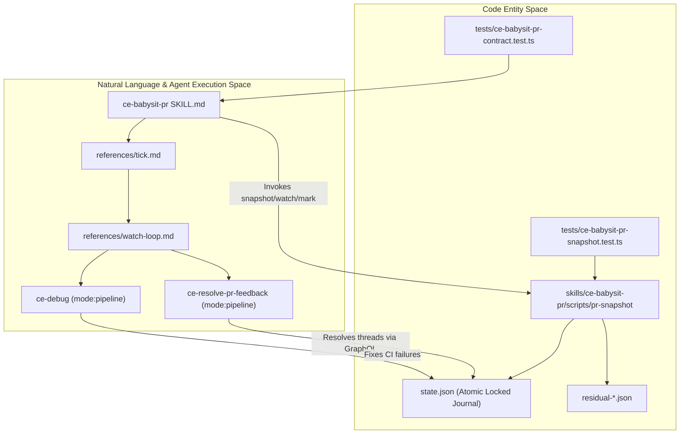
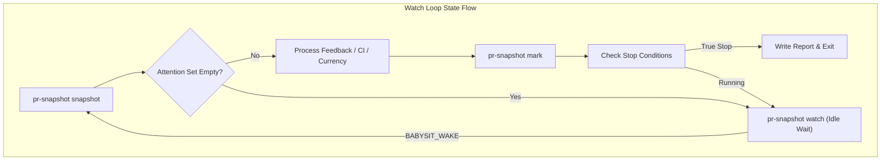

<!-- source: DeepWiki mcp.deepwiki.com · repo EveryInc/compound-engineering-plugin · page 5.3 ce-babysit-pr — Autonomous PR Watch Loop · fetched 2026-10-30 -->

# ce-babysit-pr — Autonomous PR Watch Loop

Relevant source files

The following files were used as context for generating this wiki page:

- [docs/guides/ce-babysit-pr.md](docs/guides/ce-babysit-pr.md)
- [docs/guides/ce-commit-push-pr.md](docs/guides/ce-commit-push-pr.md)
- [docs/guides/ce-resolve-pr-feedback.md](docs/guides/ce-resolve-pr-feedback.md)
- [skills/ce-babysit-pr/SKILL.md](skills/ce-babysit-pr/SKILL.md)
- [skills/ce-babysit-pr/references/envelope.md](skills/ce-babysit-pr/references/envelope.md)
- [skills/ce-babysit-pr/references/report.md](skills/ce-babysit-pr/references/report.md)
- [skills/ce-babysit-pr/references/settle.md](skills/ce-babysit-pr/references/settle.md)
- [skills/ce-babysit-pr/references/setup.md](skills/ce-babysit-pr/references/setup.md)
- [skills/ce-babysit-pr/references/tick.md](skills/ce-babysit-pr/references/tick.md)
- [skills/ce-babysit-pr/references/watch-loop.md](skills/ce-babysit-pr/references/watch-loop.md)
- [skills/ce-babysit-pr/scripts/pr-snapshot](skills/ce-babysit-pr/scripts/pr-snapshot)
- [skills/ce-resolve-pr-feedback/SKILL.md](skills/ce-resolve-pr-feedback/SKILL.md)
- [skills/ce-resolve-pr-feedback/references/evaluation-rubric.md](skills/ce-resolve-pr-feedback/references/evaluation-rubric.md)
- [skills/ce-resolve-pr-feedback/references/full-mode.md](skills/ce-resolve-pr-feedback/references/full-mode.md)
- [skills/ce-resolve-pr-feedback/references/pipeline-mode.md](skills/ce-resolve-pr-feedback/references/pipeline-mode.md)
- [skills/ce-resolve-pr-feedback/references/targeted-mode.md](skills/ce-resolve-pr-feedback/references/targeted-mode.md)
- [skills/ce-resolve-pr-feedback/scripts/get-pr-comments](skills/ce-resolve-pr-feedback/scripts/get-pr-comments)
- [skills/ce-resolve-pr-feedback/scripts/get-thread-for-comment](skills/ce-resolve-pr-feedback/scripts/get-thread-for-comment)
- [skills/ce-resolve-pr-feedback/scripts/reply-to-pr-thread](skills/ce-resolve-pr-feedback/scripts/reply-to-pr-thread)
- [tests/ce-babysit-pr-contract.test.ts](tests/ce-babysit-pr-contract.test.ts)
- [tests/ce-babysit-pr-snapshot.test.ts](tests/ce-babysit-pr-snapshot.test.ts)
- [tests/resolve-pr-feedback-pagination.test.ts](tests/resolve-pr-feedback-pagination.test.ts)
- [tests/skill-eval-cell/fixtures/resolve-feedback-adjudicate/docs/decisions/0007-retry-cap.md](tests/skill-eval-cell/fixtures/resolve-feedback-adjudicate/docs/decisions/0007-retry-cap.md)
- [tests/skill-eval-cell/fixtures/resolve-feedback-adjudicate/src/auth.ts](tests/skill-eval-cell/fixtures/resolve-feedback-adjudicate/src/auth.ts)
- [tests/skill-eval-cell/fixtures/resolve-feedback-scope/history.txt](tests/skill-eval-cell/fixtures/resolve-feedback-scope/history.txt)
- [tests/skill-eval-cell/fixtures/resolve-feedback-scope/src/export/csv.ts](tests/skill-eval-cell/fixtures/resolve-feedback-scope/src/export/csv.ts)
- [tests/skill-eval-cell/fixtures/resolve-feedback-scope/src/export/json.ts](tests/skill-eval-cell/fixtures/resolve-feedback-scope/src/export/json.ts)
- [tests/skill-eval-cell/fixtures/resolve-feedback-scope/src/export/tsv.ts](tests/skill-eval-cell/fixtures/resolve-feedback-scope/src/export/tsv.ts)
- [tests/skill-eval-cell/fixtures/resolve-feedback-scope/src/export/xlsx.ts](tests/skill-eval-cell/fixtures/resolve-feedback-scope/src/export/xlsx.ts)
- [tests/skills/ce-resolve-pr-feedback-reply-newlines.test.ts](tests/skills/ce-resolve-pr-feedback-reply-newlines.test.ts)

`ce-babysit-pr` is an orchestration skill designed to autonomously monitor and manage an open GitHub Pull Request (PR) until it reaches a merge-ready state [skills/ce-babysit-pr/SKILL.md:3](). It acts as a persistent babysitter for PRs, reacting to event streams such as review comments, CI failures, and branch currency issues [skills/ce-babysit-pr/SKILL.md:9](). Unlike single-pass skills, `ce-babysit-pr` maintains a continuous watch loop, delegating specific tasks to specialized skills like `ce-resolve-pr-feedback` for comments and `ce-debug` for CI issues, while managing overall flow, state, and stop conditions [skills/ce-babysit-pr/SKILL.md:9]().

Sources:
- [skills/ce-babysit-pr/SKILL.md:3-11]()
- [docs/guides/ce-babysit-pr.md:1-8]()

## The `pr-snapshot` Helper

The `pr-snapshot` script [skills/ce-babysit-pr/scripts/pr-snapshot]() is the foundational helper of `ce-babysit-pr`. It provides deterministic snapshotting of PR state, atomic state management, and deduplication logic. It handles the components prose cannot track reliably: fetching event streams, reading/writing state atomically under file locks, and deduping based on remote truth [skills/ce-babysit-pr/scripts/pr-snapshot:2-6]().

The script supports two primary subcommands:
- `snapshot`: Fetches the current PR state (or loads from a file), diffs it against on-disk state, atomically persists the observed state, and emits the actionable set as JSON [skills/ce-babysit-pr/scripts/pr-snapshot:15-17]().
- `mark`: Records agent actions against items, updating their dispositions in the state journal [skills/ce-babysit-pr/scripts/pr-snapshot:18-29]().

Sources:
- [skills/ce-babysit-pr/scripts/pr-snapshot:1-34]()
- [skills/ce-babysit-pr/SKILL.md:13-14]()

### Snapshot, Watch, and Mark

**`snapshot`**: Performs a single fetch of the PR's current state, parsing review threads, comments, CI checks, and branch currency [skills/ce-babysit-pr/scripts/pr-snapshot:15-17]().

**`watch`**: Runs the fetch-and-diff cycle on an interval using **zero agent tokens**, emitting a single `BABYSIT_WAKE {reason,url,...}` line only when work or a stop condition arises [skills/ce-babysit-pr/references/watch-loop.md:7](). Wake reasons categorize the triggering event (e.g., `actionable`, `feedback-candidate`, `branch-currency`, `terminal`, `merge-ready`, `needs-human`) [skills/ce-babysit-pr/references/watch-loop.md:11-25]().

**`mark`**: Updates an item's disposition after the agent processes it [skills/ce-babysit-pr/scripts/pr-snapshot:18-29](). For example, a `dispatched` thread re-triggers only if a new reviewer comment moves the last-comment identifier past the one previously acted upon [skills/ce-babysit-pr/scripts/pr-snapshot:26-28]().

Sources:
- [skills/ce-babysit-pr/references/watch-loop.md:7-25]()
- [skills/ce-babysit-pr/scripts/pr-snapshot:15-29]()
- [skills/ce-babysit-pr/references/tick.md:24-29]()

### Atomic Locked State Journal

`ce-babysit-pr` maintains state in a durable, atomic, and locked journal stored under `/tmp/compound-engineering-<uid>/ce-babysit-pr/<host>-<owner>-<repo>-<N>/` [skills/ce-babysit-pr/references/tick.md:11-12](). 

Using platform-native advisory file locks (`fcntl.flock` on POSIX systems or `msvcrt.locking` on Windows), `pr-snapshot` ensures safe concurrent operations [skills/ce-babysit-pr/scripts/pr-snapshot:54-57](). The resulting `state.json` is formatted with indentation for human inspection, while stdout streams consumed by the agent remain compact [tests/ce-babysit-pr-contract.test.ts:51-55]().

Sources:
- [skills/ce-babysit-pr/scripts/pr-snapshot:52-58]()
- [skills/ce-babysit-pr/references/tick.md:11-13]()
- [tests/ce-babysit-pr-contract.test.ts:51-55]()

### Claim→Act→Confirm Protocol

The state machine implements a strict **claim→act→confirm** protocol [skills/ce-babysit-pr/scripts/pr-snapshot:8-11]():
1. **Claim**: `snapshot` detects actionable items and presents them to the agent.
2. **Act**: The agent delegates or performs work (e.g., calling `ce-resolve-pr-feedback` or `ce-debug`).
3. **Confirm**: The agent executes `mark` to record completion.

An item remains actionable until explicitly confirmed via `mark` or removed by remote truth (e.g., a resolved thread disappearing from the GraphQL fetch) [skills/ce-babysit-pr/scripts/pr-snapshot:8-11](). If an agent run crashes before `mark`, the item remains actionable on the next tick [skills/ce-babysit-pr/scripts/pr-snapshot:8-11]().

Sources:
- [skills/ce-babysit-pr/scripts/pr-snapshot:8-11]()
- [skills/ce-babysit-pr/scripts/pr-snapshot:18-29]()

### Attention Set

The **attention set** consists of items requiring agent intervention during the current tick:
- Unresolved review threads [skills/ce-babysit-pr/SKILL.md:9]()
- Non-thread comment candidates [skills/ce-babysit-pr/references/tick.md:40]()
- Failing checks on the current head [skills/ce-babysit-pr/SKILL.md:9]()
- Branch currency items with explicit routing [skills/ce-babysit-pr/references/tick.md:40]()

Sources:
- [skills/ce-babysit-pr/SKILL.md:9]()
- [skills/ce-babysit-pr/references/tick.md:40]()

### Trajectory Metrics

`pr-snapshot` tracks trajectory indicators in the snapshot payload to measure progress and detect loops [tests/ce-babysit-pr-contract.test.ts:82-91]():
- `check_recur_max` [tests/ce-babysit-pr-contract.test.ts:83]()
- `recurring_checks` [tests/ce-babysit-pr-contract.test.ts:84]()
- `unresolved_threads` [tests/ce-babysit-pr-contract.test.ts:85]()
- `unresolved_series` [tests/ce-babysit-pr-contract.test.ts:86]()
- `unresolved_trend` [tests/ce-babysit-pr-contract.test.ts:87]()
- `new_threads_this_tick` [tests/ce-babysit-pr-contract.test.ts:88]()
- `stream_alternations` [tests/ce-babysit-pr-contract.test.ts:89]()
- `heads_since_progress` [tests/ce-babysit-pr-contract.test.ts:90]()
- `invariant_rounds` [tests/ce-babysit-pr-contract.test.ts:91]()

Sources:
- [skills/ce-babysit-pr/scripts/pr-snapshot]()
- [tests/ce-babysit-pr-contract.test.ts:82-91]()

### Branch Currency

Branch currency tracking ensures that updates from the base branch into the head happen exclusively through emitted items (such as `BEHIND` or `DIRTY`), utilizing explicit host commands (`update-branch` with `expected_head_sha`) rather than local merges [skills/ce-babysit-pr/SKILL.md:26](). Unrequested base merges are treated as protocol defects rather than valid actions [skills/ce-babysit-pr/SKILL.md:26]().

Sources:
- [skills/ce-babysit-pr/SKILL.md:26]()
- [skills/ce-babysit-pr/scripts/pr-snapshot:66-79]()

### Settle Window

Two key quiet windows govern readiness and responsiveness:
- **Settle Window (`--settle-seconds`, default 300s)**: The quiet duration required before a `merge-ready` wake is triggered [skills/ce-babysit-pr/scripts/pr-snapshot:100]().
- **Feedback Coalesce Window (`--feedback-coalesce-seconds`, default 180s)**: The quiet duration before waking on comment-only activity, preventing premature agent invocation during rapid bot chatter [skills/ce-babysit-pr/scripts/pr-snapshot:105]().

Sources:
- [skills/ce-babysit-pr/scripts/pr-snapshot:100-105]()
- [skills/ce-babysit-pr/references/watch-loop.md:46-50]()

### Managed Stacks

`ce-babysit-pr` supports multi-PR stacks under three execution postures:
- `target`: Monitors solely the specified PR [skills/ce-babysit-pr/SKILL.md:17]()
- `stack-ready`: Automatically advances to upper layers once lower layers are clean [skills/ce-babysit-pr/SKILL.md:18]()
- `stack-land`: Automatically executes `gh stack merge` and `gh stack sync` on settled layers [skills/ce-babysit-pr/SKILL.md:19]()

Sources:
- [skills/ce-babysit-pr/SKILL.md:16-21]()
- [skills/ce-babysit-pr/scripts/pr-snapshot:79-85]()

### `needs-human` Residuals

When an issue cannot be resolved autonomously (e.g., conflicting design intent or non-converging feedback), it is marked as `needs-human` along with a structured decision file containing `quoted_feedback`, `investigation`, `decision_reason`, `options`, and `recommendation` [tests/ce-babysit-pr-contract.test.ts:67-73](). Such residuals block merge-readiness while allowing independent work to continue [skills/ce-babysit-pr/SKILL.md:56]().

Sources:
- [skills/ce-babysit-pr/SKILL.md:56]()
- [tests/ce-babysit-pr-contract.test.ts:67-73]()

### Delegation to `ce-resolve-pr-feedback` and `ce-debug`

`ce-babysit-pr` delegates feedback processing and CI failure resolution to specialized skills in pipeline mode:
- **`ce-resolve-pr-feedback`**: Invoked with `mode:pipeline` to handle review threads and comments [skills/ce-babysit-pr/SKILL.md:48]().
- **`ce-debug`**: Invoked with `mode:pipeline` to troubleshoot and fix CI failures, returning structured statuses such as `fixed-and-pushed`, `diagnosed-no-fix`, or `needs-human` [tests/ce-babysit-pr-contract.test.ts:78]().

Sources:
- [skills/ce-babysit-pr/SKILL.md:48-51]()
- [tests/ce-babysit-pr-contract.test.ts:78]()

## Architecture and Data Flow

Sources:
- [skills/ce-babysit-pr/SKILL.md:1-59]()
- [skills/ce-babysit-pr/scripts/pr-snapshot:1-120]()
- [tests/ce-babysit-pr-contract.test.ts:1-143]()

Sources:
- [skills/ce-babysit-pr/SKILL.md:33-59]()
- [skills/ce-babysit-pr/scripts/pr-snapshot:15-29]()
- [skills/ce-babysit-pr/references/watch-loop.md:7-25]()

Sources:
- [skills/ce-babysit-pr/SKILL.md]()
- [skills/ce-babysit-pr/scripts/pr-snapshot]()
- [skills/ce-babysit-pr/references/watch-loop.md]()
- [skills/ce-babysit-pr/references/tick.md]()
- [tests/ce-babysit-pr-contract.test.ts]()
- [tests/ce-babysit-pr-snapshot.test.ts]()

---

