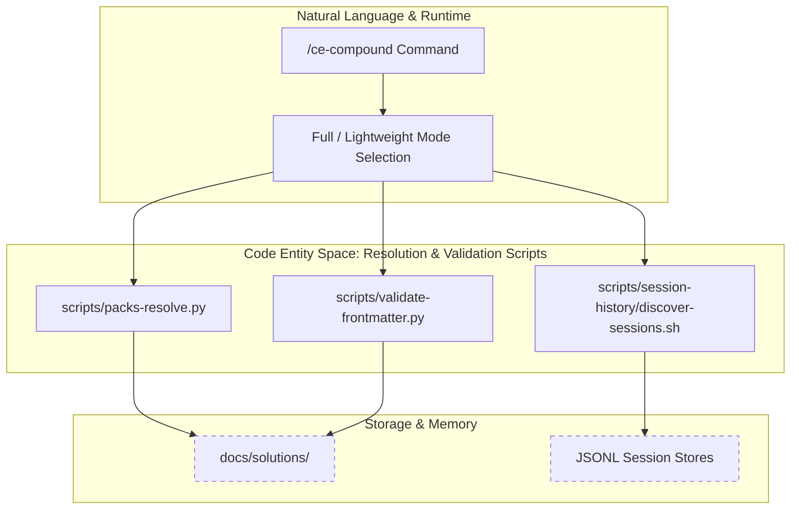
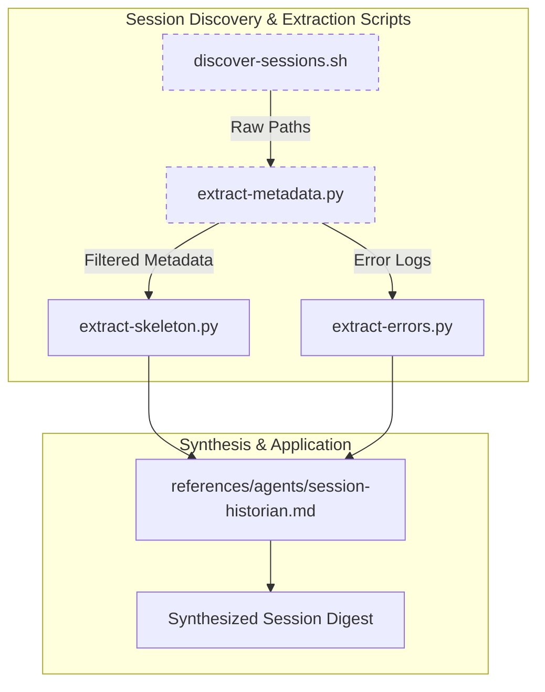

<!-- source: DeepWiki mcp.deepwiki.com · repo EveryInc/compound-engineering-plugin · page 6 Knowledge Systems · fetched 2026-10-30 -->

# Knowledge Systems

Relevant source files

The following files were used as context for generating this wiki page:

- [assets/demo/play.sh](assets/demo/play.sh)
- [docs/guides/ce-compound.md](docs/guides/ce-compound.md)
- [skills/ce-compound/references/assembly.md](skills/ce-compound/references/assembly.md)
- [skills/ce-compound/references/modes.md](skills/ce-compound/references/modes.md)
- [skills/ce-compound/references/report.md](skills/ce-compound/references/report.md)
- [skills/ce-compound/references/research.md](skills/ce-compound/references/research.md)
- [skills/ce-compound/references/session-history.md](skills/ce-compound/references/session-history.md)

The knowledge systems in the `compound-engineering-plugin` capture, store, retrieve, and leverage institutional knowledge to make each unit of engineering work easier than the last. This system transforms ephemeral chat history into durable, structured documentation in `docs/solutions/`, bridges disparate agent sessions via the session history system, and follows a research methodology that prioritizes curated local knowledge over generic external search.

For details, see [Knowledge Capture System](#6.1), [Knowledge Retrieval and Research Methodology](#6.2), and [Session Continuity and Cross-Session Knowledge](#6.3).

Sources: [skills/ce-compound/SKILL.md:25-30](), [skills/ce-compound/SKILL.md:71-76]()

---

## Knowledge Architecture Overview

The knowledge systems operate through interconnected mechanisms: capture via the `/ce-compound` command, storage in structured markdown files with YAML frontmatter, retrieval via specialized agents, and cross-session bridging via session history scanners that support Claude Code, Codex, Cursor, Pi, and oh-my-pi (`omp`).

### Knowledge Capture and Processing Architecture

Sources: [skills/ce-compound/references/research.md:60-62](), [skills/ce-compound/references/assembly.md:38-40](), [skills/ce-compound/references/session-history.md:40-44]()

---

## Knowledge Capture System (#6.1)

Knowledge capture transforms solved problems into reusable documentation through the `ce-compound` skill. This process creates structured documentation in `docs/solutions/` with YAML frontmatter to ensure searchability and future reference [skills/ce-compound/references/assembly.md:30](). The `ce-compound` skill also populates `CONCEPTS.md` as a side effect of documenting a learning, seeding the learning's area with relevant domain terms.

The system uses a phase-based pipeline:
- **Full Mode**: Uses parallel subagents (`Context Analyzer`, `Solution Extractor`, `Related Docs Finder`) and an automatic session-history probe [skills/ce-compound/references/modes.md:5-7]().
- **Lightweight Mode**: A single-pass, lower-overhead run that skips subagents and session-history research.
- **Validation**: Ensures YAML frontmatter adheres to canonical fields and enum values defined in schema references and validates parser safety via `scripts/validate-frontmatter.py` [skills/ce-compound/references/assembly.md:34-48]().

For details, see [Knowledge Capture System](#6.1).

Sources: [skills/ce-compound/references/assembly.md:30](), [skills/ce-compound/references/assembly.md:34-48](), [skills/ce-compound/references/modes.md:5-7]()

---

## Knowledge Retrieval and Research Methodology (#6.2)

The plugin implements a "local-first" research methodology. Research agents prioritize curated knowledge over generic external search:

1.  **Phase 1 (Curated Knowledge)**: Check project-specific skills and the `docs/solutions/` directory [skills/ce-compound/references/research.md:10-12]().
2.  **Phase 2 (External Search)**: Only if local knowledge is insufficient, agents perform web research. `ce-ideate` maintains a web research cache to prevent redundant external calls.

Retrieval surfaces past solutions through the `learnings-researcher` logic. This logic searches `docs/solutions/` for applicable past learnings, such as bugs (symptoms/prevention) or architecture patterns (guidance/examples). The repo-grounding profile caching and web research cache mechanisms further optimize this process by storing results of prior research, reducing redundant queries. Planning and review processes also ground in prior learnings and compound packs.

For details, see [Knowledge Retrieval and Research Methodology](#6.2).

Sources: [skills/ce-compound/references/research.md:10-12]()

---

## Session Continuity and Cross-Session Knowledge (#6.3)

The knowledge system bridges disparate agent sessions by scanning JSONL session stores. This capability is embedded within the `ce-compound` skill as the `session-historian` [skills/ce-compound/references/agents/session-historian.md:3-5]() and also powers session continuity in `ce-handoff`. The `ce-compound` skill dispatches the `session-historian` agent with pre-extracted session data [skills/ce-compound/references/session-history.md:10-12]().

### Session History Extraction Pipeline

Sources: [skills/ce-compound/references/session-history.md:40-44](), [skills/ce-compound/references/agents/session-historian.md:3-5]()

The `session-historian` scripts discover and extract skeletons, metadata, and errors from JSONL session stores across various hosts.

| Script | Purpose | Identification Method |
|----------|--------------|-----------------------|
| `discover-sessions.sh` | Finds session files | Scans platform-specific paths (e.g., `~/.claude/projects`, `~/.pi/agent/sessions`, `~/.omp/agent/sessions`) [skills/ce-compound/scripts/session-history/discover-sessions.sh:41-112]() |
| `extract-metadata.py` | Parses session headers | Detects `platform`, `branch`, `cwd`, `session ID`, and `timestamp` from JSONL structure for Claude, Codex, Pi, and omp [skills/ce-compound/scripts/session-history/extract-metadata.py:22-131]() |
| `extract-skeleton.py` | Summarizes content | Extracts user/assistant text while collapsing consecutive tool calls for Claude, Codex, Cursor, Pi, and omp [skills/ce-compound/scripts/session-history/extract-skeleton.py:8-16](), [skills/ce-compound/scripts/session-history/extract-skeleton.py:159-180]() |
| `extract-errors.py` | Extracts failures | Finds failed tool calls and non-zero exit codes [skills/ce-compound/scripts/session-history/extract-errors.py:8-10]() |

The `session-historian` agent itself is designed for synthesis only, operating on pre-extracted files and explicitly forbidden from invoking the `Skill` tool or performing its own discovery/extraction [skills/ce-compound/references/agents/session-historian.md:31-33]().

For details, see [Session Continuity and Cross-Session Knowledge](#6.3).

Sources: [skills/ce-compound/references/agents/session-historian.md:3-5](), [skills/ce-compound/references/agents/session-historian.md:31-33](), [skills/ce-compound/scripts/session-history/discover-sessions.sh:41-112](), [skills/ce-compound/scripts/session-history/extract-metadata.py:22-131](), [skills/ce-compound/scripts/session-history/extract-skeleton.py:8-16](), [skills/ce-compound/scripts/session-history/extract-skeleton.py:159-180](), [skills/ce-compound/references/session-history.md:10-12]()

---

## Knowledge Maintenance

Knowledge quality is maintained via the `ce-compound-refresh` skill. This workflow reviews existing learnings against the current codebase to detect drift. It can operate in interactive or headless mode, applying outcomes like **Keep**, **Update**, **Consolidate**, **Replace**, or **Delete** to each learning. The `CONCEPTS.md` vocabulary also has specific rules for adding, refining, folding, retiring, deleting, or scrubbing entries.

Additionally, the `ce-sweep` skill provides a recurring feedback pipeline, tracking the lifecycle of items from Slack or GitHub Issues and folding them into `lfg`-ready plans.

Sources: [skills/ce-compound-refresh/references/investigate.md:1-3](), [skills/ce-sweep/SKILL.md:1-3]()

---

