<!-- source: DeepWiki mcp.deepwiki.com · repo EveryInc/compound-engineering-plugin · page 6.1 Knowledge Capture System · fetched 2026-10-30 -->

# Knowledge Capture System

<details>
<summary>Relevant source files</summary>

The following files were used as context for generating this wiki page:

- [docs/plans/2026-08-15-1506-fix-refresh-instruction-layer-conflict-plan.md](docs/plans/2026-08-15-1506-fix-refresh-instruction-layer-conflict-plan.md)
- [docs/plans/2026-08-28-0211-fix-doc-claims-absolute-paths-plan.md](docs/plans/2026-08-28-0211-fix-doc-claims-absolute-paths-plan.md)
- [docs/solutions/developer-experience/bun-parallel-worker-loses-subprocess-exit.md](docs/solutions/developer-experience/bun-parallel-worker-loses-subprocess-exit.md)
- [docs/solutions/developer-experience/signal-during-untimed-subprocess-wait-stalls-test.md](docs/solutions/developer-experience/signal-during-untimed-subprocess-wait-stalls-test.md)
- [docs/solutions/skill-design/detector-that-cannot-decide-should-rank-not-assert.md](docs/solutions/skill-design/detector-that-cannot-decide-should-rank-not-assert.md)
- [skills/ce-compound-refresh/SKILL.md](skills/ce-compound-refresh/SKILL.md)
- [skills/ce-compound-refresh/assets/resolution-template.md](skills/ce-compound-refresh/assets/resolution-template.md)
- [skills/ce-compound-refresh/references/per-action-flows.md](skills/ce-compound-refresh/references/per-action-flows.md)
- [skills/ce-compound-refresh/references/schema.yaml](skills/ce-compound-refresh/references/schema.yaml)
- [skills/ce-compound-refresh/references/yaml-schema.md](skills/ce-compound-refresh/references/yaml-schema.md)
- [skills/ce-compound-refresh/scripts/validate-doc-claims.py](skills/ce-compound-refresh/scripts/validate-doc-claims.py)
- [skills/ce-compound/assets/resolution-template.md](skills/ce-compound/assets/resolution-template.md)
- [skills/ce-compound/references/grounding-validation.md](skills/ce-compound/references/grounding-validation.md)
- [skills/ce-compound/references/schema.yaml](skills/ce-compound/references/schema.yaml)
- [skills/ce-compound/references/yaml-schema.md](skills/ce-compound/references/yaml-schema.md)
- [skills/ce-compound/scripts/validate-doc-claims.py](skills/ce-compound/scripts/validate-doc-claims.py)
- [tests/compound-support-files.test.ts](tests/compound-support-files.test.ts)
- [tests/doc-claims-validator.test.ts](tests/doc-claims-validator.test.ts)

</details>


## Purpose and Scope

The Knowledge Capture System implements the "Compound" phase of the compound engineering workflow, automatically documenting solved problems as structured, searchable documentation under `docs/solutions/`. This system transforms solved problems into institutional knowledge that prevents repeated mistakes and accelerates future work.

This page covers the capture mechanisms (`/ce-compound` command), the `ce-compound` skill's phase-based pipeline, YAML frontmatter taxonomy and validation, the bug vs. knowledge track distinction, and mechanical grounding validation via `validate-doc-claims.py`.

Sources:
- [skills/ce-compound/SKILL.md:1-5]()
- [skills/ce-compound-refresh/scripts/validate-doc-claims.py:1-52]()

---

## System Architecture

The Knowledge Capture System consists of high-level orchestration skills (`ce-compound`, `ce-compound-refresh`), specialized research subagents, and a validation layer that enforces strict schema compliance and mechanical grounding for all documentation.

### Component Overview Diagram

```mermaid
graph TB
    subgraph "NaturalLanguageSpace"
        CompoundCmd[""/ce-compound command""]
        RefreshCmd[""/ce-compound-refresh command""]
    end

    subgraph "CodeEntitySpace"
        Phase1_Research[""Phase 1: Research & History""]
        Phase2_Assembly[""Phase 2: Assembly & Write""]
        Phase3_Discoverability[""Phase 3: Discoverability Check""]
        ValidateDocClaimsPy[""skills/ce-compound/scripts/validate-doc-claims.py""]
        ValidateFrontmatterPy[""skills/ce-compound/scripts/validate-frontmatter.py""]
        SemanticValidatorSubagent[""Semantic Validator Subagent""]
    end

    subgraph "StorageAndContracts"
        SchemaYAML[""skills/ce-compound/references/schema.yaml""]
        YAMLSchemaMD[""skills/ce-compound/references/yaml-schema.md""]
        ResolutionTemplateMD[""skills/ce-compound/assets/resolution-template.md""]
        SolutionsDir[""docs/solutions/""]
        ConceptsMD[""CONCEPTS.md""]
    end

    CompoundCmd --> Phase1_Research
    Phase1_Research --> Phase2_Assembly
    Phase2_Assembly --> SchemaYAML
    Phase2_Assembly --> YAMLSchemaMD
    Phase2_Assembly --> ResolutionTemplateMD
    Phase2_Assembly --> ValidateFrontmatterPy
    Phase2_Assembly --> ValidateDocClaimsPy
    Phase2_Assembly --> SemanticValidatorSubagent
    Phase2_Assembly --> SolutionsDir
    Phase2_Assembly --> ConceptsMD
    Phase2_Assembly --> Phase3_Discoverability
    Phase3_Discoverability --> RefreshCmd

    style CompoundCmd fill:#fff,stroke:#333,stroke-width:2px
    style RefreshCmd fill:#fff,stroke:#333,stroke-width:2px
    style Phase1_Research fill:#fff,stroke:#333,stroke-width:2px
    style Phase2_Assembly fill:#fff,stroke:#333,stroke-width:2px
    style Phase3_Discoverability fill:#fff,stroke:#333,stroke-width:2px
    style ValidateDocClaimsPy fill:#fff,stroke:#333,stroke-width:2px
    style ValidateFrontmatterPy fill:#fff,stroke:#333,stroke-width:2px
    style SemanticValidatorSubagent fill:#fff,stroke:#333,stroke-width:2px
    style SchemaYAML fill:#fff,stroke:#333,stroke-width:2px
    style YAMLSchemaMD fill:#fff,stroke:#333,stroke-width:2px
    style ResolutionTemplateMD fill:#fff,stroke:#333,stroke-width:2px
    style SolutionsDir fill:#fff,stroke:#333,stroke-width:2px
    style ConceptsMD fill:#fff,stroke:#333,stroke-width:2px
```



Sources:
- [skills/ce-compound/SKILL.md:55-71]()
- [skills/ce-compound/scripts/validate-doc-claims.py:1-52]()
- [skills/ce-compound/references/schema.yaml:1-200]()

---

## The `ce-compound` Skill Pipeline

The `ce-compound` skill coordinates parallel subagents to capture problem solutions while context is fresh. It writes structured docs to `docs/solutions/` covering symptoms, root causes, and prevention strategies.

### Execution Modes

| Mode | Depth | Behavior |
| :--- | :--- | :--- |
| **Interactive** | Auto | Full mode by default; prompts for consent on instruction edits [skills/ce-compound/SKILL.md:57](). |
| **Non-interactive** | `full` | Runs subagents and session history; reports gaps without editing files [skills/ce-compound/SKILL.md:58](). |
| **Non-interactive** | `lightweight` | Single-pass; no subagents or session history; uses active context only [skills/ce-compound/SKILL.md:58](). Skips cross-referencing, duplicate detection, and semantic grounding validation [skills/ce-compound/references/lightweight.md:7-8](). |

Sources:
- [skills/ce-compound/SKILL.md:31-60]()
- [skills/ce-compound/references/lightweight.md:1-11]()

### Phase Pipeline Steps

1. **Parallel Research and History:** The orchestrator dispatches research tasks and parses historical JSONL session stores.
2. **Assembly and Write:** Evaluates duplicate overlap, collects metadata, and writes the structured Markdown artifact using `assets/resolution-template.md` [skills/ce-compound/assets/resolution-template.md:1-96]().
3. **Frontmatter & Claims Validation:** Executes parser-safety checks and mechanical grounding validations via `validate-doc-claims.py` [skills/ce-compound/scripts/validate-doc-claims.py:12-52]() and `validate-frontmatter.py` [skills/ce-compound/references/assembly.md:34-48]().
4. **Semantic Validation:** Dispatches a read-only validator subagent to verify factual claims in the text against the local repository and upstream truth [skills/ce-compound/references/grounding-validation.md:35-77]().

Sources:
- [skills/ce-compound/assets/resolution-template.md:1-96]()
- [skills/ce-compound/scripts/validate-doc-claims.py:12-52]()
- [skills/ce-compound/references/grounding-validation.md:35-77]()

---

## Structured Knowledge Taxonomy and Frontmatter

Documentation is organized into two primary tracks defined in `skills/ce-compound/references/schema.yaml`: the **Bug Track** and the **Knowledge Track**.

### Track Classification and Schema Rules

| Track | Required Fields | Optional Fields | Example `problem_type` |
| :--- | :--- | :--- | :--- |
| **Bug** | `module`, `date`, `problem_type`, `component`, `severity`, `symptoms`, `root_cause`, `resolution_type` | `related_components`, `tags`, `retire_when` | `test_failure`, `build_error`, `runtime_error` |
| **Knowledge** | `module`, `date`, `problem_type`, `component`, `severity` | `applies_when`, `symptoms`, `root_cause`, `resolution_type`, `related_components`, `tags`, `retire_when` | `best_practice`, `architecture_pattern`, `convention` |

### YAML Safety Rules for Frontmatter
Array items in frontmatter fields (such as `symptoms:` or `tags:`) that start with YAML reserved indicators (`[`, `*`, `&`, `!`, `|`, `>`, `%`, `@`, `?`) or contain `:` must be wrapped in double quotes to satisfy strict YAML parsers like `js-yaml` [tests/compound-support-files.test.ts:61-68]().

Sources:
- [skills/ce-compound/references/schema.yaml:1-200]()
- [tests/compound-support-files.test.ts:61-68]()

---

## Grounding Validation and `validate-doc-claims.py`

The Python script `validate-doc-claims.py` performs deterministic mechanical grounding checks on written documentation bodies [skills/ce-compound/scripts/validate-doc-claims.py:12-14]().

### Natural Language to Code Entity Mapping Diagram

```mermaid
graph TD
    subgraph "NaturalLanguageSpace"
        NL_PathCitation[""Prose citing `src/real-file.ts`""]
        NL_CommitCitation[""Prose stating 'fixed in a1b2c3d'""]
        NL_DraftScaffold[""Prose containing 'Learning 3' or `{{...}}`""]
    end

    subgraph "CodeEntitySpace"
        PathChecker[""is_path_candidate() / is_path_shaped()""]
        GitTreeCheck[""subprocess.run(['git', 'rev-parse', ...])""]
        ScaffoldMatcher[""SCAFFOLD_RES regex patterns""]
        ExitCode[""sys.exit(0) or sys.exit(1)""]
    end

    NL_PathCitation --> PathChecker
    PathChecker --> GitTreeCheck
    NL_CommitCitation --> GitTreeCheck
    NL_DraftScaffold --> ScaffoldMatcher
    GitTreeCheck --> ExitCode
    ScaffoldMatcher --> ExitCode

    style NL_PathCitation fill:#fff,stroke:#333,stroke-width:2px
    style NL_CommitCitation fill:#fff,stroke:#333,stroke-width:2px
    style NL_DraftScaffold fill:#fff,stroke:#333,stroke-width:2px
    style PathChecker fill:#fff,stroke:#333,stroke-width:2px
    style GitTreeCheck fill:#fff,stroke:#333,stroke-width:2px
    style ScaffoldMatcher fill:#fff,stroke:#333,stroke-width:2px
    style ExitCode fill:#fff,stroke:#333,stroke-width:2px
```

### Core Validation Checks in `validate-doc-claims.py`
1. **Path Verification:** Backticked paths containing `/` must exist in the working tree or upstream branch [skills/ce-compound/scripts/validate-doc-claims.py:16-22]().
2. **Commit SHA Verification:** 7 to 40-character hex tokens preceded by commit trigger words or attribution verbs must resolve to valid git commits [skills/ce-compound/scripts/validate-doc-claims.py:26-36]().
3. **Markdown Link Integrity:** Relative link targets must resolve correctly from the document's directory location [skills/ce-compound/scripts/validate-doc-claims.py:37]().
4. **Drafting Scaffold Detection:** Detects leaked templates like `Learning N` or bare `{{...}}` placeholder tokens outside of code blocks [skills/ce-compound/scripts/validate-doc-claims.py:38-42]().

Sources:
- [skills/ce-compound/scripts/validate-doc-claims.py:1-52]()
- [tests/doc-claims-validator.test.ts:1-160]()
- [skills/ce-compound/references/grounding-validation.md:1-34]()

---

## Concepts Vocabulary Updates (`CONCEPTS.md`)

Domain terminology is maintained across the repository via `CONCEPTS.md`. 

### Vocabulary Actions
- **Add:** Introduce new domain concepts discovered during investigation [skills/ce-compound-refresh/references/concepts-vocabulary.md:5]().
- **Refine:** Update definitions with increased technical precision [skills/ce-compound-refresh/references/concepts-vocabulary.md:6]().
- **Fold / Retire:** Merge duplicate definitions or deprecate obsolete concepts into a `## Retired` block.

Sources:
- [skills/ce-compound-refresh/references/concepts-vocabulary.md:1-50]()

---

