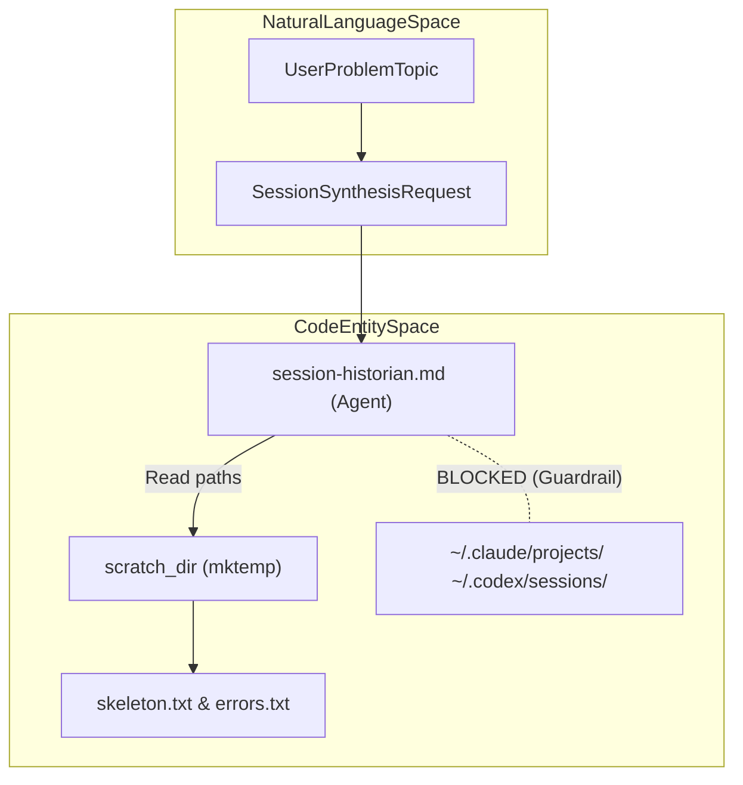
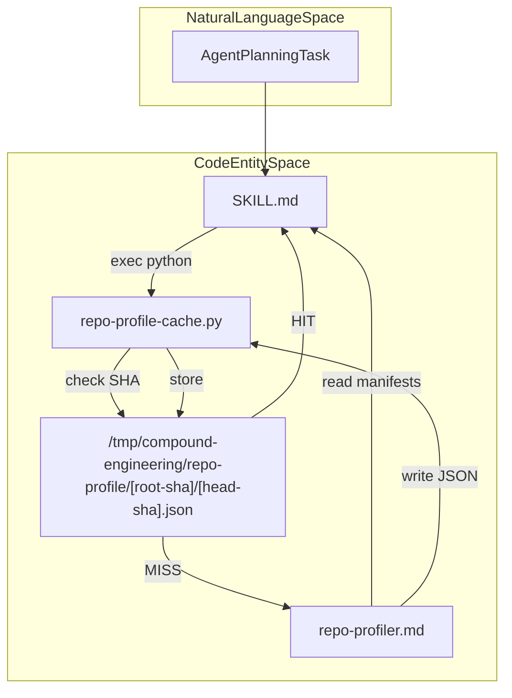
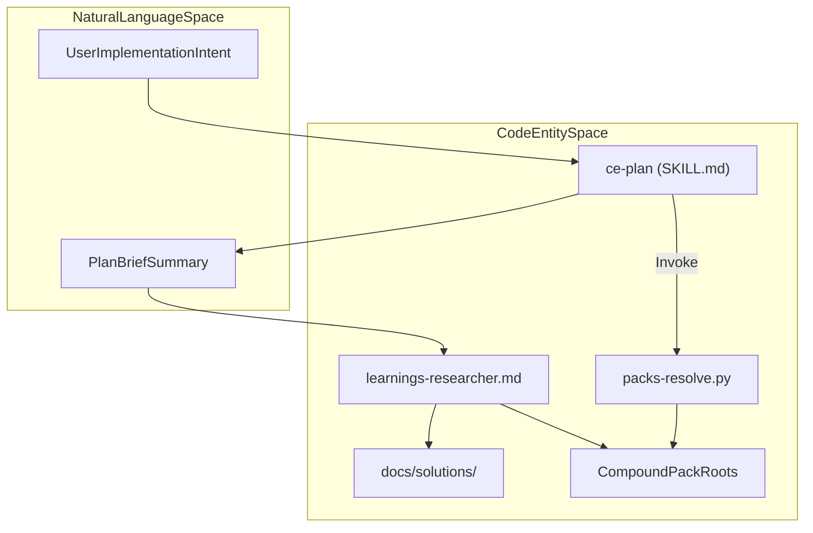

<!-- source: DeepWiki mcp.deepwiki.com · repo EveryInc/compound-engineering-plugin · page 6.2 Knowledge Retrieval and Research Methodology · fetched 2026-10-30 -->

# Knowledge Retrieval and Research Methodology

Relevant source files

The following files were used as context for generating this wiki page:

- [skills/ce-brainstorm/references/agents/slack-researcher.md](skills/ce-brainstorm/references/agents/slack-researcher.md)
- [skills/ce-brainstorm/scripts/packs-resolve.py](skills/ce-brainstorm/scripts/packs-resolve.py)
- [skills/ce-code-review/scripts/packs-resolve.py](skills/ce-code-review/scripts/packs-resolve.py)
- [skills/ce-compound/references/agents/best-practices-researcher.md](skills/ce-compound/references/agents/best-practices-researcher.md)
- [skills/ce-compound/references/agents/framework-docs-researcher.md](skills/ce-compound/references/agents/framework-docs-researcher.md)
- [skills/ce-compound/references/agents/session-historian.md](skills/ce-compound/references/agents/session-historian.md)
- [skills/ce-compound/scripts/packs-resolve.py](skills/ce-compound/scripts/packs-resolve.py)
- [skills/ce-doc-review/scripts/packs-resolve.py](skills/ce-doc-review/scripts/packs-resolve.py)
- [skills/ce-dogfood/scripts/packs-resolve.py](skills/ce-dogfood/scripts/packs-resolve.py)
- [skills/ce-optimize/references/agents/repo-research-analyst.md](skills/ce-optimize/references/agents/repo-research-analyst.md)
- [skills/ce-plan/references/agents/best-practices-researcher.md](skills/ce-plan/references/agents/best-practices-researcher.md)
- [skills/ce-plan/references/agents/framework-docs-researcher.md](skills/ce-plan/references/agents/framework-docs-researcher.md)
- [skills/ce-plan/references/agents/git-history-analyzer.md](skills/ce-plan/references/agents/git-history-analyzer.md)
- [skills/ce-plan/references/agents/repo-research-analyst.md](skills/ce-plan/references/agents/repo-research-analyst.md)
- [skills/ce-plan/references/agents/slack-researcher.md](skills/ce-plan/references/agents/slack-researcher.md)
- [skills/ce-plan/references/agents/web-researcher.md](skills/ce-plan/references/agents/web-researcher.md)
- [skills/ce-plan/scripts/packs-resolve.py](skills/ce-plan/scripts/packs-resolve.py)
- [skills/ce-pov/references/agents/external-evidence-researcher.md](skills/ce-pov/references/agents/external-evidence-researcher.md)
- [skills/ce-pov/references/agents/precedent-activity-scout.md](skills/ce-pov/references/agents/precedent-activity-scout.md)
- [skills/ce-pov/references/agents/project-grounding-scout.md](skills/ce-pov/references/agents/project-grounding-scout.md)
- [skills/ce-setup/references/pack-scaffold.md](skills/ce-setup/references/pack-scaffold.md)
- [skills/ce-setup/scripts/packs-resolve.py](skills/ce-setup/scripts/packs-resolve.py)
- [tests/skills/ce-packs-resolver.test.ts](tests/skills/ce-packs-resolver.test.ts)
- [tests/skills/ce-setup-pack-scaffold.test.ts](tests/skills/ce-setup-pack-scaffold.test.ts)

This page details the mechanisms used by the Compound Engineering plugin to search and apply past solutions, the two-phase research approach, and the shared caching primitives that optimize repo-grounding and web research.

## Overview and Purpose

The plugin leverages a multi-layered knowledge retrieval system designed to minimize redundant work and maximize the application of institutional knowledge. This is achieved through:
- **Phase 1 (Internal):** Exhaustive search of `docs/solutions/`, `SKILL.md` files, and session history via specialized subagents like `learnings-researcher` and `repo-research-analyst` [skills/ce-plan/references/agents/repo-research-analyst.md:1-5]().
- **Phase 2 (External):** Targeted online research with specific validity gates and deprecation checks [skills/ce-plan/references/agents/best-practices-researcher.md:42-51]().
- **Shared Primitives:** Cross-skill caching of repository profiles and web research results to avoid redundant API or globbing overhead [skills/ce-ideate/references/web-research-cache.md:1-10]().

Sources: [skills/ce-plan/references/agents/repo-research-analyst.md:1-5](), [skills/ce-plan/references/agents/best-practices-researcher.md:42-51](), [skills/ce-ideate/references/web-research-cache.md:1-10]()

---

## The Two-Phase Research Approach

Agents follow a strict priority order to ensure curated internal knowledge is leveraged before external searching.

### Phase 1: Curated Knowledge and Repo Grounding
Before any external search, agents must ground themselves in the project's specific context.

1.  **Institutional Knowledge**: The `ce-compound` skill creates a structured doc in `docs/solutions/` covering symptoms, root causes, and prevention strategies [docs/guides/README.md:45](). Future runs of `/ce-brainstorm` and `/ce-plan` read these learnings as grounding [docs/guides/README.md:31]().
2.  **Session History**: The `ce-compound` Full mode runs an automatic session-history probe that searches prior sessions across Claude Code, Codex, and Cursor for related context using the `session-historian` agent [skills/ce-compound/references/agents/session-historian.md:1-5]().
3.  **Skill Discovery**: Searching for specialized `SKILL.md` files that might contain domain-specific logic or patterns [skills/ce-plan/references/agents/best-practices-researcher.md:9-20]().
4.  **Lean Fresh Grounding**: The plugin emphasizes focused fresh grounding where the main agent takes coarse orientation from active instructions already in context rather than heavy monolithic indexers.

### Phase 2: Online Research and Verification
If local knowledge is insufficient, agents use external research tools with a "skeptic stance."

- **External Floor**: A verdict or plan must clear an "external floor," requiring at least one verified external source whose text supports the claim.
- **Recency Gate**: Agents are instructed that the current year is **2026** to weight source recency and dating correctly [skills/ce-optimize/references/agents/repo-research-analyst.md:1]().

Sources: [docs/guides/README.md:31](), [skills/ce-compound/references/agents/session-historian.md:1-5](), [skills/ce-plan/references/agents/best-practices-researcher.md:9-20](), [skills/ce-optimize/references/agents/repo-research-analyst.md:1]()

---

## Specialized Research Agents

The research architecture delegates work to specialized subagents defined in reference directories.

### `repo-research-analyst` and `learnings-researcher`
- **`repo-research-analyst`**: Specialized in understanding codebases, documentation structures, and project conventions [skills/ce-optimize/references/agents/repo-research-analyst.md:1-4](). It can be invoked with specific scopes (e.g., `technology`, `architecture`, `patterns`, `conventions`, `issues`, `templates`) to focus its research [skills/ce-optimize/references/agents/repo-research-analyst.md:11-20](). For optimization and planning, it converts repository research into actionable constraints, hot paths, and files to touch [skills/ce-plan/references/agents/repo-research-analyst.md:5]().
- **`learnings-researcher`**: Focuses on institutional knowledge. It is passed a planning context summary and a search-root list, which includes `docs/solutions/` and any Compound Packs [skills/ce-plan/references/research.md:39-40]().

### `session-historian` Agent
Invoked during compound and history-recovery flows, the `session-historian` synthesizes pre-extracted skeletons and error files from session stores (`~/.claude/projects/`, `~/.codex/sessions/`, etc.) [skills/ce-compound/references/agents/session-historian.md:1-30](). It operates under strict guardrails: synthesis only, read-only on provided `scratch_dir` paths, no skill tool invocation, and immediate return if no sessions are supplied [skills/ce-compound/references/agents/session-historian.md:21-37]().

**Title: Session Historian Data Flow and Guardrails**
Sources: [skills/ce-compound/references/agents/session-historian.md:1-37](), [skills/ce-optimize/references/agents/repo-research-analyst.md:1-4]()

---

## Shared Repo-Profile Cache and Web Research Cache

### Repo-Profile Cache Primitive
To avoid re-deriving project profiles (stack, topology, conventions) on every skill run, a cache primitive stores outputs under `/tmp/compound-engineering/repo-profile/` keyed by repo identity and commit state [skills/ce-brainstorm/references/visual-probes.md:74-82]().

**Title: Repo-Profile Cache Architecture**
Sources: [skills/ce-brainstorm/references/visual-probes.md:74-82]()

### Web Research Cache
In skills like `ce-ideate`, web research fuels divergent thinking [skills/ce-ideate/references/web-research-cache.md:1-10]().
- **Divergent Phase**: Broad searches find non-obvious angles.
- **Convergent Phase**: Filters findings through the project-grounding profile.
- **Cache Primitive**: Web search results are cached locally to prevent redundant network calls within the same ideation session [skills/ce-ideate/references/web-research-cache.md:1-10]().

Sources: [skills/ce-ideate/references/web-research-cache.md:1-10](), [skills/ce-brainstorm/references/visual-probes.md:74-82]()

---

## Grounding Mechanics in Planning and Review

The `ce-plan` and `ce-brainstorm` skills explicitly ground their execution in existing institutional knowledge and declared compound packs.

### `ce-plan` and Compound Pack Resolution
During Phase 1 (Gather Context), `ce-plan` performs local research and resolves Compound Packs declared in project configuration by executing `scripts/packs-resolve.py` [skills/ce-plan/references/research.md:17-23](). The JSON response provides `roots` (pack `id` + absolute `dir`), `warnings`, and `errors` [skills/ce-plan/references/research.md:24](). These roots, combined with `docs/solutions/`, establish the search-root list for the `learnings-researcher` agent [skills/ce-plan/references/research.md:24-26]().

**Title: Planning Grounding and Pack Resolution**
Sources: [skills/ce-plan/references/research.md:17-26]()

---

