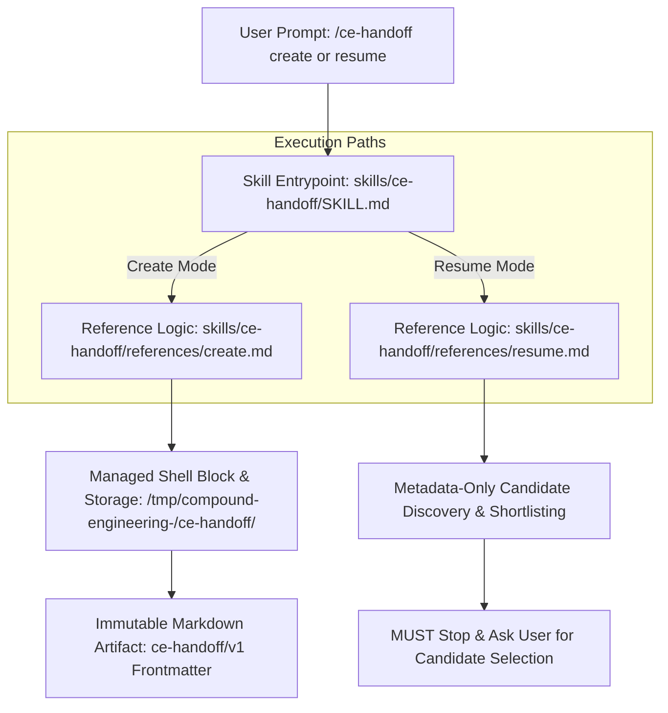

<!-- source: DeepWiki mcp.deepwiki.com · repo EveryInc/compound-engineering-plugin · page 6.3 Session Continuity and Cross-Session Knowledge · fetched 2026-10-30 -->

# Session Continuity and Cross-Session Knowledge

<details>
<summary>Relevant source files</summary>

The following files were used as context for generating this wiki page:

- [docs/plans/2026-07-16-001-feat-ce-handoff-session-continuity-plan.md](docs/plans/2026-07-16-001-feat-ce-handoff-session-continuity-plan.md)
- [skills/ce-compound/scripts/session-history/discover-sessions.sh](skills/ce-compound/scripts/session-history/discover-sessions.sh)
- [skills/ce-compound/scripts/session-history/extract-errors.py](skills/ce-compound/scripts/session-history/extract-errors.py)
- [skills/ce-compound/scripts/session-history/extract-metadata.py](skills/ce-compound/scripts/session-history/extract-metadata.py)
- [skills/ce-compound/scripts/session-history/extract-skeleton.py](skills/ce-compound/scripts/session-history/extract-skeleton.py)
- [skills/ce-handoff/SKILL.md](skills/ce-handoff/SKILL.md)
- [skills/ce-handoff/references/create.md](skills/ce-handoff/references/create.md)
- [skills/ce-handoff/references/resume.md](skills/ce-handoff/references/resume.md)
- [tests/fixtures/session-history/omp-session.jsonl](tests/fixtures/session-history/omp-session.jsonl)
- [tests/fixtures/session-history/pi-session.jsonl](tests/fixtures/session-history/pi-session.jsonl)
- [tests/session-history-scripts.test.ts](tests/session-history-scripts.test.ts)
- [tests/skills/ce-handoff-contract.test.ts](tests/skills/ce-handoff-contract.test.ts)
- [tests/skills/ce-session-historian-no-skill-tool.test.ts](tests/skills/ce-session-historian-no-skill-tool.test.ts)

</details>


The Session Continuity system bridges disparate agent sessions and cross-platform coding tool stores. It provides two core integration mechanisms: `ce-handoff` for creating immutable, point-in-time snapshots to move work between sessions [skills/ce-handoff/SKILL.md:3-5](), and a session-history discovery and extraction infrastructure (`ce-compound`) that scans local JSONL stores across agent hosts (Claude Code, Codex, Cursor, Pi, and oh-my-pi) to recover context, execution skeletons, and error signals [skills/ce-compound/scripts/session-history/discover-sessions.sh:1-3](), [skills/ce-compound/scripts/session-history/extract-metadata.py:1-14]().

Sources: [skills/ce-handoff/SKILL.md:3-5](), [skills/ce-compound/scripts/session-history/discover-sessions.sh:1-3](), [skills/ce-compound/scripts/session-history/extract-metadata.py:1-14]()

---

## Session Handoff (`ce-handoff`)

`ce-handoff` is a prose-first utility designed to preserve intent, decisions, and fragile local state that do not reside in repository files [skills/ce-handoff/SKILL.md:3-5](). It enables a fresh agent to orient quickly without access to the original transcript [skills/ce-handoff/SKILL.md:3-5]().

### Natural Language Space to Code Entity Space: ce-handoff


Sources: [skills/ce-handoff/SKILL.md:13-54](), [skills/ce-handoff/references/create.md:13-50](), [skills/ce-handoff/references/resume.md:11-28]()

### Immutable Session Snapshots and Managed Storage
Handoffs are created as immutable Markdown files. By default, they are stored in a managed temporary directory defined by shell initialization logic [skills/ce-handoff/references/create.md:13-26]().
- **Managed Path**: `$SCRATCH_ROOT/ce-handoff/<repo-namespace>/<topic>.md` where `SCRATCH_ROOT` is resolved via secure shell blocks under `/tmp/compound-engineering-$(id -u)` [skills/ce-handoff/references/create.md:18-29]().
- **Collision Handling**: Filenames are reserved atomically using topic slugs; on collision, the skill retries with the smallest available numeric suffix rather than overwriting existing records [skills/ce-handoff/references/create.md:30-31]().
- **Frontmatter Contract**: Managed handoffs enforce flat YAML frontmatter adhering to the `ce-handoff/v1` contract, containing `created_at`, `title`, `summary`, `keywords`, `cwd`, and optional repository provenance fields (`repo_root_sha`, `branch`, `head`, `worktree_path`) [skills/ce-handoff/references/create.md:34-50]().
- **Serialization Safety**: Contract tests verify that every generated string scalar and array element uses JSON-compatible YAML double quoting and escaping to prevent injection vulnerabilities or parsing failures [tests/skills/ce-handoff-contract.test.ts:71-92]().

### Resume and Orientation Procedure
The `resume` mode reads a specified or discovered continuity source and prepares the receiving agent to continue [skills/ce-handoff/SKILL.md:38-42]().
- **Metadata-Only Discovery**: Without an explicit source, discovery scans candidate files under managed roots, restricting ingestion to metadata, filename, location, and filesystem attributes without reading unselected bodies [skills/ce-handoff/references/resume.md:11-28]().
- **User-Gated Selection**: The agent **MUST stop and ask the user to select a candidate** from the generated shortlist before reading or acting on any session content [skills/ce-handoff/SKILL.md:44](), [skills/ce-handoff/references/resume.md:28]()`.
- **Orientation-First Protocol**: After ingesting a selected source, the agent produces an objective summary and recommended next steps, but enforces a strict stop condition: it takes no execution actions until the user confirms or redirects [skills/ce-handoff/SKILL.md:50-54]().

Sources: [skills/ce-handoff/SKILL.md:13-54](), [skills/ce-handoff/references/create.md:13-54](), [skills/ce-handoff/references/resume.md:11-46](), [tests/skills/ce-handoff-contract.test.ts:71-92]()

---

## Cross-Session Knowledge (Session History Subsystem)

The session history subsystem within `ce-compound` discovers, parses, and extracts structured intelligence from JSONL logs generated across various agent hosts [skills/ce-compound/references/agents/session-historian.md:3-5]().

### Natural Language Space to Code Entity Space: Session History Discovery and Extraction

```mermaid
graph TD
    Invocation[""User Request: ce-compound Session History Analysis""] --> CompoundSkill[""Skill Dispatch: skills/ce-compound/SKILL.md""]
    
    subgraph "Host Discovery Layer"
        CompoundSkill --> DiscoverScript[""Shell Script: discover-sessions.sh""]
        DiscoverScript --> ClaudeFind[""discover_claude()""]
        DiscoverScript --> CodexFind[""discover_codex()""]
        DiscoverScript --> PiFind[""discover_pi() with encode_pi_cwd()""]
        DiscoverScript --> OmpFind[""discover_omp() with encode_omp_raw_cwd()""]
    end
    
    subgraph "Python Extraction Pipeline"
        DiscoverScript --> MetaExtract[""Python Script: extract-metadata.py""]
        DiscoverScript --> SkelExtract[""Python Script: extract-skeleton.py""]
        DiscoverScript --> ErrExtract[""Python Script: extract-errors.py""]
    end
    
    subgraph "Synthesis Layer"
        SkelExtract & ErrExtract --> HistorianAgent[""Subagent Prompt: references/agents/session-historian.md""]
        HistorianAgent --> SynthesisOutput[""Institutional Learnings & Error Patterns""]
    end
```
Sources: [skills/ce-compound/scripts/session-history/discover-sessions.sh:1-171](), [skills/ce-compound/scripts/session-history/extract-metadata.py:1-45](), [skills/ce-compound/scripts/session-history/extract-skeleton.py:1-24](), [skills/ce-compound/scripts/session-history/extract-errors.py:1-187](), [skills/ce-compound/references/agents/session-historian.md:1-54]()

### Key Extraction Components and Script Mechanics
1. **`discover-sessions.sh`**: Scans JSONL session trees across platforms within a specified day window, applying platform-specific CWD encoding (`encode_pi_cwd` and `encode_omp_raw_cwd`) to target specific repository roots accurately [skills/ce-compound/scripts/session-history/discover-sessions.sh:1-171]().
2. **`extract-metadata.py`**: Auto-detects the platform from the JSONL record structure (`try_claude`, `try_codex`, `try_omp`, `try_pi`, `try_cursor`), extracting branch, working directory, session identifier, and timestamps from initial records [skills/ce-compound/scripts/session-history/extract-metadata.py:22-132]().
3. **`extract-skeleton.py`**: Extracts conversation flows consisting of user text, assistant responses, and collapsed tool call groups (e.g., grouping consecutive `Read` calls into `3x Read (...)` summaries) while stripping framework wrapper tags (`_STRIP_BLOCK`, `_STRIP_TAG`) [skills/ce-compound/scripts/session-history/extract-skeleton.py:57-126]().
4. **`extract-errors.py`**: Parses failure states, including Claude `is_error` tool results, Codex execution exit non-zero statuses, and Pi `bashExecution` exit codes or cancellations [skills/ce-compound/scripts/session-history/extract-errors.py:56-187]().
5. **`session-historian.md`**: Operates as a synthesis-only agent reading pre-extracted scratch files via native file-read tools [skills/ce-compound/references/agents/session-historian.md:31-32]().

Sources: [skills/ce-compound/scripts/session-history/discover-sessions.sh:1-171](), [skills/ce-compound/scripts/session-history/extract-metadata.py:22-132](), [skills/ce-compound/scripts/session-history/extract-skeleton.py:57-126](), [skills/ce-compound/scripts/session-history/extract-errors.py:56-187](), [skills/ce-compound/references/agents/session-historian.md:31-32]()

---

## Technical Implementation Details

### Pi and oh-my-pi Tree Tracing and Compaction
Pi and oh-my-pi session stores use append-only DAG structures where branching occurs. The extraction utilities include specialized traversal algorithms:
- **Active Path Filtering (`_pi_active_path_objects`)**: Traces back from the final leaf node using `parentId` pointers to filter out abandoned conversation branches [skills/ce-compound/scripts/session-history/extract-metadata.py:156-185](), [skills/ce-compound/scripts/session-history/extract-errors.py:109-133]().
- **Compaction Handling (`_pi_context_objects`)**: Detects `compaction` event boundaries and drops older ancestor entries that no longer participate in active LLM context [skills/ce-compound/scripts/session-history/extract-metadata.py:187-196](), [skills/ce-compound/scripts/session-history/extract-errors.py:136-162]().

### Subagent Skill Invocation Guardrail
To prevent session deadlocks in hosts like Claude Code where subagents cannot invoke the `Skill` tool, `session-historian.md` is strictly bound to synthesis-only operations [tests/skills/ce-session-historian-no-skill-tool.test.ts:18-33](). Automated test suites assert that the agent prompt contains no literal `Skill(...)` call expressions or prohibited instruction strings [tests/skills/ce-session-historian-no-skill-tool.test.ts:34-62]().

Sources: [skills/ce-compound/scripts/session-history/extract-metadata.py:156-196](), [skills/ce-compound/scripts/session-history/extract-errors.py:109-162](), [tests/skills/ce-session-historian-no-skill-tool.test.ts:18-62]()

---

