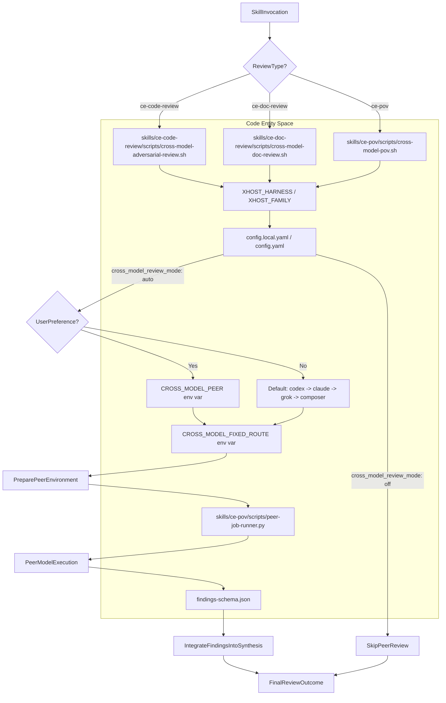
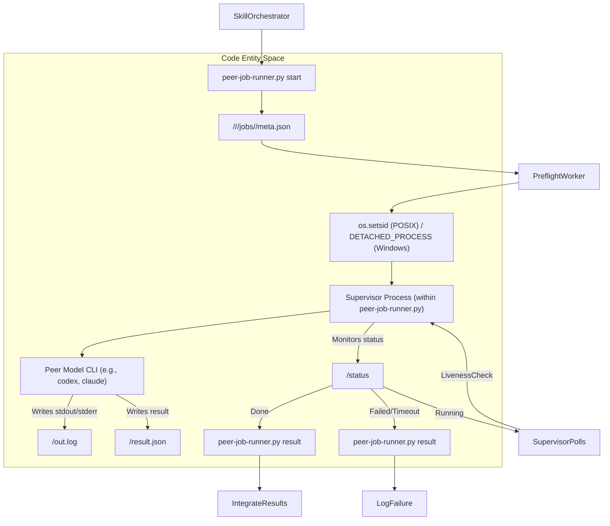

<!-- source: DeepWiki mcp.deepwiki.com · repo EveryInc/compound-engineering-plugin · page 7 Cross-Model Peer Review Subsystem · fetched 2026-10-30 -->

# Cross-Model Peer Review Subsystem

Relevant source files

The following files were used as context for generating this wiki page:

- [docs/guides/ce-code-review.md](docs/guides/ce-code-review.md)
- [docs/guides/ce-doc-review.md](docs/guides/ce-doc-review.md)
- [docs/guides/ce-work.md](docs/guides/ce-work.md)
- [skills/ce-code-review/references/cross-model-review.md](skills/ce-code-review/references/cross-model-review.md)
- [skills/ce-code-review/scripts/cross-model-adversarial-review.sh](skills/ce-code-review/scripts/cross-model-adversarial-review.sh)
- [skills/ce-doc-review/references/cross-model-review.md](skills/ce-doc-review/references/cross-model-review.md)
- [skills/ce-doc-review/scripts/cross-model-doc-review.sh](skills/ce-doc-review/scripts/cross-model-doc-review.sh)
- [skills/ce-pov/scripts/cross-model-pov.sh](skills/ce-pov/scripts/cross-model-pov.sh)
- [skills/ce-work/scripts/cross-model-work.sh](skills/ce-work/scripts/cross-model-work.sh)
- [tests/skills/ce-code-review-cross-model-routes.test.ts](tests/skills/ce-code-review-cross-model-routes.test.ts)
- [tests/skills/ce-doc-review-cross-model-routes.test.ts](tests/skills/ce-doc-review-cross-model-routes.test.ts)
- [tests/skills/ce-pov-cross-model-routes.test.ts](tests/skills/ce-pov-cross-model-routes.test.ts)
- [tests/skills/ce-work-cross-model-routes.test.ts](tests/skills/ce-work-cross-model-routes.test.ts)

The Cross-Model Peer Review Subsystem is a core component of the Compound Engineering Plugin, designed to enhance the reliability and quality of AI-generated outputs through corroboration from independent peer models. This subsystem dispatches tasks to different large language models (LLMs) than the primary agent, allowing for diverse perspectives and reducing the risk of single-model biases or errors. It is particularly crucial for high-stakes tasks like code review, document review, and decisive external input verdicts.

The system operates by selecting appropriate peer models, configuring their execution environment with strict security and resource controls, and then integrating their findings back into the main workflow. This parent page provides a high-level overview of this architecture, with detailed explanations of its components and processes available in the linked child pages.

## Cross-Model Review Scripts and Routes

The subsystem leverages dedicated shell scripts to orchestrate cross-model reviews for specific tasks. These scripts handle the selection of peer models, configuration of their environment, and the execution of the review process. Key scripts include `cross-model-adversarial-review.sh` [skills/ce-code-review/scripts/cross-model-adversarial-review.sh:1-1287](), `cross-model-doc-review.sh` [skills/ce-doc-review/scripts/cross-model-doc-review.sh:1-1282](), and `cross-model-pov.sh` [skills/ce-pov/scripts/cross-model-pov.sh:1-1122]().

These scripts are responsible for:
*   **Route Selection**: Determining the concrete LLM route (e.g., `codex`, `claude`, `grok-cli`, `grok-cursor`, `composer`) based on user preferences, configuration, and availability. This involves attesting the host identity and then sanctioning a fixed route for the peer model [skills/ce-code-review/references/cross-model-review.md:14-52]().
*   **Environment Configuration**: Setting up environment variables like `CROSS_MODEL_HOST_HARNESS` and `CROSS_MODEL_FIXED_ROUTE` to control the peer's execution [skills/ce-code-review/references/cross-model-review.md:14-52]().
*   **Peer Allowlists and Budgets**: Enforcing egress restrictions via `CROSS_MODEL_PEERS` and managing resource budgets for peer model interactions.
*   **`--emit-adapter` Introspection**: Providing a mechanism to inspect the exact command-line arguments that would be used to invoke a peer model, which is crucial for testing and debugging [skills/ce-code-review/scripts/cross-model-adversarial-review.sh:38-43]().
*   **Route Tests**: Ensuring the safety and correctness of peer model invocations, particularly regarding permissions and disallowed flags [tests/skills/ce-code-review-cross-model-routes.test.ts:98-102]().

For a detailed breakdown of these scripts, their configuration, and testing, see [Cross-Model Review Scripts and Routes](#7.1).

### Cross-Model Review Workflow

Sources:
- [skills/ce-code-review/references/cross-model-review.md:14-52]()
- [skills/ce-code-review/scripts/cross-model-adversarial-review.sh:38-43]()
- [skills/ce-doc-review/scripts/cross-model-doc-review.sh:1-1282]()
- [skills/ce-pov/scripts/cross-model-pov.sh:1-1122]()
- [tests/skills/ce-code-review-cross-model-routes.test.ts:98-102]()

## peer-job-runner and Detached Job Lifecycle

A critical component of the cross-model subsystem is the `peer-job-runner.py` script [skills/ce-pov/scripts/peer-job-runner.py:1-112](). This Python script is duplicated across various skills (e.g., `ce-code-review`, `ce-doc-review`, `ce-pov`, `ce-plan`, `ce-brainstorm`, `ce-work`) to manage the lifecycle of detached peer model jobs. It addresses the challenge of host environments that may impose hard ceilings on tool call durations, ensuring that peer model executions are robust and non-blocking.

The `peer-job-runner.py` provides functionalities for:
*   **Job Lifecycle Management**: Starting, monitoring the status of, waiting for, retrieving results from, and reaping (terminating) detached peer jobs.
*   **Durable State**: All job-related state is persisted to disk within a job directory, ensuring resilience against process interruptions. This includes `meta.json`, `pid` files, `out.log`, `reason`, and `status` files [skills/ce-pov/scripts/peer-job-runner.py:23-37]().
*   **Parity Tests**: The script's behavior is rigorously tested to ensure consistent and reliable operation across different skills and environments [tests/skills/peer-job-runner-unit.py:1-185]().
*   **Retry Gates and Quiet Intervals**: Mechanisms to handle transient failures and manage the polling frequency for job status.
*   **Requested vs. Verified Model Identity**: The system tracks both the requested peer model and the actual model that served the request [skills/ce-code-review/scripts/cross-model-adversarial-review.sh:117-136]().
*   **Portable Structured-Output Schemas**: Ensuring that peer models return findings in a consistent format, facilitating integration into the main review process.

For an in-depth look at the `peer-job-runner.py` and its role in managing detached jobs, see [peer-job-runner and Detached Job Lifecycle](#7.2).

### Peer Job Runner Architecture

Sources:
- [skills/ce-pov/scripts/peer-job-runner.py:1-112]()
- [skills/ce-pov/scripts/peer-job-runner.py:23-37]()
- [skills/ce-code-review/scripts/cross-model-adversarial-review.sh:117-136]()
- [tests/skills/peer-job-runner-unit.py:1-185]()

## ce-pov — Decisive External-Input Verdicts

The `ce-pov` skill is specifically designed to generate decisive verdicts on external inputs, often leveraging the cross-model peer review subsystem for corroboration. It acts as a critical gate for high-stakes decisions, ensuring that external inputs are thoroughly evaluated by a panel of models.

The `ce-pov` workflow involves:
*   **Intake**: Receiving an external input, which could be a framed question or subject material [skills/ce-pov/scripts/cross-model-pov.sh:31-33]().
*   **Grounding Floors**: Establishing a baseline understanding and context for the input.
*   **Method**: Applying a structured evaluation methodology to the input.
*   **Cross-Model Panel**: Dispatching the input to a panel of peer models via `cross-model-pov.sh` [skills/ce-pov/scripts/cross-model-pov.sh:1-1122](). Each peer receives the canonical POV persona, schema, and the subject payload.
*   **`pov-schema.json`**: Ensuring that all peer models return their verdicts in a standardized format for consistent aggregation and analysis.
*   **Boundaries**: Defining the scope and limitations of the verdict.
*   **Report and Follow-up**: Generating a comprehensive report based on the panel's verdicts and outlining any necessary follow-up actions.

For a detailed explanation of `ce-pov`'s operation, its schema, and how it utilizes the cross-model subsystem, see [ce-pov — Decisive External-Input Verdicts](#7.3).

Sources:
- [skills/ce-pov/scripts/cross-model-pov.sh:1-1122]()
- [skills/ce-pov/scripts/cross-model-pov.sh:31-33]()

---

