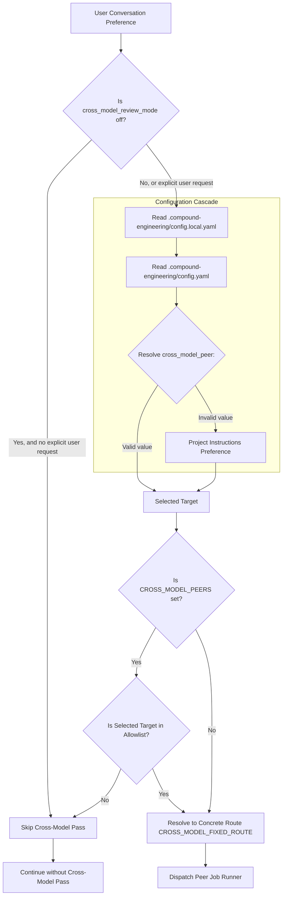
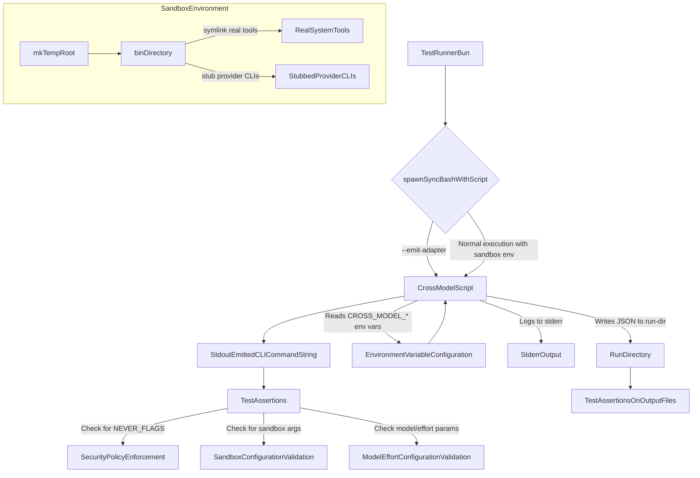

<!-- source: DeepWiki mcp.deepwiki.com · repo EveryInc/compound-engineering-plugin · page 7.1 Cross-Model Review Scripts and Routes · fetched 2026-10-30 -->

# Cross-Model Review Scripts and Routes

<details>
<summary>Relevant source files</summary>

The following files were used as context for generating this wiki page:

- [docs/guides/ce-code-review.md](docs/guides/ce-code-review.md)
- [docs/guides/ce-doc-review.md](docs/guides/ce-doc-review.md)
- [docs/guides/ce-work.md](docs/guides/ce-work.md)
- [skills/ce-code-review/references/cross-model-recovery.md](skills/ce-code-review/references/cross-model-recovery.md)
- [skills/ce-code-review/references/cross-model-review.md](skills/ce-code-review/references/cross-model-review.md)
- [skills/ce-code-review/scripts/cross-model-adversarial-review.sh](skills/ce-code-review/scripts/cross-model-adversarial-review.sh)
- [skills/ce-doc-review/references/cross-model-review.md](skills/ce-doc-review/references/cross-model-review.md)
- [skills/ce-doc-review/scripts/cross-model-doc-review.sh](skills/ce-doc-review/scripts/cross-model-doc-review.sh)
- [skills/ce-pov/scripts/cross-model-pov.sh](skills/ce-pov/scripts/cross-model-pov.sh)
- [skills/ce-work/scripts/cross-model-work.sh](skills/ce-work/scripts/cross-model-work.sh)
- [tests/fixtures/acp-stub-npx.sh](tests/fixtures/acp-stub-npx.sh)
- [tests/fixtures/acpx-streams/npm-release-age-adapter.exit](tests/fixtures/acpx-streams/npm-release-age-adapter.exit)
- [tests/fixtures/acpx-streams/npm-release-age-adapter.stdout](tests/fixtures/acpx-streams/npm-release-age-adapter.stdout)
- [tests/fixtures/acpx-streams/npm-release-age.exit](tests/fixtures/acpx-streams/npm-release-age.exit)
- [tests/skills/ce-code-review-cross-model-routes.test.ts](tests/skills/ce-code-review-cross-model-routes.test.ts)
- [tests/skills/ce-doc-review-cross-model-routes.test.ts](tests/skills/ce-doc-review-cross-model-routes.test.ts)
- [tests/skills/ce-pov-cross-model-routes.test.ts](tests/skills/ce-pov-cross-model-routes.test.ts)
- [tests/skills/ce-work-cross-model-routes.test.ts](tests/skills/ce-work-cross-model-routes.test.ts)

</details>


This page details the implementation and usage of the cross-model review scripts: `cross-model-adversarial-review.sh`, `cross-model-doc-review.sh`, and `cross-model-pov.sh`. These scripts enable independent peer review by dispatching tasks to different model providers, ensuring robust validation and corroboration of findings. The page covers route selection, environment variable configuration (`CROSS_MODEL_*`), peer allowlists, budget considerations, the `--emit-adapter` introspection mode, and associated route tests.

## Overview of Cross-Model Review Scripts

The cross-model review scripts facilitate a "judgment pass" where specific review lenses or tasks are executed by external model providers. This process aims to provide independent corroboration, leveraging the diverse strengths and potential blind spots of different AI models. Each script is designed to run in a read-only, least-privilege process, ensuring data security and controlled execution.

The core principle is "independence by provider, not CLI brand" [skills/ce-code-review/references/cross-model-review.md:11-12](). This means that a peer review is considered independent only if it comes from a different model family than the host model.

The three primary scripts are:
*   `cross-model-adversarial-review.sh`: Used by `ce-code-review` for an adversarial review pass [skills/ce-code-review/references/cross-model-review.md:1-3]().
*   `cross-model-doc-review.sh`: Used by `ce-doc-review` for conditional judgment lenses [skills/ce-doc-review/references/cross-model-review.md:1-6]().
*   `cross-model-pov.sh`: Used by `ce-pov` for point-of-view verdicts [skills/ce-pov/scripts/cross-model-pov.sh:1-5]().

All these scripts are non-blocking by design; failures log to stderr and exit cleanly without producing an output file, ensuring the main review process is not interrupted [skills/ce-code-review/scripts/cross-model-adversarial-review.sh:49-51](), [skills/ce-doc-review/scripts/cross-model-doc-review.sh:63-65](), [skills/ce-pov/scripts/cross-model-pov.sh:50-52]().

### Data Egress and Security

A critical aspect of cross-model review is data egress. The scripts explicitly log every instance of content being sent to an external model provider for auditable egress [skills/ce-code-review/scripts/cross-model-adversarial-review.sh:53-55](), [skills/ce-doc-review/scripts/cross-model-doc-review.sh:67-69](), [skills/ce-pov/scripts/cross-model-pov.sh:54-56](). Before any content leaves the machine, the host resolves and approves a concrete route, which is then passed to the script as `CROSS_MODEL_FIXED_ROUTE` [skills/ce-doc-review/references/cross-model-review.md:7]().

The scripts enforce least-privilege access, typically running in read-only modes and avoiding flags that would grant write or auto-approve privileges [tests/skills/ce-code-review-cross-model-routes.test.ts:97-98](), [tests/skills/ce-pov-cross-model-routes.test.ts:44-44]().

Sources:
* `skills/ce-code-review/references/cross-model-review.md`
* `skills/ce-code-review/scripts/cross-model-adversarial-review.sh`
* `skills/ce-doc-review/references/cross-model-review.md`
* `skills/ce-doc-review/scripts/cross-model-doc-review.sh`
* `skills/ce-pov/scripts/cross-model-pov.sh`
* `tests/skills/ce-code-review-cross-model-routes.test.ts`
* `tests/skills/ce-doc-review-cross-model-routes.test.ts`
* `tests/skills/ce-pov-cross-model-routes.test.ts`

## Route Selection and Configuration

The selection of a cross-model peer involves several steps, prioritizing user intent and system configuration.

### Host Identity Attestation

The first step is to attest the host's identity, distinguishing between the CLI harness/intermediary and the serving family/provider. This is crucial for ensuring independence (i.e., not using the same model family for peer review). Environment variables like `CLAUDECODE`, `CODEX_SANDBOX`, `GROK_AGENT`, `CURSOR_AGENT`, and `OPENCODE_TERMINAL` are used to determine `XHOST_HARNESS` and `XHOST_FAMILY` [skills/ce-code-review/references/cross-model-review.md:21-30](), [skills/ce-doc-review/references/cross-model-review.md:20-29]().

```bash
if [ "${CLAUDECODE:-}" = "1" ]; then XHOST_SEEN="$XHOST_SEEN claude"; fi;
if [ -n "${CODEX_SANDBOX:-}${CODEX_SANDBOX_NETWORK_DISABLED:-}${CODEX_SESSION_ID:-}${CODEX_THREAD_ID:-}${CODEX_CI:-}" ]; then XHOST_SEEN="$XHOST_SEEN codex"; fi;
if [ "${GROK_AGENT:-}" = "1" ] || [ -n "${GROK_SESSION_ID:-}" ]; then XHOST_SEEN="$XHOST_SEEN grok"; fi;
if [ -n "${OMPCODE:-}" ]; then XHOST_HARNESS=omp; XHOST_FAMILY=unknown;
elif [ "$XHOST_SEEN" = " claude" ] || [ "$XHOST_SEEN" = " codex" ] || [ "$XHOST_SEEN" = " grok" ]; then XHOST_HARNESS="${XHOST_SEEN# }"; XHOST_FAMILY="$XHOST_HARNESS";
elif [ -n "$XHOST_SEEN" ]; then XHOST_HARNESS=unknown; XHOST_FAMILY=unknown;
elif [ -n "${CURSOR_AGENT:-}${CURSOR_CONVERSATION_ID:-}" ]; then XHOST_HARNESS=cursor; XHOST_FAMILY=unknown;
elif [ -n "${OPENCODE_TERMINAL:-}" ]; then XHOST_HARNESS=opencode; XHOST_FAMILY=unknown;
else XHOST_HARNESS=unknown; XHOST_FAMILY=unknown; fi
```
[skills/ce-code-review/references/cross-model-review.md:21-30]()

The `XHOST_HARNESS` is passed as `CROSS_MODEL_HOST_HARNESS`, and `XHOST_FAMILY` as the first worker argument [skills/ce-code-review/references/cross-model-review.md:33]().

### Egress Policy and `cross_model_review_mode`

Before any peer resolution or job start, the `cross_model_review_mode` configuration key is evaluated. This key, read from `.compound-engineering/config.local.yaml` and `config.yaml`, can be `auto` (default) or `off` [skills/ce-code-review/references/cross-model-review.md:40-45](), [skills/ce-doc-review/references/cross-model-review.md:39-44](). If set to `off`, the automatic cross-model pass is skipped, unless the user explicitly requests it in conversation [skills/ce-code-review/references/cross-model-review.md:45](). This acts as a critical egress gate.

### Peer Resolution Order

The preference for selecting a cross-model peer is resolved in a specific order:
1.  **User conversation**: An explicit request from the user (e.g., "use grok for the cross-model pass") takes precedence [skills/ce-code-review/references/cross-model-review.md:48-49]().
2.  **`cross_model_peer:` config key**: Read from `.compound-engineering/config.local.yaml` then `config.yaml`. The first active, supported target wins [skills/ce-code-review/references/cross-model-review.md:49]().
3.  **Project instructions**: A preference already present in the active project instructions [skills/ce-code-review/references/cross-model-review.md:50]().
4.  **Default**: The first available attested-different target in the order `codex → claude → grok → antigravity`. Cursor default and Composer run only when one of steps 1-3 names them [skills/ce-doc-review/references/cross-model-review.md:51]().

Once a target is selected, it's resolved to a concrete installed route (e.g., `codex`, `claude`, `grok-cli`, `grok-cursor`, `cursor`, `composer`, `opencode`, `antigravity`) and passed as `CROSS_MODEL_FIXED_ROUTE` [skills/ce-doc-review/references/cross-model-review.md:7]().

### `CROSS_MODEL_PEERS` Allowlist

The `CROSS_MODEL_PEERS` environment variable acts as an optional egress restriction. If set, every recipient (target and intermediary) must be sanctioned by this allowlist. An unsanctioned recipient leads to a named skip. If unset or empty, no recipient is filtered [skills/ce-code-review/scripts/cross-model-adversarial-review.sh:32-33]().

### Model and Reasoning Tiers

Each script defines editorial model and reasoning tier mappings for different providers. For example, `M_CODEX` is `gpt-6-luna` with `xhigh` effort, `M_CLAUDE` is `claude-opus-5-5` with `high` effort, and `M_GROK` is `grok-4.7` with `xhigh` effort [skills/ce-code-review/scripts/cross-model-adversarial-review.sh:89-91](), [skills/ce-doc-review/scripts/cross-model-doc-review.sh:102-104](), [skills/ce-pov/scripts/cross-model-pov.sh:89-91](). These can be overridden by `CROSS_MODEL_MODEL_OVERRIDE_TARGET`, `CROSS_MODEL_MODEL_OVERRIDE`, and `CROSS_MODEL_EFFORT_OVERRIDE` environment variables [skills/ce-code-review/scripts/cross-model-adversarial-review.sh:83-85](), [skills/ce-doc-review/scripts/cross-model-doc-review.sh:97-99](), [skills/ce-pov/scripts/cross-model-pov.sh:106-110]().

### Diagram: Cross-Model Peer Selection Flow


Title: "Cross-Model Peer Selection Flow"
Sources:
* `skills/ce-code-review/references/cross-model-review.md`
* `skills/ce-doc-review/references/cross-model-review.md`

## `CROSS_MODEL_*` Environment Variables

The cross-model scripts rely on several environment variables for configuration and control:

*   **`CROSS_MODEL_HOST_HARNESS`**: The attested harness of the host (e.g., `codex`, `claude`, `grok`, `cursor`, `opencode`).
*   **`CROSS_MODEL_FIXED_ROUTE`**: The concrete, pre-sanctioned route for the peer model (e.g., `codex`, `claude`, `grok-cli`, `grok-cursor`, `composer`).
*   **`CROSS_MODEL_PEERS`**: An optional comma-separated allowlist of peer targets.
*   **`CROSS_MODEL_MODEL_OVERRIDE_TARGET`**: Specifies which target's model to override.
*   **`CROSS_MODEL_MODEL_OVERRIDE`**: The specific model ID to use for the `OVERRIDE_TARGET`.
*   **`CROSS_MODEL_EFFORT_OVERRIDE`**: The reasoning effort level to use (e.g., `high`, `xhigh`).
*   **`CROSS_MODEL_TRANSIENT_RETRY_DELAY_SECS`**: Delay in seconds for transient retries [skills/ce-code-review/scripts/cross-model-adversarial-review.sh:76]().

### Model Identity Receipt

The scripts implement a "model-identity receipt" mechanism to verify which model actually served a request. Currently, only the Claude CLI provides a reliable receipt via its JSON envelope. For other routes, the identity is recorded as "unverified". This receipt is crucial for `independence_verified: true` status, which can promote findings in synthesis [skills/ce-code-review/references/cross-model-review.md:3](), [skills/ce-doc-review/references/cross-model-review.md:3]().

Sources:
* `skills/ce-code-review/scripts/cross-model-adversarial-review.sh`
* `skills/ce-doc-review/scripts/cross-model-doc-review.sh`
* `skills/ce-pov/scripts/cross-model-pov.sh`

## `--emit-adapter` Introspection

The `--emit-adapter` flag is a powerful introspection tool available in all cross-model scripts. When invoked with a route (e.g., `codex`, `claude`, `grok-cli`), it prints the exact `argv` (argument vector) that the given route would execute, without making an actual model call [skills/ce-code-review/scripts/cross-model-adversarial-review.sh:38-42](), [skills/ce-doc-review/scripts/cross-model-doc-review.sh:52-56](), [skills/ce-pov/scripts/cross-model-pov.sh:39-43]().

This feature is invaluable for:
*   **Route Safety Testing**: Ensuring that the commands executed by peer models adhere to security policies (e.g., read-only access, no dangerous flags). Tests assert on the emitted command string [tests/skills/ce-code-review-cross-model-routes.test.ts:97-98](), [tests/skills/ce-pov-cross-model-routes.test.ts:44-44]().
*   **Debugging**: Understanding the precise command-line arguments passed to external CLIs.
*   **Documentation**: Providing concrete examples of how each route is invoked.

### Example Usage

```bash
# From the repository root
./skills/ce-code-review/scripts/cross-model-adversarial-review.sh --emit-adapter codex
```

This would output the `codex` CLI command with its specific arguments, model, and effort settings.

Sources:
* `skills/ce-code-review/scripts/cross-model-adversarial-review.sh`
* `skills/ce-doc-review/scripts/cross-model-doc-review.sh`
* `skills/ce-pov/scripts/cross-model-pov.sh`
* `tests/skills/ce-code-review-cross-model-routes.test.ts`
* `tests/skills/ce-doc-review-cross-model-routes.test.ts`
* `tests/skills/ce-pov-cross-model-routes.test.ts`

## Route Tests

The `tests/skills/` directory contains dedicated test files for cross-model routes:
*   `tests/skills/ce-code-review-cross-model-routes.test.ts`
*   `tests/skills/ce-doc-review-cross-model-routes.test.ts`
*   `tests/skills/ce-pov-cross-model-routes.test.ts`

These tests primarily focus on "route safety" and configuration logic rather than end-to-end model behavior.

Key aspects tested include:
*   **`--emit-adapter` output**: Verifying the correctness of the generated command-line arguments for each route.
*   **Security flags**: Asserting that dangerous flags (e.g., `--yolo`, `--force`, `--always-approve`) are never present in the emitted commands [tests/skills/ce-code-review-cross-model-routes.test.ts:97-98](), [tests/skills/ce-doc-review-cross-model-routes.test.ts:48-49](), [tests/skills/ce-pov-cross-model-routes.test.ts:44-44]().
*   **Sandbox configuration**: Ensuring that peer processes are launched with appropriate read-only and sandboxed environments.
*   **Tool resolution**: The tests use a `sandbox` function to create isolated `bin/` directories with symlinks to real system tools and stubbed provider CLIs, ensuring deterministic testing regardless of the host environment [tests/skills/ce-code-review-cross-model-routes.test.ts:132-145](), [tests/skills/ce-doc-review-cross-model-routes.test.ts:77-96](), [tests/skills/ce-pov-cross-model-routes.test.ts:72-90]().

### Diagram: Cross-Model Route Testing Architecture


Title: "Cross-Model Route Testing Architecture"
Sources:
* `tests/skills/ce-code-review-cross-model-routes.test.ts`
* `tests/skills/ce-doc-review-cross-model-routes.test.ts`
* `tests/skills/ce-pov-cross-model-routes.test.ts`

Sources:
* `skills/ce-code-review/references/cross-model-review.md`
* `skills/ce-code-review/scripts/cross-model-adversarial-review.sh`
* `skills/ce-doc-review/references/cross-model-review.md`
* `skills/ce-doc-review/scripts/cross-model-doc-review.sh`
* `skills/ce-pov/scripts/cross-model-pov.sh`
* `tests/skills/ce-code-review-cross-model-routes.test.ts`
* `tests/skills/ce-doc-review-cross-model-routes.test.ts`
* `tests/skills/ce-pov-cross-model-routes.test.ts`

---

