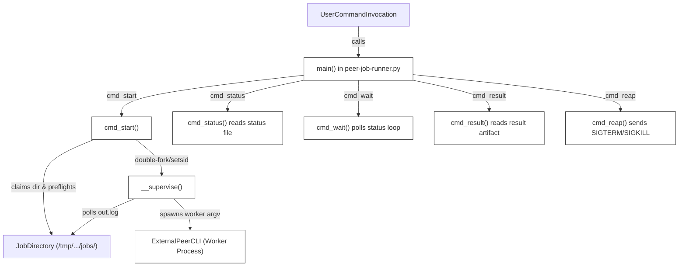
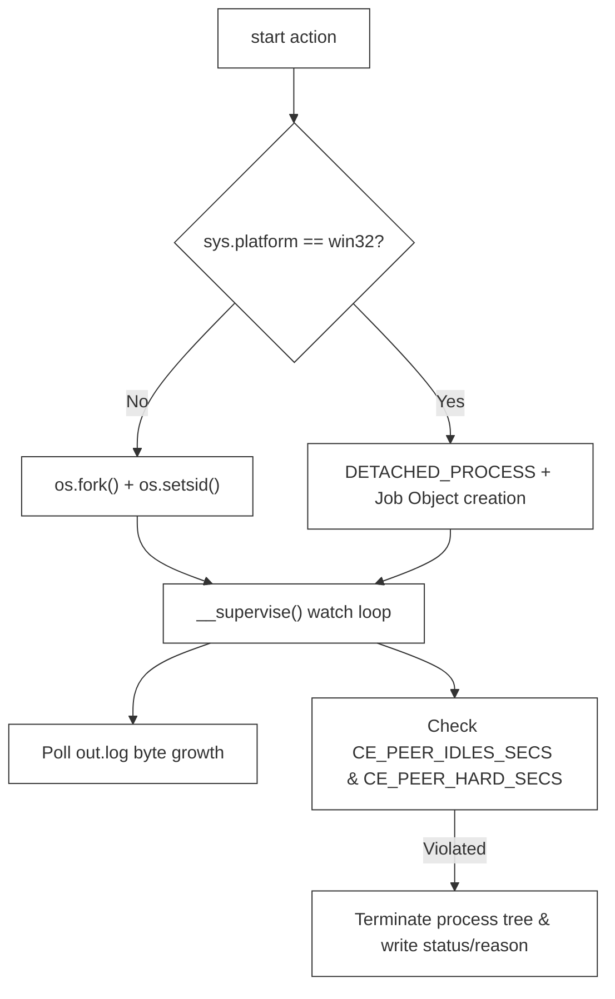

<!-- source: DeepWiki mcp.deepwiki.com · repo EveryInc/compound-engineering-plugin · page 7.2 peer-job-runner and Detached Job Lifecycle · fetched 2026-10-30 -->

# peer-job-runner and Detached Job Lifecycle

<details>
<summary>Relevant source files</summary>

The following files were used as context for generating this wiki page:

- [docs/solutions/conventions/resolve-python-interpreter-not-python3.md](docs/solutions/conventions/resolve-python-interpreter-not-python3.md)
- [docs/solutions/integration-issues/grok-camelcase-structuredoutput-and-nonfinal-peer-position.md](docs/solutions/integration-issues/grok-camelcase-structuredoutput-and-nonfinal-peer-position.md)
- [docs/solutions/integration-issues/portable-structured-output-schemas-across-model-clis.md](docs/solutions/integration-issues/portable-structured-output-schemas-across-model-clis.md)
- [docs/solutions/skill-design/bundled-script-path-resolution-across-harnesses.md](docs/solutions/skill-design/bundled-script-path-resolution-across-harnesses.md)
- [docs/solutions/skill-design/cli-output-buffering-for-progress-detection.md](docs/solutions/skill-design/cli-output-buffering-for-progress-detection.md)
- [docs/solutions/skill-design/detached-job-lifecycle-for-delegated-work.md](docs/solutions/skill-design/detached-job-lifecycle-for-delegated-work.md)
- [docs/solutions/skill-design/dispatch-script-failure-degrade-outcome-not-boundary.md](docs/solutions/skill-design/dispatch-script-failure-degrade-outcome-not-boundary.md)
- [docs/solutions/skill-design/requested-vs-verified-model-identity.md](docs/solutions/skill-design/requested-vs-verified-model-identity.md)
- [skills/ce-brainstorm/scripts/elevation-dispatch.sh](skills/ce-brainstorm/scripts/elevation-dispatch.sh)
- [skills/ce-brainstorm/scripts/peer-job-runner.py](skills/ce-brainstorm/scripts/peer-job-runner.py)
- [skills/ce-code-review/scripts/peer-job-runner.py](skills/ce-code-review/scripts/peer-job-runner.py)
- [skills/ce-doc-review/scripts/peer-job-runner.py](skills/ce-doc-review/scripts/peer-job-runner.py)
- [skills/ce-optimize/scripts/parallel-probe.sh](skills/ce-optimize/scripts/parallel-probe.sh)
- [skills/ce-plan/scripts/elevation-dispatch.sh](skills/ce-plan/scripts/elevation-dispatch.sh)
- [skills/ce-plan/scripts/peer-job-runner.py](skills/ce-plan/scripts/peer-job-runner.py)
- [skills/ce-pov/references/agents/pov-peer.md](skills/ce-pov/references/agents/pov-peer.md)
- [skills/ce-pov/references/pov-schema.json](skills/ce-pov/references/pov-schema.json)
- [skills/ce-pov/scripts/peer-job-runner.py](skills/ce-pov/scripts/peer-job-runner.py)
- [skills/ce-sweep/references/agents/media-analyzer.md](skills/ce-sweep/references/agents/media-analyzer.md)
- [skills/ce-work/scripts/peer-job-runner.py](skills/ce-work/scripts/peer-job-runner.py)
- [tests/fixtures/peer-job-runner-unit.py](tests/fixtures/peer-job-runner-unit.py)
- [tests/peer-job-runner-parity.test.ts](tests/peer-job-runner-parity.test.ts)
- [tests/skills/cross-model-peer-budget.test.ts](tests/skills/cross-model-peer-budget.test.ts)
- [tests/skills/peer-job-runner.test.ts](tests/skills/peer-job-runner.test.ts)

</details>


## Purpose and Scope

The `peer-job-runner.py` script is a shared core primitive duplicated across multiple skills in the codebase (`ce-doc-review`, `ce-code-review`, `ce-pov`, `ce-brainstorm`, `ce-plan`, and `ce-work`) [skills/ce-doc-review/scripts/peer-job-runner.py:1-24](). It orchestrates a robust *detached job lifecycle* to launch and supervise delegated work—specifically cross-model peer reviews and evaluations—whose execution times exceed the strict wall-clock ceilings imposed on single shell tool calls by certain agent hosts [docs/solutions/skill-design/detached-job-lifecycle-for-delegated-work.md:10-24]().

This page documents the technical details of:
- The motivation and failure modes of single-call delegation.
- The lifecycle phases (`start`, `status`, `wait`, `result`, `reap`) managed by `peer-job-runner.py` [skills/ce-doc-review/scripts/peer-job-runner.py:9-23]().
- Durable job state on disk and atomic terminal records [docs/solutions/skill-design/detached-job-lifecycle-for-delegated-work.md:34-46]().
- Supervision, idle windows, hard backstops, and tree reaps [skills/ce-doc-review/scripts/peer-job-runner.py:54-62]().
- Cross-platform POSIX and Windows process detachment mechanisms [skills/ce-doc-review/scripts/peer-job-runner.py:97-111]().
- Security postures, ownership verification, and retry gates [docs/solutions/skill-design/detached-job-lifecycle-for-delegated-work.md:85-95]().
- Requested-versus-verified model identity receipts and portable structured output schemas across model CLIs [docs/solutions/skill-design/requested-vs-verified-model-identity.md:16-22]().

Sources: [skills/ce-doc-review/scripts/peer-job-runner.py:1-112](), [docs/solutions/skill-design/detached-job-lifecycle-for-delegated-work.md:1-64]()

---

## 1. Motivation: Problem Context and Needs

Several core skills delegate real work to external model CLIs via bundled scripts. Their original invocation pattern relied on a single shell tool call launching the delegate and awaiting its exit. However, host environments frequently enforce a strict hard ceiling on single tool-call durations (~2 minutes on some hosts) [docs/solutions/skill-design/detached-job-lifecycle-for-delegated-work.md:21-24](). When this ceiling is reached, the host kills the supervising shell mid-run, bypassing all internal timeouts, traps, and cleanup logic. Because non-blocking review passes treat missing output files as an indication that the pass did not run, this results in a silent no-op: the orchestrator proceeds with a quiet reviewer missing and no visible error [docs/solutions/skill-design/detached-job-lifecycle-for-delegated-work.md:24]().

To solve this, `peer-job-runner.py` splits the lifecycle into short, discrete tool calls interacting with a detached background supervisor and durable on-disk state [docs/solutions/skill-design/detached-job-lifecycle-for-delegated-work.md:30-33]().

Sources: [docs/solutions/skill-design/detached-job-lifecycle-for-delegated-work.md:20-33]()

---

## 2. Detached Job Lifecycle Overview

The runner implements five core commands:

| Command | Action |
|---|---|
| `start` | Claims a unique job directory, preflights worker executables, detaches the worker into a background session/process group, prints the job ID, and returns immediately [skills/ce-doc-review/scripts/peer-job-runner.py:9-13](). |
| `status` | Non-blocking query reporting the job state word (`running`, `done`, `failed`, `timeout`, `died-without-result`, `never-started`, `unreadable`) [skills/ce-doc-review/scripts/peer-job-runner.py:14](). |
| `wait` | Bounded poll loop (~1s cadence, up to `--max-secs`) waiting for watched jobs to settle. Supports aggregate deadline tracking [skills/ce-doc-review/scripts/peer-job-runner.py:15-18](). |
| `result` | Ownership-checked, bounded read of a completed job's published artifact [skills/ce-doc-review/scripts/peer-job-runner.py:19](). |
| `reap` | Requests the detached supervisor to terminate the job. If the supervisor is gone, kills the process tree directly and writes the terminal record [skills/ce-doc-review/scripts/peer-job-runner.py:20-23](). |

Sources: [skills/ce-doc-review/scripts/peer-job-runner.py:9-24]()

---

## 3. Durable Job Directory State

The source of truth for every job resides on disk under a predictable scratch structure [docs/solutions/skill-design/detached-job-lifecycle-for-delegated-work.md:34]():

```plaintext
<root>/<skill>/<run-id>/jobs/<job-id>/
  meta.json   # Job identity, run id, label, worker argv, result path
  pid         # Supervisor pid and worker pid
  out.log     # Combined stdout/stderr stream (byte growth = liveness heartbeat)
  reason      # Detailed terminal reason text
  status      # Atomic terminal record: done | failed | timeout | died-without-result
```

- `meta.json` is written before detachment [skills/ce-doc-review/scripts/peer-job-runner.py:27-28]().
- `pid` presence denotes a successfully detached job [skills/ce-doc-review/scripts/peer-job-runner.py:29-30]().
- The `status` file is published atomically via temporary file creation followed by `os.replace` to prevent race conditions during reads [skills/ce-doc-review/scripts/peer-job-runner.py:38-40]().
- Strict ownership checks via `os.fstat` verify that file descriptors match the effective user UID (`os.geteuid()`), returning `unreadable` on mismatch [skills/ce-doc-review/scripts/peer-job-runner.py:86-89]().

Sources: [skills/ce-doc-review/scripts/peer-job-runner.py:25-53](), [docs/solutions/skill-design/detached-job-lifecycle-for-delegated-work.md:34-46]()

---

## 4. Supervision and Watchdog

Running inside the detached background session, the supervisor manages process lifecycle independently of shell tool calls [skills/ce-doc-review/scripts/peer-job-runner.py:54-62]():
- Polls `out.log` byte growth every ~2 seconds as a heartbeat [skills/ce-doc-review/scripts/peer-job-runner.py:55]().
- Enforces an idle window (`CE_PEER_IDLE_SECS`, default 240s) where lack of log growth triggers reaps [skills/ce-doc-review/scripts/peer-job-runner.py:70]().
- Enforces a hard wall-clock cap (`CE_PEER_HARD_SECS`, derived from `CROSS_MODEL_HARD_SECS`) [skills/ce-doc-review/scripts/peer-job-runner.py:71-75]().
- Applies byte caps on `out.log` (`CE_PEER_LOG_MAX_BYTES`) and result files (`CE_PEER_RESULT_MAX_BYTES`) [skills/ce-doc-review/scripts/peer-job-runner.py:76-77]().
- Reaps worker trees via `SIGTERM`, a grace period (`CE_PEER_GRACE_SECS`), and then `SIGKILL`, using a deepest-first process tree walk when process groups are unavailable [skills/ce-doc-review/scripts/peer-job-runner.py:57-60]().

Sources: [skills/ce-doc-review/scripts/peer-job-runner.py:54-84](), [docs/solutions/skill-design/detached-job-lifecycle-for-delegated-work.md:47-48]()

---

## 5. Commands and Execution Details

The runner provides five primary CLI operations implemented in python [skills/ce-doc-review/scripts/peer-job-runner.py:9-23]():
- `cmd_start`: Claims a unique job ID via atomic exclusive directory creation (`os.mkdir`), preflights worker args, detaches via POSIX double-fork or Win32 `DETACHED_PROCESS` flags, and writes the `pid` file [skills/ce-doc-review/scripts/peer-job-runner.py:9-13]().
- `cmd_status`: Reads the `status` file or returns `running` if absent [skills/ce-doc-review/scripts/peer-job-runner.py:14]().
- `cmd_wait`: Polls status words with bounded duration and supports `--deadline-secs` calculations [skills/ce-doc-review/scripts/peer-job-runner.py:15-18]().
- `cmd_result`: Performs ownership validation and returns the contents of the published result file [skills/ce-doc-review/scripts/peer-job-runner.py:19]().
- `cmd_reap`: Sends termination signals or drops a `.reap` sentinel file for supervisors [skills/ce-doc-review/scripts/peer-job-runner.py:20-23]().

Sources: [skills/ce-doc-review/scripts/peer-job-runner.py:9-23]()

---

## 6. Environment Configuration and Platform Support

The runner adapts to POSIX and Windows environments via platform-conditional branching (`sys.platform == "win32"`) [skills/ce-doc-review/scripts/peer-job-runner.py:97-100]():
- **POSIX:** Uses `os.fork()`, `os.setsid()`, and process group signaling (`os.killpg`) [skills/ce-doc-review/scripts/peer-job-runner.py:10,58]().
- **Windows:** Uses `DETACHED_PROCESS | CREATE_NEW_PROCESS_GROUP` creation flags and named Windows Job Objects to manage descendant termination [skills/ce-doc-review/scripts/peer-job-runner.py:101-106]().

Key environment variables include `CE_PEER_JOBS_ROOT`, `CE_WORK_RUNS_ROOT`, `CE_PEER_IDLE_SECS`, `CE_PEER_HARD_SECS`, `CROSS_MODEL_HARD_SECS`, `CE_PEER_LOG_MAX_BYTES`, and `CE_PEER_RESULT_MAX_BYTES` [skills/ce-doc-review/scripts/peer-job-runner.py:64-78]().

Sources: [skills/ce-doc-review/scripts/peer-job-runner.py:64-112]()

---

## 7. Reliability Measures

- **Ownership Sanity Checks:** Every state read verifies `os.fstat(fd).st_uid == os.geteuid()` to prevent unauthorized disclosure [skills/ce-doc-review/scripts/peer-job-runner.py:86-89]().
- **Atomic Terminal Records:** Terminal states are written via temporary files and atomic `os.replace` operations [skills/ce-doc-review/scripts/peer-job-runner.py:36-39]().
- **Strictly Nested Windows:** Worker hard caps, runner supervisor windows, and orchestrator aggregate deadlines are derived from a single knob (`CROSS_MODEL_HARD_SECS`), nesting outward so healthy workers are never reaped prematurely [tests/skills/cross-model-peer-budget.test.ts:7-17](), [docs/solutions/skill-design/detached-job-lifecycle-for-delegated-work.md:52-59]().

Sources: [tests/skills/cross-model-peer-budget.test.ts:1-136](), [docs/solutions/skill-design/detached-job-lifecycle-for-delegated-work.md:51-62]()

---

## 8. Cross-Model Notes and Identity Verification

Delegated peer runs record requested-versus-verified model identity receipts (`model_requested`, `model_actual`, `independence_verified`) in job metadata to guard against silent backend model substitutions [docs/solutions/skill-design/requested-vs-verified-model-identity.md:16-22](). Portable structured output schemas standardize interchange across distinct model CLIs [docs/solutions/skill-design/requested-vs-verified-model-identity.md:36-41]().

Sources: [docs/solutions/skill-design/requested-vs-verified-model-identity.md:1-46]()

---

## 9. Key Code Artifacts and Data Flow

### Diagram: "PeerJobRunnerLifecycleAndCodeMapping"



Sources: [skills/ce-doc-review/scripts/peer-job-runner.py:1-2594]()

### Diagram: "PlatformDetachmentAndSupervisionCodeFlow"



Sources: [skills/ce-doc-review/scripts/peer-job-runner.py:97-111]()

---

## 10. Testing and Verification

- Unit checks are driven by `tests/fixtures/peer-job-runner-unit.py`, verifying ownership checks and collision retries [tests/fixtures/peer-job-runner-unit.py:1-14]().
- Integration lifecycle suites in `tests/skills/peer-job-runner.test.ts` test real detached processes, bounded polling, and orphan cleanup [tests/skills/peer-job-runner.test.ts:28-68]().
- Budget guard assertions in `tests/skills/cross-model-peer-budget.test.ts` validate nested timeout windows [tests/skills/cross-model-peer-budget.test.ts:7-17]().

Sources: [tests/fixtures/peer-job-runner-unit.py:1-30](), [tests/skills/peer-job-runner.test.ts:1-68](), [tests/skills/cross-model-peer-budget.test.ts:1-50]()

---

## 11. Related Design Docs and References

- `docs/solutions/skill-design/detached-job-lifecycle-for-delegated-work.md` [docs/solutions/skill-design/detached-job-lifecycle-for-delegated-work.md:1-64]()
- `docs/solutions/skill-design/requested-vs-verified-model-identity.md` [docs/solutions/skill-design/requested-vs-verified-model-identity.md:1-46]()

Sources: [docs/solutions/skill-design/detached-job-lifecycle-for-delegated-work.md:1-64](), [docs/solutions/skill-design/requested-vs-verified-model-identity.md:1-46]()

---

