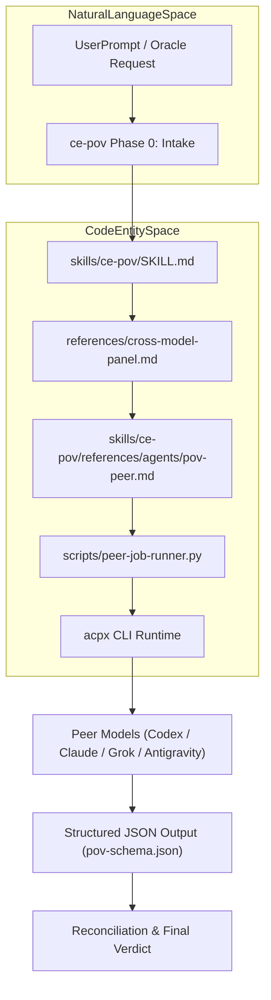
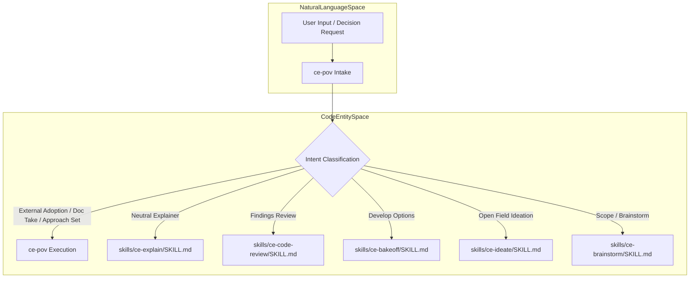

<!-- source: DeepWiki mcp.deepwiki.com · repo EveryInc/compound-engineering-plugin · page 7.3 ce-pov — Decisive External-Input Verdicts · fetched 2026-10-30 -->

# ce-pov — Decisive External-Input Verdicts

Relevant source files

The following files were used as context for generating this wiki page:

- [docs/guides/ce-pov.md](docs/guides/ce-pov.md)
- [skills/ce-brainstorm/SKILL.md](skills/ce-brainstorm/SKILL.md)
- [skills/ce-compound/SKILL.md](skills/ce-compound/SKILL.md)
- [skills/ce-plan/SKILL.md](skills/ce-plan/SKILL.md)
- [skills/ce-plan/references/agents/git-history-analyzer.md](skills/ce-plan/references/agents/git-history-analyzer.md)
- [skills/ce-pov/SKILL.md](skills/ce-pov/SKILL.md)
- [skills/ce-pov/references/agents/external-evidence-researcher.md](skills/ce-pov/references/agents/external-evidence-researcher.md)
- [skills/ce-pov/references/agents/precedent-activity-scout.md](skills/ce-pov/references/agents/precedent-activity-scout.md)
- [skills/ce-pov/references/agents/project-grounding-scout.md](skills/ce-pov/references/agents/project-grounding-scout.md)
- [skills/ce-pov/references/cross-model-panel.md](skills/ce-pov/references/cross-model-panel.md)
- [skills/ce-pov/references/method.md](skills/ce-pov/references/method.md)
- [skills/ce-strategy/SKILL.md](skills/ce-strategy/SKILL.md)
- [skills/ce-sweep/SKILL.md](skills/ce-sweep/SKILL.md)
- [skills/ce-sweep/references/interview.md](skills/ce-sweep/references/interview.md)
- [tests/pov-skill-contract.test.ts](tests/pov-skill-contract.test.ts)

The `ce-pov` skill is designed to provide a decisive, project-grounded point of view on a given subject [skills/ce-pov/SKILL.md:1-9](). It is used for assessing external adoption questions, providing a holistic take on a document, or evaluating a set of proposed approaches [skills/ce-pov/SKILL.md:3](). A key feature is its ability to consult a cross-model panel of other AI agents to reconcile opinions and ensure a robust verdict [skills/ce-pov/SKILL.md:3](). The skill emphasizes rigorous grounding in project evidence and external sources, ensuring that all verdicts are earned and supported [skills/ce-pov/SKILL.md:13-15]().

Sources: [skills/ce-pov/SKILL.md:1-9]()

## Intake

The intake phase (`Phase 0: Frame and Classify`) is the initial step where `ce-pov` establishes the frame of the request before any grounding occurs [skills/ce-pov/SKILL.md:38-40](). It defines the output mode, how a calling workflow passes information, orientation and framing, sizing, and what to do when the question has no bounded answer [skills/ce-pov/SKILL.md:40](). The skill orients itself on the provided input, settling the subject and the POV intent [skills/ce-pov/SKILL.md:40]().

The core of intake is determining the "POV intent" [skills/ce-pov/references/intake.md:29-30](). This classifies the user's underlying question into categories such as:
*   **Adopt**: Should a new capability be used?
*   **Migrate / replace**: Should an incumbent be switched to something new?
*   **Compare**: How does something stack up against alternatives?
*   **Exposure**: Is a CVE, deprecation, or ecosystem change relevant to the project?
*   **Document-take**: A holistic assessment of a document [skills/ce-pov/SKILL.md:40]().
*   **Approach-set**: Which of the supplied approaches fits the project [skills/ce-pov/SKILL.md:40]().
*   **Explainer**: If the request is for understanding, it routes to `ce-explain` [skills/ce-pov/SKILL.md:48]().

If the request belongs to another skill (e.g., `ce-explain`, `ce-bakeoff`, `ce-ideate`, `ce-brainstorm`), `ce-pov` finishes intake by routing or yields control [skills/ce-pov/SKILL.md:9](). The reversibility tier is also classified during intake to determine the depth of investigation and verification required [skills/ce-pov/references/method.md:15]().

Sources:
* [skills/ce-pov/SKILL.md:38-40]()
* [skills/ce-pov/references/method.md:15]()

## Grounding Floors

Grounding is a mandatory phase (`Phase 1: Ground`) for `ce-pov` [skills/ce-pov/SKILL.md:43-46](). The skill explicitly states, "Never issue a POV you did not earn against the project's own context" [skills/ce-pov/SKILL.md:13](). This phase defines model tiers, scratch file placement, scout orchestration, capability gating, and how grounded facts are kept distinct from unconfirmed ones [skills/ce-pov/SKILL.md:44]().

The skill employs two critical absolute floors for grounding:
1.  **Project floor**: This minimum verified project evidence always applies [skills/ce-pov/references/method.md:19](). For external-adoption questions, PASS requires the verdict to rest on a concrete, verified project fact: a named incumbent plus at least one concrete touchpoint (`file:line`, dependency, issue, PR, or doc passage) for a replacement/migration; the verified absence of an incumbent plus a concrete integration/fit point for a net-new adoption; or a prior decision on the question [skills/ce-pov/references/method.md:27-29](). Failure results in a **"Hold — insufficient project grounding"** verdict with a numbered inspection list [skills/ce-pov/references/method.md:29]().
2.  **External floor**: This applies fully to external-adoption questions, requiring at least one verified external source whose text supports the claim [skills/ce-pov/references/method.md:19-30](). For documents or approach sets, it applies only to external claims that materially support the bottom line [skills/ce-pov/references/method.md:19](). Failure results in a **"Hold — external evidence unavailable"** verdict [skills/ce-pov/references/method.md:30]().

A conversation claim never satisfies either floor until corroborated by a scout or a bounded inline read of the authoritative source [skills/ce-pov/references/method.md:19-20](). Scouts (such as `project-grounding-scout.md`) are sent directly to candidate-specific current evidence rather than generic repo profiles, returning a dossier path and a gist [skills/ce-pov/SKILL.md:46-47](). The prior-decision scan (`<root>/solutions/`, ADRs, design docs) remains mandatory on all paths [skills/ce-pov/SKILL.md:48]().

Sources:
* [skills/ce-pov/SKILL.md:13]()
* [skills/ce-pov/SKILL.md:43-48]()
* [skills/ce-pov/references/method.md:19-32]()
* [skills/ce-pov/references/agents/project-grounding-scout.md:1-30]()

## Method

The `ce-pov` method is structured into four sequential steps and two cross-cutting properties [skills/ce-pov/references/method.md:5-16]().

### The Four Steps
1.  **Frame** (`Phase 0: Frame and Classify`) — settling the question, incumbent, horizon, and success criteria [skills/ce-pov/references/method.md:7]().
2.  **Precedent** (`Phase 1: Ground`) — scanning for prior stances and recent project activity [skills/ce-pov/references/method.md:8]().
3.  **Verify** (`Phase 2: Verify Grounding`) — applying the evidence check (grounding gate) across gathered dossiers and inline reads [skills/ce-pov/references/method.md:9]().
4.  **Point of View** (`Phase 3: Point of View`) — delivering the contract content for the active subject shape [skills/ce-pov/references/method.md:10]().

### Two Cross-Cutting Properties
*   **Skeptic stance**: At every step, seek disconfirming evidence and name real alternatives, including "keep the incumbent" and "do nothing." "No", "Reject", and "Not-our-problem" are first-class outcomes [skills/ce-pov/references/method.md:14]().
*   **Reversibility-tiered effort**: Scale evidence gathering and verification effort with the cost of being wrong [skills/ce-pov/references/method.md:15]().

### Subject-Shape Contracts
*   **External-adoption questions**: Yields one of five grades: **Adopt**, **Trial**, **Hold**, **Reject**, or **Not-our-problem** [skills/ce-pov/references/method.md:42-48]().
*   **Document-take**: Judges overall document direction, decisive strengths, risks, and verified project facts [skills/ce-pov/references/method.md:54-56]().
*   **Approach-set position**: Delivers a supported position or honest toss-up, detailing material tradeoffs [docs/guides/ce-pov.md:34]().

Sources:
* [skills/ce-pov/SKILL.md:50-52]()
* [skills/ce-pov/references/method.md:1-59]()
* [docs/guides/ce-pov.md:28-36]()

## Cross-Model Panel

When a panel, cross-check, or `oracle` request is present in the invocation context, `ce-pov` executes the cross-model panel protocol defined in `references/cross-model-panel.md` [skills/ce-pov/SKILL.md:56-58]().

### Panel Mechanics and Architecture
1.  **Resolve Subject and Participants**: Separates four identities for the host and every peer: target, harness/intermediary route, requested model, and served model [skills/ce-pov/references/cross-model-panel.md:16-24]().
2.  **Participation Branches**:
    *   **Named peers**: Exact and uncapped [skills/ce-pov/references/cross-model-panel.md:107-110]().
    *   **Bare `oracle`**: Selects up to two reachable, attestably different-model targets based on configuration and defaults (`codex -> claude -> grok -> antigravity`) [skills/ce-pov/references/cross-model-panel.md:112-116]().
    *   **Explicit unnamed cross-check**: Skips correction-cost checks and uses count rules [skills/ce-pov/references/cross-model-panel.md:118-119]().
3.  **Independent Solo POV**: `ce-pov` freezes its own independent POV before dispatching peers, keeping it out of initial peer contexts to prevent groupthink [skills/ce-pov/SKILL.md:56-57]().
4.  **Execution via `acpx`**: Dispatches peer jobs using `peer-job-runner.py` over the Agent Client Protocol (`acpx`) [docs/guides/ce-pov.md:67-69]().

Diagram: Cross-Model Panel Execution Flow

Sources: [skills/ce-pov/SKILL.md:56-58](), [skills/ce-pov/references/cross-model-panel.md:1-119](), [docs/guides/ce-pov.md:67-69]()

## `pov-schema.json`

Peer agents return structured verdicts conforming to a strict JSON schema (`pov-schema.json`), ensuring parseability and consistency across distinct model CLIs [skills/ce-pov/references/agents/pov-peer.md:41-43](). The schema enforces required fields such as peer identity, verdict grade or stance, supporting evidence citations, material tradeoffs, and reconciliation movement state (`moved` or `held`) [skills/ce-pov/references/agents/pov-peer.md:22-43]().

Sources: [skills/ce-pov/references/agents/pov-peer.md:22-43]()

## Boundaries

`ce-pov` maintains strict boundaries separating it from exploratory ideation, general explanation, detailed planning, and findings-level review [skills/ce-pov/SKILL.md:3]().

Diagram: Routing Boundaries and Skill Handoffs

Sources: [skills/ce-pov/SKILL.md:3](), [skills/ce-pov/references/boundaries.md:1-36]()

## Report and Follow-up

When invoked inside a workflow, `ce-pov` returns its structured judgment and control back to the caller without rendering interactive menus or capture offers [skills/ce-pov/references/followup.md:1-3](). Standalone runs present recommendations and grades clearly, leaving downstream execution authority strictly to explicit user direction or authorized task runners [skills/ce-pov/references/followup.md:4-6]().

Sources: [skills/ce-pov/references/followup.md:1-9]()

---

