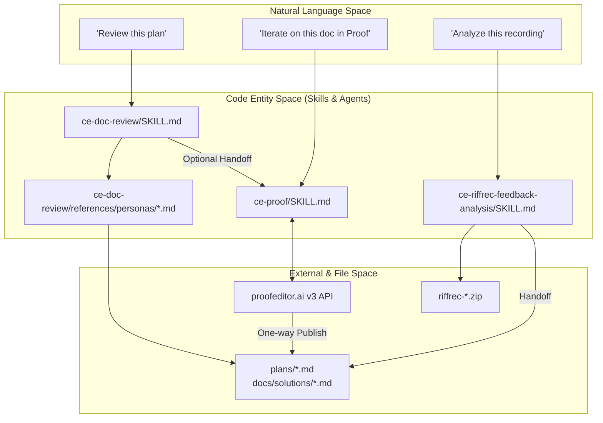
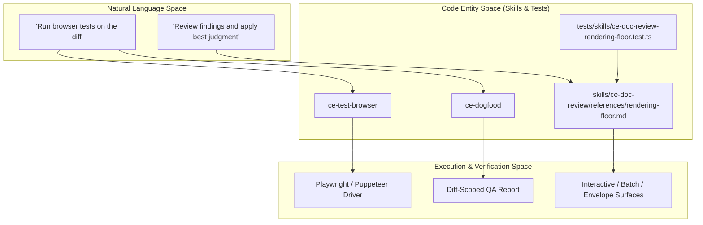

<!-- source: DeepWiki mcp.deepwiki.com · repo EveryInc/compound-engineering-plugin · page 8 Document Review and Proof Collaboration · fetched 2026-10-30 -->

# Document Review and Proof Collaboration

Relevant source files

The following files were used as context for generating this wiki page:

- [docs/solutions/skill-design/multi-surface-output-needs-a-shared-rendering-floor.md](docs/solutions/skill-design/multi-surface-output-needs-a-shared-rendering-floor.md)
- [skills/ce-doc-review/SKILL.md](skills/ce-doc-review/SKILL.md)
- [skills/ce-doc-review/references/bulk-preview.md](skills/ce-doc-review/references/bulk-preview.md)
- [skills/ce-doc-review/references/rendering-floor.md](skills/ce-doc-review/references/rendering-floor.md)
- [skills/ce-doc-review/references/review-output-template.md](skills/ce-doc-review/references/review-output-template.md)
- [skills/ce-doc-review/references/synthesis-and-presentation.md](skills/ce-doc-review/references/synthesis-and-presentation.md)
- [skills/ce-doc-review/references/walkthrough.md](skills/ce-doc-review/references/walkthrough.md)
- [tests/skills/ce-doc-review-rendering-floor.test.ts](tests/skills/ce-doc-review-rendering-floor.test.ts)

This page provides an overview of the collaborative document analysis and editing capabilities within the Compound Engineering plugin. These features enable high-rigor document reviews via multi-persona analysis, human-in-the-loop (HITL) editing through integration with external collaborative editors, and diff-scoped QA verification.

## Architecture Overview

The collaboration ecosystem bridges the gap between automated agent analysis and human decision-making. It centers on `ce-doc-review` for deep requirements and plan analysis, `ce-proof` for collaborative refinement, and testing skills for verification [skills/ce-doc-review/SKILL.md:7-10](). 

The following diagrams illustrate how high-level collaborative intent and testing requests flow into specific code entities, verification harnesses, and external services.

Sources: [skills/ce-doc-review/SKILL.md:7-10](), [skills/ce-proof/SKILL.md:1-4](), [skills/ce-doc-review/references/synthesis-and-presentation.md:1-5]()

Sources: [skills/ce-doc-review/references/rendering-floor.md:1-10](), [tests/skills/ce-doc-review-rendering-floor.test.ts:5-15]()

---

## ce-doc-review — Document Review Skill

The `ce-doc-review` skill automates the rigorous analysis of requirements and plans. It dispatches specialized reviewer agents in parallel to identify role-specific issues using a multi-persona pipeline [skills/ce-doc-review/SKILL.md:7-10](). 

Key aspects covered in detail in the child page include document intake, persona selection (including `coherence-reviewer`, `feasibility-reviewer`, `security-lens-reviewer`, and `adversarial-document-reviewer`), bulk previews, the shared rendering floor (`references/rendering-floor.md`), synthesis and confidence gating, interactive walkthroughs, and calibration patterns [skills/ce-doc-review/SKILL.md:40-52]().

For details, see [ce-doc-review — Document Review Skill](#8.1).

Sources: [skills/ce-doc-review/SKILL.md:7-52](), [skills/ce-doc-review/references/rendering-floor.md:1-10]()

---

## ce-proof and ce-noslop — Writing and Editing

The `ce-proof` skill integrates with external collaborative markdown editors (such as `proofeditor.ai`), enabling human-in-the-loop (HITL) collaborative editing through one-way publishing, structured v3 mutation APIs, and credential management [skills/ce-proof/SKILL.md:1-54](). 

Concurrently, `ce-noslop` enforces strict prose rules across written output, ensuring that PR bodies, documentation updates, and agent responses remain clear, concise, and free of filler [skills/ce-doc-review/references/rendering-floor.md:27-28]().

For details, see [ce-proof and ce-noslop — Writing and Editing](#8.2).

Sources: [skills/ce-proof/SKILL.md:1-54](), [skills/ce-doc-review/references/rendering-floor.md:27-28]()

---

## Testing and Browser Automation

Quality assurance for collaborative work and document changes is handled by specialized testing skills. These ensure that proposed changes meet technical, visual, and architectural standards [skills/ce-simplify-code/SKILL.md:1-4]().

- **`ce-test-browser`**: Manages browser automation driver policies and pipeline orchestration for web-based applications.
- **`ce-test-xcode`**: Handles mobile platform test execution via Xcode tools.
- **`ce-dogfood`**: Executes diff-scoped QA phases and utilizes standard reporting templates for rapid validation.
- **Support Files**: Includes light-webserver utilities and interactive UI prototyping assets.

For details, see [Testing and Browser Automation](#8.3).

Sources: [skills/ce-simplify-code/SKILL.md:1-4]()

---

## Child Pages
- [ce-doc-review — Document Review Skill](#8.1)
- [ce-proof and ce-noslop — Writing and Editing](#8.2)
- [Testing and Browser Automation](#8.3)

---

