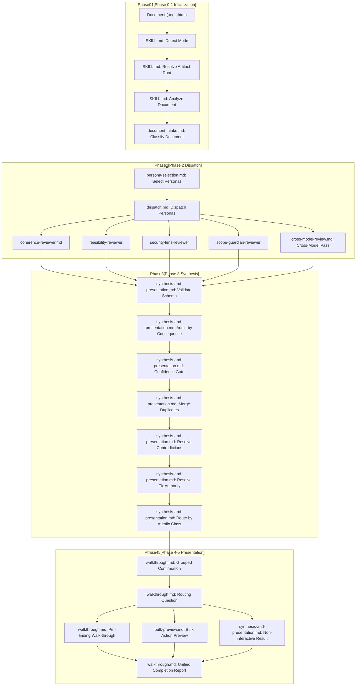
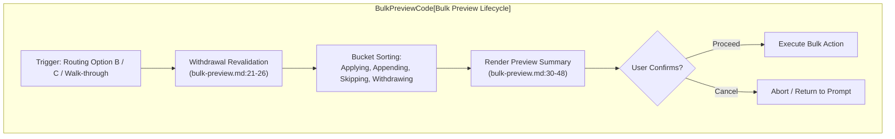
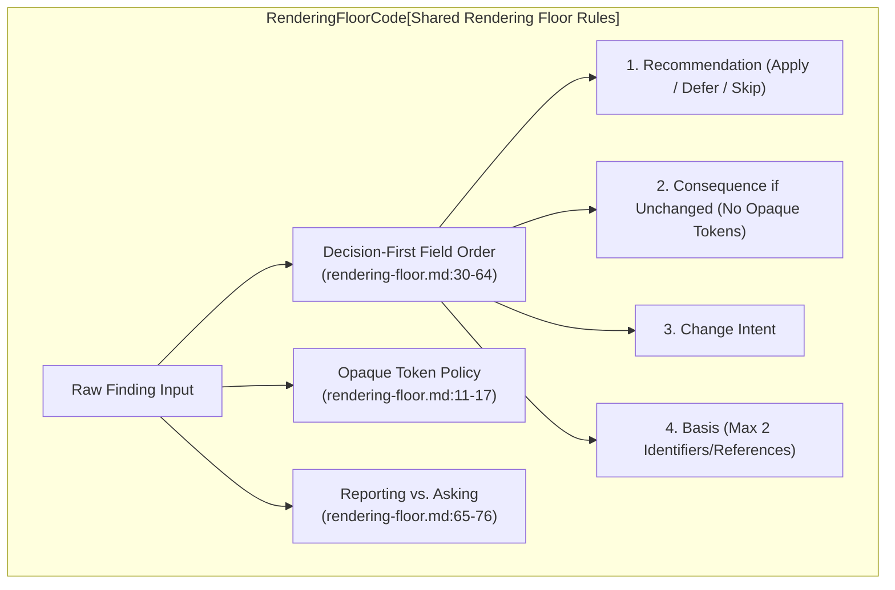

<!-- source: DeepWiki mcp.deepwiki.com · repo EveryInc/compound-engineering-plugin · page 8.1 ce-doc-review — Document Review Skill · fetched 2026-10-30 -->

# ce-doc-review — Document Review Skill

Relevant source files

The following files were used as context for generating this wiki page:

- [docs/solutions/skill-design/multi-surface-output-needs-a-shared-rendering-floor.md](docs/solutions/skill-design/multi-surface-output-needs-a-shared-rendering-floor.md)
- [docs/solutions/skill-design/workspace-isolation-is-escalation-not-entry-fee.md](docs/solutions/skill-design/workspace-isolation-is-escalation-not-entry-fee.md)
- [skills/ce-doc-review/SKILL.md](skills/ce-doc-review/SKILL.md)
- [skills/ce-doc-review/references/bulk-preview.md](skills/ce-doc-review/references/bulk-preview.md)
- [skills/ce-doc-review/references/personas/coherence-reviewer.md](skills/ce-doc-review/references/personas/coherence-reviewer.md)
- [skills/ce-doc-review/references/rendering-floor.md](skills/ce-doc-review/references/rendering-floor.md)
- [skills/ce-doc-review/references/review-output-template.md](skills/ce-doc-review/references/review-output-template.md)
- [skills/ce-doc-review/references/synthesis-and-presentation.md](skills/ce-doc-review/references/synthesis-and-presentation.md)
- [skills/ce-doc-review/references/walkthrough.md](skills/ce-doc-review/references/walkthrough.md)
- [tests/skill-eval-cell/fixtures/doc-review-peer-outcome/README.md](tests/skill-eval-cell/fixtures/doc-review-peer-outcome/README.md)
- [tests/skill-eval-cell/fixtures/doc-review-peer-outcome/docs/plans/2026-08-20-1100-feat-free-tier-greeting-api-plan.md](tests/skill-eval-cell/fixtures/doc-review-peer-outcome/docs/plans/2026-08-20-1100-feat-free-tier-greeting-api-plan.md)
- [tests/skill-eval-cell/fixtures/plan-holdable-objective/README.md](tests/skill-eval-cell/fixtures/plan-holdable-objective/README.md)
- [tests/skill-eval-cell/fixtures/plan-holdable-objective/package.json](tests/skill-eval-cell/fixtures/plan-holdable-objective/package.json)
- [tests/skill-eval-cell/fixtures/plan-holdable-objective/src/watch.ts](tests/skill-eval-cell/fixtures/plan-holdable-objective/src/watch.ts)
- [tests/skill-eval-cell/fixtures/plan-infra-objective/README.md](tests/skill-eval-cell/fixtures/plan-infra-objective/README.md)
- [tests/skill-eval-cell/fixtures/plan-infra-objective/convex/digest.ts](tests/skill-eval-cell/fixtures/plan-infra-objective/convex/digest.ts)
- [tests/skill-eval-cell/fixtures/plan-infra-objective/package.json](tests/skill-eval-cell/fixtures/plan-infra-objective/package.json)
- [tests/skill-eval-cell/fixtures/plan-infra-objective/services/report-worker/queue.ts](tests/skill-eval-cell/fixtures/plan-infra-objective/services/report-worker/queue.ts)
- [tests/skill-eval-cell/packs/ce-code-review-cross-model.md](tests/skill-eval-cell/packs/ce-code-review-cross-model.md)
- [tests/skill-eval-cell/packs/ce-doc-review-cross-model.md](tests/skill-eval-cell/packs/ce-doc-review-cross-model.md)
- [tests/skill-eval-cell/packs/ce-work-cross-model.md](tests/skill-eval-cell/packs/ce-work-cross-model.md)
- [tests/skills/ce-doc-review-rendering-floor.test.ts](tests/skills/ce-doc-review-rendering-floor.test.ts)

## Purpose and Scope

The `ce-doc-review` skill provides a multi-persona parallel review pipeline for requirements and plan documents [skills/ce-doc-review/SKILL.md:1-14](). It automates the detection of role-specific issues—such as security vulnerabilities, scope creep, or logical inconsistencies—and routes them through a structured confidence-gating system [skills/ce-doc-review/SKILL.md:7-13](). The skill supports interactive walkthroughs with users, non-interactive (headless) execution for automated pipelines, and direct integration with `ce-brainstorm` and `ce-plan` handoffs [skills/ce-doc-review/SKILL.md:15-20]().

**Sources:** [skills/ce-doc-review/SKILL.md:1-14]()

## Core Architecture and Data Flow

The skill operates as an orchestrator that dispatches specialized sub-agents (personas) to analyze a document, then synthesizes their findings into a unified, deduplicated report [skills/ce-doc-review/SKILL.md:7-13]().

**Diagram: `ce-doc-review` Pipeline Flow**

The `ce-doc-review` skill orchestrates a multi-stage process for document review. It begins by detecting operational mode and resolving the artifact root [skills/ce-doc-review/SKILL.md:15-30](). The document is then analyzed and classified [skills/ce-doc-review/SKILL.md:33-45](). In Phase 2, personas are selected based on document content and dispatched in parallel [skills/ce-doc-review/SKILL.md:48-62](). Phase 3 focuses on synthesizing findings through validation, confidence gating, deduplication, and classification [skills/ce-doc-review/references/synthesis-and-presentation.md:3-64](). Finally, Phases 4 and 5 handle presentation, user interaction, and completion reporting [skills/ce-doc-review/references/walkthrough.md:1-63]().

**Sources:** [skills/ce-doc-review/SKILL.md:15-62](), [skills/ce-doc-review/references/synthesis-and-presentation.md:3-64](), [skills/ce-doc-review/references/walkthrough.md:1-63]()

## Document Intake and Classification

The skill handles document intake by resolving the artifact root via `.compound-engineering/config.yaml` (`docs_root`), defaulting to `docs` [skills/ce-doc-review/SKILL.md:26-31](). It obtains the document based on the mode or path provided [skills/ce-doc-review/SKILL.md:22-24]().

Documents are classified by content rather than readiness labels or file paths [skills/ce-doc-review/SKILL.md:41-43]():
*   **`unified-requirements`**: Unified artifact containing only a Product Contract [skills/ce-doc-review/SKILL.md:41-42]().
*   **`unified-plan`**: Unified artifact containing any implementation planning [skills/ce-doc-review/SKILL.md:42-43]().
*   **`requirements` / `plan`**: Legacy split artifacts [skills/ce-doc-review/SKILL.md:43-43]().

HTML unified artifacts follow identical routes, with fixes applied in their native format [skills/ce-doc-review/SKILL.md:43-44]().

**Sources:** [skills/ce-doc-review/SKILL.md:26-45]()

## Persona Selection and Lenses

Reviewer personas are selected dynamically based on document activation signals [skills/ce-doc-review/SKILL.md:48-52]().

| Persona | Type | Activation Signals |
| :--- | :--- | :--- |
| `coherence-reviewer` | Always-on | Logical flow, internal consistency, terminology drift [skills/ce-doc-review/SKILL.md:51](), [skills/ce-doc-review/references/personas/coherence-reviewer.md:1-29](). |
| `feasibility-reviewer` | Always-on | Implementation viability, technical constraints [skills/ce-doc-review/SKILL.md:51](). |
| `product-lens-reviewer` | Conditional | Unsettled product position, strategic weight [skills/ce-doc-review/SKILL.md:49-59](). |
| `security-lens-reviewer` | Conditional | Sensitive data bounds, public APIs, trust boundaries [skills/ce-doc-review/SKILL.md:49-59](). |
| `scope-guardian-reviewer` | Conditional | Multiple priority tiers, large requirement count [skills/ce-doc-review/SKILL.md:48-52](). |
| `adversarial-document-reviewer` | Conditional | Challenge-surface bar, high-stakes domains, new abstractions [skills/ce-doc-review/SKILL.md:49-59](). |

Conditional personas activate only when explicit activation signals are detected in the document text [skills/ce-doc-review/SKILL.md:48-52]().

**Sources:** [skills/ce-doc-review/SKILL.md:48-53](), [skills/ce-doc-review/references/personas/coherence-reviewer.md:1-29]()

## Dispatch and Bounded Parallelism

Personas are dispatched as generic subagents with bounded parallelism using the platform subagent primitive [skills/ce-doc-review/SKILL.md:52-54](). Capacity rejections are treated as backpressure rather than reviewer failure [skills/ce-doc-review/SKILL.md:54-55](). 

If the conditional judgment trio activates, an additive, non-blocking cross-model judgment pass runs per `references/cross-model-review.md` [skills/ce-doc-review/SKILL.md:57-61]().

**Sources:** [skills/ce-doc-review/SKILL.md:52-62]()

## Bulk Preview

The bulk preview mechanism provides a single-screen view before any bulk action (routing option B/C or walk-through auto-resolve) [skills/ce-doc-review/references/bulk-preview.md:1-5]().

**Diagram: Bulk Action Preview Workflow**

**Sources:** [skills/ce-doc-review/references/bulk-preview.md:1-96]()

## Rendering Floor

The shared rendering floor (`references/rendering-floor.md`) ensures consistent finding representation across all interactive and non-interactive surfaces [skills/ce-doc-review/references/rendering-floor.md:1-10]().

**Diagram: Rendering Floor Logic**

**Sources:** [skills/ce-doc-review/references/rendering-floor.md:1-94](), [tests/skills/ce-doc-review-rendering-floor.test.ts:1-88]()

## Synthesis and Presentation

Phase 3 synthesizes findings through schema validation, admission by consequence, anchor-based confidence gating (`0`, `25`, `50`, `75`, `100`), and duplicate merging [skills/ce-doc-review/references/synthesis-and-presentation.md:3-62](). Phase 4 presents results using `references/review-output-template.md` [skills/ce-doc-review/references/review-output-template.md:1-12]().

**Sources:** [skills/ce-doc-review/references/synthesis-and-presentation.md:3-62](), [skills/ce-doc-review/references/review-output-template.md:1-112]()

## Walkthrough and HTML Editing

Interactive mode offers a per-finding walkthrough (routing option A) and grouped confirmations for agent-chosen fixes [skills/ce-doc-review/references/walkthrough.md:1-15](). HTML documents preserve their native format during edits [skills/ce-doc-review/SKILL.md:43-44]().

**Sources:** [skills/ce-doc-review/SKILL.md:43-45](), [skills/ce-doc-review/references/walkthrough.md:1-63]()

## Calibration Patterns and Modes

Calibration utilizes discrete integer confidence anchors, consequence admission filters, and strict execution modes (interactive vs non-interactive) [skills/ce-doc-review/SKILL.md:15-18](), [skills/ce-doc-review/references/synthesis-and-presentation.md:17-36]().

**Sources:** [skills/ce-doc-review/SKILL.md:15-18](), [skills/ce-doc-review/references/synthesis-and-presentation.md:17-36]()

---

