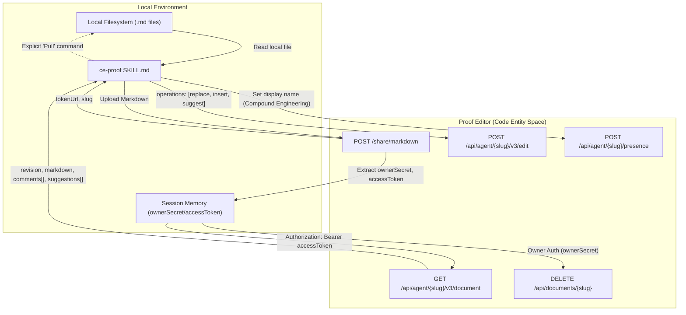
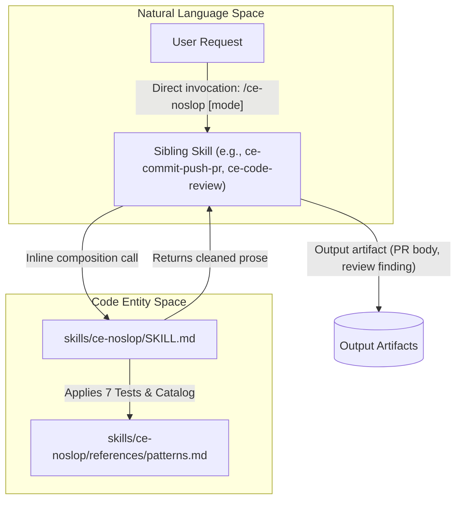

<!-- source: DeepWiki mcp.deepwiki.com · repo EveryInc/compound-engineering-plugin · page 8.2 ce-proof and ce-noslop — Writing and Editing · fetched 2026-10-30 -->

# ce-proof and ce-noslop — Writing and Editing

Relevant source files

The following files were used as context for generating this wiki page:

- [skills/ce-noslop/SKILL.md](skills/ce-noslop/SKILL.md)
- [skills/ce-noslop/references/patterns.md](skills/ce-noslop/references/patterns.md)
- [skills/ce-proof/SKILL.md](skills/ce-proof/SKILL.md)
- [skills/ce-proof/references/api.md](skills/ce-proof/references/api.md)
- [skills/ce-proof/references/workflows.md](skills/ce-proof/references/workflows.md)
- [tests/skill-eval-cell/fixtures/noslop-drafts/certainty.md](tests/skill-eval-cell/fixtures/noslop-drafts/certainty.md)
- [tests/skill-eval-cell/fixtures/noslop-drafts/choppy.md](tests/skill-eval-cell/fixtures/noslop-drafts/choppy.md)
- [tests/skill-eval-cell/fixtures/noslop-drafts/release-notes.md](tests/skill-eval-cell/fixtures/noslop-drafts/release-notes.md)
- [tests/skill-eval-cell/fixtures/noslop-drafts/status-update.md](tests/skill-eval-cell/fixtures/noslop-drafts/status-update.md)
- [tests/skill-eval-cell/grade.test.ts](tests/skill-eval-cell/grade.test.ts)
- [tests/skill-eval-cell/grade.ts](tests/skill-eval-cell/grade.ts)
- [tests/skills/ce-proof-body-pins.test.ts](tests/skills/ce-proof-body-pins.test.ts)

This page details `ce-proof`, a skill for human-in-the-loop (HITL) collaborative markdown editing, and `ce-noslop`, which enforces prose rules for PR bodies and other written output to eliminate AI writing tells and improve clarity.

## ce-proof — Collaborative Markdown Editor

The `ce-proof` skill provides a collaborative, human-in-the-loop (HITL) markdown editing experience by integrating the plugin with `https://www.proofeditor.ai`. It allows agents to share local markdown documents, receive human feedback via comments and suggestions, and participate in real-time editing using Proof's v3 Web API.
Sources: [skills/ce-proof/SKILL.md:1-15]()

### Integration Architecture

`ce-proof` operates via a web-first architecture using Proof's current web agent HTTP surface and optional model context protocol (`proof_*` MCP tools) when available.

*   **Web API (v3)**: The primary communication layer (`GET /api/agent/<slug>/v3/document`, `POST /api/agent/<slug>/v3/edit`). [skills/ce-proof/SKILL.md:52-52](), [skills/ce-proof/references/api.md:15-19]()
*   **One-Way Publish**: Local files stay canonical; publishing creates a remote copy via `POST /share/markdown` but does not sync back to disk unless an explicit pull workflow is invoked. [skills/ce-proof/SKILL.md:40-43](), [skills/ce-proof/references/workflows.md:59-88]()

#### Data Flow and Code Entities

The following diagram illustrates how the `ce-proof` skill bridges the local filesystem and the remote Proof editor via the v3 API and MCP endpoints.

Sources: [skills/ce-proof/SKILL.md:15-23](), [skills/ce-proof/SKILL.md:52-64](), [skills/ce-proof/references/workflows.md:15-95]()

### Human-in-the-Loop (HITL) Workflow

The HITL review cycle is triggered either by direct user request or as a handoff from upstream planning skills (`ce-brainstorm`, `ce-ideate`, `ce-plan`).
Sources: [skills/ce-proof/SKILL.md:40-45]()

#### Credential and Ownership Lifecycle

`ce-proof` manages two distinct credentials returned upon document creation:

| Credential | Role | Security Policy |
| :--- | :--- | :--- |
| `accessToken` | Everyday bearer for read, edit, presence, and events. | Shared with the agent for all non-owner operations. [skills/ce-proof/SKILL.md:33-34]() |
| `ownerSecret` | Owner authority for `DELETE` and high-level ops. | **Never** used as everyday bearer. Revoked if a human claims the doc. [skills/ce-proof/SKILL.md:33-35]() |
Sources: [skills/ce-proof/SKILL.md:33-39]()

#### HITL Phase Pipeline

The workflow follows a structured execution model using the v3 surface:

1.  **Upload**: `POST /share/markdown` creates the doc. The agent extracts `tokenUrl`, `slug`, `accessToken`, and `ownerSecret`. [skills/ce-proof/SKILL.md:19-20](), [skills/ce-proof/references/api.md:20-48]()
2.  **Identity Binding**: The agent posts to `/presence` to bind the display name `Compound Engineering` to the `X-Agent-Id` `ai:compound-engineering`. [skills/ce-proof/SKILL.md:28-29](), [skills/ce-proof/references/workflows.md:19-24]()
3.  **Collaborative Read**: `GET /api/agent/{slug}/v3/document` retrieves current state, comments, and suggestions. [skills/ce-proof/SKILL.md:52-52](), [skills/ce-proof/references/api.md:49-61]()
4.  **Targeted Mutation**: `POST /api/agent/{slug}/v3/edit` applies an `operations` array against visible text targets. [skills/ce-proof/SKILL.md:52-52](), [skills/ce-proof/references/api.md:69-86]()
5.  **Conflict Handling**: Uses `baseRevision` from the last read as an optional conflict guard. On `409 Conflict` or retryable errors, it re-reads and retries. [skills/ce-proof/SKILL.md:58-63](), [skills/ce-proof/references/api.md:71-125]()
Sources: [skills/ce-proof/SKILL.md:27-64](), [skills/ce-proof/references/api.md:20-130]()

### Integration with Core Skills

`ce-proof` acts as a collaborative quality gate for several core skills:

*   **`ce-brainstorm`**: Used to review requirements documents and publish markdown outputs. [skills/ce-proof/SKILL.md:44-45]()
*   **`ce-ideate`**: Used to present ranked ideas for critique and selection. [skills/ce-proof/SKILL.md:44-45]()
*   **`ce-plan`**: Used to review implementation plans labeled by readiness (e.g., `Plan: <title> (requirements-only)` or `Plan: <title> (implementation-ready)`). [skills/ce-proof/SKILL.md:45-46]()
Sources: [skills/ce-proof/SKILL.md:44-46]()

### Technical Implementation Details

#### Mutation Strategy (v3 Edit Ladder)
The skill enforces a "Narrow-First" edit ladder:
1.  **Narrow Edits**: `replace`, `insert`, or `delete` for specific prose targets. [skills/ce-proof/SKILL.md:54-55](), [skills/ce-proof/references/api.md:112-117]()
2.  **Suggestions**: `suggest` when track-changes visibility is required. [skills/ce-proof/SKILL.md:54-55](), [skills/ce-proof/references/api.md:112-117]()
3.  **Whole-Doc**: `set_document` is used only when requested or when changes cannot be expressed narrowly. [skills/ce-proof/SKILL.md:54-55](), [skills/ce-proof/references/api.md:112-117]()
Sources: [skills/ce-proof/SKILL.md:54-55](), [skills/ce-proof/references/api.md:110-117]()

#### Atomic Pull-to-Local
When syncing a Proof doc back to disk (`references/workflows.md`), the skill performs an atomic operation:
1. Fetches `v3/document`.
2. Streams `.markdown` bytes using `jq -jr` into a temporary file (`.proof-sync.$$`).
3. Renames the temporary file atomically to the destination path.
Sources: [skills/ce-proof/references/workflows.md:96-123]()

#### Implementation Constraints
*   **No Comment Delete**: v3 supports resolving/unresolving comments but not deleting them. Emptying markdown text does not scrub comment marks. [skills/ce-proof/SKILL.md:36-37](), [skills/ce-proof/references/api.md:65-65]()
*   **Ambiguity**: `TARGET_AMBIGUOUS` is returned if an anchor matches multiple times; the agent must use `occurrence`, `before`, or `after` candidates rather than guessing. [skills/ce-proof/SKILL.md:58-61](), [skills/ce-proof/references/api.md:118-119]()
Sources: [skills/ce-proof/SKILL.md:36-64](), [skills/ce-proof/references/api.md:65-129]()

---

## ce-noslop — Writing without Slop

`ce-noslop` is the plugin's writing skill, designed to produce prose free of AI writing tells and easily understood on the first read, while preserving all factual content across PR bodies, plan sections, review findings, and chat replies.
Sources: [skills/ce-noslop/SKILL.md:1-11]()

### Core Principles

The skill enforces two primary goals simultaneously:
1.  **No AI Tells**: Removal of formulaic patterns and stylistic tropes. [skills/ce-noslop/SKILL.md:9-10]()
2.  **First-Read Understandability**: Plain, dense, factual sentences requiring no re-reading. [skills/ce-noslop/SKILL.md:9-10]()

Exact identifiers, paths, commands, thresholds, and domain-specific terminology are strictly preserved.
Sources: [skills/ce-noslop/SKILL.md:11-13](), [skills/ce-noslop/SKILL.md:45-45]()

### Modes of Operation

`ce-noslop` supports three modes, selected via argument hint or explicit `mode:` token:

| Mode | Trigger Condition | Output Behavior |
| :--- | :--- | :--- |
| **author** | No draft supplied, or `mode:author` | Holds constraints while caller writes, or drafts supplied content. [skills/ce-noslop/SKILL.md:17-19]() |
| **edit** | Imperative on a draft, or `mode:edit` | Rewrites only sentences failing tests; returns text. A one-line change summary is included only when explicitly requested. [skills/ce-noslop/SKILL.md:17-20]() |
| **detect** | Question about a draft, or `mode:detect` | Names patterns found, quotes lines, gives short fixes without rewriting. [skills/ce-noslop/SKILL.md:17-21]() |
Sources: [skills/ce-noslop/SKILL.md:15-22]()

Pattern catalogues in `references/patterns.md` guide `edit` and `detect` modes.
Sources: [skills/ce-noslop/SKILL.md:23-24](), [skills/ce-noslop/references/patterns.md:1-4]()

### Registers (Audience-Specific Tone)

The register is selected based on the reader:
*   **Agent talking to the user**: A teammate who knows the domain and did not watch the work. [skills/ce-noslop/SKILL.md:28-29]()
*   **Repo or team artifact**: Neutral, matching surrounding document idioms (default when no reader is named). [skills/ce-noslop/SKILL.md:30-30]()
*   **User's own writing**: Preserves voice with minimal effective edits (sentence splits and actor restoration). [skills/ce-noslop/SKILL.md:31-31]()
Sources: [skills/ce-noslop/SKILL.md:25-32]()

### The Seven Tests

Every sentence is evaluated against seven core tests:
1.  **Mechanism**: Does the sentence state what the thing does rather than how it feels? [skills/ce-noslop/SKILL.md:37-37]()
2.  **Portability**: Could the sentence move to another project unchanged? (If so, it lacks project-specific facts). [skills/ce-noslop/SKILL.md:38-38]()
3.  **Actor**: Who performs the verb? Name them when known. [skills/ce-noslop/SKILL.md:39-39]()
4.  **One idea**: Split sentences that require rereading. [skills/ce-noslop/SKILL.md:40-40]()
5.  **Density**: Three or more distinct pattern violations indicate a finding. [skills/ce-noslop/SKILL.md:41-41]()
6.  **Decision first**: Does the first sentence carry the outcome the reader needs? [skills/ce-noslop/SKILL.md:42-42]()
7.  **Reader**: Can someone without the document or code open act on this? Gloss identifiers or name consequences. [skills/ce-noslop/SKILL.md:43-43]()
Sources: [skills/ce-noslop/SKILL.md:33-44]()

### Boundaries

`ce-noslop` never modifies:
*   Code blocks, quoted text, frontmatter, link targets, identifiers, or contract tokens unless explicitly requested. [skills/ce-noslop/SKILL.md:12-13]()
*   Facts, numbers, names, quotes, and citations. [skills/ce-noslop/SKILL.md:11-13]()
*   Files in place, unless asked to write a named file. [skills/ce-noslop/SKILL.md:12-13]()
Sources: [skills/ce-noslop/SKILL.md:11-14]()

### Integration with Sibling Skills

`ce-noslop` is invoked inline by sibling skills during text composition phases.

Sources: [skills/ce-noslop/SKILL.md:15-24](), [skills/ce-noslop/SKILL.md:33-44]()

Skills invoking `ce-noslop` include `ce-commit-push-pr`, `ce-code-review`, `ce-plan`, `ce-brainstorm`, and `ce-resolve-pr-feedback`.
Sources: [skills/ce-noslop/SKILL.md:1-5]()

---

