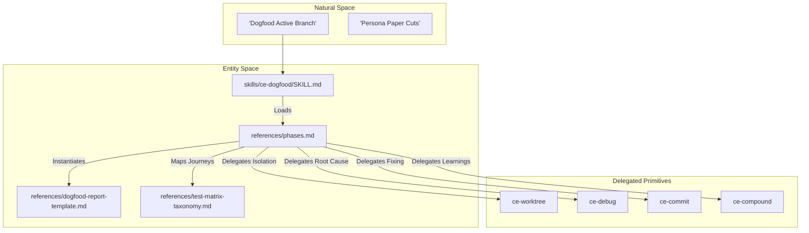

<!-- source: DeepWiki mcp.deepwiki.com · repo EveryInc/compound-engineering-plugin · page 8.3 Testing and Browser Automation · fetched 2026-10-30 -->

# Testing and Browser Automation

Relevant source files

The following files were used as context for generating this wiki page:

- [docs/guides/ce-dogfood.md](docs/guides/ce-dogfood.md)
- [docs/plans/2026-07-09-001-fix-ce-test-browser-native-driver-plan.md](docs/plans/2026-07-09-001-fix-ce-test-browser-native-driver-plan.md)
- [skills/ce-doc-review/references/decision-primer.md](skills/ce-doc-review/references/decision-primer.md)
- [skills/ce-dogfood/SKILL.md](skills/ce-dogfood/SKILL.md)
- [skills/ce-dogfood/references/agent-browser-driver.md](skills/ce-dogfood/references/agent-browser-driver.md)
- [skills/ce-dogfood/references/dogfood-report-template.md](skills/ce-dogfood/references/dogfood-report-template.md)
- [skills/ce-dogfood/references/phases.md](skills/ce-dogfood/references/phases.md)
- [skills/ce-dogfood/references/test-matrix-taxonomy.md](skills/ce-dogfood/references/test-matrix-taxonomy.md)
- [skills/ce-promote/SKILL.md](skills/ce-promote/SKILL.md)
- [skills/ce-test-browser/SKILL.md](skills/ce-test-browser/SKILL.md)
- [skills/ce-test-browser/references/agent-browser-driver.md](skills/ce-test-browser/references/agent-browser-driver.md)
- [skills/ce-test-browser/references/route-and-report.md](skills/ce-test-browser/references/route-and-report.md)
- [skills/ce-test-browser/scripts/resolve-port.sh](skills/ce-test-browser/scripts/resolve-port.sh)
- [skills/ce-worktree/SKILL.md](skills/ce-worktree/SKILL.md)
- [tests/ce-test-browser-driver-policy.test.ts](tests/ce-test-browser-driver-policy.test.ts)
- [tests/skills/ce-dogfood-body-pins.test.ts](tests/skills/ce-dogfood-body-pins.test.ts)

## Purpose and Scope

This page documents the browser automation testing, iOS application testing, interactive UI polish, and hands-off browser QA capabilities within the `compound-engineering-plugin`. The system provides specialized skills for automated quality assurance, diff-scoped browser validation, and human-in-the-loop refinement:

1.  `ce-test-browser`: Automated end-to-end testing for web applications using a host-native browser or the `agent-browser` fallback [skills/ce-test-browser/SKILL.md:2-3]().
2.  `ce-test-xcode`: iOS application testing using the `XcodeBuildMCP` server [docs/skills/ce-test-xcode.md:5]().
3.  `ce-polish`: Interactive UI refinement with automated dev-server detection and browser hand-off [skills/ce-polish/SKILL.md:3-4]().
4.  `ce-dogfood`: Hands-off, diff-scoped browser QA that maps user flows, drives real browsers, autonomously fixes small breakages with regression tests and commits, judges experience against product personas, and writes durable reports [skills/ce-dogfood/SKILL.md:2-3]().

**Key Architecture Shift**: Browser-driven skills distinguish between **host-native integrated browsers** (embedded in or owned directly by the harness) and **portable fallbacks** (`agent-browser`) [skills/ce-test-browser/SKILL.md:20-21]().

Sources: [skills/ce-test-browser/SKILL.md:2-3](), [skills/ce-polish/SKILL.md:3-4](), [skills/ce-dogfood/SKILL.md:2-3](), [docs/skills/ce-test-xcode.md:5](), [skills/ce-test-browser/SKILL.md:20-21]()

---

## Web Application Testing (ce-test-browser)

The `ce-test-browser` skill automates the execution of browser tests on pages affected by a specific PR or branch [skills/ce-test-browser/SKILL.md:2-3]().

### Browser Driver Policy

The skill implements a hierarchical driver selection policy to ensure the best possible integrated experience while maintaining portability [skills/ce-test-browser/SKILL.md:18-25]().

1.  **Prefer Host-Native Integrated Browser**: Use surfaces embedded in or owned by the active harness (such as Claude Code or Cursor) that can navigate local URLs, inspect rendered state, execute interactions, capture screenshots, and inspect console errors [skills/ce-test-browser/SKILL.md:20]().
2.  **Fallback to `agent-browser`**: Use the portable CLI driver if no qualifying host-native capability exists [skills/ce-test-browser/SKILL.md:21](). The skill explicitly requires reading `references/agent-browser-driver.md` before executing `agent-browser` commands [skills/ce-test-browser/SKILL.md:21]().
3.  **Prohibited Substitutes**: Never install or substitute standalone Playwright, Puppeteer, or ad hoc browser automation [skills/ce-test-browser/SKILL.md:24](). A Playwright API exposed *inside* a host-native browser remains native, not standalone [skills/ce-test-browser/SKILL.md:24]().

Once selected, a single driver owns the entire run to prevent mixing authentication states or session references [skills/ce-test-browser/SKILL.md:26]().

### Workflow and Reporting

The `ce-test-browser` workflow is structured across several sequential steps detailed in `references/route-and-report.md` [skills/ce-test-browser/SKILL.md:30-31]().

1.  **Select Driver**: Choose between host-native or `agent-browser` [skills/ce-test-browser/SKILL.md:32]().
2.  **Determine Test Scope**: Parse PR numbers, `current` branch, or explicit branch names using git diff commands [skills/ce-test-browser/SKILL.md:33]().
3.  **Map Changed Files to Routes**: Match file paths to corresponding HTTP routes [skills/ce-test-browser/SKILL.md:34](), [skills/ce-test-browser/references/route-and-report.md:5-20]().
4.  **Determine Dev Server Port**: Invoke `scripts/resolve-port.sh` to query package scripts, environment files, or defaults [skills/ce-test-browser/SKILL.md:35](), [tests/ce-test-browser-driver-policy.test.ts:84-108]().
5.  **Verify Dev Server Running**: Check connection availability before prompting [skills/ce-test-browser/SKILL.md:36]().
6.  **Set Visibility & Verify Root**: Handle headed/headless visibility modes and test root navigation [skills/ce-test-browser/SKILL.md:37-42]().
7.  **Test Each Affected Page**: Validate headings, content, forms, console logs, and key interactions [skills/ce-test-browser/SKILL.md:43](), [skills/ce-test-browser/references/route-and-report.md:40-54]().
8.  **Human Verification**: Pause for external integrations (OAuth, email, payments) in manual mode; skip and log in pipeline mode [skills/ce-test-browser/SKILL.md:44](), [skills/ce-test-browser/references/route-and-report.md:55-77]().
9.  **Handle Failures**: Capture error state and prompt to fix or skip [skills/ce-test-browser/SKILL.md:45](), [skills/ce-test-browser/references/route-and-report.md:79-99]().
10. **Report Summary**: Output a structured markdown summary [skills/ce-test-browser/SKILL.md:46](), [skills/ce-test-browser/references/route-and-report.md:101-129]().

### Port Detection and Dev Server Lifecycle

Port resolution follows a strict priority cascade via `scripts/resolve-port.sh` [skills/ce-test-browser/SKILL.md:35](), [tests/ce-test-browser-driver-policy.test.ts:84-108]().

| Priority | Source | Mechanism |
| :--- | :--- | :--- |
| 1 | Explicit Argument | User-provided `--port` flag [skills/ce-test-browser/SKILL.md:35](). |
| 2 | `package.json` | Scan `dev`/`start` scripts for explicit port flags [skills/ce-test-browser/SKILL.md:35](). |
| 3 | Environment | Check `PORT=` in `.env`, `.env.local`, or `.env.development` [skills/ce-test-browser/SKILL.md:35](). |
| 4 | Default | Fallback to port `3000` [skills/ce-test-browser/SKILL.md:35](). |

In **Pipeline Mode** (`mode:pipeline`), orchestration rules override manual prompts, executing unattended runs and invoking `scripts/resolve-port.sh --free` within automated server startup blocks [skills/ce-test-browser/SKILL.md:16](), [tests/ce-test-browser-driver-policy.test.ts:80]().

Sources: [skills/ce-test-browser/SKILL.md:1-50](), [skills/ce-test-browser/references/route-and-report.md:1-129](), [tests/ce-test-browser-driver-policy.test.ts:1-122]()

---

## iOS Simulator Testing (ce-test-xcode)

`ce-test-xcode` provides iOS simulator testing capabilities via Sentry's `XcodeBuildMCP` server [docs/skills/ce-test-xcode.md:5, 47-49]().

### Integration and Capabilities
The skill orchestrates Model Context Protocol (MCP) primitives:
*   **Discovery**: `discover_projs` and `list_schemes` [docs/skills/ce-test-xcode.md:51-52]().
*   **Lifecycle**: `boot_simulator`, `build_ios_sim_app`, and `install_app_on_simulator` [docs/skills/ce-test-xcode.md:53-55]().
*   **Observation**: `take_screenshot` and `capture_sim_logs` [docs/skills/ce-test-xcode.md:56]().

### Human Verification Gates
Due to simulator sandbox limitations, flows such as **Sign in with Apple**, **Push Notifications**, and **In-App Purchases** pause for explicit human sign-off [docs/skills/ce-test-xcode.md:68-76]().

Sources: [docs/skills/ce-test-xcode.md:1-107]()

---

## Hands-Off Browser QA (ce-dogfood)

`ce-dogfood` is a high-autonomy QA orchestrator that evaluates the **active branch** end-to-end [skills/ce-dogfood/SKILL.md:3-13](). 

### Diff-Scoped QA Architecture and Boundaries
Unlike general whole-app crawlers, `ce-dogfood` is strictly **diff-scoped**: it focuses on what the current branch or PR introduced or modified versus the trunk [skills/ce-dogfood/SKILL.md:14](). 

Key operational boundaries include:
*   **Single Browser Policy**: Drive one browser instance throughout the entire run [skills/ce-dogfood/SKILL.md:20]().
*   **Trunk Protection**: Never dogfood the trunk (`main`/`master`) directly on branch or blank targets; a PR target is always valid because it possesses a base [skills/ce-dogfood/SKILL.md:21]().
*   **PR Identity Preservation**: Numeric PR targets retain their PR identity through isolation and checkout [skills/ce-dogfood/SKILL.md:22]().
*   **Worktree Isolation**: Isolate PRs or named refs using `ce-worktree` without disturbing the user's primary working tree [skills/ce-dogfood/SKILL.md:23]().
*   **Artifact Root Resolution**: Artifact directories and reports are resolved against `<root>` defined by `docs_root` in `<repo-root>/.compound-engineering/config.yaml` [skills/ce-dogfood/SKILL.md:36-44]().
*   **Autonomous Fix Constraints**: Auto-fix only small, well-understood, and low-risk breakages. Architectural, schema, or product-intent changes are escalated to the report's "Decisions for a human" section [skills/ce-dogfood/SKILL.md:25]().

### Phase Pipeline
The run progresses through invariant phases defined in `references/phases.md` [skills/ce-dogfood/SKILL.md:16](), [skills/ce-dogfood/references/phases.md:1-159]():
1.  **Phase 0: Scope and Get on the Right Branch**: Parse arguments, identify targets, enforce trunk protections, and configure worktree isolation [skills/ce-dogfood/references/phases.md:5-17]().
2.  **Phase 1: Analyze Changes**: Resolve the trunk reference, extract full diffs, model user-visible changes, load product personas, and resolve Compound Packs [skills/ce-dogfood/references/phases.md:29-67]().
3.  **Map Flows & Derive Matrix**: Build Mermaid flowcharts for journeys and construct test matrices [skills/ce-dogfood/SKILL.md:56](), [skills/ce-dogfood/references/dogfood-report-template.md:19-40]().
4.  **Serve & Execute**: Start the local dev server and execute scenarios sequentially [skills/ce-dogfood/SKILL.md:56]().
5.  **Fix Loop**: Apply targeted fixes, verify with regression tests, and record commits [skills/ce-dogfood/SKILL.md:56]().
6.  **Report**: Maintain a durable checkpoint at `<root>/dogfood-reports/<YYYY-MM-DD>-<branch-slug>-dogfood.md` [skills/ce-dogfood/SKILL.md:12, 58]().

### Report Template & Test Matrix Taxonomy
The durable report is instantiated from `references/dogfood-report-template.md` [skills/ce-dogfood/SKILL.md:58](), [skills/ce-dogfood/references/dogfood-report-template.md:1-97](). It tracks:
*   **Diff Summary & Personas**: User-facing changes and persona criteria from Compound Packs or strategy documents [skills/ce-dogfood/references/dogfood-report-template.md:8-17]().
*   **Flows Tested**: Mermaid flowcharts capturing happy paths, branch points, and side effects [skills/ce-dogfood/references/dogfood-report-template.md:18-29]().
*   **Test Matrix & Results**: Scenario tracking with states (`Pending`, `Pass`, `Fixed`, `Skipped`, `Blocked`) [skills/ce-dogfood/references/dogfood-report-template.md:31-40]().
*   **Pack Compliance & Paper Cuts**: Evaluation against Compound Pack rules and persona friction points [skills/ce-dogfood/references/dogfood-report-template.md:41-61]().
*   **Decisions for a Human**: Escalated architectural or product trade-offs [skills/ce-dogfood/references/dogfood-report-template.md:71-86]().

Sources: [skills/ce-dogfood/SKILL.md:1-60](), [skills/ce-dogfood/references/dogfood-report-template.md:1-97](), [skills/ce-dogfood/references/phases.md:1-67](), [skills/ce-dogfood/references/test-matrix-taxonomy.md:1-62]()

---

## Light Webserver Support Files

The lightweight webserver implementation (`light-webserver.js`) supports skills such as `ce-brainstorm` and `ce-prototype` by serving local UI artifacts, visual probes, and interactive prototypes [skills/ce-brainstorm/scripts/light-webserver.js:1-1251](), [skills/ce-prototype/scripts/light-webserver.js:1-1251]().

### Key Implementation Features
*   **Static File Serving**: Serves HTML and asset directories with strict path containment to prevent path traversal attacks [skills/ce-brainstorm/scripts/light-webserver.js:81, 180-195]().
*   **Newest Screen Serving**: Automatically resolves and serves the most recently created HTML file as the root document [skills/ce-brainstorm/scripts/light-webserver.js:197-202]().
*   **Process Management**: Manages server lifecycle commands (`start`, `stop`, `status`, `wait`) with PID file tracking [skills/ce-brainstorm/scripts/light-webserver.js:28-35, 149-165]().
*   **Annotation Overlay (`ce-prototype`)**: Injects `annotate.js` and `annotate.css` overlays when invoked with `--annotate`, enabling real-time user feedback and Server-Sent Events (SSE) streaming [skills/ce-prototype/scripts/light-webserver.js:20-24, 61, 400-411]().
*   **Idle Timeout**: Automatically shuts down after periods of inactivity regulated by `CE_LIGHT_WEB_IDLE_TIMEOUT_MS` [skills/ce-brainstorm/scripts/light-webserver.js:13]().

Sources: [skills/ce-brainstorm/scripts/light-webserver.js:1-1251](), [skills/ce-prototype/scripts/light-webserver.js:1-1251](), [tests/skills/ce-brainstorm-visual-probe-server.test.ts:1-289](), [tests/skills/ce-prototype-server.test.ts:1-1506]()

---

