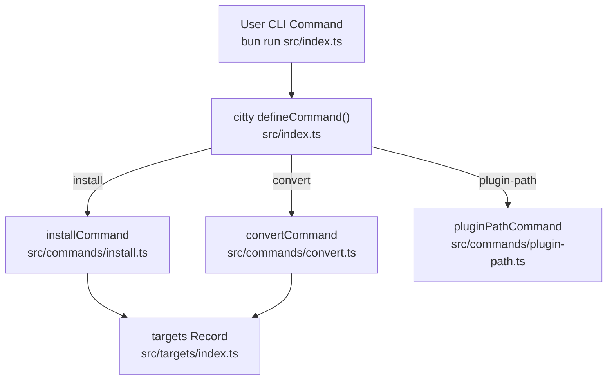
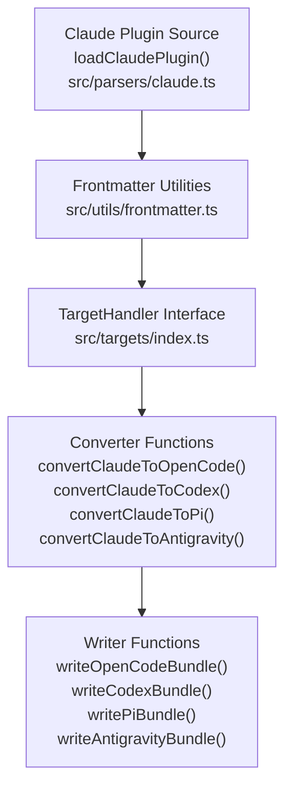

<!-- source: DeepWiki mcp.deepwiki.com · repo EveryInc/compound-engineering-plugin · page 9 Cross-Platform CLI Tool · fetched 2026-10-30 -->

# Cross-Platform CLI Tool

Relevant source files

The following files were used as context for generating this wiki page:

- [bun.lock](bun.lock)
- [src/commands/convert.ts](src/commands/convert.ts)
- [src/commands/install.ts](src/commands/install.ts)
- [src/commands/plugin-path.ts](src/commands/plugin-path.ts)
- [src/index.ts](src/index.ts)
- [src/targets/index.ts](src/targets/index.ts)
- [tests/cli.test.ts](tests/cli.test.ts)
- [tests/plugin-path.test.ts](tests/plugin-path.test.ts)
- [tests/resolve-output.test.ts](tests/resolve-output.test.ts)
- [tests/skill-eval-cell/extract.test.ts](tests/skill-eval-cell/extract.test.ts)
- [tests/skill-eval-cell/path-shim.test.ts](tests/skill-eval-cell/path-shim.test.ts)
- [tests/skill-eval-cell/path-shim.ts](tests/skill-eval-cell/path-shim.ts)

The Cross-Platform CLI Tool (`compound-plugin`) is a Bun/TypeScript command-line utility implemented in `src/` that resolves, converts, installs, and cleans up plugins for host environments that lack native plugin support [src/index.ts:1-25](), [src/commands/install.ts:17-21](). While several platforms now support native plugin architectures, the CLI remains the core mechanism for distributing skills and agents to OpenCode, Codex, Pi, Kiro, Antigravity, and other targets via `src/commands/install.ts` and `src/commands/convert.ts` [src/commands/install.ts:22-35](), [src/commands/convert.ts:14-29]().

For details on the compound-engineering plugin catalog, see [Compound Engineering Plugin](#2). For extension authoring, see [Plugin Development Guide](#11).

---

## CLI Architecture

The CLI is powered by the `citty` framework, exposing subcommands through `src/index.ts` [src/index.ts:1-25](). It delegates execution to command modules (`install`, `convert`, `cleanup`, `list`, `plugin-path`) and interacts with target handlers defined in `src/targets/index.ts` [src/targets/index.ts:37-46]().

### Diagram: CLI Execution Flow (Natural Language to Code Entities)

Sources: [src/index.ts:1-25](), [src/commands/install.ts:17-21](), [src/commands/convert.ts:14-18](), [src/targets/index.ts:48-76]()

---

## Installation System

The installation subsystem manages fetching plugins from local paths or remote Git repositories, validating environment scopes, auto-detecting installed tools, and writing converted assets to target directories [src/commands/install.ts:22-81](), [src/commands/install.ts:91-110](). The `plugin-path` command handles branch checkouts and stable path caching for integrations like `claude --plugin-dir` [src/commands/plugin-path.ts:9-36]().

For detailed coverage of commands, plugin path resolution, target registries, and home resolution utilities, see [Installation System](#9.1).

Sources: [src/commands/install.ts:22-81](), [src/commands/plugin-path.ts:6-56]()

---

## Conversion Architecture

The conversion pipeline parses Claude Code plugin manifests and transforms them into target-specific bundles [src/commands/install.ts:94-94](), [src/targets/index.ts:37-46](). It relies heavily on frontmatter parsing utilities (`src/utils/frontmatter.ts`), model alias normalization, and the `TargetHandler` interface to decouple format parsing from filesystem emission [src/targets/index.ts:37-46]().

### Diagram: Conversion Pipeline Architecture

Sources: [src/targets/index.ts:37-46](), [src/commands/install.ts:94-94]()

For details on parsing, frontmatter manipulation, content transformation, and the `TargetHandler` contract, see [Conversion Architecture](#9.2).

Sources: [src/targets/index.ts:37-46](), [src/commands/install.ts:94-94]()

---

## Target Platforms

The CLI supports multiple platform converters and writers through the registry pattern [src/targets/index.ts:48-76](). Each platform defines its own output structure, configuration files, and permission mapping rules.

| Target | Status | Target Handler Module |
|--------|--------|-----------------------|
| `opencode` | Implemented | `src/converters/claude-to-opencode.ts` / `src/targets/opencode.ts` [src/targets/index.ts:49-54]() |
| `codex` | Implemented | `src/converters/claude-to-codex.ts` / `src/targets/codex.ts` [src/targets/index.ts:55-63]() |
| `pi` | Implemented | `src/converters/claude-to-pi.ts` / `src/targets/pi.ts` [src/targets/index.ts:64-69]() |
| `antigravity` | Implemented | `src/converters/claude-to-antigravity.ts` / `src/targets/antigravity.ts` [src/targets/index.ts:70-75]() |

Sources: [src/targets/index.ts:48-76]()

For complete details on per-target writers, legacy Copilot/Droid converters, and platform specifications, see [Target Platforms](#9.3).

Sources: [src/targets/index.ts:48-76]()

---

## Cleanup and Legacy Migration

When migrating users from legacy Bun-only installations to modern native plugin systems, the CLI provides cleanup routines via `src/commands/cleanup.ts` [src/index.ts:5](). It uses ownership-aware tracking (`plugin-legacy-artifacts.ts`) to purge stale artifacts while preserving user modifications.

For details on cleanup commands, registry management, and backup strategies, see [Cleanup and Legacy Migration](#9.4).

Sources: [src/index.ts:5](), [src/commands/cleanup.ts:1-25]()

---

## Local Development Workflow (codex-dev)

For local development of skills targeted at Codex, the `codex-dev` utility (`src/dev/codex-dev.ts` and `scripts/codex-dev.ts`) allows engineers to symlink worktree skills directly into their local Codex environment.

For details on local modes, status reporting, remote checks, and session-cache mitigation via fresh-agent injection, see [Local Development Workflow (codex-dev)](#9.5).

Sources: [src/index.ts:1-25]()

---

## Summary of CLI Options

The CLI shares common flags across its installation and conversion commands [src/commands/install.ts:22-81](), [src/commands/convert.ts:19-74]():

| Flag | Default | Description |
|------|---------|-------------|
| `--to` | `opencode` | Target format (`opencode` \| `codex` \| `pi` \| `antigravity` \| `all`) [src/commands/install.ts:28-32]() |
| `--also` | `undefined` | Comma-separated extra targets to generate [src/commands/install.ts:52-55]() |
| `--permissions` | `none` | Permission mapping (`none` \| `broad` \| `from-commands`) [src/commands/install.ts:56-60]() |
| `--agent-mode` | `subagent` | Default agent mode (`primary` \| `subagent`) [src/commands/install.ts:61-65]() |
| `--infer-temperature` | `true` | Infer agent temperature from name/description [src/commands/install.ts:66-70]() |
| `--include-skills` | `false` | For Codex: emit skills and commands alongside agents [src/commands/install.ts:71-76]() |
| `--scope` | `undefined` | Scope level (`global` \| `workspace`) [src/commands/install.ts:48-51]() |
| `--branch` | `undefined` | Git branch to clone from (for `install` only) [src/commands/install.ts:77-80]() |

Sources: [src/commands/install.ts:22-81](), [src/commands/convert.ts:19-74]()

---

