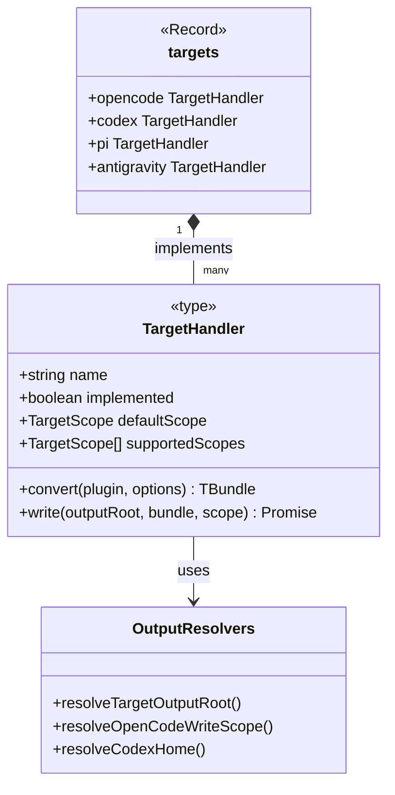

<!-- source: DeepWiki mcp.deepwiki.com · repo EveryInc/compound-engineering-plugin · page 9.1 Installation System · fetched 2026-10-30 -->

# Installation System

<details>
<summary>Relevant source files</summary>

The following files were used as context for generating this wiki page:

- [bun.lock](bun.lock)
- [src/commands/convert.ts](src/commands/convert.ts)
- [src/commands/install.ts](src/commands/install.ts)
- [src/commands/plugin-path.ts](src/commands/plugin-path.ts)
- [src/index.ts](src/index.ts)
- [src/targets/index.ts](src/targets/index.ts)
- [src/utils/detect-tools.ts](src/utils/detect-tools.ts)
- [src/utils/resolve-output.ts](src/utils/resolve-output.ts)
- [tests/cli.test.ts](tests/cli.test.ts)
- [tests/detect-tools.test.ts](tests/detect-tools.test.ts)
- [tests/plugin-path.test.ts](tests/plugin-path.test.ts)
- [tests/resolve-output.test.ts](tests/resolve-output.test.ts)
- [tests/skill-eval-cell/extract.test.ts](tests/skill-eval-cell/extract.test.ts)
- [tests/skill-eval-cell/path-shim.test.ts](tests/skill-eval-cell/path-shim.test.ts)
- [tests/skill-eval-cell/path-shim.ts](tests/skill-eval-cell/path-shim.ts)

</details>


The Installation System provides a cross-platform Bun/TypeScript CLI (`src/index.ts`) [src/index.ts:1-25]() for resolving, converting, installing, and cleaning up Claude Code plugins into multiple AI coding environments. It manages the lifecycle of plugin distribution by translating the Claude-native plugin format into target-specific manifests, agents, skills, and directory structures.

## System Overview

The system is built on a command-driven architecture using `citty` [src/index.ts:2-25](). It coordinates between a plugin parser (`loadClaudePlugin`), a target registry of converters (`targets`), and a set of output writers.

### Core Command Flow

The installation and conversion logic is orchestrated through `src/commands/install.ts` and `src/commands/convert.ts`. While both share the same conversion backend, `install` includes an additional resolution step to fetch plugins from remote sources or local paths.

**Natural Language to Code Entity: Installation and Conversion Pipeline**

```mermaid
graph TD
    subgraph "NaturalLanguageSpace"
        CLI_Input[""CLI Install/Convert Request""]
        PluginSource[""Local or Remote Plugin Source""]
        TargetPlatform[""Target AI Platform (OpenCode, Codex, Pi, Antigravity)""]
    end

    subgraph "CodeEntitySpace"
        Index[""defineCommand() / runMain()"<br/>src/index.ts:10-25]
        InstallCmd[""installCommand"<br/>src/commands/install.ts:17-82]
        ConvertCmd[""convertCommand"<br/>src/commands/convert.ts:14-74]
        ResolvePlugin[""resolvePluginPath()"<br/>src/commands/install.ts:91]
        LoadPlugin[""loadClaudePlugin()"<br/>src/parsers/claude.ts:6]
        DetectTools[""detectInstalledTools()"<br/>src/utils/detect-tools.ts:85-105]
        TargetRegistry[""targets Record"<br/>src/targets/index.ts:48-76]
        TargetWriter[""TargetHandler.write()"<br/>src/targets/index.ts:45]
    end

    CLI_Input --> Index
    Index --> InstallCmd
    Index --> ConvertCmd
    InstallCmd --> ResolvePlugin
    ResolvePlugin --> LoadPlugin
    ConvertCmd --> LoadPlugin
    LoadPlugin --> DetectTools
    DetectTools --> TargetRegistry
    TargetRegistry --> TargetWriter
```

Sources: [src/index.ts:10-25](), [src/commands/install.ts:17-154](), [src/commands/convert.ts:14-143](), [src/targets/index.ts:37-76](), [src/utils/detect-tools.ts:85-105]()

## Plugin Resolution and Caching

The `resolvePluginPath` function identifies whether a plugin source is a local filesystem path, a home-relative path, or a remote GitHub repository [src/commands/install.ts:91]().

### Resolution Mapping

| Input Pattern | Resolution Strategy | Code Entity / Utility |
|:---|:---|:---|
| `./`, `../`, absolute paths | Local filesystem path | `pathExists()` [src/utils/files:8](), `path.isAbsolute()` [tests/cli.test.ts:115-116]() |
| `~/` | Home directory expansion | `expandHome()` [src/utils/resolve-home.ts:4-14]() |
| `name` | Remote repository resolution & caching | `COMPOUND_PLUGIN_GITHUB_SOURCE` [tests/plugin-path.test.ts:77]() |

### Branch Support and Caching
The system supports installing specific versions via the `--branch` flag [src/commands/install.ts:77-80](). This triggers a Git clone or update process into a stable cache directory (`~/.cache/compound-engineering/branches/`) [tests/plugin-path.test.ts:91-92](). Branch names containing slashes are sanitized (e.g., `feat/test` becomes `feat~test`) to ensure valid directory naming [tests/plugin-path.test.ts:131]().

Sources: [src/commands/install.ts:77-91](), [src/utils/resolve-home.ts:4-14](), [tests/plugin-path.test.ts:77-135]()

## Target Registry and Orchestration

The system uses a `TargetHandler` TypeScript type to abstract platform-specific differences [src/targets/index.ts:37-46]().

**Natural Language to Code Entity: Target Registry Architecture**



Sources: [src/targets/index.ts:37-76](), [src/utils/resolve-output.ts:5-45](), [src/utils/resolve-home.ts:11]()

### Multi-Target Installation (`--also` and `--to all`)
The CLI supports installing and converting plugins to multiple platforms simultaneously:
- **`--also`**: A comma-separated list of additional targets (e.g., `--to opencode --also codex`) parsed and iterated over during execution [src/commands/install.ts:52-55](), [src/commands/convert.ts:49-52]().
- **`--to all`**: Invokes `detectInstalledTools()` and installs the plugin to every supported, detected platform found on the system [src/commands/install.ts:107-110](), [src/commands/convert.ts:96-99]().

Sources: [src/commands/install.ts:52-110](), [src/commands/convert.ts:49-99]()

## Tool Detection and Home Resolution Utilities

The `detectInstalledTools()` function scans environment variables and standard XDG configuration paths to identify active tool installations [src/utils/detect-tools.ts:85-105]().

### Detected Tools and Signals

| Tool | Detection Paths and Signals | Code Entity / Helper |
|:---|:---|:---|
| OpenCode | `OPENCODE_CONFIG_DIR` or `~/.config/opencode`, `./.opencode` | `resolveOpenCodeGlobalRoot()` [src/utils/detect-tools.ts:32-36]() |
| Codex | `CODEX_HOME` or `~/.codex` | `resolveCodexHome()` [src/utils/detect-tools.ts:43-45]() |
| Pi | `~/.pi` | `detectPaths()` [src/utils/detect-tools.ts:50]() |
| OMP | `~/.omp`, `./.omp` | `detectPaths()` [src/utils/detect-tools.ts:54]() |
| Droid | `~/.factory` | `detectPaths()` [src/utils/detect-tools.ts:58]() |
| Copilot | `~/.copilot`, `.github/skills`, `.github/agents`, `.github/copilot-instructions.md` | `detectPaths()` [src/utils/detect-tools.ts:62-67]() |
| Antigravity | `.agy`, `~/.gemini/antigravity-cli` | `detectPaths()` [src/utils/detect-tools.ts:70-75]() |
| Qwen | `~/.qwen`, `./.qwen` | `detectPaths()` [src/utils/detect-tools.ts:77-81]() |

Sources: [src/utils/detect-tools.ts:22-83](), [src/utils/resolve-home.ts:11]()

## Configuration, Permissions, and Scoping

During installation, the system maps Claude's permission model to target platform configurations.

### Permission Mapping
The `--permissions` flag controls how tool permissions are written to the target manifest [src/commands/install.ts:56-60]() (`install` defaults to `none` to prevent global user configuration pollution; `convert` defaults to `broad`). Supported modes include `none`, `broad`, and `from-commands` [src/commands/install.ts:15]().

### Scope Management
Targets support `global` or `workspace` scopes. The `validateScope()` function ensures that the requested scope complies with the target's supported scopes [src/targets/index.ts:21-35](). For OpenCode, `resolveOpenCodeWriteScope()` determines whether a flat global layout or nested workspace layout should be used [src/utils/resolve-output.ts:38-45]().

Sources: [src/commands/install.ts:15-60](), [src/targets/index.ts:21-35](), [src/utils/resolve-output.ts:38-45]()

---

