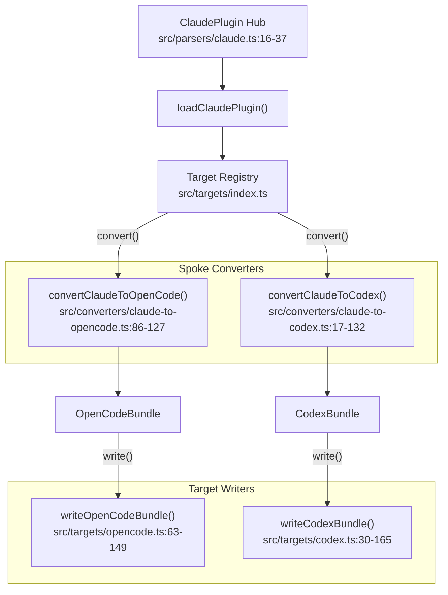
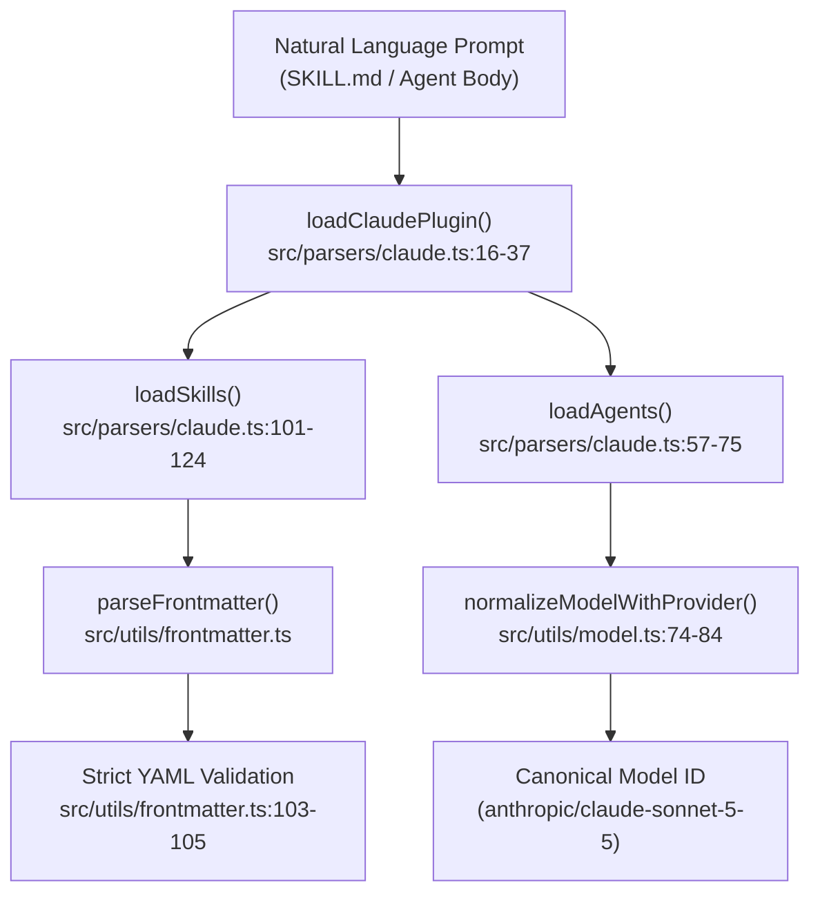
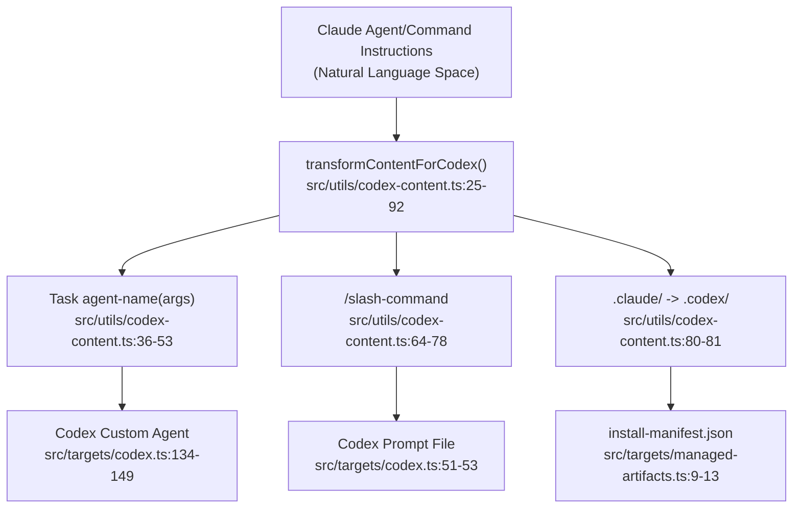

<!-- source: DeepWiki mcp.deepwiki.com · repo EveryInc/compound-engineering-plugin · page 9.2 Conversion Architecture · fetched 2026-10-30 -->

# Conversion Architecture

Relevant source files

The following files were used as context for generating this wiki page:

- [docs/guides/wtf.md](docs/guides/wtf.md)
- [docs/plans/2026-07-24-001-test-codex-content-transform-coverage-plan.md](docs/plans/2026-07-24-001-test-codex-content-transform-coverage-plan.md)
- [skills/wtf/SKILL.md](skills/wtf/SKILL.md)
- [skills/wtf/agents/openai.yaml](skills/wtf/agents/openai.yaml)
- [src/converters/claude-to-codex.ts](src/converters/claude-to-codex.ts)
- [src/converters/claude-to-opencode.ts](src/converters/claude-to-opencode.ts)
- [src/parsers/claude.ts](src/parsers/claude.ts)
- [src/targets/managed-artifacts.ts](src/targets/managed-artifacts.ts)
- [src/types/claude.ts](src/types/claude.ts)
- [src/types/codex.ts](src/types/codex.ts)
- [src/utils/codex-content.ts](src/utils/codex-content.ts)
- [src/utils/files.ts](src/utils/files.ts)
- [src/utils/frontmatter.ts](src/utils/frontmatter.ts)
- [src/utils/model.ts](src/utils/model.ts)
- [tests/claude-parser.test.ts](tests/claude-parser.test.ts)
- [tests/codex-content.test.ts](tests/codex-content.test.ts)
- [tests/codex-converter.test.ts](tests/codex-converter.test.ts)
- [tests/converter.test.ts](tests/converter.test.ts)
- [tests/frontmatter.test.ts](tests/frontmatter.test.ts)
- [tests/model-utils.test.ts](tests/model-utils.test.ts)
- [tests/skill-agent-ce-prefix.test.ts](tests/skill-agent-ce-prefix.test.ts)

## Purpose and Scope

This document details the conversion architecture of the compound-engineering plugin repository, focusing on how Claude Code plugin structures are parsed, normalized, transformed, and managed across multiple target platforms. It covers Claude plugin parsing (`src/parsers/claude.ts`), frontmatter utilities, model alias normalization (`src/utils/model.ts`), content transformation and path rewriting (`src/utils/codex-content.ts`), managed artifact lifecycles (`src/targets/managed-artifacts.ts`), and the `TargetHandler` interface used by the Bun CLI converter layer.

For information on CLI commands and execution flow, see **9.1 Installation System**. For platform-specific writer implementations, see **9.3 Target Platforms**.

Sources: [src/parsers/claude.ts:1-171](), [src/utils/model.ts:1-97](), [src/utils/codex-content.ts:1-138](), [src/targets/managed-artifacts.ts:1-164]()

---

## Architecture Overview and TargetHandler Interface

The conversion system implements a hub-and-spoke architecture. The hub is the `ClaudePlugin` data model, which aggregates a manifest, agents, commands, skills, hooks, and MCP servers loaded from disk. Spokes are target-specific bundles produced by converters and persisted by target writers via the `TargetHandler` interface.

Sources: [src/parsers/claude.ts:16-37](), [src/converters/claude-to-opencode.ts:86-127](), [src/converters/claude-to-codex.ts:17-132]()

---

## Claude Plugin Parsing

The parsing layer reads a Claude Code plugin directory and constructs the canonical `ClaudePlugin` object. The process begins with `loadClaudePlugin` in `src/parsers/claude.ts`.

### Key Parser Functions

| Component | Function | File and Line Range | Description |
|-----------|----------|---------------------|-------------|
| **Root Resolution** | `resolveClaudeRoot` | [src/parsers/claude.ts:39-55]() | Locates `.claude-plugin/plugin.json` from arbitrary input paths. |
| **Plugin Manifest** | `loadClaudePlugin` | [src/parsers/claude.ts:16-37]() | Reads JSON manifest and orchestrates component loaders. |
| **Agents** | `loadAgents` | [src/parsers/claude.ts:57-75]() | Scans agent markdown files, extracts YAML frontmatter (capabilities, models). |
| **Commands** | `loadCommands` | [src/parsers/claude.ts:77-99]() | Parses command files, tool allowances, and model invocation flags. |
| **Skills** | `loadSkills` | [src/parsers/claude.ts:101-124]() | Discovers `SKILL.md` files, parses platform filters (`ce_platforms`) and invocation rules. |
| **Hooks & MCP** | `loadHooks` / `loadMcpServers` | [src/parsers/claude.ts:126-171]() | Merges hook JSON configs and MCP server declarations. |

Sources: [src/parsers/claude.ts:16-171]()

---

## Frontmatter Utilities and YAML Safety

Frontmatter parsing and serialization are handled by utilities in `src/utils/frontmatter.ts` and validated in test suites like `tests/frontmatter.test.ts`.

### YAML Serialization Rules
- **Reserved Scalar Strings**: `formatFrontmatter` quotes scalar strings such as `"null"`, `"true"`, `"false"`, numeric strings, and dates so they retain their string types rather than reparsing as booleans or numbers [tests/frontmatter.test.ts:24-32]().
- **Description Constraints**: Skill descriptions are checked against strict length limits (1024 characters) and must not contain bare angle-bracket HTML tags that violate plugin validation rules [tests/frontmatter.test.ts:92-126]().
- **Naming Enforcement**: Skill frontmatter names must match their parent directory names and conform to lowercase alphanumeric and hyphen formats (`^[a-z0-9-]+$`) [tests/frontmatter.test.ts:132-139]().

Sources: [tests/frontmatter.test.ts:1-161]()

---

## Model Alias Normalization

Claude Code uses bare family aliases (`haiku`, `sonnet`, `opus`) that must be normalized into provider-prefixed canonical model identifiers when converting to target systems [src/utils/model.ts:1-6]().

### Normalization Logic
- **Alias Mapping**: `CLAUDE_FAMILY_ALIASES` maps bare names to canonical identifiers (e.g., `sonnet` -> `claude-sonnet-5-5`) [src/utils/model.ts:13-17]().
- **Provider Prefixing**: `addProviderPrefix` ensures models include a provider prefix (e.g., `anthropic/claude-sonnet-5-5`, `openai/gpt-6.1-sol`) [src/utils/model.ts:47-64]().
- **Sampling Parameter Validation**: `rejectsSamplingParams` identifies newer model generations (e.g., Sonnet 5+, Opus 4.7+) that reject non-default temperature or sampling parameters with an HTTP 400 error, suppressing inferred temperatures during conversion [src/utils/model.ts:26-33, 94-97]().

Sources: [src/utils/model.ts:1-97]()

---

## Content Transformation and Path Rewriting

Target converters must adapt natural language instructions and system references from Claude conventions to target-specific equivalents [src/utils/codex-content.ts:14-24]().

### Transformation Operations
- **Task Agent Calls**: `Task agent-name(args)` patterns are rewritten to spawn custom agents or invoke skill commands [src/utils/codex-content.ts:36-53]().
- **Slash Commands**: Known prompt entrypoints and skills are mapped to target-specific slash commands or invocation blocks [src/utils/codex-content.ts:64-78]().
- **Path Rewriting**: Internal directory references (`.claude/`) are dynamically translated to target directories like `.codex/` or `.opencode/` [src/utils/codex-content.ts:80-81]().

Sources: [src/utils/codex-content.ts:1-92]()

---

## Managed Artifacts and Manifest Lifecycle

To prevent orphaned files and safely clean up installations across runs, target writers rely on managed artifact manifests defined in `src/targets/managed-artifacts.ts` and safety utilities in `src/utils/files.ts`.

### Manifest and Safety Mechanics
- **Plugin-Scoped Namespacing**: `resolveManagedSegment` ensures multiple installed plugins maintain independent install manifests and backup spaces [src/targets/managed-artifacts.ts:15-29]().
- **Legacy Fallback & Archival**: `readManagedInstallManifestWithLegacyFallback` and `archiveLegacyInstallManifestIfOwned` handle migration from older shared `compound-engineering` directories [src/targets/managed-artifacts.ts:40-96]().
- **Path Traversal Defense**: `isSafeManagedPath` validates relative paths from install manifests against the resolved root directory to prevent out-of-tree file deletions during cleanup [src/utils/files.ts:108-123]().

Sources: [src/targets/managed-artifacts.ts:1-164](), [src/utils/files.ts:108-123]()

---

## Natural Language Space to Code Entity Space

The following diagrams map abstract prompt instructions and natural language expressions to concrete code entities, parser functions, and filesystem outputs.

### Diagram: Parser and Normalization Flow

Sources: [src/parsers/claude.ts:16-124](), [src/utils/model.ts:74-84](), [src/utils/frontmatter.ts]()

### Diagram: Content Transformation and Target Mapping

Sources: [src/utils/codex-content.ts:25-92](), [src/targets/codex.ts:51-149](), [src/targets/managed-artifacts.ts:9-13]()

---

