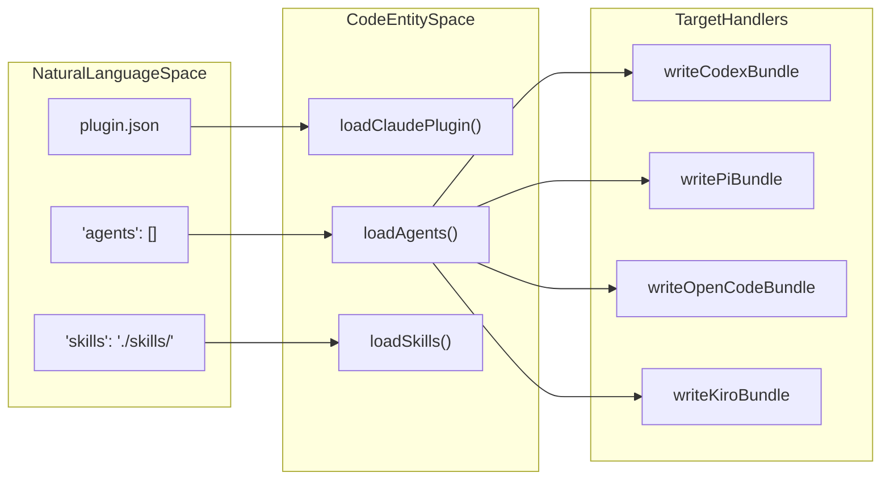
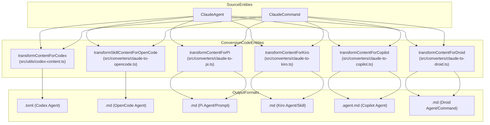

<!-- source: DeepWiki mcp.deepwiki.com · repo EveryInc/compound-engineering-plugin · page 9.3 Target Platforms · fetched 2026-10-30 -->

# Target Platforms

Relevant source files

The following files were used as context for generating this wiki page:

- [.opencode/INSTALL.md](.opencode/INSTALL.md)
- [.opencode/plugins/compound-engineering.js](.opencode/plugins/compound-engineering.js)
- [docs/brainstorms/2026-02-17-copilot-skill-naming-brainstorm.md](docs/brainstorms/2026-02-17-copilot-skill-naming-brainstorm.md)
- [docs/solutions/best-practices/predictable-tmp-cache-ownership-check.md](docs/solutions/best-practices/predictable-tmp-cache-ownership-check.md)
- [docs/solutions/best-practices/preserve-user-content-across-all-destructive-paths.md](docs/solutions/best-practices/preserve-user-content-across-all-destructive-paths.md)
- [docs/solutions/conventions/antigravity-target-empirical-format-verification.md](docs/solutions/conventions/antigravity-target-empirical-format-verification.md)
- [docs/solutions/developer-experience/always-on-agents-md.md](docs/solutions/developer-experience/always-on-agents-md.md)
- [docs/solutions/integrations/cross-platform-model-field-normalization.md](docs/solutions/integrations/cross-platform-model-field-normalization.md)
- [docs/solutions/skill-design/arguments-token-is-claude-only-in-skill-bodies.md](docs/solutions/skill-design/arguments-token-is-claude-only-in-skill-bodies.md)
- [docs/solutions/skill-design/ce-doc-review-calibration-patterns.md](docs/solutions/skill-design/ce-doc-review-calibration-patterns.md)
- [docs/solutions/skill-design/confidence-anchored-scoring.md](docs/solutions/skill-design/confidence-anchored-scoring.md)
- [index.js](index.js)
- [src/converters/claude-to-copilot.ts](src/converters/claude-to-copilot.ts)
- [src/converters/claude-to-droid.ts](src/converters/claude-to-droid.ts)
- [src/converters/claude-to-kiro.ts](src/converters/claude-to-kiro.ts)
- [src/converters/claude-to-pi.ts](src/converters/claude-to-pi.ts)
- [src/targets/codex.ts](src/targets/codex.ts)
- [src/targets/opencode.ts](src/targets/opencode.ts)
- [src/targets/pi.ts](src/targets/pi.ts)
- [tests/codex-writer.test.ts](tests/codex-writer.test.ts)
- [tests/copilot-converter.test.ts](tests/copilot-converter.test.ts)
- [tests/droid-converter.test.ts](tests/droid-converter.test.ts)
- [tests/kiro-converter.test.ts](tests/kiro-converter.test.ts)
- [tests/opencode-plugin-commands.test.ts](tests/opencode-plugin-commands.test.ts)
- [tests/opencode-plugin.test.ts](tests/opencode-plugin.test.ts)
- [tests/opencode-writer.test.ts](tests/opencode-writer.test.ts)
- [tests/pi-converter.test.ts](tests/pi-converter.test.ts)
- [tests/pi-writer.test.ts](tests/pi-writer.test.ts)

This document describes the AI coding tool platforms supported by the `compound-plugin` CLI tool. While the repository contains logic for many platforms, the Bun CLI converter actively maintains support for targets like OpenCode, Codex, Pi, Kiro, and Antigravity. Modern platforms like Copilot, Droid, Qwen, and Windsurf have transitioned to native plugin installs and no longer require the Bun converter step for standard operations.

**Sources:** [README.md:21-86]()

---

## Target Registry Architecture

The CLI uses a centralized target registry that maps target names to converter and writer implementations. Each `TargetHandler` implements a `convert` function (transforms Claude plugin data) and a `write` function (writes platform-specific files).

### Active CLI Target Implementation Map

| Target | Handler Name | Implementation Reference | Active Converter |
|--------|--------------|--------------------------|------------------|
| `opencode` | `opencode` | [src/targets/opencode.ts:97-220]() | Yes |
| `codex` | `codex` | [src/targets/codex.ts:31-165]() | Yes (Agents Only) |
| `pi` | `pi` | [src/targets/pi.ts:59-171]() | Yes |
| `kiro` | `kiro` | [src/converters/claude-to-kiro.ts:33-71]() | Yes |
| `antigravity` | `antigravity` | [.agy/plugin.json:1-7]() | Native / Root |
| `copilot` | `copilot` | [src/converters/claude-to-copilot.ts:17-46]() | Yes (Legacy) |
| `droid` | `droid` | [src/converters/claude-to-droid.ts:43-54]() | Yes (Legacy) |

**Note:** Copilot and Droid implementations are primarily used for legacy support or specific edge cases, as they now support native plugin manifests.

**Sources:** [src/targets/opencode.ts:97-100](), [src/targets/codex.ts:31-40](), [src/converters/claude-to-kiro.ts:33-71](), [src/converters/claude-to-copilot.ts:17-46](), [src/converters/claude-to-droid.ts:43-54]()

---

## OpenCode

**Output:** `~/.config/opencode/` (XDG compliant global config) or `.opencode/` (project)

### File Structure
- **Agents:** `agents/*.md` — Markdown files derived from `ClaudeAgent` definitions [src/targets/opencode.ts:107-161]().
- **Commands:** `commands/*.md` — Markdown files where colons in names are converted to directory separators via `commandNameToRelativePath` [src/targets/opencode.ts:108-174]().
- **MCP Servers:** Merged into root `opencode.json` with backups before overwriting [src/targets/opencode.ts:121-131]().

### Special Behaviors
- **Global vs Project Layout:** Uses `resolveOpenCodePaths` to determine if it should use a flat layout (global) or a nested `.opencode` directory (project) based on the `scope` or directory basename [src/targets/opencode.ts:103-106]().
- **Deep merge:** `mergeOpenCodeConfig` merges MCP servers, permissions, and tools while preserving existing user settings [src/targets/opencode.ts:53-95]().
- **Ownership Tracking:** Uses an `install-manifest.json` to track which files are managed by the plugin to avoid clobbering user-managed symlinks or manual edits [src/targets/opencode.ts:29-51]().

**Sources:** [src/targets/opencode.ts:29-174](), [tests/opencode-writer.test.ts:34-57]()

---

## Codex

**Output:** `~/.codex/prompts`, `~/.codex/skills`, and `~/.codex/agents`

Codex has a hybrid support model. By default, `install --to codex` operates in **agents-only mode**. Skills and commands are expected to be installed via Codex's native plugin flow, which reads the plugin's native manifest [src/targets/codex.ts:31-88]().

### File Structure
- **Agents:** Converted to `.toml` custom agents in `~/.codex/agents/` [src/targets/codex.ts:137-161]().
- **Skills:** Managed in `~/.codex/skills/`. The converter includes `externallyManagedSkillNames` to ensure native skills aren't cleaned up as "stale" artifacts [src/targets/codex.ts:84-88]().
- **MCP Servers:** Merged into `~/.codex/config.toml` using `MANAGED_START_MARKER` and `MANAGED_END_MARKER` blocks [src/targets/codex.ts:11-14]().

### Special Behaviors
- **Filename Collision Guard:** Codex enforces strict filename sanitization. The `writeCodexBundle` function calls `assertNoCodexAgentFilenameCollisions` and throws an error if two agents resolve to the same filename [src/targets/codex.ts:47](), [tests/codex-writer.test.ts:126-149]().
- **Sidecar Directories:** Supports copying directory dependencies for agents and skills (e.g., script folders) [src/targets/codex.ts:131-135]().

**Sources:** [src/targets/codex.ts:31-165](), [tests/codex-writer.test.ts:73-124]()

---

## Pi

**Output:** `~/.pi/` or `./.pi`

### File Structure
- **Agents:** Written as `.md` files in `~/.pi/agents/` with frontmatter for `name` and `description` [src/targets/pi.ts:143-156]().
- **Prompts:** Commands are converted to `.md` prompt files in `~/.pi/prompts/` [src/targets/pi.ts:98-107]().
- **Skills:** Copied as directories to `~/.pi/skills/` [src/targets/pi.ts:111-139]().
- **MCP Servers:** Converted to `mcporter.json` in `~/.pi/` [src/targets/pi.ts:131-147]().

### Conversion Logic
- **Tool Mapping:** Automatically generates a `BEGIN COMPOUND PI TOOL MAP` block to register `pi-subagents` and `pi-ask-user` capabilities [src/targets/pi.ts:24-37]().

**Sources:** [src/targets/pi.ts:24-171](), [tests/pi-writer.test.ts:29-160]()

---

## Kiro

**Output:** `.kiro/` directory containing `agents/`, `prompts/`, `skills/`, `steering/`, and `mcp.json`.

### File Structure
- **Agents:** Converted to `KiroAgent` objects, which include a `config` (TOML) and `promptContent` (Markdown) [src/converters/claude-to-kiro.ts:73-102](). These are written to `.kiro/agents/<agent-name>.toml` and `.kiro/prompts/<agent-name>.md` respectively.
- **Skills:** Claude skills are passed through as directory references [src/converters/claude-to-kiro.ts:40-46](). Commands are converted into generated skills [src/converters/claude-to-kiro.ts:52-55]().
- **Steering Files:** Built from repository instruction files like `AGENTS.md` [src/converters/claude-to-kiro.ts:60-62]().
- **MCP Servers:** Converted to `mcp.json` format [src/converters/claude-to-kiro.ts:57-58]().

### Special Behaviors
- **Content Transformation:** `transformContentForKiro` handles rewriting `Task` calls, `.claude/` paths to `.kiro/`, slash commands to skill activation language, and Claude tool names to Kiro tool names [src/converters/claude-to-kiro.ts:136-176]().
- **Hooks Warning:** Kiro CLI hooks use a different format, so a warning is issued if Claude hooks are present [src/converters/claude-to-kiro.ts:63-68]().

**Sources:** [src/converters/claude-to-kiro.ts:33-71](), [tests/kiro-converter.test.ts:54-82]()

---

## Antigravity

**Output:** Root `plugin.json` or `.agy/plugin.json`

Antigravity uses a native plugin specification defined by the Google Antigravity schema.

### File Structure
- **Root Manifest:** `plugin.json` contains the schema reference, name, version, and description [plugin.json:1-6]().
- **Hidden Config:** `.agy/plugin.json` mirrors the root configuration for environment-specific detection [.agy/plugin.json:1-6]().
- **Installation:** Uses an `INSTALL.md` guide for manual setup in the Antigravity environment [.agy/INSTALL.md:1-10]().

**Sources:** [plugin.json:1-7](), [.agy/plugin.json:1-7](), [docs/specs/antigravity.md:1-20]()

---

## Copilot (Legacy Converter)

**Output:** `.copilot/` directory containing `agents/` and `skills/`.

### File Structure
- **Agents:** Converted to `.agent.md` files in `.copilot/agents/` with Copilot-specific frontmatter [src/converters/claude-to-copilot.ts:48-74]().
- **Skills:** Claude skills are passed through as directory references [src/converters/claude-to-copilot.ts:27-33](). Commands are converted into generated skills [src/converters/claude-to-copilot.ts:35-37]().

### Special Behaviors
- **Content Transformation:** `transformContentForCopilot` rewrites `Task` calls, slash commands, `ce:` namespaced commands, `.claude/` paths to `.github/` or `~/.copilot/`, and `@agent-name` references [src/converters/claude-to-copilot.ts:103-141]().
- **Body Character Limit:** Warns if an agent body exceeds 30,000 characters, as Copilot may truncate it [src/converters/claude-to-copilot.ts:66-70]().
- **Hooks Warning:** Copilot does not support hooks, so a warning is issued if Claude hooks are present [src/converters/claude-to-copilot.ts:41-43]().

**Sources:** [src/converters/claude-to-copilot.ts:17-46](), [tests/copilot-converter.test.ts:48-64]()

---

## Droid (Legacy Converter)

**Output:** `.droid/` directory containing `commands/`, `droids/`, and `skills/`.

### File Structure
- **Commands:** Converted to `.md` files in `.droid/commands/` with frontmatter for `description` and `argument-hint` [src/converters/claude-to-droid.ts:57-72]().
- **Droids (Agents):** Converted to `.md` files in `.droid/droids/` with frontmatter for `name`, `description`, `model`, and `tools` [src/converters/claude-to-droid.ts:74-103]().
- **Skills:** Claude skills are passed through as directory references [src/converters/claude-to-droid.ts:49-52]().

### Special Behaviors
- **Content Transformation:** `transformContentForDroid` rewrites `Task` calls, flattens slash commands (e.g., `/workflows:plan` to `/plan`), and transforms `@agent-name` references to `droid` references [src/converters/claude-to-droid.ts:126-152]().
- **Tool Mapping:** `mapAgentTools` infers Droid tools from the agent's body, description, and capabilities, mapping Claude tool names to Droid equivalents [src/converters/claude-to-droid.ts:105-117]().

**Sources:** [src/converters/claude-to-droid.ts:43-54](), [tests/droid-converter.test.ts:43-58]()

---

## Data Flow: Claude to Target

The following diagrams illustrate how the system bridges the "Natural Language Space" (manifests and markdown) to the "Code Entity Space" (internal types and writer functions).

### Plugin Component Resolution
Title: "Component Resolution Flow"

**Sources:** [src/targets/codex.ts:31](), [src/targets/pi.ts:59](), [src/targets/opencode.ts:97](), [src/converters/claude-to-kiro.ts:33]()

### Content Transformation Pipeline
Title: "Transformation Logic Pipeline"

**Sources:** [src/targets/codex.ts:6](), [src/targets/opencode.ts:3](), [src/converters/claude-to-pi.ts:1-10](), [src/converters/claude-to-kiro.ts:136](), [src/converters/claude-to-copilot.ts:103](), [src/converters/claude-to-droid.ts:126]()

---

## Legacy Cleanup and Migration

The CLI provides a `cleanup` command to remove legacy artifacts from previous installation methods (e.g., when moving from a Bun-only install to a native plugin install).

### Artifact Detection
- **Managed Manifests:** Checks `install-manifest.json` to identify files previously written by the CLI [src/targets/managed-artifacts.ts:19-20]().
- **Ownership Verification:** Uses `isLegacyAgentArtifactOwned` and `isLegacySkillArtifactOwned` to ensure only plugin-created files are removed [src/utils/legacy-cleanup.ts:6-7]().
- **Backup Strategy:** Before overwriting or cleaning, the system often uses `backupFile` to preserve user configurations [src/utils/files.ts:2]().

**Sources:** [src/commands/cleanup.ts:1-50](), [src/targets/managed-artifacts.ts:8-20](), [src/utils/legacy-cleanup.ts:6-7](), [src/utils/files.ts:2]()

---

