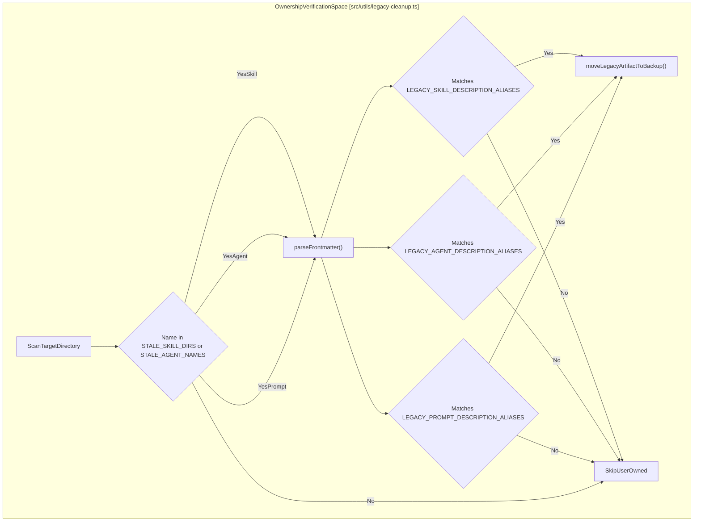
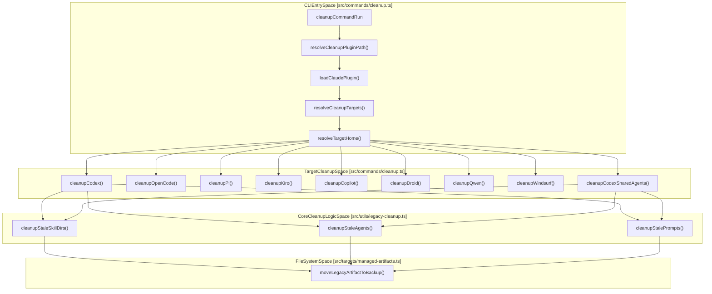

<!-- source: DeepWiki mcp.deepwiki.com · repo EveryInc/compound-engineering-plugin · page 9.4 Cleanup and Legacy Migration · fetched 2026-10-30 -->

# Cleanup and Legacy Migration

Relevant source files

The following files were used as context for generating this wiki page:

- [docs/plans/2026-08-06-001-fix-agent-plugins-manifest-conformance-plan.md](docs/plans/2026-08-06-001-fix-agent-plugins-manifest-conformance-plan.md)
- [docs/solutions/conventions/verify-externally-attributed-constraints-at-the-source.md](docs/solutions/conventions/verify-externally-attributed-constraints-at-the-source.md)
- [docs/solutions/integrations/agent-plugins-schema-is-a-host-routing-switch.md](docs/solutions/integrations/agent-plugins-schema-is-a-host-routing-switch.md)
- [docs/specs/agent-plugins.md](docs/specs/agent-plugins.md)
- [docs/specs/antigravity.md](docs/specs/antigravity.md)
- [src/commands/cleanup.ts](src/commands/cleanup.ts)
- [src/data/plugin-legacy-artifacts.ts](src/data/plugin-legacy-artifacts.ts)
- [src/utils/legacy-cleanup.ts](src/utils/legacy-cleanup.ts)
- [tests/codex-skill-prompt-budget.test.ts](tests/codex-skill-prompt-budget.test.ts)
- [tests/legacy-cleanup.test.ts](tests/legacy-cleanup.test.ts)
- [tests/real-plugin-conversion.test.ts](tests/real-plugin-conversion.test.ts)
- [tests/skill-conventions.test.ts](tests/skill-conventions.test.ts)
- [tests/skills/task-visibility-contract.test.ts](tests/skills/task-visibility-contract.test.ts)
- [tests/skills/user-facing-skill-invocation-rendering.test.ts](tests/skills/user-facing-skill-invocation-rendering.test.ts)

The cleanup command is a specialized utility designed to migrate users from legacy Bun-only installations to modern native plugin systems and to remove stale artifacts from previous versions of the `compound-engineering` (CE) plugin. As the project evolved, several platforms transitioned to native plugin support, making manual synchronization and conversion steps redundant.

**Note:** The sync command has been removed. Native platform installs handle synchronization directly, and the cleanup command serves as the primary tool for recovering from stale or shadowing artifacts.

## Purpose and Scope

The cleanup system ensures a clean environment by:
- Identifying and backing up legacy CE artifacts (skills, agents, commands) that are no longer needed [src/utils/legacy-cleanup.ts:4-11]().
- Resolving "shadowing" issues where old skills in shared directories (like `~/.agents`) conflict with new native installs [src/commands/cleanup.ts:100-104]().
- Providing a safe, idempotent way to transition from v2 (unprefixed) to v3 (prefixed with `ce-`) naming conventions [src/utils/legacy-cleanup.ts:4-7]().
- Supporting recovery across target environments: Codex, OpenCode, Pi, Kiro, Copilot, Droid, Qwen, and Windsurf [src/commands/cleanup.ts:30-31]().

Sources: [src/commands/cleanup.ts:30-43](), [src/commands/cleanup.ts:100-104](), [src/utils/legacy-cleanup.ts:4-11]()

## Legacy Artifact Detection Logic

The system uses a multi-signal detection strategy to distinguish between `compound-engineering` plugin files and user-owned content, preventing the accidental deletion of custom user skills that might share a name with a stale CE component.

### Fingerprint Matching
To verify ownership, the `legacy-cleanup` module performs fingerprint matching on file content. It parses the frontmatter description and compares it against a registry of known historical strings used in previous CE releases [src/utils/legacy-cleanup.ts:20-20](), [src/utils/legacy-cleanup.ts:250-260]().

*Figure 1: Artifact Verification Flow*

Sources: [src/utils/legacy-cleanup.ts:1-20](), [src/utils/legacy-cleanup.ts:250-260](), [src/utils/legacy-cleanup.ts:300-310](), [src/utils/legacy-cleanup.ts:350-360]()

### Stale Registries
The system maintains comprehensive lists of artifacts to target:
- **`STALE_SKILL_DIRS`**: Includes old prefixes like `git-*`, `workflows:*`, and unprefixed names like `setup` or `document-review` [src/utils/legacy-cleanup.ts:23-122]().
- **`STALE_AGENT_NAMES`**: Lists legacy agent names that were renamed to include the `ce-` prefix, such as `adversarial-reviewer` becoming `ce-adversarial-reviewer` [src/utils/legacy-cleanup.ts:125-234]().
- **`STALE_PROMPT_FILES`**: Lists old prompt wrapper names that are no longer generated [src/utils/legacy-cleanup.ts:237-245]().
- **`EXTRA_LEGACY_ARTIFACTS_BY_PLUGIN`**: A mapping of historical artifacts derived from git history for the `compound-engineering` plugin, covering skills like `agent-browser` and commands like `lfg` [src/data/plugin-legacy-artifacts.ts:17-138]().

Sources: [src/utils/legacy-cleanup.ts:23-122](), [src/utils/legacy-cleanup.ts:125-234](), [src/utils/legacy-cleanup.ts:237-245](), [src/data/plugin-legacy-artifacts.ts:17-138]()

## Cleanup Architecture

The `cleanup` command implemented in `src/commands/cleanup.ts` relies on target-specific resolvers and clean routines that dispatch to core utilities in `src/utils/legacy-cleanup.ts` and `src/targets/managed-artifacts.ts`.

*Figure 2: Cleanup System Data Flow*

Sources: [src/commands/cleanup.ts:107-135](), [src/commands/cleanup.ts:164-168](), [src/commands/cleanup.ts:170-176](), [src/utils/legacy-cleanup.ts:250-297](), [src/utils/legacy-cleanup.ts:300-347](), [src/utils/legacy-cleanup.ts:350-397](), [src/targets/managed-artifacts.ts:23-23]()

## Ownership-Aware File Management

Modern target writers (`src/targets/opencode.ts`, `src/targets/codex.ts`, `src/targets/pi.ts`) implement strict ownership checks using an `install-manifest.json` file. This ensures that the plugin only cleans up files it previously wrote, respecting user modifications and symlinks.

### Manifest and Safety Guards
- **`ManagedInstallManifest`**: Tracks which files belong to a specific plugin name within a shared target directory [src/targets/managed-artifacts.ts:9-13]().
- **`isSafeManagedPath`**: Validates that relative paths in manifests do not attempt directory traversal (e.g., `../../etc/passwd`) before deletion [src/utils/files.ts:108-123]().
- **Symlink Protection**: Functions like `cleanupCurrentManagedFile` skip any path that has been replaced by a user symbolic link, preserving personal forks [src/targets/opencode.ts:28-45]().
- **Escape Detection**: `storeRootEscapesManagedRoot` prevents operations if a managed directory segment resolves outside the expected target root [src/targets/opencode.ts:111-114]().

Sources: [src/targets/managed-artifacts.ts:9-13](), [src/utils/files.ts:108-123](), [src/targets/opencode.ts:28-45](), [src/targets/opencode.ts:111-114]()

## Target-Specific Migration and Recovery

### Codex Recovery
Codex cleanup handles both local profile roots and a shared `.agents` root.
- **Managed Roots:** The system identifies managed Codex roots using `resolveCodexManagedRoots` [src/commands/cleanup.ts:24-24]().
- **Symlink Detection:** It checks if `.agents/skills` are symlinks pointing to managed install roots using `isManagedCodexAgentsSymlink` [src/commands/cleanup.ts:24-24]().
- **Legacy Fallback:** `readManagedInstallManifestWithLegacyFallback` allows new plugin-scoped installs to adopt artifacts previously owned by the generic `compound-engineering` namespace [src/targets/managed-artifacts.ts:54-63]().
- **Legacy Codex Tool Map**: The `ce-setup check-health` script detects and reports the presence of a legacy Codex tool map in `$CODEX_HOME/AGENTS.md` [tests/skills/ce-setup-check-health.test.ts:78-93](). This obsolete block can collapse subagent dispatch onto the main thread [docs/install/upgrading.md:50-56](). The `ce-setup` skill offers to remove this block [skills/ce-setup/SKILL.md:71-71](), [skills/ce-setup/references/legacy-codex-tool-map.md:1-15]().

Sources: [src/commands/cleanup.ts:24-24](), [src/targets/managed-artifacts.ts:54-63](), [tests/skills/ce-setup-check-health.test.ts:78-93](), [docs/install/upgrading.md:50-56](), [skills/ce-setup/SKILL.md:71-71](), [skills/ce-setup/references/legacy-codex-tool-map.md:1-15]()

### OpenCode and Pi Layouts
- **OpenCode**: Supports merging configurations (`opencode.json`) while preserving user settings [src/targets/opencode.ts:47-89](). It also handles global vs workspace-scoped legacy installs [src/commands/cleanup.ts:170-181]().
- **Pi**: Manages a specific `AGENTS.md` block for tool mapping and handles the removal of stale agent-style skill directories [src/targets/pi.ts:20-37](), [src/targets/pi.ts:89-92]().

Sources: [src/targets/opencode.ts:47-89](), [src/commands/cleanup.ts:170-181](), [src/targets/pi.ts:20-37](), [src/targets/pi.ts:89-92]()

## Execution and Backup Strategy

The cleanup command is designed to be idempotent and safe. It does not perform destructive deletes; instead, it moves identified artifacts to a `legacy-backup` directory within the target root using `moveLegacyArtifactToBackup` [src/targets/managed-artifacts.ts:23-23]().

### Backup Logic
1. **Timestamped Folders**: Artifacts are moved into a subfolder named with a timestamp to prevent collisions between multiple cleanup runs [src/utils/files.ts:8-9]().
2. **Configuration Backups**: Critical configuration files (like `opencode.json`) are backed up using `backupFile` before any merge operation [src/utils/files.ts:4-15]().
3. **Manifest Archival**: When migrating to per-plugin namespacing, the legacy `compound-engineering/install-manifest.json` is archived if it matches the current plugin [src/targets/managed-artifacts.ts:76-96]().

Sources: [src/utils/files.ts:4-15](), [src/targets/managed-artifacts.ts:23-23](), [src/targets/managed-artifacts.ts:76-96]()

---

