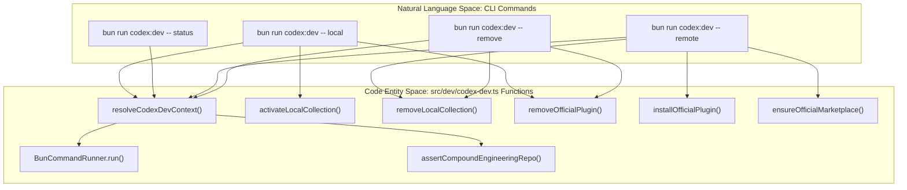
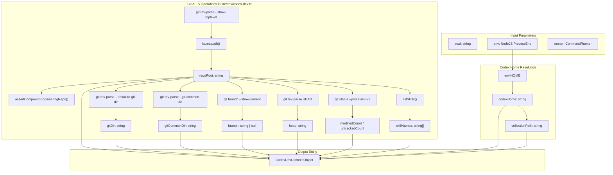

<!-- source: DeepWiki mcp.deepwiki.com · repo EveryInc/compound-engineering-plugin · page 9.5 Local Development Workflow (codex-dev) · fetched 2026-10-30 -->

# Local Development Workflow (codex-dev)

Relevant source files

The following files were used as context for generating this wiki page:

- [.agents/plugins/marketplace.json](.agents/plugins/marketplace.json)
- [docs/development.md](docs/development.md)
- [docs/solutions/developer-experience/codex-local-skill-development-workflow.md](docs/solutions/developer-experience/codex-local-skill-development-workflow.md)
- [scripts/codex-dev.ts](scripts/codex-dev.ts)
- [site/_plugins/ce_relative_urls.rb](site/_plugins/ce_relative_urls.rb)
- [site/test/test_ce_relative_urls.rb](site/test/test_ce_relative_urls.rb)
- [site/test/test_ce_sources.rb](site/test/test_ce_sources.rb)
- [src/dev/codex-dev.ts](src/dev/codex-dev.ts)
- [tests/codex-dev.test.ts](tests/codex-dev.test.ts)

This page details the local development workflow for Compound Engineering skills within the Codex agent environment, specifically focusing on the `bun run codex:dev` CLI command (`scripts/codex-dev.ts`) and its modes (`local`, `status`, `refresh`, `remote`, `remove`) implemented in `src/dev/codex-dev.ts`. It explains how this workflow facilitates testing worktree skills by symlinking them into Codex and addresses the implications of session caching, which necessitates fresh-agent injection for accurate testing.

Sources:
- [src/dev/codex-dev.ts:1-739]()
- [scripts/codex-dev.ts:1-8]()
- [docs/development.md:60-92]()
- [docs/solutions/developer-experience/codex-local-skill-development-workflow.md:1-56]()

## Modes of Operation

The `bun run codex:dev` command provides primary modes for managing Compound Engineering skill installations in Codex:

*   **`local` (or `refresh`)**: Links the current worktree's skills into Codex and removes any existing official Compound Engineering plugin installations. This mode ensures that any modifications, including uncommitted and untracked files, are immediately reflected in the Codex environment via `activateLocalCollection` [src/dev/codex-dev.ts:300-324]().
*   **`status`**: Displays the current local and remote installation state via `inspectCodexDevStatus`, including the provenance of the active checkout, worktree kind, branch, commit SHA, and dirty counts [src/dev/codex-dev.ts:78-86]().
*   **`remote`**: Restores the official marketplace-backed Compound Engineering plugin, ensuring the official marketplace exists via `ensureOfficialMarketplace` [src/dev/codex-dev.ts:375-386]() and installing via `installOfficialPlugin` [src/dev/codex-dev.ts:362-373](), effectively deactivating the local worktree link.
*   **`remove`**: Uninstalls both the local symlink (`removeLocalCollection`) [src/dev/codex-dev.ts:326-337]() and any official Compound Engineering plugin installations (`removeOfficialPlugin`) [src/dev/codex-dev.ts:349-360](), leaving Codex without Compound Engineering skills.

Sources:
- [src/dev/codex-dev.ts:78-86]()
- [src/dev/codex-dev.ts:300-386]()
- [docs/development.md:77-90]()
- [docs/solutions/developer-experience/codex-local-skill-development-workflow.md:31-31]()

## Implementation Architecture

The core logic for the `codex:dev` workflow resides in `src/dev/codex-dev.ts` [src/dev/codex-dev.ts:1-739]() and is invoked via `scripts/codex-dev.ts` [scripts/codex-dev.ts:1-8](). This module defines functions for resolving the development context, managing symlinks, interacting with the Codex CLI, and parsing Codex configuration files.

### Key Components and Data Flow

The `codex:dev` script orchestrates several steps to manage the Codex plugin environment:

1.  **Context Resolution**: The `resolveCodexDevContext` function [src/dev/codex-dev.ts:172-202]() determines the repository root, skill root, Codex home directory, and Git information (branch, head, modified/untracked files). It also asserts that the current directory is the valid `compound-engineering` repository using `assertCompoundEngineeringRepo` [src/dev/codex-dev.ts:123-155]().
2.  **Codex CLI Interaction**: The `BunCommandRunner` class [src/dev/codex-dev.ts:19-34]() provides a standardized `CommandRunner` implementation [src/dev/codex-dev.ts:15-17]() to execute `codex` CLI commands. Functions like `listInstalledPlugins` [src/dev/codex-dev.ts:210-224]() and `listMarketplaces` [src/dev/codex-dev.ts:226-239]() use this runner to query the current state of Codex plugins and marketplaces.
3.  **Local Collection Management**:
    *   `activateLocalCollection` [src/dev/codex-dev.ts:300-324]() creates a symbolic link from `$CODEX_HOME/skills/compound-engineering-local` to the current worktree's `skills/` directory.
    *   `removeLocalCollection` [src/dev/codex-dev.ts:326-337]() removes this symlink.
    *   `inspectLocalCollection` [src/dev/codex-dev.ts:241-298]() checks the state of this symlink (`absent`, `valid`, `broken`, `unrelated`, or `collision`).
4.  **Official Plugin Management**:
    *   `removeOfficialPlugin` [src/dev/codex-dev.ts:349-360]() removes the official `compound-engineering@compound-engineering-plugin` installation.
    *   `installOfficialPlugin` [src/dev/codex-dev.ts:362-373]() installs the official plugin.
    *   `ensureOfficialMarketplace` [src/dev/codex-dev.ts:375-386]() ensures the official marketplace is added to Codex.
5.  **Configuration Reconciliation**: The workflow explicitly parses `$CODEX_HOME/config.toml` [src/dev/codex-dev.ts:400-419]() to determine if the official plugin is enabled, even if `codex plugin list` might omit it. This addresses a known issue where Codex's inventory can be lossy [docs/solutions/developer-experience/codex-local-skill-development-workflow.md:43-45]().

### Diagram: Codex Dev Workflow Overview (Code Entity Space)

Sources:
- [src/dev/codex-dev.ts:15-34]()
- [src/dev/codex-dev.ts:123-155]()
- [src/dev/codex-dev.ts:172-202]()
- [src/dev/codex-dev.ts:300-386]()
- [scripts/codex-dev.ts:1-8]()

### Diagram: `resolveCodexDevContext` Data Flow

Sources:
- [src/dev/codex-dev.ts:172-202]()

## Why Symlinking and Fresh Agent Injection are Necessary

The `codex:dev` workflow is designed around two empirical facts about Codex that impact local development:

1.  **Marketplace Installs Cache Snapshots**: If you were to add the repository as a marketplace (`codex plugin marketplace add "$PWD"`), Codex would install a *cached copy* of the skills. Subsequent edits to your local files would not be live, and the manifest version would remain static while your branch content changes. This makes it impossible to test uncommitted or untracked changes directly [docs/solutions/developer-experience/codex-local-skill-development-workflow.md:33-35]().
    *   **Solution**: The `local` mode creates a direct symbolic link (`$CODEX_HOME/skills/compound-engineering-local -> <worktree>/skills`) to your worktree's `skills/` directory. This ensures that Codex always uses the exact files from your current branch, including any modifications [docs/solutions/developer-experience/codex-local-skill-development-workflow.md:35-35]().
    *   **Contrast with Cursor**: Cursor agents, for example, can directly accept a plugin directory (`cursor-agent --plugin-dir "$PWD"`), making symlinking unnecessary for that platform [docs/development.md:54-58](), [docs/solutions/developer-experience/codex-local-skill-development-workflow.md:35-36]().

2.  **Session Caching and Stale Content**: Codex plugins cache their content at the start of a session. This means that even with a direct symlink, invoking an edited skill within the *same* authoring session might still test stale content.
    *   **Solution**: To ensure you are testing the latest changes, you *must start a new Codex session* after switching installation modes (e.g., from `remote` to `local`). While current Codex versions might detect direct skill edits automatically, a restart is recommended if changes don't appear [docs/development.md:75-75](), [docs/solutions/developer-experience/codex-local-skill-development-workflow.md:41-41](). For critical testing, especially when evaluating skill behavior, it's best to inject the current on-disk skill into a **fresh** agent context. This prevents the agent from using cached or stale versions of the skill.

Sources:
- [docs/development.md:60-76]()
- [docs/solutions/developer-experience/codex-local-skill-development-workflow.md:33-41]()

## Deliberate Limits and Safety Rails

The `local` mode of `codex:dev` is specifically designed for **skill-only** development. It explicitly refuses to manage manifests that include other Codex runtime components like `apps`, `hooks`, or `mcpServers` in `assertCompoundEngineeringRepo` [src/dev/codex-dev.ts:138-155](). If your development requires testing these components, a full plugin installation workflow is necessary.

The workflow also prioritizes user content safety. It will never overwrite a regular file, an unrelated symlink, or a broken symlink at the target path, adhering to the principle of preserving user content across destructive paths [docs/solutions/developer-experience/codex-local-skill-development-workflow.md:49-52]().

Sources:
- [src/dev/codex-dev.ts:138-155]()
- [docs/solutions/developer-experience/codex-local-skill-development-workflow.md:49-52]()

---

