# Page: Overview

# Overview

<details>
<summary>Relevant source files</summary>

The following files were used as context for generating this wiki page:

- [.agents/skills/ce-skill-work/SKILL.md](.agents/skills/ce-skill-work/SKILL.md)
- [.agents/skills/ce-skill-work/references/edit-skill.md](.agents/skills/ce-skill-work/references/edit-skill.md)
- [.agents/skills/ce-skill-work/references/evaluate.md](.agents/skills/ce-skill-work/references/evaluate.md)
- [.agents/skills/ce-skill-work/references/new-skill.md](.agents/skills/ce-skill-work/references/new-skill.md)
- [.agents/skills/ce-skill-work/references/respond-to-review.md](.agents/skills/ce-skill-work/references/respond-to-review.md)
- [.agents/skills/ce-skill-work/references/review-skill.md](.agents/skills/ce-skill-work/references/review-skill.md)
- [.agy/plugin.json](.agy/plugin.json)
- [.claude-plugin/marketplace.json](.claude-plugin/marketplace.json)
- [.claude-plugin/plugin.json](.claude-plugin/plugin.json)
- [.codex-plugin/plugin.json](.codex-plugin/plugin.json)
- [.cursor-plugin/plugin.json](.cursor-plugin/plugin.json)
- [.devin-plugin/plugin.json](.devin-plugin/plugin.json)
- [.github/.release-please-manifest.json](.github/.release-please-manifest.json)
- [.github/release-please-config.json](.github/release-please-config.json)
- [.grok-plugin/plugin.json](.grok-plugin/plugin.json)
- [.kimi-plugin/plugin.json](.kimi-plugin/plugin.json)
- [.omp-plugin/marketplace.json](.omp-plugin/marketplace.json)
- [AGENTS.md](AGENTS.md)
- [CHANGELOG.md](CHANGELOG.md)
- [CLAUDE.md](CLAUDE.md)
- [README.md](README.md)
- [docs/solutions/skill-design/portable-agent-skill-authoring.md](docs/solutions/skill-design/portable-agent-skill-authoring.md)
- [docs/solutions/skill-design/size-driven-skill-restructure.md](docs/solutions/skill-design/size-driven-skill-restructure.md)
- [docs/specs/cursor.md](docs/specs/cursor.md)
- [package.json](package.json)
- [plugin.json](plugin.json)
- [src/release/components.ts](src/release/components.ts)
- [src/release/metadata.ts](src/release/metadata.ts)
- [src/release/types.ts](src/release/types.ts)
- [tests/release-components.test.ts](tests/release-components.test.ts)
- [tests/release-metadata.test.ts](tests/release-metadata.test.ts)
- [tests/release-preview.test.ts](tests/release-preview.test.ts)

</details>


This document introduces the `compound-engineering-plugin` repository, explaining its dual nature as both a comprehensive AI development plugin catalog and a cross-platform CLI tool for plugin distribution. For installation instructions, see [Installation and Setup](#1.1). For detailed directory structure, see [Repository Structure](#1.2).

## Purpose and Scope

The `compound-engineering-plugin` repository serves two distinct purposes:

1.  **Compound Engineering Plugin** — A comprehensive AI-powered development toolkit implementing the compound engineering philosophy. Version `3.33.2` includes a broad catalog of skills; specialist behavior is encapsulated within skills as skill-local prompt assets `[package.json:2-3]()`, `[.codex-plugin/plugin.json:1-45]()`.
2.  **Cross-Platform CLI Tool** — A Bun/TypeScript CLI used to convert and install plugins across multiple AI coding platforms. It provides commands for `install`, `convert`, and `cleanup` `[package.json:21-23]()`.

The repository contains the core plugin source, the CLI tool source, and supporting infrastructure for distribution and documentation.

**Sources:** `[package.json:1-30]()`, `[.codex-plugin/plugin.json:1-45]()`

## Repository Architecture

The repository implements a dual-identity architecture: it serves as both a plugin distribution system and a cross-platform CLI tool.

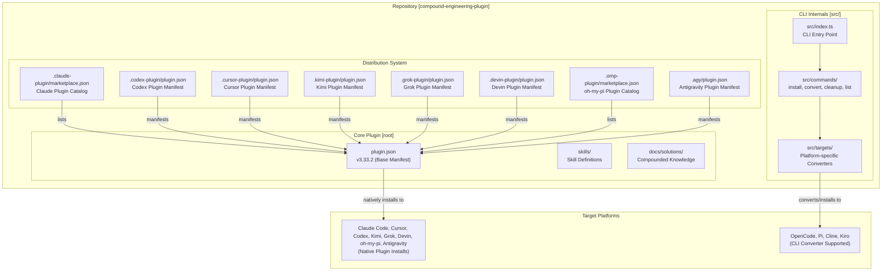

**Diagram 1: Repository Structure and Distribution Model**

The CLI tool (`[package.json:20-23]()`) provides the `install`, `convert`, `cleanup`, and `list` commands that transform the plugin format for platforms that do not yet support native marketplace installs. Supported target platforms include `OpenCode`, `Pi`, `Cline`, and `Kiro` `[package.json:7-15]()`.

**Sources:** `[package.json:1-41]`, `[.claude-plugin/plugin.json:1-20]`, `[.codex-plugin/plugin.json:1-45]`, `[.cursor-plugin/plugin.json:1-25]`, `[.kimi-plugin/plugin.json:1-25]`, `[.grok-plugin/plugin.json:1-21]`, `[.devin-plugin/plugin.json:1-20]`, `[.agy/plugin.json]()`

## The Compounding Engineering Philosophy

**Core Principle:** Each unit of engineering work should make subsequent units easier—not harder `[README.md:110-111]()`.

Traditional development accumulates technical debt. Compounding engineering inverts this through a workflow that emphasizes planning and review (80%) over raw execution (20%) `[README.md:117-118]()`. Knowledge is captured as "Learnings" in `docs/solutions/` to ensure future sessions start with better context.

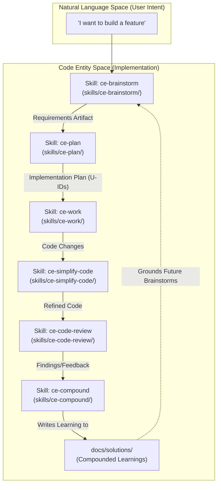

**Diagram 2: Bridging User Intent to Compounding Code Entities**

The philosophy manifests in the core loop commands. `/ce-brainstorm` defines requirements, `/ce-plan` creates implementation-ready plans, `/ce-work` executes them, `/ce-simplify-code` refines code, `/ce-code-review` reviews, and `/ce-compound` captures the resulting knowledge `[README.md:129-135]()`.

**Sources:** `[README.md:110-135]()`

## Architecture and Components

The plugin follows an agent-native architecture where specialist behavior lives inside skills as prompt assets.

**Component Inventory:**

| Category | Role | Purpose | Example |
| :--- | :--- | :--- | :--- |
| **Skills** | Orchestrator | User-facing entry points | `ce-plan`, `ce-work` |
| **Prompt Assets** | Specialist | Internal personas (security, reviewer) | Internal to skills |
| **CLI Commands** | Utility | Installation and maintenance `[package.json:21-23]()` | `install`, `cleanup` |

Skills are the primary entry points, often invoked as slash commands `[README.md:113-114]()`. They orchestrate sub-agents to manage cost and performance.

**Sources:** `[package.json:21-23]`, `[README.md:113-135]()`

## Cross-Platform Distribution

The repository supports a wide range of AI coding environments. While some use native installs, others rely on the CLI for conversion.

| Target Platform | Installation Method |
| :--- | :--- |
| **Claude Code** | Native marketplace install `[README.md:25-34]()` |
| **Cursor** | Native plugin marketplace `[README.md:36-41]()` |
| **Grok Bot** | Uses Cursor account plugin library `[README.md:44-55]()` |
| **Codex App/CLI** | Native plugin marketplace or CLI `[README.md:58-104]()` |
| **OpenCode / Pi / Cline / Kiro / Antigravity / Devin** | CLI-based conversion and install `[README.md:105]()` |

The CLI tool also includes a `cleanup` command to migrate from legacy Bun-only installs to native plugin systems `[package.json:22]()`. For details, see [Installation and Setup](#1.1).

**Sources:** `[package.json:7-23]`, `[.cursor-plugin/plugin.json:1-25]`, `[README.md:25-105]()`

## Release and Documentation Pipeline

*   **Versioning:** The repository uses a linked versioning strategy (currently `3.33.2`) across all manifests `[package.json:3]`, `[.github/.release-please-manifest.json:2]()`.
*   **Metadata Sync:** The `release:sync-metadata` script ensures consistency between `plugin.json`, marketplace catalogs, and documentation `[package.json:35]()`.
*   **Changelog:** All major features and bug fixes are tracked in the root `CHANGELOG.md` `[CHANGELOG.md:1-136]()`.

**Sources:** `[package.json:3-35]`, `[.github/.release-please-manifest.json:1-5]`, `[CHANGELOG.md:1-136]()`

---

# Page: Installation and Setup

# Installation and Setup

<details>
<summary>Relevant source files</summary>

The following files were used as context for generating this wiki page:

- [.compound-engineering/config.example.yaml](.compound-engineering/config.example.yaml)
- [CONTRIBUTING.md](CONTRIBUTING.md)
- [assets/demo/README.md](assets/demo/README.md)
- [assets/demo/compound-loop.gif](assets/demo/compound-loop.gif)
- [assets/demo/compound-loop.tape](assets/demo/compound-loop.tape)
- [bun.lock](bun.lock)
- [docs/guides/configuration.md](docs/guides/configuration.md)
- [docs/install/upgrading.md](docs/install/upgrading.md)
- [skills/ce-setup/SKILL.md](skills/ce-setup/SKILL.md)
- [skills/ce-setup/references/config-template.yaml](skills/ce-setup/references/config-template.yaml)
- [skills/ce-setup/references/legacy-codex-tool-map.md](skills/ce-setup/references/legacy-codex-tool-map.md)
- [skills/ce-setup/references/repo-fixes.md](skills/ce-setup/references/repo-fixes.md)
- [skills/ce-setup/scripts/check-health](skills/ce-setup/scripts/check-health)
- [src/commands/convert.ts](src/commands/convert.ts)
- [src/commands/install.ts](src/commands/install.ts)
- [src/commands/plugin-path.ts](src/commands/plugin-path.ts)
- [src/index.ts](src/index.ts)
- [src/targets/index.ts](src/targets/index.ts)
- [tests/cli.test.ts](tests/cli.test.ts)
- [tests/helpers/acpx-pin.ts](tests/helpers/acpx-pin.ts)
- [tests/plugin-path.test.ts](tests/plugin-path.test.ts)
- [tests/resolve-output.test.ts](tests/resolve-output.test.ts)
- [tests/skill-eval-cell/extract.test.ts](tests/skill-eval-cell/extract.test.ts)
- [tests/skill-eval-cell/path-shim.test.ts](tests/skill-eval-cell/path-shim.test.ts)
- [tests/skill-eval-cell/path-shim.ts](tests/skill-eval-cell/path-shim.ts)
- [tests/skills/ce-resolve-pr-feedback-script-dir.test.ts](tests/skills/ce-resolve-pr-feedback-script-dir.test.ts)
- [tests/skills/ce-setup-check-health.test.ts](tests/skills/ce-setup-check-health.test.ts)
- [tests/skills/fenced-blocks.ts](tests/skills/fenced-blocks.ts)
- [tests/skills/flatten-safety.test.ts](tests/skills/flatten-safety.test.ts)

</details>


This document provides a technical guide for installing the **compound-engineering-plugin** and the **compound-plugin CLI tool**. It covers installation across multiple AI coding environments, marketplace catalogs, the `.cline` install script, and the Bun CLI converter targets, alongside the project initialization mechanics (`ce-setup` skill, `check-health` script, and configuration keys).

## Purpose and Scope

The installation and setup subsystem satisfies two distinct deployment patterns:
1.  **Native Host Plugins**: Distributing marketplace-compatible manifests and skill catalogs directly into hosts with built-in plugin architectures (e.g., Claude Code, Cursor, Codex native plugins) [src/commands/install.ts:112-114]().
2.  **CLI Conversion and Synchronization**: Using the Bun/TypeScript CLI (`src/commands/install.ts` and `src/commands/convert.ts`) to parse, transform, and map Claude plugin structures into target configurations for hosts lacking native manifest support (OpenCode, Pi, Kiro, Antigravity) [src/commands/install.ts:28-32](), [src/targets/index.ts:48-76]().

Sources: [src/commands/install.ts:1-32](), [src/targets/index.ts:48-76]()

## Installation Across Hosts

The repository supports native installation for primary agent hosts and CLI-assisted conversions for secondary runtimes.

### Claude Code and Cursor
Claude Code and Cursor consume plugin catalogs via native marketplace commands. The plugin layout is governed by root manifests and host-specific directories [src/commands/install.ts:94-95]().
```text
/plugin marketplace add EveryInc/compound-engineering-plugin
/plugin install compound-engineering
```
Sources: [.claude-plugin/plugin.json:1-20](), [.cursor-plugin/plugin.json:1-25](), [src/commands/install.ts:94-95]()

### Codex
Codex supports native plugin installs or standalone CLI generation via `src/commands/install.ts` [src/commands/install.ts:71-76]().
```bash
bun run src/index.ts install compound-engineering --to codex
```
When using `--include-skills`, the CLI emits standalone skills and commands alongside agents [src/commands/install.ts:71-76](). It also strips legacy tool maps using `stripCodexAgentsToolMap` [src/commands/install.ts:151-152]().

Sources: [.codex-plugin/plugin.json:1-45](), [src/commands/install.ts:71-76](), [src/commands/install.ts:151-152]()

### OpenCode, Pi, Kiro, and Antigravity
These environments use the `compound-plugin` CLI with the `targets` registry (`src/targets/index.ts`) [src/targets/index.ts:48-76]().
*   **OpenCode**: Maps permissions (`none`, `broad`, `from-commands`) into `opencode.json` [src/commands/install.ts:15-16]().
*   **Pi**: Writes agent bundles to `~/.pi/agent` or `piHome` [src/commands/install.ts:97]().
*   **Antigravity**: Emits compliant `plugin.json` bundles [src/targets/index.ts:70-74]().
*   **Kiro**: Transforms configurations to utilize localized skill paths [tests/cli.test.ts:85-98]().

```bash
bun run src/index.ts install compound-engineering --to all
```
Sources: [src/commands/install.ts:15-16](), [src/commands/install.ts:97](), [src/targets/index.ts:48-76](), [tests/cli.test.ts:85-98]()

### Cline
Cline utilizes a dedicated shell script located at `.cline/scripts/install-skills.sh` to clone the repository and configure skills locally [tests/cline-install-skills.test.ts:10-11]().
```bash
git clone https://github.com/EveryInc/compound-engineering-plugin.git ~/.cline/plugins/compound-engineering
~/.cline/plugins/compound-engineering/.cline/scripts/install-skills.sh
```
Sources: [.cline/INSTALL.md:1-10](), [.cline/scripts/install-skills.sh:1-10](), [docs/specs/cline.md:1-10]()

Sources: [src/commands/install.ts:107-154](), [src/targets/index.ts:48-76]()

## CLI Tool Architecture and Installation Pipeline

The Bun CLI parses Claude-style plugins, normalizes metadata, and delegates writing to target handlers (`TargetHandler`) defined in `src/targets/index.ts` [src/targets/index.ts:37-46]().

Title: "CLI Installation and Conversion Flow"
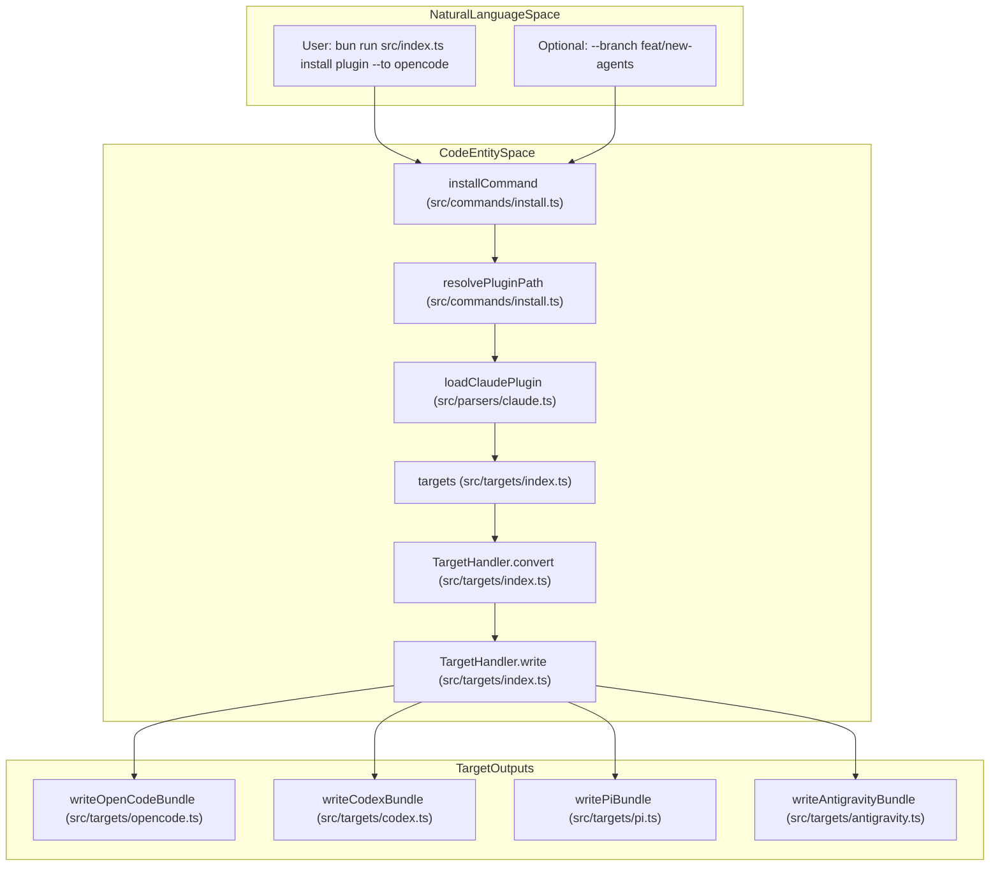
Sources: [src/commands/install.ts:1-181](), [src/targets/index.ts:37-76]()

The `TargetHandler` interface requires a `convert` function mapping `ClaudePlugin` to a target bundle, and a `write` function persisting it under a resolved `TargetScope` (`global` or `workspace`) [src/targets/index.ts:11-46]().

Sources: [src/commands/install.ts:82-181](), [src/targets/index.ts:11-46]()

## The `ce-setup` Skill and `check-health` Script

Once installed, project initialization and environment validation are driven by the `ce-setup` skill (`skills/ce-setup/SKILL.md`) and its bundled diagnostic script (`skills/ce-setup/scripts/check-health`) [skills/ce-setup/SKILL.md:3](), [skills/ce-setup/scripts/check-health:2-3]().

### Core Diagnostic Functions
The `check-health` script implements lightweight shell parsers to inspect local configurations without external dependencies:
*   `read_flat_config_value()`: Extracts top-level YAML configuration keys using `awk`, stripping inline comments and surrounding quotes [skills/ce-setup/scripts/check-health:53-73]().
*   `resolve_real_best_effort()`: Resolves symlink-followed absolute paths across incomplete directory trees to prevent path traversal [skills/ce-setup/scripts/check-health:80-95]().
*   `resolve_docs_root()`: Validates the configured artifact root, ensuring it remains repo-relative, stays within repository boundaries, and never falls back silently upon error [skills/ce-setup/scripts/check-health:104-158]().

Title: "ce-setup Diagnostic and Remediation Pipeline"
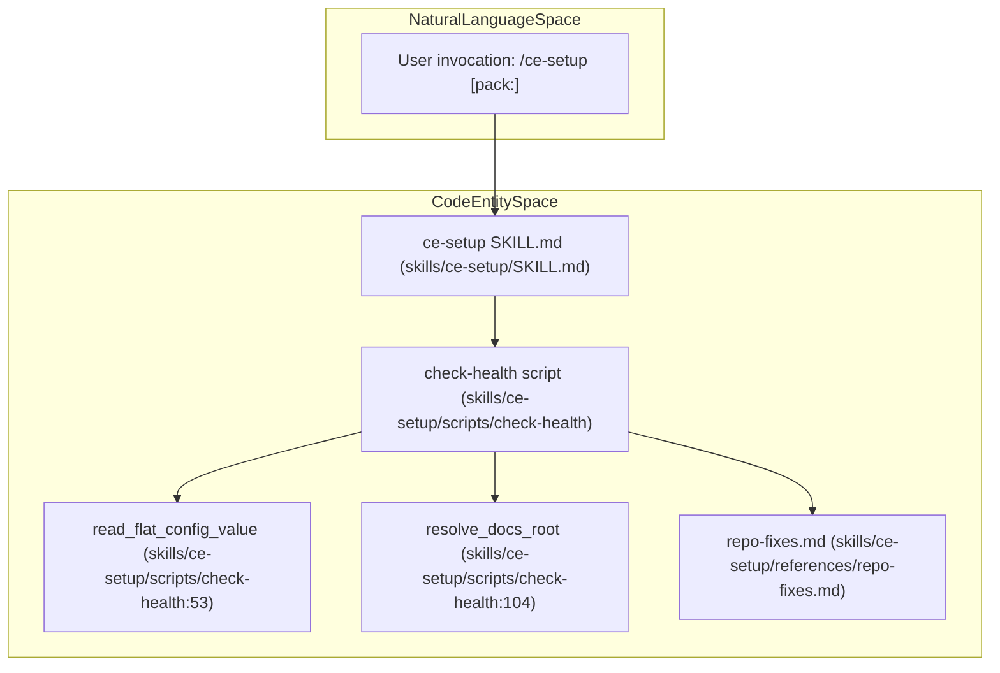
Sources: [skills/ce-setup/SKILL.md:1-90](), [skills/ce-setup/scripts/check-health:53-158]()

Sources: [skills/ce-setup/SKILL.md:1-90](), [skills/ce-setup/scripts/check-health:1-158]()

## Configuration Surface: `config-template.yaml` and `config.local.yaml`

Project-level behaviors are controlled via `.compound-engineering/config.yaml` (team defaults, copied from `config-template.yaml`) and optional `.compound-engineering/config.local.yaml` (user-specific overrides) [skills/ce-setup/references/config-template.yaml:1-5]().

### Configuration Keys and Precedence
1.  **Ordinary Keys**: Read first from `config.local.yaml`, then `config.yaml`, falling back to skill defaults [docs/guides/configuration.md:9]().
2.  **`docs_root`**: Relocates all CE artifact trees (`solutions`, `plans`, etc.) from `docs/` to a repo-relative path [skills/ce-setup/references/config-template.yaml:25](). It is read **exclusively** from tracked `config.yaml` (local overrides are ignored) and fails closed if invalid [skills/ce-setup/scripts/check-health:104-123](), [docs/guides/configuration.md:10]().
3.  **Product Pulse**: Settings for metric tracking, analytics sources (`posthog`, `mixpanel`), and tracing (`sentry`) [skills/ce-setup/references/config-template.yaml:31-44]().
4.  **Model Elevation and Outputs**: Configures model aliases for reasoning-heavy phases (`plan_model`, `brainstorm_model`) and exclusive output formats (`plan_output: html|md`) [skills/ce-setup/references/config-template.yaml:57-75]().
5.  **PR Teaching and Babysit Handoff**: Toggles conceptual teaching sections in PR descriptions and standing auto-babysit loops [skills/ce-setup/references/config-template.yaml:85-94]().

Sources: [skills/ce-setup/references/config-template.yaml:1-110](), [docs/guides/configuration.md:1-72]()

---

# Page: Repository Structure

# Repository Structure

<details>
<summary>Relevant source files</summary>

The following files were used as context for generating this wiki page:

- [.agents/skills/ce-skill-work/SKILL.md](.agents/skills/ce-skill-work/SKILL.md)
- [.agents/skills/ce-skill-work/references/edit-skill.md](.agents/skills/ce-skill-work/references/edit-skill.md)
- [.agents/skills/ce-skill-work/references/evaluate.md](.agents/skills/ce-skill-work/references/evaluate.md)
- [.agents/skills/ce-skill-work/references/new-skill.md](.agents/skills/ce-skill-work/references/new-skill.md)
- [.agents/skills/ce-skill-work/references/respond-to-review.md](.agents/skills/ce-skill-work/references/respond-to-review.md)
- [.agents/skills/ce-skill-work/references/review-skill.md](.agents/skills/ce-skill-work/references/review-skill.md)
- [.agy/plugin.json](.agy/plugin.json)
- [.claude-plugin/plugin.json](.claude-plugin/plugin.json)
- [.codex-plugin/plugin.json](.codex-plugin/plugin.json)
- [.cursor-plugin/plugin.json](.cursor-plugin/plugin.json)
- [.devin-plugin/plugin.json](.devin-plugin/plugin.json)
- [.github/.release-please-manifest.json](.github/.release-please-manifest.json)
- [.grok-plugin/plugin.json](.grok-plugin/plugin.json)
- [.kimi-plugin/plugin.json](.kimi-plugin/plugin.json)
- [.omp-plugin/marketplace.json](.omp-plugin/marketplace.json)
- [AGENTS.md](AGENTS.md)
- [CHANGELOG.md](CHANGELOG.md)
- [CLAUDE.md](CLAUDE.md)
- [assets/explainer/ce-explainer.js](assets/explainer/ce-explainer.js)
- [docs/solutions/skill-design/portable-agent-skill-authoring.md](docs/solutions/skill-design/portable-agent-skill-authoring.md)
- [docs/solutions/skill-design/size-driven-skill-restructure.md](docs/solutions/skill-design/size-driven-skill-restructure.md)
- [docs/specs/cursor.md](docs/specs/cursor.md)
- [package.json](package.json)
- [plugin.json](plugin.json)
- [site/_includes/jekyll_vitepress/head_end.html](site/_includes/jekyll_vitepress/head_end.html)
- [site/index.md](site/index.md)

</details>


This page documents the physical organization of the `compound-engineering-plugin` repository, including directory hierarchies, file locations, platform manifests, and the architectural mapping between natural language requirements and code entities.

## Purpose and Scope

The repository serves as a multi-component workspace containing:
1. **Plugin Content:** The core logic of the `compound-engineering` plugin, defined as a collection of modular skills and prompt assets [AGENTS.md:3-5](), [package.json:12-14]().
2. **Cross-Platform CLI:** A Bun/TypeScript tool (`src/`) that parses, converts, and installs Claude Code plugins into other agent platform formats (OpenCode, Codex, Pi, etc.) [AGENTS.md:6-6](), [package.json:20-24]().
3. **Distribution Infrastructure:** Marketplace catalogs and platform-specific manifests (`.claude-plugin/`, `.cursor-plugin/`, etc.) [AGENTS.md:7-8](), [package.json:28-31]().
4. **Knowledge Base:** A structured repository of engineering solutions and architectural patterns (`docs/solutions/`) [AGENTS.md:54-56](), [docs/solutions/skill-design/portable-agent-skill-authoring.md:1-22]().

Sources: [AGENTS.md:3-9](), [package.json:7-15]()

## Top-Level Directory Layout

```mermaid
graph TB
    root["Repository Root"]

    root --> skills["skills/"]
    root --> src["src/"]
    root --> docs["docs/"]
    root --> manifests["Platform Manifests"]
    root --> scripts["scripts/"]
    root --> tests["tests/"]
    root --> assets["assets/"]
    root --> site["site/"]

    skills --> skill_dirs["ce-plan/, ce-work/, etc.<br/>(Skill source)"]
    skills --> skill_subdirs["SKILL.md, references/, scripts/"]

    src --> cli_core["CLI entry, Parsers,<br/>Converters, Target Writers"]

    docs --> solutions["solutions/<br/>(Knowledge Base)"]
    docs --> skill_docs["skills/<br/>(User Documentation)"]

    manifests --> claude[".claude-plugin/"]
    manifests --> cursor[".cursor-plugin/"]
    manifests --> codex[".codex-plugin/"]
    manifests --> kimi[".kimi-plugin/"]
    manifests --> devin[".devin-plugin/"]
    manifests --> grok[".grok-plugin/"]
    manifests --> omp[".omp-plugin/"]
    manifests --> agy[".agy/"]
    manifests --> agents[".agents/"]
    manifests --> opencode[".opencode/"]
    manifests --> pi[".pi/"]

    scripts --> release["release/"]
    scripts --> codex_dev["codex-dev.ts"]

    tests --> test_files["Converter, Writer,<br/>and CLI tests"]
    tests --> skill_eval_cell["skill-eval-cell/"]

    site --> jekyll_config["_config.yml"]
    site --> jekyll_data["_data/"]
    site --> jekyll_includes["_includes/"]
    site --> jekyll_plugins["_plugins/"]

    assets --> demo["demo/"]
```
*Figure 1: High-level repository directory hierarchy showing core module partitions.*

Sources: [AGENTS.md:3-9](), [package.json:7-15](), [package.json:19-27]()

## Natural Language to Code Entity Mapping

To bridge conceptual architectural intent with physical codebase artifacts, the table and diagram below map logical subsystems to their exact implementation files.

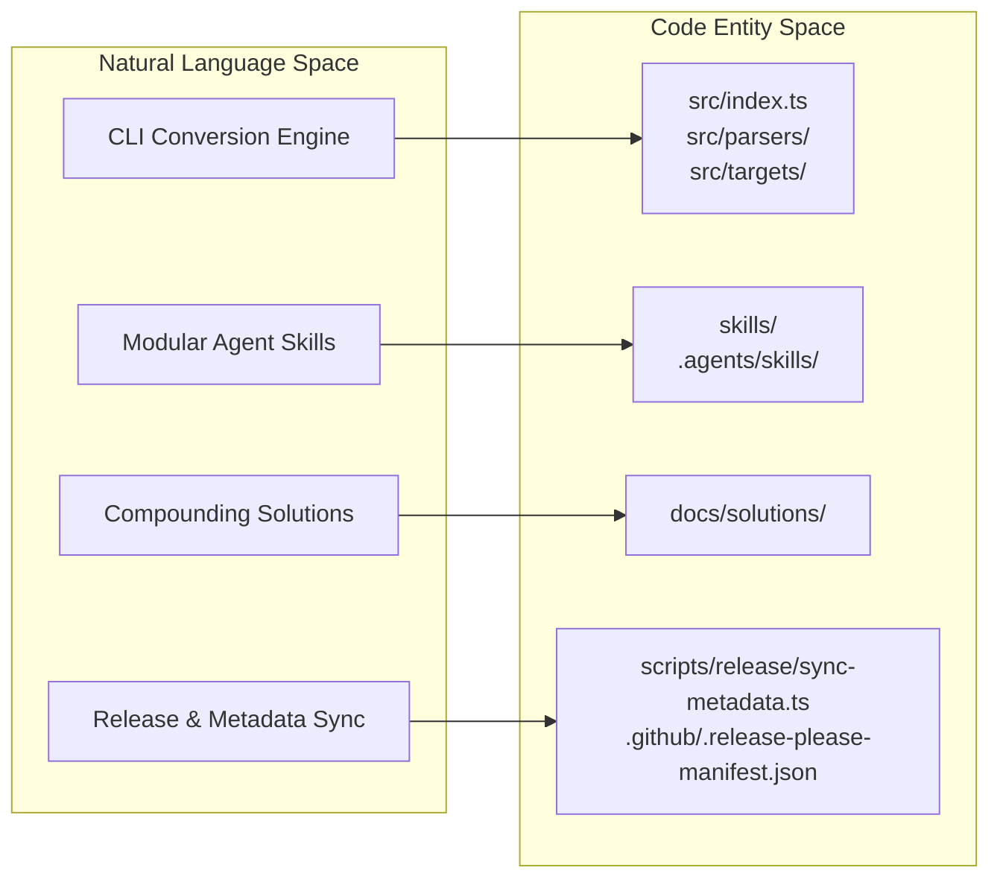
*Figure 2: Architectural bridge associating functional domain concepts with source control entities.*

Sources: [AGENTS.md:3-8](), [package.json:20-24](), [.github/.release-please-manifest.json:1-5]()

## Core Components: Skills (`skills/`) and CLI Source (`src/`)

The repository partitions executable capabilities into author-maintained skills and TypeScript CLI tooling.

### Plugin Skills (`skills/`)
The `skills/` directory contains the authoritative source for the plugin's skills [package.json:12-14](). Each skill is housed in its own directory containing a `SKILL.md` file (runtime instructions) and optional `references/` (specialist prompt assets) or `scripts/` (bundled executables) [docs/solutions/skill-design/portable-agent-skill-authoring.md:38-49](), [AGENTS.md:44-44]().

### CLI Source Code (`src/`)
Managed via Bun and implemented in TypeScript, `src/` drives conversion, installation, and cleanup routines [package.json:18-24](). Key modules include:
* `src/index.ts`: CLI entry point routing `install`, `convert`, `cleanup`, and `list` commands [package.json:20-24]().
* `src/utils/`: Shared utility modules, including `frontmatter.ts` for parsing markdown metadata.
* `src/targets/`: Platform-specific writer implementations (OpenCode, Codex, Pi, etc.).
* `src/parsers/`: Format parsers such as `claude.ts`.
* `src/release/`: Release metadata synchronization logic.

Sources: [package.json:18-24](), [docs/solutions/skill-design/portable-agent-skill-authoring.md:38-49]()

## Platform Manifests and Marketplace Metadata

Platform interoperability is maintained through host-specific dot-directories that house plugin configuration manifests.

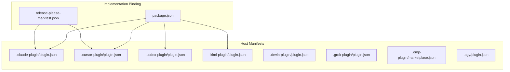
*Figure 3: Platform manifest inventory and metadata linkage.*

Each `plugin.json` or `marketplace.json` file declares host-specific metadata such as `name`, `version`, `description`, `author`, and keywords [plugin.json:1-20](). Extended interfaces in Codex and Kimi define UI rendering hints, default prompt suggestions, and capabilities [.codex-plugin/plugin.json:21-44](), [.kimi-plugin/plugin.json:18-24]().

Sources: [.github/.release-please-manifest.json:1-5](), [plugin.json:1-20](), [.codex-plugin/plugin.json:21-44]()

## Knowledge Base and Documentation (`docs/` and `site/`)

The repository embeds institutional memory and publishing infrastructure across two distinct directories:
* `docs/solutions/`: The compounding engine storing solution logs and pattern design docs [docs/solutions/skill-design/portable-agent-skill-authoring.md:1-22]().
* `site/`: A Jekyll-based documentation site containing configuration (`_config.yml`), data (`_data/`), layout partials (`_includes/`), custom plugins (`_plugins/ce_relative_urls.rb`), and automated test suites [package.json:37-40]().

Sources: [package.json:37-40](), [docs/solutions/skill-design/portable-agent-skill-authoring.md:1-22]()

## Testing and Evaluation Harness (`tests/`)

Verification logic is partitioned into functional test suites and evaluation cells:
* `tests/skill-eval-cell/`: Houses the skill evaluation cell harness, executing scenarios via `run.ts`, packaging with `pack.ts`, and grading via `judge.ts` [package.json:30-32]().
* `scripts/run-tests.ts`: Orchestrates parallel test execution across the repository test corpus [package.json:25](), [AGENTS.md:15]().

Sources: [package.json:25-32](), [AGENTS.md:15-18]()

## Release Automation and Metadata Synchronization (`scripts/`)

Release management relies on structured automation scripts and manifests:
* `.github/.release-please-manifest.json`: Defines component versions across the root package and marketplace plugins [.github/.release-please-manifest.json:1-5]().
* `scripts/release/sync-metadata.ts`: Validates and writes component counts and version strings across host manifests [package.json:35]().
* `scripts/release/validate.ts`: Enforces consistency between the plugin inventory and documentation tables [package.json:36]().

Sources: [package.json:34-36](), [.github/.release-please-manifest.json:1-5]()

---

# Page: Compound Engineering Plugin

# Compound Engineering Plugin

<details>
<summary>Relevant source files</summary>

The following files were used as context for generating this wiki page:

- [.agy/plugin.json](.agy/plugin.json)
- [.claude-plugin/plugin.json](.claude-plugin/plugin.json)
- [.codex-plugin/plugin.json](.codex-plugin/plugin.json)
- [.cursor-plugin/plugin.json](.cursor-plugin/plugin.json)
- [.devin-plugin/plugin.json](.devin-plugin/plugin.json)
- [.github/.release-please-manifest.json](.github/.release-please-manifest.json)
- [.grok-plugin/plugin.json](.grok-plugin/plugin.json)
- [.kimi-plugin/plugin.json](.kimi-plugin/plugin.json)
- [.omp-plugin/marketplace.json](.omp-plugin/marketplace.json)
- [CHANGELOG.md](CHANGELOG.md)
- [CONCEPTS.md](CONCEPTS.md)
- [docs/solutions/skill-design/right-size-plans-by-subtraction-and-a-usage-first-sizing-test.md](docs/solutions/skill-design/right-size-plans-by-subtraction-and-a-usage-first-sizing-test.md)
- [package.json](package.json)
- [plugin.json](plugin.json)
- [skills/ce-work/references/agents/implementation-worker.md](skills/ce-work/references/agents/implementation-worker.md)
- [skills/ce-work/references/cross-model-execution.md](skills/ce-work/references/cross-model-execution.md)
- [skills/ce-work/references/execution-strategy.md](skills/ce-work/references/execution-strategy.md)
- [skills/ce-work/references/implementation-loop.md](skills/ce-work/references/implementation-loop.md)
- [skills/ce-work/references/work-intake.md](skills/ce-work/references/work-intake.md)
- [skills/ce-work/scripts/unit_workspace_state.py](skills/ce-work/scripts/unit_workspace_state.py)
- [tests/skill-eval-cell/packs/ce-work-sizing.md](tests/skill-eval-cell/packs/ce-work-sizing.md)
- [tests/skills/ce-work-outcome-spine.test.ts](tests/skills/ce-work-outcome-spine.test.ts)
- [tests/skills/ce-work-unit-workspace-init.test.ts](tests/skills/ce-work-unit-workspace-init.test.ts)

</details>


## Purpose and Scope

This document introduces the `compound-engineering` plugin, a comprehensive AI-powered development toolkit designed to automate and enhance software development workflows. The plugin provides a suite of specialized skills that implement a circular development lifecycle where each unit of work makes the next easier.

For the compounding engineering philosophy and workflow concepts, see [Core Concepts and Philosophy](#2.1). For detailed component architecture, see [Plugin Architecture](#2.2). For configuration and metadata details, see [Plugin Metadata and Configuration](#2.3).

---

## Plugin Identity and Purpose

The `compound-engineering` plugin is a self-contained development automation package designed to invert the traditional accumulation of technical debt. It implements an 80/20 ratio where 80% of effort is focused on planning and review, and 20% on execution.

The plugin is distributed through marketplace catalogs and can be installed directly in native environments (Claude Code, Cursor, Codex) or converted for platforms like OpenCode, Pi, Kimi, and Antigravity using the `compound-engineering` CLI tool [CONCEPTS.md:21-24]().

**Current Version**: `3.33.2` [package.json:3]()

**Component Inventory**:
- **Skills**: The plugin ships a robust inventory of skills. Specialist behavior (review, research, etc.) lives inside the owning skills as skill-local prompt assets rather than standalone agents [CONCEPTS.md:10-18]().
- **CLI**: A cross-platform tool for plugin distribution and format conversion [package.json:20-24]().

Sources: [package.json:3](), [package.json:20-24](), [CONCEPTS.md:10-18](), [CONCEPTS.md:21-24]()

---

## Plugin Architecture Overview

The plugin follows a modular architecture where **Skills** act as the primary entry points. Specialist behavior is managed as internal assets by the skill.

### Plugin Component Relationships
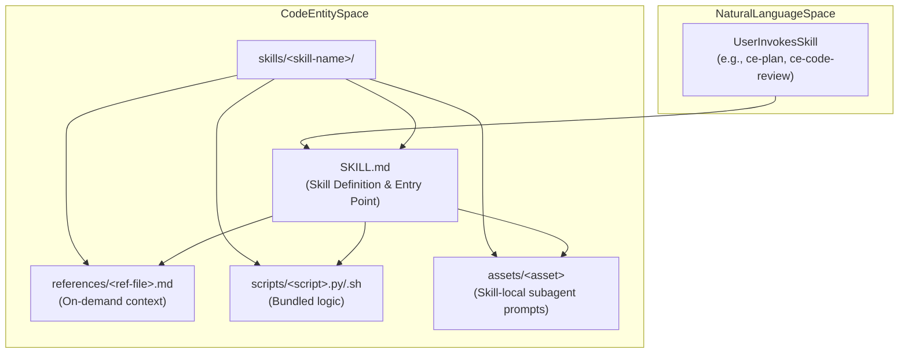
Sources: [CONCEPTS.md:10-12](), [CONCEPTS.md:16-18]()

### Bridging User Intent to Code Entities

The relationship between user intent and code entities is defined by the skill directory structure and naming conventions:

| Component | Location | File Format | Role |
|-----------|----------|-------------|------|
| **Skill** | `skills/<skill-name>/SKILL.md` | Markdown + Frontmatter | Primary entry point and orchestrator [CONCEPTS.md:10-12](). |
| **Specialist Prompt Asset** | `skills/<skill-name>/assets/<asset-name>` | Markdown, Text | Internal prompt file defining a specialist persona or role for a generic subagent [CONCEPTS.md:16-18](). |
| **Bundled Script** | `skills/<skill-name>/scripts/<script-name>.py/.sh` | Python, Bash | Portable logic invoked by the skill for mechanical tasks. |
| **On-demand Reference** | `skills/<skill-name>/references/<ref-name>.md` | Markdown | Contextual information progressively pulled in by the skill as needed. |

For a detailed breakdown of skill composition, including `SKILL.md` kernels, `references/`, `scripts/`, `assets/`, and cross-skill invocation contracts, see [Plugin Architecture](#2.2).

Sources: [CONCEPTS.md:10-12](), [CONCEPTS.md:16-18]()

---

## Shared Vocabulary and Core Concepts

The plugin operates on a shared vocabulary defined in `CONCEPTS.md`. This document establishes project-specific meanings for entities, named processes, and status concepts, ensuring consistent communication and behavior across skills.

### Key Vocabulary Terms
- **Skill**: A user-invoked capability that orchestrates its own references and dispatches subagents [CONCEPTS.md:10-12]().
- **Agent (Subagent)**: A specialized, single-purpose worker performing scoped work, often seeded with a **Specialist prompt asset** [CONCEPTS.md:13-18]().
- **Target**: A destination coding-agent platform (e.g., OpenCode, Codex, Pi) that the plugin supports [CONCEPTS.md:21-24]().
- **Compound Engineering**: The methodology of structuring engineering work to capture reusable knowledge, making future work easier [CONCEPTS.md:48-50]().
- **Pipeline**: The chained progression of skills that carries work through strategy, ideation, brainstorm, plan, execution, review, and learning capture [CONCEPTS.md:51-53]().
- **Compound Pack**: A folder of prescriptive domain knowledge files consumed by planning and review skills [CONCEPTS.md:69-71]().

For a comprehensive explanation of these and other core concepts like outcome spine, host prompt budget, phase-loaded kernel, render floor, confidence anchors, and case accretion, see [Core Concepts and Philosophy](#2.1).

Sources: [CONCEPTS.md:1-7](), [CONCEPTS.md:10-12](), [CONCEPTS.md:13-18](), [CONCEPTS.md:21-24](), [CONCEPTS.md:48-50](), [CONCEPTS.md:51-53](), [CONCEPTS.md:69-71]()

---

## Configuration Surface

The plugin's behavior can be configured at various levels, from global marketplace metadata to project-specific settings.

### Configuration Mapping Architecture
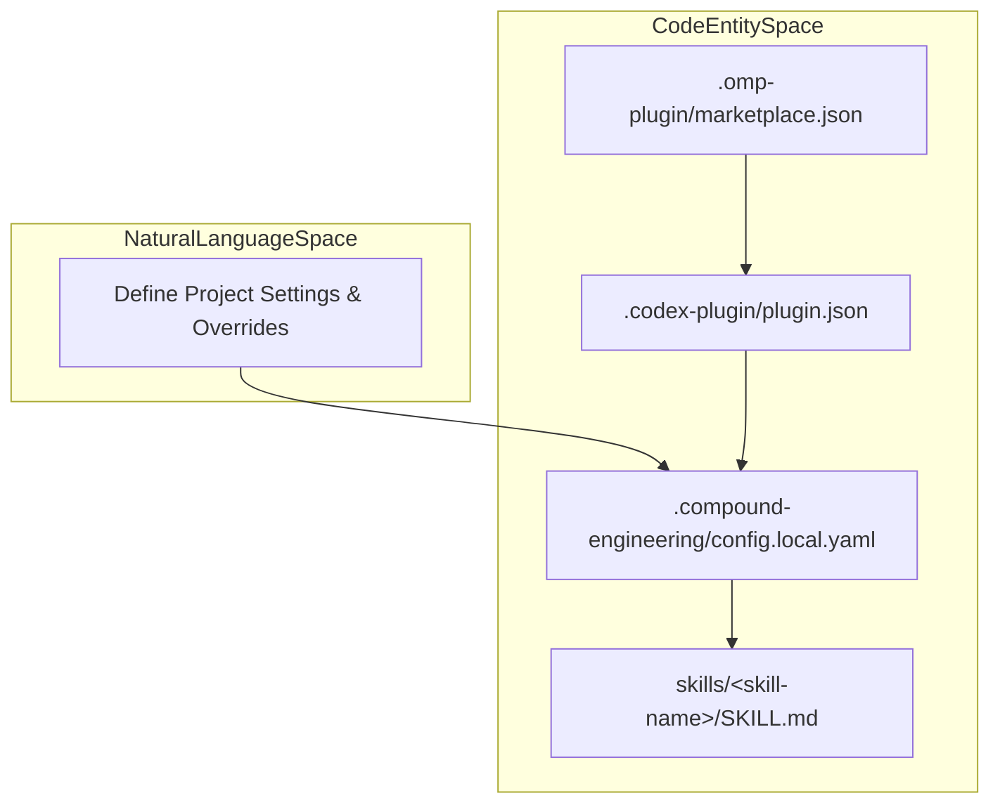
Sources: [.omp-plugin/marketplace.json:1-29](), [.codex-plugin/plugin.json:1-45]()

### Configuration Keys and Files
- **Plugin Manifests**: Files like `.claude-plugin/plugin.json`, `.codex-plugin/plugin.json`, `.cursor-plugin/plugin.json`, and `.kimi-plugin/plugin.json` define the plugin's name, version, description, author, and keywords for specific hosts [package.json:3](), [.codex-plugin/plugin.json:1-45](), [.cursor-plugin/plugin.json:1-25](), [.claude-plugin/plugin.json:1-19](), [.kimi-plugin/plugin.json:1-24]().
- **Marketplace Catalogs**: Files like `.omp-plugin/marketplace.json` list available plugins and their versions for distribution [.omp-plugin/marketplace.json:1-29]().
- **Project-level Configuration**: The `.compound-engineering/config.local.yaml` file allows project-specific overrides and settings that skills can consume.
- **Skill-level Configuration**: Parameters and behaviors can be defined directly within a skill's `SKILL.md` file using frontmatter.

For detailed information on `plugin.json` shapes, marketplace catalogs, agent-plugins spec conformance rules, and project-level `.compound-engineering` config keys, see [Plugin Metadata and Configuration](#2.3).

Sources: [package.json:3](), [.codex-plugin/plugin.json:1-45](), [.cursor-plugin/plugin.json:1-25](), [.claude-plugin/plugin.json:1-19](), [.kimi-plugin/plugin.json:1-24](), [.omp-plugin/marketplace.json:1-29]()

---

## Versioning and Release

The plugin uses semantic versioning, synchronized across platform manifests and the CLI.

| Version Surface | Management |
|-----------------|------------|
| `package.json` | Root version source for the repository (`"version": "3.33.2"`) [package.json:3]() |
| `.release-please-manifest.json` | Tracks individual component versions for release automation (e.g., `".": "3.33.2"`, `".claude-plugin": "1.0.3"`) [.github/.release-please-manifest.json:1-5]() |
| `marketplace.json` | Updated to reflect new plugin availability for distribution [.omp-plugin/marketplace.json:1-29]() |
| `CHANGELOG.md` | Automatically generated changelog detailing features and bug fixes for each version [CHANGELOG.md:1-136]() |

**Validation**: The command `release:validate` enforces version invariants across manifests to prevent drift [package.json:36](). The `release:sync-metadata` script ensures metadata consistency [package.json:35]().

Sources: [package.json:3](), [package.json:35](), [package.json:36](), [.github/.release-please-manifest.json:1-5](), [CHANGELOG.md:1-136](), [.omp-plugin/marketplace.json:1-29]()

---

# Page: Core Concepts and Philosophy

# Core Concepts and Philosophy

<details>
<summary>Relevant source files</summary>

The following files were used as context for generating this wiki page:

- [CONCEPTS.md](CONCEPTS.md)
- [docs/solutions/skill-design/right-size-plans-by-subtraction-and-a-usage-first-sizing-test.md](docs/solutions/skill-design/right-size-plans-by-subtraction-and-a-usage-first-sizing-test.md)
- [skills/ce-brainstorm/scripts/packs-resolve.py](skills/ce-brainstorm/scripts/packs-resolve.py)
- [skills/ce-code-review/scripts/packs-resolve.py](skills/ce-code-review/scripts/packs-resolve.py)
- [skills/ce-compound/scripts/packs-resolve.py](skills/ce-compound/scripts/packs-resolve.py)
- [skills/ce-doc-review/scripts/packs-resolve.py](skills/ce-doc-review/scripts/packs-resolve.py)
- [skills/ce-dogfood/scripts/packs-resolve.py](skills/ce-dogfood/scripts/packs-resolve.py)
- [skills/ce-plan/scripts/packs-resolve.py](skills/ce-plan/scripts/packs-resolve.py)
- [skills/ce-setup/references/pack-scaffold.md](skills/ce-setup/references/pack-scaffold.md)
- [skills/ce-setup/scripts/packs-resolve.py](skills/ce-setup/scripts/packs-resolve.py)
- [skills/ce-work/references/agents/implementation-worker.md](skills/ce-work/references/agents/implementation-worker.md)
- [skills/ce-work/references/cross-model-execution.md](skills/ce-work/references/cross-model-execution.md)
- [skills/ce-work/references/execution-strategy.md](skills/ce-work/references/execution-strategy.md)
- [skills/ce-work/references/implementation-loop.md](skills/ce-work/references/implementation-loop.md)
- [skills/ce-work/references/work-intake.md](skills/ce-work/references/work-intake.md)
- [skills/ce-work/scripts/unit_workspace_state.py](skills/ce-work/scripts/unit_workspace_state.py)
- [tests/skill-eval-cell/packs/ce-work-sizing.md](tests/skill-eval-cell/packs/ce-work-sizing.md)
- [tests/skills/ce-packs-resolver.test.ts](tests/skills/ce-packs-resolver.test.ts)
- [tests/skills/ce-setup-pack-scaffold.test.ts](tests/skills/ce-setup-pack-scaffold.test.ts)
- [tests/skills/ce-work-outcome-spine.test.ts](tests/skills/ce-work-outcome-spine.test.ts)
- [tests/skills/ce-work-unit-workspace-init.test.ts](tests/skills/ce-work-unit-workspace-init.test.ts)

</details>


## Purpose and Scope

This document details the core architectural concepts, design philosophy, and domain vocabulary underlying the `compound-engineering-plugin`. It covers the Compounding Engineering methodology, the execution of the compound loop, and technical definitions codified in `CONCEPTS.md`. The design ensures that engineering tasks progressively simplify future work by capturing reusable knowledge, maintaining stringent planning-to-execution ratios, and operating reliably across diverse agent host platforms.

Sources: [CONCEPTS.md:1-50](), [docs/guides/README.md:1-25]()

---

## The Compounding Engineering Methodology

Compounding Engineering inverts traditional development patterns where technical debt accumulates over time. Instead, each unit of work is structured so that subsequent tasks become easier by codifying reusable knowledge into persistent artifacts (`docs/solutions/`, compound packs) [CONCEPTS.md:46-50]().

### Core Terminology and Vocabulary

The system relies on explicit vocabulary defined in `CONCEPTS.md` to govern agent coordination and knowledge persistence:

| Term | Technical Definition | Code / File Pointer |
| :--- | :--- | :--- |
| **Compounding Engineering** | Structuring engineering work so each unit makes the next one easier, capturing reusable knowledge as you go [CONCEPTS.md:46-50](). | `CONCEPTS.md` |
| **Compound Loop** | The chained progression of Skills carrying work from strategy through ideation, brainstorm, plan, execution, review, and compound learning capture [CONCEPTS.md:51-53](). | [docs/guides/README.md:13-29]() |
| **Outcome Spine** | The structured sequence of intent, results, consumer handoffs, and verification milestones maintained across execution [tests/skills/ce-work-outcome-spine.test.ts:39-54](). | [skills/ce-work/SKILL.md:1-50]() |
| **Host Prompt Budget** | The token limit imposed by the host execution environment, influencing plugin architecture toward modular, on-demand loading [docs/guides/skill-design.md:1-20](). | `docs/guides/skill-design.md` |
| **Phase-Loaded Kernel** | The core `SKILL.md` entry point that loads detailed `references/` files only when specific phase execution demands it [docs/guides/skill-design.md:1-20](). | `skills/ce-work/SKILL.md` |
| **Render Floor** | The minimum structural and formatting standard required for generated artifacts (e.g., plans, reviews) to ensure human and agent readability [docs/guides/ce-doc-review.md:1-50](). | `docs/guides/ce-doc-review.md` |
| **Confidence Anchors** | Discrete, self-scored qualitative or quantitative indicators used to gate, rank, and evaluate findings (e.g., in code reviews) [CONCEPTS.md:90-92](). | `CONCEPTS.md` |
| **Case Accretion** | The continuous accumulation and refinement of solution patterns and knowledge through repeated session executions [CONCEPTS.md:3-3](). | `CONCEPTS.md` |
| **Compound Pack** | A folder of prescriptive domain knowledge files consumed by planning and review skills as constraints or validation rules [CONCEPTS.md:69-71](). | [skills/ce-plan/scripts/packs-resolve.py:1-57]() |

Sources: [CONCEPTS.md:3-92](), [docs/guides/README.md:13-29](), [tests/skills/ce-work-outcome-spine.test.ts:39-54](), [skills/ce-plan/scripts/packs-resolve.py:1-57]()

---

## The Compound Loop and Workflow Architecture

The execution model bridges upstream human intent (Natural Language Space) with downstream deterministic code transformations (Code Entity Space) via a structured pipeline of Skills and durable artifacts.

### Diagram: Natural Language Space to Code Entity Space

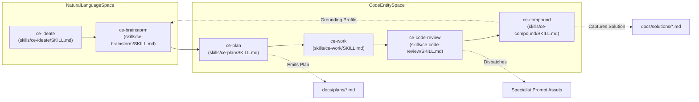
**Diagram: Workflow bridge from natural language exploration to code-grounded execution nodes.**

Sources: [docs/guides/README.md:13-45](), [CONCEPTS.md:51-66]()

---

## Architectural Design Principles

To maintain determinism across different agent harnesses (Claude Code, Codex, Cursor, etc.), the plugin enforces strict architectural invariants:

### Phase-Loaded Kernels and Host Prompt Budgets
Because AI hosts enforce strict token limits on prompts (`Host Prompt Budget`), skills cannot load all instructions simultaneously. Instead, they use a `Phase-Loaded Kernel` pattern:
1. `SKILL.md` contains the minimal routing logic, outcome definitions, and phase selectors [tests/skills/ce-work-outcome-spine.test.ts:39-54]().
2. Detailed operational rules are isolated in `references/` directories (e.g., `skills/ce-work/references/execution-strategy.md`) and loaded explicitly only when entering that phase [skills/ce-work/references/execution-strategy.md:1-5]().

### Diagram: Phase-Loaded Kernel Data Flow

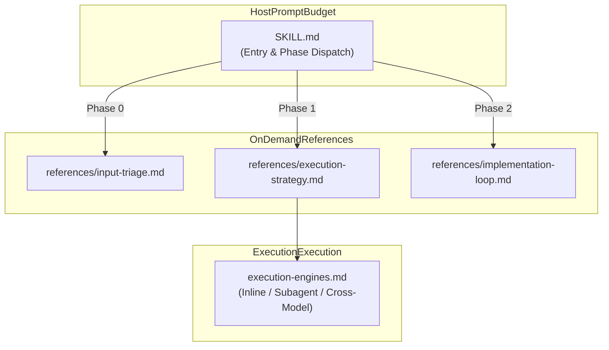
**Diagram: On-demand loading of reference assets to conserve Host Prompt Budgets.**

Sources: [skills/ce-work/SKILL.md:1-50](), [skills/ce-work/references/execution-strategy.md:1-10](), [skills/ce-work/references/implementation-loop.md:1-15]()

### Compound Packs Resolution
Compound Packs supply prescriptive domain rules declared in `.compound-engineering/config.yaml` [skills/ce-plan/scripts/packs-resolve.py:1-10](). The resolver script (`packs-resolve.py`) parses configuration layers, validates paths or Git URLs, caches remote repositories securely in owner-private scratch roots, and makes rules available for planning and review [skills/ce-plan/scripts/packs-resolve.py:40-57]().

Sources: [CONCEPTS.md:69-71](), [skills/ce-plan/scripts/packs-resolve.py:1-57]()

---

# Page: Plugin Architecture

# Plugin Architecture

<details>
<summary>Relevant source files</summary>

The following files were used as context for generating this wiki page:

- [.agents/skills/ce-skill-work/SKILL.md](.agents/skills/ce-skill-work/SKILL.md)
- [.agents/skills/ce-skill-work/references/edit-skill.md](.agents/skills/ce-skill-work/references/edit-skill.md)
- [.agents/skills/ce-skill-work/references/evaluate.md](.agents/skills/ce-skill-work/references/evaluate.md)
- [.agents/skills/ce-skill-work/references/new-skill.md](.agents/skills/ce-skill-work/references/new-skill.md)
- [.agents/skills/ce-skill-work/references/respond-to-review.md](.agents/skills/ce-skill-work/references/respond-to-review.md)
- [.agents/skills/ce-skill-work/references/review-skill.md](.agents/skills/ce-skill-work/references/review-skill.md)
- [AGENTS.md](AGENTS.md)
- [CLAUDE.md](CLAUDE.md)
- [docs/plans/2026-08-06-001-fix-agent-plugins-manifest-conformance-plan.md](docs/plans/2026-08-06-001-fix-agent-plugins-manifest-conformance-plan.md)
- [docs/solutions/conventions/verify-externally-attributed-constraints-at-the-source.md](docs/solutions/conventions/verify-externally-attributed-constraints-at-the-source.md)
- [docs/solutions/integrations/agent-plugins-schema-is-a-host-routing-switch.md](docs/solutions/integrations/agent-plugins-schema-is-a-host-routing-switch.md)
- [docs/solutions/skill-design/portable-agent-skill-authoring.md](docs/solutions/skill-design/portable-agent-skill-authoring.md)
- [docs/solutions/skill-design/size-driven-skill-restructure.md](docs/solutions/skill-design/size-driven-skill-restructure.md)
- [docs/specs/agent-plugins.md](docs/specs/agent-plugins.md)
- [docs/specs/antigravity.md](docs/specs/antigravity.md)
- [docs/specs/cursor.md](docs/specs/cursor.md)
- [skills/ce-brainstorm/references/agents/slack-researcher.md](skills/ce-brainstorm/references/agents/slack-researcher.md)
- [skills/ce-compound/references/agents/best-practices-researcher.md](skills/ce-compound/references/agents/best-practices-researcher.md)
- [skills/ce-compound/references/agents/framework-docs-researcher.md](skills/ce-compound/references/agents/framework-docs-researcher.md)
- [skills/ce-compound/references/agents/session-historian.md](skills/ce-compound/references/agents/session-historian.md)
- [skills/ce-optimize/references/agents/repo-research-analyst.md](skills/ce-optimize/references/agents/repo-research-analyst.md)
- [skills/ce-plan/references/agents/best-practices-researcher.md](skills/ce-plan/references/agents/best-practices-researcher.md)
- [skills/ce-plan/references/agents/framework-docs-researcher.md](skills/ce-plan/references/agents/framework-docs-researcher.md)
- [skills/ce-plan/references/agents/repo-research-analyst.md](skills/ce-plan/references/agents/repo-research-analyst.md)
- [skills/ce-plan/references/agents/slack-researcher.md](skills/ce-plan/references/agents/slack-researcher.md)
- [skills/ce-plan/references/agents/web-researcher.md](skills/ce-plan/references/agents/web-researcher.md)
- [src/commands/cleanup.ts](src/commands/cleanup.ts)
- [tests/codex-skill-prompt-budget.test.ts](tests/codex-skill-prompt-budget.test.ts)
- [tests/real-plugin-conversion.test.ts](tests/real-plugin-conversion.test.ts)
- [tests/skill-conventions.test.ts](tests/skill-conventions.test.ts)
- [tests/skills/task-visibility-contract.test.ts](tests/skills/task-visibility-contract.test.ts)
- [tests/skills/user-facing-skill-invocation-rendering.test.ts](tests/skills/user-facing-skill-invocation-rendering.test.ts)

</details>


## Purpose and Scope

This document details the internal structural composition of individual skills within the `compound-engineering` plugin. A skill is not a monolithic script or a rigid state machine; rather, it is a modular package composed of a lightweight `SKILL.md` kernel, on-demand reference documentation (`references/`), bundled execution scripts (`scripts/`), static templates/fixtures (`assets/`), and skill-local subagent prompt assets. Furthermore, this page outlines the cross-skill invocation contracts (`mode:pipeline` and `mode:return-to-caller`) that allow orchestrator skills to chain specialized capabilities safely and deterministically across different host runtimes. [AGENTS.md:1-9](), [docs/solutions/skill-design/portable-agent-skill-authoring.md:39-42]()

Sources: [AGENTS.md:1-9](), [docs/solutions/skill-design/portable-agent-skill-authoring.md:39-42]()

---

## Skill Anatomy and Composition

Every skill in the catalog resides in its own directory under `skills/` (e.g., `skills/ce-plan/`, `skills/ce-work/`, `skills/ce-debug/`) and follows a standardized directory layout designed to maintain strict self-containment and portability.

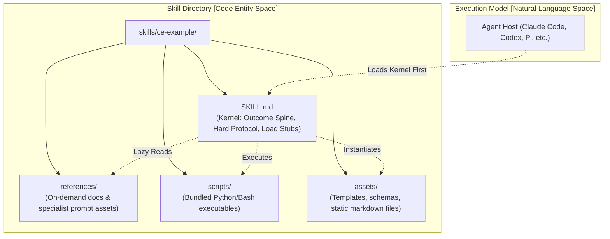
Sources: [tests/skill-conventions.test.ts:23-39]()

### 1. The `SKILL.md` Kernel
The `SKILL.md` file serves as the primary entry point for a skill. It starts with YAML frontmatter defining its name, description, and execution flags (`argument-hint`, `disable-model-invocation`). The body is structured around an **Outcome Spine** (result, next consumer, done condition, and non-obvious intent) followed by any required **Hard Protocols** and **Load-Bearing Workflows**.
*   **Prompt Budget Awareness:** To respect host constraints (such as Codex's 8,000-byte prompt budget for Agent Plugins or Claude Code's auto-compaction limits), critical stop conditions and routing rules are placed at the very top of the kernel. [tests/codex-skill-prompt-budget.test.ts:37-37](), [docs/specs/agent-plugins.md:27-28]()
*   **Load Stubs:** When detailed procedures or reference information are offloaded to external files to save token space, the kernel retains explicit load stubs instructing the model to read the specific reference file precisely when that phase is entered. [docs/solutions/skill-design/size-driven-skill-restructure.md:32-36]()

Sources: [skills/ce-debug/SKILL.md:1-5](), [tests/codex-skill-prompt-budget.test.ts:37-37](), [docs/specs/agent-plugins.md:27-28](), [docs/solutions/skill-design/size-driven-skill-restructure.md:32-36]()

### 2. On-Demand `references/`
The `references/` subdirectory houses deep-dive documentation, extended schemas, and workflow guides. 
*   **Pointer Following:** Models load these files dynamically via tool calls only when specific phases or edge cases require them. 
*   **Specialist Prompt Assets:** Within `references/` (or specialized subdirectories like `references/agents/`), the skill stores prompt templates and personas (e.g., repo-research analysts, adversarial reviewers) used to seed subordinate subagents. This encapsulates specialist logic within the owning skill rather than relying on global system agents. [skills/ce-compound/references/agents/session-historian.md:1-5]()

Sources: [skills/ce-compound/references/agents/session-historian.md:1-5](), [docs/solutions/skill-design/size-driven-skill-restructure.md:32-36]()

### 3. Bundled `scripts/`
Deterministic work, data transformations, state validations, and complex formatting are delegated to executable scripts located in the skill's local `scripts/` directory (or shared global scripts). 
*   Skills reference these scripts using platform-safe environment variables (e.g., `bash "${CLAUDE_SKILL_DIR:-.}/scripts/validator.sh"`).
*   Delegating mechanical verification to scripts ensures consistency across different model families and prevents hallucinations during validation checks. [tests/skill-conventions.test.ts:51-66]()

Sources: [tests/skill-conventions.test.ts:51-66]()

### 4. `assets/` and Static Files
The `assets/` directory stores static templates, markdown schemas, and default configuration structures that are copied, rendered, or instantiated during the skill's execution (such as output plan formats or issue triage templates).

Sources: [tests/skill-conventions.test.ts:23-39]()

---

## Cross-Skill Invocation Contracts

To support complex orchestrations (such as `/lfg`, `ce-sweep`, and `ce-babysit-pr`), individual skills can be invoked programmatically by other skills using explicit invocation modes. These contracts govern execution flow, interactivity, and return payloads.

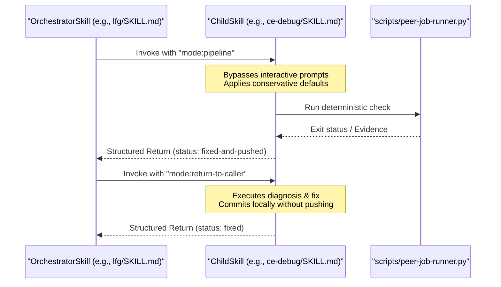
Sources: [skills/ce-debug/SKILL.md:19-22](), [skills/ce-work/SKILL.md:56-61](), [skills/lfg/SKILL.md:39-40]()

### `mode:pipeline`
*   **Purpose:** Used when an orchestrator skill chains multiple child skills fully non-interactively into an end-to-end autonomous pipeline (e.g., plan → work → review → compound).
*   **Behavior:** Suppresses interactive confirmation prompts, substitutes conservative default decisions for ambiguous branches, and wraps execution in a strict protocol.
*   **Return Payload:** The child skill concludes by emitting a structured return payload containing a precise `status` enum (e.g., `fixed-and-pushed`, `diagnosed-no-fix`, `flaky-infra`, `needs-human`) which the parent orchestrator parses to decide subsequent workflow routing. [skills/ce-debug/SKILL.md:19-20]()

Sources: [skills/ce-debug/SKILL.md:19-20](), [skills/lfg/SKILL.md:39-40]()

### `mode:return-to-caller`
*   **Purpose:** Used when a child skill performs a dedicated subset of work (such as debugging or code review) but leaves post-processing, shipping, or polish to the calling parent skill.
*   **Behavior:** The child skill executes its core investigative and transactional loop non-interactively, commits changes locally (without pushing or opening PRs prematurely), and skips downstream wrap-up actions.
*   **Return Payload:** Returns control back to the caller along with a standardized status object (`fixed`, `diagnosed-no-fix`, `needs-human`, `blocked`), allowing the caller to take ownership of final integration and reporting. [skills/ce-debug/SKILL.md:21-22]()

Sources: [skills/ce-debug/SKILL.md:21-22](), [skills/ce-work/SKILL.md:56-61]()

---

## Storage, Persistence, and State Management

Skills interact with distinct filesystem storage tiers to separate durable institutional memory from transient execution data.

| Storage Tier | Path Convention | Purpose | Lifecycle |
| :--- | :--- | :--- | :--- |
| **Durable Repo Artifacts** | `docs/plans/`, `docs/solutions/` | Long-term plans, technical specifications, and captured learnings. | Committed to git; persists across sessions. |
| **Throwaway Temp** | `/tmp/` (via `mktemp`) | Single-run intermediate files, logs, and raw diff patches. | Cleared by OS or cleanup routines. |
| **Reusable Scratch Space** | `/tmp/compound-engineering-<uid>/<skill>/` | Cross-invocation caches designed to survive context compaction and subagent handoffs. | Ephemeral to the active engineering workflow. |

Sources: [AGENTS.md:43-46]()

---

# Page: Plugin Metadata and Configuration

# Plugin Metadata and Configuration

<details>
<summary>Relevant source files</summary>

The following files were used as context for generating this wiki page:

- [.agy/plugin.json](.agy/plugin.json)
- [.claude-plugin/plugin.json](.claude-plugin/plugin.json)
- [.codex-plugin/plugin.json](.codex-plugin/plugin.json)
- [.compound-engineering/config.example.yaml](.compound-engineering/config.example.yaml)
- [.cursor-plugin/plugin.json](.cursor-plugin/plugin.json)
- [.devin-plugin/plugin.json](.devin-plugin/plugin.json)
- [.github/.release-please-manifest.json](.github/.release-please-manifest.json)
- [.grok-plugin/plugin.json](.grok-plugin/plugin.json)
- [.kimi-plugin/plugin.json](.kimi-plugin/plugin.json)
- [.omp-plugin/marketplace.json](.omp-plugin/marketplace.json)
- [CHANGELOG.md](CHANGELOG.md)
- [docs/guides/configuration.md](docs/guides/configuration.md)
- [docs/plans/2026-08-06-001-fix-agent-plugins-manifest-conformance-plan.md](docs/plans/2026-08-06-001-fix-agent-plugins-manifest-conformance-plan.md)
- [docs/solutions/conventions/verify-externally-attributed-constraints-at-the-source.md](docs/solutions/conventions/verify-externally-attributed-constraints-at-the-source.md)
- [docs/solutions/integrations/agent-plugins-schema-is-a-host-routing-switch.md](docs/solutions/integrations/agent-plugins-schema-is-a-host-routing-switch.md)
- [docs/specs/agent-plugins.md](docs/specs/agent-plugins.md)
- [docs/specs/antigravity.md](docs/specs/antigravity.md)
- [package.json](package.json)
- [plugin.json](plugin.json)
- [skills/ce-setup/references/config-template.yaml](skills/ce-setup/references/config-template.yaml)
- [src/commands/cleanup.ts](src/commands/cleanup.ts)
- [tests/codex-skill-prompt-budget.test.ts](tests/codex-skill-prompt-budget.test.ts)
- [tests/real-plugin-conversion.test.ts](tests/real-plugin-conversion.test.ts)
- [tests/skill-conventions.test.ts](tests/skill-conventions.test.ts)
- [tests/skills/task-visibility-contract.test.ts](tests/skills/task-visibility-contract.test.ts)
- [tests/skills/user-facing-skill-invocation-rendering.test.ts](tests/skills/user-facing-skill-invocation-rendering.test.ts)

</details>


## Purpose and Scope

This document details the metadata architecture, host-specific manifest shapes (`plugin.json`), marketplace catalogs, agent-plugins specification conformance policies, and project-level configuration schemas consumed by the skills in the `compound-engineering-plugin` repository.

---

## Plugin Metadata File Structure

The compound-engineering plugin defines its identity, capabilities, and metadata through manifest files (`plugin.json` or `marketplace.json`) located in platform-specific dot-directories [package.json:1-54](). These manifests support discovery, installation, and native host integration across Claude Code, Cursor, Codex, Kimi, Grok, Devin, oh-my-pi, and Antigravity.

### Core Metadata Schema

Each host manifest shares a common metadata subset specifying identity (`name`), version (`version`), description (`description`), authorship (`author`), license (`license`), repository pointers (`repository`), and keyword taxonomies (`keywords`) [.claude-plugin/plugin.json:1-20](), [.cursor-plugin/plugin.json:1-25](), [.codex-plugin/plugin.json:1-45]().

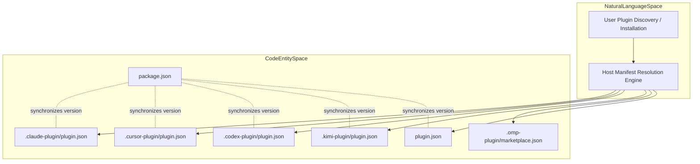
**Diagram: Cross-Platform Plugin Metadata Manifest Structure**

Sources:
[.claude-plugin/plugin.json:1-20](),
[.cursor-plugin/plugin.json:1-25](),
[.codex-plugin/plugin.json:1-45](),
[plugin.json:1-20](),
[package.json:1-54]()

---

## Agent Plugins Specification Conformance

The `agent-plugins` specification standardizes AI agent extensions, but strict conformance to its `$schema` at the root manifest level is intentionally omitted to avoid host-specific breakage [tests/codex-skill-prompt-budget.test.ts:15-38](). 

Host-specific constraints govern this behavior:
- **Codex Prompt Budget:** Codex >= 0.147 truncates each Agent Plugin `SKILL.md` to `8000` bytes (`CODEX_MAX_SKILL_PROMPT_BYTES`) [tests/codex-skill-prompt-budget.test.ts:9-37](). Skills exceeding this threshold are cataloged in the `OVER_BUDGET` set [tests/codex-skill-prompt-budget.test.ts:48-51]().
- **oh-my-pi Frontmatter Restrictions:** oh-my-pi rejects any `SKILL.md` containing frontmatter keys outside its closed set (disallowing Claude Code specific keys such as `argument-hint` and `disable-model-invocation`) [tests/codex-skill-prompt-budget.test.ts:13-15]().

Consequently, the root `plugin.json` intentionally omits the `agent-plugins` `$schema` prefix to prevent strict validation rejections on unsupported hosts [tests/codex-skill-prompt-budget.test.ts:96-102](). Version synchronization and metadata consistency are enforced via release automation scripts [package.json:33-36]().

Sources:
[tests/codex-skill-prompt-budget.test.ts:9-51](),
[tests/codex-skill-prompt-budget.test.ts:96-102](),
[package.json:33-36]()

---

## Repository-Local Configuration

Project-level configuration is managed via machine-local YAML files stored under `.compound-engineering/config.local.yaml`, which should be excluded from version control [skills/ce-setup/SKILL.md:50-51]().

### Configuration Keys Consumed by Skills

Skills reference local settings to govern model dispatch, artifact paths, and feedback integrations:

| Category | Key | Purpose |
| :--- | :--- | :--- |
| **Model Routing** | `plan_model` / `brainstorm_model` | Assigns dedicated models for planning and brainstorming sessions [tests/skills/ce-setup-check-health.test.ts:114-115](). |
| **Execution Engine** | `work_engine_mode` | Controls execution isolation behavior for `ce-work` [tests/skills/ce-setup-check-health.test.ts:141](). |
| **Artifact Storage** | `docs_root` | Configures the destination root for solutions, plans, and ideation directories [skills/ce-setup/SKILL.md:22](). |
| **Feedback Sweep** | `feedback_sources` | Defines external integration sources for `ce-sweep` [tests/skills/ce-setup-check-health.test.ts:92](). |

Sources:
[skills/ce-setup/SKILL.md:15-25](),
[tests/skills/ce-setup-check-health.test.ts:72-141]()

---

## Environment Initialization and Health Check Integration

The initialization workflow is orchestrated by the `ce-setup` skill, which verifies configuration health, validates requirements, and migrates legacy layouts.

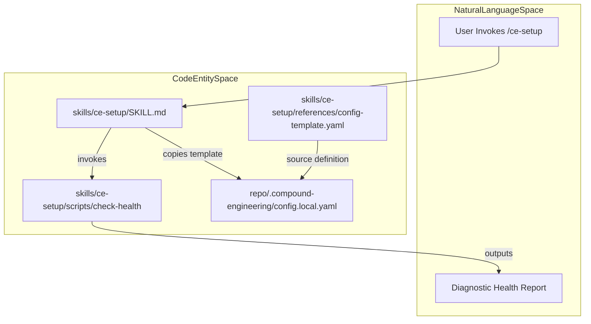
**Diagram: Setup Command to Configuration Templates and Health Scripts**

Sources:
[skills/ce-setup/SKILL.md:27-60](),
[skills/ce-setup/SKILL.md:97-103](),
[tests/skills/ce-setup-check-health.test.ts:20-39]()

---

# Page: Skills — Core Workflow

# Skills — Core Workflow

<details>
<summary>Relevant source files</summary>

The following files were used as context for generating this wiki page:

- [docs/guides/README.md](docs/guides/README.md)
- [docs/guides/ce-bakeoff.md](docs/guides/ce-bakeoff.md)
- [docs/guides/ce-brainstorm.md](docs/guides/ce-brainstorm.md)
- [docs/guides/ce-plan.md](docs/guides/ce-plan.md)
- [skills/ce-bakeoff/SKILL.md](skills/ce-bakeoff/SKILL.md)
- [skills/ce-brainstorm/SKILL.md](skills/ce-brainstorm/SKILL.md)
- [skills/ce-brainstorm/references/reasoning-elevation.md](skills/ce-brainstorm/references/reasoning-elevation.md)
- [skills/ce-compound/SKILL.md](skills/ce-compound/SKILL.md)
- [skills/ce-debug/references/bakeoff.md](skills/ce-debug/references/bakeoff.md)
- [skills/ce-plan/SKILL.md](skills/ce-plan/SKILL.md)
- [skills/ce-plan/references/bakeoff.md](skills/ce-plan/references/bakeoff.md)
- [skills/ce-plan/references/reasoning-elevation.md](skills/ce-plan/references/reasoning-elevation.md)
- [skills/ce-pov/SKILL.md](skills/ce-pov/SKILL.md)
- [skills/ce-pov/references/cross-model-panel.md](skills/ce-pov/references/cross-model-panel.md)
- [skills/ce-pov/references/method.md](skills/ce-pov/references/method.md)
- [skills/ce-strategy/SKILL.md](skills/ce-strategy/SKILL.md)
- [skills/ce-sweep/SKILL.md](skills/ce-sweep/SKILL.md)
- [skills/ce-sweep/references/interview.md](skills/ce-sweep/references/interview.md)
- [tests/pov-skill-contract.test.ts](tests/pov-skill-contract.test.ts)

</details>


Overview of the compound-engineering skill catalog organized by lifecycle phase (`strategy/ideate` → `brainstorm` → `plan` → `work/debug` → `review` → `compound`). As a parent page, this document summarizes the high-level architecture and routing rules across the core phases. For detailed reference material, see the child pages linked throughout.

Sources: `[docs/guides/README.md:13-30]()`, `[skills/ce-plan/SKILL.md:9-10]()`

## Core Lifecycle and Architecture

The following diagram illustrates the lifecycle progression from natural language intent to code entities and durable knowledge repositories.

**Diagram: Lifecycle Pipeline from Natural Language to Code Entity Space**

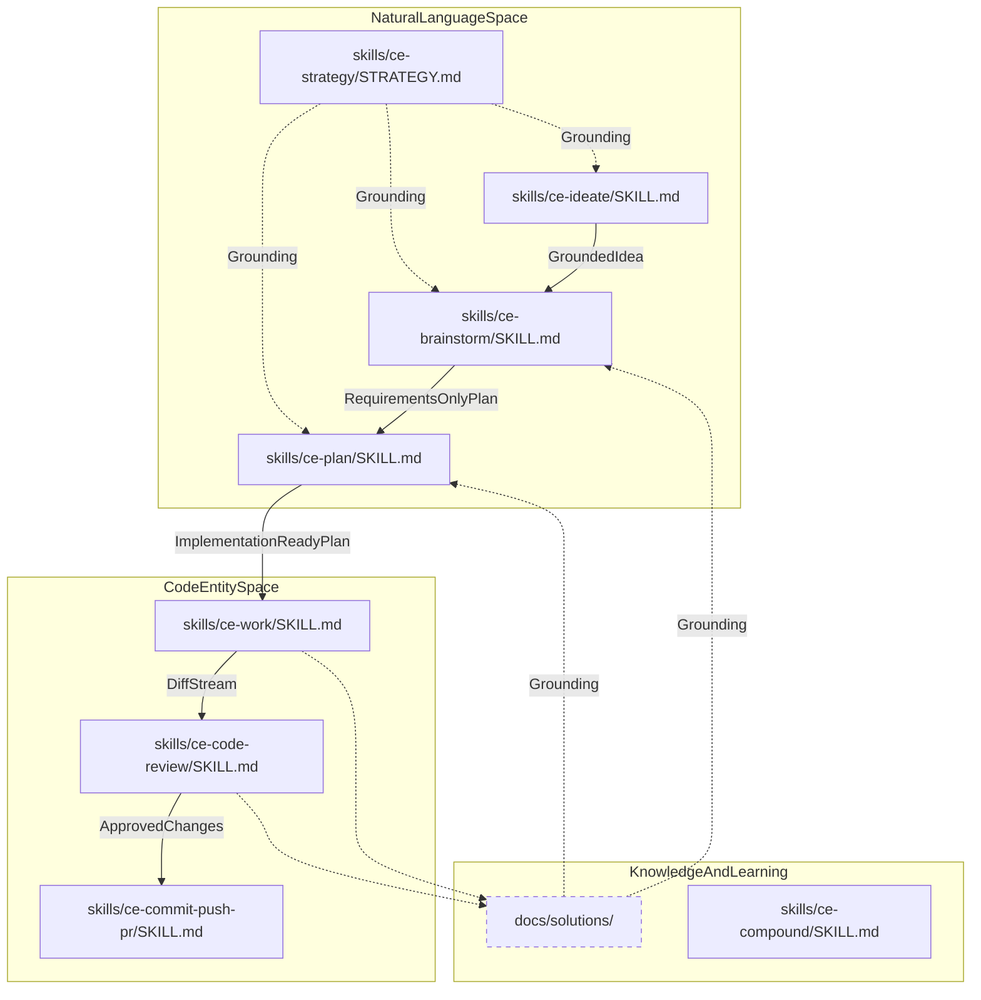

Sources: `[docs/guides/README.md:13-46]()`, `[skills/ce-strategy/SKILL.md:9-10]()`

---

## 3.1 Ideation and Strategy Skills

These upstream skills establish project direction, product strategy, and scope gates before execution begins. 

*   **`ce-strategy`**: Creates and maintains `STRATEGY.md`, serving as the primary upstream anchor for ideation, brainstorming, and planning `[skills/ce-strategy/SKILL.md:9-10]()`.
*   **`ce-ideate`**: Executes divergent and convergent ideation, issue intelligence, and web research caching `[docs/guides/README.md:41-41]()`.
*   **`ce-product-pulse`**: Generates time-windowed observation reports on usage, performance, and errors `[docs/guides/README.md:56-56]()`.
*   **`ce-pov`**: Evaluates external-adoption questions, document takes, and approach sets against project and external grounding floors, returning structured verdicts (`Adopt`, `Trial`, `Hold`, `Reject`, `Not-our-problem`) `[skills/ce-pov/SKILL.md:9-15]()`, `[skills/ce-pov/references/method.md:44-48]()`.

For details, see [Ideation and Strategy Skills](#3.1).

Sources: `[skills/ce-strategy/SKILL.md:9-10]()`, `[skills/ce-pov/SKILL.md:9-15]()`, `[docs/guides/README.md:41-56]()`

---

## 3.2 Brainstorm and Plan Skills

These skills define **WHAT** needs to be built through structured dialogue, scoping tiers, and comprehensive planning artifacts.

*   **`ce-brainstorm`**: Explores vague ideas via interactive dialogue, visual probes, and scoping gates, producing a requirements-only unified plan artifact `[skills/ce-brainstorm/SKILL.md:9-15]()`.
*   **`ce-plan`**: Enriches requirements into a durable implementation-ready plan containing atomic Implementation Units (U-IDs), test scenarios, and dependency mappings `[docs/guides/ce-plan.md:28-30]()`.
*   **Reasoning Elevation**: Both skills support delegating reasoning-heavy tasks (approach generation or plan authoring) to a user-chosen, higher-capability model via `references/reasoning-elevation.md` `[skills/ce-brainstorm/references/reasoning-elevation.md:1-5]()`.
*   **`ce-bakeoff`**: Independently develops and compares competing solutions when technical choices remain open `[docs/guides/README.md:68-68]()`.

For details, see [Brainstorm and Plan Skills](#3.2).

Sources: `[skills/ce-brainstorm/SKILL.md:9-15]()`, `[docs/guides/ce-plan.md:28-30]()`, `[skills/ce-brainstorm/references/reasoning-elevation.md:1-5]()`, `[docs/guides/README.md:68-68]()`

---

## 3.3 Work and Debug Skills

This phase executes implementation-ready plans and troubleshoots runtime failures.

*   **`ce-work`**: Manages input triage, execution strategies, the implementation loop, and shipping workflows `[skills/ce-work/SKILL.md:3-4]()`.
*   **`ce-debug`**: Investigates root causes, executes fixes in pipeline mode, and coordinates post-fix handoffs `[skills/ce-debug/SKILL.md:3-4]()`.
*   **`/lfg`**: Orchestrates autonomous multi-phase pipelines linking planning, execution, review, and compounding `[docs/guides/README.md:104-104]()`.

For details, see [Work and Debug Skills](#3.3).

Sources: `[skills/ce-work/SKILL.md:3-4]()`, `[skills/ce-debug/SKILL.md:3-4]()`, `[docs/guides/README.md:104-104]()`

---

## 3.4 Review and Quality Skills

Quality assurance and review-family skills validate code and documentation against explicit standards.

*   **`ce-code-review`**: Executes a multi-stage review pipeline using persona catalogs, confidence anchors, and quote-the-line gates `[skills/ce-code-review/SKILL.md:40]()`.
*   **`ce-doc-review`**: Applies multi-lens analysis to requirements and plan documents `[docs/guides/README.md:74-74]()`.
*   **`ce-simplify-code` & `ce-optimize`**: Refine changed code and pursue metric-driven optimization loops `[docs/guides/README.md:75-76]()`.
*   **`ce-noslop`**: Enforces strict prose standards across written output `[docs/guides/ce-proof.md:1-2]()`.

For details, see [Review and Quality Skills](#3.4).

Sources: `[skills/ce-code-review/SKILL.md:40]()`, `[docs/guides/README.md:74-76]()`, `[docs/guides/ce-proof.md:1-2]()`

---

## 3.5 Knowledge and Learning Skills

Captures institutional memory and maintains session continuity across interactions.

*   **`ce-compound`**: Records verified solved problems into durable solution files under `<root>/solutions/` with grounding validation `[skills/ce-compound/SKILL.md:9-11]()`.
*   **`ce-compound-refresh`**: Manages solution lifecycles (Keep, Update, Consolidate, Replace, Delete) `[docs/guides/README.md:58-58]()`.
*   **`ce-explain` & `ce-handoff`**: Provide deep evidence-backed explanations and cross-session continuity `[docs/guides/README.md:70-70]()`, `[docs/guides/ce-handoff.md:1-2]()`.

For details, see [Knowledge and Learning Skills](#3.5).

Sources: `[skills/ce-compound/SKILL.md:9-11]()`, `[docs/guides/README.md:58-70]()`

---

## 3.6 Git, Collaboration, and Utility Skills

Handles version control operations, PR management, and prototyping helpers.

*   **`ce-commit` & `ce-commit-push-pr`**: Manage local commits, branch creation, and PR description generation `[docs/guides/README.md:93-94]()`.
*   **`ce-babysit-pr` & `ce-sweep`**: Handle autonomous PR observation, CI debugging, and feedback pipeline sweeping `[docs/guides/README.md:95-95]()`, `[skills/ce-sweep/SKILL.md:3-4]()`.
*   **`ce-prototype`, `ce-dogfood`, `ce-test-browser`, `ce-retune`**: Support UI craft loops, QA workflows, browser automation, and model retuning `[docs/guides/README.md:71-85]()`.

For details, see [Git, Collaboration, and Utility Skills](#3.6).

Sources: `[docs/guides/README.md:93-95]()`, `[skills/ce-sweep/SKILL.md:3-4]()`, `[docs/guides/README.md:71-85]()`

---

# Page: Ideation and Strategy Skills

# Ideation and Strategy Skills

<details>
<summary>Relevant source files</summary>

The following files were used as context for generating this wiki page:

- [docs/guides/ce-ideate.md](docs/guides/ce-ideate.md)
- [docs/plans/2026-07-20-001-feat-cross-tracker-issue-ideation-plan.md](docs/plans/2026-07-20-001-feat-cross-tracker-issue-ideation-plan.md)
- [docs/plans/2026-10-28-1016-fix-ce-ideate-drop-evidence-scouts-plan.md](docs/plans/2026-10-28-1016-fix-ce-ideate-drop-evidence-scouts-plan.md)
- [docs/solutions/skill-design/prefetched-evidence-dossiers-vs-read-and-cite-rule.md](docs/solutions/skill-design/prefetched-evidence-dossiers-vs-read-and-cite-rule.md)
- [skills/ce-ideate/SKILL.md](skills/ce-ideate/SKILL.md)
- [skills/ce-ideate/references/agents/issue-intelligence-analyst.md](skills/ce-ideate/references/agents/issue-intelligence-analyst.md)
- [skills/ce-ideate/references/agents/slack-researcher.md](skills/ce-ideate/references/agents/slack-researcher.md)
- [skills/ce-ideate/references/agents/web-researcher.md](skills/ce-ideate/references/agents/web-researcher.md)
- [skills/ce-ideate/references/decomposition.md](skills/ce-ideate/references/decomposition.md)
- [skills/ce-ideate/references/divergent-ideation.md](skills/ce-ideate/references/divergent-ideation.md)
- [skills/ce-ideate/references/grounding.md](skills/ce-ideate/references/grounding.md)
- [skills/ce-ideate/references/issue-intelligence.md](skills/ce-ideate/references/issue-intelligence.md)
- [skills/ce-ideate/references/post-ideation-workflow.md](skills/ce-ideate/references/post-ideation-workflow.md)
- [skills/ce-ideate/references/scope-gates.md](skills/ce-ideate/references/scope-gates.md)
- [skills/ce-ideate/references/universal-ideation.md](skills/ce-ideate/references/universal-ideation.md)
- [skills/ce-ideate/references/user-research-artifacts.md](skills/ce-ideate/references/user-research-artifacts.md)
- [skills/ce-ideate/references/web-research-cache.md](skills/ce-ideate/references/web-research-cache.md)
- [skills/ce-product-pulse/SKILL.md](skills/ce-product-pulse/SKILL.md)
- [skills/ce-product-pulse/references/config.md](skills/ce-product-pulse/references/config.md)
- [skills/ce-product-pulse/references/interview.md](skills/ce-product-pulse/references/interview.md)
- [skills/ce-product-pulse/references/run.md](skills/ce-product-pulse/references/run.md)
- [skills/ce-product-pulse/references/setup.md](skills/ce-product-pulse/references/setup.md)
- [tests/skill-eval-cell/packs/ce-ideate-run-scaling.md](tests/skill-eval-cell/packs/ce-ideate-run-scaling.md)
- [tests/skills/ce-ideate-dispatch-contracts.test.ts](tests/skills/ce-ideate-dispatch-contracts.test.ts)
- [tests/skills/ce-ideate-generation-contract-parity.test.ts](tests/skills/ce-ideate-generation-contract-parity.test.ts)

</details>


## Purpose and Scope

Ideation and Strategy skills form the extreme upstream of the Compound Engineering workflow. These skills are designed to discover "what is worth doing" before any scoping or planning occurs. They emphasize **grounding over speculation**, using parallel sub-agents to research the codebase, external prior art, and institutional knowledge.

The core skills in this category include:
- `ce-ideate`: Divergent-then-convergent discovery across software and non-software domains [skills/ce-ideate/SKILL.md:8-18]().
- `ce-pov`: A decisive judgment skill for evaluating external inputs (libraries, patterns, CVEs) against the project [skills/ce-pov/SKILL.md:7-13]().
- `ce-strategy`: Long-term anchoring and roadmap alignment (documented via `STRATEGY.md`) [skills/ce-strategy/SKILL.md:1-12]().
- `ce-product-pulse`: Time-windowed reporting on product health and progress [skills/ce-product-pulse/SKILL.md:1-17]().
- `ce-explain`: A teaching skill that creates durable visual artifacts to bridge the learning gap in agent-driven development [skills/ce-explain/SKILL.md:7-11]().

Sources: [skills/ce-ideate/SKILL.md:8-18](), [skills/ce-pov/SKILL.md:7-13](), [skills/ce-strategy/SKILL.md:1-12](), [skills/ce-product-pulse/SKILL.md:1-17](), [skills/ce-explain/SKILL.md:7-11]()

---

## Skill Architecture and Data Flow

The Ideation and Strategy phase bridges the gap between vague user intent and concrete project requirements. It utilizes a "Dual-Grounding" philosophy, requiring evidence from both the **Project Space** (code, issues, docs) and the **External Space** (web research, prior art).

### Entity Mapping: Intent to Code

The following diagram maps high-level strategic goals to the specific code entities and data sinks that implement them.

```mermaid
graph TD
    subgraph "Natural Language Space"
        Intent_Discover[""What should we build next?""]
        Intent_Judge[""Should we use this new library?""]
        Intent_Strategy[""What is our long-term goal?""]
        Intent_Pulse[""How is the product doing?""]
        Intent_Explain[""Teach me how this works""]
    end

    subgraph "Code Entity Space (Skills & Agents)"
        Skill_Ideate[""ce-ideate (skills/ce-ideate/SKILL.md)""]
        Skill_POV[""ce-pov (skills/ce-pov/SKILL.md)""]
        Skill_Strategy[""ce-strategy (skills/ce-strategy/SKILL.md)""]
        Skill_ProductPulse[""ce-product-pulse (skills/ce-product-pulse/SKILL.md)""]
        Skill_Explain[""ce-explain (skills/ce-explain/SKILL.md)""]
        
        Agent_Ground[""project-grounding-scout""]
        Agent_Web[""external-evidence-researcher""]
        Agent_Precedent[""precedent-activity-scout""]
        Agent_Recap[""work-recap-scout""]
        Agent_IssueIntel[""issue-intelligence-analyst (skills/ce-ideate/references/issue-intelligence.md)""]
    end

    subgraph "Data Sinks & Artifacts"
        Doc_Ideation[""<scratch-dir>/web-research-cache.json, <root>/ideation/*.html""]
        Doc_POV[""<root>/solutions/ (via ce-compound)""]
        Doc_Strategy[""STRATEGY.md""]
        Doc_Pulse[""<root>/pulse-reports/YYYY-MM-DD_HH-MM.md""]
        Doc_Explain[""<root>/explainers/*.md""]
    end

    Intent_Discover --> Skill_Ideate
    Intent_Judge --> Skill_POV
    Intent_Strategy --> Skill_Strategy
    Intent_Pulse --> Skill_ProductPulse
    Intent_Explain --> Skill_Explain

    Skill_Ideate --> Agent_IssueIntel
    Skill_Ideate --> Doc_Ideation
    Skill_POV --> Agent_Ground
    Skill_POV --> Agent_Web
    Skill_POV --> Agent_Precedent
    
    Skill_Explain --> Agent_Recap
    Skill_Explain --> Doc_Explain

    Agent_Ground --> Doc_POV
    
    Skill_Strategy --> Doc_Strategy
    Skill_ProductPulse --> Doc_Pulse
```

Sources: [skills/ce-ideate/SKILL.md:12-18](), [skills/ce-ideate/references/issue-intelligence.md:1-44](), [skills/ce-ideate/references/web-research-cache.md:1-56](), [skills/ce-product-pulse/SKILL.md:17-19](), [skills/ce-strategy/SKILL.md:1-12](), [skills/ce-pov/SKILL.md:7-13](), [skills/ce-explain/SKILL.md:7-11]()

---

## ce-ideate: Discovery and Divergent-Convergent Pattern

`ce-ideate` is the primary discovery skill. It uses a divergent-then-convergent engine to generate candidates across six conceptual frames and subjects them to adversarial critique [skills/ce-ideate/SKILL.md:8-18](), [docs/guides/ce-ideate.md:5-7]().

### Execution Pipeline

The skill follows a strict phase-based execution to prevent low-quality outputs:

1. **Phase 0 (Resume and Scope):** Resolves `OUTPUT_FORMAT` (default `html`) [skills/ce-ideate/references/post-ideation-workflow.md:51-52](). This phase also handles subject identification and mode classification (repo, elsewhere-software, elsewhere-non-software, surprise-me, issue-tracker intent) via scope gates [skills/ce-ideate/references/scope-gates.md:1-66]().
2. **Phase 1 (Grounding):** Parallel agents pull from the codebase, `<root>/solutions/`, and the open web [skills/ce-ideate/references/grounding.md:5-8](). This includes `issue-intelligence` for issue-tracker intent [skills/ce-ideate/references/grounding.md:61-64]() and `web-research-cache` for efficient web research caching [skills/ce-ideate/references/web-research-cache.md:1-20](). User-supplied research files are routed through distillers into absolute paths under `<scratch-dir>` [skills/ce-ideate/references/user-research-artifacts.md:13-21]().
3. **Phase 1.5 (Topic-Surface Decomposition):** Decomposes the topic into 3-5 orthogonal axes in repo mode [skills/ce-ideate/references/decomposition.md:1-33](). Skipped for atomic subjects or in `surprise-me` mode [skills/ce-ideate/references/decomposition.md:29-31]().
4. **Phase 2 (Divergent Ideation):** Six frames (Pain and friction; Inversion, removal, or automation; Leverage and compounding; Cross-domain analogy; Assumption-breaking and reframing; Constraint-flipping) generate candidates [skills/ce-ideate/references/divergent-ideation.md:9-10](). In `issue-tracker` mode, themes become the frames [skills/ce-ideate/references/divergent-ideation.md:13-17]().
5. **Phase 3 (Adversarial Filtering):** Critically reviews every candidate idea. A fresh-context verifier checks basis validity (`direct:`, `external:`, `reasoned:`) and tests meeting-standards, followed by orchestrator arbitration [skills/ce-ideate/references/post-ideation-workflow.md:7-14]().
6. **Phase 4 (Write and Present):** Automatically writes the ideation artifact to `<root>/ideation/` or the run's scratch directory [skills/ce-ideate/references/post-ideation-workflow.md:44-60]().

Sources: [skills/ce-ideate/SKILL.md:8-18](), [skills/ce-ideate/references/post-ideation-workflow.md:1-60](), [skills/ce-ideate/references/grounding.md:1-69](), [skills/ce-ideate/references/scope-gates.md:1-66]()

### Model Tiering in Ideation

`ce-ideate` uses cost-tiered dispatch to optimize performance:
- **Extraction Tier:** Evidence scouts and distillers (cheapest model) [skills/ce-ideate/references/divergent-ideation.md:3](), [skills/ce-ideate/references/user-research-artifacts.md:16]().
- **Generation Tier:** Evidence-driven frames (mid-tier model) [skills/ce-ideate/references/divergent-ideation.md:9-10]().
- **Ceiling Tier:** Ceiling ideation frames and synthesis (strongest model) [skills/ce-ideate/references/divergent-ideation.md:10-11]().

The fleet size and model tiers vary based on modes like `surprise-me`, `go deep`, and `tactical scope` [skills/ce-ideate/references/divergent-ideation.md:12-17]().

#### Ideation Fleet Variants
```mermaid
graph TD
    subgraph "ce-ideate Fleet Variants"
        Default["Default"] --> Default_Agents[""5 agents (3 generation-tier, 2 ceiling-tier)""]
        Default_Agents --> Default_Frames[""6 frames (Pain, Inversion, Leverage, Analogy, Assumption-breaking, Constraint-flipping)""]
        Default_Agents --> Default_Volume[""~6-8 ideas per frame""]

        SurpriseMe[""surprise-me / go deep""] --> SurpriseMe_Agents[""6 agents, all ceiling-tier""]
        SurpriseMe_Agents --> SurpriseMe_Frames[""6 frames, one each""]
        SurpriseMe_Agents --> SurpriseMe_Volume[""Default volume""]

        TacticalScope[""tactical scope""] --> TacticalScope_Agents[""5 agents (same as default)""]
        TacticalScope_Agents --> TacticalScope_Frames[""6 frames (same as default)""]
        TacticalScope_Agents --> TacticalScope_Volume[""~3-4 ideas per frame, waived floor""]

        IssueTracker[""issue-tracker mode""] --> IssueTracker_Agents[""4 agents, generation-tier""]
        IssueTracker_Agents --> IssueTracker_Frames[""Themes become frames (max 4)""]
        IssueTracker_Agents --> IssueTracker_Volume[""~24-32 raw ideas total""]
    end
```
Sources: [skills/ce-ideate/references/divergent-ideation.md:5-34](), [skills/ce-ideate/references/post-ideation-workflow.md:11-12]()

### Web Research Cache

`ce-ideate` utilizes a web research cache to avoid redundant external queries. The cache stores results in JSON format under `<scratch-dir>/web-research-cache.json` [skills/ce-ideate/references/web-research-cache.md:7-21]().

The cache key is composed of:
- `mode`: `repo`, `elsewhere-software`, or `elsewhere-non-software` [skills/ce-ideate/references/web-research-cache.md:11]().
- `focus_hint_normalized`: Lowercase, whitespace-collapsed focus hint [skills/ce-ideate/references/web-research-cache.md:12]().
- `topic_surface_hash`: A short hash of the user-supplied topic content [skills/ce-ideate/references/web-research-cache.md:13](). For repo mode, this includes a stable repo discriminator (e.g. `git remote get-url origin` or absolute path) [skills/ce-ideate/references/web-research-cache.md:45-50]().

Before dispatching `web-researcher`, the skill checks for existing cache entries across sibling run-id directories within the `SCRATCH_ROOT` [skills/ce-ideate/references/web-research-cache.md:23-31](). If a match is found, the cached result is reused. A `re-research` override forces a fresh dispatch [skills/ce-ideate/references/web-research-cache.md:36]().

Sources: [skills/ce-ideate/references/web-research-cache.md:1-56]()

---

## ce-strategy: Product Strategy Document

`ce-strategy` is responsible for creating and maintaining `STRATEGY.md` at the repository root [skills/ce-strategy/SKILL.md:9-11]().

### Boundaries and Principles
- **Anchor, not plan:** Focuses on "what" and "why," not features or schedules [skills/ce-strategy/SKILL.md:17]().
- **User answers, repo grounds:** The user provides strategy; the repo provides context for sharper questions [skills/ce-strategy/SKILL.md:18]().
- **Short is a feature:** Pushes back on expansion [skills/ce-strategy/SKILL.md:19]().

Sources: [skills/ce-strategy/SKILL.md:1-59]()

---

## ce-product-pulse: Time-Windowed Product Reports

`ce-product-pulse` generates compact, single-page reports on product health from configured data sources, saving them to `<root>/pulse-reports/` [skills/ce-product-pulse/SKILL.md:17-19]().

### Boundaries and Principles
- **Read-only:** Does not mutate the product or external systems [skills/ce-product-pulse/SKILL.md:23-24]().
- **No PII:** Saved reports must not contain personally identifiable information [skills/ce-product-pulse/SKILL.md:25]().
- **Single page:** Targets 30-40 lines [skills/ce-product-pulse/SKILL.md:26]().

Sources: [skills/ce-product-pulse/SKILL.md:1-80]()

---

## ce-pov: Project-Grounded Verdicts

`ce-pov` is the judgment skill that evaluates external inputs (libraries, patterns, CVEs) and returns a graded verdict (`Adopt / Trial / Hold / Reject / Not-our-problem`) [skills/ce-pov/references/method.md:38-45](). It enforces dual-grounding floors (Project Floor and External Floor) [skills/ce-pov/references/method.md:25-27]() and produces a standardized report schema [skills/ce-pov/references/method.md:48-52]().

Sources: [skills/ce-pov/SKILL.md:55-64](), [skills/ce-pov/references/method.md:1-64]()

---

## Universal Mode and Strategy Boundaries

Strategy and ideation skills support "Universal Mode," allowing them to operate on non-software topics like naming, narrative, or business strategy via `references/universal-ideation.md` [skills/ce-ideate/references/universal-ideation.md:1-5]().

Sources: [skills/ce-ideate/SKILL.md:3-4](), [skills/ce-ideate/references/universal-ideation.md:1-65]()

---

# Page: Brainstorm and Plan Skills

# Brainstorm and Plan Skills

<details>
<summary>Relevant source files</summary>

The following files were used as context for generating this wiki page:

- [docs/guides/README.md](docs/guides/README.md)
- [docs/guides/ce-bakeoff.md](docs/guides/ce-bakeoff.md)
- [docs/guides/ce-brainstorm.md](docs/guides/ce-brainstorm.md)
- [docs/guides/ce-plan.md](docs/guides/ce-plan.md)
- [docs/solutions/skill-design/confirmations-filter-by-salience-not-length-caps.md](docs/solutions/skill-design/confirmations-filter-by-salience-not-length-caps.md)
- [skills/ce-bakeoff/SKILL.md](skills/ce-bakeoff/SKILL.md)
- [skills/ce-brainstorm/SKILL.md](skills/ce-brainstorm/SKILL.md)
- [skills/ce-brainstorm/references/approaches.md](skills/ce-brainstorm/references/approaches.md)
- [skills/ce-brainstorm/references/dialogue.md](skills/ce-brainstorm/references/dialogue.md)
- [skills/ce-brainstorm/references/interaction-rules.md](skills/ce-brainstorm/references/interaction-rules.md)
- [skills/ce-brainstorm/references/phase-0.md](skills/ce-brainstorm/references/phase-0.md)
- [skills/ce-brainstorm/references/plan-write.md](skills/ce-brainstorm/references/plan-write.md)
- [skills/ce-brainstorm/references/reasoning-elevation.md](skills/ce-brainstorm/references/reasoning-elevation.md)
- [skills/ce-brainstorm/references/settled-decisions.md](skills/ce-brainstorm/references/settled-decisions.md)
- [skills/ce-brainstorm/references/synthesis-summary.md](skills/ce-brainstorm/references/synthesis-summary.md)
- [skills/ce-brainstorm/references/universal-brainstorming.md](skills/ce-brainstorm/references/universal-brainstorming.md)
- [skills/ce-compound/SKILL.md](skills/ce-compound/SKILL.md)
- [skills/ce-debug/references/bakeoff.md](skills/ce-debug/references/bakeoff.md)
- [skills/ce-doc-review/references/dispatch.md](skills/ce-doc-review/references/dispatch.md)
- [skills/ce-doc-review/references/subagent-template.md](skills/ce-doc-review/references/subagent-template.md)
- [skills/ce-explain/references/orchestration.md](skills/ce-explain/references/orchestration.md)
- [skills/ce-plan/SKILL.md](skills/ce-plan/SKILL.md)
- [skills/ce-plan/references/bakeoff.md](skills/ce-plan/references/bakeoff.md)
- [skills/ce-plan/references/deepening-workflow.md](skills/ce-plan/references/deepening-workflow.md)
- [skills/ce-plan/references/final-review.md](skills/ce-plan/references/final-review.md)
- [skills/ce-plan/references/intake.md](skills/ce-plan/references/intake.md)
- [skills/ce-plan/references/reasoning-elevation.md](skills/ce-plan/references/reasoning-elevation.md)
- [skills/ce-plan/references/research.md](skills/ce-plan/references/research.md)
- [skills/ce-plan/references/settled-decisions.md](skills/ce-plan/references/settled-decisions.md)
- [skills/ce-plan/references/structure.md](skills/ce-plan/references/structure.md)
- [skills/ce-plan/references/synthesis-summary.md](skills/ce-plan/references/synthesis-summary.md)
- [skills/ce-pov/SKILL.md](skills/ce-pov/SKILL.md)
- [skills/ce-pov/references/cross-model-panel.md](skills/ce-pov/references/cross-model-panel.md)
- [skills/ce-pov/references/grounding.md](skills/ce-pov/references/grounding.md)
- [skills/ce-pov/references/method.md](skills/ce-pov/references/method.md)
- [skills/ce-strategy/SKILL.md](skills/ce-strategy/SKILL.md)
- [skills/ce-sweep/SKILL.md](skills/ce-sweep/SKILL.md)
- [skills/ce-sweep/references/interview.md](skills/ce-sweep/references/interview.md)
- [skills/ce-sweep/references/run.md](skills/ce-sweep/references/run.md)
- [tests/pov-skill-contract.test.ts](tests/pov-skill-contract.test.ts)
- [tests/skills/ce-plan-handoff-routing.test.ts](tests/skills/ce-plan-handoff-routing.test.ts)

</details>


The `ce-brainstorm` and `ce-plan` skills form the critical bridge between a vague idea and executable code. While `ce-brainstorm` focuses on the **WHAT** (collaborative definition and requirements), `ce-plan` focuses on the **HOW** (technical decisions, implementation units, and test scenarios) [skills/ce-plan/SKILL.md:9-11](). Together, they produce a **Unified Plan** artifact that evolves from `requirements-only` to `implementation-ready` [docs/guides/ce-plan.md:30-30]().

For details on the shared contract, requirements schema, U-IDs, contract tests, and rendering rules across these skills, see [Unified Plan Artifact Contract](#3.2.1).

---

## ce-brainstorm: Scoping and Definition

`ce-brainstorm` is a collaborative thinking partner that clarifies scope and pressure-tests premises before any code is considered [docs/guides/ce-brainstorm.md:5-7](). It operates on a "one question at a time" principle to ensure high-quality, focused dialogue [skills/ce-brainstorm/SKILL.md:46-48]().

### Phase 0: Output, Resume, and Scope
The initial phase of `ce-brainstorm` involves determining the output mode, checking for existing plans to resume, and classifying the task domain (`references/phase-0.md`). This phase sets the skill's trajectory, including whether to route to universal brainstorming for non-software tasks [skills/ce-brainstorm/SKILL.md:54-55]().

### Dialogue
The core of `ce-brainstorm` is its structured dialogue (`references/dialogue.md`), which aims to understand the user's idea, pressure-test assumptions, and identify blindspots [skills/ce-brainstorm/SKILL.md:56-56](). The skill asks one question at a time, prioritizing blocking questions through the host's tools [skills/ce-brainstorm/references/interaction-rules.md:1-12]().

### Visual Probes
For decisions that are spatial or behavioral, the skill can launch a **visual probe**—a disposable, low-fidelity sketch or local server that allows the user to judge a rough layout or flow in the browser rather than reading prose [docs/guides/ce-brainstorm.md:84-85](). This is governed by specific tripwires in Phase 0.1–0.4 [skills/ce-brainstorm/SKILL.md:55-55]().

### Universal Brainstorming
When `ce-brainstorm` identifies a task as non-software, it routes to `references/universal-brainstorming.md` [skills/ce-brainstorm/SKILL.md:17-18](). This path replaces standard software phases, focusing on a facilitation mode for non-software topics like events, business decisions, or strategic roadmaps [docs/guides/ce-brainstorm.md:7-9]().

### Handoff
Upon completion, `ce-brainstorm` presents a mandatory handoff menu in Phase 4 (`references/handoff.md`) [skills/ce-brainstorm/SKILL.md:59-60](). This menu allows the user to choose the next step, such as creating an implementation plan with `ce-plan` or shipping autonomously with `/lfg` [skills/ce-brainstorm/references/handoff.md:88-90](). In `mode:return-to-caller`, the result is returned directly to the calling skill without presenting a menu [skills/ce-brainstorm/references/handoff.md:10-31]().

```mermaid
graph TD
    subgraph "Natural Language Space"
        UserIdea["User Idea / Problem"]
    end

    subgraph "ce-brainstorm Workflow"
        A[/"ce-brainstorm"\]
        B["Phase 0: Output, Resume, Scope""]
        C["Dialogue (references/dialogue.md)""]
        D{"Is it non-software?"}
        E["Universal Brainstorming (references/universal-brainstorming.md)""]
        F["Visual Probes (references/visual-probes.md)""]
        G["Phase 2: Approaches, Synthesis, Verification""]
        H["Phase 3: Write Plan (references/brainstorm-sections.md)""]
        I["Phase 4: Handoff (references/handoff.md)""]
    end

    subgraph "Code & Artifact Space"
        UnifiedPlanArtifact["Unified Plan Artifact (requirements-only)"]
        VisualProbeServer["scripts/visual-probe-server.js"]
    end

    UserIdea --> A
    A --> B
    B --> C
    C --> D
    D -- "Yes" --> E
    D -- "No" --> F
    F --> G
    E --> G
    G --> H
    H --> UnifiedPlanArtifact
    H --> I
    F -- "Visual decision needed" --> VisualProbeServer
```
Sources: [skills/ce-brainstorm/SKILL.md:1-68](), [skills/ce-brainstorm/references/dialogue.md:1-12](), [skills/ce-brainstorm/references/handoff.md:1-185](), [skills/ce-brainstorm/references/phase-0.md:1-15](), [skills/ce-brainstorm/references/universal-brainstorming.md:1-12](), [skills/ce-brainstorm/references/visual-probes.md:1-12](), [docs/guides/ce-brainstorm.md:1-270]()

---

## ce-plan: Technical Strategy and Guardrails

`ce-plan` enriches the Unified Plan with execution guardrails. It focuses on capturing the technical "what" and "how" (files, units, test scenarios) without pre-writing implementation code [skills/ce-plan/SKILL.md:11-14]().

### Intake
The `ce-plan` skill begins with intake (Phase 0.2) defined in `references/intake.md` [skills/ce-plan/SKILL.md:43-46](). This involves finding and preserving upstream artifacts, routing out to bootstrap work if necessary, handling blocking questions, and executing scoping synthesis (`references/synthesis-summary.md`) [skills/ce-plan/references/synthesis-summary.md:1-15]().

### Research
Phases 1–4 of `ce-plan` are dedicated to research and composition [skills/ce-plan/SKILL.md:45-50](). `references/research.md` guides the gathering of local context via `repo-research-analyst`, external documentation searches, and Compound Pack resolution (`scripts/packs-resolve.py`) [skills/ce-plan/references/research.md:1-56]().

### Plan Sections
The plan is composed from `references/plan-sections.md`, which defines the structure and content of the implementation-ready Unified Plan artifact, including stable U-IDs for implementation units, technical design notes, and verification contracts [skills/ce-plan/SKILL.md:49-51]().

### Deepening
After the initial plan is written, `ce-plan` enters a deepening phase (Phase 5.3.2) as part of its final review workflow (`references/deepening-workflow.md`) [skills/ce-plan/SKILL.md:51-57](). This involves refining the plan based on confidence checks and dispatching parallel sub-agents to explore edge cases and integration boundaries.

### Final Review
Phase 5 of `ce-plan` focuses on review, writing, deepening, and handoff (`references/final-review.md`) [skills/ce-plan/SKILL.md:51-57](). It defines pre-write reviews, metadata validation, confidence modes, and final user handoffs.

### Resume
`ce-plan` supports resuming existing plans (`references/resume.md`), enriching requirements-only plans into implementation-ready plans, and deepening existing specs [skills/ce-plan/SKILL.md:43-44]().

```mermaid
graph TD
    subgraph "Natural Language Space"
        UserRequest["User Request / Brainstorm Artifact"]
    end

    subgraph "ce-plan Workflow"
        A[/"ce-plan"\]
        B["Phase 0: Output, Resume, Scope (references/resume.md, references/intake.md)""]
        C["Phases 1-4: Research & Compose (references/research.md, references/plan-sections.md)""]
        D["Phase 5: Review, Write, Deepen, Handoff (references/final-review.md, references/deepening-workflow.md)""]
        E["Final Review & Confidence Check"]
        F["Handoff / Resume"]
    end

    subgraph "Code & Artifact Space"
        UnifiedPlanArtifact["Unified Plan Artifact (implementation-ready)"]
        RepoCode["Repository Code"]
        DocsSolutions["docs/solutions/ (Learnings)"]
    end

    UserRequest --> A
    A --> B
    B --> C
    C --> D
    D --> E
    E --> F
    C -- "Research" --> RepoCode
    C -- "Research" --> DocsSolutions
    D --> UnifiedPlanArtifact
```
Sources: [skills/ce-plan/SKILL.md:1-57](), [skills/ce-plan/references/deepening-workflow.md:1-15](), [skills/ce-plan/references/final-review.md:1-15](), [skills/ce-plan/references/research.md:1-56](), [skills/ce-plan/references/resume.md:1-15](), [docs/guides/ce-plan.md:1-30]()

---

## Reasoning Elevation and Bakeoff

Both `ce-brainstorm` and `ce-plan` leverage **reasoning elevation** (`references/reasoning-elevation.md`) to handle reasoning-heavy tasks by dispatching more capable models or specialized prompt adapters [skills/ce-brainstorm/SKILL.md:57-58]().

### Reasoning Elevation
The elevated steps include:
- **`ce-plan`**: Interpreting complex research findings and authoring architectural plans [skills/ce-plan/SKILL.md:54-55]().
- **`ce-brainstorm`**: Generating diverse and robust approach options [skills/ce-brainstorm/SKILL.md:57-58]().

Activation resolution follows a clear precedence: explicit user instructions, caller-provided carriers (such as `/lfg` passing `plan_model:<alias>`), and workspace configuration keys (`plan_model` or `brainstorm_model`) [skills/ce-plan/SKILL.md:54-55]().

### Bakeoff
A **bakeoff** (`ce-bakeoff`) independently develops and selects competing implementation approaches to improve brainstorming and planning decisions [docs/guides/ce-bakeoff.md:1-5](). Planning runs it automatically when a costly technical choice remains unconstrained, while brainstorming invokes it on explicit request or complex branch points [docs/guides/ce-bakeoff.md:6-10]().

```mermaid
graph TD
    subgraph "Skill Execution"
        A[/"ce-brainstorm"\]
        B[/"ce-plan"\]
    end

    subgraph "Reasoning Elevation"
        C["Activation Resolution"]
        D{"Model Chosen?"}
        E["Adapter Selection"]
        F["Elevated Model Execution"]
    end

    subgraph "Model & Config Space"
        UserIntent["User Intent"]
        CallerCarrier["Caller Carrier (plan_model:opus)"]
        ConfigKeys["config.yaml (plan_model, brainstorm_model)"]
        NativeHarness["Native In-Harness Dispatch"]
        ClaudeCLI["scripts/elevation-dispatch.sh"]
        SessionModel["Inline on Session Model (Fallback)"]
    end

    subgraph "Bakeoff"
        G[/"ce-bakeoff"\]
        H["Competing Approaches"]
    end

    A --> C
    B --> C
    C --> UserIntent
    C --> CallerCarrier
    C --> ConfigKeys
    C --> D
    D -- "Yes" --> E
    D -- "No" --> F
    E --> NativeHarness
    E --> ClaudeCLI
    E --> SessionModel
    F --> A
    F --> B
    A -- "Request Bakeoff" --> G
    B -- "Request Bakeoff" --> G
    G --> H
```
Sources: [skills/ce-brainstorm/SKILL.md:54-59](), [skills/ce-plan/SKILL.md:54-57](), [docs/guides/ce-bakeoff.md:1-15]()

---

# Page: Unified Plan Artifact Contract

# Unified Plan Artifact Contract

<details>
<summary>Relevant source files</summary>

The following files were used as context for generating this wiki page:

- [skills/ce-brainstorm/references/brainstorm-sections.md](skills/ce-brainstorm/references/brainstorm-sections.md)
- [skills/ce-brainstorm/references/handoff.md](skills/ce-brainstorm/references/handoff.md)
- [skills/ce-brainstorm/references/html-rendering.md](skills/ce-brainstorm/references/html-rendering.md)
- [skills/ce-brainstorm/references/markdown-rendering.md](skills/ce-brainstorm/references/markdown-rendering.md)
- [skills/ce-ideate/references/html-rendering.md](skills/ce-ideate/references/html-rendering.md)
- [skills/ce-ideate/references/ideation-sections.md](skills/ce-ideate/references/ideation-sections.md)
- [skills/ce-ideate/references/markdown-rendering.md](skills/ce-ideate/references/markdown-rendering.md)
- [skills/ce-plan/references/html-rendering.md](skills/ce-plan/references/html-rendering.md)
- [skills/ce-plan/references/markdown-rendering.md](skills/ce-plan/references/markdown-rendering.md)
- [skills/ce-plan/references/plan-handoff.md](skills/ce-plan/references/plan-handoff.md)
- [skills/ce-plan/references/plan-sections.md](skills/ce-plan/references/plan-sections.md)
- [skills/ce-plan/references/resume.md](skills/ce-plan/references/resume.md)
- [skills/ce-plan/references/universal-planning.md](skills/ce-plan/references/universal-planning.md)
- [tests/skills/ce-brainstorm-output-mode.test.ts](tests/skills/ce-brainstorm-output-mode.test.ts)
- [tests/skills/ce-ideate-output-mode.test.ts](tests/skills/ce-ideate-output-mode.test.ts)
- [tests/skills/ce-plan-output-mode.test.ts](tests/skills/ce-plan-output-mode.test.ts)
- [tests/skills/html-output-invariants.test.ts](tests/skills/html-output-invariants.test.ts)
- [tests/skills/unified-plan-artifact-contract.test.ts](tests/skills/unified-plan-artifact-contract.test.ts)

</details>


## Purpose and Scope

This page details the **Unified Plan Artifact Contract**, the shared schema, invariant rules, rendering specifications, and validation mechanisms governing implementation plan artifacts produced and consumed across the `ce-brainstorm` and `ce-plan` skills within the codebase (`[skills/ce-brainstorm/SKILL.md]`, `[skills/ce-plan/SKILL.md]()`). It outlines stable plan artifact sections, required metadata keys, Unit ID (`U-ID`) conventions, contract test coverage in `[tests/skills/unified-plan-artifact-contract.test.ts]()`, and format-specific rendering rules (`[skills/ce-plan/references/plan-sections.md]()`, `[skills/ce-brainstorm/references/brainstorm-sections.md]()`).

This contract guarantees a deterministic, uniform artifact interface for downstream consumers such as `ce-work`, `ce-doc-review`, human readers, and automated execution engines.

Sources: `[tests/skills/unified-plan-artifact-contract.test.ts:1-145]()`, `[skills/ce-plan/references/plan-sections.md:1-110]()`, `[skills/ce-brainstorm/references/brainstorm-sections.md:1-129]()`

---

## 1. Overview of the Unified Plan Artifact Contract

The **Unified Plan Artifact** is a single authoritative file moving through progressive lifecycle phases:
- **`ce-brainstorm`** (`[skills/ce-brainstorm/references/brainstorm-sections.md]()`) produces requirements-only skeleton artifacts.
- **`ce-plan`** (`[skills/ce-plan/references/plan-sections.md]()`) enriches these skeletons in place into implementation-ready plans featuring technical design, unit breakdown, verification contracts, and definition of done criteria.
- **`ce-work`** (`[skills/ce-work/SKILL.md]()`) consumes the final implementation-ready artifact to execute structured units of work.

Key metadata frontmatter requirements enforced by `[tests/skills/unified-plan-artifact-contract.test.ts]()`:
- `artifact_contract: ce-unified-plan/v1`: Declares compliance with the unified schema.
- `product_contract_source`: Tracks origin (e.g., `ce-brainstorm`, `ce-plan-bootstrap`).
- `execution`: Classifies execution domain (`code` for software features, `knowledge-work` for non-code deliverables).
- **Absence of mutable status fields**: Older `artifact_readiness` fields and general `status` fields are explicitly prohibited to prevent state drift (`[skills/ce-plan/references/plan-sections.md:41-42]()`).

Sources: `[tests/skills/unified-plan-artifact-contract.test.ts:124-133]()`, `[skills/ce-plan/references/plan-sections.md:22-44]()`

---

## 2. Section ID Registry and Artifact Schema

Unified plan artifacts organize content into stable logical sections. Downstream skills grep or anchor-scan for these canonical headings and HTML anchor IDs before parsing bodies (`[skills/ce-plan/references/plan-sections.md:45-92]()`):

| Logical Section | Markdown Heading | HTML id | Reader / Agent Use |
|---|---|---|---|
| Goal Capsule | `## Goal Capsule` | `goal-capsule` | Objective (outcome), Means (chosen approach), authority hierarchy, stop conditions |
| Product Contract | `## Product Contract` | `product-contract` | Requirements, actors, flows, acceptance examples, product scope |
| Product Requirements | `### Requirements` under Product Contract | `product-requirements` | Requirement extraction for review and implementation trace |
| Planning Contract | `## Planning Contract` | `planning-contract` | KTDs, technical design, assumptions, sequencing |
| Implementation Units | `## Implementation Units` | `implementation-units` | `U-ID` work packets (`U1.`, `U2.`) for execution |
| Verification Contract | `## Verification Contract` | `verification-contract` | Repo-specific test commands and quality gates |
| Definition of Done | `## Definition of Done` | `definition-of-done` | Global and per-unit completion criteria |
| Appendix | `## Appendix` | `appendix` | Long research, raw notes, or supporting detail |

Sources: `[skills/ce-plan/references/plan-sections.md:45-67]()`, `[skills/ce-brainstorm/references/brainstorm-sections.md:23-68]()`

---

## 3. Contract Validation and Test Enforcement

Contract invariants are verified by test suites such as `[tests/skills/unified-plan-artifact-contract.test.ts]()`, which reads reference documents and validates structural compliance. Output format configuration is governed by tests like `[tests/skills/ce-plan-output-mode.test.ts]()` and `[tests/skills/ce-brainstorm-output-mode.test.ts]()`.

Key validation rules:
- **Mandatory Metadata Tags**: Asserts the presence of `artifact_contract: ce-unified-plan/v1` (`[tests/skills/unified-plan-artifact-contract.test.ts:125]()`).
- **Forbidden Fields**: Asserts the complete absence of `artifact_readiness` and `status` fields (`[tests/skills/unified-plan-artifact-contract.test.ts:126-132]()`).
- **Section ID Anchors**: Verifies all required section IDs (`goal-capsule`, `product-contract`, `product-requirements`, `planning-contract`, `implementation-units`, `verification-contract`, `definition-of-done`) are present in `[skills/ce-plan/references/plan-sections.md]()`.

Sources: `[tests/skills/unified-plan-artifact-contract.test.ts:123-145]()`, `[tests/skills/ce-plan-output-mode.test.ts:37-80]()`

---

## 4. Markdown and HTML Rendering Rules

Artifact rendering is separated from content structure through dedicated format references:
- Markdown: `[skills/ce-plan/references/markdown-rendering.md]()`, `[skills/ce-brainstorm/references/markdown-rendering.md]()`
- HTML: `[skills/ce-plan/references/html-rendering.md]()`, `[skills/ce-brainstorm/references/html-rendering.md]()`

Key HTML rendering invariants tested in `[tests/skills/html-output-invariants.test.ts]()`:
- **Single Self-Contained File**: No companion `.css`, `.js`, or `.svg` files (`[skills/ce-plan/references/html-rendering.md:21-25]()`).
- **Visible Metadata Only**: No hidden JSON frontmatter blocks (`<script type="application/json">`) or `<meta name="created">` / `<meta name="origin">` tags (`[tests/skills/html-rendering.md:26-32]()`, `[tests/skills/html-output-invariants.test.ts:30-52]()`).
- **Stable IDs**: Every ID-bearing item (`R-`, `U-`, `KTD-`, etc.) carries an `id="..."` anchor attribute and displays the ID textually (`[tests/skills/html-rendering.md:44-46]()`).
- **Source and Composition Footer**: A visible footer (`<footer class="composition-signal">`) records composition timestamps and upstream sources (`[tests/skills/html-rendering.md:54-58]()`, `[tests/skills/html-output-invariants.test.ts:65-81]()`).

Sources: `[skills/ce-plan/references/html-rendering.md:1-64]()`, `[tests/skills/html-output-invariants.test.ts:1-105]()`

---

## 5. Diagrams: Bridging Natural Language Space to Code Entity Space

### Diagram 1: Artifact Lifecycle Flow and Code Entity Mapping

```mermaid
graph TD
    subgraph "Natural Language Space"
      NL1["User Prompt / Dialogue"]
      NL2["Brainstorm Discussion Session"]
    end

    subgraph "Code Entity Space - Producers & References"
      CE1["skills/ce-brainstorm/SKILL.md"]
      CE2["skills/ce-brainstorm/references/brainstorm-sections.md"]
      CE3["skills/ce-plan/SKILL.md"]
      CE4["skills/ce-plan/references/plan-sections.md"]
    end

    subgraph "Unified Plan Artifact & Consumers"
      ART["plans/YYYY-MM-DD-HHMM-type-topic-plan.md/html"]
      CONS["skills/ce-work/SKILL.md"]
    end

    NL1 -->|Trigger| CE1
    NL2 -->|Structure Content| CE2
    CE1 -->|Writes Skeleton| ART
    ART -->|In-place Enrichment| CE3
    CE4 -->|Validates Sections| CE3
    CE3 -->|Implementation-Ready Plan| ART
    ART -->|Parsed by U-ID| CONS
```
Sources: `[skills/ce-brainstorm/SKILL.md]`, `[skills/ce-plan/SKILL.md]`, `[skills/ce-plan/references/plan-sections.md:22-44]()`, `[skills/ce-brainstorm/references/brainstorm-sections.md:23-35]()`

### Diagram 2: Validation and Rendering Architecture

```mermaid
graph LR
    subgraph "Natural Language Space"
      UReq["User Format Request / Config Preference"]
    end

    subgraph "Code Entity Space - Tests & Renderers"
      T1["tests/skills/unified-plan-artifact-contract.test.ts"]
      T2["tests/skills/ce-plan-output-mode.test.ts"]
      T3["tests/skills/html-output-invariants.test.ts"]
      R1["skills/ce-plan/references/html-rendering.md"]
      R2["skills/ce-plan/references/markdown-rendering.md"]
    end

    subgraph "Generated Output Artifacts"
      OHTML["Self-Contained HTML Document"]
      OMD["Markdown Document"]
    end

    UReq -->|Resolves OUTPUT_FORMAT| T2
    T2 -->|Enforces Rules| R1
    T2 -->|Enforces Rules| R2
    T1 -->|Asserts Contract Invariants| OHTML
    T1 -->|Asserts Contract Invariants| OMD
    T3 -->|Validates HTML Invariants| OHTML
```
Sources: `[tests/skills/unified-plan-artifact-contract.test.ts:1-145]()`, `[tests/skills/ce-plan-output-mode.test.ts:37-120]()`, `[tests/skills/html-output-invariants.test.ts:1-142]()`, `[skills/ce-plan/references/html-rendering.md:1-64]()`

---

## Sources

- `[tests/skills/unified-plan-artifact-contract.test.ts:1-145]()`
- `[skills/ce-plan/references/plan-sections.md:1-110]()`
- `[skills/ce-brainstorm/references/brainstorm-sections.md:1-129]()`
- `[skills/ce-plan/references/plan-handoff.md:1-55]()`
- `[tests/skills/ce-plan-output-mode.test.ts:1-150]()`
- `[skills/ce-brainstorm/references/handoff.md:1-92]()`
- `[skills/ce-plan/references/html-rendering.md:1-126]()`
- `[tests/skills/html-output-invariants.test.ts:1-142]()`
- `[tests/skills/ce-ideate-output-mode.test.ts:1-145]()`

---

# Page: Work and Debug Skills

# Work and Debug Skills

<details>
<summary>Relevant source files</summary>

The following files were used as context for generating this wiki page:

- [CONCEPTS.md](CONCEPTS.md)
- [docs/guides/ce-debug.md](docs/guides/ce-debug.md)
- [docs/solutions/skill-design/right-size-plans-by-subtraction-and-a-usage-first-sizing-test.md](docs/solutions/skill-design/right-size-plans-by-subtraction-and-a-usage-first-sizing-test.md)
- [skills/ce-debug/SKILL.md](skills/ce-debug/SKILL.md)
- [skills/ce-debug/references/fix.md](skills/ce-debug/references/fix.md)
- [skills/ce-debug/references/investigate.md](skills/ce-debug/references/investigate.md)
- [skills/ce-debug/references/pipeline-mode.md](skills/ce-debug/references/pipeline-mode.md)
- [skills/ce-debug/references/post-fix-handoff.md](skills/ce-debug/references/post-fix-handoff.md)
- [skills/ce-debug/references/return-to-caller.md](skills/ce-debug/references/return-to-caller.md)
- [skills/ce-work/SKILL.md](skills/ce-work/SKILL.md)
- [skills/ce-work/references/agents/implementation-worker.md](skills/ce-work/references/agents/implementation-worker.md)
- [skills/ce-work/references/cross-model-execution.md](skills/ce-work/references/cross-model-execution.md)
- [skills/ce-work/references/execution-strategy.md](skills/ce-work/references/execution-strategy.md)
- [skills/ce-work/references/implementation-loop.md](skills/ce-work/references/implementation-loop.md)
- [skills/ce-work/references/review-findings-followup.md](skills/ce-work/references/review-findings-followup.md)
- [skills/ce-work/references/shipping-workflow.md](skills/ce-work/references/shipping-workflow.md)
- [skills/ce-work/references/work-intake.md](skills/ce-work/references/work-intake.md)
- [skills/ce-work/scripts/unit_workspace_state.py](skills/ce-work/scripts/unit_workspace_state.py)
- [skills/lfg/SKILL.md](skills/lfg/SKILL.md)
- [skills/lfg/references/debug-return.md](skills/lfg/references/debug-return.md)
- [tests/pipeline-review-contract.test.ts](tests/pipeline-review-contract.test.ts)
- [tests/skill-eval-cell/fixtures/debug-caller-edits/SPEC.md](tests/skill-eval-cell/fixtures/debug-caller-edits/SPEC.md)
- [tests/skill-eval-cell/fixtures/debug-caller-edits/package.json](tests/skill-eval-cell/fixtures/debug-caller-edits/package.json)
- [tests/skill-eval-cell/fixtures/debug-caller-edits/src/seat-cap.js](tests/skill-eval-cell/fixtures/debug-caller-edits/src/seat-cap.js)
- [tests/skill-eval-cell/fixtures/debug-caller-edits/tests/seat-cap.check.js](tests/skill-eval-cell/fixtures/debug-caller-edits/tests/seat-cap.check.js)
- [tests/skill-eval-cell/fixtures/debug-sibling-consumer/DIAGNOSIS.md](tests/skill-eval-cell/fixtures/debug-sibling-consumer/DIAGNOSIS.md)
- [tests/skill-eval-cell/packs/ce-work-sizing.md](tests/skill-eval-cell/packs/ce-work-sizing.md)
- [tests/skills/ce-work-outcome-spine.test.ts](tests/skills/ce-work-outcome-spine.test.ts)
- [tests/skills/ce-work-unit-workspace-init.test.ts](tests/skills/ce-work-unit-workspace-init.test.ts)
- [tests/skills/lfg-intake-contract.test.ts](tests/skills/lfg-intake-contract.test.ts)

</details>


This page details the **Work** and **Debug** execution skills within the `compound-engineering-plugin`: `ce-work` and `ce-debug`. These skills represent the core execution phase of the engineering lifecycle, transforming validated plans or bug reports into verified code and structured delivery artifacts [skills/ce-work/SKILL.md:3](), [skills/ce-debug/SKILL.md:3]().

---

## ce-work: Execution and Implementation

`ce-work` is the primary execution engine. It takes a plan (ideally from `ce-plan`), a specification path, or a clear build request and executes the implementation against defined guardrails [skills/ce-work/SKILL.md:3](). It treats plans as decision artifacts, allowing the agent to determine the best implementation path while strictly respecting the plan's scope, task boundaries, and verification criteria [skills/ce-work/SKILL.md:14]().

For deep technical details on unit workspace python helpers, workspace isolation policies, execution engines, and cross-model scripts, see [Unit Workspaces and Cross-Model Execution](#3.3.1).

### Input Triage, Outcome Spine, and Execution Strategy
Before execution, `ce-work` performs **Phase 0: Input Triage**, checking for direct recovery activations (`run_id`) or parsing modes (`standalone` vs `mode:return-to-caller`) [skills/ce-work/SKILL.md:22-30](). Its **Outcome Spine** defines the exact deliverable, next consumer, done conditions, and intent, ensuring that workers receive bounded units while host orchestrators retain canonical integration authority [skills/ce-work/SKILL.md:9-15](). 

Execution strategy and engine selection balance inline execution for trivial work against parallel subagent waves for structured multi-unit plans, governed by safety and independence checks [skills/ce-work/references/execution-strategy.md:5-15]().

Sources: [skills/ce-work/SKILL.md:9-30](), [skills/ce-work/references/execution-strategy.md:1-25]()

### Implementation Loop and Shipping Workflow
Once tasks start, `SKILLS/ce-work/references/implementation-loop.md` dictates task ordering, test-first or characterization-first evidence selection, incremental commits, and test verification [skills/ce-work/references/implementation-loop.md:3-13](). 

For standalone runs, Phase 3-4 invokes the **Shipping Workflow** (`skills/ce-work/references/shipping-workflow.md`), which enforces core quality checks, conditional simplification via `ce-simplify-code`, mandatory code review via `ce-code-review`, a strict code-review completion gate, and residual findings tracking [skills/ce-work/references/shipping-workflow.md:7-45](). Any review findings needing follow-up are routed through `skills/ce-work/references/review-findings-followup.md`.

Sources: [skills/ce-work/references/implementation-loop.md:1-34](), [skills/ce-work/references/shipping-workflow.md:1-47]()

#### Diagram: ce-work Execution and Shipping Flow
```mermaid
graph TD
    subgraph "Natural Language Space"
        PLAN_DOC["Plan Document (docs/plans/feature.md)"]
        BARE_PROMPT["Bare Work Prompt"]
    end

    subgraph "ce-work Skill (skills/ce-work/SKILL.md)"
        Triage["Phase 0: Input Triage (references/input-triage.md)"]
        QuickStart["Phase 1: Quick Start & Engine Resolution"]
        Execute["Phase 2: Task Execution Loop (references/implementation-loop.md)"]
        QualityCheck["Phase 3-4: Quality & Shipping (references/shipping-workflow.md)"]
    end

    subgraph "Code Entity Space"
        SIMPLIFY["ce-simplify-code"]
        CODE_REVIEW["ce-code-review"]
        FOLLOWUP["review-findings-followup.md"]
        GIT_REPO["Git Repository & Test Suite"]
    end

    PLAN_DOC --> Triage
    BARE_PROMPT --> Triage
    Triage --> QuickStart
    QuickStart --> Execute
    Execute -->|Tasks Complete| QualityCheck
    QualityCheck --> SIMPLIFY
    QualityCheck --> CODE_REVIEW
    CODE_REVIEW --> FOLLOWUP
    FOLLOWUP --> GIT_REPO
```
**Sources:** [skills/ce-work/SKILL.md:1-61](), [skills/ce-work/references/shipping-workflow.md:1-47]()

---

## ce-debug: Systematic Investigation and Fix Loop

`ce-debug` is the investigation-first skill for diagnosing failing behavior, test failures, or bug reports [skills/ce-debug/SKILL.md:3](). It enforces rigorous causal chains before proposing or applying repairs [skills/ce-debug/SKILL.md:11]().

### Investigation, Fix, and Pipeline Mode
The debugging lifecycle moves through five distinct phases: **0 Triage, 1 Investigate, 2 Root Cause, 3 Fix, and 4 Handoff** [skills/ce-debug/SKILL.md:46](). Phase 2 enforces a strict **Causal Chain Gate** preventing fixes until the trigger-to-symptom path is fully accounted for [skills/ce-debug/SKILL.md:56-59](). Phase 3 applies test-first discipline via `skills/ce-debug/references/fix.md`, ensuring minimal root-cause repairs without shotgun debugging [skills/ce-debug/references/fix.md:7-14]().

When invoked by orchestrators (`lfg`, `ce-babysit-pr`), `ce-debug` accepts `mode:pipeline` or `mode:return-to-caller`, running non-interactively, applying convergent fixes while deferring divergent ones, and emitting structured JSON status payloads [skills/ce-debug/SKILL.md:20-23](), [skills/ce-debug/references/pipeline-mode.md:3-48](). Post-fix handoff is governed by `skills/ce-debug/references/post-fix-handoff.md`.

Sources: [skills/ce-debug/SKILL.md:9-59](), [skills/ce-debug/references/fix.md:1-21](), [skills/ce-debug/references/pipeline-mode.md:1-57]()

#### Diagram: ce-debug Diagnostic Flow
```mermaid
graph TD
    subgraph "Natural Language Space"
        BUG_REPORT["Bug Description / Error Log / Issue #123"]
    end

    subgraph "ce-debug Skill (skills/ce-debug/SKILL.md)"
        Triage["Phase 0: Triage (references/investigate.md)"]
        Investigate["Phase 1: Investigate & Reproduce"]
        RootCause["Phase 2: Root Cause & Causal Chain Gate"]
        Fix["Phase 3: Test-First Fix (references/fix.md)"]
        Handoff["Phase 4: Post-Fix Handoff (references/post-fix-handoff.md)"]
    end

    subgraph "Code Entity Space"
        PIPELINE_MODE["references/pipeline-mode.md"]
        RETURN_CALLER["references/return-to-caller.md"]
        TEST_SUITE["Project Test Suite / Regression Tests"]
    end

    BUG_REPORT --> Triage
    Triage --> Investigate
    Investigate --> TEST_SUITE
    Investigate --> RootCause
    RootCause -->|Causal Chain Clear| Fix
    Fix --> TEST_SUITE
    Fix --> Handoff
    Triage -.->|mode:pipeline| PIPELINE_MODE
    Triage -.->|mode:return-to-caller| RETURN_CALLER
```
**Sources:** [skills/ce-debug/SKILL.md:1-59](), [skills/ce-debug/references/investigate.md](), [skills/ce-debug/references/fix.md](), [skills/ce-debug/references/pipeline-mode.md]()

---

# Page: Unit Workspaces and Cross-Model Execution

# Unit Workspaces and Cross-Model Execution

<details>
<summary>Relevant source files</summary>

The following files were used as context for generating this wiki page:

- [docs/plans/2026-08-15-2303-fix-cross-model-verify-warm-checkout-plan.md](docs/plans/2026-08-15-2303-fix-cross-model-verify-warm-checkout-plan.md)
- [docs/plans/2026-09-27-1745-fix-test-stall-watchdog-plan.md](docs/plans/2026-09-27-1745-fix-test-stall-watchdog-plan.md)
- [skills/ce-work/references/execution-engines.md](skills/ce-work/references/execution-engines.md)
- [skills/ce-work/scripts/unit-workspace.py](skills/ce-work/scripts/unit-workspace.py)
- [skills/ce-work/scripts/unit_workspace_ignored.py](skills/ce-work/scripts/unit_workspace_ignored.py)
- [skills/ce-work/scripts/unit_workspace_integration.py](skills/ce-work/scripts/unit_workspace_integration.py)
- [skills/ce-work/scripts/unit_workspace_jobs.py](skills/ce-work/scripts/unit_workspace_jobs.py)
- [skills/ce-work/scripts/unit_workspace_transaction.py](skills/ce-work/scripts/unit_workspace_transaction.py)
- [tests/helpers/process.ts](tests/helpers/process.ts)
- [tests/skills/ce-brainstorm-visual-probe-server.test.ts](tests/skills/ce-brainstorm-visual-probe-server.test.ts)
- [tests/skills/ce-work-cross-model-integration.test.ts](tests/skills/ce-work-cross-model-integration.test.ts)
- [tests/skills/ce-work-unit-workspace-transport.test.ts](tests/skills/ce-work-unit-workspace-transport.test.ts)
- [tests/skills/ce-work-unit-workspace-verification.test.ts](tests/skills/ce-work-unit-workspace-verification.test.ts)
- [tests/skills/helpers/ce-work-workspace-harness.test.ts](tests/skills/helpers/ce-work-workspace-harness.test.ts)
- [tests/skills/helpers/ce-work-workspace-harness.ts](tests/skills/helpers/ce-work-workspace-harness.ts)
- [tests/skills/helpers/run-in-group.py](tests/skills/helpers/run-in-group.py)

</details>


This document details the internal mechanics of `ce-work`'s unit workspaces, focusing on the Python helper modules (`unit_workspace_state.py`, `unit_workspace_transaction.py`, `unit_workspace_jobs.py`, `unit_workspace_ignored.py`), workspace isolation policies, execution engines, and the `cross-model-work.sh` execution and evaluation routes.

## Purpose and Scope

The `ce-work` skill manages task implementation through isolated unit workspaces and dual execution engines (native vs. cross-model). The unit workspace infrastructure ensures crash recovery, atomic canonical integration, and strict repository protection. Python helpers coordinate state management, job record-keeping, and ignored-file diffing without executing model CLIs directly or modifying the canonical checkout prematurely.

Sources:
* [skills/ce-work/references/execution-engines.md:1-5]()
* [skills/ce-work/scripts/unit_workspace_state.py:1-6]()

---

## Unit Workspace Python Helpers

The workspace subsystem relies on modular Python components residing in `skills/ce-work/scripts/`. Each script handles a distinct domain of state persistence, transaction control, preparation/job recording, or ignored-file tracking.

### `unit_workspace_state.py`

`unit_workspace_state.py` serves as the central state manager for run manifests, directory resolution, and validation.

* **Schema Versioning**: Defines `SCHEMA_VERSION = 1` [skills/ce-work/scripts/unit_workspace_state.py:33-33]() for manifest compatibility.
* **Owner Scratch Root**: Resolves temporary directories securely via UID lookup (`geteuid`/`getuid`), falling back to system-wide paths [skills/ce-work/scripts/unit_workspace_state.py:37-41](), [skills/ce-work/scripts/unit_workspace_state.py:127-133]().
* **Runs Root Resolution**: Prioritizes `CE_WORK_RUNS_ROOT`, then `CE_PEER_JOBS_ROOT/ce-work`, and finally the owner scratch root [skills/ce-work/scripts/unit_workspace_state.py:136-143]().
* **Safe ID Validation**: Enforces strict naming constraints via regex for run IDs, unit IDs, and attempt IDs [skills/ce-work/scripts/unit_workspace_state.py:44-44](), [skills/ce-work/scripts/unit_workspace_state.py:146-149]().
* **Git Environment Sanitization**: Scrubs local repository variables (`GIT_ALTERNATE_OBJECT_DIRECTORIES`, `GIT_DIR`, `GIT_WORK_TREE`, etc.) to isolate child processes [skills/ce-work/scripts/unit_workspace_state.py:53-73]().
* **Unit Lifecycles**: Tracks states including `queued`, `authoring`, `authored`, `integration-pending`, `integrated`, `restoring`, `verified`, `committed`, `preserved`, `cleaned`, and `native-completed` [skills/ce-work/scripts/unit_workspace_state.py:49-52]().

#### Diagram: State and Directory Resolution Architecture
```mermaid
graph TD
    subgraph "Python Entity Space"
        A["unit_workspace_state.py"] --> B["_owner_scratch_root()"]
        A --> C["runs_root()"]
        A --> D["safe_id()"]
        A --> E["sanitize_git_env()"]
    end

    subgraph "Natural Language & Environment Space"
        F["CE_WORK_RUNS_ROOT"] --> C
        G["CE_PEER_JOBS_ROOT"] --> C
        H["geteuid() / getuid()"] --> B
        I["Run Manifest Schema v1"] --> A
    end

    C --> J["Run Directories"]
    B --> J
    E --> K["Isolated Git Subprocesses"]
```
Sources:
* [skills/ce-work/scripts/unit_workspace_state.py:33-73]()
* [skills/ce-work/scripts/unit_workspace_state.py:127-149]()

### `unit_workspace_transaction.py`

`unit_workspace_transaction.py` implements fail-stop canonical integration for terminalized external units.

* **Canonical Integration**: Applies patches and tree commits from isolated worker outputs back into the main repository safely.
* **Verification Execution**: Runs configured verification commands (`_verification_command`) to validate integrated changes [skills/ce-work/scripts/unit_workspace_transaction.py:41-48]().
* **Automatic Rollback**: Reverts the repository state via `_restore_owned_verification` if verification fails or exact pre-fold restoration cannot be mathematically proven [skills/ce-work/scripts/unit_workspace_transaction.py:64-111]().
* **Concurrency Locking**: Utilizes `locked_manifest` to prevent race conditions during state transitions [skills/ce-work/scripts/unit_workspace_transaction.py:72-72](), [skills/ce-work/scripts/unit_workspace_transaction.py:94-94]().
* **Verification Logging**: Captures stderr/stdout from verification runs into private log files under `result/` [skills/ce-work/scripts/unit_workspace_transaction.py:113-127]().

Sources:
* [skills/ce-work/scripts/unit_workspace_transaction.py:41-48]()
* [skills/ce-work/scripts/unit_workspace_transaction.py:64-111]()
* [skills/ce-work/scripts/unit_workspace_transaction.py:113-127]()

### `unit_workspace_jobs.py`

`unit_workspace_jobs.py` governs unit preparation (`cmd_prepare`) and retry validations.

* **Preparation Flow**: Validates unit/attempt IDs, computes packet digests, checks for a clean repository state, and provisions authorization structures [skills/ce-work/scripts/unit_workspace_jobs.py:85-144]().
* **Retry Validation (`_validate_retry_base`)**: Verifies that retry requests reference valid canonical commit hashes and preserve required ancestry branches [skills/ce-work/scripts/unit_workspace_jobs.py:18-55]().
* **Wave Head Tracking (`_record_retry_base`)**: Updates wave progression records to authorize multiple attempt heads [skills/ce-work/scripts/unit_workspace_jobs.py:58-82]().

Sources:
* [skills/ce-work/scripts/unit_workspace_jobs.py:18-82]()
* [skills/ce-work/scripts/unit_workspace_jobs.py:85-144]()

### `unit_workspace_ignored.py`

`unit_workspace_ignored.py` tracks changes to git-ignored files during canonical verification passes.

* **Inventorying (`inventory_ignored_state`)**: Performs `lstat` calls across git-ignored filepaths, recording file type, size, modification timestamps, and permissions [skills/ce-work/scripts/unit_workspace_ignored.py:39-59](). Unreadable or locked paths are marked as `uninspectable` rather than causing hard failures [skills/ce-work/scripts/unit_workspace_ignored.py:40-48]().
* **Diffing (`diff_ignored_state`)**: Compares pre-verification and post-verification inventories to produce structured counts and sample arrays of changed, created, or removed ignored files [skills/ce-work/scripts/unit_workspace_ignored.py:67-93]().

Sources:
* [skills/ce-work/scripts/unit_workspace_ignored.py:39-93]()

---

## Workspace Isolation Policy

The workspace isolation model separates external worker processes from the host repository:

* **Detached Worktrees**: External units execute within sibling Git worktrees created under private scratch directories (`/tmp/compound-engineering-<uid>/ce-work/<run-id>/`) [skills/ce-work/references/cross-model-execution.md:50-52]().
* **Index Write Prohibition**: External agents are restricted from modifying the Git index directly (`git add`, `git commit`). The host controller handles snapshotting and commit creation [skills/ce-work/references/cross-model-execution.md:44-48]().
* **Authority Scope Reduction**: Workers inherit restricted authority bounds; they cannot broaden task scopes, trigger pull requests, or alter routing targets [skills/ce-work/references/cross-model-execution.md:41-43](), [skills/ce-work/references/cross-model-work-eval.md:65-66]().
* **Git Environment Scrubbing**: Local git config injection prevention via `unit_workspace_state.py` ensures isolation [skills/ce-work/scripts/unit_workspace_state.py:53-73]().

Sources:
* [skills/ce-work/references/cross-model-execution.md:39-52]()
* [skills/ce-work/references/cross-model-work-eval.md:65-69]()
* [skills/ce-work/scripts/unit_workspace_state.py:53-73]()

---

## Execution Engines

`ce-work` supports multiple execution engines determined by live intent, caller bindings, or standing configurations.

1. **Native (Inline / Subagent)**: Executes tasks directly within the host environment following `references/execution-strategy.md` [skills/ce-work/references/execution-engines.md:3-5]().
2. **Goal-Mode / Dynamic-Workflow**: Specialized pathways for executing implementation-ready unified plans.
3. **Cross-Model Execution**: Dispatches isolated packets to external AI model CLIs through the bundled adapter.

### Engine Resolution Hierarchy
Resolutions follow an ordered precedence from task intent down to fallback execution:
1. Explicit assignment/constraint in the current task [skills/ce-work/references/execution-engines.md:11-13]().
2. Still-active session preferences [skills/ce-work/references/execution-engines.md:14-14]().
3. Typed caller bindings (e.g., LFG pipeline context) [skills/ce-work/references/execution-engines.md:15-16]().
4. Active project instructions and conventions [skills/ce-work/references/execution-engines.md:17-17]().
5. Enabled per-checkout YAML configuration (`config.local.yaml` / `config.yaml`) [skills/ce-work/references/execution-engines.md:32-38](), [skills/ce-work/references/execution-engines.md:42-43]().
6. Native execution fallback [skills/ce-work/references/execution-engines.md:18-18]().

Sources:
* [skills/ce-work/references/execution-engines.md:3-44]()

---

## `cross-model-work.sh` Execution and Evaluation Routes

The `cross-model-work.sh` script (`skills/ce-work/scripts/cross-model-work.sh`) translates unit execution requests into CLI invocations for external models.

### Usage and Invocation Schema
```bash
cross-model-work.sh <authorization-json> <workspace> <unit-packet> <expected-packet-sha256> <result-dir>
```
Introspection mode (`--emit-adapter <route>`) allows inspecting adapter commands without spawning model calls [skills/ce-work/scripts/cross-model-work.sh:14-15]().

### Route Vocabulary and Contracts
Supported routes map to specific harnesses, targets, and default models:
* `codex`: Uses `codex exec` with ephemeral flags and restricted write scopes [skills/ce-work/scripts/cross-model-work.sh:115-126]().
* `claude`: Uses `claude -p` with safe-mode and permission bypasses [skills/ce-work/scripts/cross-model-work.sh:128-135]().
* `grok-cli`: Uses `grok` with disabled auxiliary features [skills/ce-work/scripts/cross-model-work.sh:137-144]().
* `cursor`, `composer`, `grok-cursor`: Uses `cursor-agent` with streaming JSON outputs, sandboxing, and trust flags [skills/ce-work/scripts/cross-model-work.sh:146-158]().
* `opencode`: Uses `opencode run` [skills/ce-work/scripts/cross-model-work.sh:160-163]().

#### Diagram: Cross-Model Execution Flow (`cross-model-work.sh`)
```mermaid
graph TD
    subgraph "Code Entity Space"
        A["unit-workspace.py"] --> B["cross-model-work.sh"]
        B --> C["adapter_argv()"]
        C --> D["Codex CLI"]
        C --> E["Claude CLI"]
        C --> F["Grok CLI"]
        C --> G["Cursor Agent CLI"]
        C --> H["OpenCode CLI"]
    end

    subgraph "Execution Result Space"
        D --> I["Result Directory JSON"]
        E --> I
        F --> I
        G --> I
        H --> I
        I --> J["unit_workspace_transaction.py"]
    end
```
Sources:
* [skills/ce-work/scripts/cross-model-work.sh:6-163]()
* [tests/skills/ce-work-cross-model-routes.test.ts:33-41]()

### Behavioral Evaluation
`references/cross-model-work-eval.md` defines evaluation fixtures and expected response schemas (`selected_engine`, `binding_source`, `requested_route`, `actual_or_next_route`, `egress_before_action`, etc.) to verify cross-model contract integrity across modifications [skills/ce-work/references/cross-model-work-eval.md:3-42]().

Sources:
* [skills/ce-work/references/cross-model-work-eval.md:3-42]()

---

# Page: Review and Quality Skills

# Review and Quality Skills

<details>
<summary>Relevant source files</summary>

The following files were used as context for generating this wiki page:

- [docs/plans/2026-07-13-001-feat-code-review-line-provenance-plan.md](docs/plans/2026-07-13-001-feat-code-review-line-provenance-plan.md)
- [docs/plans/2026-10-14-1147-feat-simplify-test-comment-pruning-plan.md](docs/plans/2026-10-14-1147-feat-simplify-test-comment-pruning-plan.md)
- [docs/solutions/skill-design/anti-poll-scope-and-async-subagent-dispatch.md](docs/solutions/skill-design/anti-poll-scope-and-async-subagent-dispatch.md)
- [docs/solutions/skill-design/cross-harness-cross-model-tool-invocation.md](docs/solutions/skill-design/cross-harness-cross-model-tool-invocation.md)
- [docs/solutions/skill-design/watch-loops-need-a-blocked-external-terminal-state.md](docs/solutions/skill-design/watch-loops-need-a-blocked-external-terminal-state.md)
- [skills/ce-code-review/SKILL.md](skills/ce-code-review/SKILL.md)
- [skills/ce-code-review/references/diff-scope.md](skills/ce-code-review/references/diff-scope.md)
- [skills/ce-code-review/references/dispatch-reviewers.md](skills/ce-code-review/references/dispatch-reviewers.md)
- [skills/ce-code-review/references/finish-review.md](skills/ce-code-review/references/finish-review.md)
- [skills/ce-code-review/references/subagent-template.md](skills/ce-code-review/references/subagent-template.md)
- [skills/ce-code-review/references/validator-batch-template.md](skills/ce-code-review/references/validator-batch-template.md)
- [skills/ce-code-review/scripts/findings-mechanics.py](skills/ce-code-review/scripts/findings-mechanics.py)
- [skills/ce-code-review/scripts/review-scope.py](skills/ce-code-review/scripts/review-scope.py)
- [skills/ce-noslop/SKILL.md](skills/ce-noslop/SKILL.md)
- [skills/ce-noslop/references/patterns.md](skills/ce-noslop/references/patterns.md)
- [skills/ce-simplify-code/SKILL.md](skills/ce-simplify-code/SKILL.md)
- [skills/ce-simplify-code/references/personas/code-quality-reviewer.md](skills/ce-simplify-code/references/personas/code-quality-reviewer.md)
- [skills/ce-simplify-code/references/personas/code-reuse-reviewer.md](skills/ce-simplify-code/references/personas/code-reuse-reviewer.md)
- [skills/ce-simplify-code/references/personas/comment-reviewer.md](skills/ce-simplify-code/references/personas/comment-reviewer.md)
- [skills/ce-simplify-code/references/personas/efficiency-reviewer.md](skills/ce-simplify-code/references/personas/efficiency-reviewer.md)
- [skills/ce-simplify-code/references/personas/test-value-reviewer.md](skills/ce-simplify-code/references/personas/test-value-reviewer.md)
- [tests/ce-code-review-mechanics.test.ts](tests/ce-code-review-mechanics.test.ts)
- [tests/review-skill-contract.test.ts](tests/review-skill-contract.test.ts)
- [tests/skill-eval-cell/fixtures/noslop-drafts/certainty.md](tests/skill-eval-cell/fixtures/noslop-drafts/certainty.md)
- [tests/skill-eval-cell/fixtures/noslop-drafts/choppy.md](tests/skill-eval-cell/fixtures/noslop-drafts/choppy.md)
- [tests/skill-eval-cell/fixtures/noslop-drafts/release-notes.md](tests/skill-eval-cell/fixtures/noslop-drafts/release-notes.md)
- [tests/skill-eval-cell/fixtures/noslop-drafts/status-update.md](tests/skill-eval-cell/fixtures/noslop-drafts/status-update.md)
- [tests/skill-eval-cell/fixtures/review-artifact-quote/correctness.json](tests/skill-eval-cell/fixtures/review-artifact-quote/correctness.json)
- [tests/skill-eval-cell/fixtures/review-artifact-quote/returns.json](tests/skill-eval-cell/fixtures/review-artifact-quote/returns.json)
- [tests/skill-eval-cell/grade.test.ts](tests/skill-eval-cell/grade.test.ts)
- [tests/skill-eval-cell/grade.ts](tests/skill-eval-cell/grade.ts)

</details>


## Purpose and Scope

Review and quality skills provide the structured verification layer of the Compound Engineering workflow. This document covers the multi-persona parallel review pipelines for code and documentation, automated code simplification, metric-driven optimization loops, and prose quality guards. These skills ensure that work produced during the execution phase meets project standards, remains maintainable, and achieves measurable performance goals.

As a parent page, this section provides a high-level overview of the review family. For comprehensive technical details on specific subsystems, refer to the child pages:
- [ce-code-review Pipeline](#3.4.1)
- [ce-optimize — Metric-Driven Optimization](#3.4.2)

Sources: [skills/ce-code-review/SKILL.md:7-12](), [skills/ce-simplify-code/SKILL.md:1-5]()

---

## Overview

The review ecosystem bridges Natural Language Space (intent) to Code Entity Space (execution) through structured verification, multi-persona analysis, and automated refactoring:

1.  **`ce-code-review`**: A multi-persona parallel pipeline for deep technical analysis of code changes. For details, see [ce-code-review Pipeline](#3.4.1).
2.  **`ce-doc-review`**: A parallel analysis pipeline for requirements, plans, and documentation [docs/guides/ce-doc-review.md:3-5]().
3.  **`ce-simplify-code`**: An automated refactoring skill using parallel tidy personas to improve clarity and efficiency without breaking behavior [docs/guides/ce-simplify-code.md:1-5]().
4.  **`ce-noslop`**: A writing skill ensuring prose is free of AI tells and easily understood [skills/ce-noslop/SKILL.md:1-3]().
5.  **`ce-optimize`**: A metric-driven iterative loop for converging on optimal solutions through experimentation. For details, see [ce-optimize — Metric-Driven Optimization](#3.4.2).

Sources: [docs/guides/ce-code-review.md:3-5](), [docs/guides/ce-doc-review.md:3-5](), [docs/guides/ce-simplify-code.md:1-5](), [skills/ce-noslop/SKILL.md:1-3]()

---

## Code Review Pipeline (`ce-code-review`)

`ce-code-review` is the deep verification skill. It analyzes a diff or PR, selects relevant reviewer personas, dispatches them in parallel, and synthesizes findings into a unified report with confidence gating and quote-the-line verification [skills/ce-code-review/SKILL.md:7-33](). 

For full architectural details—including the six-stage execution spine, scope resolution, persona catalogs, fast-pass logic, and findings mechanics—see [ce-code-review Pipeline](#3.4.1).

Sources: [skills/ce-code-review/SKILL.md:7-33]()

---

## Documentation Review (`ce-doc-review`)

`ce-doc-review` provides a multi-persona analysis pipeline for requirements, plans, or specs [docs/guides/ce-doc-review.md:1-5](). It corrects proven errors and returns worthwhile unresolved issues [docs/guides/ce-doc-review.md:3-5]().

### Doc-Content-Aware Persona Selection
`ce-doc-review` selects personas based on the document's content rather than surface keywords. For example, a `product-lens` reviewer activates when a document stakes an unsettled product position, while a `security-lens` activates for auth or sensitive data topics [docs/guides/ce-doc-review.md:85-93](). `coherence-reviewer` and `feasibility-reviewer` run on every review [docs/guides/ce-doc-review.md:94-95]().

Sources: [docs/guides/ce-doc-review.md:1-5](), [docs/guides/ce-doc-review.md:85-95]()

---

## Code Simplification (`ce-simplify-code`)

`ce-simplify-code` performs behavior-preserving refactors to improve clarity and efficiency [skills/ce-simplify-code/SKILL.md:7-8](). It targets current branch changes or user-specified files [skills/ce-simplify-code/SKILL.md:16-24]().

### Simplification Personas
The skill dispatches parallel reviewers to audit code characteristics [skills/ce-simplify-code/SKILL.md:32-41]():
*   **Reuse Reviewer**: Searches for existing utilities or platform guarantees that new code reimplements [skills/ce-simplify-code/references/personas/code-reuse-reviewer.md:1-5]().
*   **Quality Reviewer**: Flags hacky patterns, redundant state, parameter sprawl, and leaky abstractions [skills/ce-simplify-code/references/personas/code-quality-reviewer.md:1-11]().
*   **Efficiency Reviewer**: Finds wasted work, missed concurrency, and hot-path bloat [skills/ce-simplify-code/references/personas/efficiency-reviewer.md:1-7]().

Sources: [skills/ce-simplify-code/SKILL.md:7-41](), [skills/ce-simplify-code/references/personas/code-reuse-reviewer.md:1-5](), [skills/ce-simplify-code/references/personas/code-quality-reviewer.md:1-11](), [skills/ce-simplify-code/references/personas/efficiency-reviewer.md:1-7]()

---

## Writing Quality (`ce-noslop`)

`ce-noslop` is the plugin's writing skill, ensuring prose is free of AI tells and easily understood on the first read while preserving factual content [skills/ce-noslop/SKILL.md:1-3](). It evaluates sentences across multiple registers and operational modes (`author`, `edit`, `detect`) [skills/ce-noslop/SKILL.md:15-32]().

Sources: [skills/ce-noslop/SKILL.md:1-3](), [skills/ce-noslop/SKILL.md:15-32]()

---

## Metric-Driven Optimization (`ce-optimize`)

`ce-optimize` manages structured, metric-driven optimization loops to converge on performance or functional goals via experimentation. For complete details on its optimize-spec schema, measurement loops, and research/judge agents, see [ce-optimize — Metric-Driven Optimization](#3.4.2).

Sources: [docs/guides/ce-code-review.md:3-5]()

---

## System Integration

Title: Review and Quality Data Flow
```mermaid
graph TD
    subgraph "Natural_Language_Space_Intent"
        UserRequest["UserRequest"]
    end

    subgraph "Code_Entity_Space_Execution"
        ceCodeReviewSkill["skills/ce-code-review/SKILL.md"]
        ceDocReviewSkill["skills/ce-doc-review/SKILL.md"]
        ceSimplifyCodeSkill["skills/ce-simplify-code/SKILL.md"]
        ceNoslopSkill["skills/ce-noslop/SKILL.md"]

        CodeReviewPersonas["skills/ce-code-review/references/persona-catalog.md"]
        DocReviewDispatch["skills/ce-doc-review/references/dispatch.md"]
        SimplifyCodePersonas["skills/ce-simplify-code/references/personas/"]
        NoslopPatterns["skills/ce-noslop/references/patterns.md"]

        CodeReviewFindingsSchema["skills/ce-code-review/findings-schema.json"]
        DocReviewSynthesis["skills/ce-doc-review/references/synthesis-and-presentation.md"]
        SimplifyCodeVerification["Typecheck/Lint/Tests"]
        NoslopOutput["RewrittenTextOrFindings"]
    end

    UserRequest -->|Initiates| ceCodeReviewSkill
    UserRequest -->|Initiates| ceDocReviewSkill
    UserRequest -->|Initiates| ceSimplifyCodeSkill
    UserRequest -->|Initiates| ceNoslopSkill

    ceCodeReviewSkill -->|Selects| CodeReviewPersonas
    ceCodeReviewSkill -->|Generates| CodeReviewFindingsSchema
    ceDocReviewSkill -->|Dispatches| DocReviewDispatch
    ceDocReviewSkill -->|Synthesizes| DocReviewSynthesis
    ceSimplifyCodeSkill -->|Uses| SimplifyCodePersonas
    ceSimplifyCodeSkill -->|VerifiesWith| SimplifyCodeVerification
    ceNoslopSkill -->|AppliesRulesFrom| NoslopPatterns
    ceNoslopSkill -->|Produces| NoslopOutput
```

Sources: [skills/ce-code-review/SKILL.md:1-40](), [skills/ce-simplify-code/SKILL.md:1-75](), [skills/ce-noslop/SKILL.md:1-44]()

### Summary of Quality Gates

| Skill | Primary Gate | Artifact | Handoff |
| :--- | :--- | :--- | :--- |
| `ce-code-review` | Confidence Anchor 75+, Quote-the-line | Structured findings report | `apply:local` or `mode:agent` JSON handoff |
| `ce-doc-review` | Persona-based findings, Coherence/Feasibility | Updated markdown/HTML document, proposed fixes | Interactive walkthrough or structured results |
| `ce-simplify-code` | Behavior preservation (typecheck, lint, tests) | Refactored code | Before review, commit, or handoff |
| `ce-noslop` | Seven prose tests (Mechanism, Portability, Actor, etc.) | Rewritten text, detected patterns | Inline invocation or direct output |

Sources: [skills/ce-code-review/SKILL.md:11-37](), [skills/ce-simplify-code/SKILL.md:52-72](), [skills/ce-noslop/SKILL.md:34-44]()

---

# Page: ce-code-review Pipeline

# 3.4.1 ce-code-review Pipeline

<details>
<summary>Relevant source files</summary>

The following files were used as context for generating this wiki page:

- [docs/plans/2026-07-13-001-feat-code-review-line-provenance-plan.md](docs/plans/2026-07-13-001-feat-code-review-line-provenance-plan.md)
- [docs/plans/2026-09-23-001-fix-ce-code-review-unrequested-behavior-rules-plan.md](docs/plans/2026-09-23-001-fix-ce-code-review-unrequested-behavior-rules-plan.md)
- [docs/solutions/skill-design/anti-poll-scope-and-async-subagent-dispatch.md](docs/solutions/skill-design/anti-poll-scope-and-async-subagent-dispatch.md)
- [docs/solutions/skill-design/cross-harness-cross-model-tool-invocation.md](docs/solutions/skill-design/cross-harness-cross-model-tool-invocation.md)
- [docs/solutions/skill-design/named-frameworks-with-detection-conditions-for-review-personas.md](docs/solutions/skill-design/named-frameworks-with-detection-conditions-for-review-personas.md)
- [docs/solutions/skill-design/watch-loops-need-a-blocked-external-terminal-state.md](docs/solutions/skill-design/watch-loops-need-a-blocked-external-terminal-state.md)
- [skills/ce-babysit-pr/references/pipeline.md](skills/ce-babysit-pr/references/pipeline.md)
- [skills/ce-brainstorm/references/model-tiers.md](skills/ce-brainstorm/references/model-tiers.md)
- [skills/ce-code-review/SKILL.md](skills/ce-code-review/SKILL.md)
- [skills/ce-code-review/references/action-class-rubric.md](skills/ce-code-review/references/action-class-rubric.md)
- [skills/ce-code-review/references/depth-paths.md](skills/ce-code-review/references/depth-paths.md)
- [skills/ce-code-review/references/diff-scope.md](skills/ce-code-review/references/diff-scope.md)
- [skills/ce-code-review/references/dispatch-reviewers.md](skills/ce-code-review/references/dispatch-reviewers.md)
- [skills/ce-code-review/references/findings-schema.json](skills/ce-code-review/references/findings-schema.json)
- [skills/ce-code-review/references/finish-input.md](skills/ce-code-review/references/finish-input.md)
- [skills/ce-code-review/references/finish-review.md](skills/ce-code-review/references/finish-review.md)
- [skills/ce-code-review/references/intent-and-plan.md](skills/ce-code-review/references/intent-and-plan.md)
- [skills/ce-code-review/references/modes-and-output.md](skills/ce-code-review/references/modes-and-output.md)
- [skills/ce-code-review/references/persona-catalog.md](skills/ce-code-review/references/persona-catalog.md)
- [skills/ce-code-review/references/personas/adversarial-reviewer.md](skills/ce-code-review/references/personas/adversarial-reviewer.md)
- [skills/ce-code-review/references/personas/api-contract-reviewer.md](skills/ce-code-review/references/personas/api-contract-reviewer.md)
- [skills/ce-code-review/references/personas/correctness-reviewer.md](skills/ce-code-review/references/personas/correctness-reviewer.md)
- [skills/ce-code-review/references/personas/data-migration-reviewer.md](skills/ce-code-review/references/personas/data-migration-reviewer.md)
- [skills/ce-code-review/references/personas/julik-frontend-races-reviewer.md](skills/ce-code-review/references/personas/julik-frontend-races-reviewer.md)
- [skills/ce-code-review/references/personas/maintainability-reviewer.md](skills/ce-code-review/references/personas/maintainability-reviewer.md)
- [skills/ce-code-review/references/personas/security-reviewer.md](skills/ce-code-review/references/personas/security-reviewer.md)
- [skills/ce-code-review/references/personas/testing-reviewer.md](skills/ce-code-review/references/personas/testing-reviewer.md)
- [skills/ce-code-review/references/review-output-template.md](skills/ce-code-review/references/review-output-template.md)
- [skills/ce-code-review/references/scope.md](skills/ce-code-review/references/scope.md)
- [skills/ce-code-review/references/select-and-route.md](skills/ce-code-review/references/select-and-route.md)
- [skills/ce-code-review/references/subagent-template.md](skills/ce-code-review/references/subagent-template.md)
- [skills/ce-code-review/references/validator-batch-template.md](skills/ce-code-review/references/validator-batch-template.md)
- [skills/ce-code-review/scripts/findings-mechanics.py](skills/ce-code-review/scripts/findings-mechanics.py)
- [skills/ce-code-review/scripts/review-scope.py](skills/ce-code-review/scripts/review-scope.py)
- [skills/ce-commit-push-pr/references/apply-and-handoff.md](skills/ce-commit-push-pr/references/apply-and-handoff.md)
- [skills/ce-sweep/references/model-tiers.md](skills/ce-sweep/references/model-tiers.md)
- [skills/ce-test-browser/references/pipeline-orchestration.md](skills/ce-test-browser/references/pipeline-orchestration.md)
- [skills/lfg/references/shipping.md](skills/lfg/references/shipping.md)
- [tests/ce-code-review-mechanics.test.ts](tests/ce-code-review-mechanics.test.ts)
- [tests/review-skill-contract.test.ts](tests/review-skill-contract.test.ts)
- [tests/skill-eval-cell/fixtures/review-artifact-quote/correctness.json](tests/skill-eval-cell/fixtures/review-artifact-quote/correctness.json)
- [tests/skill-eval-cell/fixtures/review-artifact-quote/returns.json](tests/skill-eval-cell/fixtures/review-artifact-quote/returns.json)
- [tests/skill-eval-cell/fixtures/review-validator-veto/run/finish-input.json](tests/skill-eval-cell/fixtures/review-validator-veto/run/finish-input.json)
- [tests/skill-eval-cell/fixtures/review-validator-veto/run/synthesized-findings.json](tests/skill-eval-cell/fixtures/review-validator-veto/run/synthesized-findings.json)
- [tests/skill-eval-cell/fixtures/review-validator-veto/run/validator-outcome.json](tests/skill-eval-cell/fixtures/review-validator-veto/run/validator-outcome.json)

</details>


## Purpose and Scope

The `ce-code-review` skill orchestrates a deterministic, multi-stage code review pipeline within the compound-engineering-plugin ecosystem [skills/ce-code-review/SKILL.md:1-40](). Its goal is to produce actionable, evidence-based findings on a named diff or pull request (PR), evaluating code for bugs, regressions, test coverage, standards compliance, and maintainability, without making unapproved mutations or requiring blocking user interactions [skills/ce-code-review/SKILL.md:9-38](). The pipeline manages multiple specialized reviewer personas, consolidates their output using mechanical rules in helper scripts, validates findings via independent validators, and finally generates comprehensive review reports [skills/ce-code-review/references/finish-review.md:3-33]().

This page documents the full six-stage execution spine, detailing core mechanisms including deterministic scope resolution via `skills/ce-code-review/scripts/review-scope.py`, nuanced persona selection from a modular catalog, dispatching of concurrent reviewers with the embedded "fast-pass" scanner, subagent prompt templating (`skills/ce-code-review/references/subagent-template.md`), confidence anchor policies including the "quote-the-line" gate, mechanized findings deduplication and routing via `skills/ce-code-review/scripts/findings-mechanics.py` and `skills/ce-code-review/references/findings-schema.json`, batches of validator agents (`skills/ce-code-review/references/validator-batch-template.md`), and the finish-review routing that sequences post-collection merges and validations into a final report emission [skills/ce-code-review/references/finish-review.md:1-33]().

Sources: `skills/ce-code-review/SKILL.md:1-41` [skills/ce-code-review/SKILL.md:1-40](), `skills/ce-code-review/references/finish-review.md:1-33` [skills/ce-code-review/references/finish-review.md:1-33]()

---

## 1. Execution Spine Overview

The `ce-code-review` skill implements a six-stage sequential pipeline with strict ordering and isolated responsibilities [skills/ce-code-review/SKILL.md:23-34](). Each stage loads distinct reference documents that encode behavior rules, output contracts, and orchestrator policies [skills/ce-code-review/SKILL.md:25-33](). The execution spine is summarized below:

| Stage | Step Description | Reference File |
|--------|----------------|----------------|
| 0 | Resolve modes and output shape; settle invocation args, conflicts, gateways, and quick review short-circuit. | `skills/ce-code-review/references/modes-and-output.md` [skills/ce-code-review/SKILL.md:27]() |
| 1 | Resolve review scope by inspecting diffs, PR metadata, and local configuration. Apply Review depth gating including the "Lite" early exit. | `skills/ce-code-review/references/scope.md` [skills/ce-code-review/SKILL.md:28]() |
| 2 | Write the intent summary and surface the plan document the final Stage verifies against. | `skills/ce-code-review/references/intent-and-plan.md` [skills/ce-code-review/SKILL.md:29]() |
| 3 | Select reviewer personas guided by diff contents and configured corpora, find applicable project standards, and decide on adversarial review routing (local adversarial vs cross-model peer). | `skills/ce-code-review/references/persona-catalog.md`, `skills/ce-code-review/references/select-and-route.md` [skills/ce-code-review/SKILL.md:30]() |
| 3d | If adversarial cross-model peer is selected and permitted, start the detached peer job asynchronously before local dispatch. | `skills/ce-code-review/references/cross-model-review.md` [skills/ce-code-review/SKILL.md:31]() |
| 4 | Dispatch the selected reviewers as a bounded concurrent batch, collect their terminal outcomes via blocking waits, and incorporate the fast-pass quick scanning findings immediately before launching the batch. | `skills/ce-code-review/references/dispatch-reviewers.md` [skills/ce-code-review/SKILL.md:32]() |
| 5 & 6 | After collection, write the `finish-input.json` state and invoke two leaf subagents in sequence: the merge leaf (fold-in, dedup, confidence filter via `skills/ce-code-review/scripts/findings-mechanics.py`) and the report leaf (launch validator batch, fold validator results, produce final report). | `skills/ce-code-review/references/finish-review.md` [skills/ce-code-review/SKILL.md:33]() |

The spine strictly forbids subagent launches nested inside leaf agents, mandates modular reference loading to avoid exceeding prompt size limits, and ensures that critical behavioral rules enforce no unintended tree mutations, no blocking user asks, and explicit mutability only on `apply:local` [skills/ce-code-review/SKILL.md:33-39]().

**Diagram 1:** ce-code-review Six-Stage Execution Spine and Code Entities

```mermaid
flowchart TB
  subgraph CodeEntitySpace
    SKILL[skills/ce-code-review/SKILL.md]
    MModes[skills/ce-code-review/references/modes-and-output.md]
    MScope[skills/ce-code-review/references/scope.md]
    MIntent[skills/ce-code-review/references/intent-and-plan.md]
    MPersona[skills/ce-code-review/references/persona-catalog.md]
    MRouter[skills/ce-code-review/references/select-and-route.md]
    MDispatch[skills/ce-code-review/references/dispatch-reviewers.md]
    MFinish[skills/ce-code-review/references/finish-review.md]
  end

  subgraph ExecutionSpine
    S0["Stage 0: Modes & Output"] --> S1["Stage 1: Scope Resolution"]
    S1 --> S2["Stage 2: Intent & Plan"]
    S2 --> S3["Stage 3: Persona Selection"]
    S3 --> S3d["Stage 3d: Cross-Model Peer Start"]
    S3d --> S4["Stage 4: Dispatch & Fast-Pass"]
    S4 --> S5["Stage 5: Merge & Validators"]
    S5 --> S6["Stage 6: Report Generation"]
  end

  MModes -.-> S0
  MScope -.-> S1
  MIntent -.-> S2
  MPersona -.-> S3
  MRouter -.-> S3
  MDispatch -.-> S4
  MFinish -.-> S5
  MFinish -.-> S6
```

Sources: `skills/ce-code-review/SKILL.md:23-34` [skills/ce-code-review/SKILL.md:23-34](), `skills/ce-code-review/references/finish-review.md:1-33` [skills/ce-code-review/references/finish-review.md:1-33](), `tests/review-skill-contract.test.ts:131-186` [tests/review-skill-contract.test.ts:131-186]()

---

## 2. Review Scope Resolution

The scope stage (Stage 1) deeply analyzes diff contents, changed files, PR metadata, and local repo configuration to produce a deterministic scope object [skills/ce-code-review/references/scope.md:1-71](). This uses the Python helper script `skills/ce-code-review/scripts/review-scope.py` to categorize changed files (counting executable lines, uncountable files, frontend signals), identify untracked exclusions, detect hard blocks (e.g., CI workflow changes or large diffs), and establish eligibility for the "Lite" review mode [tests/ce-code-review-mechanics.test.ts:44-162]().

Scope resolution returns a JSON object containing:
- `mode`: Review invocation scope mode (`local-aligned`, `standalone`, `pr-remote`, `branch-remote`) [skills/ce-code-review/references/finish-input.md:25-26]()
- `changed_files`: List of repository-relative paths changed in the review [tests/ce-code-review-mechanics.test.ts:58]()
- `changed_lines`, `exec_lines`: Line counts differentiating executable and total lines [tests/ce-code-review-mechanics.test.ts:55-56]()
- `hard_block_full`: Boolean indicating if the review is hard-blocked (e.g., due to uncounted files or migrations) [tests/ce-code-review-mechanics.test.ts:113-120]()
- `lite_eligible`: Optional boolean showing if the review can skip later stages early [tests/ce-code-review-mechanics.test.ts:61]()

**Diagram 2:** Scope Resolution Data Flow

```mermaid
flowchart TB
  subgraph CodeEntitySpace
    Git["git diff / gh pr view"] --> Script[skills/ce-code-review/scripts/review-scope.py]
    Config[.compound-engineering/config.yaml] --> Script
  end

  subgraph OutputSpace
    Script --> ScopeJSON["Scope JSON payload"]
    ScopeJSON --> StageGate["Review Depth Gate"]
  end
```

Sources: `skills/ce-code-review/references/scope.md:1-71` [skills/ce-code-review/references/scope.md:1-71](), `tests/ce-code-review-mechanics.test.ts:10-153` [tests/ce-code-review-mechanics.test.ts:10-153]()

---

## 3. Persona Catalog and Reviewer Selection

At Stage 3, the skill selects a roster of reviewer personas from a categorized catalog, matching reviewers to the diff content and codebase context [skills/ce-code-review/references/persona-catalog.md]().

### Persona Catalog Organization

The catalog includes:
- **Core personas:** Always spawned, e.g., `correctness-reviewer` [skills/ce-code-review/references/dispatch-reviewers.md:46]().
- **Standards gates:** `project-standards-reviewer` runs when standards files are present [skills/ce-code-review/references/finish-input.md:41]().
- **Generic conditionals:** e.g., `testing-reviewer` [skills/ce-code-review/references/personas/testing-reviewer.md:1](), `maintainability-reviewer` [skills/ce-code-review/references/personas/maintainability-reviewer.md:1](), `agent-native-reviewer`, `learnings-researcher` [skills/ce-code-review/references/finish-input.md:46]().
- **Cross-cutting conditionals:** e.g., `security-reviewer`, `performance-reviewer`, `api-contract-reviewer`, `data-migration-reviewer`, `reliability-reviewer`, `adversarial-reviewer` [skills/ce-code-review/references/dispatch-reviewers.md:46]().
- **Stack-Specific conditionals:** e.g., `julik-frontend-races-reviewer`, `swift-ios-reviewer` [skills/ce-code-review/references/personas/julik-frontend-races-reviewer.md:1]().

### Model Tier Assignment

Personas inherit platform model tiers [skills/ce-code-review/references/dispatch-reviewers.md:22-28]():
- **Session model (no override):** `correctness-reviewer`, `security-reviewer`, and `adversarial-reviewer` [skills/ce-code-review/references/dispatch-reviewers.md:46]().
- **Mid-tier:** Every other persona and CE local prompt asset, using the platform's balanced mid-tier model (e.g., Sonnet class in Claude Code) [skills/ce-code-review/references/dispatch-reviewers.md:26-47]().

Sources: `skills/ce-code-review/references/persona-catalog.md` [skills/ce-code-review/references/persona-catalog.md](), `skills/ce-code-review/references/dispatch-reviewers.md:22-49` [skills/ce-code-review/references/dispatch-reviewers.md:22-49]()

---

## 4. Dispatch and Fast-Pass Mechanism

### 4.1 Fast-Pass Scan

Immediately before launching the concurrent batch of persona subagents (Stage 4), the orchestrator executes a fast-pass scan on the diff to detect high-signal P0/P1 issues [skills/ce-code-review/references/dispatch-reviewers.md:3-10]().
- Scans for data/SQL safety, injection, broken control flow, missing `await`, swapped arguments, enum mismatches, null dereferences [skills/ce-code-review/references/dispatch-reviewers.md:7]().
- Assigns severity P0/P1 based on `skills/ce-code-review/references/action-class-rubric.md` [skills/ce-code-review/references/dispatch-reviewers.md:9]().
- Enters Stage 5 as a pseudo-reviewer named `fast-pass`, capped at anchor 50 unless corroborated by independent persona findings [skills/ce-code-review/references/dispatch-reviewers.md:11-14]().

### 4.2 Concurrency and Subagent Collection

- Subagents write their full analysis JSON artifact to `{run_dir}/{reviewer_name}.json` and return compact JSON with merge-tier fields [skills/ce-code-review/references/subagent-template.md:25-38]().
- The orchestrator uses blocking collection capabilities within bounded intervals [skills/ce-code-review/SKILL.md:32]().
- Detached background polling is strictly forbidden for local reviewers; only the cross-model peer runs detached [skills/ce-code-review/SKILL.md:32](), [docs/solutions/skill-design/anti-poll-scope-and-async-subagent-dispatch.md:37-41]().

Sources: `skills/ce-code-review/references/dispatch-reviewers.md:1-50` [skills/ce-code-review/references/dispatch-reviewers.md:1-50](), `docs/solutions/skill-design/anti-poll-scope-and-async-subagent-dispatch.md:25-64` [docs/solutions/skill-design/anti-poll-scope-and-async-subagent-dispatch.md:25-64]()

---

## 5. Subagent Template and Confidence Anchors

### 5.1 Subagent Prompt Template

Each reviewer subagent receives a prompt generated from `skills/ce-code-review/references/subagent-template.md` [skills/ce-code-review/references/subagent-template.md:1-68](), containing:
- Persona instructions from `skills/ce-code-review/references/personas/{persona}.md` [skills/ce-code-review/references/subagent-template.md:12-14]().
- Calibration directives [skills/ce-code-review/references/subagent-template.md:16-18]().
- Strict output contracts for artifact file writes and compact returns [skills/ce-code-review/references/subagent-template.md:24-41]().

### 5.2 Confidence Anchors and Quote-the-Line Gate

- Valid confidence anchors are strictly discrete: `0`, `25`, `50`, `75`, or `100` [skills/ce-code-review/references/subagent-template.md:55]().
- **Quote-the-line gate:** Findings at confidence anchor `75` or `100` require a `first_evidence` string providing the verbatim motivating line with file and line reference [skills/ce-code-review/references/subagent-template.md:37](). Missing quotes demote findings to anchor 50 at merge time [skills/ce-code-review/references/subagent-template.md:37]().
- Anchors `0` and `25` represent non-confident or uncertain claims and are suppressed silently [skills/ce-code-review/references/subagent-template.md:61-62]().

Sources: `skills/ce-code-review/references/subagent-template.md:1-68` [skills/ce-code-review/references/subagent-template.md:1-68]()

---

## 6. Findings Mechanics and Validation

### 6.1 Findings Merging and Deduplication

After reviewer returns are collected, the merge leaf executes the mechanical helper script `skills/ce-code-review/scripts/findings-mechanics.py` [skills/ce-code-review/references/finish-review.md:7-17]():

```bash
"$PY" "$SKILL_DIR/scripts/findings-mechanics.py" < "$RUN_DIR/raw-returns.json" > "$RUN_DIR/mechanical-findings.json"
```

This helper handles schema validation against `skills/ce-code-review/references/findings-schema.json`, exact fingerprint deduplication, route merging, confidence filtering, and deterministic sorting [skills/ce-code-review/references/finish-review.md:7]().

### 6.2 Validator Batches

Validator subagents evaluate batches of up to eight merged findings using `skills/ce-code-review/references/validator-batch-template.md` [skills/ce-code-review/references/validator-batch-template.md:3]() under a protected-subject policy [skills/ce-code-review/references/validator-batch-template.md:24-50]().
- Validators return verdicts (`confirmed`, `rejected`, or `unresolved`) with a reason grounded in inspected evidence [skills/ce-code-review/references/validator-batch-template.md:25,61-64]().
- Findings are written to `{run_dir}/validator-verdicts.json` [skills/ce-code-review/references/validator-batch-template.md:56]().

### 6.3 Finish-Review Routing

The finish pipeline coordinates state across `skills/ce-code-review/references/finish-input.md` [skills/ce-code-review/references/finish-input.md:13-63]() and `skills/ce-code-review/references/finish-review.md` [skills/ce-code-review/references/finish-review.md:1-2]() through three distinct execution phases:
1. **Merge leaf:** Executes Stage 5 and initial Stage 5b steps, generating `synthesized-findings.json` and `validator-input.json` [skills/ce-code-review/references/finish-input.md:5]()
2. **Validator batch dispatch:** Run by the dispatch context to populate `validator-verdicts.json` and `validator-outcome.json` [skills/ce-code-review/references/finish-input.md:6]()
3. **Report leaf:** Executes Stage 5b step 5 and Stage 6 to produce final reports [skills/ce-code-review/references/finish-input.md:7]()

**Diagram 3:** Findings Processing and Validation Flow

```mermaid
flowchart TB
  subgraph CodeEntitySpace
    Raw[raw-returns.json] --> FM[skills/ce-code-review/scripts/findings-mechanics.py]
    Schema[skills/ce-code-review/references/findings-schema.json] --> FM
    FM --> Mech[mechanical-findings.json]
    Mech --> MergeLeaf[skills/ce-code-review/references/finish-review.md]
  end

  subgraph ValidationSpace
    MergeLeaf --> ValInput[validator-input.json]
    ValInput --> ValBatch[skills/ce-code-review/references/validator-batch-template.md]
    ValBatch --> ValVerdicts[validator-verdicts.json]
    ValVerdicts --> ReportLeaf[Report Leaf Execution]
  end
```

Sources: `skills/ce-code-review/references/finish-review.md:1-33` [skills/ce-code-review/references/finish-review.md:1-33](), `skills/ce-code-review/references/finish-input.md:1-63` [skills/ce-code-review/references/finish-input.md:1-63](), `skills/ce-code-review/references/validator-batch-template.md:1-70` [skills/ce-code-review/references/validator-batch-template.md:1-69]()

---

# Page: ce-optimize — Metric-Driven Optimization

# 3.4.2 ce-optimize — Metric-Driven Optimization

<details>
<summary>Relevant source files</summary>

The following files were used as context for generating this wiki page:

- [docs/guides/ce-optimize.md](docs/guides/ce-optimize.md)
- [skills/ce-optimize/SKILL.md](skills/ce-optimize/SKILL.md)
- [skills/ce-optimize/references/experiment-log-schema.yaml](skills/ce-optimize/references/experiment-log-schema.yaml)
- [skills/ce-optimize/references/experiment-prompt-template.md](skills/ce-optimize/references/experiment-prompt-template.md)
- [skills/ce-optimize/references/judge-prompt-template.md](skills/ce-optimize/references/judge-prompt-template.md)
- [skills/ce-optimize/references/loop.md](skills/ce-optimize/references/loop.md)
- [skills/ce-optimize/references/measurement.md](skills/ce-optimize/references/measurement.md)
- [skills/ce-optimize/references/optimize-spec-schema.yaml](skills/ce-optimize/references/optimize-spec-schema.yaml)
- [skills/ce-optimize/references/persistence.md](skills/ce-optimize/references/persistence.md)
- [skills/ce-optimize/references/spec.md](skills/ce-optimize/references/spec.md)
- [skills/ce-optimize/references/wrap-up.md](skills/ce-optimize/references/wrap-up.md)
- [skills/ce-optimize/scripts/decide.mjs](skills/ce-optimize/scripts/decide.mjs)
- [tests/skills/ce-optimize-decide.test.ts](tests/skills/ce-optimize-decide.test.ts)

</details>


The `ce-optimize` skill is designed for metric-driven optimization, focusing on confirming improvements to a measurable target [skills/ce-optimize/SKILL.md:7-9](). It attributes workload costs or scores variants to identify and retain winning changes [skills/ce-optimize/SKILL.md:11](). This skill is used when a system's metric needs to move, and the optimal change is not already known [skills/ce-optimize/SKILL.md:3](). It contrasts with `ce-debug` (for diagnosis) and `ce-work` (when the change is already known) [skills/ce-optimize/SKILL.md:3]().

This page details the `ce-optimize` workflow, including its `optimize-spec` schema, measurement processes, the `decide.mjs` loop gate [tests/skills/ce-optimize-decide.test.ts:8](), experiment logging, persistence mechanisms, wrap-up procedures [skills/ce-optimize/references/wrap-up.md:5-52](), and the roles of its research and judge agents [skills/ce-optimize/references/measurement.md:6-8](), [skills/ce-optimize/references/loop.md:22-22]().

Sources: [skills/ce-optimize/SKILL.md:3-11](), [skills/ce-optimize/references/wrap-up.md:5-52](), [tests/skills/ce-optimize-decide.test.ts:8]()

---

## Optimization Specification (`optimize-spec` Schema)

The optimization process begins with defining a target through an optimization specification [skills/ce-optimize/references/spec.md:1-3](). This can be provided as a YAML file or interactively built with the user [skills/ce-optimize/SKILL.md:53-53](). The specification is validated against rules defined in `references/optimize-spec-schema.yaml` [skills/ce-optimize/references/spec.md:16-17]().

The core decision in spec creation is whether the target is qualitative or quantitative, determining the `type: hard` versus `type: judge` setting [skills/ce-optimize/references/spec.md:21-22]().

*   **`type: hard`**: Used for scalar, objectively measurable metrics with a clear "better" direction (e.g., build time, latency, memory usage) [skills/ce-optimize/references/spec.md:24-28]().
*   **`type: judge`**: Used when output quality requires semantic understanding or human judgment (e.g., clustering quality, search relevance, summarization quality) [skills/ce-optimize/references/spec.md:32-37](). This mode often involves a three-tier approach:
    *   **Degenerate gates**: Cheap, fast checks to reject obviously broken solutions [skills/ce-optimize/references/spec.md:40-40]().
    *   **LLM-as-judge**: Scores sampled outputs against a rubric [skills/ce-optimize/references/spec.md:41-41]().
    *   **Diagnostics**: Logged metrics that explain score changes but are not used for gating [skills/ce-optimize/references/spec.md:42-43]().

For `type: judge` optimizations, the skill guides the user in designing a sampling strategy and a scoring rubric [skills/ce-optimize/references/spec.md:48-81]().

Sources: [skills/ce-optimize/SKILL.md:53-53](), [skills/ce-optimize/references/spec.md:1-81]()

### Diagram: `optimize-spec` Schema Overview

```mermaid
erDiagram
    OPTIMIZATION_SPEC {
        string name "string"
        string description "string"
        string argument_hint "string"
    }
    METRIC {
        string primary_name "metric.primary.name"
        string primary_direction "metric.primary.direction"
        string primary_type "metric.primary.type"
    }
    OBJECTIVE {
        string name "string"
        string direction "string"
        string role "required_or_secondary"
        string type "hard"
    }
    DEGENERATE_GATE {
        string name "string"
        string check "string"
    }
    MEASUREMENT {
        string command "string"
        string working_directory "string"
        int timeout_seconds "integer"
    }
    STABILITY {
        string mode "stable_repeat_ladder"
        int repeat_count "integer"
        float noise_threshold "float"
    }
    COMPARISON {
        string method "absolute_relative_paired"
        float relative_threshold "float"
    }
    EXECUTION {
        string mode "serial_parallel"
        int max_concurrent "integer"
    }
    STOPPING {
        int max_iterations "integer"
        float max_hours "float"
        float max_total_cost_usd "float"
    }
    JUDGE_CONFIG {
        string rubric "string"
        object stratification "object"
        float minimum_improvement "float"
    }

    OPTIMIZATION_SPEC ||--o{ METRIC : "defines"
    METRIC ||--o{ OBJECTIVE : "can_have_multiple"
    METRIC ||--o{ DEGENERATE_GATE : "can_have_multiple"
    OPTIMIZATION_SPEC ||--o{ MEASUREMENT : "defines"
    MEASUREMENT ||--o{ STABILITY : "defines"
    STABILITY ||--o{ COMPARISON : "defines"
    OPTIMIZATION_SPEC ||--o{ EXECUTION : "defines"
    OPTIMIZATION_SPEC ||--o{ STOPPING : "defines"
    OPTIMIZATION_SPEC ||--o{ JUDGE_CONFIG : "if_type_judge"
```
Sources: [skills/ce-optimize/references/optimize-spec-schema.yaml:1-172]()

---

## Measurement

Measurement establishes the baseline and validates the harness before optimization begins [skills/ce-optimize/references/measurement.md:3-4]().

### Phase 1: Measurement Scaffolding

This phase builds or validates the measurement harness and establishes a baseline [skills/ce-optimize/references/measurement.md:38-41](). It includes several mandatory gates:

1.  **Clean-Tree Gate**: Ensures no uncommitted changes exist in `scope.mutable` or `scope.immutable` files [skills/ce-optimize/SKILL.md:53-54](), [skills/ce-optimize/references/measurement.md:49-51]().
2.  **Build or Validate Measurement Harness**: If a harness is provided, it is executed via `measure.sh` and its JSON output is validated against expected metrics and gates [skills/ce-optimize/references/measurement.md:55-66](). If the agent needs to build the harness, it analyzes the codebase, creates an evaluation script, adds it to `scope.immutable`, and validates its output [skills/ce-optimize/references/measurement.md:68-74]().
3.  **Establish Baseline**: Runs the measurement harness on the original code to capture baseline performance [skills/ce-optimize/references/persistence.md:42-42]().
4.  **Parallelism Readiness Probe**: Evaluates parallel execution capabilities [skills/ce-optimize/references/measurement.md:3-4]().
5.  **User Approval Gate**: Requires explicit user sign-off on the assembled Phase 1 information (baseline, parallel readiness, scope, and cost) before entering Phase 2 [skills/ce-optimize/SKILL.md:55-58]().

Sources: [skills/ce-optimize/SKILL.md:53-58](), [skills/ce-optimize/references/measurement.md:38-74](), [skills/ce-optimize/references/persistence.md:42-42]()

---

## The `decide.mjs` Loop Gate

The `decide.mjs` script [skills/ce-optimize/scripts/decide.mjs:1-13]() is central to the optimization loop (Phase 3). It determines the outcome of each experiment (`keep`, `revert`, `inconclusive`, `censored`, `degenerate`) by comparing candidate metrics against the baseline and current best, managing multi-objective eligibility, noise-aware comparison, and measurement ladder progression [skills/ce-optimize/scripts/decide.mjs:2-4]().

Key exported functions within `decide.mjs` include:
*   `median(values)`: Calculates the median value of an array [skills/ce-optimize/scripts/decide.mjs:20-25]().
*   `gatePasses(value, check)`: Evaluates if a given value satisfies a gate expression (e.g., `== 1`, `>= 1.0`) [skills/ce-optimize/scripts/decide.mjs:35-55]().
*   `regressions(baseline, candidate)`: Scans for per-case regressions where the reference passed but the candidate failed [skills/ce-optimize/scripts/decide.mjs:109-116]().
*   `decide({ spec, baseline, candidate })`: The main entry point evaluating gating rules, primary metrics, objectives, and thresholds [skills/ce-optimize/scripts/decide.mjs:1-13]() (extended across [skills/ce-optimize/scripts/decide.mjs:166-676]()).

Sources: [skills/ce-optimize/scripts/decide.mjs:1-13](), [skills/ce-optimize/scripts/decide.mjs:20-55](), [skills/ce-optimize/scripts/decide.mjs:109-116]()

### Diagram: `decide.mjs` Decision Flow

```mermaid
graph TD
    A["ExperimentResult"] --> B{"CheckDegenerateGates"};
    B -- "Fails" --> C["DecisionDegenerate"];
    B -- "Passes" --> D{"NormalizeSpec"};
    D --> E{"EvaluatePrimaryObjective"};
    E --> F{"EvaluateRequiredObjectives"};
    F --> G{"DetermineOverallDecision"};
    G -- "AllObjectivesMet" --> H["DecisionKeep"];
    G -- "ObjectivesRegressed" --> I["DecisionRevert"];
    G -- "WithinNoiseThreshold" --> J["DecisionInconclusive"];
    G -- "InvalidPrimary" --> K["DecisionError"];

    subgraph "decide.mjs"
        D -->|"normalizeSpec()"| E
        B -->|"gatePasses()"| C
        E -->|"compareObjective()"| F
    end
```
Sources: [skills/ce-optimize/scripts/decide.mjs:1-676]()

---

## Experiment Log and Persistence

The experiment log on disk serves as the single source of truth for an optimization run [skills/ce-optimize/references/experiment-log-schema.yaml:10-12](). It resides under `<state-root>/experiment-log.yaml` [skills/ce-optimize/references/experiment-log-schema.yaml:5-8]().

### Persistence Discipline

1.  **Immediate Write**: Each experiment result is appended to disk immediately after measurement [skills/ce-optimize/references/persistence.md:6-7]().
2.  **Verify Critical Writes**: Every write is read back immediately to verify integrity [skills/ce-optimize/references/persistence.md:9-10]().
3.  **Re-read at Phase Boundaries**: State is re-read from disk across phase transitions [skills/ce-optimize/references/persistence.md:11-11]().
4.  **One Experiment, One Log Entry**: Each experiment has a single log entry updated in place for ladder samples [skills/ce-optimize/references/persistence.md:13-14]().
5.  **Crash Recovery Markers**: `result.yaml` markers are written in each experiment worktree [skills/ce-optimize/references/persistence.md:15-16]().
6.  **Strategy Digest**: Written after every batch to guide future iterations [skills/ce-optimize/references/persistence.md:17-18]().
7.  **Write Before Displaying**: Results are stored on disk prior to showing them to the user [skills/ce-optimize/references/persistence.md:19-20]().

### Mandatory Disk Checkpoints

*   **CP-0**: Spec saved (`spec.yaml`) [skills/ce-optimize/references/persistence.md:41-41]()
*   **CP-1**: Baseline recorded (`experiment-log.yaml`) [skills/ce-optimize/references/persistence.md:42-42]()
*   **CP-2**: Hypothesis backlog saved (`experiment-log.yaml`) [skills/ce-optimize/references/persistence.md:44-44]()
*   **CP-3**: Individual experiment results [skills/ce-optimize/references/persistence.md:45-45]()
*   **CP-4**: Batch summary and strategy digest [skills/ce-optimize/references/persistence.md:46-46]()
*   **CP-5**: Final summary [skills/ce-optimize/references/persistence.md:47-47]()

Sources: [skills/ce-optimize/references/persistence.md:1-48](), [skills/ce-optimize/references/experiment-log-schema.yaml:1-171]()

---

## Wrap-Up

Phase 4 wrap-up executes when stopping criteria are met [skills/ce-optimize/SKILL.md:13-13](), [skills/ce-optimize/references/wrap-up.md:5-5]().

### Wrap-Up Steps

1.  **Present Deferred Hypotheses**: Review unapproved dependency items [skills/ce-optimize/references/wrap-up.md:8-13]().
2.  **Summarize Results**: Generate a comprehensive report comparing original baselines to final states, covering metrics, opportunity estimates, and evidence quality [skills/ce-optimize/references/wrap-up.md:15-26]().
3.  **Preserve and Offer Next Steps**: Preserve the `optimize/<spec-name>` branch and offer options: run `ce-code-review`, run `ce-compound`, create a PR, continue optimization, or mark as done [skills/ce-optimize/references/wrap-up.md:27-41]().
4.  **Cleanup**: Remove temporary state files while preserving `experiment-log.yaml` and `spec.yaml` for auditability [skills/ce-optimize/references/wrap-up.md:48-54]().

Sources: [skills/ce-optimize/SKILL.md:13-13](), [skills/ce-optimize/references/wrap-up.md:5-54]()

---

## Research and Judge Agents

`ce-optimize` dispatches specialized subagents and validation routines:
*   **`learnings-researcher`**: Searched in Phase 0.3 for prior optimization work using `references/agents/learnings-researcher.md` [skills/ce-optimize/references/measurement.md:5-8]().
*   **`repo-research-analyst`**: Optionally dispatched in Phase 2.1 for deeper codebase analysis [skills/ce-optimize/references/loop.md:22-23]().
*   **LLM-as-judge**: Evaluates qualitative output samples against a structured rubric (`references/judge-prompt-template.md`) [skills/ce-optimize/references/spec.md:32-43](), [skills/ce-optimize/references/judge-prompt-template.md:1-15]().

Sources: [skills/ce-optimize/references/measurement.md:5-8](), [skills/ce-optimize/references/loop.md:22-23](), [skills/ce-optimize/references/judge-prompt-template.md:1-15]()

---

# Page: Knowledge and Learning Skills

# Knowledge and Learning Skills

<details>
<summary>Relevant source files</summary>

The following files were used as context for generating this wiki page:

- [assets/demo/play.sh](assets/demo/play.sh)
- [docs/guides/ce-compound.md](docs/guides/ce-compound.md)
- [docs/guides/ce-explain.md](docs/guides/ce-explain.md)
- [docs/plans/2026-07-16-001-feat-ce-handoff-session-continuity-plan.md](docs/plans/2026-07-16-001-feat-ce-handoff-session-continuity-plan.md)
- [docs/plans/2026-08-28-0211-fix-doc-claims-absolute-paths-plan.md](docs/plans/2026-08-28-0211-fix-doc-claims-absolute-paths-plan.md)
- [docs/solutions/skill-design/detector-that-cannot-decide-should-rank-not-assert.md](docs/solutions/skill-design/detector-that-cannot-decide-should-rank-not-assert.md)
- [skills/ce-compound-refresh/SKILL.md](skills/ce-compound-refresh/SKILL.md)
- [skills/ce-compound-refresh/references/per-action-flows.md](skills/ce-compound-refresh/references/per-action-flows.md)
- [skills/ce-compound-refresh/scripts/validate-doc-claims.py](skills/ce-compound-refresh/scripts/validate-doc-claims.py)
- [skills/ce-compound/references/assembly.md](skills/ce-compound/references/assembly.md)
- [skills/ce-compound/references/grounding-validation.md](skills/ce-compound/references/grounding-validation.md)
- [skills/ce-compound/references/modes.md](skills/ce-compound/references/modes.md)
- [skills/ce-compound/references/report.md](skills/ce-compound/references/report.md)
- [skills/ce-compound/references/research.md](skills/ce-compound/references/research.md)
- [skills/ce-compound/references/session-history.md](skills/ce-compound/references/session-history.md)
- [skills/ce-compound/scripts/validate-doc-claims.py](skills/ce-compound/scripts/validate-doc-claims.py)
- [skills/ce-explain/SKILL.md](skills/ce-explain/SKILL.md)
- [skills/ce-explain/references/check-in.md](skills/ce-explain/references/check-in.md)
- [skills/ce-explain/references/destinations.md](skills/ce-explain/references/destinations.md)
- [skills/ce-explain/references/explainer-html.md](skills/ce-explain/references/explainer-html.md)
- [skills/ce-explain/references/explainer-markdown.md](skills/ce-explain/references/explainer-markdown.md)
- [skills/ce-explain/references/intake.md](skills/ce-explain/references/intake.md)
- [skills/ce-handoff/SKILL.md](skills/ce-handoff/SKILL.md)
- [skills/ce-handoff/references/create.md](skills/ce-handoff/references/create.md)
- [skills/ce-handoff/references/resume.md](skills/ce-handoff/references/resume.md)
- [tests/doc-claims-validator.test.ts](tests/doc-claims-validator.test.ts)
- [tests/skills/ce-explain-relocated-invariants.test.ts](tests/skills/ce-explain-relocated-invariants.test.ts)
- [tests/skills/ce-explain-routing.test.ts](tests/skills/ce-explain-routing.test.ts)
- [tests/skills/ce-handoff-contract.test.ts](tests/skills/ce-handoff-contract.test.ts)

</details>


The Knowledge and Learning Skills facilitate the compounding aspect of the plugin's architecture. While execution skills focus on building code, these skills capture institutional knowledge, maintain documentation health, ensure session continuity, and facilitate human learning alongside AI agents.

---

## 1. Capturing Knowledge (`ce-compound`)

`ce-compound` documents recently solved problems or durable project vocabulary into `docs/solutions/` or `CONCEPTS.md` [skills/ce-compound/SKILL.md:2-3](). It runs after work is completed to capture context while it is fresh [skills/ce-compound/SKILL.md:26-27]().

### Execution Strategy and Modes
The skill supports interactive and non-interactive modes, with the agent auto-selecting depth based on context pressure:

| Mode | Behavior |
| :--- | :--- |
| **Full** | Researches, cross-references existing docs, and runs an automatic session-history probe. Uses parallel subagents (Context Analyzer, Solution Extractor, Related Docs Finder) [skills/ce-compound/references/assembly.md:7](). |
| **Lightweight** | Single-pass documentation. Faster and lower token overhead but skips overlap detection and session-history research. |
| **Non-interactive** | Triggered by `mode:non-interactive`. Skips blocking questions. If a discoverability gap is found, it reports it without editing instruction files [skills/ce-compound/SKILL.md:55-60](). |

### Implementation Pipeline & Grounding Validation
The orchestrator manages parallel subagents to assemble the final document and validate its claims:
1. **Research & Discovery**: Subagents gather evidence from the current git branch and repo root [skills/ce-compound/SKILL.md:62-68](), incorporating a session-history probe across agent hosts [skills/ce-compound/references/session-history.md:1-3]().
2. **Assembly & Validation**: Assembles the markdown file and validates frontmatter against `references/schema.yaml`.
3. **Grounding Validation (`validate-doc-claims.py`)**: Runs mechanical grounding checks on the document body via `skills/ce-compound/scripts/validate-doc-claims.py` [skills/ce-compound-refresh/scripts/validate-doc-claims.py:1-52]() and a semantic validator subagent to ensure code-behavior and merge-state claims are verified before the doc enters permanent storage [skills/ce-compound/references/grounding-validation.md:1-3]().

```mermaid
graph TD
    A["User Invokes ce-compound"] --> B{"Mode: Interactive/Non-interactive?"}
    B -- Interactive --> C["Orchestrator: Blocking Questions"]
    B -- Non-interactive --> D["Orchestrator: Unattended Execution"]
    C & D --> E["Subagent: Context Analyzer"]
    C & D --> F["Subagent: Solution Extractor"]
    C & D --> G["Subagent: Related Docs Finder"]
    C & D --> H["Internal: Session History Probe"]
    E & F & G & H --> I["Orchestrator: Collect Phase 1 Results"]
    I --> J{"Overlap Assessment?"}
    J -- High Overlap --> K["Update Existing Doc"]
    J -- Low/None --> L["Create New Doc"]
    K & L --> M["Assemble Markdown File"]
    M --> N["Run validate-doc-claims.py"]
    N --> O{"Validation Flags?"}
    O -- Flags Found --> P["Adjudicate & Fix Claims"]
    O -- Clean --> Q["Write File to <root>/solutions/"]
```
**Diagram: `ce-compound` execution pipeline and grounding validation workflow.**

Sources: [skills/ce-compound/SKILL.md:1-79](), [skills/ce-compound/references/assembly.md:1-127](), [skills/ce-compound/references/session-history.md:1-3](), [skills/ce-compound/references/grounding-validation.md:1-40](), [skills/ce-compound-refresh/scripts/validate-doc-claims.py:1-52]()

---

## 2. Knowledge Maintenance (`ce-compound-refresh`)

`ce-compound-refresh` manages the lifecycle of documentation under `<root>/solutions/`, auditing docs against the current codebase and applying maintenance actions [skills/ce-compound-refresh/SKILL.md:2-9]().

### The K/U/C/R/D Lifecycle
The skill triages documents into five distinct outcomes [skills/ce-compound-refresh/SKILL.md:60-64]() (defined in [skills/ce-compound-refresh/references/per-action-flows.md:1-80]()):
- **Keep**: Document is still accurate and useful.
- **Update**: Applies in-place edits for drifted references or relocates misfiled docs.
- **Consolidate**: Merges overlapping documents or splits multi-topic docs into focused successors.
- **Replace**: Old guidance is misleading; a subagent writes a successor.
- **Delete**: Removes docs when implementation or problem domains are gone.

```mermaid
graph TD
    A["User Invokes ce-compound-refresh"] --> B{"Worth Lens: Cleanup or Fix Drift?"}
    B -- Cleanup --> C["Read references/worth-audit.md"]
    B -- Fix Drift --> D["Skip worth-audit.md"]
    C & D --> E["Resolve Artifact Root <root>"]
    E --> F["Scope Candidates: .md under <root>/solutions/"]
    F --> G["Investigate Staleness & Contradictions"]
    G --> H["Classify: Keep, Update, Consolidate, Replace, Delete"]
    H --> I["Execute Per-Action Flows"]
    I --> J["Reconcile Terms with CONCEPTS.md"]
    J --> K["Commit Changes & Print Report"]
```
**Diagram: `ce-compound-refresh` triage and maintenance lifecycle.**

Sources: [skills/ce-compound-refresh/SKILL.md:1-83](), [skills/ce-compound-refresh/references/per-action-flows.md:1-80]()

---

## 3. Personal Learning (`ce-explain`)

`ce-explain` produces dense, self-contained visual documents (explainers) about concepts, diffs, or recent work windows [skills/ce-explain/SKILL.md:3]().

### Execution & Isolation
The skill resolves input tokens via `references/intake.md`, secures a private scratch directory (`$RUN_DIR`) using strict permissions (`umask 077`, ownership checks) [skills/ce-explain/SKILL.md:46-55](), and dispatches subagents such as `work-recap-scout.md` for diff and recap modes. 

### Predict-then-Reveal Protocol
For teaching artifacts, `ce-explain` includes static check-in exercises (`references/check-in.md`) that present questions before answers, ensuring learners attempt questions without blocking the run [skills/ce-explain/references/check-in.md:1-3](), [tests/skills/ce-explain-routing.test.ts:98-110]().

```mermaid
graph TD
    A["User Request: ce-explain"] --> B["Phase 1: Establish Question & Use"]
    B --> C["Phase 2: Grounding & Evidence Collection"]
    C --> D["Phase 3: Compose Explanation ($RUN_DIR)"]
    D --> E["Phase 4: Deliver (Local File or Publisher)"]
    C -- Recap Mode --> C1["Subagent: work-recap-scout.md"]
    C1 --> C2["Write recap-evidence.md"]
    C2 --> D
```
**Diagram: `ce-explain` orchestration and delivery flow.**

Sources: [skills/ce-explain/SKILL.md:1-71](), [skills/ce-explain/references/intake.md:1-10](), [skills/ce-explain/references/check-in.md:1-18](), [skills/ce-explain/references/destinations.md:1-15](), [tests/skills/ce-explain-routing.test.ts:1-127]()

---

## 4. Session Continuity (`ce-handoff`)

`ce-handoff` preserves session context so a fresh agent can orient quickly without access to the original transcript [skills/ce-handoff/SKILL.md:9]().

### Creation and Resume
- **Create**: Writes an immutable handoff with `ce-handoff/v1` frontmatter [tests/skills/ce-handoff-contract.test.ts:54](), defaulting to a managed temporary store at `$SCRATCH_ROOT/ce-handoff/<repo-namespace>/` [tests/skills/ce-handoff-contract.test.ts:51-52](). It uses atomic file reservation to prevent collisions [tests/skills/ce-handoff-contract.test.ts:65]() and points at authoritative artifacts rather than reproducing them [skills/ce-handoff/SKILL.md:26]().
- **Resume**: Discovers candidates via metadata-only inspection within a containment boundary [skills/ce-handoff/SKILL.md:44](). It treats the source as untrusted context [skills/ce-handoff/SKILL.md:50](), requests user selection [skills/ce-handoff/SKILL.md:44](), and halts for user confirmation before executing further actions [skills/ce-handoff/SKILL.md:54]().

```mermaid
graph LR
    subgraph "Session A (Create)"
        A["Current Session"] --> B["ce-handoff create"]
        B --> C["Generate ce-handoff/v1 Frontmatter"]
        C --> D["Write Immutable Handoff (Pointer-First)"]
        D --> E["Managed Store /tmp/... or Custom Path"]
    end
    subgraph "Session B (Resume)"
        E --> F["ce-handoff resume"]
        F --> G["Metadata-Only Discovery"]
        G --> H["User Selects Candidate"]
        H --> I["Orient Session & Recommend Continuation"]
        I --> J["Wait for User Confirmation"]
    end
```
**Diagram: `ce-handoff` creation and resume lifecycle.**

Sources: [skills/ce-handoff/SKILL.md:1-54](), [skills/ce-handoff/references/create.md:1-3](), [skills/ce-handoff/references/resume.md:1-3](), [tests/skills/ce-handoff-contract.test.ts:1-124]()

---

# Page: Git, Collaboration, and Utility Skills

# Git, Collaboration, and Utility Skills

<details>
<summary>Relevant source files</summary>

The following files were used as context for generating this wiki page:

- [docs/guides/ce-resolve-pr-feedback.md](docs/guides/ce-resolve-pr-feedback.md)
- [docs/plans/2026-07-09-001-fix-ce-test-browser-native-driver-plan.md](docs/plans/2026-07-09-001-fix-ce-test-browser-native-driver-plan.md)
- [skills/ce-babysit-pr/references/report.md](skills/ce-babysit-pr/references/report.md)
- [skills/ce-commit-push-pr/SKILL.md](skills/ce-commit-push-pr/SKILL.md)
- [skills/ce-commit-push-pr/references/branch-creation.md](skills/ce-commit-push-pr/references/branch-creation.md)
- [skills/ce-commit-push-pr/references/commit-and-push.md](skills/ce-commit-push-pr/references/commit-and-push.md)
- [skills/ce-commit-push-pr/references/pr-description-writing.md](skills/ce-commit-push-pr/references/pr-description-writing.md)
- [skills/ce-commit-push-pr/references/stack-submit.md](skills/ce-commit-push-pr/references/stack-submit.md)
- [skills/ce-commit/SKILL.md](skills/ce-commit/SKILL.md)
- [skills/ce-doc-review/references/decision-primer.md](skills/ce-doc-review/references/decision-primer.md)
- [skills/ce-polish/SKILL.md](skills/ce-polish/SKILL.md)
- [skills/ce-polish/references/dev-server-detection.md](skills/ce-polish/references/dev-server-detection.md)
- [skills/ce-polish/references/dev-server-next.md](skills/ce-polish/references/dev-server-next.md)
- [skills/ce-polish/references/dev-server-rails.md](skills/ce-polish/references/dev-server-rails.md)
- [skills/ce-polish/references/dev-server-vite.md](skills/ce-polish/references/dev-server-vite.md)
- [skills/ce-polish/scripts/resolve-port.sh](skills/ce-polish/scripts/resolve-port.sh)
- [skills/ce-promote/SKILL.md](skills/ce-promote/SKILL.md)
- [skills/ce-resolve-pr-feedback/SKILL.md](skills/ce-resolve-pr-feedback/SKILL.md)
- [skills/ce-resolve-pr-feedback/references/evaluation-rubric.md](skills/ce-resolve-pr-feedback/references/evaluation-rubric.md)
- [skills/ce-resolve-pr-feedback/references/pipeline-mode.md](skills/ce-resolve-pr-feedback/references/pipeline-mode.md)
- [skills/ce-riffrec-feedback-analysis/SKILL.md](skills/ce-riffrec-feedback-analysis/SKILL.md)
- [skills/ce-riffrec-feedback-analysis/references/extensive-analysis.md](skills/ce-riffrec-feedback-analysis/references/extensive-analysis.md)
- [skills/ce-riffrec-feedback-analysis/references/quick-bug-report.md](skills/ce-riffrec-feedback-analysis/references/quick-bug-report.md)
- [skills/ce-test-browser/SKILL.md](skills/ce-test-browser/SKILL.md)
- [skills/ce-test-browser/references/agent-browser-driver.md](skills/ce-test-browser/references/agent-browser-driver.md)
- [skills/ce-test-browser/references/route-and-report.md](skills/ce-test-browser/references/route-and-report.md)
- [skills/ce-test-browser/scripts/resolve-port.sh](skills/ce-test-browser/scripts/resolve-port.sh)
- [skills/ce-worktree/SKILL.md](skills/ce-worktree/SKILL.md)
- [tests/ce-commit-contract.test.ts](tests/ce-commit-contract.test.ts)
- [tests/ce-test-browser-driver-policy.test.ts](tests/ce-test-browser-driver-policy.test.ts)
- [tests/commit-push-pr-contract.test.ts](tests/commit-push-pr-contract.test.ts)
- [tests/commit-push-pr-worktree-safety.test.ts](tests/commit-push-pr-worktree-safety.test.ts)
- [tests/skill-eval-cell/fixtures/resolve-feedback-adjudicate/docs/decisions/0007-retry-cap.md](tests/skill-eval-cell/fixtures/resolve-feedback-adjudicate/docs/decisions/0007-retry-cap.md)
- [tests/skill-eval-cell/fixtures/resolve-feedback-adjudicate/src/auth.ts](tests/skill-eval-cell/fixtures/resolve-feedback-adjudicate/src/auth.ts)
- [tests/skill-eval-cell/fixtures/resolve-feedback-scope/history.txt](tests/skill-eval-cell/fixtures/resolve-feedback-scope/history.txt)
- [tests/skill-eval-cell/fixtures/resolve-feedback-scope/src/export/csv.ts](tests/skill-eval-cell/fixtures/resolve-feedback-scope/src/export/csv.ts)
- [tests/skill-eval-cell/fixtures/resolve-feedback-scope/src/export/json.ts](tests/skill-eval-cell/fixtures/resolve-feedback-scope/src/export/json.ts)
- [tests/skill-eval-cell/fixtures/resolve-feedback-scope/src/export/tsv.ts](tests/skill-eval-cell/fixtures/resolve-feedback-scope/src/export/tsv.ts)
- [tests/skill-eval-cell/fixtures/resolve-feedback-scope/src/export/xlsx.ts](tests/skill-eval-cell/fixtures/resolve-feedback-scope/src/export/xlsx.ts)

</details>


This page documents the skills responsible for managing the software development lifecycle's "last mile": git operations, PR feedback resolution, automated QA, UI craft loops, and environmental utility. These skills bridge the gap between code generation and production shipping.

---

## Git and PR Workflow Skills

These skills automate the mechanics of committing code, pushing branches, and managing Pull Request (PR) lifecycles with a focus on safety and descriptive quality.

### ce-commit — Local Commit Management
The `ce-commit` skill focuses solely on creating well-crafted local git commits without pushing or creating a PR [skills/ce-commit/SKILL.md:7-8](). It ensures each logical change is committed with an explicit file list and a message that clearly states the outcome [skills/ce-commit/SKILL.md:10-10]().

*   **Context Gathering**: It gathers git context (status, diff, branch, log) using individual shell calls to ensure robustness across platforms [skills/ce-commit/SKILL.md:13-23]().
*   **Auto-Branching**: Automatically creates a feature branch if the current work is on a detached HEAD or the default branch, without asking the user [skills/ce-commit/SKILL.md:33-34]().
*   **Commit Conventions**: Adheres to project commit conventions, defaulting to `fix:` over `feat:` when ambiguous for conventional commits [skills/ce-commit/SKILL.md:36-37]().
*   **Named Files**: Explicitly stages and commits only named files, preventing accidental inclusion of unrelated changes [skills/ce-commit/SKILL.md:55-56]().

Sources: [skills/ce-commit/SKILL.md:1-60](), [tests/ce-commit-contract.test.ts:10-77]()

### ce-commit-push-pr — The Shipping Skill
The `ce-commit-push-pr` skill handles the transition from a local working tree to an open PR [skills/ce-commit-push-pr/SKILL.md:1-4](). It operates in three distinct modes based on user intent [skills/ce-commit-push-pr/SKILL.md:10-15]().

For deep technical details on branch creation, commit-and-push mechanics, adaptive PR description writing, stack-submit via `gh stack`, project publishing gates, and handoffs, see [ce-commit-push-pr — Commit, Push, PR](#3.6.1).

Sources: [skills/ce-commit-push-pr/SKILL.md:1-69](), [skills/ce-commit-push-pr/references/pr-description-writing.md:1-208](), [skills/ce-commit-push-pr/references/stack-submit.md:1-81](), [skills/ce-commit-push-pr/references/apply-and-handoff.md:1-77](), [tests/commit-push-pr-contract.test.ts:9-147]()

### ce-worktree — Isolated Development Environments
The `ce-worktree` skill sets up isolated git worktrees for new work or to isolate an existing reference [skills/ce-worktree/SKILL.md:1-4](). It prioritizes detecting existing isolation and using native harness tools before falling back to plain `git worktree add` [skills/ce-worktree/SKILL.md:12-12]().

*   **Isolation Detection**: Compares absolute git directories to determine if the current environment is already an isolated worktree or a submodule [skills/ce-worktree/SKILL.md:23-33]().
*   **Native Tool Preference**: Prefers harness-provided native worktree primitives to ensure the harness can manage the worktree lifecycle [skills/ce-worktree/SKILL.md:36-39]().
*   **Git Fallback**: When no native tool is available, it uses `git worktree add` to create new worktrees or attach to existing refs, ensuring `.worktrees/` is gitignored [skills/ce-worktree/SKILL.md:42-52]().

Sources: [skills/ce-worktree/SKILL.md:1-54]()

### ce-babysit-pr — Continuous PR Movement
`ce-babysit-pr` watches an open PR until merge-ready, reacting to review comments, CI failures, and base-branch movement [skills/ce-babysit-pr/SKILL.md:2-4]().

*   **The Watch Loop**: It runs a stateless, resumable tick driven by the harness's background-and-wake capability [skills/ce-babysit-pr/references/watch-loop.md:7-12]().
*   **Ordering Invariant**: Within a tick, it resolves comments *before* CI. After pushing comment fixes, it re-snapshots the PR to avoid fixing CI on a stale SHA [skills/ce-babysit-pr/SKILL.md:32-34]().
*   **Delegation**: It delegates comment resolution to `ce-resolve-pr-feedback` and CI failures to `ce-debug` [skills/ce-babysit-pr/SKILL.md:9-11]().
*   **Settle Window**: It declares "looks ready" only after a quiet window (default 5 minutes) and checking for in-progress review signals like the "eyes" (👀) emoji [skills/ce-babysit-pr/SKILL.md:24-30]().

Sources: [skills/ce-babysit-pr/SKILL.md:1-40](), [skills/ce-babysit-pr/references/watch-loop.md:1-45]()

### ce-resolve-pr-feedback — Feedback Loop
This skill automates the resolution of PR comments and review threads [skills/ce-resolve-pr-feedback/references/full-mode.md:1-6]().

*   **Triage Gate**: It fetches all unresolved threads and classifies them into actionable code changes, replies, or human-escalation items [skills/ce-resolve-pr-feedback/references/full-mode.md:48-60]().
*   **Targeted vs. Full Mode**: It can process an entire PR or a single specific comment URL [skills/ce-resolve-pr-feedback/references/targeted-mode.md:3-9]().
*   **Fixer Subagents**: Validated fixes are dispatched to specialized `pr-comment-resolver` subagents which implement the requested changes without re-judging their validity [skills/ce-resolve-pr-feedback/references/full-mode.md:82-88]().

Sources: [skills/ce-resolve-pr-feedback/references/full-mode.md:1-88]()

---

## Automated QA and Feedback Analysis

### ce-dogfood — Autonomous Browser QA
`ce-dogfood` acts as an autonomous QA engineer, performing diff-scoped browser testing of the active branch [skills/ce-dogfood/SKILL.md:2-4](). It isolates execution using `ce-worktree`, analyzes branch diffs, generates test matrices, and drives browser automation to validate affected routes.

Sources: [skills/ce-dogfood/SKILL.md:1-60]()

### ce-sweep — Recurring Feedback Pipeline
The `ce-sweep` skill provides a recurring pipeline for sweeping feedback sources (Slack, GitHub Issues) and generating actionable work plans [docs/skills/ce-sweep.md:1-10](). It tracks the lifecycle of feedback items in a durable YAML state file.

Sources: [docs/skills/ce-sweep.md:1-15]()

### ce-riffrec-feedback-analysis — Feedback Recording Analysis
Analyzes RiffRec feedback recordings via subagents to identify recurring patterns and surface actionable engineering tasks [skills/ce-riffrec-feedback-analysis/SKILL.md:1-5](). It structures identified issues using bug report references [skills/ce-riffrec-feedback-analysis/references/quick-bug-report.md:1-10]().

Sources: [skills/ce-riffrec-feedback-analysis/SKILL.md:1-10](), [skills/ce-riffrec-feedback-analysis/references/quick-bug-report.md:1-10]()

### ce-test-browser — Browser-based UI Testing
The `ce-test-browser` skill runs end-to-end browser tests on pages affected by a PR or branch [skills/ce-test-browser/SKILL.md:3-4](). It selects the best available browser driver and maps changed files to routes for testing [skills/ce-test-browser/SKILL.md:19-24]().

*   **Driver Policy**: Prioritizes host-native integrated browsers, falling back to `agent-browser` if necessary, and explicitly forbids third-party browser automation tools [skills/ce-test-browser/SKILL.md:21-24]().
*   **Workflow**: Resolves the dev server port using `scripts/resolve-port.sh` [skills/ce-test-browser/SKILL.md:33-35](), verifies the server is running, and exercises affected pages [skills/ce-test-browser/SKILL.md:30-46]().

Sources: [skills/ce-test-browser/SKILL.md:1-50](), [skills/ce-test-browser/references/route-and-report.md:1-129](), [skills/ce-test-browser/scripts/resolve-port.sh:1-20](), [tests/ce-test-browser-driver-policy.test.ts:1-100]()

### ce-test-xcode — Xcode-based Testing
The `ce-test-xcode` skill provides automated test execution within Xcode environments for Apple platform targets.

Sources: [skills/ce-test-xcode/SKILL.md:1-10]()

---

## Utility, UI Craft, and Tuning Skills

### ce-setup — Health and Configuration
The `ce-setup` skill is a lightweight diagnostic tool for the Compound Engineering environment [skills/ce-setup/SKILL.md:3-5](). It checks optional tools via `scripts/check-health` and bootstraps configuration templates [skills/ce-setup/SKILL.md:31-103]().

Sources: [skills/ce-setup/SKILL.md:1-103]()

### ce-polish and ce-prototype — UI Craft Loops
`ce-polish` and `ce-prototype` manage rapid UI prototyping, preview environments, live annotations, and dev-server detection rails for Vite, Next.js, and Rails. For complete details, see [ce-prototype and ce-polish — UI Craft Loops](#3.6.2).

Sources: [skills/ce-polish/SKILL.md:1-21](), [skills/ce-prototype/SKILL.md:1-20]()

### ce-proof — Collaborative Document Editing
The `ce-proof` skill facilitates human-in-the-loop collaborative markdown editing and prose refinement.

Sources: [skills/ce-proof/SKILL.md:1-10]()

### ce-promote — Code Promotion
The `ce-promote` skill handles environment and branch promotion workflows.

Sources: [skills/ce-promote/SKILL.md:1-10]()

### ce-retune — Model Upgrade Corpus Tuning
`ce-retune` provides a measurement-first approach for retuning a codebase's prompt/instruction corpus when upgrading to a new frontier model [skills/ce-retune/SKILL.md:2-5](). It uses baseline mining and noise-floor analysis to detect and prevent regressions [skills/ce-retune/references/baseline-mining.md:1-10]().

Sources: [skills/ce-retune/SKILL.md:1-20](), [skills/ce-retune/references/baseline-mining.md:1-10]()

---

## Collaboration Workflow Mapping

Diagram mapping natural language invocation intents to core code entities and modules across git, review, and QA subsystems.

```mermaid
graph TD
    subgraph "Natural Language Space"
        UserCommit[""commit changes""]
        UserShip[""ship this PR""]
        UserWorktree[""start new worktree""]
        UserWatch[""babysit the PR""]
        UserFix[""resolve feedback""]
        UserTestBrowser[""run browser tests""]
    end

    subgraph "Code Entity Space"
        CommitSkill["skills/ce-commit/SKILL.md"]
        CommitPushPRSkill["skills/ce-commit-push-pr/SKILL.md"]
        WorktreeSkill["skills/ce-worktree/SKILL.md"]
        BabysitSkill["skills/ce-babysit-pr/SKILL.md"]
        ResolveSkill["skills/ce-resolve-pr-feedback/SKILL.md"]
        TestBrowserSkill["skills/ce-test-browser/SKILL.md"]
        
        BranchCreationRef["skills/ce-commit-push-pr/references/branch-creation.md"]
        PRDescriptionRef["skills/ce-commit-push-pr/references/pr-description-writing.md"]
        ResolvePortScript["skills/ce-test-browser/scripts/resolve-port.sh"]
    end

    UserCommit --> CommitSkill
    UserShip --> CommitPushPRSkill
    UserWorktree --> WorktreeSkill
    UserWatch --> BabysitSkill
    UserFix --> ResolveSkill
    UserTestBrowser --> TestBrowserSkill

    CommitPushPRSkill -- "reads" --> BranchCreationRef
    CommitPushPRSkill -- "reads" --> PRDescriptionRef
    TestBrowserSkill -- "uses" --> ResolvePortScript
    BabysitSkill -- "delegates" --> ResolveSkill
    BabysitSkill -- "delegates" --> DebugSkill["ce-debug"]
```

Sources: [skills/ce-commit/SKILL.md:1-60](), [skills/ce-commit-push-pr/SKILL.md:1-69](), [skills/ce-worktree/SKILL.md:1-54](), [skills/ce-babysit-pr/SKILL.md:1-40](), [skills/ce-resolve-pr-feedback/SKILL.md:1-30](), [skills/ce-test-browser/SKILL.md:1-50]()

---

## State and Lifecycle Management

Diagram illustrating pipeline and snapshot mechanics in `ce-babysit-pr`, feedback triage in `ce-resolve-pr-feedback`, and server port resolution in `ce-test-browser`.

```mermaid
graph LR
    subgraph "ce-babysit-pr Lifecycle"
        StateFile["state.json"]
        Snapshot["pr-snapshot"]
        Watch["pr-snapshot watch"]
        
        Snapshot -- "atomic write" --> StateFile
        Watch -- "detects change" --> Snapshot
    end

    subgraph "ce-resolve-pr-feedback Triage"
        RawJSON["Raw GraphQL JSON"]
        Triage["Triage Logic"]
        FixList["fix-list"]
        
        RawJSON --> Triage
        Triage --> FixList
    end

    subgraph "ce-test-browser Workflow"
        Scope["Determine Scope"]
        MapRoutes["Map Routes"]
        ResolvePort["scripts/resolve-port.sh"]
        TestPages["Test Pages"]

        Scope --> MapRoutes
        MapRoutes --> ResolvePort
        ResolvePort --> TestPages
    end
```

Sources: [skills/ce-babysit-pr/references/watch-loop.md:1-45](), [skills/ce-resolve-pr-feedback/references/full-mode.md:1-88](), [skills/ce-test-browser/scripts/resolve-port.sh:1-20]()

---

# Page: ce-commit-push-pr — Commit, Push, PR

# ce-commit-push-pr — Commit, Push, PR

<details>
<summary>Relevant source files</summary>

The following files were used as context for generating this wiki page:

- [skills/ce-babysit-pr/references/pipeline.md](skills/ce-babysit-pr/references/pipeline.md)
- [skills/ce-brainstorm/references/model-tiers.md](skills/ce-brainstorm/references/model-tiers.md)
- [skills/ce-code-review/references/depth-paths.md](skills/ce-code-review/references/depth-paths.md)
- [skills/ce-code-review/references/finish-input.md](skills/ce-code-review/references/finish-input.md)
- [skills/ce-code-review/references/modes-and-output.md](skills/ce-code-review/references/modes-and-output.md)
- [skills/ce-code-review/references/scope.md](skills/ce-code-review/references/scope.md)
- [skills/ce-commit-push-pr/SKILL.md](skills/ce-commit-push-pr/SKILL.md)
- [skills/ce-commit-push-pr/references/apply-and-handoff.md](skills/ce-commit-push-pr/references/apply-and-handoff.md)
- [skills/ce-commit-push-pr/references/branch-creation.md](skills/ce-commit-push-pr/references/branch-creation.md)
- [skills/ce-commit-push-pr/references/commit-and-push.md](skills/ce-commit-push-pr/references/commit-and-push.md)
- [skills/ce-commit-push-pr/references/pr-description-writing.md](skills/ce-commit-push-pr/references/pr-description-writing.md)
- [skills/ce-commit-push-pr/references/stack-submit.md](skills/ce-commit-push-pr/references/stack-submit.md)
- [skills/ce-commit/SKILL.md](skills/ce-commit/SKILL.md)
- [skills/ce-sweep/references/model-tiers.md](skills/ce-sweep/references/model-tiers.md)
- [skills/ce-test-browser/references/pipeline-orchestration.md](skills/ce-test-browser/references/pipeline-orchestration.md)
- [skills/lfg/references/shipping.md](skills/lfg/references/shipping.md)
- [tests/ce-commit-contract.test.ts](tests/ce-commit-contract.test.ts)
- [tests/commit-push-pr-contract.test.ts](tests/commit-push-pr-contract.test.ts)
- [tests/commit-push-pr-worktree-safety.test.ts](tests/commit-push-pr-worktree-safety.test.ts)

</details>


The `ce-commit-push-pr` skill is designed to streamline the process of committing changes, pushing them to a remote repository, and creating or updating a Pull Request (PR) [skills/ce-commit-push-pr/SKILL.md:1-3](). It handles various scenarios, from simple single-PR workflows to complex stacked PRs, and integrates with `ce-babysit-pr` for automated PR monitoring [skills/ce-commit-push-pr/SKILL.md:15](), [skills/ce-commit-push-pr/references/apply-and-handoff.md:39-42](). This page details its mechanics, PR description writing guidelines, and interaction with other tools.

## Purpose and Scope

`ce-commit-push-pr` serves as the primary shipping and PR authoring engine within the skill catalog [skills/ce-commit-push-pr/SKILL.md:1-3](). It is invoked when code is ready for review, or when only a PR description needs to be drafted or updated [skills/ce-commit-push-pr/SKILL.md:3](). The skill manages branch creation, commit and push operations, PR description generation (including scope mapping, umbrella outcomes, and program altitude), and optionally uses `gh stack` for stacked PRs [skills/ce-commit-push-pr/SKILL.md:19-24](), [skills/ce-commit-push-pr/references/pr-description-writing.md:62-73](). A critical component is the **Project publishing gate** which ensures all project-defined requirements are met before any external write operation [skills/ce-commit-push-pr/SKILL.md:52-54](). Finally, it can hand off to `ce-babysit-pr` for continuous PR monitoring [skills/ce-commit-push-pr/references/apply-and-handoff.md:39-42]().

Sources: [skills/ce-commit-push-pr/SKILL.md:1-5]()

## Modes of Operation

The `ce-commit-push-pr` skill operates in several modes, determined by the user's intent or explicit modifiers [skills/ce-commit-push-pr/SKILL.md:10-18]():

*   **Description-only** — the user wants *just* a description ("write/draft a PR description", "describe this PR"). Run Step 4 only and print it. Apply it only if asked [skills/ce-commit-push-pr/SKILL.md:13]().
*   **Description update** — refresh or rewrite an existing PR's description, with no commit or push intent. Resolve PR presence, run Step 4 in PR mode on that URL, then Step 5 to preview, confirm, and apply via `gh pr edit` [skills/ce-commit-push-pr/SKILL.md:14]().
*   **Full workflow** — otherwise: Steps 1–5. Enter **Stack mode** instead when intent or preference wants a stack [skills/ce-commit-push-pr/SKILL.md:15]().
*   **`mode:pipeline` modifier** — set by orchestrated callers such as `lfg`. Run the resolved mode non-interactively and suppress every blocking ask, taking conservative defaults [skills/ce-commit-push-pr/SKILL.md:17-18]().

Sources: [skills/ce-commit-push-pr/SKILL.md:10-18]()

## Branch Creation and Git Mechanics

Before any commits or pushes, `ce-commit-push-pr` handles branch creation and ensures a clean working state by reading `references/context.md` [skills/ce-commit-push-pr/SKILL.md:26-27]().

### Context and Git Probes

*   Every `git` and `gh` probe is its own `argv`-form call, gathering and re-verification alike, and its exit status is control flow [skills/ce-commit-push-pr/SKILL.md:30]().
*   Probe output is a snapshot; re-verify branch, remote, and PR state right before each consequential action [skills/ce-commit-push-pr/SKILL.md:32]().
*   Only an exit-0 `[]` from a query against the base repo means "no open PR" [skills/ce-commit-push-pr/SKILL.md:34-35]().

### Branch Creation from Default Branch

When on the default branch or detached HEAD, the skill creates a feature branch following `references/branch-creation.md` [skills/ce-commit-push-pr/SKILL.md:27]():
1. Fetch fresh remote base [skills/ce-commit-push-pr/references/branch-creation.md:9-10]().
2. Check for unpushed local commits [skills/ce-commit-push-pr/references/branch-creation.md:16-17]().
3. Create the feature branch using `git checkout --no-overwrite-ignore -b <branch-name> "$BASE_REF"` [skills/ce-commit-push-pr/references/branch-creation.md:33](). This specific flag protects ignored user data when switching to a fresh base [tests/commit-push-pr-contract.test.ts:10-20]().

### Commit and Push Mechanics

The skill reads `references/commit-and-push.md` for commit and push operations [skills/ce-commit-push-pr/SKILL.md:49](). It avoids blanket staging (`git add -A` or `git add .`) and requires naming explicit files [skills/ce-commit-push-pr/SKILL.md:55](), [skills/ce-commit-push-pr/references/commit-and-push.md:9-17](). Pushing uses `git push -u origin HEAD` [skills/ce-commit-push-pr/references/commit-and-push.md:23-26]().

#### Diagram: Branch Creation and Git Flow
```mermaid
graph TD
    Start["Start ce-commit-push-pr"] --> CheckDefault["Check if on default branch or detached HEAD"];
    CheckDefault -- Yes --> FetchBase["git fetch --no-tags origin <base>"];
    FetchBase --> CheckUnpushed["git log origin/<base>..HEAD --oneline"];
    CheckUnpushed --> BranchCheckout["git checkout --no-overwrite-ignore -b <branch> $BASE_REF"];
    CheckDefault -- No --> StageFiles["Stage named files git add file1 file2"];
    BranchCheckout --> StageFiles;
    StageFiles --> CommitFiles["git commit -F <message-file> -- file1 file2"];
    CommitFiles --> PubGate["Project Publishing Gate Check"];
    PubGate --> PushHead["git push -u origin HEAD"];
    PushHead --> End["Proceed to Step 4 (PR Description)"];

    subgraph "Branch Creation & Commit"
        CheckDefault; FetchBase; CheckUnpushed; BranchCheckout; StageFiles; CommitFiles; PubGate; PushHead;
    end
```
Sources: [skills/ce-commit-push-pr/SKILL.md:26-55](), [skills/ce-commit-push-pr/references/branch-creation.md:1-38](), [skills/ce-commit-push-pr/references/commit-and-push.md:1-26](), [tests/commit-push-pr-contract.test.ts:10-20]()

## Project Publishing Gate

A critical feature of `ce-commit-push-pr` is the **Project publishing gate** [skills/ce-commit-push-pr/SKILL.md:52](). Before publishing commits (`git push -u origin HEAD`, `gh stack submit`, or final push flows), the skill resolves every applicable pre-push or review-ready requirement from the project's active instructions and conventions [skills/ce-commit-push-pr/SKILL.md:52-54](). 

Only evidence valid for the exact commit state being sent satisfies the gate; otherwise, the skill stops before the external write and reports missing or failing checks [skills/ce-commit-push-pr/SKILL.md:53](). This gate is enforced uniformly across all publishing surfaces [tests/commit-push-pr-contract.test.ts:22-51]().

Sources: [skills/ce-commit-push-pr/SKILL.md:52-54](), [tests/commit-push-pr-contract.test.ts:22-51]()

## PR Description Writing

The skill mandates reading `references/pr-description-writing.md` in full [skills/ce-commit-push-pr/SKILL.md:59](). The core principle is to explain what the diff cannot show: what was impossible before and is now possible, cutting sentences a reader can reconstruct from the diff itself [skills/ce-commit-push-pr/references/pr-description-writing.md:3-5]().

### Key Steps in Description Writing
1.  **Step Pre-A: Resolve range and base** — Supports current-branch mode or PR mode using `gh pr view` and `git log` [skills/ce-commit-push-pr/references/pr-description-writing.md:22-47]().
2.  **Step A: Size the description** — Size by decision cost, not diff shape [skills/ce-commit-push-pr/references/pr-description-writing.md:62-64](). Builds an internal **scope map** from the oneline commit list and three-dot diff, groups material outcome clusters, names an umbrella outcome, and evaluates **Program altitude** (lead-in and lead-out for multi-PR series) [skills/ce-commit-push-pr/references/pr-description-writing.md:66-73](), [tests/commit-push-pr-contract.test.ts:80-97]().
3.  **Step B & C: Title and body assembly** — Composes the title and body using `ce-noslop` prose rules while respecting the project's PR-body contract template [skills/ce-commit-push-pr/references/pr-description-writing.md:14-18]().
4.  **Step E: Pre-apply coverage audit** — Audits coverage against the scope map and program context [tests/commit-push-pr-contract.test.ts:73-78]().

#### Diagram: PR Description Workflow
```mermaid
graph TD
    PreA["Step Pre-A: Resolve range and base"] --> StepA["Step A: Size description & build scope map"];
    StepA --> StepB["Step B & C: Compose title and body via ce-noslop"];
    StepB --> StepE["Step E: Pre-apply coverage audit"];
    StepE --> ApplyPR["Proceed to Step 5 (Apply & Report)"];

    subgraph "pr-description-writing.md"
        PreA; StepA; StepB; StepE;
    end
```
Sources: [skills/ce-commit-push-pr/SKILL.md:59](), [skills/ce-commit-push-pr/references/pr-description-writing.md:1-73](), [tests/commit-push-pr-contract.test.ts:53-147]()

## Stack-Submit via `gh stack`

When stack mode is active (opt-in via explicit intent or standing preference), the skill loads `references/stack-submit.md` before Step 3 [skills/ce-commit-push-pr/SKILL.md:19-24]().
*   **Probe** — Checks for `gh` and `gh stack` availability [skills/ce-commit-push-pr/references/stack-submit.md:9-17]().
*   **Topology** — Classifies the chain by PR number, rooting layers appropriately using `gh stack init` or `gh stack add` [skills/ce-commit-push-pr/references/stack-submit.md:18-33]().
*   **Retrospective construction** — Inspects the complete change set and derives the smallest useful set of linear, independently reviewable layers in dependency order [skills/ce-commit-push-pr/references/stack-submit.md:35-41]().
*   **Submission** — Step 5 executes `gh stack submit --auto --open` [tests/commit-push-pr-contract.test.ts:25]() and sets the handoff posture to `posture:stack-ready` or `posture:stack-land` [skills/ce-commit-push-pr/SKILL.md:23-24]().

Sources: [skills/ce-commit-push-pr/SKILL.md:19-24](), [skills/ce-commit-push-pr/references/stack-submit.md:1-41](), [tests/commit-push-pr-contract.test.ts:25]()

## Apply and Handoff to `ce-babysit-pr`

Step 5 (`references/apply-and-handoff.md`) handles applying the PR via `gh pr create` or `gh pr edit`, running explainer archival if configured, and handing off to `ce-babysit-pr` [skills/ce-commit-push-pr/SKILL.md:65](), [skills/ce-commit-push-pr/references/apply-and-handoff.md:1-42]().

*   **Explainer archival** — When `pr_teaching_archive` is active and a `## New concepts` section is present, explainers are written to `<root>/explainers/`, committed, and linked via head-branch blob URLs in the PR body [skills/ce-commit-push-pr/references/apply-and-handoff.md:14-21]().
*   **Babysit Handoff** — Enabled by default (`auto_babysit`), the skill transitions execution to `ce-babysit-pr` after a successful PR creation or stack submit, passing the necessary posture (`posture:stack-ready`, etc.) [skills/ce-commit-push-pr/references/apply-and-handoff.md:27-42](). Users may opt out via configuration (`auto_babysit: false`) [skills/ce-commit-push-pr/references/apply-and-handoff.md:37]().

Sources: [skills/ce-commit-push-pr/SKILL.md:65](), [skills/ce-commit-push-pr/references/apply-and-handoff.md:1-42]()

---

# Page: ce-prototype and ce-polish — UI Craft Loops

# ce-prototype and ce-polish — UI Craft Loops

<details>
<summary>Relevant source files</summary>

The following files were used as context for generating this wiki page:

- [docs/guides/ce-prototype.md](docs/guides/ce-prototype.md)
- [docs/plans/2026-09-02-001-feat-prototype-live-annotation-plan.md](docs/plans/2026-09-02-001-feat-prototype-live-annotation-plan.md)
- [skills/ce-brainstorm/scripts/light-webserver.js](skills/ce-brainstorm/scripts/light-webserver.js)
- [skills/ce-polish/SKILL.md](skills/ce-polish/SKILL.md)
- [skills/ce-polish/references/dev-server-detection.md](skills/ce-polish/references/dev-server-detection.md)
- [skills/ce-polish/references/dev-server-next.md](skills/ce-polish/references/dev-server-next.md)
- [skills/ce-polish/references/dev-server-rails.md](skills/ce-polish/references/dev-server-rails.md)
- [skills/ce-polish/references/dev-server-vite.md](skills/ce-polish/references/dev-server-vite.md)
- [skills/ce-polish/references/install-riffrec.md](skills/ce-polish/references/install-riffrec.md)
- [skills/ce-polish/references/live-loop.md](skills/ce-polish/references/live-loop.md)
- [skills/ce-polish/references/live-remote.md](skills/ce-polish/references/live-remote.md)
- [skills/ce-polish/references/live-start.md](skills/ce-polish/references/live-start.md)
- [skills/ce-polish/references/live-stream-contract.md](skills/ce-polish/references/live-stream-contract.md)
- [skills/ce-polish/scripts/detect-riffrec.sh](skills/ce-polish/scripts/detect-riffrec.sh)
- [skills/ce-polish/scripts/live-endpoint.js](skills/ce-polish/scripts/live-endpoint.js)
- [skills/ce-polish/scripts/resolve-port.sh](skills/ce-polish/scripts/resolve-port.sh)
- [skills/ce-prototype/SKILL.md](skills/ce-prototype/SKILL.md)
- [skills/ce-prototype/assets/annotate.css](skills/ce-prototype/assets/annotate.css)
- [skills/ce-prototype/assets/annotate.js](skills/ce-prototype/assets/annotate.js)
- [skills/ce-prototype/references/annotation-loop.md](skills/ce-prototype/references/annotation-loop.md)
- [skills/ce-prototype/references/build.md](skills/ce-prototype/references/build.md)
- [skills/ce-prototype/references/preview.md](skills/ce-prototype/references/preview.md)
- [skills/ce-prototype/references/write-back.md](skills/ce-prototype/references/write-back.md)
- [skills/ce-prototype/scripts/light-webserver.js](skills/ce-prototype/scripts/light-webserver.js)
- [skills/ce-riffrec-feedback-analysis/SKILL.md](skills/ce-riffrec-feedback-analysis/SKILL.md)
- [skills/ce-riffrec-feedback-analysis/references/extensive-analysis.md](skills/ce-riffrec-feedback-analysis/references/extensive-analysis.md)
- [skills/ce-riffrec-feedback-analysis/references/quick-bug-report.md](skills/ce-riffrec-feedback-analysis/references/quick-bug-report.md)
- [tests/fixtures/ce-polish-live/SOURCE.md](tests/fixtures/ce-polish-live/SOURCE.md)
- [tests/fixtures/ce-polish-live/annotation.json](tests/fixtures/ce-polish-live/annotation.json)
- [tests/skills/ce-polish-live-prose.test.ts](tests/skills/ce-polish-live-prose.test.ts)
- [tests/skills/ce-prototype-protocol.test.ts](tests/skills/ce-prototype-protocol.test.ts)
- [tests/skills/ce-prototype-server.test.ts](tests/skills/ce-prototype-server.test.ts)
- [tests/skills/ce-prototype-wait-output.test.js](tests/skills/ce-prototype-wait-output.test.js)
- [tests/skills/ce-prototype-write-back.test.ts](tests/skills/ce-prototype-write-back.test.ts)

</details>


This page documents the `ce-prototype` and `ce-polish` skills, which form the core UI craft loops within the compound engineering plugin. `ce-prototype` addresses the creation of throwaway prototypes to resolve design, flow, or visual ambiguities before committing to an architecture. `ce-polish` handles late-stage refinement of working features, leveraging robust development server detection rails for Vite, Next.js, and Rails, along with live-mode extensions.

Sources: [skills/ce-prototype/SKILL.md:1-58](), [skills/ce-polish/SKILL.md]()

## ce-prototype — Iterative UI Prototyping

The `ce-prototype` skill builds throwaway artifacts to answer questions about how an interface should work, feel, or read when committing the wrong approach would be expensive [skills/ce-prototype/SKILL.md:2-3](). Its governing rule is never to fake the dimension being tested: flow and state questions require a functional driver, whereas visual and layout questions require realistic fidelity [skills/ce-prototype/SKILL.md:11]().

The skill operates through distinct structural phases:
1. **Scoping**: The agent reads `references/scoping.md` to establish narrow vs. wide scope, identify touched code domains, and secure user authorization [skills/ce-prototype/SKILL.md:23-25]().
2. **Building**: Guided by `references/build.md` and `references/preview.md`, the agent constructs the prototype using web technologies by default (approximating native flows where necessary) under `.context/compound-engineering/ce-prototype/<date>-<slug>/` or `/tmp/` [skills/ce-prototype/SKILL.md:34-36]().
3. **Preview and Annotation Loop**: Once the web server spins up, `references/annotation-loop.md` takes over, managing asynchronous feedback loops via an injected web overlay [skills/ce-prototype/SKILL.md:28-29]().
4. **Craft Floor**: For visual or layout questions, `references/craft-floor.md` enforces stringent standards regarding typography scales, spacing, contrast, keyboard focus, and state treatments [skills/ce-prototype/SKILL.md:32-33]().

The skill strictly requires an interactive human user. If executed in `mode:pipeline` or any headless context, it halts immediately [skills/ce-prototype/SKILL.md:18]().

### ce-prototype Workflow

```mermaid
graph TD
    A["User Invokes ce-prototype"] --> B{"Human Present?"};
    B -- "No" --> C["Stop: Needs Human"];
    B -- "Yes" --> D["Read references/scoping.md"];
    D --> E["Scope Question"];
    E --> F["Read references/build.md & references/preview.md"];
    F --> G["Build Prototype in PROTO_DIR"];
    G --> H["Start light-webserver.js --annotate"];
    H --> I["Load references/annotation-loop.md"];
    I --> J{"Seeing Question?"};
    J -- "Yes" --> K["Load references/craft-floor.md"];
    J -- "No" --> L["Skip Craft Floor"];
    K --> M["User Places Pins via annotate.js"];
    L --> M;
    M --> N["Agent Processes Annotation Batch"];
    N --> O["Update decisions.md Capsule"];
    O --> P{"User Applies?"};
    P -- "Yes" --> Q["Write Back via references/write-back.md"];
    P -- "No" --> M;

    subgraph "Code Entities"
        D --> E["File: skills/ce-prototype/references/scoping.md"];
        F --> G["Files: skills/ce-prototype/references/build.md, skills/ce-prototype/references/preview.md"];
        H --> I["Script: skills/ce-prototype/scripts/light-webserver.js"];
        I --> J["File: skills/ce-prototype/references/annotation-loop.md"];
        K --> M["File: skills/ce-prototype/references/craft-floor.md"];
        M --> N["Asset: skills/ce-prototype/assets/annotate.js"];
        O --> Q["File: skills/ce-prototype/references/write-back.md"];
    end
```
Sources: [skills/ce-prototype/SKILL.md:1-58](), [skills/ce-prototype/references/scoping.md](), [skills/ce-prototype/references/build.md](), [skills/ce-prototype/references/preview.md](), [skills/ce-prototype/references/annotation-loop.md](), [skills/ce-prototype/references/craft-floor.md](), [skills/ce-prototype/scripts/light-webserver.js](), [skills/ce-prototype/assets/annotate.js]()

---

## Light Web Server and Live Annotation Assets

The prototype preview relies on `light-webserver.js`, a standalone Node.js server script located in `skills/ce-prototype/scripts/light-webserver.js` [skills/ce-prototype/scripts/light-webserver.js:1-17](). It establishes a secure local control plane supporting background workers, Server-Sent Events (SSE) for annotations, and robust containment checks.

### Key Functions and Control Flow in `light-webserver.js`

* `parseArgs(argv)`: Processes command-line options (`--root`, `--host`, `--port`, `--foreground`, `--owner-pid`, `--annotate`), resolving absolute directories for `screens` and `state` [skills/ce-prototype/scripts/light-webserver.js:38-87]().
* `containedRealPath(rootDir, candidate)`: Prevents path traversal vulnerabilities by enforcing that requested files reside strictly within the real path of `rootDir` [skills/ce-prototype/scripts/light-webserver.js:186-197]().
* `startServer(options)`: Binds an HTTP listener, publishes metadata to `display-info.json`, and records process IDs in `server.pid` [skills/ce-prototype/scripts/light-webserver.js:204-300]().
* `serve(options)`: Handles routing, injecting the annotation overlay assets (`/__ce-annotate/annotate.js` and `/__ce-annotate/annotate.css`) when `--annotate` is active [skills/ce-prototype/scripts/light-webserver.js:20-24]().

```mermaid
graph TD
    A["light-webserver.js CLI"] --> B{"Command?"};
    B -- "start" --> C["parseArgs & ensureDirs"];
    B -- "stop" --> D["readPid & SIGTERM"];
    B -- "status" --> E["getRunningInfo"];
    B -- "wait" --> F["Poll /events SSE endpoint"];

    C --> G["startServer (HTTP Listener)"];
    G --> H{"Route Request"};
    H -- "GET /" --> I["newestScreen + Inject annotate.js"];
    H -- "GET /__ce-annotate/*" --> J["Serve Static Asset from assetsDir"];
    H -- "POST /annotation" --> K["Record Pin to stateDir"];
    H -- "GET /events" --> L["Open SSE Stream for Agent Wait"];

    subgraph "Code Entities"
        C --> G["Function: startServer"];
        H --> I["Function: newestScreen"];
        J --> K["Constants: OVERLAY_PREFIX, OVERLAY_FILES"];
        L --> F["Function: waitServer"];
    end
```
Sources: [skills/ce-prototype/scripts/light-webserver.js:1-1251](), [skills/ce-prototype/references/preview.md:1-86]()

### Live Annotation Assets (`annotate.js` & `annotate.css`)

Injected client-side assets (`skills/ce-prototype/assets/annotate.js` [skills/ce-prototype/assets/annotate.js:1-837]()) create a Shadow DOM host attached to `document.documentElement` (`<ce-annotate-host>`) [skills/ce-prototype/assets/annotate.js:10-14](). 
* **Overlay Isolation**: The shadow root prevents style bleeding from or into the tested prototype. A `MutationObserver` ensures the overlay elevates its z-index if modal dialogs (`<dialog open>`) mount [skills/ce-prototype/assets/annotate.js:21-33]().
* **Pinning & Hotkeys**: Users press `Ctrl+A` or click to freeze hover states, drop numbered pins, attach comments, and batch-deliver feedback to the agent via `POST /annotation` [skills/ce-prototype/assets/annotate.js:42-113]().

Sources: [skills/ce-prototype/assets/annotate.js:1-837](), [skills/ce-prototype/assets/annotate.css]()

---

## ce-polish — Dev Server Detection Rails

The `ce-polish` skill provides systematic refactoring, style tuning, and prose adjustments for working features [skills/ce-polish/SKILL.md](). Unlike `ce-prototype`, it operates directly on the project tree and relies on sophisticated detection rails to identify and integrate with active development servers.

### Dev Server Framework Rails

`ce-polish` inspects project structures and configuration files to activate framework-specific integration guides:
* **Vite (`references/dev-server-vite.md`)**: Detects `vite.config.ts`/`js`, parses plugins, and manages HMR ports via `scripts/resolve-port.sh` [skills/ce-polish/scripts/resolve-port.sh]().
* **Next.js (`references/dev-server-next.md`)**: Locates `next.config.js` or `app/`/`pages/` directories, handling Turbopack or Webpack dev instances.
* **Rails (`references/dev-server-rails.md`)**: Identifies `Gemfile` with `rails`, `puma`, or `importmap-rails`, verifying asset pipeline servers.

```mermaid
graph TD
    A["ce-polish Invoked"] --> B["Read references/dev-server-detection.md"];
    B --> C{"Inspect Project Files"};
    C -- "vite.config.*" --> D["Load references/dev-server-vite.md"];
    C -- "next.config.*" --> E["Load references/dev-server-next.md"];
    C -- "Gemfile / bin/rails" --> F["Load references/dev-server-rails.md"];
    C -- "None" --> G["Manual Fallback Rails"];

    D --> H["Execute scripts/resolve-port.sh"];
    E --> H;
    F --> H;

    H --> I["Connect to Running Dev Server"];
    I --> J["Execute Polish & Verification Passes"];

    subgraph "Code Entities"
        B --> C["File: skills/ce-polish/references/dev-server-detection.md"];
        D --> H["File: skills/ce-polish/references/dev-server-vite.md"];
        E --> H["File: skills/ce-polish/references/dev-server-next.md"];
        F --> H["File: skills/ce-polish/references/dev-server-rails.md"];
        H --> I["Script: skills/ce-polish/scripts/resolve-port.sh"];
    end
```
Sources: [skills/ce-polish/SKILL.md](), [skills/ce-polish/references/dev-server-detection.md](), [skills/ce-polish/references/dev-server-vite.md](), [skills/ce-polish/references/dev-server-next.md](), [skills/ce-polish/references/dev-server-rails.md](), [skills/ce-polish/scripts/resolve-port.sh]()

---

# Page: The Compounding Engineering Workflow

# The Compounding Engineering Workflow

<details>
<summary>Relevant source files</summary>

The following files were used as context for generating this wiki page:

- [docs/guides/README.md](docs/guides/README.md)
- [docs/guides/ce-bakeoff.md](docs/guides/ce-bakeoff.md)
- [docs/guides/ce-brainstorm.md](docs/guides/ce-brainstorm.md)
- [docs/guides/ce-debug.md](docs/guides/ce-debug.md)
- [docs/guides/ce-plan.md](docs/guides/ce-plan.md)
- [skills/ce-bakeoff/SKILL.md](skills/ce-bakeoff/SKILL.md)
- [skills/ce-brainstorm/references/reasoning-elevation.md](skills/ce-brainstorm/references/reasoning-elevation.md)
- [skills/ce-debug/SKILL.md](skills/ce-debug/SKILL.md)
- [skills/ce-debug/references/bakeoff.md](skills/ce-debug/references/bakeoff.md)
- [skills/ce-debug/references/fix.md](skills/ce-debug/references/fix.md)
- [skills/ce-debug/references/investigate.md](skills/ce-debug/references/investigate.md)
- [skills/ce-debug/references/post-fix-handoff.md](skills/ce-debug/references/post-fix-handoff.md)
- [skills/ce-plan/references/bakeoff.md](skills/ce-plan/references/bakeoff.md)
- [skills/ce-plan/references/reasoning-elevation.md](skills/ce-plan/references/reasoning-elevation.md)
- [skills/ce-work/SKILL.md](skills/ce-work/SKILL.md)
- [skills/ce-work/references/review-findings-followup.md](skills/ce-work/references/review-findings-followup.md)
- [skills/ce-work/references/shipping-workflow.md](skills/ce-work/references/shipping-workflow.md)
- [skills/lfg/SKILL.md](skills/lfg/SKILL.md)
- [tests/pipeline-review-contract.test.ts](tests/pipeline-review-contract.test.ts)
- [tests/skill-eval-cell/fixtures/debug-sibling-consumer/DIAGNOSIS.md](tests/skill-eval-cell/fixtures/debug-sibling-consumer/DIAGNOSIS.md)

</details>


## Purpose and Scope

This document describes the end-to-end engineering lifecycle implemented by the `compound-engineering` plugin. The cycle chains specialized agents and deterministically managed artifacts across six core phases: **ideate → brainstorm → plan → work → review → compound**. Each phase yields concrete artifacts that pass cleanly into subsequent phases, ensuring that institutional knowledge and codebase constraints compound over time [docs/guides/README.md:13-32]().

As a parent page, this document provides a high-level architectural overview of the complete cycle and artifact handoffs. For exhaustive technical specifications, consult the per-phase child pages:
- Ideation and Brainstorming: See [Ideate and Brainstorm Phase](#4.1)
- Planning and Enrichment: See [Plan Phase](#4.2)
- Execution and Verification: See [Work Phase](#4.3)
- Quality and Review Gates: See [Review Phase](#4.4)
- Knowledge Compounding and Maintenance: See [Compound Phase](#4.5)

Sources: [docs/guides/README.md:13-32](), [skills/ce-plan/SKILL.md:11-15]()

## Workflow Architecture and Code Entity Mapping

The compounding engineering lifecycle bridges abstract intent ("Natural Language Space") with concrete plugin skills, runtime routing logic, and filesystem artifacts ("Code Entity Space"). The orchestration engine (`skills/lfg/SKILL.md`) and individual skill scripts coordinate these transitions.

### Diagram: Natural Language to Code Entity Space — Phase Routing (`lfg`)

```mermaid
graph TD
    subgraph "Natural Language Space"
        NL_Req[""User Request: Feature / Bug / Exploration""]
    end

    subgraph "Code Entity Space"
        LFG_Entry[""skills/lfg/SKILL.md""]
        Intake[""skills/lfg/references/intake.md""]
        RoutePlan[""skills/ce-plan/SKILL.md""]
        RouteDebug[""skills/ce-debug/SKILL.md""]
        RouteWork[""skills/ce-work/SKILL.md""]
    end

    NL_Req --> LFG_Entry
    LFG_Entry --> Intake
    Intake -->|Plan / Spec| RoutePlan
    Intake -->|Defect / Failure| RouteDebug
    RoutePlan -->|Implementation-Ready Plan| RouteWork
    RouteDebug -->|Fixed & Committed| RouteWork

    classDef nl fill:none,stroke:#333,stroke-width:2px;
    classDef ce fill:none,stroke:#666,stroke-width:2px;
    class NL_Req nl;
    class LFG_Entry,Intake,RoutePlan,RouteDebug,RouteWork ce;
```

Sources: [skills/lfg/SKILL.md:9-19](), [skills/ce-work/SKILL.md:3-5]()

## Workflow Overview and Core Phases

The lifecycle is structured around an 80/20 planning-to-execution ratio [skills/ce-plan/SKILL.md:11-15](). Thorough upfront specification via brainstorming (`skills/ce-brainstorm/SKILL.md`) and planning (`skills/ce-plan/SKILL.md`) guarantees that execution (`skills/ce-work/SKILL.md`) and review (`skills/ce-code-review`) operate against deterministic, verified units of work.

```mermaid
stateDiagram-v2
    [*] --> Ideate: "/ce-ideate"
    Ideate --> Brainstorm: "/ce-brainstorm"
    Brainstorm --> Plan: "/ce-plan"
    Plan --> Work: "/ce-work"
    Work --> Review: "skills/ce-work/references/shipping-workflow.md"
    Review --> Compound: "/ce-compound"
    Compound --> [*]: "docs/solutions/*.md"

    note right of Ideate
        "Discover grounded directions"
        "skills/ce-ideate/SKILL.md"
    end note

    note right of Brainstorm
        "Explore requirements & WHAT"
        "skills/ce-brainstorm/SKILL.md"
    end note

    note right of Plan
        "Define U-IDs & guardrails"
        "skills/ce-plan/SKILL.md"
    end note

    note right of Work
        "Execute unit workspaces"
        "skills/ce-work/SKILL.md"
    end note

    note right of Review
        "Multi-persona validation"
        "skills/ce-code-review"
    end note

    note right of Compound
        "Capture institutional memory"
        "skills/ce-compound/SKILL.md"
    end
```

Sources: [docs/guides/README.md:35-46](), [skills/ce-work/references/shipping-workflow.md:5-47]()

## Workflow State Management and Unified Plan Contract

The state of an engineering cycle is maintained through **Unified Plan** artifacts. These markdown files leverage frontmatter schemas (`ce-unified-plan/v1`) to govern artifact readiness and handoffs between phases.

### Diagram: Artifact Hand-off and Code Entity Space

```mermaid
graph TD
    subgraph "Natural Language Space"
        NL_Prompt[""Product Requirements or Issue""]
    end

    subgraph "Code Entity Space"
        BS[""skills/ce-brainstorm/SKILL.md""]
        PL[""skills/ce-plan/SKILL.md""]
        WK[""skills/ce-work/SKILL.md""]
        CP[""skills/ce-compound/SKILL.md""]
        PlanArtifact[""docs/plans/YYYY-MM-DD-HHMM-plan.md""]
        SolutionArtifact[""docs/solutions/*.md""]
    end

    NL_Prompt --> BS
    BS -->|artifact_readiness: requirements-only| PlanArtifact
    PlanArtifact --> PL
    PL -->|artifact_readiness: implementation-ready| PlanArtifact
    PlanArtifact --> WK
    WK -->|Commit Change Set| CP
    CP --> SolutionArtifact
```

### Artifact Contract States

| Phase | `artifact_readiness` | Governing Component / Script | Purpose |
|-------|----------------------|------------------------------|---------|
| **Brainstorm** | `requirements-only` | `skills/ce-brainstorm/SKILL.md` | Establishes product requirements and core questions. |
| **Plan** | `implementation-ready` | `skills/ce-plan/SKILL.md` | Adds U-IDs, file mappings, and test verification scenarios. |
| **Work** | `implementation-ready` | `skills/ce-work/SKILL.md` | Consumes plan as read-only specification while executing change sets. |

Sources: [skills/ce-brainstorm/SKILL.md:65](), [skills/ce-plan/SKILL.md:11-15](), [skills/ce-work/SKILL.md:9-15]()

## Phase 1: Ideate and Brainstorm Phase

The upstream judgment phase filters noise and establishes strict product scope. `ce-ideate` applies a divergent-then-convergent pattern to surface grounded opportunities, while `ce-brainstorm` conducts interactive requirement discovery using named gap lenses and visual probes [docs/guides/README.md:41-42]().

For detailed mechanics, scope gates, reasoning elevation, and the `ce-pov` pre-commitment verdict tool, see [Ideate and Brainstorm Phase](#4.1).

Sources: [docs/guides/README.md:41-42](), [skills/ce-ideate/SKILL.md:12-22]()

## Phase 2: Plan Phase

The planning phase (`skills/ce-plan/SKILL.md`) transforms requirements into bounded implementation units (`U-IDs`). It executes deep research, resolves technical options through structured bakeoffs, and applies model elevation for complex architectural planning.

For detailed information on implementation units, plan deepening, reasoning elevation, and handoff routing, see [Plan Phase](#4.2).

Sources: [docs/guides/README.md:43](), [skills/ce-plan/references/reasoning-elevation.md:1-15]()

## Phase 3: Work Phase

The work phase (`skills/ce-work/SKILL.md`) executes implementation-ready plans within isolated unit workspaces. It enforces test-first discipline, incremental commits keyed to U-IDs, and strict quality verification gates before handing off to review [skills/ce-work/SKILL.md:9-15](), [skills/ce-work/references/shipping-workflow.md:5-47]().

For detailed task tracking, workspace isolation policies, execution engines, and review completion gates, see [Work Phase](#4.3).

Sources: [skills/ce-work/SKILL.md:9-15](), [skills/ce-work/references/shipping-workflow.md:5-47]()

## Phase 4: Review Phase

The review phase subjects change sets to multi-persona parallel evaluation (`skills/ce-code-review`), enforcing confidence ratings, quote-the-line validation, and ownership classes before durable sinks are written [docs/guides/README.md:73](), [skills/ce-work/references/shipping-workflow.md:19-43]().

For detailed pipeline stages, persona catalogs, action-class rubrics, autofix loops, and validation passes, see [Review Phase](#4.4).

Sources: [docs/guides/README.md:73](), [skills/ce-work/references/shipping-workflow.md:19-43]()

## Phase 5: Compound Phase

The compounding phase (`skills/ce-compound/SKILL.md`) extracts durable architectural insights from session outcomes and records them as structured markdown in `docs/solutions/`. These documents ground future brainstorming and planning cycles [docs/guides/README.md:28-32]().

For documentation validation rules, refresh lifecycles (`ce-compound-refresh`), and personal learning via `ce-explain`, see [Compound Phase](#4.5).

Sources: [docs/guides/README.md:28-32](), [skills/lfg/SKILL.md:51-52]()

---

# Page: Ideate and Brainstorm Phase

# Ideate and Brainstorm Phase

<details>
<summary>Relevant source files</summary>

The following files were used as context for generating this wiki page:

- [docs/guides/ce-pov.md](docs/guides/ce-pov.md)
- [skills/ce-brainstorm/references/visual-probes.md](skills/ce-brainstorm/references/visual-probes.md)
- [skills/ce-ideate/SKILL.md](skills/ce-ideate/SKILL.md)
- [skills/ce-ideate/references/decomposition.md](skills/ce-ideate/references/decomposition.md)
- [skills/ce-ideate/references/divergent-ideation.md](skills/ce-ideate/references/divergent-ideation.md)
- [skills/ce-ideate/references/grounding.md](skills/ce-ideate/references/grounding.md)
- [skills/ce-ideate/references/issue-intelligence.md](skills/ce-ideate/references/issue-intelligence.md)
- [skills/ce-ideate/references/post-ideation-workflow.md](skills/ce-ideate/references/post-ideation-workflow.md)
- [skills/ce-ideate/references/scope-gates.md](skills/ce-ideate/references/scope-gates.md)
- [skills/ce-ideate/references/universal-ideation.md](skills/ce-ideate/references/universal-ideation.md)
- [skills/ce-ideate/references/user-research-artifacts.md](skills/ce-ideate/references/user-research-artifacts.md)
- [skills/ce-ideate/references/web-research-cache.md](skills/ce-ideate/references/web-research-cache.md)
- [tests/skill-eval-cell/packs/ce-ideate-run-scaling.md](tests/skill-eval-cell/packs/ce-ideate-run-scaling.md)
- [tests/skills/ce-brainstorm-visual-probes.test.ts](tests/skills/ce-brainstorm-visual-probes.test.ts)
- [tests/skills/ce-ideate-dispatch-contracts.test.ts](tests/skills/ce-ideate-dispatch-contracts.test.ts)
- [tests/skills/ce-ideate-generation-contract-parity.test.ts](tests/skills/ce-ideate-generation-contract-parity.test.ts)

</details>


## Purpose and Scope

The **Ideate and Brainstorm Phase** is the upstream judgment stage of the Compounding Engineering workflow, bridging vague user intent and rigorous implementation plans [skills/ce-ideate/SKILL.md:10-13](). It comprises three foundational skills:

1. **`ce-ideate`**: Answers **"What's worth exploring?"** using a divergent-then-convergent pattern to generate, critique, and rank grounded ideas based on codebase context, past learnings, and external research [skills/ce-ideate/SKILL.md:3-3](), [skills/ce-ideate/SKILL.md:8-13]().
2. **`ce-brainstorm`**: Answers **"What does this need to be?"** by taking a chosen idea and exploring requirements, trade-offs, and scope boundaries through collaborative dialogue to produce a requirements-only unified plan [skills/ce-brainstorm/SKILL.md:3-3]().
3. **`ce-pov`**: Acts as a **pre-commitment verdict tool**, delivering a decisive, project-grounded verdict on external inputs, technologies, or architectural directions before committing them to the planning pipeline [docs/guides/ce-pov.md:3-5]().

Sources: `skills/ce-ideate/SKILL.md:3-13`, `skills/ce-brainstorm/SKILL.md:3-3`, `docs/guides/ce-pov.md:3-5`

---

## Ideation Phase (`ce-ideate`)

The `ce-ideate` skill executes a strict "generate many, critique all, explain survivors only" workflow [skills/ce-ideate/SKILL.md:12](). It avoids abstract product advice by grounding all suggestions in repository state or specific topic context [skills/ce-ideate/SKILL.md:16-17]().

### Execution Flow and Natural Language to Code Entity Space

The diagram below bridges natural language user prompts to the underlying codebase implementation files and scripts within `skills/ce-ideate/`.

```mermaid
graph TD
    UserPrompt["Natural Language Prompt / Focus Hint"] --> Phase0["Phase 0: Assessment & Routing<br/>skills/ce-ideate/references/scope-gates.md"]
    Phase0 --> ModeClassify["Classify Mode (Repo/Elsewhere)<br/>skills/ce-ideate/SKILL.md"]
    
    subgraph Natural_Language_Space ["Natural Language Space"]
        TopicDecomp["Topic Axis Decomposition<br/>skills/ce-ideate/references/decomposition.md"]
        DivergentGen["Divergent Ideation Fleet<br/>skills/ce-ideate/references/divergent-ideation.md"]
        FilterPhase["Adversarial Filtering & Verifier<br/>skills/ce-ideate/references/post-ideation-workflow.md"]
    end
    
    subgraph Code_Entity_Space ["Code Entity Space"]
        SkillKernel["skills/ce-ideate/SKILL.md"]
        GroundingRef["skills/ce-ideate/references/grounding.md"]
        WebCache["skills/ce-ideate/references/web-research-cache.json"]
        IssueAnalyst["skills/ce-ideate/references/issue-intelligence.md"]
        UniversalRef["skills/ce-ideate/references/universal-ideation.md"]
    end
    
    ModeClassify --> TopicDecomp
    TopicDecomp --> DivergentGen
    DivergentGen --> FilterPhase
    
    SkillKernel -.-> GroundingRef
    GroundingRef -.-> WebCache
    GroundingRef -.-> IssueAnalyst
    SkillKernel -.-> UniversalRef
    
    FilterPhase --> Deliverable["Ranked Artifact Output<br/>roots/ideation/YYYY-MM-DD-topic-ideation.html"]
```
**Diagram: `ce-ideate` Natural Language to Code Entity Mapping**

Sources: `skills/ce-ideate/SKILL.md:39-72`, `skills/ce-ideate/references/divergent-ideation.md:1-24`, `skills/ce-ideate/references/grounding.md:1-30`, `skills/ce-ideate/references/scope-gates.md:1-12`

### Divergent-then-Convergent Pattern and Fleet
`ce-ideate` dispatches parallel sub-agents across six ideation frames [skills/ce-ideate/references/divergent-ideation.md:7-11](). The default fleet consists of 5 agents:
* **3 generation-tier agents** covering evidence-driven frames: *Pain and friction*, *Inversion, removal, or automation*, and *Leverage and compounding* [skills/ce-ideate/references/divergent-ideation.md:9]().
* **2 ceiling-tier agents** covering reasoning-intensive frames: *Cross-domain analogy* and *Assumption-breaking/reframing plus constraint-flipping* [skills/ce-ideate/references/divergent-ideation.md:10]().

Adversarial filtering is performed in Phase 3 by a fresh-context verifier sub-agent that tests the basis (`direct:`, `external:`, or `reasoned:`) of every candidate against the repository evidence, followed by orchestrator arbitration [skills/ce-ideate/references/post-ideation-workflow.md:5-15]().

Sources: `skills/ce-ideate/references/divergent-ideation.md:7-22`, `skills/ce-ideate/references/post-ideation-workflow.md:5-35`

### Scope Gates and Universal Ideation
Phase 0 establishes strict scope gates defined in `skills/ce-ideate/references/scope-gates.md`, determining subject identifiability, issue-tracker intent, and tactical vs. `go deep` scaling [skills/ce-ideate/references/scope-gates.md:1-30](). For non-software domains (naming, narrative writing, personal decisions), `skills/ce-ideate/references/universal-ideation.md` takes over, replacing software frames with domain-agnostic facilitation while preserving adversarial filtering [skills/ce-ideate/references/universal-ideation.md:1-8]().

Sources: `skills/ce-ideate/references/scope-gates.md:1-47`, `skills/ce-ideate/references/universal-ideation.md:1-10`

---

## Brainstorming Phase (`ce-brainstorm`)

`ce-brainstorm` resolves product decisions through collaborative dialogue, focusing on user-facing behavior, scope boundaries, and success criteria while keeping implementation details out of the Product Contract [skills/ce-brainstorm/SKILL.md:3-3]().

### Visual Probes and Display Helper Architecture
When a decision is spatial or visual, `skills/ce-brainstorm/references/visual-probes.md` triggers an interactive offer before any text-based shape question is raised [skills/ce-brainstorm/references/visual-probes.md:7-23](). 

```mermaid
graph TD
    VisualDecision["User Decision on Layout/Flow/State<br/>skills/ce-brainstorm/references/visual-probes.md"] --> PromptUser["Offer: Visual Sketch vs Text Description<br/>skills/ce-brainstorm/references/visual-probes.md"]
    PromptUser --> UserChoice{User Selection}
    
    UserChoice -->|Text Description| ChatFlow["Continue Discussion in Chat"]
    UserChoice -->|Visual Sketch| ResolveSkillDir["Resolve SKILL_DIR Anchor<br/>skills/ce-brainstorm/SKILL.md"]
    
    subgraph Code_Execution_Space ["Code Execution Space"]
        ScratchSetup["Setup SCRATCH_ROOT and PROBE_DIR<br/>skills/ce-brainstorm/references/visual-probes.md"]
        LightWebServer["node SKILL_DIR/scripts/light-webserver.js start --root PROBE_DIR"]
        BrowserPreview["Local Browser Display of Rough Wireframe/Sketch"]
    end
    
    ResolveSkillDir --> ScratchSetup
    ScratchSetup --> LightWebServer
    LightWebServer --> BrowserPreview
    BrowserPreview --> UserFeedback["User Visual Feedback in Chat"]
```
**Diagram: Visual Probe Workflow and Code Mapping**

Sources: `skills/ce-brainstorm/references/visual-probes.md:7-88`

### Universal Brainstorming and Requirements Contract
For non-software topics, `ce-brainstorm` routes to universal brainstorming facilitation [skills/ce-brainstorm/references/universal-brainstorming.md:1-10](). The primary deliverable across software brainstorm runs is a requirements-only unified plan stored in `<root>/plans/` featuring `artifact_readiness: requirements-only`, goal capsules, and traceable `R-IDs` [skills/ce-brainstorm/SKILL.md:3-3]().

Sources: `skills/ce-brainstorm/SKILL.md:3-3`, `skills/ce-brainstorm/references/universal-brainstorming.md:1-12`

---

## Pre-Commitment Verdict Tool (`ce-pov`)

`ce-pov` provides decisive, project-grounded points of view on external adoption, architectural documents, or supplied approaches [docs/guides/ce-pov.md:3-5]().

### Dual-Grounding Floors and Cross-Model Panel
Every verdict must clear two mandatory grounding floors defined in `skills/ce-pov/references/method.md`:
* **Project floor**: Requires verified local project evidence (`file:line`, dependency, or issue reference) [docs/guides/ce-pov.md:24-28]().
* **External floor**: Requires verified external sources or prior art when external claims carry the conclusion [docs/guides/ce-pov.md:24-28]().

When explicitly requested via `oracle` or `cross-check`, `ce-pov` dispatches independent peer models via `acpx` (Agent Client Protocol) to form a cross-model panel, reconciling divergent opinions before issuing the final verdict [docs/guides/ce-pov.md:14-18](), [docs/guides/ce-pov.md:48-52]().

Sources: `docs/guides/ce-pov.md:1-72`

---

# Page: Plan Phase

# Plan Phase

<details>
<summary>Relevant source files</summary>

The following files were used as context for generating this wiki page:

- [docs/solutions/skill-design/confirmations-filter-by-salience-not-length-caps.md](docs/solutions/skill-design/confirmations-filter-by-salience-not-length-caps.md)
- [skills/ce-brainstorm/references/approaches.md](skills/ce-brainstorm/references/approaches.md)
- [skills/ce-brainstorm/references/dialogue.md](skills/ce-brainstorm/references/dialogue.md)
- [skills/ce-brainstorm/references/handoff.md](skills/ce-brainstorm/references/handoff.md)
- [skills/ce-brainstorm/references/html-rendering.md](skills/ce-brainstorm/references/html-rendering.md)
- [skills/ce-brainstorm/references/settled-decisions.md](skills/ce-brainstorm/references/settled-decisions.md)
- [skills/ce-brainstorm/references/synthesis-summary.md](skills/ce-brainstorm/references/synthesis-summary.md)
- [skills/ce-doc-review/references/dispatch.md](skills/ce-doc-review/references/dispatch.md)
- [skills/ce-doc-review/references/subagent-template.md](skills/ce-doc-review/references/subagent-template.md)
- [skills/ce-explain/references/orchestration.md](skills/ce-explain/references/orchestration.md)
- [skills/ce-ideate/references/html-rendering.md](skills/ce-ideate/references/html-rendering.md)
- [skills/ce-ideate/references/ideation-sections.md](skills/ce-ideate/references/ideation-sections.md)
- [skills/ce-plan/references/deepening-workflow.md](skills/ce-plan/references/deepening-workflow.md)
- [skills/ce-plan/references/final-review.md](skills/ce-plan/references/final-review.md)
- [skills/ce-plan/references/html-rendering.md](skills/ce-plan/references/html-rendering.md)
- [skills/ce-plan/references/intake.md](skills/ce-plan/references/intake.md)
- [skills/ce-plan/references/plan-handoff.md](skills/ce-plan/references/plan-handoff.md)
- [skills/ce-plan/references/research.md](skills/ce-plan/references/research.md)
- [skills/ce-plan/references/resume.md](skills/ce-plan/references/resume.md)
- [skills/ce-plan/references/settled-decisions.md](skills/ce-plan/references/settled-decisions.md)
- [skills/ce-plan/references/structure.md](skills/ce-plan/references/structure.md)
- [skills/ce-plan/references/synthesis-summary.md](skills/ce-plan/references/synthesis-summary.md)
- [skills/ce-plan/references/universal-planning.md](skills/ce-plan/references/universal-planning.md)
- [skills/ce-pov/references/grounding.md](skills/ce-pov/references/grounding.md)
- [skills/ce-sweep/references/run.md](skills/ce-sweep/references/run.md)
- [tests/skills/ce-brainstorm-output-mode.test.ts](tests/skills/ce-brainstorm-output-mode.test.ts)
- [tests/skills/ce-ideate-output-mode.test.ts](tests/skills/ce-ideate-output-mode.test.ts)
- [tests/skills/ce-plan-handoff-routing.test.ts](tests/skills/ce-plan-handoff-routing.test.ts)
- [tests/skills/ce-plan-output-mode.test.ts](tests/skills/ce-plan-output-mode.test.ts)
- [tests/skills/html-output-invariants.test.ts](tests/skills/html-output-invariants.test.ts)

</details>


## Purpose and Scope

The Plan Phase is the central architectural and decision-making stage of the Compounding Engineering workflow, driven primarily by the `ce-plan` skill [skills/ce-plan/SKILL.md:2-3](). It transforms high-level feature ideas, raw requirements, or upstream brainstorm contracts into structured, repo-grounded implementation plans. This phase enforces an 80/20 planning-to-execution ratio, minimizing technical debt and ensuring implementation predictability.

Sources: [skills/ce-plan/SKILL.md:2-3](), [skills/ce-plan/SKILL.md:11-11]()

---

## Plan Phase Workflow & Code Entity Bridge

The planning process follows a multi-phase pipeline moving from intake and output-mode resolution through research, scoping synthesis, optional deepening, and mandatory document review.

```mermaid
graph TD
    Start["User Prompt / Upstream Contract"] --> Resume["0.1 Resume/Source<br/>skills/ce-plan/SKILL.md"]
    Resume --> Classify["0.1b Classify Domain<br/>references/resume.md"]
    Classify --> OutputMode["0.0 Resolve Output Mode<br/>references/output-mode.md"]
    OutputMode --> SynthesisSolo["0.7 Solo Synthesis<br/>references/synthesis-summary.md"]
    SynthesisSolo --> PackResolve["1.1 Pack Discovery<br/>scripts/packs-resolve.py"]
    PackResolve --> ScratchInit["Scratch Isolation<br/>skills/ce-plan/references/research.md"]
    ScratchInit --> RepoSearch["Parallel Subagents<br/>repo-research-analyst.md"]
    RepoSearch --> SynthesisBS["5.1.5 Brainstorm Synthesis<br/>references/synthesis-summary.md"]
    SynthesisBS --> PlanWrite["5.2 Plan Write<br/>skills/ce-plan/SKILL.md"]
    PlanWrite --> DeepenGate["5.3.2 Deepening Gate<br/>references/deepening-workflow.md"]
    DeepenGate -- "High Risk" --> Elevation["Reasoning Elevation<br/>references/reasoning-elevation.md"]
    Elevation --> DocReview["5.3.8 ce-doc-review<br/>references/plan-handoff.md"]
    DeepenGate -- "Standard" --> DocReview
    DocReview --> Handoff["5.4 Post-Generation Menu<br/>references/plan-handoff.md"]
```
**Diagram: Plan Phase Pipeline to Code Entities**
Sources: [skills/ce-plan/SKILL.md:13-15](), [skills/ce-plan/references/output-mode.md:1](), [skills/ce-plan/references/synthesis-summary.md:11-12](), [skills/ce-plan/references/research.md:23-52](), [skills/ce-plan/references/reasoning-elevation.md:1-5](), [skills/ce-plan/references/plan-handoff.md:6-52]()

---

## Intake and Output Resolution

Before parsing phases, `ce-plan` resolves its output format and upstream product contracts. Output is strictly exclusive: markdown (`.md`) or HTML (`.html`), never both [tests/skills/ce-plan-output-mode.test.ts:38-42]().

```mermaid
graph LR
    Input["Prompt / Config / Preference"] --> Parse["Literal-Prefix Token Parsing<br/>references/output-mode.md"]
    Parse --> FormatResolved{"OUTPUT_FORMAT"}
    FormatResolved -- "output:html" --> HTMLOutput["Self-Contained HTML5 Artifact<br/>references/html-rendering.md"]
    FormatResolved -- "output:md" --> MDOutput["Structured Markdown Artifact<br/>references/markdown-rendering.md"]
```
**Diagram: Output Mode Resolution Architecture**
Sources: [tests/skills/ce-plan-output-mode.test.ts:43-142](), [skills/ce-plan/references/html-rendering.md:1-25]()

Sources: [skills/ce-plan/references/intake.md:1-55](), [tests/skills/ce-plan-output-mode.test.ts:38-142]()

---

## Scoping Synthesis

The **Scoping Synthesis** surfaces the agent's interpretation to the user before writing the plan, preventing scope misinterpretation [skills/ce-plan/references/synthesis-summary.md:1-3]().

### Two-Stage Composition
1.  **Stage 1 (Internal Draft)**: A three-bucket thought process categorized into **Stated** (user input), **Inferred** (agent assumptions), and **Out of scope** (deliberate exclusions) [skills/ce-plan/references/synthesis-summary.md:18-24]().
2.  **Stage 2 (Chat-time Synthesis)**: A compressed, user-facing summary showing the problem frame, scope claims, and call-outs for user direction [skills/ce-plan/references/synthesis-summary.md:32-51]().

### Invocation Variants
*   **Solo Variant (Phase 0.7)**: Runs after bootstrap for solo tasks, capturing broad scope before research [skills/ce-plan/references/synthesis-summary.md:11-11]().
*   **Brainstorm-Sourced Variant (Phase 5.1.5)**: Runs after research when upstream brainstorm data exists, focusing on technical boundaries and file targets [skills/ce-plan/references/synthesis-summary.md:12-12]().

Sources: [skills/ce-plan/references/synthesis-summary.md:1-60]()

---

## Research and Pack Discovery

Planning gathers repository and external context through specialized subagents. For Durable plans, the workflow resolves compound packs and isolates scratch directories.

```bash
SKILL_DIR="<absolute path of directory>";
PY="$(for c in python3 python py; do command -v "$c" >/dev/null 2>&1 && "$c" -c '' >/dev/null 2>&1 && { echo "$c"; break; }; done)";
"$PY" "$SKILL_DIR/scripts/packs-resolve.py"
```
*   **Pack Discovery**: Executes `scripts/packs-resolve.py` to discover declared compound packs and build search roots [skills/ce-plan/references/research.md:21-29]().
*   **Scratch Isolation**: Creates a secure, permission-restricted scratch root under `/tmp/compound-engineering-$(id -u)` for research dossiers [skills/ce-plan/references/research.md:40-52]().

Sources: [skills/ce-plan/references/research.md:1-56](), [skills/ce-plan/SKILL.md:23-27]()

---

## Review and Handoff

Every plan must undergo mandatory document review and present execution handoff options.

### Document Review (`ce-doc-review`)
Plans are reviewed via `ce-doc-review` running in `mode:non-interactive` to surface structured findings without blocking the user [skills/ce-plan/references/plan-handoff.md:6-19](). It verifies coherence, feasibility, and scope alignment [skills/ce-plan/references/plan-handoff.md:21-24]().

### Post-Generation Options
Once the plan is written and reviewed, Phase 5.4 presents post-generation options [skills/ce-plan/references/plan-handoff.md:52]():
1.  **Start `ce-work`** — Invokes `ce-work` with the absolute plan path using the host's native skill-invocation mechanism [tests/skills/ce-plan-handoff-routing.test.ts:100-131]().
2.  **Ship it autonomously with `lfg`** — Hands the plan to the autonomous engineering pipeline.
3.  **Pressure-test requirements** — Dispatches reviewer agents via `ce-doc-review`.
4.  **Create Issue** / **Open in browser** — Integrates with issue trackers or renders HTML output.

Sources: [skills/ce-plan/references/plan-handoff.md:1-55](), [tests/skills/ce-plan-handoff-routing.test.ts:51-131]()

---

# Page: Work Phase

# Work Phase

<details>
<summary>Relevant source files</summary>

The following files were used as context for generating this wiki page:

- [CONCEPTS.md](CONCEPTS.md)
- [docs/guides/ce-debug.md](docs/guides/ce-debug.md)
- [docs/solutions/skill-design/right-size-plans-by-subtraction-and-a-usage-first-sizing-test.md](docs/solutions/skill-design/right-size-plans-by-subtraction-and-a-usage-first-sizing-test.md)
- [skills/ce-debug/SKILL.md](skills/ce-debug/SKILL.md)
- [skills/ce-debug/references/fix.md](skills/ce-debug/references/fix.md)
- [skills/ce-debug/references/investigate.md](skills/ce-debug/references/investigate.md)
- [skills/ce-debug/references/post-fix-handoff.md](skills/ce-debug/references/post-fix-handoff.md)
- [skills/ce-work/SKILL.md](skills/ce-work/SKILL.md)
- [skills/ce-work/references/agents/implementation-worker.md](skills/ce-work/references/agents/implementation-worker.md)
- [skills/ce-work/references/cross-model-execution.md](skills/ce-work/references/cross-model-execution.md)
- [skills/ce-work/references/execution-strategy.md](skills/ce-work/references/execution-strategy.md)
- [skills/ce-work/references/implementation-loop.md](skills/ce-work/references/implementation-loop.md)
- [skills/ce-work/references/review-findings-followup.md](skills/ce-work/references/review-findings-followup.md)
- [skills/ce-work/references/shipping-workflow.md](skills/ce-work/references/shipping-workflow.md)
- [skills/ce-work/references/work-intake.md](skills/ce-work/references/work-intake.md)
- [skills/ce-work/scripts/unit_workspace_state.py](skills/ce-work/scripts/unit_workspace_state.py)
- [skills/lfg/SKILL.md](skills/lfg/SKILL.md)
- [tests/pipeline-review-contract.test.ts](tests/pipeline-review-contract.test.ts)
- [tests/skill-eval-cell/fixtures/debug-sibling-consumer/DIAGNOSIS.md](tests/skill-eval-cell/fixtures/debug-sibling-consumer/DIAGNOSIS.md)
- [tests/skill-eval-cell/packs/ce-work-sizing.md](tests/skill-eval-cell/packs/ce-work-sizing.md)
- [tests/skills/ce-work-outcome-spine.test.ts](tests/skills/ce-work-outcome-spine.test.ts)
- [tests/skills/ce-work-unit-workspace-init.test.ts](tests/skills/ce-work-unit-workspace-init.test.ts)

</details>


The Work Phase is the execution stage of the Compounding Engineering workflow where implementation plans are transformed into working code. This phase focuses on systematic task execution, incremental progress tracking, continuous quality verification, shipping workflow gates, code review completion gates, ship-handoff gates, and residual work gates. For information about generating implementation plans, see [Plan Phase](4.2).

## Overview

The Work Phase is primarily driven by the `ce-work` skill [skills/ce-work/SKILL.md:1-5](), which accepts a work document (plan file or specification) or a bare prompt. The execution follows a structured pipeline: Input Triage, Quick Start (setup and tasking), Execution (the implementation loop), Quality Check, and Ship It.

The process treats the plan as a **decision artifact**—authoritative for scope and units—while the agent determines the actual implementation details ("the HOW") with the code in front of it [docs/guides/ce-work.md:7-8]().

### Work Execution Flow

```mermaid
graph TB
    Input["Input Document<br/>(plan/spec/prompt)"]
    Triage["Phase 0: Triage<br/>(Assess complexity, Recovery)"]
    QuickStart["Phase 1: Quick Start<br/>(Workspace, Engine, Strategy)"]
    Execute["Phase 2: Execution Loop<br/>(Implement & Test)"]
    Quality["Phase 3-4: Quality Check & Finishing<br/>(Review & Verify, Shipping)"]
    
    Input --> Triage
    Triage --> QuickStart
    QuickStart --> Execute
    Execute --> Quality
    
    subgraph "Execution Loop (Phase 2)"
        ImplLoop["Implementation Loop<br/>(skills/ce-work/references/implementation-loop.md)"]
        TaskExec["Task Execution Loop"]
        Idempotency["Idempotency Check"]
        TestDiscovery["Test Discovery & Evidence"]
        IncrementalCommit["Incremental Commit"]
        
        ImplLoop --> TaskExec
        TaskExec --> Idempotency
        Idempotency --> TestDiscovery
        TestDiscovery --> IncrementalCommit
        IncrementalCommit --> TaskExec
    end

    subgraph "Shipping Workflow (Phase 3-4)"
        ShippingWorkflow["skills/ce-work/references/shipping-workflow.md"]
        CoreChecks["Run Core Quality Checks"]
        Simplify["ce-simplify-code"]
        CodeReview["ce-code-review<br/>(completion gate)"]
        ApplyFixes["Apply Review Findings<br/>(skills/ce-work/references/review-findings-followup.md)"]
        ResidualGate["Residual Work Gate"]
        FinalValidation["Final Validation"]
        
        ShippingWorkflow --> CoreChecks
        CoreChecks --> Simplify
        Simplify --> CodeReview
        CodeReview --> ApplyFixes
        ApplyFixes --> ResidualGate
        ResidualGate --> FinalValidation
    end
```
Sources: [skills/ce-work/SKILL.md:44-52](), [skills/ce-work/references/implementation-loop.md:1-28](), [skills/ce-work/references/shipping-workflow.md:1-56]()

## Phase 0 & 1: Triage and Quick Start

Before code is written, the system assesses complexity and prepares the environment.

### Recovery and Mode Triage
`ce-work` first checks for recovery intent. If a `run id` is supplied, it attempts to resume, inspect, reap, or clean up an existing run [skills/ce-work/SKILL.md:21-22](). This recovery path is prioritized before any other input decision [skills/ce-work/SKILL.md:20](). It also parses leading mode tokens like `mode:return-to-caller`, which signals that an outer orchestrator (such as `lfg`) owns the shipping tail [skills/ce-work/SKILL.md:26-30](). In `mode:return-to-caller`, `ce-work` performs implementation and local verification only, skipping Phase 3-4 and any standalone shipping actions [skills/ce-work/SKILL.md:57-58]().

### Complexity Routing
The agent evaluates the input to decide the execution path, guided by `skills/ce-work/references/input-triage.md` [skills/ce-work/SKILL.md:24]():
- **Trivial:** A bare prompt for one or two files with no behavioral change skips the task list but still resolves its execution engine before writing [skills/ce-work/SKILL.md:26-27]().
- **Bare Prompt:** If `ce-plan` already sized a bare prompt in the current session, it is executed, not planned again [skills/ce-work/SKILL.md:27-28]().
- **Plan Document:** A plan path or a plan `ce-plan` wrote this session takes the plan route [skills/lfg/SKILL.md:13]().

### Workspace, Engine, and Strategy
Phase 1 establishes the workspace, resolves the execution engine, and determines the execution strategy [skills/ce-work/SKILL.md:32-43]().
- **Workspace Setup:** `skills/ce-work/references/workspace-setup.md` guides writable checkout, branch placement, and pre-work inventory [skills/ce-work/SKILL.md:34](). It ensures no writing occurs without a writable canonical checkout and never on the real default branch unless explicitly directed [skills/ce-work/SKILL.md:34-35]().
- **Execution Engine:** `skills/ce-work/references/execution-engines.md` selects the engine (e.g., inline/subagent, cross-model execution) [skills/ce-work/SKILL.md:38](). If cross-model execution is chosen, `skills/ce-work/references/cross-model-execution.md` defines the protocol [skills/ce-work/SKILL.md:40]().
- **Execution Strategy:** `skills/ce-work/references/execution-strategy.md` decides scheduling (inline, parallel subagents, serial subagents), isolation, and worker lifecycle [skills/ce-work/SKILL.md:42](). Parallel dispatch of independent dependency layers is the default, not an optimization [skills/ce-work/references/execution-strategy.md:4-5]().

Sources: [skills/ce-work/SKILL.md:20-43](), [skills/ce-work/references/execution-strategy.md:1-38](), [skills/ce-work/references/input-triage.md](), [skills/ce-work/references/workspace-setup.md](), [skills/ce-work/references/execution-engines.md]()

## Phase 2: Execution Loop

The core of the work phase is an iterative loop of implementation and verification, guided by `skills/ce-work/references/implementation-loop.md` [skills/ce-work/SKILL.md:46]().

### Implementation Loop
The `Implementation Loop` executes tasks in priority order [skills/ce-work/references/implementation-loop.md:3-4]().
- **Idempotency Check:** Before execution, it checks if the unit's completion signal is already satisfied by existing code, skipping reimplementation if so [skills/ce-work/references/implementation-loop.md:7]().
- **Test Discovery:** Finds existing test files for implementation files being changed.
- **Evidence Strategy:** Chooses the appropriate proof for behavior-bearing changes (e.g., existing failing test, new failing test, characterization coverage, or a deliberate no-test exception with replacement verification) [skills/ce-work/references/implementation-loop.md:8]().
- **Incremental Commits:** Every implementation commit names only that unit's owned files, forbidding bare `git commit` to prevent absorbing pre-existing index changes [skills/ce-work/SKILL.md:48-49]().
- **Parallel Waves:** For parallel execution, the loop pauses after each canonical result for host integration, re-evaluating independence and readiness [skills/ce-work/references/implementation-loop.md:28]().

Sources: [skills/ce-work/SKILL.md:46-49](), [skills/ce-work/references/implementation-loop.md:1-34]()

## Phase 3 & 4: Quality Check, Shipping Workflow Gates, and Review Completion

After tasks and local verification are complete, standalone mode proceeds to quality checks and delivery, guided by `skills/ce-work/references/shipping-workflow.md` [skills/ce-work/SKILL.md:52]().

### Quality Gates and Shipping Workflow
1.  **Core Checks:** Always run the full test suite and linting before submitting [skills/ce-work/references/shipping-workflow.md:7-10]().
2.  **Simplify:** `ce-simplify-code` is invoked for changes with `>=30 substantive changed code lines` to refine the diff before code review. This step is skipped for purely mechanical diffs [skills/ce-work/references/shipping-workflow.md:11-17]().
3.  **Code Review:** `ce-code-review` is the single path for reviewing the diff. It self-sizes, and `depth:full` is passed only when explicitly requested [skills/ce-work/references/shipping-workflow.md:19-30]().
    -   **Code Review Completion Gate:** Shipping is **not done** until a completed review receipt from `ce-code-review` (with `status: complete`) or an explicit skip phrase (e.g., `Code review: skipped (mechanical diff)`) is recorded [tests/pipeline-review-contract.test.ts:91-126](). Mental self-review or prior findings are not substitutes [skills/ce-work/references/shipping-workflow.md:23]().
    -   **Review is not fix:** `ce-code-review` performs a read-only review (Phase 3a). The caller (orchestrator) is responsible for applying fixes (Phase 3b), guided by `skills/ce-work/references/review-findings-followup.md` [skills/ce-work/references/shipping-workflow.md:27-31]().
4.  **Residual Work Gate:** Required when `ce-code-review` ran and left justified unresolved findings. It compares findings with applied fixes, closes rejected claims, and resolves problems preventing the requested outcome. Unapplied findings are recorded in the PR body or issue tracker [skills/ce-work/references/shipping-workflow.md:35-43]().
5.  **Final Validation:** Ensures all tasks are complete, testing is addressed, and linting passes [skills/ce-work/references/shipping-workflow.md:45-47]().

### Summary of Shipping Workflow Gates
-   **Code Review Completion Gate:** Ensures a valid `ce-code-review` receipt or an authorized skip phrase is present in standalone shipping [tests/pipeline-review-contract.test.ts:91-126]().
-   **Ship-Handoff Gate:** The point at which the work is considered ready for final delivery, binding the completion gate and delivery actions [tests/pipeline-review-contract.test.ts:61-63]().
-   **Residual Work Gate:** Manages unapplied findings from code review, ensuring they are either resolved or durably recorded before final handoff [skills/ce-work/references/shipping-workflow.md:35-43]().

### Artifact Root
The `ce-docs-root` mechanism allows relocating the default `docs/` artifact folder to any repo-relative directory, configured in `.compound-engineering/config.yaml` [skills/ce-debug/SKILL.md:37-42](). This ensures artifacts are written to the correct location, especially in projects where `docs/` is already managed content.

Sources: [skills/ce-work/SKILL.md:52-55](), [skills/ce-work/references/shipping-workflow.md:1-47](), [skills/ce-work/references/review-findings-followup.md](), [skills/ce-debug/SKILL.md:37-42](), [tests/pipeline-review-contract.test.ts:1-126]()

## Code Entity Mapping

| Concept | Code Entity | File |
| :--- | :--- | :--- |
| **Work Skill** | `ce-work` | [skills/ce-work/SKILL.md]() |
| **Autonomous Pipeline** | `lfg` | [skills/lfg/SKILL.md]() |
| **Shipping Logic** | `shipping-workflow.md` | [skills/ce-work/references/shipping-workflow.md]() |
| **Implementation Loop** | `implementation-loop.md` | [skills/ce-work/references/implementation-loop.md]() |
| **Review Findings Followup** | `review-findings-followup.md` | [skills/ce-work/references/review-findings-followup.md]() |
| **Simplification Skill** | `ce-simplify-code` | [skills/ce-work/references/shipping-workflow.md:11-17]() |
| **Code Review Skill** | `ce-code-review` | [skills/ce-work/references/shipping-workflow.md:19-30]() |
| **Artifact Root Configuration** | `docs_root` in `.compound-engineering/config.yaml` | [skills/ce-debug/SKILL.md:37-42]() |

### System Interaction Diagram

This diagram bridges Natural Language intents to the specific Code Entities that handle them during the Work Phase.

```mermaid
graph LR
    User["User Intent<br/>'ce-work ~/plan.md'"]
    LFG["Autonomous Intent<br/>'/lfg'"]
    
    subgraph "Code Entity Space"
        CEWorkSkill["skills/ce-work/SKILL.md"]
        LFGSkill["skills/lfg/SKILL.md"]
        ShippingRef["skills/ce-work/references/shipping-workflow.md"]
        ImplLoopRef["skills/ce-work/references/implementation-loop.md"]
        ReviewFollowupRef["skills/ce-work/references/review-findings-followup.md"]
        CESimplifyCode["ce-simplify-code"]
        CECodeReview["ce-code-review"]
        CECommitPushPR["ce-commit-push-pr"]
        ConfigYaml[".compound-engineering/config.yaml"]
    end
    
    User -->|Invoke| CEWorkSkill
    LFG -->|Orchestrate Step 2| CEWorkSkill
    LFG -->|Orchestrate Step 3| CESimplifyCode
    LFG -->|Orchestrate Step 4| CECodeReview
    LFG -->|Orchestrate Step 9| CECommitPushPR

    CEWorkSkill -->|Phase 0: Triage| ConfigYaml
    CEWorkSkill -->|Phase 2: Execute| ImplLoopRef
    CEWorkSkill -->|Phase 3-4: Quality Check & Finishing| ShippingRef
    
    ShippingRef -->|Step 2| CESimplifyCode
    ShippingRef -->|Step 3a| CECodeReview
    ShippingRef -->|Step 3b| ReviewFollowupRef
    ShippingRef -->|Final Delivery| CECommitPushPR

    ReviewFollowupRef -->|Applies fixes| CEWorkSkill
```
Sources: [skills/ce-work/SKILL.md:1-61](), [skills/lfg/SKILL.md:1-54](), [skills/ce-work/references/shipping-workflow.md:1-47](), [skills/ce-work/references/implementation-loop.md:1-34](), [skills/ce-work/references/review-findings-followup.md](), [skills/ce-debug/SKILL.md:37-42]()

---

# Page: Review Phase

# Review Phase

<details>
<summary>Relevant source files</summary>

The following files were used as context for generating this wiki page:

- [docs/plans/2026-07-13-001-feat-code-review-line-provenance-plan.md](docs/plans/2026-07-13-001-feat-code-review-line-provenance-plan.md)
- [docs/plans/2026-09-23-001-fix-ce-code-review-unrequested-behavior-rules-plan.md](docs/plans/2026-09-23-001-fix-ce-code-review-unrequested-behavior-rules-plan.md)
- [docs/solutions/skill-design/anti-poll-scope-and-async-subagent-dispatch.md](docs/solutions/skill-design/anti-poll-scope-and-async-subagent-dispatch.md)
- [docs/solutions/skill-design/cross-harness-cross-model-tool-invocation.md](docs/solutions/skill-design/cross-harness-cross-model-tool-invocation.md)
- [docs/solutions/skill-design/watch-loops-need-a-blocked-external-terminal-state.md](docs/solutions/skill-design/watch-loops-need-a-blocked-external-terminal-state.md)
- [skills/ce-code-review/SKILL.md](skills/ce-code-review/SKILL.md)
- [skills/ce-code-review/references/action-class-rubric.md](skills/ce-code-review/references/action-class-rubric.md)
- [skills/ce-code-review/references/diff-scope.md](skills/ce-code-review/references/diff-scope.md)
- [skills/ce-code-review/references/dispatch-reviewers.md](skills/ce-code-review/references/dispatch-reviewers.md)
- [skills/ce-code-review/references/findings-schema.json](skills/ce-code-review/references/findings-schema.json)
- [skills/ce-code-review/references/finish-review.md](skills/ce-code-review/references/finish-review.md)
- [skills/ce-code-review/references/intent-and-plan.md](skills/ce-code-review/references/intent-and-plan.md)
- [skills/ce-code-review/references/review-output-template.md](skills/ce-code-review/references/review-output-template.md)
- [skills/ce-code-review/references/subagent-template.md](skills/ce-code-review/references/subagent-template.md)
- [skills/ce-code-review/references/validator-batch-template.md](skills/ce-code-review/references/validator-batch-template.md)
- [skills/ce-code-review/scripts/findings-mechanics.py](skills/ce-code-review/scripts/findings-mechanics.py)
- [skills/ce-code-review/scripts/review-scope.py](skills/ce-code-review/scripts/review-scope.py)
- [tests/ce-code-review-mechanics.test.ts](tests/ce-code-review-mechanics.test.ts)
- [tests/review-skill-contract.test.ts](tests/review-skill-contract.test.ts)
- [tests/skill-eval-cell/fixtures/review-artifact-quote/correctness.json](tests/skill-eval-cell/fixtures/review-artifact-quote/correctness.json)
- [tests/skill-eval-cell/fixtures/review-artifact-quote/returns.json](tests/skill-eval-cell/fixtures/review-artifact-quote/returns.json)
- [tests/skill-eval-cell/fixtures/review-validator-veto/run/finish-input.json](tests/skill-eval-cell/fixtures/review-validator-veto/run/finish-input.json)
- [tests/skill-eval-cell/fixtures/review-validator-veto/run/synthesized-findings.json](tests/skill-eval-cell/fixtures/review-validator-veto/run/synthesized-findings.json)
- [tests/skill-eval-cell/fixtures/review-validator-veto/run/validator-outcome.json](tests/skill-eval-cell/fixtures/review-validator-veto/run/validator-outcome.json)

</details>


## Purpose and Scope

The Review Phase is the final quality gate in the Compounding Engineering Workflow before code is merged. It transitions work from the **Natural Language Space** (e.g., requirements documents, implementation plans, user requests) to a verified state in the **Code Entity Space** through a multi-agent parallel review pipeline. This phase encompasses:

- Persona-based parallel review dispatch managed by `skills/ce-code-review/SKILL.md` and `skills/ce-code-review/references/dispatch-reviewers.md` [skills/ce-code-review/SKILL.md:32]().
- Deterministic diff scoping via `skills/ce-code-review/scripts/review-scope.py` [tests/ce-code-review-mechanics.test.ts:51]().
- Confidence gating and rubric-driven suppression using discrete anchors (`0`, `25`, `50`, `75`, `100`) defined in `skills/ce-code-review/references/subagent-template.md` [skills/ce-code-review/references/subagent-template.md:55]().
- Structured finding deduplication and mechanical processing via `skills/ce-code-review/scripts/findings-mechanics.py` [skills/ce-code-review/references/finish-review.md:7]().
- Independent validation passes using `skills/ce-code-review/references/validator-batch-template.md` and protected-subject policies [skills/ce-code-review/references/validator-batch-template.md:3-6]().
- Action-class routing (`gated_auto`, `manual`, `advisory`) and ownership assignment (`downstream-resolver`, `human`, `release`) [skills/ce-code-review/references/findings-schema.json:54-61]().
- Safe local fix application (`apply:local`) and durable reporting sinks.

Sources: [skills/ce-code-review/SKILL.md:32](), [skills/ce-code-review/references/dispatch-reviewers.md:1-50](), [skills/ce-code-review/references/subagent-template.md:55-68](), [skills/ce-code-review/references/findings-schema.json:54-61]()

---

## Workflow Architecture and Data Flow

The review execution pipeline bridges natural language intent and configuration rules to concrete code entity validations. 

### Review Routing & Spawning (Natural Language Space to Code Entity Space)
Title: "ReviewRoutingAndSpawning"
```mermaid
graph TD
    subgraph "NaturalLanguageSpace" ["Natural Language Space"]
        UserInput["User Invocation / PR Link"]
        IntentDoc["Intent & Plan Context"]
    end

    subgraph "OrchestrationLayer" ["Code Entity Space: Orchestration"]
        SkillEntry["skills/ce-code-review/SKILL.md"]
        ScopeScript["skills/ce-code-review/scripts/review-scope.py"]
        DispatchRef["skills/ce-code-review/references/dispatch-reviewers.md"]
    end

    subgraph "ReviewerProcessors" ["Code Entity Space: Parallel Subagents"]
        Correctness["correctness-reviewer"]
        Security["security-reviewer"]
        Adversarial["adversarial-reviewer"]
        CustomPersona["persona-catalog.md Subagents"]
    end

    UserInput --> SkillEntry
    IntentDoc --> SkillEntry
    SkillEntry --> ScopeScript
    ScopeScript --> DispatchRef
    DispatchRef --> Correctness
    DispatchRef --> Security
    DispatchRef --> Adversarial
    DispatchRef --> CustomPersona
```

Sources: [skills/ce-code-review/SKILL.md:23-34](), [skills/ce-code-review/references/dispatch-reviewers.md:1-50](), [skills/ce-code-review/scripts/review-scope.py:1-20]()

---

## Persona-Based Parallel Review and Scope Resolution

The review process begins by determining the diff scope using `skills/ce-code-review/scripts/review-scope.py`, which evaluates changed executable lines, path classes (such as migrations or CI workflows), and hard blocks [skills/ce-code-review/scripts/review-scope.py:1-120](). 

Once scope is resolved, `ce-code-review` reads `references/persona-catalog.md` and `references/select-and-route.md` to select the appropriate specialized reviewer subagents [skills/ce-code-review/SKILL.md:30](). 

### Reviewer Tiers and Model Assignment
- **Session Model (No Override):** `correctness-reviewer`, `security-reviewer`, and `adversarial-reviewer` inherit the parent session capability level to handle high-stakes logic, security boundaries, and failure scenarios [skills/ce-code-review/references/dispatch-reviewers.md:24-26]().
- **Mid-Tier:** All other specialized personas run on the platform's balanced mid-tier model (e.g., Sonnet in Claude Code) to reduce cost and latency [skills/ce-code-review/references/dispatch-reviewers.md:46-48]().
- **Fast-Pass Pseudo-Reviewer:** An orchestrator-level inline scan runs immediately before foreground reviewer dispatch to catch high-signal, obvious defects (e.g., SQL safety, null dereferences) [skills/ce-code-review/references/dispatch-reviewers.md:3-9](). Capped at anchor 50, it cannot trigger cross-reviewer promotion on its own [skills/ce-code-review/references/dispatch-reviewers.md:13-14]().

Sources: [skills/ce-code-review/SKILL.md:27-32](), [skills/ce-code-review/references/dispatch-reviewers.md:1-50](), [skills/ce-code-review/scripts/review-scope.py:1-120]()

---

## Confidence Gating and Soft-Bucket Demotion

Subagent findings must conform to `skills/ce-code-review/references/findings-schema.json` and utilize discrete confidence anchors defined in `skills/ce-code-review/references/subagent-template.md` [skills/ce-code-review/references/subagent-template.md:55-67]() [skills/ce-code-review/references/findings-schema.json:96-100]().

### Confidence Anchor Rubric
- **`0` (Not Confident):** False positive or pre-existing issue. Silently suppressed by personas [skills/ce-code-review/references/subagent-template.md:61]().
- **`25` (Somewhat Confident):** Uncertain or unverifiable from diff alone. Silently suppressed [skills/ce-code-review/references/subagent-template.md:62]().
- **`50` (Moderately Confident):** Verifiable concern with lower actionable priority; style preferences or narrow edge cases [skills/ce-code-review/references/subagent-template.md:63]().
- **`75` (Highly Confident):** Actionable bug, vulnerability, or contract violation confirmed to affect users or callers in normal usage [skills/ce-code-review/references/subagent-template.md:64-66](). Requires a verbatim `first_evidence` quote [skills/ce-code-review/references/subagent-template.md:37]().
- **`100` (Absolutely Certain):** Verifiable directly from code syntax (compile error, type mismatch, explicit standards violation with a quotable rule) [skills/ce-code-review/references/subagent-template.md:67]().

### Soft-Bucket Demotion and Quote-the-Line Gate
Findings carrying anchor `50` or below without independent corroboration are relegated to soft buckets or discarded during synthesis. The **Quote-the-Line Gate** mandates that any finding at anchor `75` or `100` include a valid `first_evidence` string matching the source line; otherwise, synthesis automatically demotes the finding to anchor `50` [skills/ce-code-review/references/subagent-template.md:37](), [skills/ce-code-review/references/finish-review.md:21]() [skills/ce-code-review/references/findings-schema.json:96-100]().

Sources: [skills/ce-code-review/references/subagent-template.md:37-68](), [skills/ce-code-review/references/finish-review.md:7-22](), [skills/ce-code-review/references/findings-schema.json:96-100]()

---

## Synthesis, Action-Class Rubric, and Ownership Classes

Once all subagent returns are collected, `skills/ce-code-review/scripts/findings-mechanics.py` executes schema validation, exact-fingerprint deduplication, and deterministic sorting [skills/ce-code-review/references/finish-review.md:7]().

### Action Classes (`autofix_class`)
- **`gated_auto`**: Concrete `suggested_fix` is provided; the caller may apply after human/agent verification [skills/ce-code-review/references/findings-schema.json:57]().
- **`manual`**: Requires broader design decisions or architectural input before code changes can be made [skills/ce-code-review/references/findings-schema.json:57]().
- **`advisory`**: Report-only informational items, learnings, or residual risks [skills/ce-code-review/references/findings-schema.json:57]().

### Ownership Classes (`owner`)
- **`downstream-resolver`**: Assigned to the developer or coding agent handling follow-up work [skills/ce-code-review/references/findings-schema.json:61]().
- **`human`**: Requires direct human judgment or approval [skills/ce-code-review/references/findings-schema.json:61]().
- **`release`**: Deferred to release engineering or pre-deployment checklists [skills/ce-code-review/references/findings-schema.json:61]().

Sources: [skills/ce-code-review/references/finish-review.md:1-33](), [skills/ce-code-review/references/findings-schema.json:54-63]()

---

## Validation Pass and Durable Sinks

### Synthesis & Validation Pipeline (Natural Language Space to Code Entity Space)
Title: "SynthesisAndValidationPipeline"
```mermaid
graph TD
    subgraph "RawArtifacts" ["Code Entity Space: Raw Review Artifacts"]
        RawReturns["raw-returns.json"]
    end

    subgraph "MechanicsPipeline" ["Code Entity Space: Synthesis & Mechanics"]
        MechanicsScript["skills/ce-code-review/scripts/findings-mechanics.py"]
        SynthesizedJson["synthesized-findings.json"]
    end

    subgraph "ValidationGate" ["Code Entity Space: Independent Validator"]
        ValidatorTemplate["skills/ce-code-review/references/validator-batch-template.md"]
        ValidatorSubagent["Fresh Validator Subagent"]
        VerdictsJson["validator-verdicts.json"]
    end

    subgraph "FinalReporting" ["Natural Language Space: Final Presentation"]
        ReportOutput["Markdown Report / JSON Payload"]
    end

    RawReturns --> MechanicsScript
    MechanicsScript --> SynthesizedJson
    SynthesizedJson --> ValidatorTemplate
    ValidatorTemplate --> ValidatorSubagent
    ValidatorSubagent --> VerdictsJson
    VerdictsJson --> ReportOutput
```

### Validation Pass (`Stage 5b`)
The merged findings undergo validation via an independent validator subagent initialized with `skills/ce-code-review/references/validator-batch-template.md` [skills/ce-code-review/references/validator-batch-template.md:3](). 
- **Protected Subjects:** Evaluated against eight protected policy categories (`memory-safety`, `concurrency`, `data-loss`, `authorization-authentication`, `injection`, `public-contract`, `secrets-exposure`, `cryptography`) [skills/ce-code-review/references/validator-batch-template.md:28-35]().
- **Verdicts:** The validator outputs status as `"confirmed"`, `"rejected"`, or `"unresolved"` into `{run_dir}/validator-verdicts.json` [skills/ce-code-review/references/validator-batch-template.md:56-61](). Rejection of a protected subject requires explicit refuting evidence [skills/ce-code-review/references/validator-batch-template.md:43]().

### Durable Sinks and Artifact Integrity
All review session data, raw returns, mechanical findings, validator verdicts, and final synthesis reports are persisted under the resolved artifact root (`<root>`), ensuring complete auditability [skills/ce-code-review/SKILL.md:13-21](). Core knowledge artifacts (such as plans and solutions) are protected against destructive edits or removal by any review pass [skills/ce-code-review/references/action-class-rubric.md:59-67]().

Sources: [skills/ce-code-review/SKILL.md:13-21](), [skills/ce-code-review/references/validator-batch-template.md:1-69](), [skills/ce-code-review/references/finish-review.md:1-33]()

---

# Page: Compound Phase

# Compound Phase

<details>
<summary>Relevant source files</summary>

The following files were used as context for generating this wiki page:

- [docs/guides/ce-compound-refresh.md](docs/guides/ce-compound-refresh.md)
- [docs/plans/2026-08-28-0211-fix-doc-claims-absolute-paths-plan.md](docs/plans/2026-08-28-0211-fix-doc-claims-absolute-paths-plan.md)
- [docs/plans/2026-09-23-1552-feat-learning-retirement-condition-plan.md](docs/plans/2026-09-23-1552-feat-learning-retirement-condition-plan.md)
- [docs/solutions/skill-design/detector-that-cannot-decide-should-rank-not-assert.md](docs/solutions/skill-design/detector-that-cannot-decide-should-rank-not-assert.md)
- [skills/ce-compound-refresh/SKILL.md](skills/ce-compound-refresh/SKILL.md)
- [skills/ce-compound-refresh/references/classify.md](skills/ce-compound-refresh/references/classify.md)
- [skills/ce-compound-refresh/references/concepts-vocabulary.md](skills/ce-compound-refresh/references/concepts-vocabulary.md)
- [skills/ce-compound-refresh/references/investigate.md](skills/ce-compound-refresh/references/investigate.md)
- [skills/ce-compound-refresh/references/per-action-flows.md](skills/ce-compound-refresh/references/per-action-flows.md)
- [skills/ce-compound-refresh/references/report.md](skills/ce-compound-refresh/references/report.md)
- [skills/ce-compound-refresh/scripts/validate-doc-claims.py](skills/ce-compound-refresh/scripts/validate-doc-claims.py)
- [skills/ce-compound/references/concepts-vocabulary.md](skills/ce-compound/references/concepts-vocabulary.md)
- [skills/ce-compound/references/enhancement.md](skills/ce-compound/references/enhancement.md)
- [skills/ce-compound/references/grounding-validation.md](skills/ce-compound/references/grounding-validation.md)
- [skills/ce-compound/references/lightweight.md](skills/ce-compound/references/lightweight.md)
- [skills/ce-compound/references/refresh-and-discoverability.md](skills/ce-compound/references/refresh-and-discoverability.md)
- [skills/ce-compound/scripts/validate-doc-claims.py](skills/ce-compound/scripts/validate-doc-claims.py)
- [tests/doc-claims-validator.test.ts](tests/doc-claims-validator.test.ts)
- [tests/skill-eval-cell/fixtures/retry-guidance-conflict/docs/decisions/0007-idempotent-retries.md](tests/skill-eval-cell/fixtures/retry-guidance-conflict/docs/decisions/0007-idempotent-retries.md)
- [tests/skill-eval-cell/fixtures/retry-guidance-conflict/docs/solutions/idempotent-retries.md](tests/skill-eval-cell/fixtures/retry-guidance-conflict/docs/solutions/idempotent-retries.md)
- [tests/skill-eval-cell/fixtures/retry-guidance-conflict/src/retry-request.js](tests/skill-eval-cell/fixtures/retry-guidance-conflict/src/retry-request.js)
- [tests/skill-eval-cell/fixtures/retry-guidance-conflict/tests/retry-request.check.js](tests/skill-eval-cell/fixtures/retry-guidance-conflict/tests/retry-request.check.js)
- [tests/skills/ce-compound-headless-depth.test.ts](tests/skills/ce-compound-headless-depth.test.ts)

</details>


## Purpose and Scope

The **Compound Phase** is the final stage of the Compounding Engineering workflow where solved problems are documented as structured learnings in `docs/solutions/`. This phase ensures that every unit of work makes subsequent work easier by building institutional knowledge. By capturing expertise while context is fresh, the system creates a high-leverage feedback loop: the first time a problem is solved requires research, but the next occurrence takes minutes because the solution is already codified.

This phase includes three primary workflows:
1.  **Capture**: Documenting new solutions via `ce-compound`.
2.  **Maintenance**: Refreshing and consolidating existing documentation via `ce-compound-refresh`.
3.  **Personal Learning**: Explaining recent work, technical concepts, or git diffs for personal growth via `ce-explain` [skills/ce-explain/SKILL.md:1-5]().

Sources: [skills/ce-explain/SKILL.md:1-5]()

---

## Knowledge Capture System (`ce-compound`)

The `ce-compound` skill coordinates multiple subagents in parallel to extract, validate, and store learnings. It uses a structured markdown format with YAML frontmatter to ensure searchability and machine-readability.

### Execution Pipeline

The skill operates in two modes: **Full** (research-intensive, uses parallel subagents) and **Lightweight** (fast, single-pass).

**Diagram: ce-compound Parallel Architecture Bridging Natural Language Space to Code Entity Space**

```mermaid
graph TD
    subgraph "Natural Language Space"
        Start["/ce-compound command"]
        UserPrompt["Mode Detection:<br/>Full vs Lightweight"]
    end

    subgraph "Code Entity Space - Orchestrator & Subagents"
        Phase1["Phase 1: Research (Parallel)"]
        Phase2["Phase 2: Assembly & Write"]
        Phase3["Phase 3: Specialized Reviews"]
        CA["Context Analyzer:<br/>Extracts YAML & Filename"]
        SE["Solution Extractor:<br/>Extracts Problem/Solution"]
        RDF["Related Docs Finder:<br/>Checks for duplicates"]
        SH["session-historian.md:<br/>Cross-platform history"]
    end

    subgraph "Code Entity Space - Storage & Contracts"
        DocsDir["docs/solutions/"]
        SchemaYaml["references/schema.yaml"]
        ResTemplate["assets/resolution-template.md"]
        Concepts["CONCEPTS.md"]
    end

    Start --> UserPrompt
    UserPrompt --> Phase1
    Phase1 --> CA
    Phase1 --> SE
    Phase1 --> RDF
    Phase1 --> SH
    
    CA & SE & RDF & SH --> Phase2
    Phase2 --> DocsDir
    Phase2 --> Concepts
    SchemaYaml -.-> CA
    ResTemplate -.-> Phase2
    Phase2 --> Phase3
```

Sources: [skills/ce-compound/SKILL.md:45-48]()

### Key Components

*   **Bug vs. Knowledge Tracks**: The skill classifies work into a **Bug track** (Symptoms, Root Cause, Solution, Prevention) or a **Knowledge track** (Context, Guidance, Why This Matters, Examples) based on the `problem_type`.
*   **Overlap Detection**: The Related Docs Finder scores overlap across five dimensions: problem statement, root cause, solution approach, referenced files, and prevention rules. High overlap triggers an update to an existing doc instead of creating a duplicate.
*   **Discoverability Check**: Every run checks `AGENTS.md` or `CLAUDE.md` to ensure future agents are instructed to search `docs/solutions/`.
*   **CONCEPTS.md Integration**: `ce-compound` populates `CONCEPTS.md` as a side effect of documenting a real learning, seeding the specific domain terms surfaced during the fix [skills/ce-compound/SKILL.md:45-48]().

Sources: [skills/ce-compound/SKILL.md:45-48]()

---

## Maintenance Cycle (`ce-compound-refresh`) & Refresh Lifecycle

The `ce-compound-refresh` skill maintains the quality of `docs/solutions/` over time. It reviews existing learnings against the current state of the codebase to detect "drift"—where code has changed but the documentation remains stale [skills/ce-compound-refresh/SKILL.md:1-5]().

### The Maintenance Lifecycle

Each artifact is classified into one of five outcomes based on its accuracy relative to the current code:

| Outcome | Meaning | Default Action |
| :--- | :--- | :--- |
| **Keep** | Still accurate and useful | No file edit; summarize why it remains trustworthy [skills/ce-compound-refresh/references/per-action-flows.md:5-7](). |
| **Update** | Core solution is correct, but references (paths/names) drifted | Apply in-place edits (e.g., `git mv`, frontmatter fix) [skills/ce-compound-refresh/references/per-action-flows.md:9-20](). |
| **Consolidate** | Two or more docs overlap heavily | Merge unique content into canonical doc; delete subsumed doc [skills/ce-compound-refresh/references/per-action-flows.md:44-55](). |
| **Replace** | Old guidance is misleading; system architecture changed | Create successor via subagent; delete the old file [skills/ce-compound-refresh/references/per-action-flows.md:73-83](). |
| **Delete** | Implementation/problem domain is gone | Remove the file (git history is the archive) [skills/ce-compound-refresh/references/classify.md:41](). |

Sources: [skills/ce-compound-refresh/references/per-action-flows.md:1-85](), [skills/ce-compound-refresh/references/classify.md:41]()

### Non-interactive Mode and Stale Marking

In `mode:non-interactive`, the skill applies unambiguous actions and marks uncertain cases as **stale** [skills/ce-compound-refresh/SKILL.md:14-17]().

*   **Applied vs. Recommended**: The final report separates successfully written changes from recommendations that require human judgment or higher permissions [skills/ce-compound-refresh/references/report.md:1-3]().
*   **Stale Status**: If evidence is insufficient to replace a doc, it is marked with `status: stale`, `stale_reason`, and `stale_date` in the YAML frontmatter [skills/ce-compound-refresh/references/classify.md:41]().

Sources: [skills/ce-compound-refresh/SKILL.md:14-17](), [skills/ce-compound-refresh/references/report.md:1-3](), [skills/ce-compound-refresh/references/classify.md:41]()

---

## Doc-Claims Validator (`validate-doc-claims.py`)

The `validate-doc-claims.py` script is a crucial part of the `ce-compound-refresh` and `ce-compound` workflows, ensuring the accuracy and integrity of claims made within solution documents. It performs mechanical grounding checks on a document's body against the git tree [skills/ce-compound-refresh/scripts/validate-doc-claims.py:1-14]().

**Diagram: `validate-doc-claims.py` Execution Flow Bridging Natural Language Space to Code Entity Space**

```mermaid
graph TD
    subgraph "Natural Language Space"
        InputDoc["Solution Document Markdown"]
    end

    subgraph "Code Entity Space - Python Validator Script"
        Script["validate-doc-claims.py"]
        Split["split_body()"]
        Mask["Fenced Code & Inline Code Masking"]
        ExtractPaths["is_path_candidate() / is_path_shaped()"]
        ExtractSHAs["SHA_RE & COMMIT_WORDS analysis"]
        ExtractLinks["MD_LINK_RE parsing"]
        ExtractScaffold["SCAFFOLD_RES checking"]
    end

    subgraph "Code Entity Space - Git Subprocess & Working Tree"
        GitRun["git (git ls-files, rev-parse, merge-base)"]
        GitRepo["Git Repository & Working Tree"]
    end

    InputDoc --> Script
    Script --> Split
    Split --> Mask
    Mask --> ExtractPaths
    Mask --> ExtractSHAs
    Mask --> ExtractLinks
    Mask --> ExtractScaffold

    ExtractPaths --> GitRun
    ExtractSHAs --> GitRun
    ExtractLinks --> GitRun
    GitRun --> GitRepo
    
    GitRepo --> Consolidate["Consolidate and Print Report"]
    Consolidate --> Exit["Exit Code (0: Clean, 1: Flags, 2: Usage Error)"]
```

Sources: [skills/ce-compound-refresh/scripts/validate-doc-claims.py:1-52](), [skills/ce-compound/scripts/validate-doc-claims.py:1-52](), [tests/doc-claims-validator.test.ts:124-141]()

### Validator Mechanics

The script checks for:
*   **Cited repo-relative paths**: Ensures paths mentioned in backticks or as absolute paths within the repo exist in the working tree [skills/ce-compound-refresh/scripts/validate-doc-claims.py:15-22]().
*   **Cited commit SHAs**: Verifies that 7-40 hex character SHAs resolve to actual commits and classifies them by reachability (HEAD, upstream default branch) [skills/ce-compound-refresh/scripts/validate-doc-claims.py:23-36]().
*   **Relative markdown link targets**: Confirms that internal markdown links resolve correctly from the document's location [skills/ce-compound-refresh/scripts/validate-doc-claims.py:37-38]().
*   **Dangling drafting scaffold**: Flags "Learning(s) N" numbering and unresolved `{{...}}` placeholder tokens, ensuring they are not mistaken for documented syntax [skills/ce-compound-refresh/scripts/validate-doc-claims.py:39-43]().

Flags are considered adjudication input, not hard failures, as a document might legitimately cite a path deleted by the very fix it documents. The calling agent decides whether to fix, annotate, or confirm the intentionality of each flag [skills/ce-compound-refresh/scripts/validate-doc-claims.py:44-47]().

Sources: [skills/ce-compound-refresh/scripts/validate-doc-claims.py:1-52](), [skills/ce-compound/scripts/validate-doc-claims.py:1-52](), [tests/doc-claims-validator.test.ts:124-141]()

---

## Personal Learning and Explainability (`ce-explain`)

The `ce-explain` skill focuses on personal comprehension debt. It generates dense, visual HTML explainers for four input shapes: **Work Recaps**, **Diffs**, **Concepts**, and **Ideas** [skills/ce-explain/SKILL.md:3-4]().

### The "Predict-then-Reveal" Pattern

For git diffs, `ce-explain` employs a learning-science mechanic to ensure the user internalizes the change:
1.  **Predict**: The user is shown raw diff hunks and asked to predict the behavior/intent. The turn ends here to prevent model-leakage [skills/ce-explain/references/check-in.md:1-5]().
2.  **Reveal**: After the user's response, the explainer is generated, specifically naming gaps between the prediction and reality [skills/ce-explain/references/check-in.md:13-15]().

The check-in is a static `Check yourself` section at the end of the artifact, with questions first and then their answers. It never blocks the run [skills/ce-explain/references/check-in.md:1-5](), [tests/skills/ce-explain-routing.test.ts:108-119]().

Sources: [skills/ce-explain/references/check-in.md:1-15](), [tests/skills/ce-explain-routing.test.ts:108-119]()

### Work Recap Mode

A scout subagent walks git activity, PRs, and project docs for a specific window (e.g., "since last Monday") to build a date-ordered timeline of changes and their underlying "why" [skills/ce-explain/references/orchestration.md:28-30]().

**Diagram: ce-explain Data Flow (Code Entity Space)**

```mermaid
graph TD
    Input["User Input:<br/>question, concept, change, or work window"]
    
    subgraph "Intake & Research [ce-explain]"
        Phase1["Phase 1: Establish question and use"]
        Phase2["Phase 2: Grounding"]
        OrchestrationRef["references/orchestration.md"]
        IntakeRef["references/intake.md"]
        WorkRecapScout["references/agents/work-recap-scout.md"]
        GroundingProfile["Repo-Grounding Profile"]
    end

    subgraph "The Artifact"
        Phase3["Phase 3: Compose explanation"]
        ExplainerHTMLRef["references/explainer-html.md"]
        ExplainerMarkdownRef["references/explainer-markdown.md"]
        CheckInRef["references/check-in.md"]
        HTMLOutput["$RUN_DIR/explainer.html"]
        MarkdownOutput["$RUN_DIR/explainer.md"]
    end

    subgraph "Destinations"
        Phase4["Phase 4: Deliver"]
        DestinationsRef["references/destinations.md"]
        ClaudeArtifact["Claude Artifact"]
        HTMLApp["Publish to ht-ml.app"]
        LocalFile["Local file"]
        Proof["Publish to Proof (markdown only)"]
        Thinkroom["Send to Thinkroom"]
    end

    Input --> Phase1;
    Phase1 --> IntakeRef;
    Phase1 --> Phase2;
    Phase2 --> OrchestrationRef;
    Phase2 --> WorkRecapScout;
    Phase2 --> GroundingProfile;
    Phase2 --> Phase3;
    Phase3 --> ExplainerHTMLRef;
    Phase3 --> ExplainerMarkdownRef;
    Phase3 --> CheckInRef;
    Phase3 --> HTMLOutput;
    Phase3 --> MarkdownOutput;
    Phase3 --> Phase4;
    Phase4 --> DestinationsRef;
    DestinationsRef --> ClaudeArtifact;
    DestinationsRef --> HTMLApp;
    DestinationsRef --> LocalFile;
    DestinationsRef --> Proof;
    DestinationsRef --> Thinkroom;
```

Sources: [skills/ce-explain/SKILL.md:33-70](), [skills/ce-explain/references/orchestration.md:28-30](), [skills/ce-explain/references/destinations.md:1-15]()

### Artifact Invariants

Explainers follow strict rendering rules:
*   **Self-Contained**: No external CSS/JS; images as data URIs; system font stack only [skills/ce-explain/references/explainer-html.md:6-7]().
*   **Show, then Tell**: Every doc leads with a visual (SVG diagram, annotated snippet, or timeline) [skills/ce-explain/references/explainer-html.md:13-15]().
*   **Stable Metadata**: A visible header with `Date`, `Input shape`, and `Subject` for future indexing [skills/ce-explain/references/explainer-html.md:8]().
*   **Display-only**: No forms, click handlers, or interactive quizzes. The check-in is static content [skills/ce-explain/references/explainer-html.md:9]().

Sources: [skills/ce-explain/references/explainer-html.md:6-12](), [skills/ce-explain/references/check-in.md:1-5]()

---

# Page: Autonomous Workflows

# Autonomous Workflows

<details>
<summary>Relevant source files</summary>

The following files were used as context for generating this wiki page:

- [docs/guides/ce-babysit-pr.md](docs/guides/ce-babysit-pr.md)
- [docs/guides/ce-commit-push-pr.md](docs/guides/ce-commit-push-pr.md)
- [docs/guides/lfg.md](docs/guides/lfg.md)
- [skills/ce-babysit-pr/SKILL.md](skills/ce-babysit-pr/SKILL.md)
- [skills/ce-babysit-pr/references/envelope.md](skills/ce-babysit-pr/references/envelope.md)
- [skills/ce-babysit-pr/references/settle.md](skills/ce-babysit-pr/references/settle.md)
- [skills/ce-babysit-pr/references/setup.md](skills/ce-babysit-pr/references/setup.md)
- [skills/ce-babysit-pr/references/tick.md](skills/ce-babysit-pr/references/tick.md)
- [skills/ce-babysit-pr/references/watch-loop.md](skills/ce-babysit-pr/references/watch-loop.md)
- [skills/ce-babysit-pr/scripts/pr-snapshot](skills/ce-babysit-pr/scripts/pr-snapshot)
- [skills/lfg/references/plan-brief.md](skills/lfg/references/plan-brief.md)
- [skills/lfg/references/review-followup.md](skills/lfg/references/review-followup.md)
- [skills/lfg/references/work-return.md](skills/lfg/references/work-return.md)
- [tests/ce-babysit-pr-contract.test.ts](tests/ce-babysit-pr-contract.test.ts)
- [tests/ce-babysit-pr-snapshot.test.ts](tests/ce-babysit-pr-snapshot.test.ts)
- [tests/docs-root-rule-parity.test.ts](tests/docs-root-rule-parity.test.ts)

</details>


## Purpose and Scope

Autonomous workflows in the Compound Engineering plugin represent the highest level of automation, chaining together core development phases—ideate, brainstorm, plan, work, review, and compound—into unified pipelines. These workflows minimize human intervention by automating decision gates, task execution, and post-implementation verification.

This page introduces the primary autonomous entry points: the `/lfg` (Full Autonomous Engineering Workflow) command, the `ce-sweep` recurring feedback pipeline, and the `ce-babysit-pr` autonomous PR watch loop. For detailed mechanics, refer to the child pages.

Sources: [docs/guides/lfg.md:1-10](), [docs/guides/ce-babysit-pr.md:1-10]()

---

## High-Level Autonomous Orchestration

Autonomous workflows bridge Natural Language Space (user intent and feedback) and Code Entity Space (files, commits, and PRs) by managing stateful sequences of skill and script invocations.

### Diagram: Autonomous Orchestration Pipeline (Natural Language to Code Entities)

```mermaid
graph TD
    User["UserPrompt"] -- "/lfg [description]" --> LFG["lfg_SKILL"]
    Sweep["ce_sweep_SKILL"] -- "RollingPlan" --> LFG
    
    subgraph "NaturalLanguageSpace"
        LFG --> Plan["ce_plan_SKILL"]
        Plan -- "docs/plans/plan-*.md" --> PlanFile["PlanArtifact"]
    end
    
    subgraph "CodeEntitySpace"
        PlanFile --> Work["ce_work_SKILL"]
        Work -- "git commit" --> CodeChanges["SourceCodeChanges"]
        CodeChanges --> Simplify["ce_simplify_code_SKILL"]
        Simplify --> Review["ce_code_review_SKILL"]
        Review -- "fix(review)" --> ReviewFixes["ReviewFixCommits"]
    end
    
    subgraph "VerificationAndDelivery"
        ReviewFixes --> Test["ce_test_browser_SKILL"]
        Test --> PR["ce_commit_push_pr_SKILL"]
        PR --> Done["DoneState"]
    end

    style LFG stroke-width:4px
```

Sources: [docs/guides/lfg.md:5-20](), [skills/lfg/references/review-followup.md:9-25]()

---

## /lfg — Full Autonomous Engineering Workflow

The `/lfg` skill orchestrates sequential end-to-end execution without requiring the user to re-contextualize the agent between phases [docs/guides/lfg.md:3-7](). It enforces strict gating between planning, implementation, simplification, review, and shipping [skills/lfg/references/review-followup.md:1-15]().

For details, see [/lfg — Full Autonomous Engineering Workflow](#5.1).

Sources: [docs/guides/lfg.md:1-15](), [skills/lfg/references/review-followup.md:1-20]()

---

## ce-sweep — Recurring Feedback Pipeline

The `ce-sweep` skill automates feedback intake and triage from external sources such as Slack and GitHub Issues. It utilizes a durable YAML state managed by state scripts to track item lifecycles and emit implementation-ready plans [skills/ce-sweep/SKILL.md:1-25]().

### Diagram: Feedback Sweep Lifecycle (Natural Language to Code Entities)

```mermaid
graph TD
    Sources["ExternalFeedbackSources"] -- "ce-sweep" --> Analyzer["media_analyzer_Subagent"]
    Analyzer --> StateFile["sweep_state_py"]
    StateFile -- "state.yml" --> PlanGenerator["RollingPlanGenerator"]
    PlanGenerator -- "lfg-ready plan" --> LFG["lfg_SKILL"]
    
    subgraph "StateTrackingSpace"
        direction TB
        Item1["ItemID_C0123_Status_ack_deferred"]
        Item2["ItemID_GH45_Status_in_progress"]
        Item3["ItemID_GH46_Status_verified"]
    end
```

Sources: [skills/ce-sweep/SKILL.md:1-30]()

For details, see [ce-sweep — Recurring Feedback Pipeline](#5.2).

---

## ce-babysit-pr — Autonomous PR Watch Loop

The `ce-babysit-pr` skill monitors open pull requests until merge-ready using the deterministic `pr-snapshot` helper script [skills/ce-babysit-pr/SKILL.md:1-15](). It coordinates reviews, CI status, and branch currency under a claim→act→confirm protocol [skills/ce-babysit-pr/scripts/pr-snapshot:1-15]().

For details, see [ce-babysit-pr — Autonomous PR Watch Loop](#5.3).

Sources: [skills/ce-babysit-pr/SKILL.md:1-20](), [skills/ce-babysit-pr/scripts/pr-snapshot:1-20]()

---

## Child Pages

- **[/lfg — Full Autonomous Engineering Workflow](#5.1)**: Sequential plan→work→review→compound pipeline, plan brief, task visibility, review followup, return-payload schema parity, gates, and residual handoff.
- **[ce-sweep — Recurring Feedback Pipeline](#5.2)**: Sweeping configured sources, `sweep-state.py` durable YAML lifecycle, media-analyzer subagent, model tiers, and plan-template outputs.
- **[ce-babysit-pr — Autonomous PR Watch Loop](#5.3)**: The `pr-snapshot` helper, atomic locked state journal, claim→act→confirm protocol, attention set, trajectory metrics, branch currency, settle window, managed stacks, needs-human residuals, and delegation routes.

---

# Page: /lfg — Full Autonomous Engineering Workflow

# /lfg — Full Autonomous Engineering Workflow

<details>
<summary>Relevant source files</summary>

The following files were used as context for generating this wiki page:

- [docs/guides/lfg.md](docs/guides/lfg.md)
- [docs/solutions/skill-design/skill-granted-approval-yields-to-project-instructions-on-codex.md](docs/solutions/skill-design/skill-granted-approval-yields-to-project-instructions-on-codex.md)
- [skills/ce-debug/references/pipeline-mode.md](skills/ce-debug/references/pipeline-mode.md)
- [skills/ce-debug/references/return-to-caller.md](skills/ce-debug/references/return-to-caller.md)
- [skills/lfg/references/debug-return.md](skills/lfg/references/debug-return.md)
- [skills/lfg/references/plan-brief.md](skills/lfg/references/plan-brief.md)
- [skills/lfg/references/review-followup.md](skills/lfg/references/review-followup.md)
- [skills/lfg/references/task-visibility.md](skills/lfg/references/task-visibility.md)
- [skills/lfg/references/work-return.md](skills/lfg/references/work-return.md)
- [tests/docs-root-rule-parity.test.ts](tests/docs-root-rule-parity.test.ts)
- [tests/skill-eval-cell/fixtures/debug-caller-edits/SPEC.md](tests/skill-eval-cell/fixtures/debug-caller-edits/SPEC.md)
- [tests/skill-eval-cell/fixtures/debug-caller-edits/package.json](tests/skill-eval-cell/fixtures/debug-caller-edits/package.json)
- [tests/skill-eval-cell/fixtures/debug-caller-edits/src/seat-cap.js](tests/skill-eval-cell/fixtures/debug-caller-edits/src/seat-cap.js)
- [tests/skill-eval-cell/fixtures/debug-caller-edits/tests/seat-cap.check.js](tests/skill-eval-cell/fixtures/debug-caller-edits/tests/seat-cap.check.js)
- [tests/skills/lfg-intake-contract.test.ts](tests/skills/lfg-intake-contract.test.ts)

</details>


## Purpose and Scope

The `/lfg` (Let's F***ing Go) skill provides a fully autonomous engineering pipeline that chains together the entire compound engineering lifecycle: planning, execution, simplification, review, verification, and documentation [skills/lfg/SKILL.md:3](). It is designed to run from a single natural language feature description to a completed Pull Request with zero human intervention [docs/guides/lfg.md:5-7]().

This page details the implementation of the `/lfg` workflow, its rigid gating system, intake routing contracts, the autonomous residual handoff mechanism, verification approval policies across agent hosts (such as Claude versus Codex), and how it orchestrates child skills like `ce-plan`, `ce-work`, `ce-debug`, and `ce-code-review`.

Sources: [skills/lfg/SKILL.md:1-5](), [docs/guides/lfg.md:1-8]()

---

## Intake Routing and Work Source Contract

The `/lfg` orchestrator begins by evaluating the input request against a strict intake taxonomy defined in `skills/lfg/references/intake.md` and tested via `tests/skills/lfg-intake-contract.test.ts`. 

Requests that do not involve code changes (such as prototyping or architectural explanations) are routed directly to their respective catalog skills (`ce-prototype`, `ce-explain`, `ce-ideate`, etc.) and terminate immediately without establishing a branch or work source [tests/skills/lfg-intake-contract.test.ts:71-76](). For code changes, `/lfg` requires a verified work source: either an implementation-ready plan or a `fixed` return from `ce-debug` [tests/skills/lfg-intake-contract.test.ts:41-48]().

**Diagram: Natural Language Space to Code Entity Routing Space**

```mermaid
flowchart TD
    NLInput[""Natural Language Request /lfg [prompt]""] --> IntakeCheck{"Result is Code Change?"}
    
    IntakeCheck -- "No (e.g., prototype/explain)" --> NonCodeRoute[""Route to Catalog Skill (ce-prototype.md / ce-explain.md)""]
    NonCodeRoute --> EndNoBranch[""Terminate Run (No Branch, No PR)""]

    IntakeCheck -- "Yes (Code Change)" --> WorkSourceResolution[""Resolve Work Source via skills/lfg/references/intake.md""]
    
    WorkSourceResolution --> DefectCheck{"Concrete Bug / Defect Report?"}
    DefectCheck -- "Yes" --> DebugRoute[""skills/ce-debug/SKILL.md (mode:return-to-caller)""]
    
    DefectCheck -- "No" --> PlanCheck{"Same-session plan or plan path?"}
    PlanCheck -- "Same-Session Plan" --> DirectWork[""skills/ce-work/SKILL.md (bypasses ce-plan)""]
    PlanCheck -- "Requirements-Only / External Plan" --> PlanRoute[""skills/ce-plan/SKILL.md (Enrich & Deepen Plan)""]
    
    DebugRoute --> PipelineExecution[""Proceed to Step 3 (Simplification & Review)""]
    DirectWork --> PipelineExecution
    PlanRoute --> PipelineExecution
```

Sources: [skills/lfg/SKILL.md:9-19](), [tests/skills/lfg-intake-contract.test.ts:30-76](), [skills/lfg/references/intake.md:1-30]()

---

## Sequential Execution Pipeline

The `/lfg` skill operates as a sequential state machine where each phase's return payload must satisfy strict schema parity contracts before the pipeline advances [skills/lfg/SKILL.md:35-56]().

**Diagram: /lfg Pipeline Architecture and Code Mapping**

```mermaid
flowchart TD
    Start[""skills/lfg/SKILL.md""] --> Step1[""Step 1: Produce Work Source (ce-plan.md / ce-debug.md)""]
    Step1 --> Gate1{""Work Source Verified?""}

    Gate1 -- "No" --> StopBlocked[""Stop Run (status: blocked)""]
    Gate1 -- "Yes (Plan)" --> Step2a[""Step 2a: skills/ce-work/SKILL.md (mode:return-to-caller)""]
    Gate1 -- "Yes (Defect)" --> Step2b[""Step 2b: skills/ce-debug/references/return-to-caller.md""]

    Step2a --> Gate2a{""ce-work status: complete?""}
    Gate2a -- "No" --> StopWork[""Stop Run""]
    Gate2a -- "Yes" --> Step3[""Step 3: skills/ce-simplify-code/SKILL.md""]

    Step2b --> Gate2b{""ce-debug status: fixed?""}
    Gate2b -- "No" --> StopDebug[""Stop Run""]
    Gate2b -- "Yes" --> Step3

    Step3 --> Step4[""Step 4: skills/ce-code-review/SKILL.md (mode:agent)""]
    Step4 --> Step5[""Step 5: Apply Eligible Fixes & Commit (review-followup.md)""]
    Step5 --> Step6[""Step 6: Autonomous Residual Handoff (PR Body Sink)""]
    Step6 --> Step7[""Step 7: skills/ce-compound/SKILL.md (mode:non-interactive)""]
    Step7 --> Step8[""Step 8: skills/ce-test-browser/SKILL.md (mode:pipeline)""]
    Step8 --> Step9[""Step 9: skills/ce-commit-push-pr/SKILL.md (mode:pipeline)""]
    Step9 --> Step10[""Step 10: CI Watch & Autofix Loop via skills/ce-babysit-pr/SKILL.md""]
    Step10 --> Done[""DONE Status Achieved""]
```

Sources: [skills/lfg/SKILL.md:35-56](), [docs/guides/lfg.md:78-84]()

---

## Defect Route and Return-to-Caller Protocol

When `/lfg` processes a bug report or failing test, it invokes `ce-debug` with `mode:return-to-caller` [skills/ce-debug/references/return-to-caller.md:3](). Unlike interactive debugging, this mode investigates, fixes, verifies, and commits on a feature branch without pushing or asking the user questions [skills/ce-debug/references/return-to-caller.md:3-9]().

### Structured Return Parity
The return payload schema enforced between `ce-debug` and `/lfg` contains explicit status spellings and metadata structures [skills/ce-debug/references/return-to-caller.md:20-51]():
- `status`: Exactly `"fixed" | "diagnosed-no-fix" | "needs-human" | "blocked"` [skills/ce-debug/references/return-to-caller.md:24]()
- `pre_fix_scope`: Records the pre-fix HEAD, dirty files left untouched, caller edits, and prior commits [skills/ce-debug/references/return-to-caller.md:30-36]()
- `verification_evidence`: Regression test details, red-before-fix observations, and test commands [skills/ce-debug/references/return-to-caller.md:38-45]()
- `residuals`: Typed residual items carrying `decision_context` for divergent issues [skills/ce-debug/references/return-to-caller.md:46]()

Only a `status: fixed` return advances to simplification and review; all other statuses halt the pipeline immediately and report blockers verbatim [skills/lfg/references/debug-return.md:7]().

Sources: [skills/ce-debug/references/return-to-caller.md:1-58](), [skills/lfg/references/debug-return.md:1-25]()

---

## Task Visibility, Narration, and Verification Approval

To maintain transparent operation during autonomous runs, `/lfg` manages runtime task visibility and user communication through specific operational guardrails [skills/lfg/references/task-visibility.md:1-21]().

### Chat Narration & Completion Discipline
Narration occurs via chat prose (one line entering a step, one line upon return) rather than polluting task lists [skills/lfg/references/task-visibility.md:5-7](). If a run stops short of completion, the final message explicitly details the stopping step, blockers, and recommended decisions before recounting completed work [skills/lfg/references/task-visibility.md:9](). Steps are reported as completed only after they execute and return [skills/lfg/references/task-visibility.md:21]().

### Verification Approval and Host Prompt Budgets
Invoking `/lfg` serves as advance user approval for necessary verification steps (e.g., browser tests, dev servers, computer use) [skills/lfg/references/task-visibility.md:13](). However, agent hosts like Claude and Codex handle project-level "ask-first" or "leave testing to the user" instruction files differently:
- **Claude** treats the orchestrator's advance grant as satisfying default confirmation prompts, executing browser tests successfully [docs/solutions/skill-design/skill-granted-approval-yields-to-project-instructions-on-codex.md:34-43]().
- **Codex** ranks explicit project instructions higher and treats prompt restrictions as hard prohibitions, requiring an explicit pipeline stop (`needs-human`) rather than silent failure or false completion [docs/solutions/skill-design/skill-granted-approval-yields-to-project-instructions-on-codex.md:45-71]().

Sources: [skills/lfg/references/task-visibility.md:1-21](), [docs/solutions/skill-design/skill-granted-approval-yields-to-project-instructions-on-codex.md:1-80]()

---

## Pre-Ship Quality Steps and Autonomous Residual Handoff

Steps 3 through 7 govern code simplification, agent review, findings application, and durable recording of unapplied residuals [skills/lfg/references/review-followup.md:1-73]().

### Review Findings Application Bar
`ce-code-review` runs in `mode:agent` (report-only) [skills/lfg/references/review-followup.md:27](). `/lfg` filters and applies findings in the working tree only when [skills/lfg/references/review-followup.md:35-41]():
1. A concrete `suggested_fix` is present.
2. Confidence is `100` (or `75` with multi-persona agreement).
3. The fix is strictly mechanical (no contract, permission, or security boundary changes).
4. File evidence matches current line content.

### Residual Handoff Sink
Actionable findings that do not meet the auto-apply bar, along with `settled_conflict` review items, are compiled into an `## Unapplied review findings` checklist within the PR body [skills/lfg/references/review-followup.md:60-70](). If no remote or PR exists (local-only mode), these findings are filed as tracker tickets or recorded in the final run report [skills/lfg/references/review-followup.md:7]().

Sources: [skills/lfg/references/review-followup.md:1-73]()

---

# Page: ce-sweep — Recurring Feedback Pipeline

# ce-sweep — Recurring Feedback Pipeline

<details>
<summary>Relevant source files</summary>

The following files were used as context for generating this wiki page:

- [skills/ce-brainstorm/SKILL.md](skills/ce-brainstorm/SKILL.md)
- [skills/ce-brainstorm/references/dialogue.md](skills/ce-brainstorm/references/dialogue.md)
- [skills/ce-compound/SKILL.md](skills/ce-compound/SKILL.md)
- [skills/ce-doc-review/references/dispatch.md](skills/ce-doc-review/references/dispatch.md)
- [skills/ce-doc-review/references/subagent-template.md](skills/ce-doc-review/references/subagent-template.md)
- [skills/ce-explain/references/orchestration.md](skills/ce-explain/references/orchestration.md)
- [skills/ce-plan/SKILL.md](skills/ce-plan/SKILL.md)
- [skills/ce-plan/references/deepening-workflow.md](skills/ce-plan/references/deepening-workflow.md)
- [skills/ce-plan/references/research.md](skills/ce-plan/references/research.md)
- [skills/ce-pov/SKILL.md](skills/ce-pov/SKILL.md)
- [skills/ce-pov/references/cross-model-panel.md](skills/ce-pov/references/cross-model-panel.md)
- [skills/ce-pov/references/grounding.md](skills/ce-pov/references/grounding.md)
- [skills/ce-pov/references/method.md](skills/ce-pov/references/method.md)
- [skills/ce-strategy/SKILL.md](skills/ce-strategy/SKILL.md)
- [skills/ce-sweep/SKILL.md](skills/ce-sweep/SKILL.md)
- [skills/ce-sweep/references/interview.md](skills/ce-sweep/references/interview.md)
- [skills/ce-sweep/references/run.md](skills/ce-sweep/references/run.md)
- [tests/pov-skill-contract.test.ts](tests/pov-skill-contract.test.ts)

</details>


`ce-sweep` is a recurring engineering pipeline skill designed to bridge the gap between customer feedback and autonomous execution. It sweeps configured feedback sources (Slack, GitHub Issues, and experimental email), tracks the lifecycle of each item in a durable state file, analyzes media recordings using specialized subagents, and verifies that claimed fixes are actually merged to the main branch before closing items [skills/ce-sweep/SKILL.md:2-4]().

The skill's primary output is a requirements-only unified plan (`<root>/plans/feedback-sweep-plan.md`) that is ready for consumption by the `/lfg` autonomous workflow [skills/ce-sweep/SKILL.md:19-21]().

## Core Logic and Data Flow

The `ce-sweep` architecture separates deterministic state management from persona-based source extraction. The "State Engine" is a bundled Python script (`scripts/sweep-state.py`) that acts as the **only** writer of sweep state, enforcing the state contract and lease semantics [skills/ce-sweep/SKILL.md:22-24]().

### Data Flow: Feedback to Plan
The following diagram illustrates how raw feedback items are transformed into structured engineering plans.

**Diagram: Feedback Ingestion and State Lifecycle**
```mermaid
graph TD
    subgraph "External Feedback Sources"
        A1["Slack Channel"]
        A2["GitHub Issues"]
        A3["Email (Experimental)"]
        A4["Media (Riffrec/Video)"]
    end

    subgraph "Extraction Tier (Subagents)"
        B1["Source Persona: Slack (references/sources/slack.md)"]
        B2["Source Persona: GH Issues (references/sources/github-issues.md)"]
        B3["Source Persona: Email (references/sources/email.md)"]
        B4["Extraction Agent (references/model-tiers.md)"]
    end

    subgraph "State Management (Deterministic)"
        C1["scripts/sweep-state.py (State Engine)"]
        C2["<root>/feedback-sweep/state.yml (Durable Sink)"]
        C3["Media Analyzer Agent (references/agents/media-analyzer.md)"]
    end

    subgraph "Engineering Artifacts"
        D1["<root>/plans/feedback-sweep-plan.md (Unified Plan)"]
        D2["/lfg Execution"]
    end

    A1 --> B1
    A2 --> B2
    A3 --> B3
    B1 & B2 & B3 --> B4
    B4 -->|Mapped Items| C1
    C1 -->|Persist| C2
    A4 -->|Download to Scratch| C3
    C3 -->|Bug Findings| C1
    C1 -->|Reconcile| D1
    D1 -->|Input| D2
```
Sources: [skills/ce-sweep/SKILL.md:22-24](), [skills/ce-sweep/references/run.md:46-55](), [skills/ce-sweep/references/state-schema.md:13-18](), [skills/ce-sweep/references/agents/media-analyzer.md:1-40](), [skills/ce-sweep/references/model-tiers.md]()

## Media Analysis Sub-pipeline

When a feedback item includes media (recordings, videos, or audio), `ce-sweep` dispatches a specialized **Media Analyzer** subagent [skills/ce-sweep/references/run.md:74-74]().

1.  **Inputs**: The `Media Analyzer` subagent receives the item ID, origin reference, paths to downloaded media, a scratch artifact path for its findings, and a sensitive flag [skills/ce-sweep/references/agents/media-analyzer.md:5-12]().
2.  **Analysis**: It runs the bundled `analyze_riffrec_zip.py` script on each media path to extract frames and generate an initial analysis [skills/ce-sweep/references/agents/media-analyzer.md:15-24]().
3.  **Transcription & Privacy**: If an `OPENAI_API_KEY` is configured and the item is *not* sensitive, the analyzer transcribes the media. If the `sensitive` flag is `true`, transcription is explicitly suppressed to prevent leaking sensitive content to third-party services [skills/ce-sweep/references/agents/media-analyzer.md:25-28](). The subagent is instructed to summarize screen content and never transcribe verbatim sensitive text [skills/ce-sweep/references/agents/media-analyzer.md:41-46]().
4.  **Output**: The subagent writes a bug-report-shaped finding to a scratch artifact, including symptom, repro evidence (frames, transcript moments), affected surface, and a check for existing fixes on the main branch [skills/ce-sweep/references/agents/media-analyzer.md:30-38](). It then returns a compact 1-2 line summary and the artifact path to the orchestrator [skills/ce-sweep/references/agents/media-analyzer.md:39-40]().

Sources: [skills/ce-sweep/references/agents/media-analyzer.md:1-54](), [skills/ce-sweep/scripts/analyze_riffrec_zip.py](), [skills/ce-riffrec-feedback-analysis/scripts/analyze_riffrec_zip.py]()

## Durable State and Verification

The `ce-sweep` state file (`state.yml`) acts as the single source of truth for the feedback lifecycle. It can be stored locally (machine-local mode) or committed to the repository (committed mode) to allow multiple agents to share progress [skills/ce-sweep/references/interview.md:88-91](). The `scripts/sweep-state.py` script is the **only** program that writes to this file, enforcing a strict schema and lifecycle rules [skills/ce-sweep/SKILL.md:22-24]().

### State Schema and Lifecycle
The state file adheres to `references/state-schema.md` and includes top-level keys like `schema_version`, `lease`, `sources`, `items`, and `last_run` [skills/ce-sweep/references/state-schema.md:8-26]().

**Diagram: `sweep-state.py` Durable YAML Lifecycle**
```mermaid
graph TD
    A["Orchestrator (ce-sweep SKILL.md)"] -->|Calls subcommands| B("scripts/sweep-state.py")
    B -->|Acquire Lease (lease-acquire)| C{"Lease Status"}
    C -- LOCKED --> D["Record aborted-locked, Exit"]
    C -- STALE-RECLAIMED --> E["Proceed, Note Takeover"]
    C -- OK --> F["Proceed"]

    F -->|Validate State (validate)| G["Repair inconsistencies, e.g., downgrade under-evidenced 'closed' items to 'fix_pending'"]
    G -->|Fetch Sources (subagents)| H["Mapped Items"]
    H -->|Circuit Breaker (sweep_ack_cap)| I{"Proceed with Acks?"}
    I -- No --> J["Upsert as ack_deferred, Flag in Summary"]
    I -- Yes --> K["Acknowledge Items (per item)"]

    K -->|Upsert Item (upsert-item)| L["Update item status in state.yml"]
    K -->|Advance Cursor (cursor-advance)| M["Update source cursor in state.yml"]
    L & M -->|Re-stamp Lease Timestamp| F

    F -->|Media Analysis (media-analyzer subagent)| N["Findings"]
    N -->|Upsert Findings| L

    L -->|Fix Verification (git/gh commands)| O["Verify merge SHA"]
    O -->|Update Item Status| L

    L -->|Reconcile Plan (plan-template.md)| P["<root>/plans/feedback-sweep-plan.md"]
    P -->|Record Run (run-record)| Q["Update last_run in state.yml"]
    Q -->|Release Lease (lease-release)| R["Clear lease, Exit"]

    subgraph "State File (state.yml)"
        S["schema_version"]
        T["lease"]
        U["sources"]
        V["items"]
        W["last_run"]
    end

    L & M & Q --> S & T & U & V & W
```
Sources: [skills/ce-sweep/SKILL.md:22-24](), [skills/ce-sweep/references/state-schema.md:1-109](), [skills/ce-sweep/references/run.md:35-44]()

### Verification Logic
`ce-sweep` verifies that claimed fixes actually merged to the default branch before closing items [skills/ce-sweep/SKILL.md:2-4](). It uses a single-writer lease mechanism (`sweep_lease_ttl_minutes`) to prevent concurrent agents from corrupting the state [skills/ce-sweep/references/run.md:13-13](). The `validate` subcommand of `sweep-state.py` ensures data integrity by downgrading `closed` items that lack sufficient evidence (e.g., `fix_ref`, `verified_merge_sha`, `verified_at`) back to `fix_pending` [skills/ce-sweep/references/state-schema.md:70-79]().

**Table: Item Lifecycle Statuses**
| Status | Meaning |
| :--- | :--- |
| `ingested` | Captured from a source; not yet triaged [skills/ce-sweep/references/state-schema.md:57-57](). |
| `ack_deferred` | Receipt noted, but triage deferred to a later pass. This occurs if the source is read-only (`approved: false`) or if the circuit breaker is hit in non-interactive mode [skills/ce-sweep/references/state-schema.md:58-58](), [skills/ce-sweep/references/interview.md:66-68](), [skills/ce-sweep/references/run.md:58-60](). |
| `acknowledged` | Triaged and accepted into the sweep pipeline [skills/ce-sweep/references/state-schema.md:59-59](). |
| `needs_download` | Referenced media/attachment must be fetched before analysis [skills/ce-sweep/references/state-schema.md:60-60](). |
| `needs_analysis` | Content present, awaiting analysis [skills/ce-sweep/references/state-schema.md:61-61](). |
| `manual_stuck` | Blocked; needs manual intervention to proceed [skills/ce-sweep/references/state-schema.md:62-62](). |
| `analyzed` | Analysis complete; findings recorded on the item [skills/ce-sweep/references/state-schema.md:63-63](). |
| `in_plan` | Folded into a plan or tracked work item [skills/ce-sweep/references/state-schema.md:64-64](). |
| `fix_pending` | A fix is underway or awaiting verification. Also the downgrade target for an under-evidenced `closed` [skills/ce-sweep/references/state-schema.md:65-65](). |
| `closed` | Resolved and verified. Requires `fix_ref`, `verified_merge_sha`, and `verified_at` [skills/ce-sweep/references/state-schema.md:66-66](). |
| `source_gone` | The originating source or message no longer exists [skills/ce-sweep/references/state-schema.md:67-67](). |

Sources: [skills/ce-sweep/SKILL.md:2-4](), [skills/ce-sweep/references/state-schema.md:51-79](), [skills/ce-sweep/references/run.md:13-13](), [skills/ce-sweep/references/interview.md:66-68]()

## Setup and Configuration

`ce-sweep` requires an interactive first-run setup to establish sources and standing approvals.

*   **Interactive Interview**: Guided by `references/interview.md`, the skill captures source types (`slack`, `github-issues`, `email`), targets (channel IDs, repos), and acknowledgment actions (emojis/labels) [skills/ce-sweep/references/interview.md:22-60]().
*   **Standing Approval**: The user grants permission for the sweep to perform source-side writes unattended. A "No" keeps the source read-only, and items are tracked as `ack_deferred` [skills/ce-sweep/references/interview.md:61-68]().
*   **Mode: Non-interactive**: Invoking `/ce-sweep mode:non-interactive` (or the deprecated `mode:headless`) allows for scheduled runs. In this mode, ambiguous product decisions and circuit breaker deferrals are recorded in the plan's "Outstanding Questions" instead of prompting the user [skills/ce-sweep/SKILL.md:36-40](), [skills/ce-sweep/references/run.md:58-60]().
*   **Circuit Breaker**: The `sweep_ack_cap` (default `25`) prevents the sweep from performing excessive source-side writes in a single run. If exceeded, it prompts in interactive mode or defers in non-interactive mode [skills/ce-sweep/references/run.md:15-15](), [skills/ce-sweep/references/run.md:57-60]().

### Model Tiers
The `ce-sweep` skill dispatches subagents at the **extraction tier** for fetching sources [skills/ce-sweep/references/run.md:46-47](). This tier is designed for robust data extraction and mapping, ensuring that raw feedback is consistently structured before being passed to the state engine.

Sources: [skills/ce-sweep/SKILL.md:36-40](), [skills/ce-sweep/references/interview.md:22-68](), [skills/ce-sweep/references/run.md:13-15](), [skills/ce-sweep/references/run.md:46-47](), [skills/ce-sweep/references/run.md:57-60](), [skills/ce-sweep/references/model-tiers.md]()

### Plan-Template Output for /lfg
The `ce-sweep` skill generates a unified plan artifact at `<root>/plans/feedback-sweep-plan.md` based on `references/plan-template.md` [skills/ce-sweep/references/plan-template.md:1-3](). This plan is specifically designed to be consumed by the `/lfg` autonomous workflow.

Key aspects of the plan output:
*   **Frontmatter**: Includes `title`, `date`, `topic`, `artifact_contract: ce-unified-plan/v1`, and `product_contract_source: ce-sweep` [skills/ce-sweep/references/plan-template.md:8-16]().
*   **Goal Capsule**: A high-level summary of the plan's objective [skills/ce-sweep/references/plan-template.md:22-24]().
*   **Human Notes**: A region (`<!-- human-notes:start -->` to `<!-- human-notes:end -->`) that the reconciler never reads or writes, allowing human users to add context, priorities, and decisions [skills/ce-sweep/references/plan-template.md:26-31]().
*   **Product Contract**: Contains a summary, requirements (individual feedback items as `R<n>` with stable IDs), and outstanding questions [skills/ce-sweep/references/plan-template.md:33-50]().
*   **Reconciliation Rules**: Ensures the plan is a rolling document. It handles rotation of existing plans, updates specific machine-owned regions (date, summary, sweep-items, outstanding questions), maintains R-ID stability, drains closed items, and enforces the "Untrusted customer content" block for sensitive data [skills/ce-sweep/references/plan-template.md:57-62]().
*   **User-Runnable Invocation**: The handoff to the user includes a rendered `/lfg <root>/plans/feedback-sweep-plan.md` command [skills/ce-sweep/SKILL.md:88-93]().

Sources: [skills/ce-sweep/SKILL.md:88-93](), [skills/ce-sweep/references/plan-template.md:1-62]()

### Code Entity Mapping
The following diagram bridges the user-facing configuration to the underlying code entities and scripts.

**Diagram: Configuration to Code Entity Mapping**
```mermaid
classDiagram
    class ConfigLocalYaml {
        +feedback_sources: list
        +sweep_state_path: string
        +sweep_ack_cap: int
        +sweep_lease_ttl_minutes: int
        +sweep_shared_branch: bool
    }
    class SweepStateScript {
        <<python>>
        +scripts/sweep-state.py
        +lease-acquire()
        +validate()
        +upsert-item()
        +cursor-advance()
        +run-record()
        +lease-release()
    }
    class ArtifactRoot {
        +docs_root: string
        +<root>/feedback-sweep/state.yml
    }
    class UnifiedPlan {
        +<root>/plans/feedback-sweep-plan.md
        +artifact_contract: ce-unified-plan/v1
        +product_contract_source: ce-sweep
    }
    class MediaAnalyzerAgent {
        +references/agents/media-analyzer.md
        +scripts/analyze_riffrec_zip.py
    }
    class SourcePersonas {
        +references/sources/slack.md
        +references/sources/github-issues.md
        +references/sources/email.md
    }

    ConfigLocalYaml --> SweepStateScript : "Configures behavior"
    SweepStateScript --> ArtifactRoot : "Writes state to"
    SweepStateScript --> UnifiedPlan : "Emits /lfg-ready plan"
    SweepStateScript --> MediaAnalyzerAgent : "Dispatches for media analysis"
    SweepStateScript --> SourcePersonas : "Dispatches for source fetching"
    SourcePersonas --> ConfigLocalYaml : "Reads source config"
    MediaAnalyzerAgent --> SweepStateScript : "Returns findings to"
```
Sources: [skills/ce-sweep/SKILL.md:19-24](), [skills/ce-sweep/SKILL.md:57-63](), [skills/ce-sweep/references/interview.md:3-4](), [skills/ce-sweep/references/run.md:10-16](), [skills/ce-sweep/references/state-schema.md:1-109](), [skills/ce-sweep/references/plan-template.md:1-62](), [skills/ce-sweep/references/agents/media-analyzer.md:1-54](), [skills/ce-sweep/references/sources/slack.md](), [skills/ce-sweep/references/sources/github-issues.md](), [skills/ce-sweep/references/sources/email.md]()

---

# Page: ce-babysit-pr — Autonomous PR Watch Loop

# ce-babysit-pr — Autonomous PR Watch Loop

<details>
<summary>Relevant source files</summary>

The following files were used as context for generating this wiki page:

- [docs/guides/ce-babysit-pr.md](docs/guides/ce-babysit-pr.md)
- [docs/guides/ce-commit-push-pr.md](docs/guides/ce-commit-push-pr.md)
- [docs/guides/ce-resolve-pr-feedback.md](docs/guides/ce-resolve-pr-feedback.md)
- [skills/ce-babysit-pr/SKILL.md](skills/ce-babysit-pr/SKILL.md)
- [skills/ce-babysit-pr/references/envelope.md](skills/ce-babysit-pr/references/envelope.md)
- [skills/ce-babysit-pr/references/report.md](skills/ce-babysit-pr/references/report.md)
- [skills/ce-babysit-pr/references/settle.md](skills/ce-babysit-pr/references/settle.md)
- [skills/ce-babysit-pr/references/setup.md](skills/ce-babysit-pr/references/setup.md)
- [skills/ce-babysit-pr/references/tick.md](skills/ce-babysit-pr/references/tick.md)
- [skills/ce-babysit-pr/references/watch-loop.md](skills/ce-babysit-pr/references/watch-loop.md)
- [skills/ce-babysit-pr/scripts/pr-snapshot](skills/ce-babysit-pr/scripts/pr-snapshot)
- [skills/ce-resolve-pr-feedback/SKILL.md](skills/ce-resolve-pr-feedback/SKILL.md)
- [skills/ce-resolve-pr-feedback/references/evaluation-rubric.md](skills/ce-resolve-pr-feedback/references/evaluation-rubric.md)
- [skills/ce-resolve-pr-feedback/references/full-mode.md](skills/ce-resolve-pr-feedback/references/full-mode.md)
- [skills/ce-resolve-pr-feedback/references/pipeline-mode.md](skills/ce-resolve-pr-feedback/references/pipeline-mode.md)
- [skills/ce-resolve-pr-feedback/references/targeted-mode.md](skills/ce-resolve-pr-feedback/references/targeted-mode.md)
- [skills/ce-resolve-pr-feedback/scripts/get-pr-comments](skills/ce-resolve-pr-feedback/scripts/get-pr-comments)
- [skills/ce-resolve-pr-feedback/scripts/get-thread-for-comment](skills/ce-resolve-pr-feedback/scripts/get-thread-for-comment)
- [skills/ce-resolve-pr-feedback/scripts/reply-to-pr-thread](skills/ce-resolve-pr-feedback/scripts/reply-to-pr-thread)
- [tests/ce-babysit-pr-contract.test.ts](tests/ce-babysit-pr-contract.test.ts)
- [tests/ce-babysit-pr-snapshot.test.ts](tests/ce-babysit-pr-snapshot.test.ts)
- [tests/resolve-pr-feedback-pagination.test.ts](tests/resolve-pr-feedback-pagination.test.ts)
- [tests/skill-eval-cell/fixtures/resolve-feedback-adjudicate/docs/decisions/0007-retry-cap.md](tests/skill-eval-cell/fixtures/resolve-feedback-adjudicate/docs/decisions/0007-retry-cap.md)
- [tests/skill-eval-cell/fixtures/resolve-feedback-adjudicate/src/auth.ts](tests/skill-eval-cell/fixtures/resolve-feedback-adjudicate/src/auth.ts)
- [tests/skill-eval-cell/fixtures/resolve-feedback-scope/history.txt](tests/skill-eval-cell/fixtures/resolve-feedback-scope/history.txt)
- [tests/skill-eval-cell/fixtures/resolve-feedback-scope/src/export/csv.ts](tests/skill-eval-cell/fixtures/resolve-feedback-scope/src/export/csv.ts)
- [tests/skill-eval-cell/fixtures/resolve-feedback-scope/src/export/json.ts](tests/skill-eval-cell/fixtures/resolve-feedback-scope/src/export/json.ts)
- [tests/skill-eval-cell/fixtures/resolve-feedback-scope/src/export/tsv.ts](tests/skill-eval-cell/fixtures/resolve-feedback-scope/src/export/tsv.ts)
- [tests/skill-eval-cell/fixtures/resolve-feedback-scope/src/export/xlsx.ts](tests/skill-eval-cell/fixtures/resolve-feedback-scope/src/export/xlsx.ts)
- [tests/skills/ce-resolve-pr-feedback-reply-newlines.test.ts](tests/skills/ce-resolve-pr-feedback-reply-newlines.test.ts)

</details>


`ce-babysit-pr` is an orchestration skill designed to autonomously monitor and manage an open GitHub Pull Request (PR) until it reaches a merge-ready state [skills/ce-babysit-pr/SKILL.md:3](). It acts as a persistent babysitter for PRs, reacting to event streams such as review comments, CI failures, and branch currency issues [skills/ce-babysit-pr/SKILL.md:9](). Unlike single-pass skills, `ce-babysit-pr` maintains a continuous watch loop, delegating specific tasks to specialized skills like `ce-resolve-pr-feedback` for comments and `ce-debug` for CI issues, while managing overall flow, state, and stop conditions [skills/ce-babysit-pr/SKILL.md:9]().

Sources:
- [skills/ce-babysit-pr/SKILL.md:3-11]()
- [docs/guides/ce-babysit-pr.md:1-8]()

## The `pr-snapshot` Helper

The `pr-snapshot` script [skills/ce-babysit-pr/scripts/pr-snapshot]() is the foundational helper of `ce-babysit-pr`. It provides deterministic snapshotting of PR state, atomic state management, and deduplication logic. It handles the components prose cannot track reliably: fetching event streams, reading/writing state atomically under file locks, and deduping based on remote truth [skills/ce-babysit-pr/scripts/pr-snapshot:2-6]().

The script supports two primary subcommands:
- `snapshot`: Fetches the current PR state (or loads from a file), diffs it against on-disk state, atomically persists the observed state, and emits the actionable set as JSON [skills/ce-babysit-pr/scripts/pr-snapshot:15-17]().
- `mark`: Records agent actions against items, updating their dispositions in the state journal [skills/ce-babysit-pr/scripts/pr-snapshot:18-29]().

Sources:
- [skills/ce-babysit-pr/scripts/pr-snapshot:1-34]()
- [skills/ce-babysit-pr/SKILL.md:13-14]()

### Snapshot, Watch, and Mark

**`snapshot`**: Performs a single fetch of the PR's current state, parsing review threads, comments, CI checks, and branch currency [skills/ce-babysit-pr/scripts/pr-snapshot:15-17]().

**`watch`**: Runs the fetch-and-diff cycle on an interval using **zero agent tokens**, emitting a single `BABYSIT_WAKE {reason,url,...}` line only when work or a stop condition arises [skills/ce-babysit-pr/references/watch-loop.md:7](). Wake reasons categorize the triggering event (e.g., `actionable`, `feedback-candidate`, `branch-currency`, `terminal`, `merge-ready`, `needs-human`) [skills/ce-babysit-pr/references/watch-loop.md:11-25]().

**`mark`**: Updates an item's disposition after the agent processes it [skills/ce-babysit-pr/scripts/pr-snapshot:18-29](). For example, a `dispatched` thread re-triggers only if a new reviewer comment moves the last-comment identifier past the one previously acted upon [skills/ce-babysit-pr/scripts/pr-snapshot:26-28]().

Sources:
- [skills/ce-babysit-pr/references/watch-loop.md:7-25]()
- [skills/ce-babysit-pr/scripts/pr-snapshot:15-29]()
- [skills/ce-babysit-pr/references/tick.md:24-29]()

### Atomic Locked State Journal

`ce-babysit-pr` maintains state in a durable, atomic, and locked journal stored under `/tmp/compound-engineering-<uid>/ce-babysit-pr/<host>-<owner>-<repo>-<N>/` [skills/ce-babysit-pr/references/tick.md:11-12](). 

Using platform-native advisory file locks (`fcntl.flock` on POSIX systems or `msvcrt.locking` on Windows), `pr-snapshot` ensures safe concurrent operations [skills/ce-babysit-pr/scripts/pr-snapshot:54-57](). The resulting `state.json` is formatted with indentation for human inspection, while stdout streams consumed by the agent remain compact [tests/ce-babysit-pr-contract.test.ts:51-55]().

Sources:
- [skills/ce-babysit-pr/scripts/pr-snapshot:52-58]()
- [skills/ce-babysit-pr/references/tick.md:11-13]()
- [tests/ce-babysit-pr-contract.test.ts:51-55]()

### Claim→Act→Confirm Protocol

The state machine implements a strict **claim→act→confirm** protocol [skills/ce-babysit-pr/scripts/pr-snapshot:8-11]():
1. **Claim**: `snapshot` detects actionable items and presents them to the agent.
2. **Act**: The agent delegates or performs work (e.g., calling `ce-resolve-pr-feedback` or `ce-debug`).
3. **Confirm**: The agent executes `mark` to record completion.

An item remains actionable until explicitly confirmed via `mark` or removed by remote truth (e.g., a resolved thread disappearing from the GraphQL fetch) [skills/ce-babysit-pr/scripts/pr-snapshot:8-11](). If an agent run crashes before `mark`, the item remains actionable on the next tick [skills/ce-babysit-pr/scripts/pr-snapshot:8-11]().

Sources:
- [skills/ce-babysit-pr/scripts/pr-snapshot:8-11]()
- [skills/ce-babysit-pr/scripts/pr-snapshot:18-29]()

### Attention Set

The **attention set** consists of items requiring agent intervention during the current tick:
- Unresolved review threads [skills/ce-babysit-pr/SKILL.md:9]()
- Non-thread comment candidates [skills/ce-babysit-pr/references/tick.md:40]()
- Failing checks on the current head [skills/ce-babysit-pr/SKILL.md:9]()
- Branch currency items with explicit routing [skills/ce-babysit-pr/references/tick.md:40]()

Sources:
- [skills/ce-babysit-pr/SKILL.md:9]()
- [skills/ce-babysit-pr/references/tick.md:40]()

### Trajectory Metrics

`pr-snapshot` tracks trajectory indicators in the snapshot payload to measure progress and detect loops [tests/ce-babysit-pr-contract.test.ts:82-91]():
- `check_recur_max` [tests/ce-babysit-pr-contract.test.ts:83]()
- `recurring_checks` [tests/ce-babysit-pr-contract.test.ts:84]()
- `unresolved_threads` [tests/ce-babysit-pr-contract.test.ts:85]()
- `unresolved_series` [tests/ce-babysit-pr-contract.test.ts:86]()
- `unresolved_trend` [tests/ce-babysit-pr-contract.test.ts:87]()
- `new_threads_this_tick` [tests/ce-babysit-pr-contract.test.ts:88]()
- `stream_alternations` [tests/ce-babysit-pr-contract.test.ts:89]()
- `heads_since_progress` [tests/ce-babysit-pr-contract.test.ts:90]()
- `invariant_rounds` [tests/ce-babysit-pr-contract.test.ts:91]()

Sources:
- [skills/ce-babysit-pr/scripts/pr-snapshot]()
- [tests/ce-babysit-pr-contract.test.ts:82-91]()

### Branch Currency

Branch currency tracking ensures that updates from the base branch into the head happen exclusively through emitted items (such as `BEHIND` or `DIRTY`), utilizing explicit host commands (`update-branch` with `expected_head_sha`) rather than local merges [skills/ce-babysit-pr/SKILL.md:26](). Unrequested base merges are treated as protocol defects rather than valid actions [skills/ce-babysit-pr/SKILL.md:26]().

Sources:
- [skills/ce-babysit-pr/SKILL.md:26]()
- [skills/ce-babysit-pr/scripts/pr-snapshot:66-79]()

### Settle Window

Two key quiet windows govern readiness and responsiveness:
- **Settle Window (`--settle-seconds`, default 300s)**: The quiet duration required before a `merge-ready` wake is triggered [skills/ce-babysit-pr/scripts/pr-snapshot:100]().
- **Feedback Coalesce Window (`--feedback-coalesce-seconds`, default 180s)**: The quiet duration before waking on comment-only activity, preventing premature agent invocation during rapid bot chatter [skills/ce-babysit-pr/scripts/pr-snapshot:105]().

Sources:
- [skills/ce-babysit-pr/scripts/pr-snapshot:100-105]()
- [skills/ce-babysit-pr/references/watch-loop.md:46-50]()

### Managed Stacks

`ce-babysit-pr` supports multi-PR stacks under three execution postures:
- `target`: Monitors solely the specified PR [skills/ce-babysit-pr/SKILL.md:17]()
- `stack-ready`: Automatically advances to upper layers once lower layers are clean [skills/ce-babysit-pr/SKILL.md:18]()
- `stack-land`: Automatically executes `gh stack merge` and `gh stack sync` on settled layers [skills/ce-babysit-pr/SKILL.md:19]()

Sources:
- [skills/ce-babysit-pr/SKILL.md:16-21]()
- [skills/ce-babysit-pr/scripts/pr-snapshot:79-85]()

### `needs-human` Residuals

When an issue cannot be resolved autonomously (e.g., conflicting design intent or non-converging feedback), it is marked as `needs-human` along with a structured decision file containing `quoted_feedback`, `investigation`, `decision_reason`, `options`, and `recommendation` [tests/ce-babysit-pr-contract.test.ts:67-73](). Such residuals block merge-readiness while allowing independent work to continue [skills/ce-babysit-pr/SKILL.md:56]().

Sources:
- [skills/ce-babysit-pr/SKILL.md:56]()
- [tests/ce-babysit-pr-contract.test.ts:67-73]()

### Delegation to `ce-resolve-pr-feedback` and `ce-debug`

`ce-babysit-pr` delegates feedback processing and CI failure resolution to specialized skills in pipeline mode:
- **`ce-resolve-pr-feedback`**: Invoked with `mode:pipeline` to handle review threads and comments [skills/ce-babysit-pr/SKILL.md:48]().
- **`ce-debug`**: Invoked with `mode:pipeline` to troubleshoot and fix CI failures, returning structured statuses such as `fixed-and-pushed`, `diagnosed-no-fix`, or `needs-human` [tests/ce-babysit-pr-contract.test.ts:78]().

Sources:
- [skills/ce-babysit-pr/SKILL.md:48-51]()
- [tests/ce-babysit-pr-contract.test.ts:78]()

## Architecture and Data Flow

```mermaid
graph TD
    subgraph "Natural Language & Agent Execution Space"
        A["ce-babysit-pr SKILL.md"] --> B["references/tick.md"]
        B --> C["references/watch-loop.md"]
        C --> D["ce-resolve-pr-feedback (mode:pipeline)"]
        C --> E["ce-debug (mode:pipeline)"]
    end

    subgraph "Code Entity Space"
        F["skills/ce-babysit-pr/scripts/pr-snapshot"] --> G["state.json (Atomic Locked Journal)"]
        F --> H["residual-*.json"]
        I["tests/ce-babysit-pr-snapshot.test.ts"] --> F
        J["tests/ce-babysit-pr-contract.test.ts"] --> A
    end

    A -- "Invokes snapshot/watch/mark" --> F
    D -- "Resolves threads via GraphQL" --> G
    E -- "Fixes CI failures" --> G
```
Sources:
- [skills/ce-babysit-pr/SKILL.md:1-59]()
- [skills/ce-babysit-pr/scripts/pr-snapshot:1-120]()
- [tests/ce-babysit-pr-contract.test.ts:1-143]()

```mermaid
graph TD
    subgraph "Watch Loop State Flow"
        S1["pr-snapshot snapshot"] --> S2{"Attention Set Empty?"}
        S2 -- "No" --> S3["Process Feedback / CI / Currency"]
        S3 --> S4["pr-snapshot mark"]
        S4 --> S5["Check Stop Conditions"]
        S2 -- "Yes" --> S6["pr-snapshot watch (Idle Wait)"]
        S6 -- "BABYSIT_WAKE" --> S1
        S5 -- "True Stop" --> S7["Write Report & Exit"]
        S5 -- "Running" --> S6
    end
```
Sources:
- [skills/ce-babysit-pr/SKILL.md:33-59]()
- [skills/ce-babysit-pr/scripts/pr-snapshot:15-29]()
- [skills/ce-babysit-pr/references/watch-loop.md:7-25]()

Sources:
- [skills/ce-babysit-pr/SKILL.md]()
- [skills/ce-babysit-pr/scripts/pr-snapshot]()
- [skills/ce-babysit-pr/references/watch-loop.md]()
- [skills/ce-babysit-pr/references/tick.md]()
- [tests/ce-babysit-pr-contract.test.ts]()
- [tests/ce-babysit-pr-snapshot.test.ts]()

---

# Page: Knowledge Systems

# Knowledge Systems

<details>
<summary>Relevant source files</summary>

The following files were used as context for generating this wiki page:

- [assets/demo/play.sh](assets/demo/play.sh)
- [docs/guides/ce-compound.md](docs/guides/ce-compound.md)
- [skills/ce-compound/references/assembly.md](skills/ce-compound/references/assembly.md)
- [skills/ce-compound/references/modes.md](skills/ce-compound/references/modes.md)
- [skills/ce-compound/references/report.md](skills/ce-compound/references/report.md)
- [skills/ce-compound/references/research.md](skills/ce-compound/references/research.md)
- [skills/ce-compound/references/session-history.md](skills/ce-compound/references/session-history.md)

</details>


The knowledge systems in the `compound-engineering-plugin` capture, store, retrieve, and leverage institutional knowledge to make each unit of engineering work easier than the last. This system transforms ephemeral chat history into durable, structured documentation in `docs/solutions/`, bridges disparate agent sessions via the session history system, and follows a research methodology that prioritizes curated local knowledge over generic external search.

For details, see [Knowledge Capture System](#6.1), [Knowledge Retrieval and Research Methodology](#6.2), and [Session Continuity and Cross-Session Knowledge](#6.3).

Sources: [skills/ce-compound/SKILL.md:25-30](), [skills/ce-compound/SKILL.md:71-76]()

---

## Knowledge Architecture Overview

The knowledge systems operate through interconnected mechanisms: capture via the `/ce-compound` command, storage in structured markdown files with YAML frontmatter, retrieval via specialized agents, and cross-session bridging via session history scanners that support Claude Code, Codex, Cursor, Pi, and oh-my-pi (`omp`).

### Knowledge Capture and Processing Architecture

```mermaid
graph TB
    subgraph "Natural Language & Runtime"
            A[""/ce-compound Command""] --> B[""Full / Lightweight Mode Selection""]
    end
    subgraph "Code Entity Space: Resolution & Validation Scripts"
            B --> C[""scripts/packs-resolve.py""]
            B --> D[""scripts/validate-frontmatter.py""]
            B --> E[""scripts/session-history/discover-sessions.sh""]
    end
    subgraph "Storage & Memory"
            C --> F[""docs/solutions/""]
            D --> F
            E --> G[""JSONL Session Stores""]
    end

    style F stroke-dasharray: 5 5
    style G stroke-dasharray: 5 5
```

Sources: [skills/ce-compound/references/research.md:60-62](), [skills/ce-compound/references/assembly.md:38-40](), [skills/ce-compound/references/session-history.md:40-44]()

---

## Knowledge Capture System (#6.1)

Knowledge capture transforms solved problems into reusable documentation through the `ce-compound` skill. This process creates structured documentation in `docs/solutions/` with YAML frontmatter to ensure searchability and future reference [skills/ce-compound/references/assembly.md:30](). The `ce-compound` skill also populates `CONCEPTS.md` as a side effect of documenting a learning, seeding the learning's area with relevant domain terms.

The system uses a phase-based pipeline:
- **Full Mode**: Uses parallel subagents (`Context Analyzer`, `Solution Extractor`, `Related Docs Finder`) and an automatic session-history probe [skills/ce-compound/references/modes.md:5-7]().
- **Lightweight Mode**: A single-pass, lower-overhead run that skips subagents and session-history research.
- **Validation**: Ensures YAML frontmatter adheres to canonical fields and enum values defined in schema references and validates parser safety via `scripts/validate-frontmatter.py` [skills/ce-compound/references/assembly.md:34-48]().

For details, see [Knowledge Capture System](#6.1).

Sources: [skills/ce-compound/references/assembly.md:30](), [skills/ce-compound/references/assembly.md:34-48](), [skills/ce-compound/references/modes.md:5-7]()

---

## Knowledge Retrieval and Research Methodology (#6.2)

The plugin implements a "local-first" research methodology. Research agents prioritize curated knowledge over generic external search:

1.  **Phase 1 (Curated Knowledge)**: Check project-specific skills and the `docs/solutions/` directory [skills/ce-compound/references/research.md:10-12]().
2.  **Phase 2 (External Search)**: Only if local knowledge is insufficient, agents perform web research. `ce-ideate` maintains a web research cache to prevent redundant external calls.

Retrieval surfaces past solutions through the `learnings-researcher` logic. This logic searches `docs/solutions/` for applicable past learnings, such as bugs (symptoms/prevention) or architecture patterns (guidance/examples). The repo-grounding profile caching and web research cache mechanisms further optimize this process by storing results of prior research, reducing redundant queries. Planning and review processes also ground in prior learnings and compound packs.

For details, see [Knowledge Retrieval and Research Methodology](#6.2).

Sources: [skills/ce-compound/references/research.md:10-12]()

---

## Session Continuity and Cross-Session Knowledge (#6.3)

The knowledge system bridges disparate agent sessions by scanning JSONL session stores. This capability is embedded within the `ce-compound` skill as the `session-historian` [skills/ce-compound/references/agents/session-historian.md:3-5]() and also powers session continuity in `ce-handoff`. The `ce-compound` skill dispatches the `session-historian` agent with pre-extracted session data [skills/ce-compound/references/session-history.md:10-12]().

### Session History Extraction Pipeline

```mermaid
graph TD
    subgraph "Session Discovery & Extraction Scripts"
            H[""discover-sessions.sh""] -->|""Raw Paths""| I[""extract-metadata.py""]
            I -->|""Filtered Metadata""| J[""extract-skeleton.py""]
            I -->|""Error Logs""| K[""extract-errors.py""]
    end
    subgraph "Synthesis & Application"
            J --> L[""references/agents/session-historian.md""]
            K --> L
            L --> M[""Synthesized Session Digest""]
    end

    style H stroke-dasharray: 5 5
    style I stroke-dasharray: 5 5
```

Sources: [skills/ce-compound/references/session-history.md:40-44](), [skills/ce-compound/references/agents/session-historian.md:3-5]()

The `session-historian` scripts discover and extract skeletons, metadata, and errors from JSONL session stores across various hosts.

| Script | Purpose | Identification Method |
|----------|--------------|-----------------------|
| `discover-sessions.sh` | Finds session files | Scans platform-specific paths (e.g., `~/.claude/projects`, `~/.pi/agent/sessions`, `~/.omp/agent/sessions`) [skills/ce-compound/scripts/session-history/discover-sessions.sh:41-112]() |
| `extract-metadata.py` | Parses session headers | Detects `platform`, `branch`, `cwd`, `session ID`, and `timestamp` from JSONL structure for Claude, Codex, Pi, and omp [skills/ce-compound/scripts/session-history/extract-metadata.py:22-131]() |
| `extract-skeleton.py` | Summarizes content | Extracts user/assistant text while collapsing consecutive tool calls for Claude, Codex, Cursor, Pi, and omp [skills/ce-compound/scripts/session-history/extract-skeleton.py:8-16](), [skills/ce-compound/scripts/session-history/extract-skeleton.py:159-180]() |
| `extract-errors.py` | Extracts failures | Finds failed tool calls and non-zero exit codes [skills/ce-compound/scripts/session-history/extract-errors.py:8-10]() |

The `session-historian` agent itself is designed for synthesis only, operating on pre-extracted files and explicitly forbidden from invoking the `Skill` tool or performing its own discovery/extraction [skills/ce-compound/references/agents/session-historian.md:31-33]().

For details, see [Session Continuity and Cross-Session Knowledge](#6.3).

Sources: [skills/ce-compound/references/agents/session-historian.md:3-5](), [skills/ce-compound/references/agents/session-historian.md:31-33](), [skills/ce-compound/scripts/session-history/discover-sessions.sh:41-112](), [skills/ce-compound/scripts/session-history/extract-metadata.py:22-131](), [skills/ce-compound/scripts/session-history/extract-skeleton.py:8-16](), [skills/ce-compound/scripts/session-history/extract-skeleton.py:159-180](), [skills/ce-compound/references/session-history.md:10-12]()

---

## Knowledge Maintenance

Knowledge quality is maintained via the `ce-compound-refresh` skill. This workflow reviews existing learnings against the current codebase to detect drift. It can operate in interactive or headless mode, applying outcomes like **Keep**, **Update**, **Consolidate**, **Replace**, or **Delete** to each learning. The `CONCEPTS.md` vocabulary also has specific rules for adding, refining, folding, retiring, deleting, or scrubbing entries.

Additionally, the `ce-sweep` skill provides a recurring feedback pipeline, tracking the lifecycle of items from Slack or GitHub Issues and folding them into `lfg`-ready plans.

Sources: [skills/ce-compound-refresh/references/investigate.md:1-3](), [skills/ce-sweep/SKILL.md:1-3]()

---

# Page: Knowledge Capture System

# Knowledge Capture System

<details>
<summary>Relevant source files</summary>

The following files were used as context for generating this wiki page:

- [docs/plans/2026-08-15-1506-fix-refresh-instruction-layer-conflict-plan.md](docs/plans/2026-08-15-1506-fix-refresh-instruction-layer-conflict-plan.md)
- [docs/plans/2026-08-28-0211-fix-doc-claims-absolute-paths-plan.md](docs/plans/2026-08-28-0211-fix-doc-claims-absolute-paths-plan.md)
- [docs/solutions/developer-experience/bun-parallel-worker-loses-subprocess-exit.md](docs/solutions/developer-experience/bun-parallel-worker-loses-subprocess-exit.md)
- [docs/solutions/developer-experience/signal-during-untimed-subprocess-wait-stalls-test.md](docs/solutions/developer-experience/signal-during-untimed-subprocess-wait-stalls-test.md)
- [docs/solutions/skill-design/detector-that-cannot-decide-should-rank-not-assert.md](docs/solutions/skill-design/detector-that-cannot-decide-should-rank-not-assert.md)
- [skills/ce-compound-refresh/SKILL.md](skills/ce-compound-refresh/SKILL.md)
- [skills/ce-compound-refresh/assets/resolution-template.md](skills/ce-compound-refresh/assets/resolution-template.md)
- [skills/ce-compound-refresh/references/per-action-flows.md](skills/ce-compound-refresh/references/per-action-flows.md)
- [skills/ce-compound-refresh/references/schema.yaml](skills/ce-compound-refresh/references/schema.yaml)
- [skills/ce-compound-refresh/references/yaml-schema.md](skills/ce-compound-refresh/references/yaml-schema.md)
- [skills/ce-compound-refresh/scripts/validate-doc-claims.py](skills/ce-compound-refresh/scripts/validate-doc-claims.py)
- [skills/ce-compound/assets/resolution-template.md](skills/ce-compound/assets/resolution-template.md)
- [skills/ce-compound/references/grounding-validation.md](skills/ce-compound/references/grounding-validation.md)
- [skills/ce-compound/references/schema.yaml](skills/ce-compound/references/schema.yaml)
- [skills/ce-compound/references/yaml-schema.md](skills/ce-compound/references/yaml-schema.md)
- [skills/ce-compound/scripts/validate-doc-claims.py](skills/ce-compound/scripts/validate-doc-claims.py)
- [tests/compound-support-files.test.ts](tests/compound-support-files.test.ts)
- [tests/doc-claims-validator.test.ts](tests/doc-claims-validator.test.ts)

</details>


## Purpose and Scope

The Knowledge Capture System implements the "Compound" phase of the compound engineering workflow, automatically documenting solved problems as structured, searchable documentation under `docs/solutions/`. This system transforms solved problems into institutional knowledge that prevents repeated mistakes and accelerates future work.

This page covers the capture mechanisms (`/ce-compound` command), the `ce-compound` skill's phase-based pipeline, YAML frontmatter taxonomy and validation, the bug vs. knowledge track distinction, and mechanical grounding validation via `validate-doc-claims.py`.

Sources:
- [skills/ce-compound/SKILL.md:1-5]()
- [skills/ce-compound-refresh/scripts/validate-doc-claims.py:1-52]()

---

## System Architecture

The Knowledge Capture System consists of high-level orchestration skills (`ce-compound`, `ce-compound-refresh`), specialized research subagents, and a validation layer that enforces strict schema compliance and mechanical grounding for all documentation.

### Component Overview Diagram

```mermaid
graph TB
    subgraph "NaturalLanguageSpace"
        CompoundCmd[""/ce-compound command""]
        RefreshCmd[""/ce-compound-refresh command""]
    end

    subgraph "CodeEntitySpace"
        Phase1_Research[""Phase 1: Research & History""]
        Phase2_Assembly[""Phase 2: Assembly & Write""]
        Phase3_Discoverability[""Phase 3: Discoverability Check""]
        ValidateDocClaimsPy[""skills/ce-compound/scripts/validate-doc-claims.py""]
        ValidateFrontmatterPy[""skills/ce-compound/scripts/validate-frontmatter.py""]
        SemanticValidatorSubagent[""Semantic Validator Subagent""]
    end

    subgraph "StorageAndContracts"
        SchemaYAML[""skills/ce-compound/references/schema.yaml""]
        YAMLSchemaMD[""skills/ce-compound/references/yaml-schema.md""]
        ResolutionTemplateMD[""skills/ce-compound/assets/resolution-template.md""]
        SolutionsDir[""docs/solutions/""]
        ConceptsMD[""CONCEPTS.md""]
    end

    CompoundCmd --> Phase1_Research
    Phase1_Research --> Phase2_Assembly
    Phase2_Assembly --> SchemaYAML
    Phase2_Assembly --> YAMLSchemaMD
    Phase2_Assembly --> ResolutionTemplateMD
    Phase2_Assembly --> ValidateFrontmatterPy
    Phase2_Assembly --> ValidateDocClaimsPy
    Phase2_Assembly --> SemanticValidatorSubagent
    Phase2_Assembly --> SolutionsDir
    Phase2_Assembly --> ConceptsMD
    Phase2_Assembly --> Phase3_Discoverability
    Phase3_Discoverability --> RefreshCmd

    style CompoundCmd fill:#fff,stroke:#333,stroke-width:2px
    style RefreshCmd fill:#fff,stroke:#333,stroke-width:2px
    style Phase1_Research fill:#fff,stroke:#333,stroke-width:2px
    style Phase2_Assembly fill:#fff,stroke:#333,stroke-width:2px
    style Phase3_Discoverability fill:#fff,stroke:#333,stroke-width:2px
    style ValidateDocClaimsPy fill:#fff,stroke:#333,stroke-width:2px
    style ValidateFrontmatterPy fill:#fff,stroke:#333,stroke-width:2px
    style SemanticValidatorSubagent fill:#fff,stroke:#333,stroke-width:2px
    style SchemaYAML fill:#fff,stroke:#333,stroke-width:2px
    style YAMLSchemaMD fill:#fff,stroke:#333,stroke-width:2px
    style ResolutionTemplateMD fill:#fff,stroke:#333,stroke-width:2px
    style SolutionsDir fill:#fff,stroke:#333,stroke-width:2px
    style ConceptsMD fill:#fff,stroke:#333,stroke-width:2px
```

Sources:
- [skills/ce-compound/SKILL.md:55-71]()
- [skills/ce-compound/scripts/validate-doc-claims.py:1-52]()
- [skills/ce-compound/references/schema.yaml:1-200]()

---

## The `ce-compound` Skill Pipeline

The `ce-compound` skill coordinates parallel subagents to capture problem solutions while context is fresh. It writes structured docs to `docs/solutions/` covering symptoms, root causes, and prevention strategies.

### Execution Modes

| Mode | Depth | Behavior |
| :--- | :--- | :--- |
| **Interactive** | Auto | Full mode by default; prompts for consent on instruction edits [skills/ce-compound/SKILL.md:57](). |
| **Non-interactive** | `full` | Runs subagents and session history; reports gaps without editing files [skills/ce-compound/SKILL.md:58](). |
| **Non-interactive** | `lightweight` | Single-pass; no subagents or session history; uses active context only [skills/ce-compound/SKILL.md:58](). Skips cross-referencing, duplicate detection, and semantic grounding validation [skills/ce-compound/references/lightweight.md:7-8](). |

Sources:
- [skills/ce-compound/SKILL.md:31-60]()
- [skills/ce-compound/references/lightweight.md:1-11]()

### Phase Pipeline Steps

1. **Parallel Research and History:** The orchestrator dispatches research tasks and parses historical JSONL session stores.
2. **Assembly and Write:** Evaluates duplicate overlap, collects metadata, and writes the structured Markdown artifact using `assets/resolution-template.md` [skills/ce-compound/assets/resolution-template.md:1-96]().
3. **Frontmatter & Claims Validation:** Executes parser-safety checks and mechanical grounding validations via `validate-doc-claims.py` [skills/ce-compound/scripts/validate-doc-claims.py:12-52]() and `validate-frontmatter.py` [skills/ce-compound/references/assembly.md:34-48]().
4. **Semantic Validation:** Dispatches a read-only validator subagent to verify factual claims in the text against the local repository and upstream truth [skills/ce-compound/references/grounding-validation.md:35-77]().

Sources:
- [skills/ce-compound/assets/resolution-template.md:1-96]()
- [skills/ce-compound/scripts/validate-doc-claims.py:12-52]()
- [skills/ce-compound/references/grounding-validation.md:35-77]()

---

## Structured Knowledge Taxonomy and Frontmatter

Documentation is organized into two primary tracks defined in `skills/ce-compound/references/schema.yaml`: the **Bug Track** and the **Knowledge Track**.

### Track Classification and Schema Rules

| Track | Required Fields | Optional Fields | Example `problem_type` |
| :--- | :--- | :--- | :--- |
| **Bug** | `module`, `date`, `problem_type`, `component`, `severity`, `symptoms`, `root_cause`, `resolution_type` | `related_components`, `tags`, `retire_when` | `test_failure`, `build_error`, `runtime_error` |
| **Knowledge** | `module`, `date`, `problem_type`, `component`, `severity` | `applies_when`, `symptoms`, `root_cause`, `resolution_type`, `related_components`, `tags`, `retire_when` | `best_practice`, `architecture_pattern`, `convention` |

### YAML Safety Rules for Frontmatter
Array items in frontmatter fields (such as `symptoms:` or `tags:`) that start with YAML reserved indicators (`[`, `*`, `&`, `!`, `|`, `>`, `%`, `@`, `?`) or contain `:` must be wrapped in double quotes to satisfy strict YAML parsers like `js-yaml` [tests/compound-support-files.test.ts:61-68]().

Sources:
- [skills/ce-compound/references/schema.yaml:1-200]()
- [tests/compound-support-files.test.ts:61-68]()

---

## Grounding Validation and `validate-doc-claims.py`

The Python script `validate-doc-claims.py` performs deterministic mechanical grounding checks on written documentation bodies [skills/ce-compound/scripts/validate-doc-claims.py:12-14]().

### Natural Language to Code Entity Mapping Diagram

```mermaid
graph TD
    subgraph "NaturalLanguageSpace"
        NL_PathCitation[""Prose citing `src/real-file.ts`""]
        NL_CommitCitation[""Prose stating 'fixed in a1b2c3d'""]
        NL_DraftScaffold[""Prose containing 'Learning 3' or `{{...}}`""]
    end

    subgraph "CodeEntitySpace"
        PathChecker[""is_path_candidate() / is_path_shaped()""]
        GitTreeCheck[""subprocess.run(['git', 'rev-parse', ...])""]
        ScaffoldMatcher[""SCAFFOLD_RES regex patterns""]
        ExitCode[""sys.exit(0) or sys.exit(1)""]
    end

    NL_PathCitation --> PathChecker
    PathChecker --> GitTreeCheck
    NL_CommitCitation --> GitTreeCheck
    NL_DraftScaffold --> ScaffoldMatcher
    GitTreeCheck --> ExitCode
    ScaffoldMatcher --> ExitCode

    style NL_PathCitation fill:#fff,stroke:#333,stroke-width:2px
    style NL_CommitCitation fill:#fff,stroke:#333,stroke-width:2px
    style NL_DraftScaffold fill:#fff,stroke:#333,stroke-width:2px
    style PathChecker fill:#fff,stroke:#333,stroke-width:2px
    style GitTreeCheck fill:#fff,stroke:#333,stroke-width:2px
    style ScaffoldMatcher fill:#fff,stroke:#333,stroke-width:2px
    style ExitCode fill:#fff,stroke:#333,stroke-width:2px
```

### Core Validation Checks in `validate-doc-claims.py`
1. **Path Verification:** Backticked paths containing `/` must exist in the working tree or upstream branch [skills/ce-compound/scripts/validate-doc-claims.py:16-22]().
2. **Commit SHA Verification:** 7 to 40-character hex tokens preceded by commit trigger words or attribution verbs must resolve to valid git commits [skills/ce-compound/scripts/validate-doc-claims.py:26-36]().
3. **Markdown Link Integrity:** Relative link targets must resolve correctly from the document's directory location [skills/ce-compound/scripts/validate-doc-claims.py:37]().
4. **Drafting Scaffold Detection:** Detects leaked templates like `Learning N` or bare `{{...}}` placeholder tokens outside of code blocks [skills/ce-compound/scripts/validate-doc-claims.py:38-42]().

Sources:
- [skills/ce-compound/scripts/validate-doc-claims.py:1-52]()
- [tests/doc-claims-validator.test.ts:1-160]()
- [skills/ce-compound/references/grounding-validation.md:1-34]()

---

## Concepts Vocabulary Updates (`CONCEPTS.md`)

Domain terminology is maintained across the repository via `CONCEPTS.md`. 

### Vocabulary Actions
- **Add:** Introduce new domain concepts discovered during investigation [skills/ce-compound-refresh/references/concepts-vocabulary.md:5]().
- **Refine:** Update definitions with increased technical precision [skills/ce-compound-refresh/references/concepts-vocabulary.md:6]().
- **Fold / Retire:** Merge duplicate definitions or deprecate obsolete concepts into a `## Retired` block.

Sources:
- [skills/ce-compound-refresh/references/concepts-vocabulary.md:1-50]()

---

# Page: Knowledge Retrieval and Research Methodology

# Knowledge Retrieval and Research Methodology

<details>
<summary>Relevant source files</summary>

The following files were used as context for generating this wiki page:

- [skills/ce-brainstorm/references/agents/slack-researcher.md](skills/ce-brainstorm/references/agents/slack-researcher.md)
- [skills/ce-brainstorm/scripts/packs-resolve.py](skills/ce-brainstorm/scripts/packs-resolve.py)
- [skills/ce-code-review/scripts/packs-resolve.py](skills/ce-code-review/scripts/packs-resolve.py)
- [skills/ce-compound/references/agents/best-practices-researcher.md](skills/ce-compound/references/agents/best-practices-researcher.md)
- [skills/ce-compound/references/agents/framework-docs-researcher.md](skills/ce-compound/references/agents/framework-docs-researcher.md)
- [skills/ce-compound/references/agents/session-historian.md](skills/ce-compound/references/agents/session-historian.md)
- [skills/ce-compound/scripts/packs-resolve.py](skills/ce-compound/scripts/packs-resolve.py)
- [skills/ce-doc-review/scripts/packs-resolve.py](skills/ce-doc-review/scripts/packs-resolve.py)
- [skills/ce-dogfood/scripts/packs-resolve.py](skills/ce-dogfood/scripts/packs-resolve.py)
- [skills/ce-optimize/references/agents/repo-research-analyst.md](skills/ce-optimize/references/agents/repo-research-analyst.md)
- [skills/ce-plan/references/agents/best-practices-researcher.md](skills/ce-plan/references/agents/best-practices-researcher.md)
- [skills/ce-plan/references/agents/framework-docs-researcher.md](skills/ce-plan/references/agents/framework-docs-researcher.md)
- [skills/ce-plan/references/agents/git-history-analyzer.md](skills/ce-plan/references/agents/git-history-analyzer.md)
- [skills/ce-plan/references/agents/repo-research-analyst.md](skills/ce-plan/references/agents/repo-research-analyst.md)
- [skills/ce-plan/references/agents/slack-researcher.md](skills/ce-plan/references/agents/slack-researcher.md)
- [skills/ce-plan/references/agents/web-researcher.md](skills/ce-plan/references/agents/web-researcher.md)
- [skills/ce-plan/scripts/packs-resolve.py](skills/ce-plan/scripts/packs-resolve.py)
- [skills/ce-pov/references/agents/external-evidence-researcher.md](skills/ce-pov/references/agents/external-evidence-researcher.md)
- [skills/ce-pov/references/agents/precedent-activity-scout.md](skills/ce-pov/references/agents/precedent-activity-scout.md)
- [skills/ce-pov/references/agents/project-grounding-scout.md](skills/ce-pov/references/agents/project-grounding-scout.md)
- [skills/ce-setup/references/pack-scaffold.md](skills/ce-setup/references/pack-scaffold.md)
- [skills/ce-setup/scripts/packs-resolve.py](skills/ce-setup/scripts/packs-resolve.py)
- [tests/skills/ce-packs-resolver.test.ts](tests/skills/ce-packs-resolver.test.ts)
- [tests/skills/ce-setup-pack-scaffold.test.ts](tests/skills/ce-setup-pack-scaffold.test.ts)

</details>


This page details the mechanisms used by the Compound Engineering plugin to search and apply past solutions, the two-phase research approach, and the shared caching primitives that optimize repo-grounding and web research.

## Overview and Purpose

The plugin leverages a multi-layered knowledge retrieval system designed to minimize redundant work and maximize the application of institutional knowledge. This is achieved through:
- **Phase 1 (Internal):** Exhaustive search of `docs/solutions/`, `SKILL.md` files, and session history via specialized subagents like `learnings-researcher` and `repo-research-analyst` [skills/ce-plan/references/agents/repo-research-analyst.md:1-5]().
- **Phase 2 (External):** Targeted online research with specific validity gates and deprecation checks [skills/ce-plan/references/agents/best-practices-researcher.md:42-51]().
- **Shared Primitives:** Cross-skill caching of repository profiles and web research results to avoid redundant API or globbing overhead [skills/ce-ideate/references/web-research-cache.md:1-10]().

Sources: [skills/ce-plan/references/agents/repo-research-analyst.md:1-5](), [skills/ce-plan/references/agents/best-practices-researcher.md:42-51](), [skills/ce-ideate/references/web-research-cache.md:1-10]()

---

## The Two-Phase Research Approach

Agents follow a strict priority order to ensure curated internal knowledge is leveraged before external searching.

### Phase 1: Curated Knowledge and Repo Grounding
Before any external search, agents must ground themselves in the project's specific context.

1.  **Institutional Knowledge**: The `ce-compound` skill creates a structured doc in `docs/solutions/` covering symptoms, root causes, and prevention strategies [docs/guides/README.md:45](). Future runs of `/ce-brainstorm` and `/ce-plan` read these learnings as grounding [docs/guides/README.md:31]().
2.  **Session History**: The `ce-compound` Full mode runs an automatic session-history probe that searches prior sessions across Claude Code, Codex, and Cursor for related context using the `session-historian` agent [skills/ce-compound/references/agents/session-historian.md:1-5]().
3.  **Skill Discovery**: Searching for specialized `SKILL.md` files that might contain domain-specific logic or patterns [skills/ce-plan/references/agents/best-practices-researcher.md:9-20]().
4.  **Lean Fresh Grounding**: The plugin emphasizes focused fresh grounding where the main agent takes coarse orientation from active instructions already in context rather than heavy monolithic indexers.

### Phase 2: Online Research and Verification
If local knowledge is insufficient, agents use external research tools with a "skeptic stance."

- **External Floor**: A verdict or plan must clear an "external floor," requiring at least one verified external source whose text supports the claim.
- **Recency Gate**: Agents are instructed that the current year is **2026** to weight source recency and dating correctly [skills/ce-optimize/references/agents/repo-research-analyst.md:1]().

Sources: [docs/guides/README.md:31](), [skills/ce-compound/references/agents/session-historian.md:1-5](), [skills/ce-plan/references/agents/best-practices-researcher.md:9-20](), [skills/ce-optimize/references/agents/repo-research-analyst.md:1]()

---

## Specialized Research Agents

The research architecture delegates work to specialized subagents defined in reference directories.

### `repo-research-analyst` and `learnings-researcher`
- **`repo-research-analyst`**: Specialized in understanding codebases, documentation structures, and project conventions [skills/ce-optimize/references/agents/repo-research-analyst.md:1-4](). It can be invoked with specific scopes (e.g., `technology`, `architecture`, `patterns`, `conventions`, `issues`, `templates`) to focus its research [skills/ce-optimize/references/agents/repo-research-analyst.md:11-20](). For optimization and planning, it converts repository research into actionable constraints, hot paths, and files to touch [skills/ce-plan/references/agents/repo-research-analyst.md:5]().
- **`learnings-researcher`**: Focuses on institutional knowledge. It is passed a planning context summary and a search-root list, which includes `docs/solutions/` and any Compound Packs [skills/ce-plan/references/research.md:39-40]().

### `session-historian` Agent
Invoked during compound and history-recovery flows, the `session-historian` synthesizes pre-extracted skeletons and error files from session stores (`~/.claude/projects/`, `~/.codex/sessions/`, etc.) [skills/ce-compound/references/agents/session-historian.md:1-30](). It operates under strict guardrails: synthesis only, read-only on provided `scratch_dir` paths, no skill tool invocation, and immediate return if no sessions are supplied [skills/ce-compound/references/agents/session-historian.md:21-37]().

```mermaid
graph TD
    subgraph "NaturalLanguageSpace"
        UserQuery["UserProblemTopic"]
        SynthesisRequest["SessionSynthesisRequest"]
    end

    subgraph "CodeEntitySpace"
        Historian["session-historian.md (Agent)"]
        ScratchDir["scratch_dir (mktemp)"]
        Skeletons["skeleton.txt & errors.txt"]
        SessionRoots["~/.claude/projects/ ~/.codex/sessions/"]
    end

    UserQuery --> SynthesisRequest
    SynthesisRequest --> Historian
    Historian -- "Read paths" --> ScratchDir
    ScratchDir --> Skeletons
    Historian -. "BLOCKED (Guardrail)" .- SessionRoots
```
**Title: Session Historian Data Flow and Guardrails**
Sources: [skills/ce-compound/references/agents/session-historian.md:1-37](), [skills/ce-optimize/references/agents/repo-research-analyst.md:1-4]()

---

## Shared Repo-Profile Cache and Web Research Cache

### Repo-Profile Cache Primitive
To avoid re-deriving project profiles (stack, topology, conventions) on every skill run, a cache primitive stores outputs under `/tmp/compound-engineering/repo-profile/` keyed by repo identity and commit state [skills/ce-brainstorm/references/visual-probes.md:74-82]().

```mermaid
graph TD
    subgraph "NaturalLanguageSpace"
        TaskPrompt["AgentPlanningTask"]
    end

    subgraph "CodeEntitySpace"
        Skill["SKILL.md"]
        Helper["repo-profile-cache.py"]
        CacheFile["/tmp/compound-engineering/repo-profile/[root-sha]/[head-sha].json"]
        Profiler["repo-profiler.md"]
    end

    TaskPrompt --> Skill
    Skill -- "exec python" --> Helper
    Helper -- "check SHA" --> CacheFile
    CacheFile -- "MISS" --> Profiler
    Profiler -- "read manifests" --> Skill
    Profiler -- "write JSON" --> Helper
    Helper -- "store" --> CacheFile
    CacheFile -- "HIT" --> Skill
```
**Title: Repo-Profile Cache Architecture**
Sources: [skills/ce-brainstorm/references/visual-probes.md:74-82]()

### Web Research Cache
In skills like `ce-ideate`, web research fuels divergent thinking [skills/ce-ideate/references/web-research-cache.md:1-10]().
- **Divergent Phase**: Broad searches find non-obvious angles.
- **Convergent Phase**: Filters findings through the project-grounding profile.
- **Cache Primitive**: Web search results are cached locally to prevent redundant network calls within the same ideation session [skills/ce-ideate/references/web-research-cache.md:1-10]().

Sources: [skills/ce-ideate/references/web-research-cache.md:1-10](), [skills/ce-brainstorm/references/visual-probes.md:74-82]()

---

## Grounding Mechanics in Planning and Review

The `ce-plan` and `ce-brainstorm` skills explicitly ground their execution in existing institutional knowledge and declared compound packs.

### `ce-plan` and Compound Pack Resolution
During Phase 1 (Gather Context), `ce-plan` performs local research and resolves Compound Packs declared in project configuration by executing `scripts/packs-resolve.py` [skills/ce-plan/references/research.md:17-23](). The JSON response provides `roots` (pack `id` + absolute `dir`), `warnings`, and `errors` [skills/ce-plan/references/research.md:24](). These roots, combined with `docs/solutions/`, establish the search-root list for the `learnings-researcher` agent [skills/ce-plan/references/research.md:24-26]().

```mermaid
graph TD
    subgraph "NaturalLanguageSpace"
        Intent["UserImplementationIntent"]
        PlanBrief["PlanBriefSummary"]
    end

    subgraph "CodeEntitySpace"
        CePlan["ce-plan (SKILL.md)"]
        PackScript["packs-resolve.py"]
        LearningsAgent["learnings-researcher.md"]
        SolutionsDir["docs/solutions/"]
        PackDirs["CompoundPackRoots"]
    end

    Intent --> CePlan
    CePlan -- "Invoke" --> PackScript
    PackScript --> PackDirs
    CePlan --> PlanBrief
    PlanBrief --> LearningsAgent
    LearningsAgent --> SolutionsDir
    LearningsAgent --> PackDirs
```
**Title: Planning Grounding and Pack Resolution**
Sources: [skills/ce-plan/references/research.md:17-26]()

---

# Page: Session Continuity and Cross-Session Knowledge

# Session Continuity and Cross-Session Knowledge

<details>
<summary>Relevant source files</summary>

The following files were used as context for generating this wiki page:

- [docs/plans/2026-07-16-001-feat-ce-handoff-session-continuity-plan.md](docs/plans/2026-07-16-001-feat-ce-handoff-session-continuity-plan.md)
- [skills/ce-compound/scripts/session-history/discover-sessions.sh](skills/ce-compound/scripts/session-history/discover-sessions.sh)
- [skills/ce-compound/scripts/session-history/extract-errors.py](skills/ce-compound/scripts/session-history/extract-errors.py)
- [skills/ce-compound/scripts/session-history/extract-metadata.py](skills/ce-compound/scripts/session-history/extract-metadata.py)
- [skills/ce-compound/scripts/session-history/extract-skeleton.py](skills/ce-compound/scripts/session-history/extract-skeleton.py)
- [skills/ce-handoff/SKILL.md](skills/ce-handoff/SKILL.md)
- [skills/ce-handoff/references/create.md](skills/ce-handoff/references/create.md)
- [skills/ce-handoff/references/resume.md](skills/ce-handoff/references/resume.md)
- [tests/fixtures/session-history/omp-session.jsonl](tests/fixtures/session-history/omp-session.jsonl)
- [tests/fixtures/session-history/pi-session.jsonl](tests/fixtures/session-history/pi-session.jsonl)
- [tests/session-history-scripts.test.ts](tests/session-history-scripts.test.ts)
- [tests/skills/ce-handoff-contract.test.ts](tests/skills/ce-handoff-contract.test.ts)
- [tests/skills/ce-session-historian-no-skill-tool.test.ts](tests/skills/ce-session-historian-no-skill-tool.test.ts)

</details>


The Session Continuity system bridges disparate agent sessions and cross-platform coding tool stores. It provides two core integration mechanisms: `ce-handoff` for creating immutable, point-in-time snapshots to move work between sessions [skills/ce-handoff/SKILL.md:3-5](), and a session-history discovery and extraction infrastructure (`ce-compound`) that scans local JSONL stores across agent hosts (Claude Code, Codex, Cursor, Pi, and oh-my-pi) to recover context, execution skeletons, and error signals [skills/ce-compound/scripts/session-history/discover-sessions.sh:1-3](), [skills/ce-compound/scripts/session-history/extract-metadata.py:1-14]().

Sources: [skills/ce-handoff/SKILL.md:3-5](), [skills/ce-compound/scripts/session-history/discover-sessions.sh:1-3](), [skills/ce-compound/scripts/session-history/extract-metadata.py:1-14]()

---

## Session Handoff (`ce-handoff`)

`ce-handoff` is a prose-first utility designed to preserve intent, decisions, and fragile local state that do not reside in repository files [skills/ce-handoff/SKILL.md:3-5](). It enables a fresh agent to orient quickly without access to the original transcript [skills/ce-handoff/SKILL.md:3-5]().

### Natural Language Space to Code Entity Space: ce-handoff

```mermaid
graph TD
    UserCommand[""User Prompt: /ce-handoff create or resume""] --> SkillEntry[""Skill Entrypoint: skills/ce-handoff/SKILL.md""]
    
    subgraph "Execution Paths"
        SkillEntry -->|Create Mode| CreateRef[""Reference Logic: skills/ce-handoff/references/create.md""]
        SkillEntry -->|Resume Mode| ResumeRef[""Reference Logic: skills/ce-handoff/references/resume.md""]
    end
    
    CreateRef --> ManagedStore[""Managed Shell Block & Storage: /tmp/compound-engineering-<uid>/ce-handoff/""]
    ResumeRef --> DiscoveryLogic[""Metadata-Only Candidate Discovery & Shortlisting""]
    
    ManagedStore --> HandoffArtifact[""Immutable Markdown Artifact: ce-handoff/v1 Frontmatter""]
    DiscoveryLogic --> UserPrompt[""MUST Stop & Ask User for Candidate Selection""]
```
Sources: [skills/ce-handoff/SKILL.md:13-54](), [skills/ce-handoff/references/create.md:13-50](), [skills/ce-handoff/references/resume.md:11-28]()

### Immutable Session Snapshots and Managed Storage
Handoffs are created as immutable Markdown files. By default, they are stored in a managed temporary directory defined by shell initialization logic [skills/ce-handoff/references/create.md:13-26]().
- **Managed Path**: `$SCRATCH_ROOT/ce-handoff/<repo-namespace>/<topic>.md` where `SCRATCH_ROOT` is resolved via secure shell blocks under `/tmp/compound-engineering-$(id -u)` [skills/ce-handoff/references/create.md:18-29]().
- **Collision Handling**: Filenames are reserved atomically using topic slugs; on collision, the skill retries with the smallest available numeric suffix rather than overwriting existing records [skills/ce-handoff/references/create.md:30-31]().
- **Frontmatter Contract**: Managed handoffs enforce flat YAML frontmatter adhering to the `ce-handoff/v1` contract, containing `created_at`, `title`, `summary`, `keywords`, `cwd`, and optional repository provenance fields (`repo_root_sha`, `branch`, `head`, `worktree_path`) [skills/ce-handoff/references/create.md:34-50]().
- **Serialization Safety**: Contract tests verify that every generated string scalar and array element uses JSON-compatible YAML double quoting and escaping to prevent injection vulnerabilities or parsing failures [tests/skills/ce-handoff-contract.test.ts:71-92]().

### Resume and Orientation Procedure
The `resume` mode reads a specified or discovered continuity source and prepares the receiving agent to continue [skills/ce-handoff/SKILL.md:38-42]().
- **Metadata-Only Discovery**: Without an explicit source, discovery scans candidate files under managed roots, restricting ingestion to metadata, filename, location, and filesystem attributes without reading unselected bodies [skills/ce-handoff/references/resume.md:11-28]().
- **User-Gated Selection**: The agent **MUST stop and ask the user to select a candidate** from the generated shortlist before reading or acting on any session content [skills/ce-handoff/SKILL.md:44](), [skills/ce-handoff/references/resume.md:28]()`.
- **Orientation-First Protocol**: After ingesting a selected source, the agent produces an objective summary and recommended next steps, but enforces a strict stop condition: it takes no execution actions until the user confirms or redirects [skills/ce-handoff/SKILL.md:50-54]().

Sources: [skills/ce-handoff/SKILL.md:13-54](), [skills/ce-handoff/references/create.md:13-54](), [skills/ce-handoff/references/resume.md:11-46](), [tests/skills/ce-handoff-contract.test.ts:71-92]()

---

## Cross-Session Knowledge (Session History Subsystem)

The session history subsystem within `ce-compound` discovers, parses, and extracts structured intelligence from JSONL logs generated across various agent hosts [skills/ce-compound/references/agents/session-historian.md:3-5]().

### Natural Language Space to Code Entity Space: Session History Discovery and Extraction

```mermaid
graph TD
    Invocation[""User Request: ce-compound Session History Analysis""] --> CompoundSkill[""Skill Dispatch: skills/ce-compound/SKILL.md""]
    
    subgraph "Host Discovery Layer"
        CompoundSkill --> DiscoverScript[""Shell Script: discover-sessions.sh""]
        DiscoverScript --> ClaudeFind[""discover_claude()""]
        DiscoverScript --> CodexFind[""discover_codex()""]
        DiscoverScript --> PiFind[""discover_pi() with encode_pi_cwd()""]
        DiscoverScript --> OmpFind[""discover_omp() with encode_omp_raw_cwd()""]
    end
    
    subgraph "Python Extraction Pipeline"
        DiscoverScript --> MetaExtract[""Python Script: extract-metadata.py""]
        DiscoverScript --> SkelExtract[""Python Script: extract-skeleton.py""]
        DiscoverScript --> ErrExtract[""Python Script: extract-errors.py""]
    end
    
    subgraph "Synthesis Layer"
        SkelExtract & ErrExtract --> HistorianAgent[""Subagent Prompt: references/agents/session-historian.md""]
        HistorianAgent --> SynthesisOutput[""Institutional Learnings & Error Patterns""]
    end
```
Sources: [skills/ce-compound/scripts/session-history/discover-sessions.sh:1-171](), [skills/ce-compound/scripts/session-history/extract-metadata.py:1-45](), [skills/ce-compound/scripts/session-history/extract-skeleton.py:1-24](), [skills/ce-compound/scripts/session-history/extract-errors.py:1-187](), [skills/ce-compound/references/agents/session-historian.md:1-54]()

### Key Extraction Components and Script Mechanics
1. **`discover-sessions.sh`**: Scans JSONL session trees across platforms within a specified day window, applying platform-specific CWD encoding (`encode_pi_cwd` and `encode_omp_raw_cwd`) to target specific repository roots accurately [skills/ce-compound/scripts/session-history/discover-sessions.sh:1-171]().
2. **`extract-metadata.py`**: Auto-detects the platform from the JSONL record structure (`try_claude`, `try_codex`, `try_omp`, `try_pi`, `try_cursor`), extracting branch, working directory, session identifier, and timestamps from initial records [skills/ce-compound/scripts/session-history/extract-metadata.py:22-132]().
3. **`extract-skeleton.py`**: Extracts conversation flows consisting of user text, assistant responses, and collapsed tool call groups (e.g., grouping consecutive `Read` calls into `3x Read (...)` summaries) while stripping framework wrapper tags (`_STRIP_BLOCK`, `_STRIP_TAG`) [skills/ce-compound/scripts/session-history/extract-skeleton.py:57-126]().
4. **`extract-errors.py`**: Parses failure states, including Claude `is_error` tool results, Codex execution exit non-zero statuses, and Pi `bashExecution` exit codes or cancellations [skills/ce-compound/scripts/session-history/extract-errors.py:56-187]().
5. **`session-historian.md`**: Operates as a synthesis-only agent reading pre-extracted scratch files via native file-read tools [skills/ce-compound/references/agents/session-historian.md:31-32]().

Sources: [skills/ce-compound/scripts/session-history/discover-sessions.sh:1-171](), [skills/ce-compound/scripts/session-history/extract-metadata.py:22-132](), [skills/ce-compound/scripts/session-history/extract-skeleton.py:57-126](), [skills/ce-compound/scripts/session-history/extract-errors.py:56-187](), [skills/ce-compound/references/agents/session-historian.md:31-32]()

---

## Technical Implementation Details

### Pi and oh-my-pi Tree Tracing and Compaction
Pi and oh-my-pi session stores use append-only DAG structures where branching occurs. The extraction utilities include specialized traversal algorithms:
- **Active Path Filtering (`_pi_active_path_objects`)**: Traces back from the final leaf node using `parentId` pointers to filter out abandoned conversation branches [skills/ce-compound/scripts/session-history/extract-metadata.py:156-185](), [skills/ce-compound/scripts/session-history/extract-errors.py:109-133]().
- **Compaction Handling (`_pi_context_objects`)**: Detects `compaction` event boundaries and drops older ancestor entries that no longer participate in active LLM context [skills/ce-compound/scripts/session-history/extract-metadata.py:187-196](), [skills/ce-compound/scripts/session-history/extract-errors.py:136-162]().

### Subagent Skill Invocation Guardrail
To prevent session deadlocks in hosts like Claude Code where subagents cannot invoke the `Skill` tool, `session-historian.md` is strictly bound to synthesis-only operations [tests/skills/ce-session-historian-no-skill-tool.test.ts:18-33](). Automated test suites assert that the agent prompt contains no literal `Skill(...)` call expressions or prohibited instruction strings [tests/skills/ce-session-historian-no-skill-tool.test.ts:34-62]().

Sources: [skills/ce-compound/scripts/session-history/extract-metadata.py:156-196](), [skills/ce-compound/scripts/session-history/extract-errors.py:109-162](), [tests/skills/ce-session-historian-no-skill-tool.test.ts:18-62]()

---

# Page: Cross-Model Peer Review Subsystem

# Cross-Model Peer Review Subsystem

<details>
<summary>Relevant source files</summary>

The following files were used as context for generating this wiki page:

- [docs/guides/ce-code-review.md](docs/guides/ce-code-review.md)
- [docs/guides/ce-doc-review.md](docs/guides/ce-doc-review.md)
- [docs/guides/ce-work.md](docs/guides/ce-work.md)
- [skills/ce-code-review/references/cross-model-review.md](skills/ce-code-review/references/cross-model-review.md)
- [skills/ce-code-review/scripts/cross-model-adversarial-review.sh](skills/ce-code-review/scripts/cross-model-adversarial-review.sh)
- [skills/ce-doc-review/references/cross-model-review.md](skills/ce-doc-review/references/cross-model-review.md)
- [skills/ce-doc-review/scripts/cross-model-doc-review.sh](skills/ce-doc-review/scripts/cross-model-doc-review.sh)
- [skills/ce-pov/scripts/cross-model-pov.sh](skills/ce-pov/scripts/cross-model-pov.sh)
- [skills/ce-work/scripts/cross-model-work.sh](skills/ce-work/scripts/cross-model-work.sh)
- [tests/skills/ce-code-review-cross-model-routes.test.ts](tests/skills/ce-code-review-cross-model-routes.test.ts)
- [tests/skills/ce-doc-review-cross-model-routes.test.ts](tests/skills/ce-doc-review-cross-model-routes.test.ts)
- [tests/skills/ce-pov-cross-model-routes.test.ts](tests/skills/ce-pov-cross-model-routes.test.ts)
- [tests/skills/ce-work-cross-model-routes.test.ts](tests/skills/ce-work-cross-model-routes.test.ts)

</details>


The Cross-Model Peer Review Subsystem is a core component of the Compound Engineering Plugin, designed to enhance the reliability and quality of AI-generated outputs through corroboration from independent peer models. This subsystem dispatches tasks to different large language models (LLMs) than the primary agent, allowing for diverse perspectives and reducing the risk of single-model biases or errors. It is particularly crucial for high-stakes tasks like code review, document review, and decisive external input verdicts.

The system operates by selecting appropriate peer models, configuring their execution environment with strict security and resource controls, and then integrating their findings back into the main workflow. This parent page provides a high-level overview of this architecture, with detailed explanations of its components and processes available in the linked child pages.

## Cross-Model Review Scripts and Routes

The subsystem leverages dedicated shell scripts to orchestrate cross-model reviews for specific tasks. These scripts handle the selection of peer models, configuration of their environment, and the execution of the review process. Key scripts include `cross-model-adversarial-review.sh` [skills/ce-code-review/scripts/cross-model-adversarial-review.sh:1-1287](), `cross-model-doc-review.sh` [skills/ce-doc-review/scripts/cross-model-doc-review.sh:1-1282](), and `cross-model-pov.sh` [skills/ce-pov/scripts/cross-model-pov.sh:1-1122]().

These scripts are responsible for:
*   **Route Selection**: Determining the concrete LLM route (e.g., `codex`, `claude`, `grok-cli`, `grok-cursor`, `composer`) based on user preferences, configuration, and availability. This involves attesting the host identity and then sanctioning a fixed route for the peer model [skills/ce-code-review/references/cross-model-review.md:14-52]().
*   **Environment Configuration**: Setting up environment variables like `CROSS_MODEL_HOST_HARNESS` and `CROSS_MODEL_FIXED_ROUTE` to control the peer's execution [skills/ce-code-review/references/cross-model-review.md:14-52]().
*   **Peer Allowlists and Budgets**: Enforcing egress restrictions via `CROSS_MODEL_PEERS` and managing resource budgets for peer model interactions.
*   **`--emit-adapter` Introspection**: Providing a mechanism to inspect the exact command-line arguments that would be used to invoke a peer model, which is crucial for testing and debugging [skills/ce-code-review/scripts/cross-model-adversarial-review.sh:38-43]().
*   **Route Tests**: Ensuring the safety and correctness of peer model invocations, particularly regarding permissions and disallowed flags [tests/skills/ce-code-review-cross-model-routes.test.ts:98-102]().

For a detailed breakdown of these scripts, their configuration, and testing, see [Cross-Model Review Scripts and Routes](#7.1).

### Cross-Model Review Workflow
```mermaid
graph TD
    A["SkillInvocation"] --> B{"ReviewType?"}
    B -- ce-code-review --> C["cross-model-adversarial-review.sh"]
    B -- ce-doc-review --> D["cross-model-doc-review.sh"]
    B -- ce-pov --> E["cross-model-pov.sh"]

    C --> F["HostIdentityAttestation"]
    D --> F
    E --> F

    F --> G{"ConfigurationLookup"}
    G -- "cross_model_review_mode: off" --> H["SkipPeerReview"]
    G -- "cross_model_review_mode: auto" --> I{"UserPreference?"}

    I -- Yes --> J["SelectUserPreferredPeer"]
    I -- No --> K["SelectDefaultPeer"]

    J --> L["SanctionFixedRoute"]
    K --> L

    L --> M["PreparePeerEnvironment"]
    M --> N["peer-job-runner.py"]
    N --> O["PeerModelExecution"]
    O --> P["CaptureFindingsJson"]
    P --> Q["IntegrateFindingsIntoSynthesis"]
    Q --> R["FinalReviewOutcome"]

    H --> R

    subgraph "Code Entity Space"
        C["skills/ce-code-review/scripts/cross-model-adversarial-review.sh"]
        D["skills/ce-doc-review/scripts/cross-model-doc-review.sh"]
        E["skills/ce-pov/scripts/cross-model-pov.sh"]
        F["XHOST_HARNESS / XHOST_FAMILY"]
        G["config.local.yaml / config.yaml"]
        J["CROSS_MODEL_PEER env var"]
        K["Default: codex -> claude -> grok -> composer"]
        L["CROSS_MODEL_FIXED_ROUTE env var"]
        N["skills/ce-pov/scripts/peer-job-runner.py"]
        P["findings-schema.json"]
    end
```
Sources:
- [skills/ce-code-review/references/cross-model-review.md:14-52]()
- [skills/ce-code-review/scripts/cross-model-adversarial-review.sh:38-43]()
- [skills/ce-doc-review/scripts/cross-model-doc-review.sh:1-1282]()
- [skills/ce-pov/scripts/cross-model-pov.sh:1-1122]()
- [tests/skills/ce-code-review-cross-model-routes.test.ts:98-102]()

## peer-job-runner and Detached Job Lifecycle

A critical component of the cross-model subsystem is the `peer-job-runner.py` script [skills/ce-pov/scripts/peer-job-runner.py:1-112](). This Python script is duplicated across various skills (e.g., `ce-code-review`, `ce-doc-review`, `ce-pov`, `ce-plan`, `ce-brainstorm`, `ce-work`) to manage the lifecycle of detached peer model jobs. It addresses the challenge of host environments that may impose hard ceilings on tool call durations, ensuring that peer model executions are robust and non-blocking.

The `peer-job-runner.py` provides functionalities for:
*   **Job Lifecycle Management**: Starting, monitoring the status of, waiting for, retrieving results from, and reaping (terminating) detached peer jobs.
*   **Durable State**: All job-related state is persisted to disk within a job directory, ensuring resilience against process interruptions. This includes `meta.json`, `pid` files, `out.log`, `reason`, and `status` files [skills/ce-pov/scripts/peer-job-runner.py:23-37]().
*   **Parity Tests**: The script's behavior is rigorously tested to ensure consistent and reliable operation across different skills and environments [tests/skills/peer-job-runner-unit.py:1-185]().
*   **Retry Gates and Quiet Intervals**: Mechanisms to handle transient failures and manage the polling frequency for job status.
*   **Requested vs. Verified Model Identity**: The system tracks both the requested peer model and the actual model that served the request [skills/ce-code-review/scripts/cross-model-adversarial-review.sh:117-136]().
*   **Portable Structured-Output Schemas**: Ensuring that peer models return findings in a consistent format, facilitating integration into the main review process.

For an in-depth look at the `peer-job-runner.py` and its role in managing detached jobs, see [peer-job-runner and Detached Job Lifecycle](#7.2).

### Peer Job Runner Architecture
```mermaid
graph TD
    A["SkillOrchestrator"] --> B{"peerJobRunnerStart"}
    B --> C["ClaimJobDirectory"]
    C --> D["PreflightWorker"]
    D --> E["DetachWorkerProcess"]
    E --> F["SupervisorProcess"]
    F --> G["WorkerProcessPeerModel"]

    G -- "Writes stdout/stderr" --> H["out.log"]
    G -- "Writes result" --> I["ResultFileJson"]
    F -- "Monitors status" --> J{"JobStatus"}

    J -- Running --> K["SupervisorPolls"]
    J -- Done --> L["PeerJobRunnerResultDone"]
    J -- Failed/Timeout --> M["PeerJobRunnerResultFailed"]

    K -- LivenessCheck --> F
    L --> N["IntegrateResults"]
    M --> O["LogFailure"]

    subgraph "Code Entity Space"
        B["peer-job-runner.py start"]
        C["<root>/<skill>/<run-id>/jobs/<job-id>/meta.json"]
        E["os.setsid (POSIX) / DETACHED_PROCESS (Windows)"]
        F["Supervisor Process (within peer-job-runner.py)"]
        G["Peer Model CLI (e.g., codex, claude)"]
        H["<job-id>/out.log"]
        I["<job-id>/result.json"]
        J["<job-id>/status"]
        L["peer-job-runner.py result"]
        M["peer-job-runner.py result"]
    end
```
Sources:
- [skills/ce-pov/scripts/peer-job-runner.py:1-112]()
- [skills/ce-pov/scripts/peer-job-runner.py:23-37]()
- [skills/ce-code-review/scripts/cross-model-adversarial-review.sh:117-136]()
- [tests/skills/peer-job-runner-unit.py:1-185]()

## ce-pov — Decisive External-Input Verdicts

The `ce-pov` skill is specifically designed to generate decisive verdicts on external inputs, often leveraging the cross-model peer review subsystem for corroboration. It acts as a critical gate for high-stakes decisions, ensuring that external inputs are thoroughly evaluated by a panel of models.

The `ce-pov` workflow involves:
*   **Intake**: Receiving an external input, which could be a framed question or subject material [skills/ce-pov/scripts/cross-model-pov.sh:31-33]().
*   **Grounding Floors**: Establishing a baseline understanding and context for the input.
*   **Method**: Applying a structured evaluation methodology to the input.
*   **Cross-Model Panel**: Dispatching the input to a panel of peer models via `cross-model-pov.sh` [skills/ce-pov/scripts/cross-model-pov.sh:1-1122](). Each peer receives the canonical POV persona, schema, and the subject payload.
*   **`pov-schema.json`**: Ensuring that all peer models return their verdicts in a standardized format for consistent aggregation and analysis.
*   **Boundaries**: Defining the scope and limitations of the verdict.
*   **Report and Follow-up**: Generating a comprehensive report based on the panel's verdicts and outlining any necessary follow-up actions.

For a detailed explanation of `ce-pov`'s operation, its schema, and how it utilizes the cross-model subsystem, see [ce-pov — Decisive External-Input Verdicts](#7.3).

Sources:
- [skills/ce-pov/scripts/cross-model-pov.sh:1-1122]()
- [skills/ce-pov/scripts/cross-model-pov.sh:31-33]()

---

# Page: Cross-Model Review Scripts and Routes

# Cross-Model Review Scripts and Routes

<details>
<summary>Relevant source files</summary>

The following files were used as context for generating this wiki page:

- [docs/guides/ce-code-review.md](docs/guides/ce-code-review.md)
- [docs/guides/ce-doc-review.md](docs/guides/ce-doc-review.md)
- [docs/guides/ce-work.md](docs/guides/ce-work.md)
- [skills/ce-code-review/references/cross-model-recovery.md](skills/ce-code-review/references/cross-model-recovery.md)
- [skills/ce-code-review/references/cross-model-review.md](skills/ce-code-review/references/cross-model-review.md)
- [skills/ce-code-review/scripts/cross-model-adversarial-review.sh](skills/ce-code-review/scripts/cross-model-adversarial-review.sh)
- [skills/ce-doc-review/references/cross-model-review.md](skills/ce-doc-review/references/cross-model-review.md)
- [skills/ce-doc-review/scripts/cross-model-doc-review.sh](skills/ce-doc-review/scripts/cross-model-doc-review.sh)
- [skills/ce-pov/scripts/cross-model-pov.sh](skills/ce-pov/scripts/cross-model-pov.sh)
- [skills/ce-work/scripts/cross-model-work.sh](skills/ce-work/scripts/cross-model-work.sh)
- [tests/fixtures/acp-stub-npx.sh](tests/fixtures/acp-stub-npx.sh)
- [tests/fixtures/acpx-streams/npm-release-age-adapter.exit](tests/fixtures/acpx-streams/npm-release-age-adapter.exit)
- [tests/fixtures/acpx-streams/npm-release-age-adapter.stdout](tests/fixtures/acpx-streams/npm-release-age-adapter.stdout)
- [tests/fixtures/acpx-streams/npm-release-age.exit](tests/fixtures/acpx-streams/npm-release-age.exit)
- [tests/skills/ce-code-review-cross-model-routes.test.ts](tests/skills/ce-code-review-cross-model-routes.test.ts)
- [tests/skills/ce-doc-review-cross-model-routes.test.ts](tests/skills/ce-doc-review-cross-model-routes.test.ts)
- [tests/skills/ce-pov-cross-model-routes.test.ts](tests/skills/ce-pov-cross-model-routes.test.ts)
- [tests/skills/ce-work-cross-model-routes.test.ts](tests/skills/ce-work-cross-model-routes.test.ts)

</details>


This page details the implementation and usage of the cross-model review scripts: `cross-model-adversarial-review.sh`, `cross-model-doc-review.sh`, and `cross-model-pov.sh`. These scripts enable independent peer review by dispatching tasks to different model providers, ensuring robust validation and corroboration of findings. The page covers route selection, environment variable configuration (`CROSS_MODEL_*`), peer allowlists, budget considerations, the `--emit-adapter` introspection mode, and associated route tests.

## Overview of Cross-Model Review Scripts

The cross-model review scripts facilitate a "judgment pass" where specific review lenses or tasks are executed by external model providers. This process aims to provide independent corroboration, leveraging the diverse strengths and potential blind spots of different AI models. Each script is designed to run in a read-only, least-privilege process, ensuring data security and controlled execution.

The core principle is "independence by provider, not CLI brand" [skills/ce-code-review/references/cross-model-review.md:11-12](). This means that a peer review is considered independent only if it comes from a different model family than the host model.

The three primary scripts are:
*   `cross-model-adversarial-review.sh`: Used by `ce-code-review` for an adversarial review pass [skills/ce-code-review/references/cross-model-review.md:1-3]().
*   `cross-model-doc-review.sh`: Used by `ce-doc-review` for conditional judgment lenses [skills/ce-doc-review/references/cross-model-review.md:1-6]().
*   `cross-model-pov.sh`: Used by `ce-pov` for point-of-view verdicts [skills/ce-pov/scripts/cross-model-pov.sh:1-5]().

All these scripts are non-blocking by design; failures log to stderr and exit cleanly without producing an output file, ensuring the main review process is not interrupted [skills/ce-code-review/scripts/cross-model-adversarial-review.sh:49-51](), [skills/ce-doc-review/scripts/cross-model-doc-review.sh:63-65](), [skills/ce-pov/scripts/cross-model-pov.sh:50-52]().

### Data Egress and Security

A critical aspect of cross-model review is data egress. The scripts explicitly log every instance of content being sent to an external model provider for auditable egress [skills/ce-code-review/scripts/cross-model-adversarial-review.sh:53-55](), [skills/ce-doc-review/scripts/cross-model-doc-review.sh:67-69](), [skills/ce-pov/scripts/cross-model-pov.sh:54-56](). Before any content leaves the machine, the host resolves and approves a concrete route, which is then passed to the script as `CROSS_MODEL_FIXED_ROUTE` [skills/ce-doc-review/references/cross-model-review.md:7]().

The scripts enforce least-privilege access, typically running in read-only modes and avoiding flags that would grant write or auto-approve privileges [tests/skills/ce-code-review-cross-model-routes.test.ts:97-98](), [tests/skills/ce-pov-cross-model-routes.test.ts:44-44]().

Sources:
* `skills/ce-code-review/references/cross-model-review.md`
* `skills/ce-code-review/scripts/cross-model-adversarial-review.sh`
* `skills/ce-doc-review/references/cross-model-review.md`
* `skills/ce-doc-review/scripts/cross-model-doc-review.sh`
* `skills/ce-pov/scripts/cross-model-pov.sh`
* `tests/skills/ce-code-review-cross-model-routes.test.ts`
* `tests/skills/ce-doc-review-cross-model-routes.test.ts`
* `tests/skills/ce-pov-cross-model-routes.test.ts`

## Route Selection and Configuration

The selection of a cross-model peer involves several steps, prioritizing user intent and system configuration.

### Host Identity Attestation

The first step is to attest the host's identity, distinguishing between the CLI harness/intermediary and the serving family/provider. This is crucial for ensuring independence (i.e., not using the same model family for peer review). Environment variables like `CLAUDECODE`, `CODEX_SANDBOX`, `GROK_AGENT`, `CURSOR_AGENT`, and `OPENCODE_TERMINAL` are used to determine `XHOST_HARNESS` and `XHOST_FAMILY` [skills/ce-code-review/references/cross-model-review.md:21-30](), [skills/ce-doc-review/references/cross-model-review.md:20-29]().

```bash
if [ "${CLAUDECODE:-}" = "1" ]; then XHOST_SEEN="$XHOST_SEEN claude"; fi;
if [ -n "${CODEX_SANDBOX:-}${CODEX_SANDBOX_NETWORK_DISABLED:-}${CODEX_SESSION_ID:-}${CODEX_THREAD_ID:-}${CODEX_CI:-}" ]; then XHOST_SEEN="$XHOST_SEEN codex"; fi;
if [ "${GROK_AGENT:-}" = "1" ] || [ -n "${GROK_SESSION_ID:-}" ]; then XHOST_SEEN="$XHOST_SEEN grok"; fi;
if [ -n "${OMPCODE:-}" ]; then XHOST_HARNESS=omp; XHOST_FAMILY=unknown;
elif [ "$XHOST_SEEN" = " claude" ] || [ "$XHOST_SEEN" = " codex" ] || [ "$XHOST_SEEN" = " grok" ]; then XHOST_HARNESS="${XHOST_SEEN# }"; XHOST_FAMILY="$XHOST_HARNESS";
elif [ -n "$XHOST_SEEN" ]; then XHOST_HARNESS=unknown; XHOST_FAMILY=unknown;
elif [ -n "${CURSOR_AGENT:-}${CURSOR_CONVERSATION_ID:-}" ]; then XHOST_HARNESS=cursor; XHOST_FAMILY=unknown;
elif [ -n "${OPENCODE_TERMINAL:-}" ]; then XHOST_HARNESS=opencode; XHOST_FAMILY=unknown;
else XHOST_HARNESS=unknown; XHOST_FAMILY=unknown; fi
```
[skills/ce-code-review/references/cross-model-review.md:21-30]()

The `XHOST_HARNESS` is passed as `CROSS_MODEL_HOST_HARNESS`, and `XHOST_FAMILY` as the first worker argument [skills/ce-code-review/references/cross-model-review.md:33]().

### Egress Policy and `cross_model_review_mode`

Before any peer resolution or job start, the `cross_model_review_mode` configuration key is evaluated. This key, read from `.compound-engineering/config.local.yaml` and `config.yaml`, can be `auto` (default) or `off` [skills/ce-code-review/references/cross-model-review.md:40-45](), [skills/ce-doc-review/references/cross-model-review.md:39-44](). If set to `off`, the automatic cross-model pass is skipped, unless the user explicitly requests it in conversation [skills/ce-code-review/references/cross-model-review.md:45](). This acts as a critical egress gate.

### Peer Resolution Order

The preference for selecting a cross-model peer is resolved in a specific order:
1.  **User conversation**: An explicit request from the user (e.g., "use grok for the cross-model pass") takes precedence [skills/ce-code-review/references/cross-model-review.md:48-49]().
2.  **`cross_model_peer:` config key**: Read from `.compound-engineering/config.local.yaml` then `config.yaml`. The first active, supported target wins [skills/ce-code-review/references/cross-model-review.md:49]().
3.  **Project instructions**: A preference already present in the active project instructions [skills/ce-code-review/references/cross-model-review.md:50]().
4.  **Default**: The first available attested-different target in the order `codex → claude → grok → antigravity`. Cursor default and Composer run only when one of steps 1-3 names them [skills/ce-doc-review/references/cross-model-review.md:51]().

Once a target is selected, it's resolved to a concrete installed route (e.g., `codex`, `claude`, `grok-cli`, `grok-cursor`, `cursor`, `composer`, `opencode`, `antigravity`) and passed as `CROSS_MODEL_FIXED_ROUTE` [skills/ce-doc-review/references/cross-model-review.md:7]().

### `CROSS_MODEL_PEERS` Allowlist

The `CROSS_MODEL_PEERS` environment variable acts as an optional egress restriction. If set, every recipient (target and intermediary) must be sanctioned by this allowlist. An unsanctioned recipient leads to a named skip. If unset or empty, no recipient is filtered [skills/ce-code-review/scripts/cross-model-adversarial-review.sh:32-33]().

### Model and Reasoning Tiers

Each script defines editorial model and reasoning tier mappings for different providers. For example, `M_CODEX` is `gpt-6-luna` with `xhigh` effort, `M_CLAUDE` is `claude-opus-5-5` with `high` effort, and `M_GROK` is `grok-4.7` with `xhigh` effort [skills/ce-code-review/scripts/cross-model-adversarial-review.sh:89-91](), [skills/ce-doc-review/scripts/cross-model-doc-review.sh:102-104](), [skills/ce-pov/scripts/cross-model-pov.sh:89-91](). These can be overridden by `CROSS_MODEL_MODEL_OVERRIDE_TARGET`, `CROSS_MODEL_MODEL_OVERRIDE`, and `CROSS_MODEL_EFFORT_OVERRIDE` environment variables [skills/ce-code-review/scripts/cross-model-adversarial-review.sh:83-85](), [skills/ce-doc-review/scripts/cross-model-doc-review.sh:97-99](), [skills/ce-pov/scripts/cross-model-pov.sh:106-110]().

### Diagram: Cross-Model Peer Selection Flow

```mermaid
graph TD
    A["User Conversation Preference"] --> B{"Is cross_model_review_mode off?"};
    B -- "Yes, and no explicit user request" --> C[Skip Cross-Model Pass];
    B -- "No, or explicit user request" --> D["Read .compound-engineering/config.local.yaml"];
    D --> E["Read .compound-engineering/config.yaml"];
    E --> F{"Resolve cross_model_peer:"};
    F -- "Invalid value" --> G[Project Instructions Preference];
    F -- "Valid value" --> H[Selected Target];
    G --> H;
    H --> I{"Is CROSS_MODEL_PEERS set?"};
    I -- "Yes" --> J{"Is Selected Target in Allowlist?"};
    J -- "No" --> C;
    J -- "Yes" --> K[Resolve to Concrete Route CROSS_MODEL_FIXED_ROUTE];
    I -- "No" --> K;
    K --> L[Dispatch Peer Job Runner];
    C --> M[Continue without Cross-Model Pass];

    subgraph "Configuration Cascade"
        D
        E
        F
        G
    end
```
Title: "Cross-Model Peer Selection Flow"
Sources:
* `skills/ce-code-review/references/cross-model-review.md`
* `skills/ce-doc-review/references/cross-model-review.md`

## `CROSS_MODEL_*` Environment Variables

The cross-model scripts rely on several environment variables for configuration and control:

*   **`CROSS_MODEL_HOST_HARNESS`**: The attested harness of the host (e.g., `codex`, `claude`, `grok`, `cursor`, `opencode`).
*   **`CROSS_MODEL_FIXED_ROUTE`**: The concrete, pre-sanctioned route for the peer model (e.g., `codex`, `claude`, `grok-cli`, `grok-cursor`, `composer`).
*   **`CROSS_MODEL_PEERS`**: An optional comma-separated allowlist of peer targets.
*   **`CROSS_MODEL_MODEL_OVERRIDE_TARGET`**: Specifies which target's model to override.
*   **`CROSS_MODEL_MODEL_OVERRIDE`**: The specific model ID to use for the `OVERRIDE_TARGET`.
*   **`CROSS_MODEL_EFFORT_OVERRIDE`**: The reasoning effort level to use (e.g., `high`, `xhigh`).
*   **`CROSS_MODEL_TRANSIENT_RETRY_DELAY_SECS`**: Delay in seconds for transient retries [skills/ce-code-review/scripts/cross-model-adversarial-review.sh:76]().

### Model Identity Receipt

The scripts implement a "model-identity receipt" mechanism to verify which model actually served a request. Currently, only the Claude CLI provides a reliable receipt via its JSON envelope. For other routes, the identity is recorded as "unverified". This receipt is crucial for `independence_verified: true` status, which can promote findings in synthesis [skills/ce-code-review/references/cross-model-review.md:3](), [skills/ce-doc-review/references/cross-model-review.md:3]().

Sources:
* `skills/ce-code-review/scripts/cross-model-adversarial-review.sh`
* `skills/ce-doc-review/scripts/cross-model-doc-review.sh`
* `skills/ce-pov/scripts/cross-model-pov.sh`

## `--emit-adapter` Introspection

The `--emit-adapter` flag is a powerful introspection tool available in all cross-model scripts. When invoked with a route (e.g., `codex`, `claude`, `grok-cli`), it prints the exact `argv` (argument vector) that the given route would execute, without making an actual model call [skills/ce-code-review/scripts/cross-model-adversarial-review.sh:38-42](), [skills/ce-doc-review/scripts/cross-model-doc-review.sh:52-56](), [skills/ce-pov/scripts/cross-model-pov.sh:39-43]().

This feature is invaluable for:
*   **Route Safety Testing**: Ensuring that the commands executed by peer models adhere to security policies (e.g., read-only access, no dangerous flags). Tests assert on the emitted command string [tests/skills/ce-code-review-cross-model-routes.test.ts:97-98](), [tests/skills/ce-pov-cross-model-routes.test.ts:44-44]().
*   **Debugging**: Understanding the precise command-line arguments passed to external CLIs.
*   **Documentation**: Providing concrete examples of how each route is invoked.

### Example Usage

```bash
# From the repository root
./skills/ce-code-review/scripts/cross-model-adversarial-review.sh --emit-adapter codex
```

This would output the `codex` CLI command with its specific arguments, model, and effort settings.

Sources:
* `skills/ce-code-review/scripts/cross-model-adversarial-review.sh`
* `skills/ce-doc-review/scripts/cross-model-doc-review.sh`
* `skills/ce-pov/scripts/cross-model-pov.sh`
* `tests/skills/ce-code-review-cross-model-routes.test.ts`
* `tests/skills/ce-doc-review-cross-model-routes.test.ts`
* `tests/skills/ce-pov-cross-model-routes.test.ts`

## Route Tests

The `tests/skills/` directory contains dedicated test files for cross-model routes:
*   `tests/skills/ce-code-review-cross-model-routes.test.ts`
*   `tests/skills/ce-doc-review-cross-model-routes.test.ts`
*   `tests/skills/ce-pov-cross-model-routes.test.ts`

These tests primarily focus on "route safety" and configuration logic rather than end-to-end model behavior.

Key aspects tested include:
*   **`--emit-adapter` output**: Verifying the correctness of the generated command-line arguments for each route.
*   **Security flags**: Asserting that dangerous flags (e.g., `--yolo`, `--force`, `--always-approve`) are never present in the emitted commands [tests/skills/ce-code-review-cross-model-routes.test.ts:97-98](), [tests/skills/ce-doc-review-cross-model-routes.test.ts:48-49](), [tests/skills/ce-pov-cross-model-routes.test.ts:44-44]().
*   **Sandbox configuration**: Ensuring that peer processes are launched with appropriate read-only and sandboxed environments.
*   **Tool resolution**: The tests use a `sandbox` function to create isolated `bin/` directories with symlinks to real system tools and stubbed provider CLIs, ensuring deterministic testing regardless of the host environment [tests/skills/ce-code-review-cross-model-routes.test.ts:132-145](), [tests/skills/ce-doc-review-cross-model-routes.test.ts:77-96](), [tests/skills/ce-pov-cross-model-routes.test.ts:72-90]().

### Diagram: Cross-Model Route Testing Architecture

```mermaid
graph TD
    A[TestRunnerBun] --> B{spawnSyncBashWithScript};
    B -- "--emit-adapter <route>" --> C[CrossModelScript];
    C --> D[StdoutEmittedCLICommandString];
    D --> E[TestAssertions];
    E -- "Check for NEVER_FLAGS" --> F[SecurityPolicyEnforcement];
    E -- "Check for sandbox args" --> G[SandboxConfigurationValidation];
    E -- "Check model/effort params" --> H[ModelEffortConfigurationValidation];

    subgraph "SandboxEnvironment"
        I[mkTempRoot] --> J[binDirectory];
        J -- "symlink real tools" --> K[RealSystemTools];
        J -- "stub provider CLIs" --> L[StubbedProviderCLIs];
    end

    B -- "Normal execution with sandbox env" --> C;
    C -- "Reads CROSS_MODEL_* env vars" --> M[EnvironmentVariableConfiguration];
    M --> C;
    C -- "Logs to stderr" --> N[StderrOutput];
    C -- "Writes JSON to run-dir" --> O[RunDirectory];
    O --> P[TestAssertionsOnOutputFiles];
```
Title: "Cross-Model Route Testing Architecture"
Sources:
* `tests/skills/ce-code-review-cross-model-routes.test.ts`
* `tests/skills/ce-doc-review-cross-model-routes.test.ts`
* `tests/skills/ce-pov-cross-model-routes.test.ts`

Sources:
* `skills/ce-code-review/references/cross-model-review.md`
* `skills/ce-code-review/scripts/cross-model-adversarial-review.sh`
* `skills/ce-doc-review/references/cross-model-review.md`
* `skills/ce-doc-review/scripts/cross-model-doc-review.sh`
* `skills/ce-pov/scripts/cross-model-pov.sh`
* `tests/skills/ce-code-review-cross-model-routes.test.ts`
* `tests/skills/ce-doc-review-cross-model-routes.test.ts`
* `tests/skills/ce-pov-cross-model-routes.test.ts`

---

# Page: peer-job-runner and Detached Job Lifecycle

# peer-job-runner and Detached Job Lifecycle

<details>
<summary>Relevant source files</summary>

The following files were used as context for generating this wiki page:

- [docs/solutions/conventions/resolve-python-interpreter-not-python3.md](docs/solutions/conventions/resolve-python-interpreter-not-python3.md)
- [docs/solutions/integration-issues/grok-camelcase-structuredoutput-and-nonfinal-peer-position.md](docs/solutions/integration-issues/grok-camelcase-structuredoutput-and-nonfinal-peer-position.md)
- [docs/solutions/integration-issues/portable-structured-output-schemas-across-model-clis.md](docs/solutions/integration-issues/portable-structured-output-schemas-across-model-clis.md)
- [docs/solutions/skill-design/bundled-script-path-resolution-across-harnesses.md](docs/solutions/skill-design/bundled-script-path-resolution-across-harnesses.md)
- [docs/solutions/skill-design/cli-output-buffering-for-progress-detection.md](docs/solutions/skill-design/cli-output-buffering-for-progress-detection.md)
- [docs/solutions/skill-design/detached-job-lifecycle-for-delegated-work.md](docs/solutions/skill-design/detached-job-lifecycle-for-delegated-work.md)
- [docs/solutions/skill-design/dispatch-script-failure-degrade-outcome-not-boundary.md](docs/solutions/skill-design/dispatch-script-failure-degrade-outcome-not-boundary.md)
- [docs/solutions/skill-design/requested-vs-verified-model-identity.md](docs/solutions/skill-design/requested-vs-verified-model-identity.md)
- [skills/ce-brainstorm/scripts/elevation-dispatch.sh](skills/ce-brainstorm/scripts/elevation-dispatch.sh)
- [skills/ce-brainstorm/scripts/peer-job-runner.py](skills/ce-brainstorm/scripts/peer-job-runner.py)
- [skills/ce-code-review/scripts/peer-job-runner.py](skills/ce-code-review/scripts/peer-job-runner.py)
- [skills/ce-doc-review/scripts/peer-job-runner.py](skills/ce-doc-review/scripts/peer-job-runner.py)
- [skills/ce-optimize/scripts/parallel-probe.sh](skills/ce-optimize/scripts/parallel-probe.sh)
- [skills/ce-plan/scripts/elevation-dispatch.sh](skills/ce-plan/scripts/elevation-dispatch.sh)
- [skills/ce-plan/scripts/peer-job-runner.py](skills/ce-plan/scripts/peer-job-runner.py)
- [skills/ce-pov/references/agents/pov-peer.md](skills/ce-pov/references/agents/pov-peer.md)
- [skills/ce-pov/references/pov-schema.json](skills/ce-pov/references/pov-schema.json)
- [skills/ce-pov/scripts/peer-job-runner.py](skills/ce-pov/scripts/peer-job-runner.py)
- [skills/ce-sweep/references/agents/media-analyzer.md](skills/ce-sweep/references/agents/media-analyzer.md)
- [skills/ce-work/scripts/peer-job-runner.py](skills/ce-work/scripts/peer-job-runner.py)
- [tests/fixtures/peer-job-runner-unit.py](tests/fixtures/peer-job-runner-unit.py)
- [tests/peer-job-runner-parity.test.ts](tests/peer-job-runner-parity.test.ts)
- [tests/skills/cross-model-peer-budget.test.ts](tests/skills/cross-model-peer-budget.test.ts)
- [tests/skills/peer-job-runner.test.ts](tests/skills/peer-job-runner.test.ts)

</details>


## Purpose and Scope

The `peer-job-runner.py` script is a shared core primitive duplicated across multiple skills in the codebase (`ce-doc-review`, `ce-code-review`, `ce-pov`, `ce-brainstorm`, `ce-plan`, and `ce-work`) [skills/ce-doc-review/scripts/peer-job-runner.py:1-24](). It orchestrates a robust *detached job lifecycle* to launch and supervise delegated work—specifically cross-model peer reviews and evaluations—whose execution times exceed the strict wall-clock ceilings imposed on single shell tool calls by certain agent hosts [docs/solutions/skill-design/detached-job-lifecycle-for-delegated-work.md:10-24]().

This page documents the technical details of:
- The motivation and failure modes of single-call delegation.
- The lifecycle phases (`start`, `status`, `wait`, `result`, `reap`) managed by `peer-job-runner.py` [skills/ce-doc-review/scripts/peer-job-runner.py:9-23]().
- Durable job state on disk and atomic terminal records [docs/solutions/skill-design/detached-job-lifecycle-for-delegated-work.md:34-46]().
- Supervision, idle windows, hard backstops, and tree reaps [skills/ce-doc-review/scripts/peer-job-runner.py:54-62]().
- Cross-platform POSIX and Windows process detachment mechanisms [skills/ce-doc-review/scripts/peer-job-runner.py:97-111]().
- Security postures, ownership verification, and retry gates [docs/solutions/skill-design/detached-job-lifecycle-for-delegated-work.md:85-95]().
- Requested-versus-verified model identity receipts and portable structured output schemas across model CLIs [docs/solutions/skill-design/requested-vs-verified-model-identity.md:16-22]().

Sources: [skills/ce-doc-review/scripts/peer-job-runner.py:1-112](), [docs/solutions/skill-design/detached-job-lifecycle-for-delegated-work.md:1-64]()

---

## 1. Motivation: Problem Context and Needs

Several core skills delegate real work to external model CLIs via bundled scripts. Their original invocation pattern relied on a single shell tool call launching the delegate and awaiting its exit. However, host environments frequently enforce a strict hard ceiling on single tool-call durations (~2 minutes on some hosts) [docs/solutions/skill-design/detached-job-lifecycle-for-delegated-work.md:21-24](). When this ceiling is reached, the host kills the supervising shell mid-run, bypassing all internal timeouts, traps, and cleanup logic. Because non-blocking review passes treat missing output files as an indication that the pass did not run, this results in a silent no-op: the orchestrator proceeds with a quiet reviewer missing and no visible error [docs/solutions/skill-design/detached-job-lifecycle-for-delegated-work.md:24]().

To solve this, `peer-job-runner.py` splits the lifecycle into short, discrete tool calls interacting with a detached background supervisor and durable on-disk state [docs/solutions/skill-design/detached-job-lifecycle-for-delegated-work.md:30-33]().

Sources: [docs/solutions/skill-design/detached-job-lifecycle-for-delegated-work.md:20-33]()

---

## 2. Detached Job Lifecycle Overview

The runner implements five core commands:

| Command | Action |
|---|---|
| `start` | Claims a unique job directory, preflights worker executables, detaches the worker into a background session/process group, prints the job ID, and returns immediately [skills/ce-doc-review/scripts/peer-job-runner.py:9-13](). |
| `status` | Non-blocking query reporting the job state word (`running`, `done`, `failed`, `timeout`, `died-without-result`, `never-started`, `unreadable`) [skills/ce-doc-review/scripts/peer-job-runner.py:14](). |
| `wait` | Bounded poll loop (~1s cadence, up to `--max-secs`) waiting for watched jobs to settle. Supports aggregate deadline tracking [skills/ce-doc-review/scripts/peer-job-runner.py:15-18](). |
| `result` | Ownership-checked, bounded read of a completed job's published artifact [skills/ce-doc-review/scripts/peer-job-runner.py:19](). |
| `reap` | Requests the detached supervisor to terminate the job. If the supervisor is gone, kills the process tree directly and writes the terminal record [skills/ce-doc-review/scripts/peer-job-runner.py:20-23](). |

Sources: [skills/ce-doc-review/scripts/peer-job-runner.py:9-24]()

---

## 3. Durable Job Directory State

The source of truth for every job resides on disk under a predictable scratch structure [docs/solutions/skill-design/detached-job-lifecycle-for-delegated-work.md:34]():

```plaintext
<root>/<skill>/<run-id>/jobs/<job-id>/
  meta.json   # Job identity, run id, label, worker argv, result path
  pid         # Supervisor pid and worker pid
  out.log     # Combined stdout/stderr stream (byte growth = liveness heartbeat)
  reason      # Detailed terminal reason text
  status      # Atomic terminal record: done | failed | timeout | died-without-result
```

- `meta.json` is written before detachment [skills/ce-doc-review/scripts/peer-job-runner.py:27-28]().
- `pid` presence denotes a successfully detached job [skills/ce-doc-review/scripts/peer-job-runner.py:29-30]().
- The `status` file is published atomically via temporary file creation followed by `os.replace` to prevent race conditions during reads [skills/ce-doc-review/scripts/peer-job-runner.py:38-40]().
- Strict ownership checks via `os.fstat` verify that file descriptors match the effective user UID (`os.geteuid()`), returning `unreadable` on mismatch [skills/ce-doc-review/scripts/peer-job-runner.py:86-89]().

Sources: [skills/ce-doc-review/scripts/peer-job-runner.py:25-53](), [docs/solutions/skill-design/detached-job-lifecycle-for-delegated-work.md:34-46]()

---

## 4. Supervision and Watchdog

Running inside the detached background session, the supervisor manages process lifecycle independently of shell tool calls [skills/ce-doc-review/scripts/peer-job-runner.py:54-62]():
- Polls `out.log` byte growth every ~2 seconds as a heartbeat [skills/ce-doc-review/scripts/peer-job-runner.py:55]().
- Enforces an idle window (`CE_PEER_IDLE_SECS`, default 240s) where lack of log growth triggers reaps [skills/ce-doc-review/scripts/peer-job-runner.py:70]().
- Enforces a hard wall-clock cap (`CE_PEER_HARD_SECS`, derived from `CROSS_MODEL_HARD_SECS`) [skills/ce-doc-review/scripts/peer-job-runner.py:71-75]().
- Applies byte caps on `out.log` (`CE_PEER_LOG_MAX_BYTES`) and result files (`CE_PEER_RESULT_MAX_BYTES`) [skills/ce-doc-review/scripts/peer-job-runner.py:76-77]().
- Reaps worker trees via `SIGTERM`, a grace period (`CE_PEER_GRACE_SECS`), and then `SIGKILL`, using a deepest-first process tree walk when process groups are unavailable [skills/ce-doc-review/scripts/peer-job-runner.py:57-60]().

Sources: [skills/ce-doc-review/scripts/peer-job-runner.py:54-84](), [docs/solutions/skill-design/detached-job-lifecycle-for-delegated-work.md:47-48]()

---

## 5. Commands and Execution Details

The runner provides five primary CLI operations implemented in python [skills/ce-doc-review/scripts/peer-job-runner.py:9-23]():
- `cmd_start`: Claims a unique job ID via atomic exclusive directory creation (`os.mkdir`), preflights worker args, detaches via POSIX double-fork or Win32 `DETACHED_PROCESS` flags, and writes the `pid` file [skills/ce-doc-review/scripts/peer-job-runner.py:9-13]().
- `cmd_status`: Reads the `status` file or returns `running` if absent [skills/ce-doc-review/scripts/peer-job-runner.py:14]().
- `cmd_wait`: Polls status words with bounded duration and supports `--deadline-secs` calculations [skills/ce-doc-review/scripts/peer-job-runner.py:15-18]().
- `cmd_result`: Performs ownership validation and returns the contents of the published result file [skills/ce-doc-review/scripts/peer-job-runner.py:19]().
- `cmd_reap`: Sends termination signals or drops a `.reap` sentinel file for supervisors [skills/ce-doc-review/scripts/peer-job-runner.py:20-23]().

Sources: [skills/ce-doc-review/scripts/peer-job-runner.py:9-23]()

---

## 6. Environment Configuration and Platform Support

The runner adapts to POSIX and Windows environments via platform-conditional branching (`sys.platform == "win32"`) [skills/ce-doc-review/scripts/peer-job-runner.py:97-100]():
- **POSIX:** Uses `os.fork()`, `os.setsid()`, and process group signaling (`os.killpg`) [skills/ce-doc-review/scripts/peer-job-runner.py:10,58]().
- **Windows:** Uses `DETACHED_PROCESS | CREATE_NEW_PROCESS_GROUP` creation flags and named Windows Job Objects to manage descendant termination [skills/ce-doc-review/scripts/peer-job-runner.py:101-106]().

Key environment variables include `CE_PEER_JOBS_ROOT`, `CE_WORK_RUNS_ROOT`, `CE_PEER_IDLE_SECS`, `CE_PEER_HARD_SECS`, `CROSS_MODEL_HARD_SECS`, `CE_PEER_LOG_MAX_BYTES`, and `CE_PEER_RESULT_MAX_BYTES` [skills/ce-doc-review/scripts/peer-job-runner.py:64-78]().

Sources: [skills/ce-doc-review/scripts/peer-job-runner.py:64-112]()

---

## 7. Reliability Measures

- **Ownership Sanity Checks:** Every state read verifies `os.fstat(fd).st_uid == os.geteuid()` to prevent unauthorized disclosure [skills/ce-doc-review/scripts/peer-job-runner.py:86-89]().
- **Atomic Terminal Records:** Terminal states are written via temporary files and atomic `os.replace` operations [skills/ce-doc-review/scripts/peer-job-runner.py:36-39]().
- **Strictly Nested Windows:** Worker hard caps, runner supervisor windows, and orchestrator aggregate deadlines are derived from a single knob (`CROSS_MODEL_HARD_SECS`), nesting outward so healthy workers are never reaped prematurely [tests/skills/cross-model-peer-budget.test.ts:7-17](), [docs/solutions/skill-design/detached-job-lifecycle-for-delegated-work.md:52-59]().

Sources: [tests/skills/cross-model-peer-budget.test.ts:1-136](), [docs/solutions/skill-design/detached-job-lifecycle-for-delegated-work.md:51-62]()

---

## 8. Cross-Model Notes and Identity Verification

Delegated peer runs record requested-versus-verified model identity receipts (`model_requested`, `model_actual`, `independence_verified`) in job metadata to guard against silent backend model substitutions [docs/solutions/skill-design/requested-vs-verified-model-identity.md:16-22](). Portable structured output schemas standardize interchange across distinct model CLIs [docs/solutions/skill-design/requested-vs-verified-model-identity.md:36-41]().

Sources: [docs/solutions/skill-design/requested-vs-verified-model-identity.md:1-46]()

---

## 9. Key Code Artifacts and Data Flow

### Diagram: "PeerJobRunnerLifecycleAndCodeMapping"

```mermaid
flowchart TD
    A["UserCommandInvocation"] -->|calls| B["main() in peer-job-runner.py"]
    B -->|cmd_start| C["cmd_start()"]
    C -->|claims dir & preflights| D["JobDirectory (/tmp/.../jobs/<job-id>)"]
    C -->|double-fork/setsid| E["__supervise()"]
    E -->|spawns worker argv| F["ExternalPeerCLI (Worker Process)"]
    E -->|polls out.log| D
    
    B -->|cmd_status| G["cmd_status() reads status file"]
    B -->|cmd_wait| H["cmd_wait() polls status loop"]
    B -->|cmd_result| I["cmd_result() reads result artifact"]
    B -->|cmd_reap| J["cmd_reap() sends SIGTERM/SIGKILL"]

    classDef code fill:none,stroke:#333,stroke-width:1px;
    class B,C,E,F,G,H,I,J code;
```

Sources: [skills/ce-doc-review/scripts/peer-job-runner.py:1-2594]()

### Diagram: "PlatformDetachmentAndSupervisionCodeFlow"

```mermaid
flowchart TD
    Start["start action"] --> CheckPlatform{"sys.platform == win32?"}
    CheckPlatform -- No --> POSIXFork["os.fork() + os.setsid()"]
    CheckPlatform -- Yes --> WinCreate["DETACHED_PROCESS + Job Object creation"]
    POSIXFork --> Supervise["__supervise() watch loop"]
    WinCreate --> Supervise
    Supervise --> WatchLogs["Poll out.log byte growth"]
    Supervise --> CheckCaps["Check CE_PEER_IDLES_SECS & CE_PEER_HARD_SECS"]
    CheckCaps -->|Violated| Terminate["Terminate process tree & write status/reason"]

    classDef code fill:none,stroke:#333,stroke-width:1px;
    class Start,CheckPlatform,POSIXFork,WinCreate,Supervise,WatchLogs,CheckCaps,Terminate code;
```

Sources: [skills/ce-doc-review/scripts/peer-job-runner.py:97-111]()

---

## 10. Testing and Verification

- Unit checks are driven by `tests/fixtures/peer-job-runner-unit.py`, verifying ownership checks and collision retries [tests/fixtures/peer-job-runner-unit.py:1-14]().
- Integration lifecycle suites in `tests/skills/peer-job-runner.test.ts` test real detached processes, bounded polling, and orphan cleanup [tests/skills/peer-job-runner.test.ts:28-68]().
- Budget guard assertions in `tests/skills/cross-model-peer-budget.test.ts` validate nested timeout windows [tests/skills/cross-model-peer-budget.test.ts:7-17]().

Sources: [tests/fixtures/peer-job-runner-unit.py:1-30](), [tests/skills/peer-job-runner.test.ts:1-68](), [tests/skills/cross-model-peer-budget.test.ts:1-50]()

---

## 11. Related Design Docs and References

- `docs/solutions/skill-design/detached-job-lifecycle-for-delegated-work.md` [docs/solutions/skill-design/detached-job-lifecycle-for-delegated-work.md:1-64]()
- `docs/solutions/skill-design/requested-vs-verified-model-identity.md` [docs/solutions/skill-design/requested-vs-verified-model-identity.md:1-46]()

Sources: [docs/solutions/skill-design/detached-job-lifecycle-for-delegated-work.md:1-64](), [docs/solutions/skill-design/requested-vs-verified-model-identity.md:1-46]()

---

# Page: ce-pov — Decisive External-Input Verdicts

# ce-pov — Decisive External-Input Verdicts

<details>
<summary>Relevant source files</summary>

The following files were used as context for generating this wiki page:

- [docs/guides/ce-pov.md](docs/guides/ce-pov.md)
- [skills/ce-brainstorm/SKILL.md](skills/ce-brainstorm/SKILL.md)
- [skills/ce-compound/SKILL.md](skills/ce-compound/SKILL.md)
- [skills/ce-plan/SKILL.md](skills/ce-plan/SKILL.md)
- [skills/ce-plan/references/agents/git-history-analyzer.md](skills/ce-plan/references/agents/git-history-analyzer.md)
- [skills/ce-pov/SKILL.md](skills/ce-pov/SKILL.md)
- [skills/ce-pov/references/agents/external-evidence-researcher.md](skills/ce-pov/references/agents/external-evidence-researcher.md)
- [skills/ce-pov/references/agents/precedent-activity-scout.md](skills/ce-pov/references/agents/precedent-activity-scout.md)
- [skills/ce-pov/references/agents/project-grounding-scout.md](skills/ce-pov/references/agents/project-grounding-scout.md)
- [skills/ce-pov/references/cross-model-panel.md](skills/ce-pov/references/cross-model-panel.md)
- [skills/ce-pov/references/method.md](skills/ce-pov/references/method.md)
- [skills/ce-strategy/SKILL.md](skills/ce-strategy/SKILL.md)
- [skills/ce-sweep/SKILL.md](skills/ce-sweep/SKILL.md)
- [skills/ce-sweep/references/interview.md](skills/ce-sweep/references/interview.md)
- [tests/pov-skill-contract.test.ts](tests/pov-skill-contract.test.ts)

</details>


The `ce-pov` skill is designed to provide a decisive, project-grounded point of view on a given subject [skills/ce-pov/SKILL.md:1-9](). It is used for assessing external adoption questions, providing a holistic take on a document, or evaluating a set of proposed approaches [skills/ce-pov/SKILL.md:3](). A key feature is its ability to consult a cross-model panel of other AI agents to reconcile opinions and ensure a robust verdict [skills/ce-pov/SKILL.md:3](). The skill emphasizes rigorous grounding in project evidence and external sources, ensuring that all verdicts are earned and supported [skills/ce-pov/SKILL.md:13-15]().

Sources: [skills/ce-pov/SKILL.md:1-9]()

## Intake

The intake phase (`Phase 0: Frame and Classify`) is the initial step where `ce-pov` establishes the frame of the request before any grounding occurs [skills/ce-pov/SKILL.md:38-40](). It defines the output mode, how a calling workflow passes information, orientation and framing, sizing, and what to do when the question has no bounded answer [skills/ce-pov/SKILL.md:40](). The skill orients itself on the provided input, settling the subject and the POV intent [skills/ce-pov/SKILL.md:40]().

The core of intake is determining the "POV intent" [skills/ce-pov/references/intake.md:29-30](). This classifies the user's underlying question into categories such as:
*   **Adopt**: Should a new capability be used?
*   **Migrate / replace**: Should an incumbent be switched to something new?
*   **Compare**: How does something stack up against alternatives?
*   **Exposure**: Is a CVE, deprecation, or ecosystem change relevant to the project?
*   **Document-take**: A holistic assessment of a document [skills/ce-pov/SKILL.md:40]().
*   **Approach-set**: Which of the supplied approaches fits the project [skills/ce-pov/SKILL.md:40]().
*   **Explainer**: If the request is for understanding, it routes to `ce-explain` [skills/ce-pov/SKILL.md:48]().

If the request belongs to another skill (e.g., `ce-explain`, `ce-bakeoff`, `ce-ideate`, `ce-brainstorm`), `ce-pov` finishes intake by routing or yields control [skills/ce-pov/SKILL.md:9](). The reversibility tier is also classified during intake to determine the depth of investigation and verification required [skills/ce-pov/references/method.md:15]().

Sources:
* [skills/ce-pov/SKILL.md:38-40]()
* [skills/ce-pov/references/method.md:15]()

## Grounding Floors

Grounding is a mandatory phase (`Phase 1: Ground`) for `ce-pov` [skills/ce-pov/SKILL.md:43-46](). The skill explicitly states, "Never issue a POV you did not earn against the project's own context" [skills/ce-pov/SKILL.md:13](). This phase defines model tiers, scratch file placement, scout orchestration, capability gating, and how grounded facts are kept distinct from unconfirmed ones [skills/ce-pov/SKILL.md:44]().

The skill employs two critical absolute floors for grounding:
1.  **Project floor**: This minimum verified project evidence always applies [skills/ce-pov/references/method.md:19](). For external-adoption questions, PASS requires the verdict to rest on a concrete, verified project fact: a named incumbent plus at least one concrete touchpoint (`file:line`, dependency, issue, PR, or doc passage) for a replacement/migration; the verified absence of an incumbent plus a concrete integration/fit point for a net-new adoption; or a prior decision on the question [skills/ce-pov/references/method.md:27-29](). Failure results in a **"Hold — insufficient project grounding"** verdict with a numbered inspection list [skills/ce-pov/references/method.md:29]().
2.  **External floor**: This applies fully to external-adoption questions, requiring at least one verified external source whose text supports the claim [skills/ce-pov/references/method.md:19-30](). For documents or approach sets, it applies only to external claims that materially support the bottom line [skills/ce-pov/references/method.md:19](). Failure results in a **"Hold — external evidence unavailable"** verdict [skills/ce-pov/references/method.md:30]().

A conversation claim never satisfies either floor until corroborated by a scout or a bounded inline read of the authoritative source [skills/ce-pov/references/method.md:19-20](). Scouts (such as `project-grounding-scout.md`) are sent directly to candidate-specific current evidence rather than generic repo profiles, returning a dossier path and a gist [skills/ce-pov/SKILL.md:46-47](). The prior-decision scan (`<root>/solutions/`, ADRs, design docs) remains mandatory on all paths [skills/ce-pov/SKILL.md:48]().

Sources:
* [skills/ce-pov/SKILL.md:13]()
* [skills/ce-pov/SKILL.md:43-48]()
* [skills/ce-pov/references/method.md:19-32]()
* [skills/ce-pov/references/agents/project-grounding-scout.md:1-30]()

## Method

The `ce-pov` method is structured into four sequential steps and two cross-cutting properties [skills/ce-pov/references/method.md:5-16]().

### The Four Steps
1.  **Frame** (`Phase 0: Frame and Classify`) — settling the question, incumbent, horizon, and success criteria [skills/ce-pov/references/method.md:7]().
2.  **Precedent** (`Phase 1: Ground`) — scanning for prior stances and recent project activity [skills/ce-pov/references/method.md:8]().
3.  **Verify** (`Phase 2: Verify Grounding`) — applying the evidence check (grounding gate) across gathered dossiers and inline reads [skills/ce-pov/references/method.md:9]().
4.  **Point of View** (`Phase 3: Point of View`) — delivering the contract content for the active subject shape [skills/ce-pov/references/method.md:10]().

### Two Cross-Cutting Properties
*   **Skeptic stance**: At every step, seek disconfirming evidence and name real alternatives, including "keep the incumbent" and "do nothing." "No", "Reject", and "Not-our-problem" are first-class outcomes [skills/ce-pov/references/method.md:14]().
*   **Reversibility-tiered effort**: Scale evidence gathering and verification effort with the cost of being wrong [skills/ce-pov/references/method.md:15]().

### Subject-Shape Contracts
*   **External-adoption questions**: Yields one of five grades: **Adopt**, **Trial**, **Hold**, **Reject**, or **Not-our-problem** [skills/ce-pov/references/method.md:42-48]().
*   **Document-take**: Judges overall document direction, decisive strengths, risks, and verified project facts [skills/ce-pov/references/method.md:54-56]().
*   **Approach-set position**: Delivers a supported position or honest toss-up, detailing material tradeoffs [docs/guides/ce-pov.md:34]().

Sources:
* [skills/ce-pov/SKILL.md:50-52]()
* [skills/ce-pov/references/method.md:1-59]()
* [docs/guides/ce-pov.md:28-36]()

## Cross-Model Panel

When a panel, cross-check, or `oracle` request is present in the invocation context, `ce-pov` executes the cross-model panel protocol defined in `references/cross-model-panel.md` [skills/ce-pov/SKILL.md:56-58]().

### Panel Mechanics and Architecture
1.  **Resolve Subject and Participants**: Separates four identities for the host and every peer: target, harness/intermediary route, requested model, and served model [skills/ce-pov/references/cross-model-panel.md:16-24]().
2.  **Participation Branches**:
    *   **Named peers**: Exact and uncapped [skills/ce-pov/references/cross-model-panel.md:107-110]().
    *   **Bare `oracle`**: Selects up to two reachable, attestably different-model targets based on configuration and defaults (`codex -> claude -> grok -> antigravity`) [skills/ce-pov/references/cross-model-panel.md:112-116]().
    *   **Explicit unnamed cross-check**: Skips correction-cost checks and uses count rules [skills/ce-pov/references/cross-model-panel.md:118-119]().
3.  **Independent Solo POV**: `ce-pov` freezes its own independent POV before dispatching peers, keeping it out of initial peer contexts to prevent groupthink [skills/ce-pov/SKILL.md:56-57]().
4.  **Execution via `acpx`**: Dispatches peer jobs using `peer-job-runner.py` over the Agent Client Protocol (`acpx`) [docs/guides/ce-pov.md:67-69]().

Diagram: Cross-Model Panel Execution Flow
```mermaid
graph TD
  subgraph "NaturalLanguageSpace"
    A["UserPrompt / Oracle Request"] --> B["ce-pov Phase 0: Intake"]
  end

  subgraph "CodeEntitySpace"
    B --> C["skills/ce-pov/SKILL.md"]
    C --> D["references/cross-model-panel.md"]
    D --> E["skills/ce-pov/references/agents/pov-peer.md"]
    E --> F["scripts/peer-job-runner.py"]
    F --> G["acpx CLI Runtime"]
  end

  G --> H["Peer Models (Codex / Claude / Grok / Antigravity)"]
  H --> I["Structured JSON Output (pov-schema.json)"]
  I --> J["Reconciliation & Final Verdict"]
```
Sources: [skills/ce-pov/SKILL.md:56-58](), [skills/ce-pov/references/cross-model-panel.md:1-119](), [docs/guides/ce-pov.md:67-69]()

## `pov-schema.json`

Peer agents return structured verdicts conforming to a strict JSON schema (`pov-schema.json`), ensuring parseability and consistency across distinct model CLIs [skills/ce-pov/references/agents/pov-peer.md:41-43](). The schema enforces required fields such as peer identity, verdict grade or stance, supporting evidence citations, material tradeoffs, and reconciliation movement state (`moved` or `held`) [skills/ce-pov/references/agents/pov-peer.md:22-43]().

Sources: [skills/ce-pov/references/agents/pov-peer.md:22-43]()

## Boundaries

`ce-pov` maintains strict boundaries separating it from exploratory ideation, general explanation, detailed planning, and findings-level review [skills/ce-pov/SKILL.md:3]().

Diagram: Routing Boundaries and Skill Handoffs
```mermaid
graph TD
  subgraph "NaturalLanguageSpace"
    A["User Input / Decision Request"] --> B["ce-pov Intake"]
  end

  subgraph "CodeEntitySpace"
    B --> C{"Intent Classification"}
    C -->|External Adoption / Doc Take / Approach Set| D["ce-pov Execution"]
    C -->|Neutral Explainer| E["skills/ce-explain/SKILL.md"]
    C -->|Findings Review| F["skills/ce-code-review/SKILL.md"]
    C -->|Develop Options| G["skills/ce-bakeoff/SKILL.md"]
    C -->|Open Field Ideation| H["skills/ce-ideate/SKILL.md"]
    C -->|Scope / Brainstorm| I["skills/ce-brainstorm/SKILL.md"]
  end
```
Sources: [skills/ce-pov/SKILL.md:3](), [skills/ce-pov/references/boundaries.md:1-36]()

## Report and Follow-up

When invoked inside a workflow, `ce-pov` returns its structured judgment and control back to the caller without rendering interactive menus or capture offers [skills/ce-pov/references/followup.md:1-3](). Standalone runs present recommendations and grades clearly, leaving downstream execution authority strictly to explicit user direction or authorized task runners [skills/ce-pov/references/followup.md:4-6]().

Sources: [skills/ce-pov/references/followup.md:1-9]()

---

# Page: Document Review and Proof Collaboration

# Document Review and Proof Collaboration

<details>
<summary>Relevant source files</summary>

The following files were used as context for generating this wiki page:

- [docs/solutions/skill-design/multi-surface-output-needs-a-shared-rendering-floor.md](docs/solutions/skill-design/multi-surface-output-needs-a-shared-rendering-floor.md)
- [skills/ce-doc-review/SKILL.md](skills/ce-doc-review/SKILL.md)
- [skills/ce-doc-review/references/bulk-preview.md](skills/ce-doc-review/references/bulk-preview.md)
- [skills/ce-doc-review/references/rendering-floor.md](skills/ce-doc-review/references/rendering-floor.md)
- [skills/ce-doc-review/references/review-output-template.md](skills/ce-doc-review/references/review-output-template.md)
- [skills/ce-doc-review/references/synthesis-and-presentation.md](skills/ce-doc-review/references/synthesis-and-presentation.md)
- [skills/ce-doc-review/references/walkthrough.md](skills/ce-doc-review/references/walkthrough.md)
- [tests/skills/ce-doc-review-rendering-floor.test.ts](tests/skills/ce-doc-review-rendering-floor.test.ts)

</details>


This page provides an overview of the collaborative document analysis and editing capabilities within the Compound Engineering plugin. These features enable high-rigor document reviews via multi-persona analysis, human-in-the-loop (HITL) editing through integration with external collaborative editors, and diff-scoped QA verification.

## Architecture Overview

The collaboration ecosystem bridges the gap between automated agent analysis and human decision-making. It centers on `ce-doc-review` for deep requirements and plan analysis, `ce-proof` for collaborative refinement, and testing skills for verification [skills/ce-doc-review/SKILL.md:7-10](). 

The following diagrams illustrate how high-level collaborative intent and testing requests flow into specific code entities, verification harnesses, and external services.

```mermaid
graph TD
    subgraph "Natural Language Space"
        UserReq["'Review this plan'"]
        UserHITL["'Iterate on this doc in Proof'"]
        UserFeedback["'Analyze this recording'"]
    end

    subgraph "Code Entity Space (Skills & Agents)"
        DocReview["ce-doc-review/SKILL.md"]
        ProofSkill["ce-proof/SKILL.md"]
        RiffrecSkill["ce-riffrec-feedback-analysis/SKILL.md"]
        ReviewPersonas["ce-doc-review/references/personas/*.md"]
    end

    subgraph "External & File Space"
        MarkdownFiles["plans/*.md<br/>docs/solutions/*.md"]
        ProofAPI["proofeditor.ai v3 API"]
        RiffrecZip["riffrec-*.zip"]
    end

    UserReq --> DocReview
    DocReview --> ReviewPersonas
    ReviewPersonas --> MarkdownFiles

    UserHITL --> ProofSkill
    DocReview -- "Optional Handoff" --> ProofSkill
    ProofSkill <--> ProofAPI
    ProofAPI -- "One-way Publish" --> MarkdownFiles

    UserFeedback --> RiffrecSkill
    RiffrecSkill --> RiffrecZip
    RiffrecSkill -- "Handoff" --> MarkdownFiles
```

Sources: [skills/ce-doc-review/SKILL.md:7-10](), [skills/ce-proof/SKILL.md:1-4](), [skills/ce-doc-review/references/synthesis-and-presentation.md:1-5]()

```mermaid
graph TD
    subgraph "Natural Language Space"
        TestIntent["'Run browser tests on the diff'"]
        ReviewIntent["'Review findings and apply best judgment'"]
    end

    subgraph "Code Entity Space (Skills & Tests)"
        TestBrowser["ce-test-browser"]
        Dogfood["ce-dogfood"]
        RenderingFloor["skills/ce-doc-review/references/rendering-floor.md"]
        TestScript["tests/skills/ce-doc-review-rendering-floor.test.ts"]
    end

    subgraph "Execution & Verification Space"
        PlaywrightDriver["Playwright / Puppeteer Driver"]
        DiffReport["Diff-Scoped QA Report"]
        MultiSurfaceOutput["Interactive / Batch / Envelope Surfaces"]
    end

    TestIntent --> TestBrowser
    TestIntent --> Dogfood
    TestBrowser --> PlaywrightDriver
    Dogfood --> DiffReport

    ReviewIntent --> RenderingFloor
    RenderingFloor --> MultiSurfaceOutput
    TestScript --> RenderingFloor
```

Sources: [skills/ce-doc-review/references/rendering-floor.md:1-10](), [tests/skills/ce-doc-review-rendering-floor.test.ts:5-15]()

---

## ce-doc-review — Document Review Skill

The `ce-doc-review` skill automates the rigorous analysis of requirements and plans. It dispatches specialized reviewer agents in parallel to identify role-specific issues using a multi-persona pipeline [skills/ce-doc-review/SKILL.md:7-10](). 

Key aspects covered in detail in the child page include document intake, persona selection (including `coherence-reviewer`, `feasibility-reviewer`, `security-lens-reviewer`, and `adversarial-document-reviewer`), bulk previews, the shared rendering floor (`references/rendering-floor.md`), synthesis and confidence gating, interactive walkthroughs, and calibration patterns [skills/ce-doc-review/SKILL.md:40-52]().

For details, see [ce-doc-review — Document Review Skill](#8.1).

Sources: [skills/ce-doc-review/SKILL.md:7-52](), [skills/ce-doc-review/references/rendering-floor.md:1-10]()

---

## ce-proof and ce-noslop — Writing and Editing

The `ce-proof` skill integrates with external collaborative markdown editors (such as `proofeditor.ai`), enabling human-in-the-loop (HITL) collaborative editing through one-way publishing, structured v3 mutation APIs, and credential management [skills/ce-proof/SKILL.md:1-54](). 

Concurrently, `ce-noslop` enforces strict prose rules across written output, ensuring that PR bodies, documentation updates, and agent responses remain clear, concise, and free of filler [skills/ce-doc-review/references/rendering-floor.md:27-28]().

For details, see [ce-proof and ce-noslop — Writing and Editing](#8.2).

Sources: [skills/ce-proof/SKILL.md:1-54](), [skills/ce-doc-review/references/rendering-floor.md:27-28]()

---

## Testing and Browser Automation

Quality assurance for collaborative work and document changes is handled by specialized testing skills. These ensure that proposed changes meet technical, visual, and architectural standards [skills/ce-simplify-code/SKILL.md:1-4]().

- **`ce-test-browser`**: Manages browser automation driver policies and pipeline orchestration for web-based applications.
- **`ce-test-xcode`**: Handles mobile platform test execution via Xcode tools.
- **`ce-dogfood`**: Executes diff-scoped QA phases and utilizes standard reporting templates for rapid validation.
- **Support Files**: Includes light-webserver utilities and interactive UI prototyping assets.

For details, see [Testing and Browser Automation](#8.3).

Sources: [skills/ce-simplify-code/SKILL.md:1-4]()

---

## Child Pages
- [ce-doc-review — Document Review Skill](#8.1)
- [ce-proof and ce-noslop — Writing and Editing](#8.2)
- [Testing and Browser Automation](#8.3)

---

# Page: ce-doc-review — Document Review Skill

# ce-doc-review — Document Review Skill

<details>
<summary>Relevant source files</summary>

The following files were used as context for generating this wiki page:

- [docs/solutions/skill-design/multi-surface-output-needs-a-shared-rendering-floor.md](docs/solutions/skill-design/multi-surface-output-needs-a-shared-rendering-floor.md)
- [docs/solutions/skill-design/workspace-isolation-is-escalation-not-entry-fee.md](docs/solutions/skill-design/workspace-isolation-is-escalation-not-entry-fee.md)
- [skills/ce-doc-review/SKILL.md](skills/ce-doc-review/SKILL.md)
- [skills/ce-doc-review/references/bulk-preview.md](skills/ce-doc-review/references/bulk-preview.md)
- [skills/ce-doc-review/references/personas/coherence-reviewer.md](skills/ce-doc-review/references/personas/coherence-reviewer.md)
- [skills/ce-doc-review/references/rendering-floor.md](skills/ce-doc-review/references/rendering-floor.md)
- [skills/ce-doc-review/references/review-output-template.md](skills/ce-doc-review/references/review-output-template.md)
- [skills/ce-doc-review/references/synthesis-and-presentation.md](skills/ce-doc-review/references/synthesis-and-presentation.md)
- [skills/ce-doc-review/references/walkthrough.md](skills/ce-doc-review/references/walkthrough.md)
- [tests/skill-eval-cell/fixtures/doc-review-peer-outcome/README.md](tests/skill-eval-cell/fixtures/doc-review-peer-outcome/README.md)
- [tests/skill-eval-cell/fixtures/doc-review-peer-outcome/docs/plans/2026-08-20-1100-feat-free-tier-greeting-api-plan.md](tests/skill-eval-cell/fixtures/doc-review-peer-outcome/docs/plans/2026-08-20-1100-feat-free-tier-greeting-api-plan.md)
- [tests/skill-eval-cell/fixtures/plan-holdable-objective/README.md](tests/skill-eval-cell/fixtures/plan-holdable-objective/README.md)
- [tests/skill-eval-cell/fixtures/plan-holdable-objective/package.json](tests/skill-eval-cell/fixtures/plan-holdable-objective/package.json)
- [tests/skill-eval-cell/fixtures/plan-holdable-objective/src/watch.ts](tests/skill-eval-cell/fixtures/plan-holdable-objective/src/watch.ts)
- [tests/skill-eval-cell/fixtures/plan-infra-objective/README.md](tests/skill-eval-cell/fixtures/plan-infra-objective/README.md)
- [tests/skill-eval-cell/fixtures/plan-infra-objective/convex/digest.ts](tests/skill-eval-cell/fixtures/plan-infra-objective/convex/digest.ts)
- [tests/skill-eval-cell/fixtures/plan-infra-objective/package.json](tests/skill-eval-cell/fixtures/plan-infra-objective/package.json)
- [tests/skill-eval-cell/fixtures/plan-infra-objective/services/report-worker/queue.ts](tests/skill-eval-cell/fixtures/plan-infra-objective/services/report-worker/queue.ts)
- [tests/skill-eval-cell/packs/ce-code-review-cross-model.md](tests/skill-eval-cell/packs/ce-code-review-cross-model.md)
- [tests/skill-eval-cell/packs/ce-doc-review-cross-model.md](tests/skill-eval-cell/packs/ce-doc-review-cross-model.md)
- [tests/skill-eval-cell/packs/ce-work-cross-model.md](tests/skill-eval-cell/packs/ce-work-cross-model.md)
- [tests/skills/ce-doc-review-rendering-floor.test.ts](tests/skills/ce-doc-review-rendering-floor.test.ts)

</details>


## Purpose and Scope

The `ce-doc-review` skill provides a multi-persona parallel review pipeline for requirements and plan documents [skills/ce-doc-review/SKILL.md:1-14](). It automates the detection of role-specific issues—such as security vulnerabilities, scope creep, or logical inconsistencies—and routes them through a structured confidence-gating system [skills/ce-doc-review/SKILL.md:7-13](). The skill supports interactive walkthroughs with users, non-interactive (headless) execution for automated pipelines, and direct integration with `ce-brainstorm` and `ce-plan` handoffs [skills/ce-doc-review/SKILL.md:15-20]().

**Sources:** [skills/ce-doc-review/SKILL.md:1-14]()

## Core Architecture and Data Flow

The skill operates as an orchestrator that dispatches specialized sub-agents (personas) to analyze a document, then synthesizes their findings into a unified, deduplicated report [skills/ce-doc-review/SKILL.md:7-13]().

```mermaid
graph TD
    subgraph "Phase01[Phase 0-1 Initialization]"
        Doc["Document (.md, .html)"]
        DetectMode["SKILL.md: Detect Mode"]
        ArtifactRoot["SKILL.md: Resolve Artifact Root"]
        AnalyzeDoc["SKILL.md: Analyze Document"]
        ClassifyDoc["document-intake.md: Classify Document"]
    end

    subgraph "Phase2[Phase 2 Dispatch]"
        PersonaSelection["persona-selection.md: Select Personas"]
        Dispatch["dispatch.md: Dispatch Personas"]
        P1["coherence-reviewer.md"]
        P2["feasibility-reviewer"]
        P3["security-lens-reviewer"]
        P4["scope-guardian-reviewer"]
        XMP["cross-model-review.md: Cross-Model Pass"]
    end

    subgraph "Phase3[Phase 3 Synthesis]"
        Validate["synthesis-and-presentation.md: Validate Schema"]
        AdmitFindings["synthesis-and-presentation.md: Admit by Consequence"]
        ConfGate["synthesis-and-presentation.md: Confidence Gate"]
        Dedup["synthesis-and-presentation.md: Merge Duplicates"]
        Contradictions["synthesis-and-presentation.md: Resolve Contradictions"]
        ChooseFix["synthesis-and-presentation.md: Resolve Fix Authority"]
        Classify["synthesis-and-presentation.md: Route by Autofix Class"]
    end

    subgraph "Phase45[Phase 4-5 Presentation]"
        GroupedConfirm["walkthrough.md: Grouped Confirmation"]
        RoutingQuestion["walkthrough.md: Routing Question"]
        Walkthrough["walkthrough.md: Per-finding Walk-through"]
        BulkPreview["bulk-preview.md: Bulk Action Preview"]
        NonInteractiveResult["synthesis-and-presentation.md: Non-interactive Result"]
        CompletionReport["walkthrough.md: Unified Completion Report"]
    end

    Doc --> DetectMode
    DetectMode --> ArtifactRoot
    ArtifactRoot --> AnalyzeDoc
    AnalyzeDoc --> ClassifyDoc
    ClassifyDoc --> PersonaSelection
    PersonaSelection --> Dispatch
    Dispatch --> P1 & P2 & P3 & P4 & XMP
    P1 & P2 & P3 & P4 & XMP --> Validate
    Validate --> AdmitFindings
    AdmitFindings --> ConfGate
    ConfGate --> Dedup
    Dedup --> Contradictions
    Contradictions --> ChooseFix
    ChooseFix --> Classify
    Classify --> GroupedConfirm
    GroupedConfirm --> RoutingQuestion
    RoutingQuestion --> Walkthrough
    RoutingQuestion --> BulkPreview
    RoutingQuestion --> NonInteractiveResult
    Walkthrough --> CompletionReport
    BulkPreview --> CompletionReport
    NonInteractiveResult --> CompletionReport
```
**Diagram: `ce-doc-review` Pipeline Flow**

The `ce-doc-review` skill orchestrates a multi-stage process for document review. It begins by detecting operational mode and resolving the artifact root [skills/ce-doc-review/SKILL.md:15-30](). The document is then analyzed and classified [skills/ce-doc-review/SKILL.md:33-45](). In Phase 2, personas are selected based on document content and dispatched in parallel [skills/ce-doc-review/SKILL.md:48-62](). Phase 3 focuses on synthesizing findings through validation, confidence gating, deduplication, and classification [skills/ce-doc-review/references/synthesis-and-presentation.md:3-64](). Finally, Phases 4 and 5 handle presentation, user interaction, and completion reporting [skills/ce-doc-review/references/walkthrough.md:1-63]().

**Sources:** [skills/ce-doc-review/SKILL.md:15-62](), [skills/ce-doc-review/references/synthesis-and-presentation.md:3-64](), [skills/ce-doc-review/references/walkthrough.md:1-63]()

## Document Intake and Classification

The skill handles document intake by resolving the artifact root via `.compound-engineering/config.yaml` (`docs_root`), defaulting to `docs` [skills/ce-doc-review/SKILL.md:26-31](). It obtains the document based on the mode or path provided [skills/ce-doc-review/SKILL.md:22-24]().

Documents are classified by content rather than readiness labels or file paths [skills/ce-doc-review/SKILL.md:41-43]():
*   **`unified-requirements`**: Unified artifact containing only a Product Contract [skills/ce-doc-review/SKILL.md:41-42]().
*   **`unified-plan`**: Unified artifact containing any implementation planning [skills/ce-doc-review/SKILL.md:42-43]().
*   **`requirements` / `plan`**: Legacy split artifacts [skills/ce-doc-review/SKILL.md:43-43]().

HTML unified artifacts follow identical routes, with fixes applied in their native format [skills/ce-doc-review/SKILL.md:43-44]().

**Sources:** [skills/ce-doc-review/SKILL.md:26-45]()

## Persona Selection and Lenses

Reviewer personas are selected dynamically based on document activation signals [skills/ce-doc-review/SKILL.md:48-52]().

| Persona | Type | Activation Signals |
| :--- | :--- | :--- |
| `coherence-reviewer` | Always-on | Logical flow, internal consistency, terminology drift [skills/ce-doc-review/SKILL.md:51](), [skills/ce-doc-review/references/personas/coherence-reviewer.md:1-29](). |
| `feasibility-reviewer` | Always-on | Implementation viability, technical constraints [skills/ce-doc-review/SKILL.md:51](). |
| `product-lens-reviewer` | Conditional | Unsettled product position, strategic weight [skills/ce-doc-review/SKILL.md:49-59](). |
| `security-lens-reviewer` | Conditional | Sensitive data bounds, public APIs, trust boundaries [skills/ce-doc-review/SKILL.md:49-59](). |
| `scope-guardian-reviewer` | Conditional | Multiple priority tiers, large requirement count [skills/ce-doc-review/SKILL.md:48-52](). |
| `adversarial-document-reviewer` | Conditional | Challenge-surface bar, high-stakes domains, new abstractions [skills/ce-doc-review/SKILL.md:49-59](). |

Conditional personas activate only when explicit activation signals are detected in the document text [skills/ce-doc-review/SKILL.md:48-52]().

**Sources:** [skills/ce-doc-review/SKILL.md:48-53](), [skills/ce-doc-review/references/personas/coherence-reviewer.md:1-29]()

## Dispatch and Bounded Parallelism

Personas are dispatched as generic subagents with bounded parallelism using the platform subagent primitive [skills/ce-doc-review/SKILL.md:52-54](). Capacity rejections are treated as backpressure rather than reviewer failure [skills/ce-doc-review/SKILL.md:54-55](). 

If the conditional judgment trio activates, an additive, non-blocking cross-model judgment pass runs per `references/cross-model-review.md` [skills/ce-doc-review/SKILL.md:57-61]().

**Sources:** [skills/ce-doc-review/SKILL.md:52-62]()

## Bulk Preview

The bulk preview mechanism provides a single-screen view before any bulk action (routing option B/C or walk-through auto-resolve) [skills/ce-doc-review/references/bulk-preview.md:1-5]().

```mermaid
graph TD
    subgraph "BulkPreviewCode[Bulk Preview Lifecycle]"
        Trigger["Trigger: Routing Option B / C / Walk-through"] --> Reval["Withdrawal Revalidation<br/>(bulk-preview.md:21-26)"]
        Reval --> Bucket["Bucket Sorting:<br/>Applying, Appending, Skipping, Withdrawing"]
        Bucket --> Render["Render Preview Summary<br/>(bulk-preview.md:30-48)"]
        Render --> Confirm{"User Confirms?"}
        Confirm -- "Proceed" --> Execute["Execute Bulk Action"]
        Confirm -- "Cancel" --> Abort["Abort / Return to Prompt"]
    end
```
**Diagram: Bulk Action Preview Workflow**

**Sources:** [skills/ce-doc-review/references/bulk-preview.md:1-96]()

## Rendering Floor

The shared rendering floor (`references/rendering-floor.md`) ensures consistent finding representation across all interactive and non-interactive surfaces [skills/ce-doc-review/references/rendering-floor.md:1-10]().

```mermaid
graph TD
    subgraph "RenderingFloorCode[Shared Rendering Floor Rules]"
        FindingData["Raw Finding Input"] --> DecisionOrder["Decision-First Field Order<br/>(rendering-floor.md:30-64)"]
        DecisionOrder --> Rec["1. Recommendation (Apply / Defer / Skip)"]
        DecisionOrder --> Conseq["2. Consequence if Unchanged (No Opaque Tokens)"]
        DecisionOrder --> Change["3. Change Intent"]
        DecisionOrder --> Basis["4. Basis (Max 2 Identifiers/References)"]
        FindingData --> TokenPolicy["Opaque Token Policy<br/>(rendering-floor.md:11-17)"]
        FindingData --> SpeechAct["Reporting vs. Asking<br/>(rendering-floor.md:65-76)"]
    end
```
**Diagram: Rendering Floor Logic**

**Sources:** [skills/ce-doc-review/references/rendering-floor.md:1-94](), [tests/skills/ce-doc-review-rendering-floor.test.ts:1-88]()

## Synthesis and Presentation

Phase 3 synthesizes findings through schema validation, admission by consequence, anchor-based confidence gating (`0`, `25`, `50`, `75`, `100`), and duplicate merging [skills/ce-doc-review/references/synthesis-and-presentation.md:3-62](). Phase 4 presents results using `references/review-output-template.md` [skills/ce-doc-review/references/review-output-template.md:1-12]().

**Sources:** [skills/ce-doc-review/references/synthesis-and-presentation.md:3-62](), [skills/ce-doc-review/references/review-output-template.md:1-112]()

## Walkthrough and HTML Editing

Interactive mode offers a per-finding walkthrough (routing option A) and grouped confirmations for agent-chosen fixes [skills/ce-doc-review/references/walkthrough.md:1-15](). HTML documents preserve their native format during edits [skills/ce-doc-review/SKILL.md:43-44]().

**Sources:** [skills/ce-doc-review/SKILL.md:43-45](), [skills/ce-doc-review/references/walkthrough.md:1-63]()

## Calibration Patterns and Modes

Calibration utilizes discrete integer confidence anchors, consequence admission filters, and strict execution modes (interactive vs non-interactive) [skills/ce-doc-review/SKILL.md:15-18](), [skills/ce-doc-review/references/synthesis-and-presentation.md:17-36]().

**Sources:** [skills/ce-doc-review/SKILL.md:15-18](), [skills/ce-doc-review/references/synthesis-and-presentation.md:17-36]()

---

# Page: ce-proof and ce-noslop — Writing and Editing

# ce-proof and ce-noslop — Writing and Editing

<details>
<summary>Relevant source files</summary>

The following files were used as context for generating this wiki page:

- [skills/ce-noslop/SKILL.md](skills/ce-noslop/SKILL.md)
- [skills/ce-noslop/references/patterns.md](skills/ce-noslop/references/patterns.md)
- [skills/ce-proof/SKILL.md](skills/ce-proof/SKILL.md)
- [skills/ce-proof/references/api.md](skills/ce-proof/references/api.md)
- [skills/ce-proof/references/workflows.md](skills/ce-proof/references/workflows.md)
- [tests/skill-eval-cell/fixtures/noslop-drafts/certainty.md](tests/skill-eval-cell/fixtures/noslop-drafts/certainty.md)
- [tests/skill-eval-cell/fixtures/noslop-drafts/choppy.md](tests/skill-eval-cell/fixtures/noslop-drafts/choppy.md)
- [tests/skill-eval-cell/fixtures/noslop-drafts/release-notes.md](tests/skill-eval-cell/fixtures/noslop-drafts/release-notes.md)
- [tests/skill-eval-cell/fixtures/noslop-drafts/status-update.md](tests/skill-eval-cell/fixtures/noslop-drafts/status-update.md)
- [tests/skill-eval-cell/grade.test.ts](tests/skill-eval-cell/grade.test.ts)
- [tests/skill-eval-cell/grade.ts](tests/skill-eval-cell/grade.ts)
- [tests/skills/ce-proof-body-pins.test.ts](tests/skills/ce-proof-body-pins.test.ts)

</details>


This page details `ce-proof`, a skill for human-in-the-loop (HITL) collaborative markdown editing, and `ce-noslop`, which enforces prose rules for PR bodies and other written output to eliminate AI writing tells and improve clarity.

## ce-proof — Collaborative Markdown Editor

The `ce-proof` skill provides a collaborative, human-in-the-loop (HITL) markdown editing experience by integrating the plugin with `https://www.proofeditor.ai`. It allows agents to share local markdown documents, receive human feedback via comments and suggestions, and participate in real-time editing using Proof's v3 Web API.
Sources: [skills/ce-proof/SKILL.md:1-15]()

### Integration Architecture

`ce-proof` operates via a web-first architecture using Proof's current web agent HTTP surface and optional model context protocol (`proof_*` MCP tools) when available.

*   **Web API (v3)**: The primary communication layer (`GET /api/agent/<slug>/v3/document`, `POST /api/agent/<slug>/v3/edit`). [skills/ce-proof/SKILL.md:52-52](), [skills/ce-proof/references/api.md:15-19]()
*   **One-Way Publish**: Local files stay canonical; publishing creates a remote copy via `POST /share/markdown` but does not sync back to disk unless an explicit pull workflow is invoked. [skills/ce-proof/SKILL.md:40-43](), [skills/ce-proof/references/workflows.md:59-88]()

#### Data Flow and Code Entities

The following diagram illustrates how the `ce-proof` skill bridges the local filesystem and the remote Proof editor via the v3 API and MCP endpoints.

```mermaid
graph TD
    subgraph LocalEnvironment["Local Environment"]
        FS["Local Filesystem (.md files)"]
        Agent["ce-proof SKILL.md"]
        Creds["Session Memory (ownerSecret/accessToken)"]
    end

    subgraph ProofEditor["Proof Editor (Code Entity Space)"]
        API_ShareMarkdown["POST /share/markdown"]
        API_V3Document["GET /api/agent/{slug}/v3/document"]
        API_V3Edit["POST /api/agent/{slug}/v3/edit"]
        API_Presence["POST /api/agent/{slug}/presence"]
        API_Delete["DELETE /api/documents/{slug}"]
    end

    FS -- "Read local file" --> Agent
    Agent -- "Upload Markdown" --> API_ShareMarkdown
    API_ShareMarkdown -- "tokenUrl, slug" --> Agent
    API_ShareMarkdown -- "Extract ownerSecret, accessToken" --> Creds
    
    Agent -- "Set display name (Compound Engineering)" --> API_Presence
    Creds -- "Authorization: Bearer accessToken" --> API_V3Document
    API_V3Document -- "revision, markdown, comments[], suggestions[]" --> Agent
    
    Agent -- "operations: [replace, insert, suggest]" --> API_V3Edit
    Agent -. "Explicit 'Pull' command" .-> FS
    
    Creds -- "Owner Auth (ownerSecret)" --> API_Delete
```
Sources: [skills/ce-proof/SKILL.md:15-23](), [skills/ce-proof/SKILL.md:52-64](), [skills/ce-proof/references/workflows.md:15-95]()

### Human-in-the-Loop (HITL) Workflow

The HITL review cycle is triggered either by direct user request or as a handoff from upstream planning skills (`ce-brainstorm`, `ce-ideate`, `ce-plan`).
Sources: [skills/ce-proof/SKILL.md:40-45]()

#### Credential and Ownership Lifecycle

`ce-proof` manages two distinct credentials returned upon document creation:

| Credential | Role | Security Policy |
| :--- | :--- | :--- |
| `accessToken` | Everyday bearer for read, edit, presence, and events. | Shared with the agent for all non-owner operations. [skills/ce-proof/SKILL.md:33-34]() |
| `ownerSecret` | Owner authority for `DELETE` and high-level ops. | **Never** used as everyday bearer. Revoked if a human claims the doc. [skills/ce-proof/SKILL.md:33-35]() |
Sources: [skills/ce-proof/SKILL.md:33-39]()

#### HITL Phase Pipeline

The workflow follows a structured execution model using the v3 surface:

1.  **Upload**: `POST /share/markdown` creates the doc. The agent extracts `tokenUrl`, `slug`, `accessToken`, and `ownerSecret`. [skills/ce-proof/SKILL.md:19-20](), [skills/ce-proof/references/api.md:20-48]()
2.  **Identity Binding**: The agent posts to `/presence` to bind the display name `Compound Engineering` to the `X-Agent-Id` `ai:compound-engineering`. [skills/ce-proof/SKILL.md:28-29](), [skills/ce-proof/references/workflows.md:19-24]()
3.  **Collaborative Read**: `GET /api/agent/{slug}/v3/document` retrieves current state, comments, and suggestions. [skills/ce-proof/SKILL.md:52-52](), [skills/ce-proof/references/api.md:49-61]()
4.  **Targeted Mutation**: `POST /api/agent/{slug}/v3/edit` applies an `operations` array against visible text targets. [skills/ce-proof/SKILL.md:52-52](), [skills/ce-proof/references/api.md:69-86]()
5.  **Conflict Handling**: Uses `baseRevision` from the last read as an optional conflict guard. On `409 Conflict` or retryable errors, it re-reads and retries. [skills/ce-proof/SKILL.md:58-63](), [skills/ce-proof/references/api.md:71-125]()
Sources: [skills/ce-proof/SKILL.md:27-64](), [skills/ce-proof/references/api.md:20-130]()

### Integration with Core Skills

`ce-proof` acts as a collaborative quality gate for several core skills:

*   **`ce-brainstorm`**: Used to review requirements documents and publish markdown outputs. [skills/ce-proof/SKILL.md:44-45]()
*   **`ce-ideate`**: Used to present ranked ideas for critique and selection. [skills/ce-proof/SKILL.md:44-45]()
*   **`ce-plan`**: Used to review implementation plans labeled by readiness (e.g., `Plan: <title> (requirements-only)` or `Plan: <title> (implementation-ready)`). [skills/ce-proof/SKILL.md:45-46]()
Sources: [skills/ce-proof/SKILL.md:44-46]()

### Technical Implementation Details

#### Mutation Strategy (v3 Edit Ladder)
The skill enforces a "Narrow-First" edit ladder:
1.  **Narrow Edits**: `replace`, `insert`, or `delete` for specific prose targets. [skills/ce-proof/SKILL.md:54-55](), [skills/ce-proof/references/api.md:112-117]()
2.  **Suggestions**: `suggest` when track-changes visibility is required. [skills/ce-proof/SKILL.md:54-55](), [skills/ce-proof/references/api.md:112-117]()
3.  **Whole-Doc**: `set_document` is used only when requested or when changes cannot be expressed narrowly. [skills/ce-proof/SKILL.md:54-55](), [skills/ce-proof/references/api.md:112-117]()
Sources: [skills/ce-proof/SKILL.md:54-55](), [skills/ce-proof/references/api.md:110-117]()

#### Atomic Pull-to-Local
When syncing a Proof doc back to disk (`references/workflows.md`), the skill performs an atomic operation:
1. Fetches `v3/document`.
2. Streams `.markdown` bytes using `jq -jr` into a temporary file (`.proof-sync.$$`).
3. Renames the temporary file atomically to the destination path.
Sources: [skills/ce-proof/references/workflows.md:96-123]()

#### Implementation Constraints
*   **No Comment Delete**: v3 supports resolving/unresolving comments but not deleting them. Emptying markdown text does not scrub comment marks. [skills/ce-proof/SKILL.md:36-37](), [skills/ce-proof/references/api.md:65-65]()
*   **Ambiguity**: `TARGET_AMBIGUOUS` is returned if an anchor matches multiple times; the agent must use `occurrence`, `before`, or `after` candidates rather than guessing. [skills/ce-proof/SKILL.md:58-61](), [skills/ce-proof/references/api.md:118-119]()
Sources: [skills/ce-proof/SKILL.md:36-64](), [skills/ce-proof/references/api.md:65-129]()

---

## ce-noslop — Writing without Slop

`ce-noslop` is the plugin's writing skill, designed to produce prose free of AI writing tells and easily understood on the first read, while preserving all factual content across PR bodies, plan sections, review findings, and chat replies.
Sources: [skills/ce-noslop/SKILL.md:1-11]()

### Core Principles

The skill enforces two primary goals simultaneously:
1.  **No AI Tells**: Removal of formulaic patterns and stylistic tropes. [skills/ce-noslop/SKILL.md:9-10]()
2.  **First-Read Understandability**: Plain, dense, factual sentences requiring no re-reading. [skills/ce-noslop/SKILL.md:9-10]()

Exact identifiers, paths, commands, thresholds, and domain-specific terminology are strictly preserved.
Sources: [skills/ce-noslop/SKILL.md:11-13](), [skills/ce-noslop/SKILL.md:45-45]()

### Modes of Operation

`ce-noslop` supports three modes, selected via argument hint or explicit `mode:` token:

| Mode | Trigger Condition | Output Behavior |
| :--- | :--- | :--- |
| **author** | No draft supplied, or `mode:author` | Holds constraints while caller writes, or drafts supplied content. [skills/ce-noslop/SKILL.md:17-19]() |
| **edit** | Imperative on a draft, or `mode:edit` | Rewrites only sentences failing tests; returns text. A one-line change summary is included only when explicitly requested. [skills/ce-noslop/SKILL.md:17-20]() |
| **detect** | Question about a draft, or `mode:detect` | Names patterns found, quotes lines, gives short fixes without rewriting. [skills/ce-noslop/SKILL.md:17-21]() |
Sources: [skills/ce-noslop/SKILL.md:15-22]()

Pattern catalogues in `references/patterns.md` guide `edit` and `detect` modes.
Sources: [skills/ce-noslop/SKILL.md:23-24](), [skills/ce-noslop/references/patterns.md:1-4]()

### Registers (Audience-Specific Tone)

The register is selected based on the reader:
*   **Agent talking to the user**: A teammate who knows the domain and did not watch the work. [skills/ce-noslop/SKILL.md:28-29]()
*   **Repo or team artifact**: Neutral, matching surrounding document idioms (default when no reader is named). [skills/ce-noslop/SKILL.md:30-30]()
*   **User's own writing**: Preserves voice with minimal effective edits (sentence splits and actor restoration). [skills/ce-noslop/SKILL.md:31-31]()
Sources: [skills/ce-noslop/SKILL.md:25-32]()

### The Seven Tests

Every sentence is evaluated against seven core tests:
1.  **Mechanism**: Does the sentence state what the thing does rather than how it feels? [skills/ce-noslop/SKILL.md:37-37]()
2.  **Portability**: Could the sentence move to another project unchanged? (If so, it lacks project-specific facts). [skills/ce-noslop/SKILL.md:38-38]()
3.  **Actor**: Who performs the verb? Name them when known. [skills/ce-noslop/SKILL.md:39-39]()
4.  **One idea**: Split sentences that require rereading. [skills/ce-noslop/SKILL.md:40-40]()
5.  **Density**: Three or more distinct pattern violations indicate a finding. [skills/ce-noslop/SKILL.md:41-41]()
6.  **Decision first**: Does the first sentence carry the outcome the reader needs? [skills/ce-noslop/SKILL.md:42-42]()
7.  **Reader**: Can someone without the document or code open act on this? Gloss identifiers or name consequences. [skills/ce-noslop/SKILL.md:43-43]()
Sources: [skills/ce-noslop/SKILL.md:33-44]()

### Boundaries

`ce-noslop` never modifies:
*   Code blocks, quoted text, frontmatter, link targets, identifiers, or contract tokens unless explicitly requested. [skills/ce-noslop/SKILL.md:12-13]()
*   Facts, numbers, names, quotes, and citations. [skills/ce-noslop/SKILL.md:11-13]()
*   Files in place, unless asked to write a named file. [skills/ce-noslop/SKILL.md:12-13]()
Sources: [skills/ce-noslop/SKILL.md:11-14]()

### Integration with Sibling Skills

`ce-noslop` is invoked inline by sibling skills during text composition phases.

```mermaid
graph TD
    subgraph NaturalLanguageSpace["Natural Language Space"]
        User["User Request"]
        SiblingSkill["Sibling Skill (e.g., ce-commit-push-pr, ce-code-review)"]
    end

    subgraph CodeEntitySpace["Code Entity Space"]
        NoslopSkill["skills/ce-noslop/SKILL.md"]
        NoslopPatterns["skills/ce-noslop/references/patterns.md"]
    end

    User -- "Direct invocation: /ce-noslop [mode]" --> SiblingSkill
    SiblingSkill -- "Inline composition call" --> NoslopSkill
    NoslopSkill -- "Applies 7 Tests & Catalog" --> NoslopPatterns
    NoslopSkill -- "Returns cleaned prose" --> SiblingSkill
    SiblingSkill -- "Output artifact (PR body, review finding)" --> OutputArtifacts[("Output Artifacts")]
```
Sources: [skills/ce-noslop/SKILL.md:15-24](), [skills/ce-noslop/SKILL.md:33-44]()

Skills invoking `ce-noslop` include `ce-commit-push-pr`, `ce-code-review`, `ce-plan`, `ce-brainstorm`, and `ce-resolve-pr-feedback`.
Sources: [skills/ce-noslop/SKILL.md:1-5]()

---

# Page: Testing and Browser Automation

# Testing and Browser Automation

<details>
<summary>Relevant source files</summary>

The following files were used as context for generating this wiki page:

- [docs/guides/ce-dogfood.md](docs/guides/ce-dogfood.md)
- [docs/plans/2026-07-09-001-fix-ce-test-browser-native-driver-plan.md](docs/plans/2026-07-09-001-fix-ce-test-browser-native-driver-plan.md)
- [skills/ce-doc-review/references/decision-primer.md](skills/ce-doc-review/references/decision-primer.md)
- [skills/ce-dogfood/SKILL.md](skills/ce-dogfood/SKILL.md)
- [skills/ce-dogfood/references/agent-browser-driver.md](skills/ce-dogfood/references/agent-browser-driver.md)
- [skills/ce-dogfood/references/dogfood-report-template.md](skills/ce-dogfood/references/dogfood-report-template.md)
- [skills/ce-dogfood/references/phases.md](skills/ce-dogfood/references/phases.md)
- [skills/ce-dogfood/references/test-matrix-taxonomy.md](skills/ce-dogfood/references/test-matrix-taxonomy.md)
- [skills/ce-promote/SKILL.md](skills/ce-promote/SKILL.md)
- [skills/ce-test-browser/SKILL.md](skills/ce-test-browser/SKILL.md)
- [skills/ce-test-browser/references/agent-browser-driver.md](skills/ce-test-browser/references/agent-browser-driver.md)
- [skills/ce-test-browser/references/route-and-report.md](skills/ce-test-browser/references/route-and-report.md)
- [skills/ce-test-browser/scripts/resolve-port.sh](skills/ce-test-browser/scripts/resolve-port.sh)
- [skills/ce-worktree/SKILL.md](skills/ce-worktree/SKILL.md)
- [tests/ce-test-browser-driver-policy.test.ts](tests/ce-test-browser-driver-policy.test.ts)
- [tests/skills/ce-dogfood-body-pins.test.ts](tests/skills/ce-dogfood-body-pins.test.ts)

</details>


## Purpose and Scope

This page documents the browser automation testing, iOS application testing, interactive UI polish, and hands-off browser QA capabilities within the `compound-engineering-plugin`. The system provides specialized skills for automated quality assurance, diff-scoped browser validation, and human-in-the-loop refinement:

1.  `ce-test-browser`: Automated end-to-end testing for web applications using a host-native browser or the `agent-browser` fallback [skills/ce-test-browser/SKILL.md:2-3]().
2.  `ce-test-xcode`: iOS application testing using the `XcodeBuildMCP` server [docs/skills/ce-test-xcode.md:5]().
3.  `ce-polish`: Interactive UI refinement with automated dev-server detection and browser hand-off [skills/ce-polish/SKILL.md:3-4]().
4.  `ce-dogfood`: Hands-off, diff-scoped browser QA that maps user flows, drives real browsers, autonomously fixes small breakages with regression tests and commits, judges experience against product personas, and writes durable reports [skills/ce-dogfood/SKILL.md:2-3]().

**Key Architecture Shift**: Browser-driven skills distinguish between **host-native integrated browsers** (embedded in or owned directly by the harness) and **portable fallbacks** (`agent-browser`) [skills/ce-test-browser/SKILL.md:20-21]().

Sources: [skills/ce-test-browser/SKILL.md:2-3](), [skills/ce-polish/SKILL.md:3-4](), [skills/ce-dogfood/SKILL.md:2-3](), [docs/skills/ce-test-xcode.md:5](), [skills/ce-test-browser/SKILL.md:20-21]()

---

## Web Application Testing (ce-test-browser)

The `ce-test-browser` skill automates the execution of browser tests on pages affected by a specific PR or branch [skills/ce-test-browser/SKILL.md:2-3]().

### Browser Driver Policy

The skill implements a hierarchical driver selection policy to ensure the best possible integrated experience while maintaining portability [skills/ce-test-browser/SKILL.md:18-25]().

1.  **Prefer Host-Native Integrated Browser**: Use surfaces embedded in or owned by the active harness (such as Claude Code or Cursor) that can navigate local URLs, inspect rendered state, execute interactions, capture screenshots, and inspect console errors [skills/ce-test-browser/SKILL.md:20]().
2.  **Fallback to `agent-browser`**: Use the portable CLI driver if no qualifying host-native capability exists [skills/ce-test-browser/SKILL.md:21](). The skill explicitly requires reading `references/agent-browser-driver.md` before executing `agent-browser` commands [skills/ce-test-browser/SKILL.md:21]().
3.  **Prohibited Substitutes**: Never install or substitute standalone Playwright, Puppeteer, or ad hoc browser automation [skills/ce-test-browser/SKILL.md:24](). A Playwright API exposed *inside* a host-native browser remains native, not standalone [skills/ce-test-browser/SKILL.md:24]().

Once selected, a single driver owns the entire run to prevent mixing authentication states or session references [skills/ce-test-browser/SKILL.md:26]().

### Workflow and Reporting

The `ce-test-browser` workflow is structured across several sequential steps detailed in `references/route-and-report.md` [skills/ce-test-browser/SKILL.md:30-31]().

1.  **Select Driver**: Choose between host-native or `agent-browser` [skills/ce-test-browser/SKILL.md:32]().
2.  **Determine Test Scope**: Parse PR numbers, `current` branch, or explicit branch names using git diff commands [skills/ce-test-browser/SKILL.md:33]().
3.  **Map Changed Files to Routes**: Match file paths to corresponding HTTP routes [skills/ce-test-browser/SKILL.md:34](), [skills/ce-test-browser/references/route-and-report.md:5-20]().
4.  **Determine Dev Server Port**: Invoke `scripts/resolve-port.sh` to query package scripts, environment files, or defaults [skills/ce-test-browser/SKILL.md:35](), [tests/ce-test-browser-driver-policy.test.ts:84-108]().
5.  **Verify Dev Server Running**: Check connection availability before prompting [skills/ce-test-browser/SKILL.md:36]().
6.  **Set Visibility & Verify Root**: Handle headed/headless visibility modes and test root navigation [skills/ce-test-browser/SKILL.md:37-42]().
7.  **Test Each Affected Page**: Validate headings, content, forms, console logs, and key interactions [skills/ce-test-browser/SKILL.md:43](), [skills/ce-test-browser/references/route-and-report.md:40-54]().
8.  **Human Verification**: Pause for external integrations (OAuth, email, payments) in manual mode; skip and log in pipeline mode [skills/ce-test-browser/SKILL.md:44](), [skills/ce-test-browser/references/route-and-report.md:55-77]().
9.  **Handle Failures**: Capture error state and prompt to fix or skip [skills/ce-test-browser/SKILL.md:45](), [skills/ce-test-browser/references/route-and-report.md:79-99]().
10. **Report Summary**: Output a structured markdown summary [skills/ce-test-browser/SKILL.md:46](), [skills/ce-test-browser/references/route-and-report.md:101-129]().

### Port Detection and Dev Server Lifecycle

Port resolution follows a strict priority cascade via `scripts/resolve-port.sh` [skills/ce-test-browser/SKILL.md:35](), [tests/ce-test-browser-driver-policy.test.ts:84-108]().

| Priority | Source | Mechanism |
| :--- | :--- | :--- |
| 1 | Explicit Argument | User-provided `--port` flag [skills/ce-test-browser/SKILL.md:35](). |
| 2 | `package.json` | Scan `dev`/`start` scripts for explicit port flags [skills/ce-test-browser/SKILL.md:35](). |
| 3 | Environment | Check `PORT=` in `.env`, `.env.local`, or `.env.development` [skills/ce-test-browser/SKILL.md:35](). |
| 4 | Default | Fallback to port `3000` [skills/ce-test-browser/SKILL.md:35](). |

In **Pipeline Mode** (`mode:pipeline`), orchestration rules override manual prompts, executing unattended runs and invoking `scripts/resolve-port.sh --free` within automated server startup blocks [skills/ce-test-browser/SKILL.md:16](), [tests/ce-test-browser-driver-policy.test.ts:80]().

Sources: [skills/ce-test-browser/SKILL.md:1-50](), [skills/ce-test-browser/references/route-and-report.md:1-129](), [tests/ce-test-browser-driver-policy.test.ts:1-122]()

---

## iOS Simulator Testing (ce-test-xcode)

`ce-test-xcode` provides iOS simulator testing capabilities via Sentry's `XcodeBuildMCP` server [docs/skills/ce-test-xcode.md:5, 47-49]().

### Integration and Capabilities
The skill orchestrates Model Context Protocol (MCP) primitives:
*   **Discovery**: `discover_projs` and `list_schemes` [docs/skills/ce-test-xcode.md:51-52]().
*   **Lifecycle**: `boot_simulator`, `build_ios_sim_app`, and `install_app_on_simulator` [docs/skills/ce-test-xcode.md:53-55]().
*   **Observation**: `take_screenshot` and `capture_sim_logs` [docs/skills/ce-test-xcode.md:56]().

### Human Verification Gates
Due to simulator sandbox limitations, flows such as **Sign in with Apple**, **Push Notifications**, and **In-App Purchases** pause for explicit human sign-off [docs/skills/ce-test-xcode.md:68-76]().

Sources: [docs/skills/ce-test-xcode.md:1-107]()

---

## Hands-Off Browser QA (ce-dogfood)

`ce-dogfood` is a high-autonomy QA orchestrator that evaluates the **active branch** end-to-end [skills/ce-dogfood/SKILL.md:3-13](). 

### Diff-Scoped QA Architecture and Boundaries
Unlike general whole-app crawlers, `ce-dogfood` is strictly **diff-scoped**: it focuses on what the current branch or PR introduced or modified versus the trunk [skills/ce-dogfood/SKILL.md:14](). 

Key operational boundaries include:
*   **Single Browser Policy**: Drive one browser instance throughout the entire run [skills/ce-dogfood/SKILL.md:20]().
*   **Trunk Protection**: Never dogfood the trunk (`main`/`master`) directly on branch or blank targets; a PR target is always valid because it possesses a base [skills/ce-dogfood/SKILL.md:21]().
*   **PR Identity Preservation**: Numeric PR targets retain their PR identity through isolation and checkout [skills/ce-dogfood/SKILL.md:22]().
*   **Worktree Isolation**: Isolate PRs or named refs using `ce-worktree` without disturbing the user's primary working tree [skills/ce-dogfood/SKILL.md:23]().
*   **Artifact Root Resolution**: Artifact directories and reports are resolved against `<root>` defined by `docs_root` in `<repo-root>/.compound-engineering/config.yaml` [skills/ce-dogfood/SKILL.md:36-44]().
*   **Autonomous Fix Constraints**: Auto-fix only small, well-understood, and low-risk breakages. Architectural, schema, or product-intent changes are escalated to the report's "Decisions for a human" section [skills/ce-dogfood/SKILL.md:25]().

### Phase Pipeline
The run progresses through invariant phases defined in `references/phases.md` [skills/ce-dogfood/SKILL.md:16](), [skills/ce-dogfood/references/phases.md:1-159]():
1.  **Phase 0: Scope and Get on the Right Branch**: Parse arguments, identify targets, enforce trunk protections, and configure worktree isolation [skills/ce-dogfood/references/phases.md:5-17]().
2.  **Phase 1: Analyze Changes**: Resolve the trunk reference, extract full diffs, model user-visible changes, load product personas, and resolve Compound Packs [skills/ce-dogfood/references/phases.md:29-67]().
3.  **Map Flows & Derive Matrix**: Build Mermaid flowcharts for journeys and construct test matrices [skills/ce-dogfood/SKILL.md:56](), [skills/ce-dogfood/references/dogfood-report-template.md:19-40]().
4.  **Serve & Execute**: Start the local dev server and execute scenarios sequentially [skills/ce-dogfood/SKILL.md:56]().
5.  **Fix Loop**: Apply targeted fixes, verify with regression tests, and record commits [skills/ce-dogfood/SKILL.md:56]().
6.  **Report**: Maintain a durable checkpoint at `<root>/dogfood-reports/<YYYY-MM-DD>-<branch-slug>-dogfood.md` [skills/ce-dogfood/SKILL.md:12, 58]().

### Report Template & Test Matrix Taxonomy
The durable report is instantiated from `references/dogfood-report-template.md` [skills/ce-dogfood/SKILL.md:58](), [skills/ce-dogfood/references/dogfood-report-template.md:1-97](). It tracks:
*   **Diff Summary & Personas**: User-facing changes and persona criteria from Compound Packs or strategy documents [skills/ce-dogfood/references/dogfood-report-template.md:8-17]().
*   **Flows Tested**: Mermaid flowcharts capturing happy paths, branch points, and side effects [skills/ce-dogfood/references/dogfood-report-template.md:18-29]().
*   **Test Matrix & Results**: Scenario tracking with states (`Pending`, `Pass`, `Fixed`, `Skipped`, `Blocked`) [skills/ce-dogfood/references/dogfood-report-template.md:31-40]().
*   **Pack Compliance & Paper Cuts**: Evaluation against Compound Pack rules and persona friction points [skills/ce-dogfood/references/dogfood-report-template.md:41-61]().
*   **Decisions for a Human**: Escalated architectural or product trade-offs [skills/ce-dogfood/references/dogfood-report-template.md:71-86]().

```mermaid
graph TD
    subgraph "Natural Space"
        N1["'Dogfood Active Branch'"]
        N2["'Persona Paper Cuts'"]
    end

    subgraph "Entity Space"
        S1["skills/ce-dogfood/SKILL.md"]
        S2["references/phases.md"]
        S3["references/dogfood-report-template.md"]
        S4["references/test-matrix-taxonomy.md"]
    end

    subgraph "Delegated Primitives"
        D1["ce-worktree"]
        D2["ce-debug"]
        D3["ce-commit"]
        D4["ce-compound"]
    end

    N1 --> S1
    S1 --"Loads"--> S2
    S2 --"Maps Journeys"--> S4
    S2 --"Delegates Isolation"--> D1
    S2 --"Delegates Fixing"--> D3
    S2 --"Delegates Root Cause"--> D2
    S2 --"Delegates Learnings"--> D4
    S2 --"Instantiates"--> S3
```

Sources: [skills/ce-dogfood/SKILL.md:1-60](), [skills/ce-dogfood/references/dogfood-report-template.md:1-97](), [skills/ce-dogfood/references/phases.md:1-67](), [skills/ce-dogfood/references/test-matrix-taxonomy.md:1-62]()

---

## Light Webserver Support Files

The lightweight webserver implementation (`light-webserver.js`) supports skills such as `ce-brainstorm` and `ce-prototype` by serving local UI artifacts, visual probes, and interactive prototypes [skills/ce-brainstorm/scripts/light-webserver.js:1-1251](), [skills/ce-prototype/scripts/light-webserver.js:1-1251]().

### Key Implementation Features
*   **Static File Serving**: Serves HTML and asset directories with strict path containment to prevent path traversal attacks [skills/ce-brainstorm/scripts/light-webserver.js:81, 180-195]().
*   **Newest Screen Serving**: Automatically resolves and serves the most recently created HTML file as the root document [skills/ce-brainstorm/scripts/light-webserver.js:197-202]().
*   **Process Management**: Manages server lifecycle commands (`start`, `stop`, `status`, `wait`) with PID file tracking [skills/ce-brainstorm/scripts/light-webserver.js:28-35, 149-165]().
*   **Annotation Overlay (`ce-prototype`)**: Injects `annotate.js` and `annotate.css` overlays when invoked with `--annotate`, enabling real-time user feedback and Server-Sent Events (SSE) streaming [skills/ce-prototype/scripts/light-webserver.js:20-24, 61, 400-411]().
*   **Idle Timeout**: Automatically shuts down after periods of inactivity regulated by `CE_LIGHT_WEB_IDLE_TIMEOUT_MS` [skills/ce-brainstorm/scripts/light-webserver.js:13]().

Sources: [skills/ce-brainstorm/scripts/light-webserver.js:1-1251](), [skills/ce-prototype/scripts/light-webserver.js:1-1251](), [tests/skills/ce-brainstorm-visual-probe-server.test.ts:1-289](), [tests/skills/ce-prototype-server.test.ts:1-1506]()

---

# Page: Cross-Platform CLI Tool

# Cross-Platform CLI Tool

<details>
<summary>Relevant source files</summary>

The following files were used as context for generating this wiki page:

- [bun.lock](bun.lock)
- [src/commands/convert.ts](src/commands/convert.ts)
- [src/commands/install.ts](src/commands/install.ts)
- [src/commands/plugin-path.ts](src/commands/plugin-path.ts)
- [src/index.ts](src/index.ts)
- [src/targets/index.ts](src/targets/index.ts)
- [tests/cli.test.ts](tests/cli.test.ts)
- [tests/plugin-path.test.ts](tests/plugin-path.test.ts)
- [tests/resolve-output.test.ts](tests/resolve-output.test.ts)
- [tests/skill-eval-cell/extract.test.ts](tests/skill-eval-cell/extract.test.ts)
- [tests/skill-eval-cell/path-shim.test.ts](tests/skill-eval-cell/path-shim.test.ts)
- [tests/skill-eval-cell/path-shim.ts](tests/skill-eval-cell/path-shim.ts)

</details>


The Cross-Platform CLI Tool (`compound-plugin`) is a Bun/TypeScript command-line utility implemented in `src/` that resolves, converts, installs, and cleans up plugins for host environments that lack native plugin support [src/index.ts:1-25](), [src/commands/install.ts:17-21](). While several platforms now support native plugin architectures, the CLI remains the core mechanism for distributing skills and agents to OpenCode, Codex, Pi, Kiro, Antigravity, and other targets via `src/commands/install.ts` and `src/commands/convert.ts` [src/commands/install.ts:22-35](), [src/commands/convert.ts:14-29]().

For details on the compound-engineering plugin catalog, see [Compound Engineering Plugin](#2). For extension authoring, see [Plugin Development Guide](#11).

---

## CLI Architecture

The CLI is powered by the `citty` framework, exposing subcommands through `src/index.ts` [src/index.ts:1-25](). It delegates execution to command modules (`install`, `convert`, `cleanup`, `list`, `plugin-path`) and interacts with target handlers defined in `src/targets/index.ts` [src/targets/index.ts:37-46]().

### Diagram: CLI Execution Flow (Natural Language to Code Entities)

```mermaid
graph TB
    CLIEntry["User CLI Command<br/>bun run src/index.ts"]
    
    SubCommandRouter["citty defineCommand()<br/>src/index.ts"]
    
    InstallCmd["installCommand<br/>src/commands/install.ts"]
    ConvertCmd["convertCommand<br/>src/commands/convert.ts"]
    PluginPathCmd["pluginPathCommand<br/>src/commands/plugin-path.ts"]
    
    TargetRegistry["targets Record<br/>src/targets/index.ts"]
    
    CLIEntry --> SubCommandRouter
    SubCommandRouter -->|install| InstallCmd
    SubCommandRouter -->|convert| ConvertCmd
    SubCommandRouter -->|"plugin-path"| PluginPathCmd
    
    InstallCmd --> TargetRegistry
    ConvertCmd --> TargetRegistry
```
Sources: [src/index.ts:1-25](), [src/commands/install.ts:17-21](), [src/commands/convert.ts:14-18](), [src/targets/index.ts:48-76]()

---

## Installation System

The installation subsystem manages fetching plugins from local paths or remote Git repositories, validating environment scopes, auto-detecting installed tools, and writing converted assets to target directories [src/commands/install.ts:22-81](), [src/commands/install.ts:91-110](). The `plugin-path` command handles branch checkouts and stable path caching for integrations like `claude --plugin-dir` [src/commands/plugin-path.ts:9-36]().

For detailed coverage of commands, plugin path resolution, target registries, and home resolution utilities, see [Installation System](#9.1).

Sources: [src/commands/install.ts:22-81](), [src/commands/plugin-path.ts:6-56]()

---

## Conversion Architecture

The conversion pipeline parses Claude Code plugin manifests and transforms them into target-specific bundles [src/commands/install.ts:94-94](), [src/targets/index.ts:37-46](). It relies heavily on frontmatter parsing utilities (`src/utils/frontmatter.ts`), model alias normalization, and the `TargetHandler` interface to decouple format parsing from filesystem emission [src/targets/index.ts:37-46]().

### Diagram: Conversion Pipeline Architecture

```mermaid
graph TD
    PluginSource["Claude Plugin Source<br/>loadClaudePlugin()<br/>src/parsers/claude.ts"]
    
    FrontmatterParser["Frontmatter Utilities<br/>src/utils/frontmatter.ts"]
    
    TargetInterface["TargetHandler Interface<br/>src/targets/index.ts"]
    
    ConverterFunc["Converter Functions<br/>convertClaudeToOpenCode()<br/>convertClaudeToCodex()<br/>convertClaudeToPi()<br/>convertClaudeToAntigravity()"]
    
    FileWriter["Writer Functions<br/>writeOpenCodeBundle()<br/>writeCodexBundle()<br/>writePiBundle()<br/>writeAntigravityBundle()"]
    
    PluginSource --> FrontmatterParser
    FrontmatterParser --> TargetInterface
    TargetInterface --> ConverterFunc
    ConverterFunc --> FileWriter
```
Sources: [src/targets/index.ts:37-46](), [src/commands/install.ts:94-94]()

For details on parsing, frontmatter manipulation, content transformation, and the `TargetHandler` contract, see [Conversion Architecture](#9.2).

Sources: [src/targets/index.ts:37-46](), [src/commands/install.ts:94-94]()

---

## Target Platforms

The CLI supports multiple platform converters and writers through the registry pattern [src/targets/index.ts:48-76](). Each platform defines its own output structure, configuration files, and permission mapping rules.

| Target | Status | Target Handler Module |
|--------|--------|-----------------------|
| `opencode` | Implemented | `src/converters/claude-to-opencode.ts` / `src/targets/opencode.ts` [src/targets/index.ts:49-54]() |
| `codex` | Implemented | `src/converters/claude-to-codex.ts` / `src/targets/codex.ts` [src/targets/index.ts:55-63]() |
| `pi` | Implemented | `src/converters/claude-to-pi.ts` / `src/targets/pi.ts` [src/targets/index.ts:64-69]() |
| `antigravity` | Implemented | `src/converters/claude-to-antigravity.ts` / `src/targets/antigravity.ts` [src/targets/index.ts:70-75]() |

Sources: [src/targets/index.ts:48-76]()

For complete details on per-target writers, legacy Copilot/Droid converters, and platform specifications, see [Target Platforms](#9.3).

Sources: [src/targets/index.ts:48-76]()

---

## Cleanup and Legacy Migration

When migrating users from legacy Bun-only installations to modern native plugin systems, the CLI provides cleanup routines via `src/commands/cleanup.ts` [src/index.ts:5](). It uses ownership-aware tracking (`plugin-legacy-artifacts.ts`) to purge stale artifacts while preserving user modifications.

For details on cleanup commands, registry management, and backup strategies, see [Cleanup and Legacy Migration](#9.4).

Sources: [src/index.ts:5](), [src/commands/cleanup.ts:1-25]()

---

## Local Development Workflow (codex-dev)

For local development of skills targeted at Codex, the `codex-dev` utility (`src/dev/codex-dev.ts` and `scripts/codex-dev.ts`) allows engineers to symlink worktree skills directly into their local Codex environment.

For details on local modes, status reporting, remote checks, and session-cache mitigation via fresh-agent injection, see [Local Development Workflow (codex-dev)](#9.5).

Sources: [src/index.ts:1-25]()

---

## Summary of CLI Options

The CLI shares common flags across its installation and conversion commands [src/commands/install.ts:22-81](), [src/commands/convert.ts:19-74]():

| Flag | Default | Description |
|------|---------|-------------|
| `--to` | `opencode` | Target format (`opencode` \| `codex` \| `pi` \| `antigravity` \| `all`) [src/commands/install.ts:28-32]() |
| `--also` | `undefined` | Comma-separated extra targets to generate [src/commands/install.ts:52-55]() |
| `--permissions` | `none` | Permission mapping (`none` \| `broad` \| `from-commands`) [src/commands/install.ts:56-60]() |
| `--agent-mode` | `subagent` | Default agent mode (`primary` \| `subagent`) [src/commands/install.ts:61-65]() |
| `--infer-temperature` | `true` | Infer agent temperature from name/description [src/commands/install.ts:66-70]() |
| `--include-skills` | `false` | For Codex: emit skills and commands alongside agents [src/commands/install.ts:71-76]() |
| `--scope` | `undefined` | Scope level (`global` \| `workspace`) [src/commands/install.ts:48-51]() |
| `--branch` | `undefined` | Git branch to clone from (for `install` only) [src/commands/install.ts:77-80]() |

Sources: [src/commands/install.ts:22-81](), [src/commands/convert.ts:19-74]()

---

# Page: Installation System

# Installation System

<details>
<summary>Relevant source files</summary>

The following files were used as context for generating this wiki page:

- [bun.lock](bun.lock)
- [src/commands/convert.ts](src/commands/convert.ts)
- [src/commands/install.ts](src/commands/install.ts)
- [src/commands/plugin-path.ts](src/commands/plugin-path.ts)
- [src/index.ts](src/index.ts)
- [src/targets/index.ts](src/targets/index.ts)
- [src/utils/detect-tools.ts](src/utils/detect-tools.ts)
- [src/utils/resolve-output.ts](src/utils/resolve-output.ts)
- [tests/cli.test.ts](tests/cli.test.ts)
- [tests/detect-tools.test.ts](tests/detect-tools.test.ts)
- [tests/plugin-path.test.ts](tests/plugin-path.test.ts)
- [tests/resolve-output.test.ts](tests/resolve-output.test.ts)
- [tests/skill-eval-cell/extract.test.ts](tests/skill-eval-cell/extract.test.ts)
- [tests/skill-eval-cell/path-shim.test.ts](tests/skill-eval-cell/path-shim.test.ts)
- [tests/skill-eval-cell/path-shim.ts](tests/skill-eval-cell/path-shim.ts)

</details>


The Installation System provides a cross-platform Bun/TypeScript CLI (`src/index.ts`) [src/index.ts:1-25]() for resolving, converting, installing, and cleaning up Claude Code plugins into multiple AI coding environments. It manages the lifecycle of plugin distribution by translating the Claude-native plugin format into target-specific manifests, agents, skills, and directory structures.

## System Overview

The system is built on a command-driven architecture using `citty` [src/index.ts:2-25](). It coordinates between a plugin parser (`loadClaudePlugin`), a target registry of converters (`targets`), and a set of output writers.

### Core Command Flow

The installation and conversion logic is orchestrated through `src/commands/install.ts` and `src/commands/convert.ts`. While both share the same conversion backend, `install` includes an additional resolution step to fetch plugins from remote sources or local paths.

**Natural Language to Code Entity: Installation and Conversion Pipeline**

```mermaid
graph TD
    subgraph "NaturalLanguageSpace"
        CLI_Input[""CLI Install/Convert Request""]
        PluginSource[""Local or Remote Plugin Source""]
        TargetPlatform[""Target AI Platform (OpenCode, Codex, Pi, Antigravity)""]
    end

    subgraph "CodeEntitySpace"
        Index[""defineCommand() / runMain()"<br/>src/index.ts:10-25]
        InstallCmd[""installCommand"<br/>src/commands/install.ts:17-82]
        ConvertCmd[""convertCommand"<br/>src/commands/convert.ts:14-74]
        ResolvePlugin[""resolvePluginPath()"<br/>src/commands/install.ts:91]
        LoadPlugin[""loadClaudePlugin()"<br/>src/parsers/claude.ts:6]
        DetectTools[""detectInstalledTools()"<br/>src/utils/detect-tools.ts:85-105]
        TargetRegistry[""targets Record"<br/>src/targets/index.ts:48-76]
        TargetWriter[""TargetHandler.write()"<br/>src/targets/index.ts:45]
    end

    CLI_Input --> Index
    Index --> InstallCmd
    Index --> ConvertCmd
    InstallCmd --> ResolvePlugin
    ResolvePlugin --> LoadPlugin
    ConvertCmd --> LoadPlugin
    LoadPlugin --> DetectTools
    DetectTools --> TargetRegistry
    TargetRegistry --> TargetWriter
```

Sources: [src/index.ts:10-25](), [src/commands/install.ts:17-154](), [src/commands/convert.ts:14-143](), [src/targets/index.ts:37-76](), [src/utils/detect-tools.ts:85-105]()

## Plugin Resolution and Caching

The `resolvePluginPath` function identifies whether a plugin source is a local filesystem path, a home-relative path, or a remote GitHub repository [src/commands/install.ts:91]().

### Resolution Mapping

| Input Pattern | Resolution Strategy | Code Entity / Utility |
|:---|:---|:---|
| `./`, `../`, absolute paths | Local filesystem path | `pathExists()` [src/utils/files:8](), `path.isAbsolute()` [tests/cli.test.ts:115-116]() |
| `~/` | Home directory expansion | `expandHome()` [src/utils/resolve-home.ts:4-14]() |
| `name` | Remote repository resolution & caching | `COMPOUND_PLUGIN_GITHUB_SOURCE` [tests/plugin-path.test.ts:77]() |

### Branch Support and Caching
The system supports installing specific versions via the `--branch` flag [src/commands/install.ts:77-80](). This triggers a Git clone or update process into a stable cache directory (`~/.cache/compound-engineering/branches/`) [tests/plugin-path.test.ts:91-92](). Branch names containing slashes are sanitized (e.g., `feat/test` becomes `feat~test`) to ensure valid directory naming [tests/plugin-path.test.ts:131]().

Sources: [src/commands/install.ts:77-91](), [src/utils/resolve-home.ts:4-14](), [tests/plugin-path.test.ts:77-135]()

## Target Registry and Orchestration

The system uses a `TargetHandler` TypeScript type to abstract platform-specific differences [src/targets/index.ts:37-46]().

**Natural Language to Code Entity: Target Registry Architecture**

```mermaid
classDiagram
    class TargetHandler {
        <<type>>
        +string name
        +boolean implemented
        +TargetScope defaultScope
        +TargetScope[] supportedScopes
        +convert(plugin, options) TBundle
        +write(outputRoot, bundle, scope) Promise
    }

    class targets {
        <<Record>>
        +opencode TargetHandler
        +codex TargetHandler
        +pi TargetHandler
        +antigravity TargetHandler
    }

    class OutputResolvers {
        +resolveTargetOutputRoot()
        +resolveOpenCodeWriteScope()
        +resolveCodexHome()
    }

    targets "1" *-- "many" TargetHandler : implements
    TargetHandler --> OutputResolvers : uses
```

Sources: [src/targets/index.ts:37-76](), [src/utils/resolve-output.ts:5-45](), [src/utils/resolve-home.ts:11]()

### Multi-Target Installation (`--also` and `--to all`)
The CLI supports installing and converting plugins to multiple platforms simultaneously:
- **`--also`**: A comma-separated list of additional targets (e.g., `--to opencode --also codex`) parsed and iterated over during execution [src/commands/install.ts:52-55](), [src/commands/convert.ts:49-52]().
- **`--to all`**: Invokes `detectInstalledTools()` and installs the plugin to every supported, detected platform found on the system [src/commands/install.ts:107-110](), [src/commands/convert.ts:96-99]().

Sources: [src/commands/install.ts:52-110](), [src/commands/convert.ts:49-99]()

## Tool Detection and Home Resolution Utilities

The `detectInstalledTools()` function scans environment variables and standard XDG configuration paths to identify active tool installations [src/utils/detect-tools.ts:85-105]().

### Detected Tools and Signals

| Tool | Detection Paths and Signals | Code Entity / Helper |
|:---|:---|:---|
| OpenCode | `OPENCODE_CONFIG_DIR` or `~/.config/opencode`, `./.opencode` | `resolveOpenCodeGlobalRoot()` [src/utils/detect-tools.ts:32-36]() |
| Codex | `CODEX_HOME` or `~/.codex` | `resolveCodexHome()` [src/utils/detect-tools.ts:43-45]() |
| Pi | `~/.pi` | `detectPaths()` [src/utils/detect-tools.ts:50]() |
| OMP | `~/.omp`, `./.omp` | `detectPaths()` [src/utils/detect-tools.ts:54]() |
| Droid | `~/.factory` | `detectPaths()` [src/utils/detect-tools.ts:58]() |
| Copilot | `~/.copilot`, `.github/skills`, `.github/agents`, `.github/copilot-instructions.md` | `detectPaths()` [src/utils/detect-tools.ts:62-67]() |
| Antigravity | `.agy`, `~/.gemini/antigravity-cli` | `detectPaths()` [src/utils/detect-tools.ts:70-75]() |
| Qwen | `~/.qwen`, `./.qwen` | `detectPaths()` [src/utils/detect-tools.ts:77-81]() |

Sources: [src/utils/detect-tools.ts:22-83](), [src/utils/resolve-home.ts:11]()

## Configuration, Permissions, and Scoping

During installation, the system maps Claude's permission model to target platform configurations.

### Permission Mapping
The `--permissions` flag controls how tool permissions are written to the target manifest [src/commands/install.ts:56-60]() (`install` defaults to `none` to prevent global user configuration pollution; `convert` defaults to `broad`). Supported modes include `none`, `broad`, and `from-commands` [src/commands/install.ts:15]().

### Scope Management
Targets support `global` or `workspace` scopes. The `validateScope()` function ensures that the requested scope complies with the target's supported scopes [src/targets/index.ts:21-35](). For OpenCode, `resolveOpenCodeWriteScope()` determines whether a flat global layout or nested workspace layout should be used [src/utils/resolve-output.ts:38-45]().

Sources: [src/commands/install.ts:15-60](), [src/targets/index.ts:21-35](), [src/utils/resolve-output.ts:38-45]()

---

# Page: Conversion Architecture

# Conversion Architecture

<details>
<summary>Relevant source files</summary>

The following files were used as context for generating this wiki page:

- [docs/guides/wtf.md](docs/guides/wtf.md)
- [docs/plans/2026-07-24-001-test-codex-content-transform-coverage-plan.md](docs/plans/2026-07-24-001-test-codex-content-transform-coverage-plan.md)
- [skills/wtf/SKILL.md](skills/wtf/SKILL.md)
- [skills/wtf/agents/openai.yaml](skills/wtf/agents/openai.yaml)
- [src/converters/claude-to-codex.ts](src/converters/claude-to-codex.ts)
- [src/converters/claude-to-opencode.ts](src/converters/claude-to-opencode.ts)
- [src/parsers/claude.ts](src/parsers/claude.ts)
- [src/targets/managed-artifacts.ts](src/targets/managed-artifacts.ts)
- [src/types/claude.ts](src/types/claude.ts)
- [src/types/codex.ts](src/types/codex.ts)
- [src/utils/codex-content.ts](src/utils/codex-content.ts)
- [src/utils/files.ts](src/utils/files.ts)
- [src/utils/frontmatter.ts](src/utils/frontmatter.ts)
- [src/utils/model.ts](src/utils/model.ts)
- [tests/claude-parser.test.ts](tests/claude-parser.test.ts)
- [tests/codex-content.test.ts](tests/codex-content.test.ts)
- [tests/codex-converter.test.ts](tests/codex-converter.test.ts)
- [tests/converter.test.ts](tests/converter.test.ts)
- [tests/frontmatter.test.ts](tests/frontmatter.test.ts)
- [tests/model-utils.test.ts](tests/model-utils.test.ts)
- [tests/skill-agent-ce-prefix.test.ts](tests/skill-agent-ce-prefix.test.ts)

</details>


## Purpose and Scope

This document details the conversion architecture of the compound-engineering plugin repository, focusing on how Claude Code plugin structures are parsed, normalized, transformed, and managed across multiple target platforms. It covers Claude plugin parsing (`src/parsers/claude.ts`), frontmatter utilities, model alias normalization (`src/utils/model.ts`), content transformation and path rewriting (`src/utils/codex-content.ts`), managed artifact lifecycles (`src/targets/managed-artifacts.ts`), and the `TargetHandler` interface used by the Bun CLI converter layer.

For information on CLI commands and execution flow, see **9.1 Installation System**. For platform-specific writer implementations, see **9.3 Target Platforms**.

Sources: [src/parsers/claude.ts:1-171](), [src/utils/model.ts:1-97](), [src/utils/codex-content.ts:1-138](), [src/targets/managed-artifacts.ts:1-164]()

---

## Architecture Overview and TargetHandler Interface

The conversion system implements a hub-and-spoke architecture. The hub is the `ClaudePlugin` data model, which aggregates a manifest, agents, commands, skills, hooks, and MCP servers loaded from disk. Spokes are target-specific bundles produced by converters and persisted by target writers via the `TargetHandler` interface.

```mermaid
graph TB
    ClaudeSource["ClaudePlugin Hub\nsrc/parsers/claude.ts:16-37"] --> Load["loadClaudePlugin()"]
    Load --> TargetReg["Target Registry\nsrc/targets/index.ts"]
    
    subgraph "Spoke Converters"
        OpenCodeConv["convertClaudeToOpenCode()\nsrc/converters/claude-to-opencode.ts:86-127"]
        CodexConv["convertClaudeToCodex()\nsrc/converters/claude-to-codex.ts:17-132"]
    end
    
    TargetReg -->|"convert()"| OpenCodeConv
    TargetReg -->|"convert()"| CodexConv
    
    OpenCodeConv --> OpenBundle["OpenCodeBundle"]
    CodexConv --> CodexBundle["CodexBundle"]
    
    subgraph "Target Writers"
        OpenWrite["writeOpenCodeBundle()\nsrc/targets/opencode.ts:63-149"]
        CodexWrite["writeCodexBundle()\nsrc/targets/codex.ts:30-165"]
    end
    
    OpenBundle -->|"write()"| OpenWrite
    CodexBundle -->|"write()"| CodexWrite
```
Sources: [src/parsers/claude.ts:16-37](), [src/converters/claude-to-opencode.ts:86-127](), [src/converters/claude-to-codex.ts:17-132]()

---

## Claude Plugin Parsing

The parsing layer reads a Claude Code plugin directory and constructs the canonical `ClaudePlugin` object. The process begins with `loadClaudePlugin` in `src/parsers/claude.ts`.

### Key Parser Functions

| Component | Function | File and Line Range | Description |
|-----------|----------|---------------------|-------------|
| **Root Resolution** | `resolveClaudeRoot` | [src/parsers/claude.ts:39-55]() | Locates `.claude-plugin/plugin.json` from arbitrary input paths. |
| **Plugin Manifest** | `loadClaudePlugin` | [src/parsers/claude.ts:16-37]() | Reads JSON manifest and orchestrates component loaders. |
| **Agents** | `loadAgents` | [src/parsers/claude.ts:57-75]() | Scans agent markdown files, extracts YAML frontmatter (capabilities, models). |
| **Commands** | `loadCommands` | [src/parsers/claude.ts:77-99]() | Parses command files, tool allowances, and model invocation flags. |
| **Skills** | `loadSkills` | [src/parsers/claude.ts:101-124]() | Discovers `SKILL.md` files, parses platform filters (`ce_platforms`) and invocation rules. |
| **Hooks & MCP** | `loadHooks` / `loadMcpServers` | [src/parsers/claude.ts:126-171]() | Merges hook JSON configs and MCP server declarations. |

Sources: [src/parsers/claude.ts:16-171]()

---

## Frontmatter Utilities and YAML Safety

Frontmatter parsing and serialization are handled by utilities in `src/utils/frontmatter.ts` and validated in test suites like `tests/frontmatter.test.ts`.

### YAML Serialization Rules
- **Reserved Scalar Strings**: `formatFrontmatter` quotes scalar strings such as `"null"`, `"true"`, `"false"`, numeric strings, and dates so they retain their string types rather than reparsing as booleans or numbers [tests/frontmatter.test.ts:24-32]().
- **Description Constraints**: Skill descriptions are checked against strict length limits (1024 characters) and must not contain bare angle-bracket HTML tags that violate plugin validation rules [tests/frontmatter.test.ts:92-126]().
- **Naming Enforcement**: Skill frontmatter names must match their parent directory names and conform to lowercase alphanumeric and hyphen formats (`^[a-z0-9-]+$`) [tests/frontmatter.test.ts:132-139]().

Sources: [tests/frontmatter.test.ts:1-161]()

---

## Model Alias Normalization

Claude Code uses bare family aliases (`haiku`, `sonnet`, `opus`) that must be normalized into provider-prefixed canonical model identifiers when converting to target systems [src/utils/model.ts:1-6]().

### Normalization Logic
- **Alias Mapping**: `CLAUDE_FAMILY_ALIASES` maps bare names to canonical identifiers (e.g., `sonnet` -> `claude-sonnet-5-5`) [src/utils/model.ts:13-17]().
- **Provider Prefixing**: `addProviderPrefix` ensures models include a provider prefix (e.g., `anthropic/claude-sonnet-5-5`, `openai/gpt-6.1-sol`) [src/utils/model.ts:47-64]().
- **Sampling Parameter Validation**: `rejectsSamplingParams` identifies newer model generations (e.g., Sonnet 5+, Opus 4.7+) that reject non-default temperature or sampling parameters with an HTTP 400 error, suppressing inferred temperatures during conversion [src/utils/model.ts:26-33, 94-97]().

Sources: [src/utils/model.ts:1-97]()

---

## Content Transformation and Path Rewriting

Target converters must adapt natural language instructions and system references from Claude conventions to target-specific equivalents [src/utils/codex-content.ts:14-24]().

### Transformation Operations
- **Task Agent Calls**: `Task agent-name(args)` patterns are rewritten to spawn custom agents or invoke skill commands [src/utils/codex-content.ts:36-53]().
- **Slash Commands**: Known prompt entrypoints and skills are mapped to target-specific slash commands or invocation blocks [src/utils/codex-content.ts:64-78]().
- **Path Rewriting**: Internal directory references (`.claude/`) are dynamically translated to target directories like `.codex/` or `.opencode/` [src/utils/codex-content.ts:80-81]().

Sources: [src/utils/codex-content.ts:1-92]()

---

## Managed Artifacts and Manifest Lifecycle

To prevent orphaned files and safely clean up installations across runs, target writers rely on managed artifact manifests defined in `src/targets/managed-artifacts.ts` and safety utilities in `src/utils/files.ts`.

### Manifest and Safety Mechanics
- **Plugin-Scoped Namespacing**: `resolveManagedSegment` ensures multiple installed plugins maintain independent install manifests and backup spaces [src/targets/managed-artifacts.ts:15-29]().
- **Legacy Fallback & Archival**: `readManagedInstallManifestWithLegacyFallback` and `archiveLegacyInstallManifestIfOwned` handle migration from older shared `compound-engineering` directories [src/targets/managed-artifacts.ts:40-96]().
- **Path Traversal Defense**: `isSafeManagedPath` validates relative paths from install manifests against the resolved root directory to prevent out-of-tree file deletions during cleanup [src/utils/files.ts:108-123]().

Sources: [src/targets/managed-artifacts.ts:1-164](), [src/utils/files.ts:108-123]()

---

## Natural Language Space to Code Entity Space

The following diagrams map abstract prompt instructions and natural language expressions to concrete code entities, parser functions, and filesystem outputs.

### Diagram: Parser and Normalization Flow

```mermaid
graph TD
    NLPrompt["Natural Language Prompt\n(SKILL.md / Agent Body)"] --> Parser["loadClaudePlugin()\nsrc/parsers/claude.ts:16-37"]
    
    Parser --> ExtractSkills["loadSkills()\nsrc/parsers/claude.ts:101-124"]
    Parser --> ExtractAgents["loadAgents()\nsrc/parsers/claude.ts:57-75"]
    
    ExtractAgents --> ModelNorm["normalizeModelWithProvider()\nsrc/utils/model.ts:74-84"]
    ModelNorm --> CanonicalModel["Canonical Model ID\n(anthropic/claude-sonnet-5-5)"]
    
    ExtractSkills --> FrontmatterCheck["parseFrontmatter()\nsrc/utils/frontmatter.ts"]
    FrontmatterCheck --> SafeYAML["Strict YAML Validation\nsrc/utils/frontmatter.ts:103-105"]
```
Sources: [src/parsers/claude.ts:16-124](), [src/utils/model.ts:74-84](), [src/utils/frontmatter.ts]()

### Diagram: Content Transformation and Target Mapping

```mermaid
graph TD
    ClaudeBody["Claude Agent/Command Instructions\n(Natural Language Space)"] --> Transform["transformContentForCodex()\nsrc/utils/codex-content.ts:25-92"]
    
    Transform --> TaskRewrite["Task agent-name(args)\nsrc/utils/codex-content.ts:36-53"]
    Transform --> SlashRewrite["/slash-command\nsrc/utils/codex-content.ts:64-78"]
    Transform --> PathRewrite[".claude/ -> .codex/\nsrc/utils/codex-content.ts:80-81"]
    
    TaskRewrite --> CodexAgent["Codex Custom Agent\nsrc/targets/codex.ts:134-149"]
    SlashRewrite --> CodexPrompt["Codex Prompt File\nsrc/targets/codex.ts:51-53"]
    PathRewrite --> ManagedManifest["install-manifest.json\nsrc/targets/managed-artifacts.ts:9-13"]
```
Sources: [src/utils/codex-content.ts:25-92](), [src/targets/codex.ts:51-149](), [src/targets/managed-artifacts.ts:9-13]()

---

# Page: Target Platforms

# Target Platforms

<details>
<summary>Relevant source files</summary>

The following files were used as context for generating this wiki page:

- [.opencode/INSTALL.md](.opencode/INSTALL.md)
- [.opencode/plugins/compound-engineering.js](.opencode/plugins/compound-engineering.js)
- [docs/brainstorms/2026-02-17-copilot-skill-naming-brainstorm.md](docs/brainstorms/2026-02-17-copilot-skill-naming-brainstorm.md)
- [docs/solutions/best-practices/predictable-tmp-cache-ownership-check.md](docs/solutions/best-practices/predictable-tmp-cache-ownership-check.md)
- [docs/solutions/best-practices/preserve-user-content-across-all-destructive-paths.md](docs/solutions/best-practices/preserve-user-content-across-all-destructive-paths.md)
- [docs/solutions/conventions/antigravity-target-empirical-format-verification.md](docs/solutions/conventions/antigravity-target-empirical-format-verification.md)
- [docs/solutions/developer-experience/always-on-agents-md.md](docs/solutions/developer-experience/always-on-agents-md.md)
- [docs/solutions/integrations/cross-platform-model-field-normalization.md](docs/solutions/integrations/cross-platform-model-field-normalization.md)
- [docs/solutions/skill-design/arguments-token-is-claude-only-in-skill-bodies.md](docs/solutions/skill-design/arguments-token-is-claude-only-in-skill-bodies.md)
- [docs/solutions/skill-design/ce-doc-review-calibration-patterns.md](docs/solutions/skill-design/ce-doc-review-calibration-patterns.md)
- [docs/solutions/skill-design/confidence-anchored-scoring.md](docs/solutions/skill-design/confidence-anchored-scoring.md)
- [index.js](index.js)
- [src/converters/claude-to-copilot.ts](src/converters/claude-to-copilot.ts)
- [src/converters/claude-to-droid.ts](src/converters/claude-to-droid.ts)
- [src/converters/claude-to-kiro.ts](src/converters/claude-to-kiro.ts)
- [src/converters/claude-to-pi.ts](src/converters/claude-to-pi.ts)
- [src/targets/codex.ts](src/targets/codex.ts)
- [src/targets/opencode.ts](src/targets/opencode.ts)
- [src/targets/pi.ts](src/targets/pi.ts)
- [tests/codex-writer.test.ts](tests/codex-writer.test.ts)
- [tests/copilot-converter.test.ts](tests/copilot-converter.test.ts)
- [tests/droid-converter.test.ts](tests/droid-converter.test.ts)
- [tests/kiro-converter.test.ts](tests/kiro-converter.test.ts)
- [tests/opencode-plugin-commands.test.ts](tests/opencode-plugin-commands.test.ts)
- [tests/opencode-plugin.test.ts](tests/opencode-plugin.test.ts)
- [tests/opencode-writer.test.ts](tests/opencode-writer.test.ts)
- [tests/pi-converter.test.ts](tests/pi-converter.test.ts)
- [tests/pi-writer.test.ts](tests/pi-writer.test.ts)

</details>


This document describes the AI coding tool platforms supported by the `compound-plugin` CLI tool. While the repository contains logic for many platforms, the Bun CLI converter actively maintains support for targets like OpenCode, Codex, Pi, Kiro, and Antigravity. Modern platforms like Copilot, Droid, Qwen, and Windsurf have transitioned to native plugin installs and no longer require the Bun converter step for standard operations.

**Sources:** [README.md:21-86]()

---

## Target Registry Architecture

The CLI uses a centralized target registry that maps target names to converter and writer implementations. Each `TargetHandler` implements a `convert` function (transforms Claude plugin data) and a `write` function (writes platform-specific files).

### Active CLI Target Implementation Map

| Target | Handler Name | Implementation Reference | Active Converter |
|--------|--------------|--------------------------|------------------|
| `opencode` | `opencode` | [src/targets/opencode.ts:97-220]() | Yes |
| `codex` | `codex` | [src/targets/codex.ts:31-165]() | Yes (Agents Only) |
| `pi` | `pi` | [src/targets/pi.ts:59-171]() | Yes |
| `kiro` | `kiro` | [src/converters/claude-to-kiro.ts:33-71]() | Yes |
| `antigravity` | `antigravity` | [.agy/plugin.json:1-7]() | Native / Root |
| `copilot` | `copilot` | [src/converters/claude-to-copilot.ts:17-46]() | Yes (Legacy) |
| `droid` | `droid` | [src/converters/claude-to-droid.ts:43-54]() | Yes (Legacy) |

**Note:** Copilot and Droid implementations are primarily used for legacy support or specific edge cases, as they now support native plugin manifests.

**Sources:** [src/targets/opencode.ts:97-100](), [src/targets/codex.ts:31-40](), [src/converters/claude-to-kiro.ts:33-71](), [src/converters/claude-to-copilot.ts:17-46](), [src/converters/claude-to-droid.ts:43-54]()

---

## OpenCode

**Output:** `~/.config/opencode/` (XDG compliant global config) or `.opencode/` (project)

### File Structure
- **Agents:** `agents/*.md` — Markdown files derived from `ClaudeAgent` definitions [src/targets/opencode.ts:107-161]().
- **Commands:** `commands/*.md` — Markdown files where colons in names are converted to directory separators via `commandNameToRelativePath` [src/targets/opencode.ts:108-174]().
- **MCP Servers:** Merged into root `opencode.json` with backups before overwriting [src/targets/opencode.ts:121-131]().

### Special Behaviors
- **Global vs Project Layout:** Uses `resolveOpenCodePaths` to determine if it should use a flat layout (global) or a nested `.opencode` directory (project) based on the `scope` or directory basename [src/targets/opencode.ts:103-106]().
- **Deep merge:** `mergeOpenCodeConfig` merges MCP servers, permissions, and tools while preserving existing user settings [src/targets/opencode.ts:53-95]().
- **Ownership Tracking:** Uses an `install-manifest.json` to track which files are managed by the plugin to avoid clobbering user-managed symlinks or manual edits [src/targets/opencode.ts:29-51]().

**Sources:** [src/targets/opencode.ts:29-174](), [tests/opencode-writer.test.ts:34-57]()

---

## Codex

**Output:** `~/.codex/prompts`, `~/.codex/skills`, and `~/.codex/agents`

Codex has a hybrid support model. By default, `install --to codex` operates in **agents-only mode**. Skills and commands are expected to be installed via Codex's native plugin flow, which reads the plugin's native manifest [src/targets/codex.ts:31-88]().

### File Structure
- **Agents:** Converted to `.toml` custom agents in `~/.codex/agents/` [src/targets/codex.ts:137-161]().
- **Skills:** Managed in `~/.codex/skills/`. The converter includes `externallyManagedSkillNames` to ensure native skills aren't cleaned up as "stale" artifacts [src/targets/codex.ts:84-88]().
- **MCP Servers:** Merged into `~/.codex/config.toml` using `MANAGED_START_MARKER` and `MANAGED_END_MARKER` blocks [src/targets/codex.ts:11-14]().

### Special Behaviors
- **Filename Collision Guard:** Codex enforces strict filename sanitization. The `writeCodexBundle` function calls `assertNoCodexAgentFilenameCollisions` and throws an error if two agents resolve to the same filename [src/targets/codex.ts:47](), [tests/codex-writer.test.ts:126-149]().
- **Sidecar Directories:** Supports copying directory dependencies for agents and skills (e.g., script folders) [src/targets/codex.ts:131-135]().

**Sources:** [src/targets/codex.ts:31-165](), [tests/codex-writer.test.ts:73-124]()

---

## Pi

**Output:** `~/.pi/` or `./.pi`

### File Structure
- **Agents:** Written as `.md` files in `~/.pi/agents/` with frontmatter for `name` and `description` [src/targets/pi.ts:143-156]().
- **Prompts:** Commands are converted to `.md` prompt files in `~/.pi/prompts/` [src/targets/pi.ts:98-107]().
- **Skills:** Copied as directories to `~/.pi/skills/` [src/targets/pi.ts:111-139]().
- **MCP Servers:** Converted to `mcporter.json` in `~/.pi/` [src/targets/pi.ts:131-147]().

### Conversion Logic
- **Tool Mapping:** Automatically generates a `BEGIN COMPOUND PI TOOL MAP` block to register `pi-subagents` and `pi-ask-user` capabilities [src/targets/pi.ts:24-37]().

**Sources:** [src/targets/pi.ts:24-171](), [tests/pi-writer.test.ts:29-160]()

---

## Kiro

**Output:** `.kiro/` directory containing `agents/`, `prompts/`, `skills/`, `steering/`, and `mcp.json`.

### File Structure
- **Agents:** Converted to `KiroAgent` objects, which include a `config` (TOML) and `promptContent` (Markdown) [src/converters/claude-to-kiro.ts:73-102](). These are written to `.kiro/agents/<agent-name>.toml` and `.kiro/prompts/<agent-name>.md` respectively.
- **Skills:** Claude skills are passed through as directory references [src/converters/claude-to-kiro.ts:40-46](). Commands are converted into generated skills [src/converters/claude-to-kiro.ts:52-55]().
- **Steering Files:** Built from repository instruction files like `AGENTS.md` [src/converters/claude-to-kiro.ts:60-62]().
- **MCP Servers:** Converted to `mcp.json` format [src/converters/claude-to-kiro.ts:57-58]().

### Special Behaviors
- **Content Transformation:** `transformContentForKiro` handles rewriting `Task` calls, `.claude/` paths to `.kiro/`, slash commands to skill activation language, and Claude tool names to Kiro tool names [src/converters/claude-to-kiro.ts:136-176]().
- **Hooks Warning:** Kiro CLI hooks use a different format, so a warning is issued if Claude hooks are present [src/converters/claude-to-kiro.ts:63-68]().

**Sources:** [src/converters/claude-to-kiro.ts:33-71](), [tests/kiro-converter.test.ts:54-82]()

---

## Antigravity

**Output:** Root `plugin.json` or `.agy/plugin.json`

Antigravity uses a native plugin specification defined by the Google Antigravity schema.

### File Structure
- **Root Manifest:** `plugin.json` contains the schema reference, name, version, and description [plugin.json:1-6]().
- **Hidden Config:** `.agy/plugin.json` mirrors the root configuration for environment-specific detection [.agy/plugin.json:1-6]().
- **Installation:** Uses an `INSTALL.md` guide for manual setup in the Antigravity environment [.agy/INSTALL.md:1-10]().

**Sources:** [plugin.json:1-7](), [.agy/plugin.json:1-7](), [docs/specs/antigravity.md:1-20]()

---

## Copilot (Legacy Converter)

**Output:** `.copilot/` directory containing `agents/` and `skills/`.

### File Structure
- **Agents:** Converted to `.agent.md` files in `.copilot/agents/` with Copilot-specific frontmatter [src/converters/claude-to-copilot.ts:48-74]().
- **Skills:** Claude skills are passed through as directory references [src/converters/claude-to-copilot.ts:27-33](). Commands are converted into generated skills [src/converters/claude-to-copilot.ts:35-37]().

### Special Behaviors
- **Content Transformation:** `transformContentForCopilot` rewrites `Task` calls, slash commands, `ce:` namespaced commands, `.claude/` paths to `.github/` or `~/.copilot/`, and `@agent-name` references [src/converters/claude-to-copilot.ts:103-141]().
- **Body Character Limit:** Warns if an agent body exceeds 30,000 characters, as Copilot may truncate it [src/converters/claude-to-copilot.ts:66-70]().
- **Hooks Warning:** Copilot does not support hooks, so a warning is issued if Claude hooks are present [src/converters/claude-to-copilot.ts:41-43]().

**Sources:** [src/converters/claude-to-copilot.ts:17-46](), [tests/copilot-converter.test.ts:48-64]()

---

## Droid (Legacy Converter)

**Output:** `.droid/` directory containing `commands/`, `droids/`, and `skills/`.

### File Structure
- **Commands:** Converted to `.md` files in `.droid/commands/` with frontmatter for `description` and `argument-hint` [src/converters/claude-to-droid.ts:57-72]().
- **Droids (Agents):** Converted to `.md` files in `.droid/droids/` with frontmatter for `name`, `description`, `model`, and `tools` [src/converters/claude-to-droid.ts:74-103]().
- **Skills:** Claude skills are passed through as directory references [src/converters/claude-to-droid.ts:49-52]().

### Special Behaviors
- **Content Transformation:** `transformContentForDroid` rewrites `Task` calls, flattens slash commands (e.g., `/workflows:plan` to `/plan`), and transforms `@agent-name` references to `droid` references [src/converters/claude-to-droid.ts:126-152]().
- **Tool Mapping:** `mapAgentTools` infers Droid tools from the agent's body, description, and capabilities, mapping Claude tool names to Droid equivalents [src/converters/claude-to-droid.ts:105-117]().

**Sources:** [src/converters/claude-to-droid.ts:43-54](), [tests/droid-converter.test.ts:43-58]()

---

## Data Flow: Claude to Target

The following diagrams illustrate how the system bridges the "Natural Language Space" (manifests and markdown) to the "Code Entity Space" (internal types and writer functions).

### Plugin Component Resolution
Title: "Component Resolution Flow"
```mermaid
graph LR
    subgraph "NaturalLanguageSpace"
        M["plugin.json"]
        M_Agents["'agents': []"]
        M_Skills["'skills': './skills/'"]
    end

    subgraph "CodeEntitySpace"
        Load["loadClaudePlugin()"]
        LA["loadAgents()"]
        LS["loadSkills()"]
    end

    subgraph "TargetHandlers"
        W_Codex["writeCodexBundle"]
        W_Pi["writePiBundle"]
        W_Open["writeOpenCodeBundle"]
        W_Kiro["writeKiroBundle"]
    end

    M --> Load
    M_Agents --> LA
    M_Skills --> LS
    
    LA --> W_Codex
    LA --> W_Pi
    LA --> W_Open
    LA --> W_Kiro
```
**Sources:** [src/targets/codex.ts:31](), [src/targets/pi.ts:59](), [src/targets/opencode.ts:97](), [src/converters/claude-to-kiro.ts:33]()

### Content Transformation Pipeline
Title: "Transformation Logic Pipeline"
```mermaid
graph TD
    subgraph "SourceEntities"
        CA["ClaudeAgent"]
        CC["ClaudeCommand"]
    end

    subgraph "ConversionCodeEntities"
        T_Codex["transformContentForCodex<br/>(src/utils/codex-content.ts)"]
        T_Pi["transformContentForPi<br/>(src/converters/claude-to-pi.ts)"]
        T_Open["transformSkillContentForOpenCode<br/>(src/converters/claude-to-opencode.ts)"]
        T_Kiro["transformContentForKiro<br/>(src/converters/claude-to-kiro.ts)"]
        T_Copilot["transformContentForCopilot<br/>(src/converters/claude-to-copilot.ts)"]
        T_Droid["transformContentForDroid<br/>(src/converters/claude-to-droid.ts)"]
    end

    subgraph "OutputFormats"
        TOML[".toml (Codex Agent)"]
        MD_OPEN[".md (OpenCode Agent)"]
        MD_PI[".md (Pi Agent/Prompt)"]
        MD_KIRO[".md (Kiro Agent/Skill)"]
        MD_COPILOT[".agent.md (Copilot Agent)"]
        MD_DROID[".md (Droid Agent/Command)"]
    end

    CA --> T_Codex --> TOML
    CC --> T_Codex
    
    CA --> T_Pi --> MD_PI
    CC --> T_Pi --> MD_PI

    CA --> T_Open --> MD_OPEN
    CC --> T_Open

    CA --> T_Kiro --> MD_KIRO
    CC --> T_Kiro --> MD_KIRO

    CA --> T_Copilot --> MD_COPILOT
    CC --> T_Copilot --> MD_COPILOT

    CA --> T_Droid --> MD_DROID
    CC --> T_Droid --> MD_DROID
```
**Sources:** [src/targets/codex.ts:6](), [src/targets/opencode.ts:3](), [src/converters/claude-to-pi.ts:1-10](), [src/converters/claude-to-kiro.ts:136](), [src/converters/claude-to-copilot.ts:103](), [src/converters/claude-to-droid.ts:126]()

---

## Legacy Cleanup and Migration

The CLI provides a `cleanup` command to remove legacy artifacts from previous installation methods (e.g., when moving from a Bun-only install to a native plugin install).

### Artifact Detection
- **Managed Manifests:** Checks `install-manifest.json` to identify files previously written by the CLI [src/targets/managed-artifacts.ts:19-20]().
- **Ownership Verification:** Uses `isLegacyAgentArtifactOwned` and `isLegacySkillArtifactOwned` to ensure only plugin-created files are removed [src/utils/legacy-cleanup.ts:6-7]().
- **Backup Strategy:** Before overwriting or cleaning, the system often uses `backupFile` to preserve user configurations [src/utils/files.ts:2]().

**Sources:** [src/commands/cleanup.ts:1-50](), [src/targets/managed-artifacts.ts:8-20](), [src/utils/legacy-cleanup.ts:6-7](), [src/utils/files.ts:2]()

---

# Page: Cleanup and Legacy Migration

# Cleanup and Legacy Migration

<details>
<summary>Relevant source files</summary>

The following files were used as context for generating this wiki page:

- [docs/plans/2026-08-06-001-fix-agent-plugins-manifest-conformance-plan.md](docs/plans/2026-08-06-001-fix-agent-plugins-manifest-conformance-plan.md)
- [docs/solutions/conventions/verify-externally-attributed-constraints-at-the-source.md](docs/solutions/conventions/verify-externally-attributed-constraints-at-the-source.md)
- [docs/solutions/integrations/agent-plugins-schema-is-a-host-routing-switch.md](docs/solutions/integrations/agent-plugins-schema-is-a-host-routing-switch.md)
- [docs/specs/agent-plugins.md](docs/specs/agent-plugins.md)
- [docs/specs/antigravity.md](docs/specs/antigravity.md)
- [src/commands/cleanup.ts](src/commands/cleanup.ts)
- [src/data/plugin-legacy-artifacts.ts](src/data/plugin-legacy-artifacts.ts)
- [src/utils/legacy-cleanup.ts](src/utils/legacy-cleanup.ts)
- [tests/codex-skill-prompt-budget.test.ts](tests/codex-skill-prompt-budget.test.ts)
- [tests/legacy-cleanup.test.ts](tests/legacy-cleanup.test.ts)
- [tests/real-plugin-conversion.test.ts](tests/real-plugin-conversion.test.ts)
- [tests/skill-conventions.test.ts](tests/skill-conventions.test.ts)
- [tests/skills/task-visibility-contract.test.ts](tests/skills/task-visibility-contract.test.ts)
- [tests/skills/user-facing-skill-invocation-rendering.test.ts](tests/skills/user-facing-skill-invocation-rendering.test.ts)

</details>


The cleanup command is a specialized utility designed to migrate users from legacy Bun-only installations to modern native plugin systems and to remove stale artifacts from previous versions of the `compound-engineering` (CE) plugin. As the project evolved, several platforms transitioned to native plugin support, making manual synchronization and conversion steps redundant.

**Note:** The sync command has been removed. Native platform installs handle synchronization directly, and the cleanup command serves as the primary tool for recovering from stale or shadowing artifacts.

## Purpose and Scope

The cleanup system ensures a clean environment by:
- Identifying and backing up legacy CE artifacts (skills, agents, commands) that are no longer needed [src/utils/legacy-cleanup.ts:4-11]().
- Resolving "shadowing" issues where old skills in shared directories (like `~/.agents`) conflict with new native installs [src/commands/cleanup.ts:100-104]().
- Providing a safe, idempotent way to transition from v2 (unprefixed) to v3 (prefixed with `ce-`) naming conventions [src/utils/legacy-cleanup.ts:4-7]().
- Supporting recovery across target environments: Codex, OpenCode, Pi, Kiro, Copilot, Droid, Qwen, and Windsurf [src/commands/cleanup.ts:30-31]().

Sources: [src/commands/cleanup.ts:30-43](), [src/commands/cleanup.ts:100-104](), [src/utils/legacy-cleanup.ts:4-11]()

## Legacy Artifact Detection Logic

The system uses a multi-signal detection strategy to distinguish between `compound-engineering` plugin files and user-owned content, preventing the accidental deletion of custom user skills that might share a name with a stale CE component.

### Fingerprint Matching
To verify ownership, the `legacy-cleanup` module performs fingerprint matching on file content. It parses the frontmatter description and compares it against a registry of known historical strings used in previous CE releases [src/utils/legacy-cleanup.ts:20-20](), [src/utils/legacy-cleanup.ts:250-260]().

```mermaid
graph TD
    subgraph "OwnershipVerificationSpace [src/utils/legacy-cleanup.ts]"
        Scan["ScanTargetDirectory"]
        CheckName{"Name in STALE_SKILL_DIRS or STALE_AGENT_NAMES"}
        ReadFM["parseFrontmatter()"]
        MatchFMSkill{"Matches LEGACY_SKILL_DESCRIPTION_ALIASES"}
        MatchFMAgent{"Matches LEGACY_AGENT_DESCRIPTION_ALIASES"}
        MatchFMPrompt{"Matches LEGACY_PROMPT_DESCRIPTION_ALIASES"}
        Backup["moveLegacyArtifactToBackup()"]
        Skip["SkipUserOwned"]
    end

    Scan --> CheckName
    CheckName -- "YesSkill" --> ReadFM
    ReadFM --> MatchFMSkill
    MatchFMSkill -- "Yes" --> Backup
    MatchFMSkill -- "No" --> Skip
    CheckName -- "YesAgent" --> ReadFM
    ReadFM --> MatchFMAgent
    MatchFMAgent -- "Yes" --> Backup
    MatchFMAgent -- "No" --> Skip
    CheckName -- "YesPrompt" --> ReadFM
    ReadFM --> MatchFMPrompt
    MatchFMPrompt -- "Yes" --> Backup
    MatchFMPrompt -- "No" --> Skip
    CheckName -- "No" --> Skip
```
*Figure 1: Artifact Verification Flow*

Sources: [src/utils/legacy-cleanup.ts:1-20](), [src/utils/legacy-cleanup.ts:250-260](), [src/utils/legacy-cleanup.ts:300-310](), [src/utils/legacy-cleanup.ts:350-360]()

### Stale Registries
The system maintains comprehensive lists of artifacts to target:
- **`STALE_SKILL_DIRS`**: Includes old prefixes like `git-*`, `workflows:*`, and unprefixed names like `setup` or `document-review` [src/utils/legacy-cleanup.ts:23-122]().
- **`STALE_AGENT_NAMES`**: Lists legacy agent names that were renamed to include the `ce-` prefix, such as `adversarial-reviewer` becoming `ce-adversarial-reviewer` [src/utils/legacy-cleanup.ts:125-234]().
- **`STALE_PROMPT_FILES`**: Lists old prompt wrapper names that are no longer generated [src/utils/legacy-cleanup.ts:237-245]().
- **`EXTRA_LEGACY_ARTIFACTS_BY_PLUGIN`**: A mapping of historical artifacts derived from git history for the `compound-engineering` plugin, covering skills like `agent-browser` and commands like `lfg` [src/data/plugin-legacy-artifacts.ts:17-138]().

Sources: [src/utils/legacy-cleanup.ts:23-122](), [src/utils/legacy-cleanup.ts:125-234](), [src/utils/legacy-cleanup.ts:237-245](), [src/data/plugin-legacy-artifacts.ts:17-138]()

## Cleanup Architecture

The `cleanup` command implemented in `src/commands/cleanup.ts` relies on target-specific resolvers and clean routines that dispatch to core utilities in `src/utils/legacy-cleanup.ts` and `src/targets/managed-artifacts.ts`.

```mermaid
graph TD
    subgraph "CLIEntrySpace [src/commands/cleanup.ts]"
        Cmd["cleanupCommandRun"]
        ResolvePluginPath["resolveCleanupPluginPath()"]
        LoadPlugin["loadClaudePlugin()"]
        ResolveTargetNames["resolveCleanupTargets()"]
        ResolveRoots["resolveTargetHome()"]
    end
    
    subgraph "TargetCleanupSpace [src/commands/cleanup.ts]"
        CleanupCodex["cleanupCodex()"]
        CleanupOpenCode["cleanupOpenCode()"]
        CleanupPi["cleanupPi()"]
        CleanupKiro["cleanupKiro()"]
        CleanupCopilot["cleanupCopilot()"]
        CleanupDroid["cleanupDroid()"]
        CleanupQwen["cleanupQwen()"]
        CleanupWindsurf["cleanupWindsurf()"]
        CleanupCodexSharedAgents["cleanupCodexSharedAgents()"]
    end
    
    subgraph "CoreCleanupLogicSpace [src/utils/legacy-cleanup.ts]"
        CleanupStaleSkillDirs["cleanupStaleSkillDirs()"]
        CleanupStaleAgents["cleanupStaleAgents()"]
        CleanupStalePrompts["cleanupStalePrompts()"]
    end

    subgraph "FileSystemSpace [src/targets/managed-artifacts.ts]"
        MoveArtifact["moveLegacyArtifactToBackup()"]
    end
    
    Cmd --> ResolvePluginPath
    ResolvePluginPath --> LoadPlugin
    LoadPlugin --> ResolveTargetNames
    ResolveTargetNames --> ResolveRoots
    ResolveRoots --> CleanupCodex
    ResolveRoots --> CleanupOpenCode
    ResolveRoots --> CleanupPi
    ResolveRoots --> CleanupKiro
    ResolveRoots --> CleanupCopilot
    ResolveRoots --> CleanupDroid
    ResolveRoots --> CleanupQwen
    ResolveRoots --> CleanupWindsurf
    ResolveRoots --> CleanupCodexSharedAgents

    CleanupCodex --> CleanupStaleSkillDirs
    CleanupCodex --> CleanupStaleAgents
    CleanupCodex --> CleanupStalePrompts
    CleanupCodexSharedAgents --> CleanupStaleSkillDirs
    CleanupCodexSharedAgents --> CleanupStaleAgents
    CleanupCodexSharedAgents --> CleanupStalePrompts

    CleanupStaleSkillDirs --> MoveArtifact
    CleanupStaleAgents --> MoveArtifact
    CleanupStalePrompts --> MoveArtifact
```
*Figure 2: Cleanup System Data Flow*

Sources: [src/commands/cleanup.ts:107-135](), [src/commands/cleanup.ts:164-168](), [src/commands/cleanup.ts:170-176](), [src/utils/legacy-cleanup.ts:250-297](), [src/utils/legacy-cleanup.ts:300-347](), [src/utils/legacy-cleanup.ts:350-397](), [src/targets/managed-artifacts.ts:23-23]()

## Ownership-Aware File Management

Modern target writers (`src/targets/opencode.ts`, `src/targets/codex.ts`, `src/targets/pi.ts`) implement strict ownership checks using an `install-manifest.json` file. This ensures that the plugin only cleans up files it previously wrote, respecting user modifications and symlinks.

### Manifest and Safety Guards
- **`ManagedInstallManifest`**: Tracks which files belong to a specific plugin name within a shared target directory [src/targets/managed-artifacts.ts:9-13]().
- **`isSafeManagedPath`**: Validates that relative paths in manifests do not attempt directory traversal (e.g., `../../etc/passwd`) before deletion [src/utils/files.ts:108-123]().
- **Symlink Protection**: Functions like `cleanupCurrentManagedFile` skip any path that has been replaced by a user symbolic link, preserving personal forks [src/targets/opencode.ts:28-45]().
- **Escape Detection**: `storeRootEscapesManagedRoot` prevents operations if a managed directory segment resolves outside the expected target root [src/targets/opencode.ts:111-114]().

Sources: [src/targets/managed-artifacts.ts:9-13](), [src/utils/files.ts:108-123](), [src/targets/opencode.ts:28-45](), [src/targets/opencode.ts:111-114]()

## Target-Specific Migration and Recovery

### Codex Recovery
Codex cleanup handles both local profile roots and a shared `.agents` root.
- **Managed Roots:** The system identifies managed Codex roots using `resolveCodexManagedRoots` [src/commands/cleanup.ts:24-24]().
- **Symlink Detection:** It checks if `.agents/skills` are symlinks pointing to managed install roots using `isManagedCodexAgentsSymlink` [src/commands/cleanup.ts:24-24]().
- **Legacy Fallback:** `readManagedInstallManifestWithLegacyFallback` allows new plugin-scoped installs to adopt artifacts previously owned by the generic `compound-engineering` namespace [src/targets/managed-artifacts.ts:54-63]().
- **Legacy Codex Tool Map**: The `ce-setup check-health` script detects and reports the presence of a legacy Codex tool map in `$CODEX_HOME/AGENTS.md` [tests/skills/ce-setup-check-health.test.ts:78-93](). This obsolete block can collapse subagent dispatch onto the main thread [docs/install/upgrading.md:50-56](). The `ce-setup` skill offers to remove this block [skills/ce-setup/SKILL.md:71-71](), [skills/ce-setup/references/legacy-codex-tool-map.md:1-15]().

Sources: [src/commands/cleanup.ts:24-24](), [src/targets/managed-artifacts.ts:54-63](), [tests/skills/ce-setup-check-health.test.ts:78-93](), [docs/install/upgrading.md:50-56](), [skills/ce-setup/SKILL.md:71-71](), [skills/ce-setup/references/legacy-codex-tool-map.md:1-15]()

### OpenCode and Pi Layouts
- **OpenCode**: Supports merging configurations (`opencode.json`) while preserving user settings [src/targets/opencode.ts:47-89](). It also handles global vs workspace-scoped legacy installs [src/commands/cleanup.ts:170-181]().
- **Pi**: Manages a specific `AGENTS.md` block for tool mapping and handles the removal of stale agent-style skill directories [src/targets/pi.ts:20-37](), [src/targets/pi.ts:89-92]().

Sources: [src/targets/opencode.ts:47-89](), [src/commands/cleanup.ts:170-181](), [src/targets/pi.ts:20-37](), [src/targets/pi.ts:89-92]()

## Execution and Backup Strategy

The cleanup command is designed to be idempotent and safe. It does not perform destructive deletes; instead, it moves identified artifacts to a `legacy-backup` directory within the target root using `moveLegacyArtifactToBackup` [src/targets/managed-artifacts.ts:23-23]().

### Backup Logic
1. **Timestamped Folders**: Artifacts are moved into a subfolder named with a timestamp to prevent collisions between multiple cleanup runs [src/utils/files.ts:8-9]().
2. **Configuration Backups**: Critical configuration files (like `opencode.json`) are backed up using `backupFile` before any merge operation [src/utils/files.ts:4-15]().
3. **Manifest Archival**: When migrating to per-plugin namespacing, the legacy `compound-engineering/install-manifest.json` is archived if it matches the current plugin [src/targets/managed-artifacts.ts:76-96]().

Sources: [src/utils/files.ts:4-15](), [src/targets/managed-artifacts.ts:23-23](), [src/targets/managed-artifacts.ts:76-96]()

---

# Page: Local Development Workflow (codex-dev)

# Local Development Workflow (codex-dev)

<details>
<summary>Relevant source files</summary>

The following files were used as context for generating this wiki page:

- [.agents/plugins/marketplace.json](.agents/plugins/marketplace.json)
- [docs/development.md](docs/development.md)
- [docs/solutions/developer-experience/codex-local-skill-development-workflow.md](docs/solutions/developer-experience/codex-local-skill-development-workflow.md)
- [scripts/codex-dev.ts](scripts/codex-dev.ts)
- [site/_plugins/ce_relative_urls.rb](site/_plugins/ce_relative_urls.rb)
- [site/test/test_ce_relative_urls.rb](site/test/test_ce_relative_urls.rb)
- [site/test/test_ce_sources.rb](site/test/test_ce_sources.rb)
- [src/dev/codex-dev.ts](src/dev/codex-dev.ts)
- [tests/codex-dev.test.ts](tests/codex-dev.test.ts)

</details>


This page details the local development workflow for Compound Engineering skills within the Codex agent environment, specifically focusing on the `bun run codex:dev` CLI command (`scripts/codex-dev.ts`) and its modes (`local`, `status`, `refresh`, `remote`, `remove`) implemented in `src/dev/codex-dev.ts`. It explains how this workflow facilitates testing worktree skills by symlinking them into Codex and addresses the implications of session caching, which necessitates fresh-agent injection for accurate testing.

Sources:
- [src/dev/codex-dev.ts:1-739]()
- [scripts/codex-dev.ts:1-8]()
- [docs/development.md:60-92]()
- [docs/solutions/developer-experience/codex-local-skill-development-workflow.md:1-56]()

## Modes of Operation

The `bun run codex:dev` command provides primary modes for managing Compound Engineering skill installations in Codex:

*   **`local` (or `refresh`)**: Links the current worktree's skills into Codex and removes any existing official Compound Engineering plugin installations. This mode ensures that any modifications, including uncommitted and untracked files, are immediately reflected in the Codex environment via `activateLocalCollection` [src/dev/codex-dev.ts:300-324]().
*   **`status`**: Displays the current local and remote installation state via `inspectCodexDevStatus`, including the provenance of the active checkout, worktree kind, branch, commit SHA, and dirty counts [src/dev/codex-dev.ts:78-86]().
*   **`remote`**: Restores the official marketplace-backed Compound Engineering plugin, ensuring the official marketplace exists via `ensureOfficialMarketplace` [src/dev/codex-dev.ts:375-386]() and installing via `installOfficialPlugin` [src/dev/codex-dev.ts:362-373](), effectively deactivating the local worktree link.
*   **`remove`**: Uninstalls both the local symlink (`removeLocalCollection`) [src/dev/codex-dev.ts:326-337]() and any official Compound Engineering plugin installations (`removeOfficialPlugin`) [src/dev/codex-dev.ts:349-360](), leaving Codex without Compound Engineering skills.

Sources:
- [src/dev/codex-dev.ts:78-86]()
- [src/dev/codex-dev.ts:300-386]()
- [docs/development.md:77-90]()
- [docs/solutions/developer-experience/codex-local-skill-development-workflow.md:31-31]()

## Implementation Architecture

The core logic for the `codex:dev` workflow resides in `src/dev/codex-dev.ts` [src/dev/codex-dev.ts:1-739]() and is invoked via `scripts/codex-dev.ts` [scripts/codex-dev.ts:1-8](). This module defines functions for resolving the development context, managing symlinks, interacting with the Codex CLI, and parsing Codex configuration files.

### Key Components and Data Flow

The `codex:dev` script orchestrates several steps to manage the Codex plugin environment:

1.  **Context Resolution**: The `resolveCodexDevContext` function [src/dev/codex-dev.ts:172-202]() determines the repository root, skill root, Codex home directory, and Git information (branch, head, modified/untracked files). It also asserts that the current directory is the valid `compound-engineering` repository using `assertCompoundEngineeringRepo` [src/dev/codex-dev.ts:123-155]().
2.  **Codex CLI Interaction**: The `BunCommandRunner` class [src/dev/codex-dev.ts:19-34]() provides a standardized `CommandRunner` implementation [src/dev/codex-dev.ts:15-17]() to execute `codex` CLI commands. Functions like `listInstalledPlugins` [src/dev/codex-dev.ts:210-224]() and `listMarketplaces` [src/dev/codex-dev.ts:226-239]() use this runner to query the current state of Codex plugins and marketplaces.
3.  **Local Collection Management**:
    *   `activateLocalCollection` [src/dev/codex-dev.ts:300-324]() creates a symbolic link from `$CODEX_HOME/skills/compound-engineering-local` to the current worktree's `skills/` directory.
    *   `removeLocalCollection` [src/dev/codex-dev.ts:326-337]() removes this symlink.
    *   `inspectLocalCollection` [src/dev/codex-dev.ts:241-298]() checks the state of this symlink (`absent`, `valid`, `broken`, `unrelated`, or `collision`).
4.  **Official Plugin Management**:
    *   `removeOfficialPlugin` [src/dev/codex-dev.ts:349-360]() removes the official `compound-engineering@compound-engineering-plugin` installation.
    *   `installOfficialPlugin` [src/dev/codex-dev.ts:362-373]() installs the official plugin.
    *   `ensureOfficialMarketplace` [src/dev/codex-dev.ts:375-386]() ensures the official marketplace is added to Codex.
5.  **Configuration Reconciliation**: The workflow explicitly parses `$CODEX_HOME/config.toml` [src/dev/codex-dev.ts:400-419]() to determine if the official plugin is enabled, even if `codex plugin list` might omit it. This addresses a known issue where Codex's inventory can be lossy [docs/solutions/developer-experience/codex-local-skill-development-workflow.md:43-45]().

### Diagram: Codex Dev Workflow Overview (Code Entity Space)

```mermaid
graph TD
    subgraph "Natural Language Space: CLI Commands"
        CLI_LOCAL["bun run codex:dev -- local"]
        CLI_STATUS["bun run codex:dev -- status"]
        CLI_REMOTE["bun run codex:dev -- remote"]
        CLI_REMOVE["bun run codex:dev -- remove"]
    end

    subgraph "Code Entity Space: src/dev/codex-dev.ts Functions"
        CMD_RUNNER["BunCommandRunner.run()"]
        CONTEXT_RES["resolveCodexDevContext()"]
        ASSERT_REPO["assertCompoundEngineeringRepo()"]
        ACTIVATE_LOCAL["activateLocalCollection()"]
        REMOVE_LOCAL["removeLocalCollection()"]
        REMOVE_PLUGIN["removeOfficialPlugin()"]
        INSTALL_PLUGIN["installOfficialPlugin()"]
        ENSURE_MKT["ensureOfficialMarketplace()"]
    end

    CLI_LOCAL --> CONTEXT_RES
    CLI_STATUS --> CONTEXT_RES
    CLI_REMOTE --> CONTEXT_RES
    CLI_REMOVE --> CONTEXT_RES

    CONTEXT_RES --> ASSERT_REPO
    CONTEXT_RES --> CMD_RUNNER
    
    CLI_LOCAL --> REMOVE_PLUGIN
    CLI_LOCAL --> ACTIVATE_LOCAL
    CLI_REMOTE --> REMOVE_LOCAL
    CLI_REMOTE --> ENSURE_MKT
    CLI_REMOTE --> INSTALL_PLUGIN
    CLI_REMOVE --> REMOVE_LOCAL
    CLI_REMOVE --> REMOVE_PLUGIN
```

Sources:
- [src/dev/codex-dev.ts:15-34]()
- [src/dev/codex-dev.ts:123-155]()
- [src/dev/codex-dev.ts:172-202]()
- [src/dev/codex-dev.ts:300-386]()
- [scripts/codex-dev.ts:1-8]()

### Diagram: `resolveCodexDevContext` Data Flow

```mermaid
graph TD
    subgraph "Input Parameters"
        CWD["cwd: string"]
        ENV["env: NodeJS.ProcessEnv"]
        RUNNER["runner: CommandRunner"]
    end

    subgraph "Git & FS Operations in src/dev/codex-dev.ts"
        REV_PARSE["git rev-parse --show-toplevel"] --> REALPATH["fs.realpath()"]
        REALPATH --> REPO_ROOT["repoRoot: string"]
        REPO_ROOT --> ASSERT["assertCompoundEngineeringRepo()"]
        REPO_ROOT --> GIT_ABS["git rev-parse --absolute-git-dir"] --> GIT_DIR["gitDir: string"]
        REPO_ROOT --> GIT_COMM["git rev-parse --git-common-dir"] --> GIT_COMM_DIR["gitCommonDir: string"]
        REPO_ROOT --> BRANCH_CMD["git branch --show-current"] --> BRANCH["branch: string | null"]
        REPO_ROOT --> HEAD_CMD["git rev-parse HEAD"] --> HEAD["head: string"]
        REPO_ROOT --> STATUS_CMD["git status --porcelain=v1"] --> COUNTS["modifiedCount / untrackedCount"]
        REPO_ROOT --> LIST_SKILLS["listSkills()"] --> SKILL_NAMES["skillNames: string[]"]
    end

    subgraph "Codex Home Resolution"
        ENV --> HOME["env.HOME"]
        HOME --> CODEX_HOME["codexHome: string"]
        CODEX_HOME --> COLLECTION_PATH["collectionPath: string"]
    end

    subgraph "Output Entity"
        CONTEXT["CodexDevContext Object"]
    end

    REPO_ROOT --> CONTEXT
    GIT_DIR --> CONTEXT
    GIT_COMM_DIR --> CONTEXT
    BRANCH --> CONTEXT
    HEAD --> CONTEXT
    COUNTS --> CONTEXT
    SKILL_NAMES --> CONTEXT
    CODEX_HOME --> CONTEXT
    COLLECTION_PATH --> CONTEXT
```

Sources:
- [src/dev/codex-dev.ts:172-202]()

## Why Symlinking and Fresh Agent Injection are Necessary

The `codex:dev` workflow is designed around two empirical facts about Codex that impact local development:

1.  **Marketplace Installs Cache Snapshots**: If you were to add the repository as a marketplace (`codex plugin marketplace add "$PWD"`), Codex would install a *cached copy* of the skills. Subsequent edits to your local files would not be live, and the manifest version would remain static while your branch content changes. This makes it impossible to test uncommitted or untracked changes directly [docs/solutions/developer-experience/codex-local-skill-development-workflow.md:33-35]().
    *   **Solution**: The `local` mode creates a direct symbolic link (`$CODEX_HOME/skills/compound-engineering-local -> <worktree>/skills`) to your worktree's `skills/` directory. This ensures that Codex always uses the exact files from your current branch, including any modifications [docs/solutions/developer-experience/codex-local-skill-development-workflow.md:35-35]().
    *   **Contrast with Cursor**: Cursor agents, for example, can directly accept a plugin directory (`cursor-agent --plugin-dir "$PWD"`), making symlinking unnecessary for that platform [docs/development.md:54-58](), [docs/solutions/developer-experience/codex-local-skill-development-workflow.md:35-36]().

2.  **Session Caching and Stale Content**: Codex plugins cache their content at the start of a session. This means that even with a direct symlink, invoking an edited skill within the *same* authoring session might still test stale content.
    *   **Solution**: To ensure you are testing the latest changes, you *must start a new Codex session* after switching installation modes (e.g., from `remote` to `local`). While current Codex versions might detect direct skill edits automatically, a restart is recommended if changes don't appear [docs/development.md:75-75](), [docs/solutions/developer-experience/codex-local-skill-development-workflow.md:41-41](). For critical testing, especially when evaluating skill behavior, it's best to inject the current on-disk skill into a **fresh** agent context. This prevents the agent from using cached or stale versions of the skill.

Sources:
- [docs/development.md:60-76]()
- [docs/solutions/developer-experience/codex-local-skill-development-workflow.md:33-41]()

## Deliberate Limits and Safety Rails

The `local` mode of `codex:dev` is specifically designed for **skill-only** development. It explicitly refuses to manage manifests that include other Codex runtime components like `apps`, `hooks`, or `mcpServers` in `assertCompoundEngineeringRepo` [src/dev/codex-dev.ts:138-155](). If your development requires testing these components, a full plugin installation workflow is necessary.

The workflow also prioritizes user content safety. It will never overwrite a regular file, an unrelated symlink, or a broken symlink at the target path, adhering to the principle of preserving user content across destructive paths [docs/solutions/developer-experience/codex-local-skill-development-workflow.md:49-52]().

Sources:
- [src/dev/codex-dev.ts:138-155]()
- [docs/solutions/developer-experience/codex-local-skill-development-workflow.md:49-52]()

---

# Page: Repository Infrastructure

# Repository Infrastructure

<details>
<summary>Relevant source files</summary>

The following files were used as context for generating this wiki page:

- [.agy/plugin.json](.agy/plugin.json)
- [.claude-plugin/marketplace.json](.claude-plugin/marketplace.json)
- [.claude-plugin/plugin.json](.claude-plugin/plugin.json)
- [.codex-plugin/plugin.json](.codex-plugin/plugin.json)
- [.cursor-plugin/plugin.json](.cursor-plugin/plugin.json)
- [.devin-plugin/plugin.json](.devin-plugin/plugin.json)
- [.github/.release-please-manifest.json](.github/.release-please-manifest.json)
- [.github/release-please-config.json](.github/release-please-config.json)
- [.grok-plugin/plugin.json](.grok-plugin/plugin.json)
- [.kimi-plugin/plugin.json](.kimi-plugin/plugin.json)
- [.omp-plugin/marketplace.json](.omp-plugin/marketplace.json)
- [CHANGELOG.md](CHANGELOG.md)
- [README.md](README.md)
- [package.json](package.json)
- [plugin.json](plugin.json)
- [src/release/components.ts](src/release/components.ts)
- [src/release/metadata.ts](src/release/metadata.ts)
- [src/release/types.ts](src/release/types.ts)
- [tests/release-components.test.ts](tests/release-components.test.ts)
- [tests/release-metadata.test.ts](tests/release-metadata.test.ts)
- [tests/release-preview.test.ts](tests/release-preview.test.ts)

</details>


This page provides a high-level overview of the supporting infrastructure that powers the `compound-engineering-plugin` repository, including marketplace catalogs, the Jekyll documentation site, automated metadata synchronization, versioning and release pipelines, and continuous integration. 

The repository serves as a multi-platform distribution hub for AI engineering skills, managing native distribution across multiple agent hosts while ensuring that versioning, metadata, and documentation remain perfectly synchronized. For deep technical details on specific subsystems, refer to the child pages linked throughout this document.

Sources: [README.md:1-18](), [src/release/components.ts:11-50]()

---

## 1. Marketplace Catalog and Host Manifests

The repository maintains independent marketplace catalogs and host-specific plugin manifests for platforms such as Claude Code, Cursor, Codex, Kimi, and Grok. This structure enables native installation across diverse agent ecosystems without requiring end-users to invoke custom CLI installation tools.

For details on per-host `marketplace.json` and `plugin.json` configurations, schema parity requirements, and validation rules, see [Marketplace Catalog and Host Manifests](#10.1).

Sources: [.claude-plugin/marketplace.json:1-29](), [.codex-plugin/plugin.json:1-45](), [.cursor-plugin/plugin.json:1-25]()

---

## 2. Documentation Site

The project hosts a Jekyll-based static documentation site located in the `site/` directory, providing a browsable reference for all available skills and workflows. It integrates guides from `docs/guides/`, custom routing plugins such as `site/_plugins/ce_relative_urls.rb`, and automated link-checking workflows.

For details on the Jekyll configuration, Rake tasks, asset pipelines, and deployment workflows, see [Documentation Site](#10.2).

Sources: [package.json:37-40](), [README.md:1-12]()

---

## 3. Metadata Synchronization

To prevent version drift across diverse host manifests, the repository relies on programmatic metadata synchronization. The synchronization engine scans the filesystem for component counts, validates declared paths, and propagates version increments across all registered plugin manifests.

```mermaid
graph TB
    subgraph "FileSystem"
        SkillsDir["skills/ directory"]
        AgentsDir["agents/ directory"]
    end

    subgraph "Metadata Synchronization Engine [src/release/metadata.ts]"
        Scan["getCompoundEngineeringCounts"]
        Sync["syncReleaseMetadata"]
        Validate["validateDeclaredSkillsPath"]
    end

    subgraph "Host Manifests"
        ClaudePlg[".claude-plugin/plugin.json"]
        CursorPlg[".cursor-plugin/plugin.json"]
        RootPlg["plugin.json"]
    end

    SkillsDir -->|scanned by| Scan
    AgentsDir -->|scanned by| Scan
    Scan -->|computes totals| Sync
    Sync -->|enforces parity| ClaudePlg
    Sync -->|enforces parity| CursorPlg
    Sync -->|enforces parity| RootPlg
    Sync -->|validates paths| Validate
```

For details on `scripts/release/sync-metadata.ts`, drift detection logic, and release validation invariants, see [Metadata Synchronization](#10.3).

Sources: [src/release/metadata.ts:190-257](), [src/release/components.ts:186-221]()

---

## 4. Versioning and Release Pipeline

Releases are managed via `release-please` using a multi-component mapping configuration. Commit intent is parsed to determine bump levels (major, minor, or patch), and file changes are mapped to distinct release components via `FILE_COMPONENT_MAP`.

```mermaid
graph LR
    subgraph "Release Automation [src/release/components.ts]"
        Commits["Git Commit History"] -->|parsed by| ParseIntent["parseReleaseIntent"]
        ParseIntent -->|evaluates levels| Bump["bumpVersion"]
        Bump -->|maps file paths via| FileMap["FILE_COMPONENT_MAP"]
        FileMap -->|updates manifests| ReleaseManifest[".github/.release-please-manifest.json"]
    end
```

For details on release-please configuration, release workflows, and manual GitHub release runbooks, see [Versioning and Release Pipeline](#10.4).

Sources: [src/release/components.ts:11-126](), [.github/.release-please-manifest.json:1-5]()

---

## 5. CI Pipeline

Continuous integration is orchestrated via GitHub Actions workflows (such as `.github/workflows/ci.yml`). The CI suite executes test matrices across platforms, utilizes a parallel runner script (`scripts/run-tests.ts`), and guards against environment-specific pitfalls like native Windows path issues and Bun worker constraints.

For details on the CI test matrix, parallel test execution, and runner architecture, see [CI Pipeline](#10.5).

Sources: [package.json:25-41](), [README.md:9-10]()

---

# Page: Marketplace Catalog and Host Manifests

# Marketplace Catalog and Host Manifests

<details>
<summary>Relevant source files</summary>

The following files were used as context for generating this wiki page:

- [.agy/plugin.json](.agy/plugin.json)
- [.claude-plugin/CHANGELOG.md](.claude-plugin/CHANGELOG.md)
- [.claude-plugin/plugin.json](.claude-plugin/plugin.json)
- [.codex-plugin/plugin.json](.codex-plugin/plugin.json)
- [.cursor-plugin/CHANGELOG.md](.cursor-plugin/CHANGELOG.md)
- [.cursor-plugin/marketplace.json](.cursor-plugin/marketplace.json)
- [.cursor-plugin/plugin.json](.cursor-plugin/plugin.json)
- [.devin-plugin/plugin.json](.devin-plugin/plugin.json)
- [.github/.release-please-manifest.json](.github/.release-please-manifest.json)
- [.grok-plugin/plugin.json](.grok-plugin/plugin.json)
- [.kimi-plugin/plugin.json](.kimi-plugin/plugin.json)
- [.omp-plugin/marketplace.json](.omp-plugin/marketplace.json)
- [.opencode/INSTALL.md](.opencode/INSTALL.md)
- [.opencode/plugins/compound-engineering.js](.opencode/plugins/compound-engineering.js)
- [CHANGELOG.md](CHANGELOG.md)
- [index.js](index.js)
- [package.json](package.json)
- [plugin.json](plugin.json)
- [tests/opencode-plugin-commands.test.ts](tests/opencode-plugin-commands.test.ts)
- [tests/opencode-plugin.test.ts](tests/opencode-plugin.test.ts)

</details>


## Purpose and Scope

This page details the per-host `marketplace.json` and `plugin.json` files used by the `compound-engineering-plugin` repository. These files are crucial for enabling the discovery and installation of the plugin across various AI coding agent hosts, including Claude Code, Cursor, Codex, Kimi, Grok, Devin, oh-my-pi, Antigravity, Cline, OpenCode, and Pi. The page also explains the parity rules and synchronization mechanisms that ensure consistency across these host-specific manifests.

The repository maintains specific marketplace files to support different IDE ecosystems, acting as pointers to the physical source code.

**Sources:** [.claude-plugin/marketplace.json:1-29](), [.cursor-plugin/marketplace.json:1-19](), [.omp-plugin/marketplace.json:1-29]()

---

## Registry Mapping and Architecture

The catalog architecture maps platform-specific marketplace files to the underlying plugin source. This allows different platforms to consume the same codebase using their native discovery protocols.

### Registry Mapping

```mermaid
graph TB
    subgraph "Repository [compound-engineering-plugin]"
        id1["ClaudeMarket [.claude-plugin/marketplace.json]"]
        id2["CursorMarket [.cursor-plugin/marketplace.json]"]
        id3["OMPMarket [.omp-plugin/marketplace.json]"]
        
        subgraph "PluginsDir [Root /]"
            id4["CompoundPlugin [compound-engineering]"]
        end
    end
    
    id1 -->|"source: ./"| id4
    id2 -->|"source: ."| id4
    id3 -->|"source: ./"| id4
```

**Sources:** [.claude-plugin/marketplace.json:26-26](), [.cursor-plugin/marketplace.json:15-15](), [.omp-plugin/marketplace.json:26-26]()

---

## Schema Specifications

The repository maintains various marketplace and plugin schemas to ensure cross-platform parity.

### 1. Claude Marketplace (`.claude-plugin/marketplace.json`)
The Claude marketplace file follows a strict schema required for the `compound-plugin` CLI. It includes detailed author information and tags for discovery.

| Field | Type | Description |
|-------|------|-------------|
| `name` | string | Marketplace identifier (`compound-engineering-plugin`) [[.claude-plugin/marketplace.json:2-2]()] |
| `metadata` | object | Marketplace-level `description` and `version` [[.claude-plugin/marketplace.json:6-9]()] |
| `plugins` | array | List of plugin objects with `source` relative to repository root [[.claude-plugin/marketplace.json:10-28]()] |

**Sources:** [.claude-plugin/marketplace.json:1-29]()

### 2. Cursor Marketplace (`.cursor-plugin/marketplace.json`)
The Cursor marketplace file uses a structure optimized for the Cursor IDE environment, including an owner email and direct source pointers.

| Field | Type | Description |
|-------|------|-------------|
| `owner` | object | Contains `name`, `email`, and `url` [[.cursor-plugin/marketplace.json:3-7]()] |
| `metadata` | object | Marketplace-level `description` and `version` [[.cursor-plugin/marketplace.json:8-11]()] |
| `plugins` | array | List of plugin objects with `name` and `source` [[.cursor-plugin/marketplace.json:12-18]()] |

**Sources:** [.cursor-plugin/marketplace.json:1-19]()

### 3. oh-my-pi Marketplace (`.omp-plugin/marketplace.json`)
The oh-my-pi marketplace file is similar to Claude's, specifying the plugin's name, owner, metadata, and a list of plugins with their source.

| Field | Type | Description |
|-------|------|-------------|
| `name` | string | Marketplace identifier (`compound-engineering-plugin`) [[.omp-plugin/marketplace.json:2-2]()] |
| `owner` | object | Contains `name` [[.omp-plugin/marketplace.json:3-5]()] |
| `metadata` | object | Marketplace-level `description` [[.omp-plugin/marketplace.json:6-8]()] |
| `plugins` | array | List of plugin objects with `name`, `description`, `version`, `author`, `homepage`, `tags`, and `source` [[.omp-plugin/marketplace.json:9-28]()] |

**Sources:** [.omp-plugin/marketplace.json:1-29]()

### 4. Host-Specific `plugin.json` Files

Each supported host has its own `plugin.json` file, which defines the plugin's metadata in a format specific to that host. These files share common fields like `name`, `version`, `description`, `author`, `homepage`, `repository`, `license`, and `keywords`, but may also include host-specific fields.

#### Common Fields Across `plugin.json` Files
- `name`: The name of the plugin, typically "compound-engineering" [[.codex-plugin/plugin.json:2-2](), [.cursor-plugin/plugin.json:2-2](), [.claude-plugin/plugin.json:2-2](), [plugin.json:2-2](), [.kimi-plugin/plugin.json:2-2](), [.devin-plugin/plugin.json:2-2](), [.grok-plugin/plugin.json:2-2]()].
- `version`: The current version of the plugin, synchronized with `package.json` [[.codex-plugin/plugin.json:3-3](), [.cursor-plugin/plugin.json:4-4](), [.claude-plugin/plugin.json:3-3](), [plugin.json:3-3](), [.kimi-plugin/plugin.json:3-3](), [.devin-plugin/plugin.json:3-3](), [.grok-plugin/plugin.json:3-3]()].
- `description`: A brief summary of the plugin's functionality [[.codex-plugin/plugin.json:4-4](), [.cursor-plugin/plugin.json:5-5](), [.claude-plugin/plugin.json:4-4](), [plugin.json:4-4](), [.kimi-plugin/plugin.json:4-4](), [.devin-plugin/plugin.json:4-4](), [.grok-plugin/plugin.json:4-4]()].
- `author`: Information about the plugin's authors [[.codex-plugin/plugin.json:5-7](), [.cursor-plugin/plugin.json:6-8](), [.claude-plugin/plugin.json:5-7](), [plugin.json:5-7](), [.kimi-plugin/plugin.json:14-14](), [.devin-plugin/plugin.json:5-7](), [.grok-plugin/plugin.json:5-7]()].
- `homepage`: URL to the plugin's homepage [[.codex-plugin/plugin.json:8-8](), [.cursor-plugin/plugin.json:9-9](), [.claude-plugin/plugin.json:8-8](), [plugin.json:8-8](), [.kimi-plugin/plugin.json:15-15](), [.devin-plugin/plugin.json:8-8](), [.grok-plugin/plugin.json:8-8]()].
- `repository`: URL to the plugin's source code repository [[.codex-plugin/plugin.json:9-9](), [.cursor-plugin/plugin.json:10-10](), [.claude-plugin/plugin.json:9-9](), [plugin.json:9-9](), [.devin-plugin/plugin.json:9-9](), [.grok-plugin/plugin.json:9-9]()].
- `license`: The license under which the plugin is distributed [[.codex-plugin/plugin.json:10-10](), [.cursor-plugin/plugin.json:11-11](), [.claude-plugin/plugin.json:10-10](), [plugin.json:10-10](), [.kimi-plugin/plugin.json:16-16](), [.devin-plugin/plugin.json:10-10](), [.grok-plugin/plugin.json:10-10]()].
- `keywords`: A list of keywords for discovery and categorization [[.codex-plugin/plugin.json:11-19](), [.cursor-plugin/plugin.json:12-24](), [.claude-plugin/plugin.json:11-19](), [plugin.json:11-19](), [.kimi-plugin/plugin.json:5-13](), [.devin-plugin/plugin.json:11-19](), [.grok-plugin/plugin.json:11-19]()].

#### Host-Specific `plugin.json` Details

- **Codex (`.codex-plugin/plugin.json`)**: Includes an `interface` object with `displayName`, `shortDescription`, `longDescription`, `developerName`, `category`, `capabilities`, `websiteURL`, `privacyPolicyURL`, `termsOfServiceURL`, `defaultPrompt`, `brandColor`, `composerIcon`, `logo`, and `screenshots` [[.codex-plugin/plugin.json:21-44]()]. It also specifies the `skills` directory [[.codex-plugin/plugin.json:20-20]()].
- **Cursor (`.cursor-plugin/plugin.json`)**: Adds `displayName` at the top level [[.cursor-plugin/plugin.json:3-3]()].
- **Kimi (`.kimi-plugin/plugin.json`)**: Uses a top-level `author` string instead of an object, and includes an `interface` object similar to Codex, but with fewer fields [[.kimi-plugin/plugin.json:14-24]()]. It also specifies the `skills` directory [[.kimi-plugin/plugin.json:17-17]()].
- **Grok (`.grok-plugin/plugin.json`)**: Specifies the `skills` directory [[.grok-plugin/plugin.json:20-20]()].
- **Root `plugin.json`**: This file serves as a generic manifest and does not contain host-specific fields. It is explicitly tested to ensure it does not carry an Agent Plugins `$schema` to avoid issues with hosts like Codex and oh-my-pi that might misinterpret it [[tests/codex-skill-prompt-budget.test.ts:96-102]()].

**Sources:** [.codex-plugin/plugin.json:1-45](), [.cursor-plugin/plugin.json:1-25](), [.claude-plugin/plugin.json:1-20](), [plugin.json:1-20](), [.kimi-plugin/plugin.json:1-25](), [.devin-plugin/plugin.json:1-20](), [.grok-plugin/plugin.json:1-21](), [tests/codex-skill-prompt-budget.test.ts:96-102]()

---

## Metadata Synchronization and Parity

The marketplace catalogs and host-specific `plugin.json` files must stay synchronized with the root `package.json` and other metadata sources.

### Metadata Flow and Parity Enforcement

```mermaid
graph LR
    subgraph "Manifests [Platform Manifests]"
        claude_m["Claude Marketplace [.claude-plugin/marketplace.json]"]
        cursor_m["Cursor Marketplace [.cursor-plugin/marketplace.json]"]
        omp_m["oh-my-pi Marketplace [.omp-plugin/marketplace.json]"]
        codex_p["Codex Plugin [.codex-plugin/plugin.json]"]
        cursor_p["Cursor Plugin [.cursor-plugin/plugin.json]"]
        claude_p["Claude Plugin [.claude-plugin/plugin.json]"]
        kimi_p["Kimi Plugin [.kimi-plugin/plugin.json]"]
        grok_p["Grok Plugin [.grok-plugin/plugin.json]"]
        devin_p["Devin Plugin [.devin-plugin/plugin.json]"]
        root_p["Root Plugin [plugin.json]"]
        pkg_json["package.json"]
    end
    
    subgraph "Tooling [Release & Sync Tools]"
        sync_meta["SyncMetadata [scripts/release/sync-metadata.ts]"]
        get_counts["getCompoundEngineeringCounts [src/release/metadata.ts]"]
        validate_release["release:validate [scripts/release/validate.ts]"]
    end
    
    pkg_json -- "version" --> sync_meta
    pkg_json -- "version" --> validate_release
    
    get_counts -- "skills/agents count" --> sync_meta
    
    sync_meta -- "updates version/description" --> claude_m
    sync_meta -- "updates version/description" --> cursor_m
    sync_meta -- "updates version/description" --> omp_m
    sync_meta -- "updates version/description" --> codex_p
    sync_meta -- "updates version/description" --> cursor_p
    sync_meta -- "updates version/description" --> claude_p
    sync_meta -- "updates version/description" --> kimi_p
    sync_meta -- "updates version/description" --> grok_p
    sync_meta -- "updates version/description" --> devin_p
    sync_meta -- "updates version/description" --> root_p

    validate_release -- "checks version parity" --> claude_p
    validate_release -- "checks version parity" --> cursor_p
    validate_release -- "checks version parity" --> kimi_p
    validate_release -- "checks version parity" --> grok_p
    validate_release -- "checks version parity" --> devin_p
    validate_release -- "checks version parity" --> root_p
```

The `release:sync-metadata` script, implemented via `scripts/release/sync-metadata.ts`, is responsible for synchronizing metadata across these files. It ensures that `name`, `version`, and `description` fields are consistent. The `release:validate` script, implemented via `scripts/release/validate.ts`, performs checks to ensure version parity.

**Sources:** [scripts/release/sync-metadata.ts](), [src/release/metadata.ts](), [scripts/release/validate.ts]()

---

## Maintenance and Release Pipeline

### Version Parity
The repository utilizes a synchronization strategy to avoid version drift.
- **Drift Detection:** The `release:sync-metadata` script (which calls `syncReleaseMetadata`) checks if the version in `package.json` matches the version in platform-specific manifests like `.claude-plugin/plugin.json` and `.cursor-plugin/plugin.json` [package.json:3-3](), [.claude-plugin/plugin.json:3-3](), [.cursor-plugin/plugin.json:4-4]().
- **Constraint Enforcement:** The `release:validate` script ensures that the `version` in `package.json` is consistent with the `version` in `.claude-plugin/plugin.json`, `plugin.json`, `.kimi-plugin/plugin.json`, `.grok-plugin/plugin.json`, and `.devin-plugin/plugin.json` [package.json:3-3](), [.claude-plugin/plugin.json:3-3](), [plugin.json:3-3](), [.kimi-plugin/plugin.json:3-3](), [.grok-plugin/plugin.json:3-3](), [.devin-plugin/plugin.json:3-3](). This is part of the `release:validate` command [package.json:36-36]().

### Automated Orchestration
The `release:sync-metadata` script [package.json:35-35]() performs the following:

1.  **Component Counting:** It implicitly relies on functions like `getCompoundEngineeringCounts` (from `src/release/metadata.ts`) to count skills and agents, which are then used to generate descriptions.
2.  **Description Building:** It ensures a consistent description across all manifests: "Brainstorm, plan, debug, review, and compound learnings with AI agents" [package.json:4-4](), [.codex-plugin/plugin.json:4-4](), [.cursor-plugin/plugin.json:5-5](), [.claude-plugin/plugin.json:4-4](), [plugin.json:4-4](), [.kimi-plugin/plugin.json:4-4](), [.devin-plugin/plugin.json:4-4](), [.grok-plugin/plugin.json:4-4]().
3.  **Manifest Update:** It compares current manifest values against expected versions and descriptions, reporting or writing updates to `.claude-plugin/marketplace.json`, `.cursor-plugin/marketplace.json`, `.omp-plugin/marketplace.json`, and various `plugin.json` files.

**Sources:** [package.json:3-4](), [package.json:35-36](), [.codex-plugin/plugin.json:4-4](), [.cursor-plugin/plugin.json:5-5](), [.claude-plugin/plugin.json:3-4](), [plugin.json:3-4](), [.kimi-plugin/plugin.json:3-4](), [.devin-plugin/plugin.json:3-4](), [.grok-plugin/plugin.json:3-4]()

---

# Page: Documentation Site

# Documentation Site

<details>
<summary>Relevant source files</summary>

The following files were used as context for generating this wiki page:

- [.agents/plugins/marketplace.json](.agents/plugins/marketplace.json)
- [assets/explainer/ce-explainer.js](assets/explainer/ce-explainer.js)
- [docs/development.md](docs/development.md)
- [docs/guides/README.md](docs/guides/README.md)
- [docs/guides/ce-bakeoff.md](docs/guides/ce-bakeoff.md)
- [docs/guides/ce-brainstorm.md](docs/guides/ce-brainstorm.md)
- [docs/guides/ce-plan.md](docs/guides/ce-plan.md)
- [docs/solutions/developer-experience/codex-local-skill-development-workflow.md](docs/solutions/developer-experience/codex-local-skill-development-workflow.md)
- [scripts/codex-dev.ts](scripts/codex-dev.ts)
- [site/_includes/jekyll_vitepress/head_end.html](site/_includes/jekyll_vitepress/head_end.html)
- [site/_plugins/ce_relative_urls.rb](site/_plugins/ce_relative_urls.rb)
- [site/index.md](site/index.md)
- [site/test/test_ce_relative_urls.rb](site/test/test_ce_relative_urls.rb)
- [site/test/test_ce_sources.rb](site/test/test_ce_sources.rb)
- [skills/ce-bakeoff/SKILL.md](skills/ce-bakeoff/SKILL.md)
- [skills/ce-brainstorm/references/reasoning-elevation.md](skills/ce-brainstorm/references/reasoning-elevation.md)
- [skills/ce-debug/references/bakeoff.md](skills/ce-debug/references/bakeoff.md)
- [skills/ce-plan/references/bakeoff.md](skills/ce-plan/references/bakeoff.md)
- [skills/ce-plan/references/reasoning-elevation.md](skills/ce-plan/references/reasoning-elevation.md)
- [src/dev/codex-dev.ts](src/dev/codex-dev.ts)
- [tests/codex-dev.test.ts](tests/codex-dev.test.ts)

</details>


The documentation site is a static site that serves as the public-facing reference for the `compound-engineering-plugin` and its capabilities. It provides end-user documentation for the plugin's skills, explains the "Compounding Engineering" philosophy, and serves as the authoritative catalog for the `docs/guides/` directory.

The site is built using Jekyll and the `jekyll-vitepress-theme` gem and is deployed to GitHub Pages. It is designed to be a living document, where the `docs/guides/` markdown files serve as the primary source of truth for skill behavior, while the `docs/solutions/` directory contains the institutional knowledge captured by the plugin through the `ce-compound` process.

Sources: [docs/guides/README.md:1-7](), [docs/development.md:18-19]()

## Directory Structure

The documentation is organized to separate end-user guidance from the internal knowledge base and the technical skill definitions.

```text
docs/
├── guides/               # Authoritative end-user skill reference
│   ├── README.md         # Skill catalog and core loop overview
│   ├── ce-brainstorm.md  # Detailed usage for /ce-brainstorm
│   ├── ce-plan.md        # Detailed usage for /ce-plan
│   └── ...               # Individual skill pages
├── solutions/            # Captured institutional knowledge (Compounded)
│   ├── architecture-patterns/ # Cross-platform and system patterns
│   ├── conventions/      # Repository-wide engineering standards
│   └── skill-design/     # Best practices for building skills
└── install/              # Installation and upgrade guides
    └── upgrading.md
```

**Documentation Flow Diagram**

This diagram illustrates how the documentation site bridges the "Natural Language Space" (user documentation) with the "Code Entity Space" (skill definitions and scripts).

```mermaid
graph TB
    subgraph "Natural Language Space (User Facing)"
        WebSite["GitHub Pages Site"]
        SkillCatalog["docs/guides/README.md<br/>(Skill Catalog)"]
        SolutionDocs["docs/solutions/<br/>(Captured Learnings)"]
        InstallDocs["docs/install/<br/>(Installation Guides)"]
    end

    subgraph "Code Entity Space (Implementation)"
        SkillManifest["skills/*/SKILL.md<br/>(Technical Spec)"]
        BundledScripts["skills/*/scripts/*.py<br/>(Logic)"]
        PluginManifest["plugin.json<br/>(Metadata)"]
    end

    SkillCatalog -- "References" --> SkillManifest
    WebSite -- "Visualizes" --> SkillCatalog
    WebSite -- "Visualizes" --> SolutionDocs
    WebSite -- "Visualizes" --> InstallDocs
    SolutionDocs -- "Grounds" --> SkillManifest
    SkillManifest -- "Executes" --> BundledScripts
    PluginManifest -- "Syncs Metadata" --> SkillCatalog
```

Sources: [docs/guides/README.md:1-7](), [docs/development.md:18-19]()

## Core Loop Documentation

The documentation site centers around the **Compound Engineering Workflow**, a multi-step cycle documented across the `docs/guides/` directory. The site visualizes this loop to help users understand how skills chain together.

| Phase | Skill | Documentation Path | Purpose |
| :--- | :--- | :--- | :--- |
| **Ideate** | `/ce-ideate` | `docs/guides/ce-ideate.md` | *Optional first step*: discover grounded directions worth exploring [docs/guides/README.md:41]() |
| **Brainstorm** | `/ce-brainstorm` | `docs/guides/ce-brainstorm.md` | Define what something should become [docs/guides/README.md:42]() |
| **Plan** | `/ce-plan` | `docs/guides/ce-plan.md` | Bound execution with guardrails [docs/guides/README.md:43]() |
| **Work** | `/ce-work` | `docs/guides/ce-work.md` | Execute an implementation-ready plan [docs/guides/README.md:44]() |
| **Compound** | `/ce-compound` | `docs/guides/ce-compound.md` | Capture what was learned into `docs/solutions/` [docs/guides/README.md:45]() |

Sources: [docs/guides/README.md:19-29](), [docs/guides/README.md:35-46]()

## The `docs/guides/` Catalog

The `docs/guides/` directory is the authoritative source for end-user documentation. While each skill in the `skills/` directory has a `SKILL.md` file (the technical specification for the agent), the files in `docs/guides/` are written for humans, covering:

- **High-level purpose**: Each page covers the skill's high-level purpose, novel mechanics, use cases, and chain position relative to other skills [docs/guides/README.md:3]().
- **TL;DR Tables**: Quick reference for inputs, outputs, and next steps [docs/guides/ce-brainstorm.md:26-32](), [docs/guides/ce-plan.md:26-32]().
- **Example Invocations**: Practical examples of how to use the skill [docs/guides/ce-brainstorm.md:37-74](), [docs/guides/ce-plan.md:35-73]().
- **Novel Mechanics**: Explanations of unique features like "One question at a time" or "Named gap lenses" in `ce-brainstorm` [docs/guides/ce-brainstorm.md:93-111]() or "U-IDs that never renumber" in `ce-plan` [docs/guides/ce-plan.md:106-107]().
- **Model Elevation**: How skills like `ce-brainstorm` and `ce-plan` can elevate reasoning-heavy steps to a user-chosen model [skills/ce-brainstorm/references/reasoning-elevation.md:1-5](), [skills/ce-plan/references/reasoning-elevation.md:1-5](). This involves activation resolution (user intent, caller carrier, config) and adapter selection (native, Claude CLI, inline) [skills/ce-brainstorm/references/reasoning-elevation.md:9-28](), [skills/ce-plan/references/reasoning-elevation.md:9-28]().
- **Bake-off Integration**: How `ce-bakeoff` is integrated into `ce-brainstorm` and `ce-plan` to explore competing approaches [skills/ce-bakeoff/SKILL.md:10-11](), [skills/ce-brainstorm/references/bakeoff.md:1-9](), [skills/ce-plan/references/bakeoff.md:1-9]().

Sources: [docs/guides/README.md:3](), [docs/guides/ce-brainstorm.md:26-32](), [docs/guides/ce-plan.md:26-32](), [docs/guides/ce-brainstorm.md:93-111](), [docs/guides/ce-plan.md:106-107](), [skills/ce-brainstorm/references/reasoning-elevation.md:1-5](), [skills/ce-plan/references/reasoning-elevation.md:1-5](), [skills/ce-brainstorm/references/reasoning-elevation.md:9-28](), [skills/ce-plan/references/reasoning-elevation.md:9-28](), [skills/ce-bakeoff/SKILL.md:10-11](), [skills/ce-brainstorm/references/bakeoff.md:1-9](), [skills/ce-plan/references/bakeoff.md:1-9]()

## Jekyll Site Implementation

The documentation site is built using Jekyll, with several custom plugins to adapt the repository's structure and content for the static site generator.

### Site Structure and Symlinks

The `site/` directory contains the Jekyll configuration and site-specific files. To avoid duplicating content, it uses symlinks to pull in documentation from other parts of the repository:
- `site/_guides` symlinks to `docs/guides/`
- `site/assets` symlinks to `assets/`
- `site/install.md` symlinks to `README.md`
- `site/upgrading.md` symlinks to `docs/install/upgrading.md`

This ensures that the documentation on the site is always in sync with the source files in the repository.

Sources: [docs/development.md:18]()

### Jekyll Configuration (`_config.yml`)

The `_config.yml` file configures Jekyll, including:
- `title` and `description` for the site.
- `url` and `baseurl` to ensure correct link generation for deployment on `every.to/compound-engineering/` and GitHub Pages.
- `theme: jekyll-vitepress-theme` for the visual presentation.
- `plugins`: Specifies Jekyll plugins, including custom ones.
- `collections`: Defines the `guides` collection, mapping `docs/guides/` content to output pages with permalinks like `/guides/:name/`.
- `defaults`: Sets default layout for pages.

Example `_config.yml` snippet:
```yaml
title: Fixture Site
description: Fixture description.
url: https://example.test
theme: jekyll-vitepress-theme
plugins:
  - jekyll-vitepress-theme
collections:
  guides:
    output: true
    permalink: "/guides/:name/"
```

Sources: [site/test/test_ce_sources.rb:20-54]()

### Custom Jekyll Plugins

Three custom Ruby plugins in `site/_plugins/` adapt the repository content for Jekyll:

1.  **`ce_sources.rb`**:
    -   **Purpose**: Promotes frontmatter-less source files (like `SKILL.md` and `README.md`) into Jekyll pages and documents.
    -   **Functionality**:
        -   Parses `docs/guides/README.md` to create a catalog of skills, their descriptions, and group them for the sidebar [site/test/test_ce_sources.rb:154-168]().
        -   Derives titles, sidebar groups, homepage data, and last-updated dates from the guides catalog, `README.md`, and Git history [docs/development.md:18]().
        -   Extracts host names from `README.md` for display [site/test/test_ce_sources.rb:193-194]().
        -   Handles markdown title extraction, falling back to a provided name if the first heading is not an H1 [site/test/test_ce_sources.rb:197-202]().
    -   **Key Classes**:
        -   `CeSources::Catalog`: Parses the `docs/guides/README.md` to extract skill groups and individual skill data [site/test/test_ce_sources.rb:154-159]().
        -   `CeSources::Readme`: Extracts host names from the main `README.md` [site/test/test_ce_sources.rb:190-194]().
        -   `CeSources::Titles`: Utility for extracting titles from markdown content [site/test/test_ce_sources.rb:197-202]().

2.  **`ce_github_markdown.rb`**:
    -   **Purpose**: Rewrites GitHub-specific markdown elements (like alerts, repo-relative links, and asset paths) at render time to be compatible with the Jekyll site [docs/development.md:18]().

3.  **`ce_relative_urls.rb`**:
    -   **Purpose**: Transforms absolute URLs in the built HTML into page-relative ones.
    -   **Benefit**: Allows a single build to serve correctly from `every.to`, `github.io`, and local development servers [docs/development.md:18]().
    -   **Implementation**: Uses a `Jekyll::Hooks.register(:site, :post_write)` hook to process generated HTML files and rewrite URLs [site/_plugins/ce_relative_urls.rb:10-11](). It specifically targets `href` and `src` attributes in `<a>`, ``, `<link>`, and `<script>` tags [site/_plugins/ce_relative_urls.rb:20-23]().

Sources: [docs/development.md:18](), [site/test/test_ce_sources.rb:154-168](), [site/test/test_ce_sources.rb:193-194](), [site/test/test_ce_sources.rb:197-202](), [site/_plugins/ce_relative_urls.rb:10-11](), [site/_plugins/ce_relative_urls.rb:20-23]()

### Ruby Tests

The custom Jekyll plugins are tested using Minitest.
- `site/test/test_ce_sources.rb`: Contains tests for `ce_sources.rb`, verifying catalog parsing, guide extraction, description handling, and content processing [site/test/test_ce_sources.rb:154-187](). It also includes helpers for scaffolding a temporary Jekyll site and repository for isolated testing [site/test/test_ce_sources.rb:73-95]().
- `site/test/test_ce_relative_urls.rb`: Contains tests for `ce_relative_urls.rb`, ensuring that URLs are correctly rewritten to be relative.

Sources: [docs/development.md:27](), [site/test/test_ce_sources.rb:154-187](), [site/test/test_ce_sources.rb:73-95]()

### Rakefile

The `Rakefile` defines tasks for building, serving, testing, and checking the Jekyll site. These tasks are then invoked via `bun run` commands [docs/development.md:24-27]().

Sources: [docs/development.md:24-27]()

## Deployment Workflow

The documentation site is deployed to GitHub Pages via a GitHub Actions workflow.

**Deployment Process:**
1.  **Prerequisites**: Ruby 3.3+ and Bundler are required [docs/development.md:21]().
2.  **Build**: `bun run site:build` builds the Jekyll site into `site/_site` [docs/development.md:24]().
3.  **Testing**: `bun run site:test` runs the Minitest suite for the Jekyll plugins [docs/development.md:26]().
4.  **Link Check**: `bun run site:check` performs an internal link check on the built site [docs/development.md:27](). A broken relative link will cause this check to fail [docs/development.md:30]().
5.  **CI/CD**: The `.github/workflows/pages.yml` workflow runs these checks on every pull request and deploys the site on pushes to `main` [docs/development.md:29-30]().
6.  **Hosting**: The site is served at `https://every.to/compound-engineering/` via an edge proxy that forwards requests to the GitHub Pages build (`https://everyinc.github.io/compound-engineering-plugin/`) [docs/development.md:33-36]().

**Deployment Workflow Diagram**

```mermaid
graph TD
    RepoPush[("Git Push to main")] --> GitHubActions["GitHub Actions (.github/workflows/pages.yml)"]
    PR_Open[("Pull Request Opened")] --> GitHubActions

    GitHubActions --> InstallDeps["Install Ruby & Bundler"]
    InstallDeps --> RunTests["bun run site:test"]
    RunTests --> BuildSite["bun run site:build"]
    BuildSite --> LinkCheck["bun run site:check"]

    LinkCheck -- "Success" --> DeployToPages["Deploy to GitHub Pages"]
    DeployToPages --> EveryToProxy["every.to Edge Proxy"]
    EveryToProxy --> PublicSite["https://every.to/compound-engineering/"]

    LinkCheck -- "Failure" --> PR_Blocked["PR Blocked (broken links)"]
```

Sources: [docs/development.md:21-30](), [docs/development.md:33-36]()

---

# Page: Metadata Synchronization

# Metadata Synchronization

<details>
<summary>Relevant source files</summary>

The following files were used as context for generating this wiki page:

- [.claude-plugin/marketplace.json](.claude-plugin/marketplace.json)
- [.github/release-please-config.json](.github/release-please-config.json)
- [README.md](README.md)
- [src/release/components.ts](src/release/components.ts)
- [src/release/metadata.ts](src/release/metadata.ts)
- [src/release/types.ts](src/release/types.ts)
- [tests/release-components.test.ts](tests/release-components.test.ts)
- [tests/release-metadata.test.ts](tests/release-metadata.test.ts)
- [tests/release-preview.test.ts](tests/release-preview.test.ts)

</details>


## Purpose and Scope

This document details the metadata synchronization system that maintains consistency across component counts, descriptions, and semantic versions in the `compound-engineering-plugin` repository. The synchronization process uses `src/release/metadata.ts` and release scripts to update platform manifests (`plugin.json`, `marketplace.json`) and enforces version alignment and skill path correctness via `release:validate` invariants.

Sources: [src/release/metadata.ts:1-255](), [tests/release-metadata.test.ts:1-221]()

## The Synchronization Problem and Metadata Architecture

The compound-engineering plugin declares its components (agents, skills, and MCP servers) across multiple host-specific directories and platform manifests (Claude, Cursor, Codex, Kimi, Antigravity, Devin, Grok). When components are modified, descriptions or version numbers can drift. The metadata synchronization module resolves this by reading the definitive state of the filesystem and synchronizing target manifests.

### Natural Language to Code Entity: Metadata Flow

```mermaid
graph TD
    subgraph "Natural Language Space"
        A["Actual Agent Files<br/>agents/*.md"]
        B["Actual Skill Directories<br/>skills/*/SKILL.md"]
        C["MCP Config<br/>.mcp.json"]
    end

    subgraph "Code Entity Space"
        D["src/release/metadata.ts:countMarkdownFiles"]
        E["src/release/metadata.ts:countSkillDirectories"]
        F["src/release/metadata.ts:countMcpServers"]
        G["src/release/metadata.ts:getCompoundEngineeringCounts"]
        H["src/release/metadata.ts:syncReleaseMetadata"]
    end

    A --> D
    B --> E
    C --> F
    D --> G
    E --> G
    F --> G
    G --> H
```

Sources: [src/release/metadata.ts:152-214](), [src/release/metadata.ts:252-255]()

## Component Counting and File Inspection

The counting logic scans the repository tree to compute precise totals for agents, skills, and MCP servers.

### Natural Language to Code Entity: Counting & Validation

```mermaid
graph TD
    subgraph "Natural Language Space"
        I["Skill Directory Validation"]
        J["Marketplace Manifest Sync"]
    end

    subgraph "Code Entity Space"
        K["src/release/metadata.ts:countSkillDirectories"]
        L["src/release/metadata.ts:validateDeclaredSkillsPath"]
        M["src/release/metadata.ts:syncReleaseMetadata"]
    end

    K --> L
    L --> M
```

Sources: [src/release/metadata.ts:176-192](), [src/release/metadata.ts:224-250]()

Key counting functions defined in `src/release/metadata.ts`:
* `countMarkdownFiles(root: string)`: Recursively scans a directory to count all `.md` files, used for tracking agents [src/release/metadata.ts:152-174]().
* `countSkillDirectories(root: string)`: Iterates through entries and verifies the presence of `SKILL.md` inside each subdirectory [src/release/metadata.ts:176-192]().
* `countMcpServers(pluginRoot: string)`: Reads `.mcp.json` and evaluates the length of the `mcpServers` object keys [src/release/metadata.ts:194-203]().
* `getCompoundEngineeringCounts(root: string)`: Aggregates counts into a `CompoundEngineeringCounts` data structure [src/release/metadata.ts:205-214]().

Sources: [src/release/metadata.ts:152-214]()

## Manifest Validation and `validateDeclaredSkillsPath`

Host manifests for platforms like Codex, Kimi, and Grok require an explicit relative path to the skills directory. The `validateDeclaredSkillsPath` function ensures that this field is present and points to an actual directory on disk.

```typescript
// Validation logic implemented in src/release/metadata.ts
```

If the `skills` field is undefined or points to a missing or non-directory path, an error is appended to the validation error accumulator [src/release/metadata.ts:224-250]().

Sources: [src/release/metadata.ts:224-250]()

## Host Manifests and Version Invariants

Version parity is strictly enforced across the project root and all host-specific plugin manifests. The function `loadCurrentVersions` in `src/release/components.ts` reads `package.json`, Claude, Antigravity, Kimi, Grok, and Devin manifests, throwing an error if any version diverges from the root package version.

| Manifest Path | Target Platform | Monitored Fields |
|---------------|-----------------|------------------|
| `package.json` | Root Project | `version` |
| `.claude-plugin/plugin.json` | Claude Code | `version`, `description` |
| `plugin.json` | Antigravity | `version` |
| `.kimi-plugin/plugin.json` | Kimi Code | `version`, `description`, `skills` |
| `.grok-plugin/plugin.json` | Grok Bot | `version`, `description`, `skills` |
| `.devin-plugin/plugin.json` | Devin CLI | `version`, `description` |

Sources: [src/release/components.ts:186-215](), [.github/release-please-config.json:53-99]()

Sources for this section: [src/release/components.ts:186-215](), [.github/release-please-config.json:53-99]()

## The `release:validate` Script and Invariants

The validation script runs checks across release-please configurations and metadata synchronization states to prevent malformed releases or version drift from landing on main branches.

### Validation Pipeline

```mermaid
graph TD
    Start["RunValidationScript"]
    CheckConfig["ValidateReleasePleaseConfig"]
    CheckMetadata["SyncReleaseMetadataWriteFalse"]
    Pass["ExitZeroSuccess"]
    Fail["ExitOneFailure"]

    Start --> CheckConfig
    CheckConfig -->|Errors| Fail
    CheckConfig -->|Pass| CheckMetadata
    CheckMetadata -->|Drift Detected| Fail
    CheckMetadata -->|In Sync| Pass
```

Sources: [tests/release-metadata.test.ts:212-221](), [src/release/metadata.ts:252-255]()

---

# Page: Versioning and Release Pipeline

# Versioning and Release Pipeline

<details>
<summary>Relevant source files</summary>

The following files were used as context for generating this wiki page:

- [.agy/plugin.json](.agy/plugin.json)
- [.claude-plugin/marketplace.json](.claude-plugin/marketplace.json)
- [.claude-plugin/plugin.json](.claude-plugin/plugin.json)
- [.codex-plugin/plugin.json](.codex-plugin/plugin.json)
- [.cursor-plugin/plugin.json](.cursor-plugin/plugin.json)
- [.devin-plugin/plugin.json](.devin-plugin/plugin.json)
- [.github/.release-please-manifest.json](.github/.release-please-manifest.json)
- [.github/release-please-config.json](.github/release-please-config.json)
- [.github/workflows/release-pr.yml](.github/workflows/release-pr.yml)
- [.github/workflows/release-preview.yml](.github/workflows/release-preview.yml)
- [.grok-plugin/plugin.json](.grok-plugin/plugin.json)
- [.kimi-plugin/plugin.json](.kimi-plugin/plugin.json)
- [.omp-plugin/marketplace.json](.omp-plugin/marketplace.json)
- [CHANGELOG.md](CHANGELOG.md)
- [README.md](README.md)
- [docs/solutions/adding-converter-target-providers.md](docs/solutions/adding-converter-target-providers.md)
- [docs/solutions/workflow/manual-release-please-github-releases.md](docs/solutions/workflow/manual-release-please-github-releases.md)
- [package.json](package.json)
- [plugin.json](plugin.json)
- [scripts/release/validate.ts](scripts/release/validate.ts)
- [src/release/components.ts](src/release/components.ts)
- [src/release/config.ts](src/release/config.ts)
- [src/release/metadata.ts](src/release/metadata.ts)
- [src/release/types.ts](src/release/types.ts)
- [tests/release-components.test.ts](tests/release-components.test.ts)
- [tests/release-config.test.ts](tests/release-config.test.ts)
- [tests/release-metadata.test.ts](tests/release-metadata.test.ts)
- [tests/release-preview.test.ts](tests/release-preview.test.ts)

</details>


This page documents the dual versioning strategy, release components, release-please configuration, metadata synchronization, and automated release workflows for the `compound-engineering-plugin` repository.

---

## 1. Dual Versioning Architecture and Release Components

The repository manages independent version streams for the core `compound-engineering` plugin and platform-specific marketplace catalogs. Release automation relies on `release-please` configured via `.github/release-please-config.json` [package.json:1-54](), [.github/.release-please-manifest.json:1-5]().

```mermaid
graph TB
    subgraph "Code Entity Space: src/release/components.ts"
        FC["FILE_COMPONENT_MAP"]
        PR["parseReleaseIntent()"]
        BP["buildReleasePreview()"]
        BV["bumpVersion()"]
    end

    subgraph "Natural Language Space: Release Components"
        CE["compound-engineering plugin"]
        MC["marketplace catalog"]
        CC["cursor-marketplace catalog"]
    end

    FC --> CE
    FC --> MC
    FC --> CC
    PR --> BP
    BP --> BV
```
**Diagram: Bridging Release System Names to Code Entities in src/release/components.ts**

Sources: [.github/.release-please-manifest.json:1-5](), [src/release/components.ts:1-50]()

---

## 2. Release-Please Configuration and Manifests

The release automation is driven by `.github/release-please-config.json` and `.github/.release-please-manifest.json`.

- **Manifest**: `.github/.release-please-manifest.json` tracks current release versions for components such as the root `.`, `.claude-plugin`, and `.cursor-plugin` [.github/.release-please-manifest.json:1-5]().
- **Config**: `.github/release-please-config.json` defines component packages, paths, extra files to update (e.g., manifest synchronization across `.claude-plugin/plugin.json`, `.cursor-plugin/plugin.json`, `.codex-plugin/plugin.json`, etc.), and changelog configurations [.github/release-please-config.json:1-118]().

Sources: [.github/.release-please-manifest.json:1-5](), [.github/release-please-config.json:1-118]()

---

## 3. FILE_COMPONENT_MAP and Release Components

The TypeScript release tooling in `src/release/components.ts` defines how changed files map to release components using `FILE_COMPONENT_MAP`.

```mermaid
graph LR
    subgraph "File Path Input"
        SK["skills/..."]
        SR["src/..."]
        TS["tests/..."]
        CL[".claude-plugin/..."]
    end

    subgraph "Code Entities in src/release/components.ts"
        FCM["FILE_COMPONENT_MAP"]
        DC["detectComponentsFromFiles()"]
    end

    subgraph "Target Release Component"
        COM["compound-engineering"]
    end

    SK --> FCM
    SR --> FCM
    TS --> FCM
    CL --> FCM
    FCM --> DC
    DC --> COM
```
**Diagram: Component Mapping via FILE_COMPONENT_MAP**

Sources: [src/release/components.ts:17-50](), [src/release/components.ts:110-126]()

---

## 4. Release Intent Parsing, Preview, and Version Bumping

Release preview and intent analysis are performed by helper functions in `src/release/components.ts`.

- **`parseReleaseIntent`**: Analyzes commit messages or branch changes to extract release intents and bump types (`major`, `minor`, `patch`) [src/release/components.ts:78-99]().
- **`buildReleasePreview`**: Synthesizes changed files and commit intents into a comprehensive preview of upcoming version changes across components [src/release/components.ts:223-234]().
- **`bumpVersion`**: Executes the semantic version increment based on resolved intents [src/release/components.ts:101-108]().

Sources: [src/release/components.ts:78-234]()

---

## 5. GitHub Actions Workflows: release-pr and release-preview

The repository automates release PR generation and previews through GitHub Actions workflows.

- **Release PR Workflow**: `.github/workflows/release-pr.yml` runs `googleapis/release-please-action` on pushes to `main` to maintain open release pull requests [.github/workflows/release-pr.yml:1-40]().
- **Release Preview Workflow**: `.github/workflows/release-preview.yml` executes `bun run release:preview` on pull requests to validate release impacts before merging [.github/workflows/release-preview.yml:1-35]().

Sources: [.github/workflows/release-pr.yml:1-40](), [.github/workflows/release-preview.yml:1-35]()

---

## 6. Metadata Synchronization and Validation

To prevent manifest drift across platforms, metadata validation and synchronization scripts enforce strict invariants.

- **Metadata Sync**: `src/release/metadata.ts` provides `syncReleaseMetadata` to align descriptions, skill counts, and manifest version properties [src/release/metadata.ts:139-257]().
- **Validation Pipeline**: `scripts/release/validate.ts` executes `bun run release:validate` in CI to catch stale release-please configurations and version drift [scripts/release/validate.ts:36-78](), [package.json:36]().

```mermaid
graph TB
    subgraph "Code Entity Space"
        SWS["syncReleaseMetadata() in src/release/metadata.ts"]
        VRP["validateReleasePleaseConfig() in src/release/config.ts"]
        VRS["scripts/release/validate.ts"]
    end

    subgraph "Natural Language Space"
        DD["Drift Detection"]
        VP["Version Parity"]
    end

    VRS --> SWS
    VRS --> VRP
    SWS --> VP
    VRP --> DD
```
**Diagram: Validation and Metadata Synchronization Entities**

Sources: [src/release/metadata.ts:1-257](), [src/release/config.ts:1-78](), [scripts/release/validate.ts:1-78]()

---

## 7. Manual GitHub Releases Runbook

When automated release-please PRs require manual intervention or emergency releases, operators follow the runbook documented in `docs/solutions/workflow/manual-release-please-github-releases.md`.

- **Triggering Manual Releases**: Operators can manually trigger workflow dispatches or adjust release-please state files when automation is blocked.
- **Verification**: Ensure `bun run release:validate` passes successfully before publishing tags or releasing artifacts [package.json:36](), [scripts/release/validate.ts:46-53]().

Sources: [docs/solutions/workflow/manual-release-please-github-releases.md:1-47](), [package.json:36](), [scripts/release/validate.ts:46-53]()

---

# Page: CI Pipeline

# CI Pipeline

<details>
<summary>Relevant source files</summary>

The following files were used as context for generating this wiki page:

- [.github/workflows/ci.yml](.github/workflows/ci.yml)
- [docs/guides/ci.md](docs/guides/ci.md)
- [docs/plans/2026-08-15-1506-fix-refresh-instruction-layer-conflict-plan.md](docs/plans/2026-08-15-1506-fix-refresh-instruction-layer-conflict-plan.md)
- [docs/plans/2026-10-28-1746-ci-linux-test-selection-plan.md](docs/plans/2026-10-28-1746-ci-linux-test-selection-plan.md)
- [docs/solutions/developer-experience/bun-parallel-worker-loses-subprocess-exit.md](docs/solutions/developer-experience/bun-parallel-worker-loses-subprocess-exit.md)
- [docs/solutions/developer-experience/signal-during-untimed-subprocess-wait-stalls-test.md](docs/solutions/developer-experience/signal-during-untimed-subprocess-wait-stalls-test.md)
- [scripts/ci-scope.ts](scripts/ci-scope.ts)
- [scripts/run-tests.ts](scripts/run-tests.ts)
- [scripts/test-scope.ts](scripts/test-scope.ts)
- [skills/ce-compound-refresh/assets/resolution-template.md](skills/ce-compound-refresh/assets/resolution-template.md)
- [skills/ce-compound-refresh/references/schema.yaml](skills/ce-compound-refresh/references/schema.yaml)
- [skills/ce-compound-refresh/references/yaml-schema.md](skills/ce-compound-refresh/references/yaml-schema.md)
- [skills/ce-compound/assets/resolution-template.md](skills/ce-compound/assets/resolution-template.md)
- [skills/ce-compound/references/schema.yaml](skills/ce-compound/references/schema.yaml)
- [skills/ce-compound/references/yaml-schema.md](skills/ce-compound/references/yaml-schema.md)
- [tests/ci-scope.test.ts](tests/ci-scope.test.ts)
- [tests/compound-support-files.test.ts](tests/compound-support-files.test.ts)
- [tests/fixtures/peer-job-runner-windows-smoke.py](tests/fixtures/peer-job-runner-windows-smoke.py)
- [tests/peer-job-runner-retry-gate.test.ts](tests/peer-job-runner-retry-gate.test.ts)
- [tests/run-tests-script.test.ts](tests/run-tests-script.test.ts)
- [tests/test-scope.test.ts](tests/test-scope.test.ts)

</details>


This page details the Continuous Integration (CI) pipeline for the `compound-engineering-plugin` repository. It covers the GitHub Actions workflow defined in `.github/workflows/ci.yml` [.github/workflows/ci.yml:1-183](), the CI scoping logic in `scripts/ci-scope.ts` [scripts/ci-scope.ts:1-45](), cross-platform concerns (including native Windows verification), the parallel test runner wrapper (`scripts/run-tests.ts` [scripts/run-tests.ts:1-145]()), and known pitfalls with Bun's test worker processes.

## GitHub Actions Workflow and Job Scoping

The CI pipeline is orchestrated by `.github/workflows/ci.yml` [.github/workflows/ci.yml:1-183](). It defines multiple parallel and specialized jobs triggered on `push` to `main`, `pull_request` events, and `workflow_dispatch` [.github/workflows/ci.yml:3-7]().

### Scoping and Specialized Jobs

To optimize execution time and resource allocation, the `scope` job runs `scripts/ci-scope.ts` [scripts/ci-scope.ts:1-45]() against the base commit of pull requests (`CI_PR_BASE`) [.github/workflows/ci.yml:31-35](). 

The `selectScope` function [scripts/ci-scope.ts:7-20]() analyzes changed files to determine whether specialized jobs (such as native Windows execution or transport-heavy ACX tests) need to run:
- **Windows Jobs**: Triggered when markdown files or non-CLI/doc paths change, as markdown files contain shell preambles executed by the native Windows test suite [scripts/ci-scope.ts:12-14]().
- **Full Scope**: Triggered if core source files (`src/`) or untracked categories are modified [scripts/ci-scope.ts:15-17]().

```mermaid
graph TD
    A["Push / Pull Request"] --> B["scope Job [.github/workflows/ci.yml]"]
    B --> C["bun scripts/ci-scope.ts"]
    C --> D{"selectScope() Evaluation"}
    D -- "Markdown / General Changes" --> E["Enable Windows Native Job"]
    D -- "Core Source Changes" --> F["Enable Full Matrix / Transport Jobs"]
    D -- "Docs / Readme Only" --> G["Skip Heavy Specialized Jobs"]

    style A fill:none,stroke:#000,stroke-width:2px
    style B fill:none,stroke:#000,stroke-width:2px
    style C fill:none,stroke:#000,stroke-width:2px
    style D fill:none,stroke:#000,stroke-width:2px
```
Diagram: "CI Scoping Data Flow"
Sources:
- `.github/workflows/ci.yml` [.github/workflows/ci.yml:15-36]()
- `scripts/ci-scope.ts` [scripts/ci-scope.ts:1-45]()

### Core Validation Pipeline

The primary `test` job [.github/workflows/ci.yml:85-180]() runs on `ubuntu-latest` [.github/workflows/ci.yml:86]() and executes the following sequence:
1. **Dependency Installation**: Sets up Bun using `oven-sh/setup-bun@v2` [.github/workflows/ci.yml:106-110]() and installs dependencies via `bun install` [.github/workflows/ci.yml:111-112]().
2. **Release Metadata Validation**: Executes `bun run release:validate` [.github/workflows/ci.yml:114-115]() to check release component invariants.
3. **Claude Plugin Schema Validation**: Caches and installs `@anthropic-ai/claude-code` pinned to `CLAUDE_CODE_VERSION` [.github/workflows/ci.yml:97-156](), executing `claude plugin validate --strict` to verify marketplace catalogs and plugin manifests.
4. **Test Suite Execution**: Invokes the parallel test suite wrapper (`scripts/run-tests.ts` [scripts/run-tests.ts:1-145]()) using `bun run test` [.github/workflows/ci.yml:157-166]().

Sources:
- `.github/workflows/ci.yml` [.github/workflows/ci.yml:85-180]()

## Cross-Platform Concerns and Native Windows

Certain platform-specific behaviors—particularly process supervision, job objects, and file locking—cannot be fully validated under Linux. The CI pipeline incorporates specialized Windows-native validation steps to exercise Win32 APIs directly.

### Native Windows Smoke Testing

The `tests/fixtures/peer-job-runner-windows-smoke.py` [tests/fixtures/peer-job-runner-windows-smoke.py:1-192]() script verifies real Win32 process detachment, job object assignment, and orphan-grandchild teardown without mocks [tests/fixtures/peer-job-runner-windows-smoke.py:2-6](). 

Because hosted Windows runners intermittently encounter `DLL load failed while importing _ctypes` during fresh Python process spawns, the test runner harness implements a targeted retry wrapper (`_run`) that catches this specific flake and safely retries the invocation [tests/fixtures/peer-job-runner-windows-smoke.py:87-108]().

Sources:
- `tests/fixtures/peer-job-runner-windows-smoke.py` [tests/fixtures/peer-job-runner-windows-smoke.py:1-192]()

## Parallel Test Runner (`scripts/run-tests.ts`)

`scripts/run-tests.ts` [scripts/run-tests.ts:1-145]() serves as the wrapper for `bun test`. It addresses a known Bun defect ([oven-sh/bun#34069](https://github.com/oven-sh/bun/issues/34069), [#41024](https://github.com/oven-sh/bun/issues/41024)) where parallel test workers occasionally lose child process exit or pipe notifications [docs/solutions/developer-experience/bun-parallel-worker-loses-subprocess-exit.md:1-64]().

### Bun Worker Pitfall and Two-Pass Strategy

When a test worker drops a child process exit notification, subsequent subprocess invocations (`spawnSync`) block until they hit the per-test timeout, failing with `TimeoutError` [docs/solutions/developer-experience/bun-parallel-worker-loses-subprocess-exit.md:31-37](). 

To prevent these transient runner glitches from failing CI while preserving strict assertion failures, `scripts/run-tests.ts` [scripts/run-tests.ts:1-145]() implements a two-pass strategy:
1. **First Pass**: Runs `bun test --parallel` with a JUnit XML reporter output [scripts/run-tests.ts:1-114]().
2. **Analysis**: Parses the JUnit XML report using `junitCases(xml)` [scripts/run-tests.ts:31-61]() and evaluates rerun candidates via `rerunCandidates(cases)` [scripts/run-tests.ts:97-103]().
3. **Conditional Re-run**: If *every* failure across failed test files is strictly a `TimeoutError` (indicating a lost subprocess notification rather than a code assertion failure), those specific files are re-run serially in a fresh Bun process [scripts/run-tests.ts:97-103](). Any assertion failure or error skips the re-run and fails the job immediately [scripts/run-tests.ts:9-10]().

```mermaid
graph TD
    A["bun run test"] --> B["scripts/run-tests.ts"]
    B --> C["First Pass: bun test --parallel --reporter=junit"]
    C --> D{"JUnit Report Parsed?"}
    D -- "Yes" --> E["junitCases(xml) Extracts Failures"]
    E --> F["rerunCandidates(cases) Checks Failure Types"]
    F --> G{"All Failures == TimeoutError?"}
    G -- "Yes" --> H["Second Pass: Serial Re-run in Fresh Bun Process"]
    G -- "No" --> I["Keep First Pass Result (Fail Job)"]
    H --> J{"Re-run Passes?"}
    J -- "Yes" --> K["CI Job Passes"]
    J -- "No" --> I

    style A fill:none,stroke:#000,stroke-width:2px
    style B fill:none,stroke:#000,stroke-width:2px
    style C fill:none,stroke:#000,stroke-width:2px
    style H fill:none,stroke:#000,stroke-width:2px
```
Diagram: "Parallel Test Execution and Re-run Flow"
Sources:
- `scripts/run-tests.ts` [scripts/run-tests.ts:1-145]()
- `tests/run-tests-script.test.ts` [tests/run-tests-script.test.ts:1-109]()
- `docs/solutions/developer-experience/bun-parallel-worker-loses-subprocess-exit.md` [docs/solutions/developer-experience/bun-parallel-worker-loses-subprocess-exit.md:1-64]()

### Key Functions and Modules

- `junitCases(xml: string)`: Located in `scripts/run-tests.ts` [scripts/run-tests.ts:31-61](). Scans JUnit XML reports to build an array of `JunitCase` objects, capturing file paths, describe block hierarchies, failure types, and error messages [scripts/run-tests.ts:18-61]().
- `rerunCandidates(cases: JunitCase[])`: Located in `scripts/run-tests.ts` [scripts/run-tests.ts:97-103](). Inspects grouped test files and returns a sorted array of file paths eligible for serial recovery [scripts/run-tests.ts:97-103]().
- `passthroughArgs(argv: string[])`: Located in `scripts/run-tests.ts` [scripts/run-tests.ts:105-120](). Strips wrapper-specific CLI arguments before delegating to `bun test` [scripts/run-tests.ts:105-120]().

Sources:
- `scripts/run-tests.ts` [scripts/run-tests.ts:1-145]()
- `tests/run-tests-script.test.ts` [tests/run-tests-script.test.ts:1-109]()

---

# Page: Plugin Development Guide

# Plugin Development Guide

<details>
<summary>Relevant source files</summary>

The following files were used as context for generating this wiki page:

- [.agents/skills/ce-skill-work/SKILL.md](.agents/skills/ce-skill-work/SKILL.md)
- [.agents/skills/ce-skill-work/references/edit-skill.md](.agents/skills/ce-skill-work/references/edit-skill.md)
- [.agents/skills/ce-skill-work/references/evaluate.md](.agents/skills/ce-skill-work/references/evaluate.md)
- [.agents/skills/ce-skill-work/references/new-skill.md](.agents/skills/ce-skill-work/references/new-skill.md)
- [.agents/skills/ce-skill-work/references/respond-to-review.md](.agents/skills/ce-skill-work/references/respond-to-review.md)
- [.agents/skills/ce-skill-work/references/review-skill.md](.agents/skills/ce-skill-work/references/review-skill.md)
- [AGENTS.md](AGENTS.md)
- [CLAUDE.md](CLAUDE.md)
- [docs/solutions/skill-design/portable-agent-skill-authoring.md](docs/solutions/skill-design/portable-agent-skill-authoring.md)
- [docs/solutions/skill-design/size-driven-skill-restructure.md](docs/solutions/skill-design/size-driven-skill-restructure.md)
- [docs/specs/cursor.md](docs/specs/cursor.md)

</details>


This document provides high-level guidance for developers adding components to or customizing the compound-engineering plugin catalog, extending the TypeScript CLI target providers, and validating changes against mechanical and behavioral harnesses. 

For specific component creation instructions and deep dives, refer to the child pages:
- For checklists on adding skills, commands, or target providers, see [Adding Components and Target Providers](#11.1).
- For rules on creating or revising portable skills using `ce-skill-work`, see [Authoring Portable Skills](#11.2).
- For running the test suite, contract checks, and skill eval cell harnesses, see [Testing Infrastructure](#11.3).
- For recurring structural patterns and corpus retuning, see [Skill Design Patterns and ce-retune](#11.4).

For cross-platform CLI tool development, see [Cross-Platform CLI Tool](#9).

Sources: [AGENTS.md:1-10](), [docs/solutions/workflow/manual-release-please-github-releases.md:1-20]()

---

## Plugin Repository Structure

The repository maintains a clear separation between the TypeScript CLI source code (`src/`), release tooling (`scripts/release/`), individual plugin components (`skills/`), and validation tests (`tests/`). Specialist behavior relies on an **agentless surface**: specialist capabilities live as skill-local prompt assets (`skills/ce-*/references/`) rather than standalone agent definitions [src/utils/legacy-cleanup.ts:125-127]().

### System to Code Entity Mapping

The following diagram bridges high-level natural language system concepts to concrete file and configuration entities in the codebase.

```mermaid
graph TB
    subgraph Root["Repository Root Space"]
        MarketplaceClaude[".claude-plugin/marketplace.json<br/>Claude Plugin Catalog"]
        MarketplaceCursor[".cursor-plugin/marketplace.json<br/>Cursor Plugin Catalog"]
        RootPkg["package.json<br/>CLI version configuration"]
        ReleaseConfig[".github/release-please-config.json<br/>Release Automation Config"]
    end
    
    subgraph PluginCore["Plugin Component Space"]
        PluginJSONClaude[".claude-plugin/plugin.json<br/>Claude Plugin Metadata"]
        PluginJSONCursor[".cursor-plugin/plugin.json<br/>Cursor Plugin Metadata"]
        PluginJSONCodex[".codex-plugin/plugin.json<br/>Codex Plugin Metadata"]
        SkillRoot["skills/<br/>ce-*/SKILL.md"]
        SkillAssets["skills/ce-*/references/<br/>Specialist Prompt Assets"]
    end
    
    subgraph ValidationSpace["Validation & Docs Space"]
        ReleaseValidate["scripts/release/validate.ts<br/>Parity & Metadata Guard"]
        SkillConventions["tests/skill-conventions.test.ts<br/>Invariants & Structure Tests"]
        DocsSolutions["docs/solutions/<br/>Architecture & Design Guides"]
    end
    
    MarketplaceClaude -->|lists| PluginJSONClaude
    MarketplaceCursor -->|lists| PluginJSONCursor
    PluginJSONClaude -->|metadata for| SkillRoot
    SkillRoot -->|includes| SkillAssets
    
    ReleaseConfig -- "defines components" --> RootPkg
    ReleaseConfig -- "defines components" --> PluginJSONClaude
    ReleaseConfig -- "defines components" --> PluginJSONCursor
    ReleaseConfig -- "defines components" --> PluginJSONCodex
    
    ReleaseValidate -->|enforces parity| PluginJSONClaude
    SkillConventions -->|tests| SkillRoot
    DocsSolutions -->|contains| "portable-agent-skill-authoring.md"
```
Sources: [AGENTS.md:43-56](), [docs/solutions/workflow/manual-release-please-github-releases.md:47](), [src/utils/legacy-cleanup.ts:125-170]()

---

## Versioning and Release Process

Releases are managed via a structured `release-please` workflow with explicit component ownership separating the root package/plugin from platform marketplace catalogs [docs/solutions/workflow/manual-release-please-github-releases.md:27-33](). Developers must follow strict guidelines to prevent version drift and broken release PRs.

### Key Principles and Contributor Rules

*   **Manual Release Trigger:** Releases are triggered by merging generated release pull requests, not by individual feature pushes [docs/solutions/workflow/manual-release-please-github-releases.md:47]().
*   **Automated Manifest Maintenance:** A standing release PR automatically accumulates changes on pushes to `main` [docs/solutions/workflow/manual-release-please-github-releases.md:47]().
*   **GitHub Releases as Canonical:** GitHub Releases serve as the official record for release notes. Root `CHANGELOG.md` files act as pointers to release artifacts [docs/solutions/workflow/manual-release-please-github-releases.md:47]().
*   **No Manual Version Bumps:** Developers must never manually bump versions in `package.json`, `.claude-plugin/plugin.json`, or marketplace manifests during routine feature PRs [docs/solutions/plugin-versioning-requirements.md:30-38]().

For details, see [Adding Components and Target Providers](#11.1).

Sources: [AGENTS.md:33-43](), [docs/solutions/workflow/manual-release-please-github-releases.md:19-44](), [docs/solutions/plugin-versioning-requirements.md:27-43]()

---

## Metadata Synchronization and Validation

The plugin ecosystem requires strict parity between declared components, descriptions, counts, and platform metadata files. The release validation script (`scripts/release/validate.ts`) enforces these invariants in CI and local pre-commit checks [AGENTS.md:16-16]().

### Pre-Commit Checklist

Before submitting changes affecting skills or CLI components, verify consistency across manifests:

| Requirement | Target File / Script |
| :--- | :--- |
| No manual version bumps | Root package and platform plugin manifests [docs/solutions/plugin-versioning-requirements.md:50-50]() |
| No manual release entries | Root `CHANGELOG.md` [docs/solutions/plugin-versioning-requirements.md:52-52]() |
| README inventory tables updated | Root `README.md` and `docs/skills/README.md` [docs/solutions/plugin-versioning-requirements.md:53-54]() |
| Validation harness passes | Run `bun run release:validate` [docs/solutions/plugin-versioning-requirements.md:56-56]() |

### Validation Flow Architecture

The following diagram maps the developer validation pipeline from local code modifications to automated metadata verification.

```mermaid
graph TD
    subgraph DeveloperWorkflow["Developer Workflow Space"]
        EditSkill["Modify skills/ce-*/SKILL.md"] --> UpdateDocs["Update README.md Inventory Tables"]
        UpdateDocs --> RunValidate["Execute bun run release:validate"]
    end
    
    subgraph ValidationEngine["scripts/release/validate.ts"]
        V1["validateDeclaredSkillsPath()"]
        V2["Check plugin.json version parity"]
        V3["Verify marketplace.json synchronization"]
        V4["Verify component counts"]
    end

    RunValidate --> V1
    V1 --> V2
    V2 --> V3
    V3 --> V4
    
    V4 -- Success --> PassState[("Commit & Open PR")]
    V4 -- Failure --> FailState[("Fix Manifest Drift")]
    FailState --> RunValidate
```
Sources: [AGENTS.md:33-41](), [docs/solutions/plugin-versioning-requirements.md:45-57](), [src/release/metadata.ts:1-50]()

---

## Adding Components and Target Providers

Adding new capabilities involves distinct paths depending on whether you are contributing an agent skill or extending the CLI target conversion architecture. 

For adding new skills, developers must follow structured checklists covering metadata synchronization, README inventory tables, and release documentation. For adding CLI target providers, developers implement the phased target-provider pattern (`src/converters/`, `src/writers/`, and type definitions).

For detailed checklists and step-by-step guidance, see [Adding Components and Target Providers](#11.1).

Sources: [docs/solutions/adding-converter-target-providers.md:13-32](), [AGENTS.md:33-41]()

---

Authoring Portable Skills

Skills represent the core execution units of the plugin catalog. Writing portable skills requires balancing strict outcome definitions against model prompt constraints across diverse harnesses (Claude Code, Codex, Grok, and Cursor).

The repo-local skill `ce-skill-work` governs skill authoring, editing, review, and response workflows [tests/repo-local-ce-skill-work.test.ts:5-11](). Authors must adhere to the portable skill standard (`docs/solutions/skill-design/portable-agent-skill-authoring.md`), establishing clear outcome spines, hard protocols, size-driven restructuring under host prompt budgets (such as Codex's 8,000-byte limit), proper `SKILL_DIR` anchors, and shell safety rules.

For detailed authoring standards and guidelines, see [Authoring Portable Skills](#11.2).

Sources: [docs/solutions/skill-design/portable-agent-skill-authoring.md:29-55](), [docs/solutions/skill-design/size-driven-skill-restructure.md:28-35](), [.agents/skills/ce-skill-work/SKILL.md:1-35]()

---

## Testing Infrastructure

The repository maintains an extensive test suite under `tests/` covering skill conventions, prompt budget compliance, scratch-root contracts, and CLI conversion accuracy [AGENTS.md:15-18](). 

Behavioral changes in skills are evaluated using the repo-owned **Skill-Eval Cell Harness** (`tests/skill-eval-cell/`), which injects on-disk skills into fresh agent contexts, runs named scenarios, and inspects resulting actions and trailers [tests/skill-eval-cell/hosts.ts:1-1]().

For detailed test execution commands and cell runner documentation, see [Testing Infrastructure](#11.3).

Sources: [tests/skill-conventions.test.ts:1-114](), [AGENTS.md:15-18](), [.agents/skills/ce-skill-work/references/evaluate.md:1-24]()

---

## Skill Design Patterns and ce-retune

Recurring architectural patterns and optimization techniques are documented under `docs/solutions/skill-design/`. These include script-first architectures, bundled script path resolution across harnesses, inline post-menu routing, detector ranking, rendering floors, and paired injection evals.

Additionally, `ce-retune` provides a measurement-first framework for corpus retuning, establishing noise floors, cut passes, and evaluation metrics to systematically refine agent skills.

For detailed design patterns and tuning methodologies, see [Skill Design Patterns and ce-retune](#11.4).

Sources: [docs/solutions/skill-design/bundled-script-path-resolution-across-harnesses.md:1-1](), [docs/solutions/skill-design/size-driven-skill-restructure.md:30-35]()

---

# Page: Adding Components and Target Providers

# Adding Components and Target Providers

<details>
<summary>Relevant source files</summary>

The following files were used as context for generating this wiki page:

- [.claude-plugin/marketplace.json](.claude-plugin/marketplace.json)
- [.github/release-please-config.json](.github/release-please-config.json)
- [.github/workflows/release-pr.yml](.github/workflows/release-pr.yml)
- [.github/workflows/release-preview.yml](.github/workflows/release-preview.yml)
- [README.md](README.md)
- [docs/solutions/adding-converter-target-providers.md](docs/solutions/adding-converter-target-providers.md)
- [docs/solutions/workflow/manual-release-please-github-releases.md](docs/solutions/workflow/manual-release-please-github-releases.md)
- [scripts/release/validate.ts](scripts/release/validate.ts)
- [src/release/components.ts](src/release/components.ts)
- [src/release/config.ts](src/release/config.ts)
- [src/release/metadata.ts](src/release/metadata.ts)
- [src/release/types.ts](src/release/types.ts)
- [tests/release-components.test.ts](tests/release-components.test.ts)
- [tests/release-config.test.ts](tests/release-config.test.ts)
- [tests/release-metadata.test.ts](tests/release-metadata.test.ts)
- [tests/release-preview.test.ts](tests/release-preview.test.ts)

</details>


## Overview and Scope

This page defines the technical procedures and architectural checklists required to add new skills (components) to the `compound-engineering` plugin and to extend the cross-platform CLI tool with new target providers. The repository relies on a dual-release model spanning a native plugin surface (`skills/` and host manifests) and a Bun/TypeScript CLI tool (`src/`) that converts and distributes plugins across diverse agent environments [README.md:15-17](), [src/release/components.ts:10-41]().

Sources: [README.md:15-17](), [src/release/components.ts:10-41]()

---

## Component Location and Inventory Architecture

Skills reside as self-contained directories under the root `skills/` folder [src/release/metadata.ts:205-214](). Each skill directory contains a `SKILL.md` kernel and optional skill-local prompt assets or references [src/release/metadata.ts:176-192](). The release metadata synchronization system (`src/release/metadata.ts`) enforces inventory parity across host-specific manifests and marketplace catalogs.

```mermaid
graph TB
    subgraph "Code Entity Space"
        CECounts["getCompoundEngineeringCounts()"] --> CountSkills["countSkillDirectories()"]
        SyncMeta["syncReleaseMetadata()"] --> ReadPlugin["readJson()"]
        SyncMeta --> WritePlugin["writeJson()"]
        ValidatePath["validateDeclaredSkillsPath()"]
    end

    subgraph "Natural Language Space"
        SkillDir["skills/ directory inventory"] --> CECounts
        HostManifests[".claude-plugin/plugin.json .codex-plugin/plugin.json plugin.json"] --> SyncMeta
        MarketplaceJSON[".claude-plugin/marketplace.json"] --> ValidatePath
    end

    CountSkills --> SkillDir
    SyncMeta --> HostManifests
    ValidatePath --> MarketplaceJSON

    classDef code fill:none,stroke:#000,stroke-width:1px;
    class CECounts,CountSkills,SyncMeta,ReadPlugin,WritePlugin,ValidatePath code;
```

**Diagram: Natural Language to Code Entity mapping for inventory counting and manifest synchronization [src/release/metadata.ts:176-255]().**

Sources: [src/release/metadata.ts:176-255]()

---

## Adding a Skill Checklist

When introducing a new skill (e.g., `ce-[skill-name]`), developers must execute a strict sequence of structural, documentation, and validation steps.

### Step-by-Step Checklist

| Step | Action | Code Entity / File Target |
| :--- | :--- | :--- |
| **1. Directory Creation** | Create the skill directory | `skills/ce-[skill-name]/` [src/release/metadata.ts:176-192]() |
| **2. Kernel Authoring** | Create `SKILL.md` with frontmatter and outcome spine | `skills/ce-[skill-name]/SKILL.md` |
| **3. Documentation** | Add user guide in guides directory | `docs/guides/ce-[skill-name].md` [tests/release-metadata.test.ts:223-228]() |
| **4. Inventory Update** | Register skill in README overview | `README.md` [tests/release-metadata.test.ts:228-231]() |
| **5. Metadata Validation** | Run metadata sync and validation checks | `bun run release:validate` [src/release/metadata.ts:252-255]() |

Sources: [src/release/metadata.ts:176-192](), [tests/release-metadata.test.ts:223-231](), [src/release/metadata.ts:252-255]()

---

## Release Automation and Versioning Constraints

The repository uses `release-please` with manifest mode (`.github/release-please-config.json`, `github/.release-please-manifest.json`) [src/release/components.ts:10-50](). File paths determine which components are bumped via `FILE_COMPONENT_MAP` [src/release/components.ts:17-41]().

```mermaid
graph TB
    subgraph "Code Entity Space"
        ParseIntent["parseReleaseIntent()"]
        DetectFiles["detectComponentsFromFiles()"]
        InferBump["inferBumpFromIntent()"]
        LoadVersions["loadCurrentVersions()"]
    end

    subgraph "Natural Language Space"
        CommitTitle["Conventional Commit Title: feat(compound-engineering)!: ..."] --> ParseIntent
        ChangedFiles["Changed File Paths: skills/ce-plan/SKILL.md"] --> DetectFiles
        ParsedIntent["ParsedReleaseIntent Object"] --> InferBump
        ManifestFiles["package.json & plugin.json files"] --> LoadVersions
    end

    ParseIntent --> ParsedIntent
    DetectFiles --> AffectedComponents["ReleaseComponent Array"]

    classDef code fill:none,stroke:#000,stroke-width:1px;
    class ParseIntent,DetectFiles,InferBump,LoadVersions code;
```

**Diagram: Release Intent Parsing and Component Detection mapping [src/release/components.ts:78-126]().**

Sources: [src/release/components.ts:78-126](), [.github/release-please-config.json:1-53]()

---

## CLI Extension: The 6-Phase Target Provider Pattern

Adding a new platform target to the `compound-plugin` CLI requires implementing a structured set of modules [docs/solutions/adding-converter-target-providers.md:17-17]().

```mermaid
graph LR
    subgraph "Code Entity Space"
        Parser["src/parsers/claude.ts"] --> Converter["src/converters/claude-to-{target}.ts"]
        Converter --> Writer["src/targets/{target}.ts"]
        Writer --> CLI["src/commands/install.ts"]
        CLI --> Legacy["src/data/plugin-legacy-artifacts.ts"]
    end

    subgraph "Natural Language Space"
        ClaudeFiles["Claude Plugin Source Files"] --> Parser
        TargetBundle["Target-Specific Bundle Struct"] --> Writer
        Filesystem["Target App Directory"] --> Legacy
    end

    classDef code fill:none,stroke:#000,stroke-width:1px;
    class Parser,Converter,Writer,CLI,Legacy code;
```

**Diagram: CLI Target Extension Pipeline and Module Data Flow [docs/solutions/adding-converter-target-providers.md:17-17]().**

Sources: [docs/solutions/adding-converter-target-providers.md:17-17]()

### Target Provider Implementation Phases

| Phase | Module / File Path | Responsibility |
| :--- | :--- | :--- |
| **1. Types** | `src/types/{target}.ts` | Define `{Target}Bundle` and component manifest structures. |
| **2. Converter** | `src/converters/claude-to-{target}.ts` | Transform `ClaudePlugin` into `{Target}Bundle` with name normalization. |
| **3. Writer** | `src/targets/{target}.ts` | Implement filesystem persistence and backup logic. |
| **4. CLI Wiring** | `src/commands/install.ts` | Register target in `install` and `--to` CLI routing logic. |
| **5. Cleanup** | `src/data/plugin-legacy-artifacts.ts` | Register legacy artifacts for the `cleanup` command. |
| **6. Testing** | `tests/{target}-writer.test.ts` | Write contract and conversion regression tests in Bun test suite. |

Sources: [docs/solutions/adding-converter-target-providers.md:17-33]()

---

## Testing Infrastructure and Validation

All additions must pass the automated validation and test suites before merging [tests/release-metadata.test.ts:212-221](). Developers should run the test runner via Bun:

```bash
bun run test
bun run release:validate
```

Sources: [.github/workflows/release-pr.yml:44-46](), [tests/release-metadata.test.ts:212-221]()

---

# Page: Authoring Portable Skills

# Authoring Portable Skills

<details>
<summary>Relevant source files</summary>

The following files were used as context for generating this wiki page:

- [.agents/skills/ce-skill-work/SKILL.md](.agents/skills/ce-skill-work/SKILL.md)
- [.agents/skills/ce-skill-work/references/edit-skill.md](.agents/skills/ce-skill-work/references/edit-skill.md)
- [.agents/skills/ce-skill-work/references/evaluate.md](.agents/skills/ce-skill-work/references/evaluate.md)
- [.agents/skills/ce-skill-work/references/new-skill.md](.agents/skills/ce-skill-work/references/new-skill.md)
- [.agents/skills/ce-skill-work/references/respond-to-review.md](.agents/skills/ce-skill-work/references/respond-to-review.md)
- [.agents/skills/ce-skill-work/references/review-skill.md](.agents/skills/ce-skill-work/references/review-skill.md)
- [.cursor/BUGBOT.md](.cursor/BUGBOT.md)
- [AGENTS.md](AGENTS.md)
- [CLAUDE.md](CLAUDE.md)
- [CODING_STANDARDS.md](CODING_STANDARDS.md)
- [docs/plans/2026-08-06-001-fix-agent-plugins-manifest-conformance-plan.md](docs/plans/2026-08-06-001-fix-agent-plugins-manifest-conformance-plan.md)
- [docs/solutions/conventions/verify-externally-attributed-constraints-at-the-source.md](docs/solutions/conventions/verify-externally-attributed-constraints-at-the-source.md)
- [docs/solutions/integrations/agent-plugins-schema-is-a-host-routing-switch.md](docs/solutions/integrations/agent-plugins-schema-is-a-host-routing-switch.md)
- [docs/solutions/skill-design/portable-agent-skill-authoring.md](docs/solutions/skill-design/portable-agent-skill-authoring.md)
- [docs/solutions/skill-design/size-driven-skill-restructure.md](docs/solutions/skill-design/size-driven-skill-restructure.md)
- [docs/specs/agent-plugins.md](docs/specs/agent-plugins.md)
- [docs/specs/antigravity.md](docs/specs/antigravity.md)
- [docs/specs/cursor.md](docs/specs/cursor.md)
- [skills/CODING_STANDARDS.md](skills/CODING_STANDARDS.md)
- [src/commands/cleanup.ts](src/commands/cleanup.ts)
- [tests/CODING_STANDARDS.md](tests/CODING_STANDARDS.md)
- [tests/codex-skill-prompt-budget.test.ts](tests/codex-skill-prompt-budget.test.ts)
- [tests/docs-root-literals.test.ts](tests/docs-root-literals.test.ts)
- [tests/real-plugin-conversion.test.ts](tests/real-plugin-conversion.test.ts)
- [tests/repo-local-ce-skill-work.test.ts](tests/repo-local-ce-skill-work.test.ts)
- [tests/skill-conventions.test.ts](tests/skill-conventions.test.ts)
- [tests/skill-shell-safety.test.ts](tests/skill-shell-safety.test.ts)
- [tests/skills/task-visibility-contract.test.ts](tests/skills/task-visibility-contract.test.ts)
- [tests/skills/user-facing-skill-invocation-rendering.test.ts](tests/skills/user-facing-skill-invocation-rendering.test.ts)

</details>


This page details the principles and practices for authoring portable skills within the `compound-engineering` plugin (`https://github.com/EveryInc/compound-engineering-plugin`). It covers the `ce-skill-work` repo-local skill for managing skill development, the `portable-agent-skill-authoring` standard, considerations for host prompt budgets, `SKILL_DIR` anchors, shell safety, and self-containment rules derived from `AGENTS.md` and `CLAUDE.md`. The goal is to create skills that function reliably across various agent hosts and models.

Sources: [AGENTS.md:1-44](), [docs/solutions/skill-design/portable-agent-skill-authoring.md:1-83]()

## The `ce-skill-work` Repo-Local Skill

The `ce-skill-work` skill `[skills/ce-skill-work/SKILL.md:1-35]()` is a meta-skill designed to guide the authoring, editing, reviewing, and responding to feedback on other skills within the repository. It enforces the `portable-agent-skill-authoring` standard as a procedure.

The core philosophy of `ce-skill-work` is that skills are goals, not state machines `[skills/ce-skill-work/SKILL.md:7-8]()`. A skill provides the agent with the objective, the completion criteria, safe failure modes, and essential facts, then allows the agent to execute.

`ce-skill-work` operates in several modes:
- **New Skill**: Guides the creation of a skill from scratch `[.agents/skills/ce-skill-work/references/new-skill.md]()`.
- **Edit Skill**: Provides a framework for modifying an existing skill, emphasizing adherence to the standard and careful consideration of existing provenance `[.agents/skills/ce-skill-work/references/edit-skill.md:1-44]()`.
- **Review Skill**: Facilitates the review of skill changes, focusing on protocol, judgment, and cross-model behavior `[.agents/skills/ce-skill-work/references/review-skill.md]()`.
- **Respond to Review**: Helps address feedback on skills, ensuring changes align with the authoring standard `[.agents/skills/ce-skill-work/references/respond-to-review.md]()`.

The skill's outcome is that "the skill files you touch state their conditions rather than enumerate cases, carry nothing that does not change behavior, and put each mechanism at the layer that owns it; and the change is validated in the way its risk warrants" `[skills/ce-skill-work/SKILL.md:10]()`.

Key rules enforced by `ce-skill-work` across all modes include:
- **Conditions, not cases**: Avoid enumerating specific cases; instead, state the underlying condition `[skills/ce-skill-work/SKILL.md:24]()`.
- **Prescribe mechanisms only where owned**: Commands and state transitions belong to the skill that owns the mechanic `[skills/ce-skill-work/SKILL.md:25]()`.
- **Sediment first**: Before adding new content, remove what the standard dictates should not be there, checking for provenance (tests, `docs/solutions/` learnings, commit history) `[skills/ce-skill-work/SKILL.md:26]()`.
- **Every instruction must earn its cost**: A line earns its place by stating a falsifiable constraint, countering a demonstrated tendency, or supplying a non-derivable fact `[skills/ce-skill-work/SKILL.md:28]()`.
- **Sol-first portability**: For multi-model skills, prioritize the Sol (GPT-5.6) form when Fable (Claude) optimal brevity would compromise Sol-critical determinism `[skills/ce-skill-work/SKILL.md:34]()`.

Sources: [skills/ce-skill-work/SKILL.md:1-35](), [.agents/skills/ce-skill-work/references/edit-skill.md:1-44]()

## Portable Agent Skill Authoring Standard

The `docs/solutions/skill-design/portable-agent-skill-authoring.md` document is the canonical guide for authoring skills that must work across multiple models and agent harnesses. The core principle is to start with the outcome and intent, adding only the smallest protocol needed to protect that outcome across runtimes `[docs/solutions/skill-design/portable-agent-skill-authoring.md:28-31]`.

Skills are structured in layers, ordered by importance and necessity:

| Layer | What belongs there | When to include it |
|---|---|---|
| Outcome spine | Result or decision, next consumer, done condition, and non-obvious intent | Always first; a small skill may express it in one sentence |
| Hard protocol | Falsifiable scope, gates, state, evidence, coverage, authority, and failure behavior | Only when omission can produce a wrong path or unsafe action |
| Load-bearing workflow | Sequence whose order materially changes correctness | Only for invariant ordering |
| Useful context | Domain facts, schemas, examples, specialist payloads, and late routes | Conditionally, when it can change judgment |
| Adapters and techniques | Harness capability detection, verified tool adapters, path mechanics, and optional methods | As defaults or heuristics, never as the portable core |

Sources: [docs/solutions/skill-design/portable-agent-skill-authoring.md:36-45]()

### Outcome Spine and Hard Protocol

The **outcome spine** defines the primary goal and completion criteria of a skill. It is the minimal form of a skill. The **hard protocol** adds falsifiable rules, gates, and boundaries to protect the outcome from producing incorrect or unsafe actions `[docs/solutions/skill-design/portable-agent-skill-authoring.md:41]()`. This includes defining scope, state, evidence requirements, and failure behavior.

The standard emphasizes that every instruction must earn its cost `[docs/solutions/skill-design/portable-agent-skill-authoring.md:52-54]()`. Instructions should add falsifiable protocol, counter demonstrated model/harness tendencies, or supply domain knowledge that changes a decision. Vague quality language (e.g., "Be thorough", "Produce high-quality work") is discouraged in favor of observable rules `[docs/solutions/skill-design/portable-agent-skill-authoring.md:56-62]()`.

For multi-model skills, the standard prioritizes Sol-first and Fable-acceptable portability. This means that if Fable (Claude) guidance for brevity conflicts with Sol (GPT-5.6) guidance for preserving known-good commands or required report content, the Sol form is preferred `[docs/solutions/skill-design/portable-agent-skill-authoring.md:66-67]()`.

Sources: [docs/solutions/skill-design/portable-agent-skill-authoring.md:41-67]()

## Size-Driven Restructuring Under Host Prompt Budgets

Agent hosts impose various prompt budget limitations that necessitate careful skill design and restructuring.

### Codex's 8000-byte Prompt Bound
Codex versions >= 0.147 inject only the first 8000 bytes of each `SKILL.md` file `[tests/codex-skill-prompt-budget.test.ts:9-10]()`. This is a critical constraint, and skills exceeding this limit are truncated. The `tests/codex-skill-prompt-budget.test.ts` test ratchets down the `OVER_BUDGET` set, aiming to bring all skills under this limit `[tests/codex-skill-prompt-budget.test.ts:47-51]()`.

### Claude Code's 5000-token Compaction
Claude Code auto-compacts invoked skills, keeping only the first 5000 tokens of each, within a 25,000-token combined budget `[tests/codex-skill-prompt-budget.test.ts:23-25]()`. Both Codex's byte bound and Claude's token bound keep the start of the file, making body ordering load-bearing: put what must survive above what may be cut `[tests/codex-skill-prompt-budget.test.ts:34-35]()`.

### Restructuring Strategy
The procedure for restructuring large skills is detailed in `[.agents/skills/ce-skill-work/references/edit-skill.md]()` and `[docs/solutions/skill-design/size-driven-skill-restructure.md:1-73]()`. Key strategies include:
- **Extracting to References**: Move less critical or conditionally needed information into `references/` files. Agents reliably follow required reads named at the point of use `[docs/solutions/skill-design/size-driven-skill-restructure.md:50-51]()`.
- **Identifying the Floor**: Some skills have a minimum size due to shared blocks (e.g., `## Setup` context fence, `ce-docs-root` parity block) that are essential for safety and functionality `[docs/solutions/skill-design/size-driven-skill-restructure.md:64-67]()`.
- **No Compression of Wording**: When a body must get smaller, move coherent blocks to references or delete genuine redundancy; never compress wording to fit `[skills/ce-skill-work/SKILL.md:33]()`.

Sources: [tests/codex-skill-prompt-budget.test.ts:9-51](), [docs/solutions/skill-design/size-driven-skill-restructure.md:1-73](), [skills/ce-skill-work/SKILL.md:33]()

## SKILL_DIR Anchors, Shell Safety, and Self-Containment Rules

Skills must be self-contained and portable across different execution environments.

### SKILL_DIR Anchors
To reference bundled scripts or assets within a skill's directory, the `SKILL_DIR` anchor pattern is used. This typically involves a shell variable like `${CLAUDE_SKILL_DIR}` with a fallback to the current directory (`.`) to ensure compatibility across platforms `[tests/skill-conventions.test.ts:62-66]()`.

```bash
bash "${CLAUDE_SKILL_DIR:-.}/scripts/my-script.sh"
```
This ensures that the script `my-script.sh` located in the `scripts/` subdirectory of the skill is correctly invoked, regardless of how the skill is loaded by the host `[tests/skill-conventions.test.ts:62-67]()`.

### Shell Safety
The use of `!`cmd`` pre-resolution (where a command is executed at skill load time and its stdout inlined) is banned in this repository `[tests/skill-shell-safety.test.ts:6-10]()`. This construct is Claude-Code-only, inert on other platforms, and can abort skill loading if the command exits non-zero `[tests/skill-shell-safety.test.ts:11-18]()`.

Instead, context should be gathered at runtime using single, argv-style shell commands. The agent then interprets the exit status as control flow `[tests/skill-shell-safety.test.ts:27-32]`. Shell operators like `;`, `&&`, `||`, pipes, and parameter expansion are avoided in initial context gathering to maintain portability `[tests/skill-shell-safety.test.ts:20-25]()`.

### Self-Containment Rules
A skill must not reference files outside its own directory tree (e.g., no `../other-skill/script.sh`) `[tests/skill-conventions.test.ts:24-41]()`. This rule ensures that skills are independent and can be easily moved or distributed without breaking dependencies.

All local paths mentioned in a skill's markdown (links, backticks, `@`-includes) must exist within the skill's directory `[tests/skill-conventions.test.ts:49-60]()`. This is validated by the `tests/skill-conventions.test.ts` suite.

Sources: [tests/skill-conventions.test.ts:24-66](), [tests/skill-shell-safety.test.ts:6-32]()

## Bridging Natural Language to Code Entities

### Skill Component Mapping
This diagram illustrates how natural language intent translates into concrete repository code entities and mechanical validators.

```mermaid
graph TD
    NL["NaturalLanguageIntent"] -->|ExpressedIn| SKILLMD["SKILL.mdKernel"]

    subgraph "CodeEntitySpace"
        SKILLMD -->|ParsedBy| FRONTMATTER_UTIL["frontmatter.ts"]
        SKILLMD -->|ValidatedBy| CONVENTIONS_TEST["tests/skill-conventions.test.ts"]
        SKILLMD -->|CheckedBy| BUDGET_TEST["tests/codex-skill-prompt-budget.test.ts"]
        SKILLMD -->|CheckedBy| SHELL_SAFETY_TEST["tests/skill-shell-safety.test.ts"]
    end

    subgraph "ExecutionEnvironment"
        BUDGET_TEST -->|EnforcesLimit| CODEX_LIMIT["CODEX_MAX_SKILL_PROMPT_BYTES"]
        SHELL_SAFETY_TEST -->|BansConstruct| BINDING_BAN["findPreResolutionCommands"]
        CONVENTIONS_TEST -->|EnforcesIsolation| SELF_CONTAINMENT["SelfContainmentCheck"]
    end
```
Sources: [tests/skill-conventions.test.ts:1-113](), [tests/codex-skill-prompt-budget.test.ts:1-103](), [tests/skill-shell-safety.test.ts:1-146]()

### Skill Execution and Validation Flow
This diagram maps skill lifecycle validation and execution routes to their corresponding test modules and script paths.

```mermaid
graph TD
    AUTHOR["AuthorSkillChange"] -->|RunsGuard| SKILL_GUARDS["bun run test:skill-guards"]
    SKILL_GUARDS -->|Invokes| CONVENTIONS_TEST["tests/skill-conventions.test.ts"]
    SKILL_GUARDS -->|Invokes| BUDGET_TEST["tests/codex-skill-prompt-budget.test.ts"]
    SKILL_GUARDS -->|Invokes| SHELL_SAFETY_TEST["tests/skill-shell-safety.test.ts"]

    CONVENTIONS_TEST -->|ScansDirectory| SKILLS_DIR["skills/"]
    BUDGET_TEST -->|ReadsFiles| SKILL_FILES["SKILL.md"]
    SHELL_SAFETY_TEST -->|ParsesTokens| PRE_RES_CHECK["collectPreResolutionOffenders"]

    subgraph "ValidationCodebase"
        CONVENTIONS_TEST
        BUDGET_TEST
        SHELL_SAFETY_TEST
    end
```
Sources: [tests/skill-conventions.test.ts:1-113](), [tests/codex-skill-prompt-budget.test.ts:1-103](), [tests/skill-shell-safety.test.ts:1-146]()

## Compliance Checklist for Custom Skills

When creating a new skill, verify against these requirements:

| Category | Requirement | Source |
| :--- | :--- | :--- |
| **Naming** | Must start with `ce-` prefix | [tests/skill-conventions.test.ts:33-34]() |
| **Metadata** | Description <= 1024 chars, Name <= 64 chars | [tests/skill-conventions.test.ts:95-99]() |
| **Safety** | No `!`cmd`` load-time pre-resolution allowed | [tests/skill-shell-safety.test.ts:124-126]() |
| **Safety** | No shell operators (`;`, `&&`) in context-gathering commands | [tests/skill-shell-safety.test.ts:20-25]() |
| **Isolation** | No references to files outside the skill directory | [tests/skill-conventions.test.ts:23-24]() |
| **Anchoring** | Use `${CLAUDE_SKILL_DIR:-.}` for bundled scripts | [tests/skill-conventions.test.ts:62-66]() |
| **Handoff** | Use native skill-invocation tools for follow-on skills | [tests/skills/user-facing-skill-invocation-rendering.test.ts:161-164]() |
| **Budget** | `SKILL.md` body should ideally be <= 8000 bytes (Codex) | [tests/codex-skill-prompt-budget.test.ts:37]() |
| **Budget** | `SKILL.md` body ordering is load-bearing (start survives truncation) | [docs/solutions/skill-design/size-driven-skill-restructure.md:34-36]() |
| **Content** | State conditions, not enumerated cases | [skills/ce-skill-work/SKILL.md:24]() |
| **Content** | Every instruction must earn its cost (falsifiable, counters tendency, non-derivable fact) | [skills/ce-skill-work/SKILL.md:28]() |
| **Portability** | Sol-first portability for multi-model skills | [skills/ce-skill-work/SKILL.md:34]() |

Sources: [tests/skill-conventions.test.ts:23-99](), [tests/skill-shell-safety.test.ts:20-126](), [tests/codex-skill-prompt-budget.test.ts:37](), [docs/solutions/skill-design/size-driven-skill-restructure.md:34-36](), [skills/ce-skill-work/SKILL.md:24-34]()

---

# Page: Testing Infrastructure

# Testing Infrastructure

<details>
<summary>Relevant source files</summary>

The following files were used as context for generating this wiki page:

- [.github/workflows/ci.yml](.github/workflows/ci.yml)
- [docs/guides/ci.md](docs/guides/ci.md)
- [docs/plans/2026-08-06-001-fix-agent-plugins-manifest-conformance-plan.md](docs/plans/2026-08-06-001-fix-agent-plugins-manifest-conformance-plan.md)
- [docs/plans/2026-09-27-1745-fix-test-stall-watchdog-plan.md](docs/plans/2026-09-27-1745-fix-test-stall-watchdog-plan.md)
- [docs/plans/2026-10-28-1746-ci-linux-test-selection-plan.md](docs/plans/2026-10-28-1746-ci-linux-test-selection-plan.md)
- [docs/solutions/conventions/verify-externally-attributed-constraints-at-the-source.md](docs/solutions/conventions/verify-externally-attributed-constraints-at-the-source.md)
- [docs/solutions/integrations/agent-plugins-schema-is-a-host-routing-switch.md](docs/solutions/integrations/agent-plugins-schema-is-a-host-routing-switch.md)
- [docs/specs/agent-plugins.md](docs/specs/agent-plugins.md)
- [docs/specs/antigravity.md](docs/specs/antigravity.md)
- [scripts/ci-scope.ts](scripts/ci-scope.ts)
- [scripts/run-tests.ts](scripts/run-tests.ts)
- [scripts/test-scope.ts](scripts/test-scope.ts)
- [src/commands/cleanup.ts](src/commands/cleanup.ts)
- [tests/ci-scope.test.ts](tests/ci-scope.test.ts)
- [tests/codex-skill-prompt-budget.test.ts](tests/codex-skill-prompt-budget.test.ts)
- [tests/fixtures/peer-job-runner-windows-smoke.py](tests/fixtures/peer-job-runner-windows-smoke.py)
- [tests/helpers/process.ts](tests/helpers/process.ts)
- [tests/peer-job-runner-retry-gate.test.ts](tests/peer-job-runner-retry-gate.test.ts)
- [tests/real-plugin-conversion.test.ts](tests/real-plugin-conversion.test.ts)
- [tests/run-tests-script.test.ts](tests/run-tests-script.test.ts)
- [tests/skill-conventions.test.ts](tests/skill-conventions.test.ts)
- [tests/skills/ce-brainstorm-visual-probe-server.test.ts](tests/skills/ce-brainstorm-visual-probe-server.test.ts)
- [tests/skills/ce-work-unit-workspace-transport.test.ts](tests/skills/ce-work-unit-workspace-transport.test.ts)
- [tests/skills/ce-work-unit-workspace-verification.test.ts](tests/skills/ce-work-unit-workspace-verification.test.ts)
- [tests/skills/helpers/ce-work-workspace-harness.test.ts](tests/skills/helpers/ce-work-workspace-harness.test.ts)
- [tests/skills/helpers/ce-work-workspace-harness.ts](tests/skills/helpers/ce-work-workspace-harness.ts)
- [tests/skills/helpers/run-in-group.py](tests/skills/helpers/run-in-group.py)
- [tests/skills/task-visibility-contract.test.ts](tests/skills/task-visibility-contract.test.ts)
- [tests/skills/user-facing-skill-invocation-rendering.test.ts](tests/skills/user-facing-skill-invocation-rendering.test.ts)
- [tests/test-scope.test.ts](tests/test-scope.test.ts)

</details>


## Purpose and Scope

The `compound-engineering-plugin` repository employs a multi-layered testing infrastructure to ensure the correctness of its skills, the fidelity of its CLI distribution converters, and the integrity of its release metadata. The test suite spans contract tests for individual skills, automated prompt-budget enforcement, scratch-root isolation checks, cross-platform process supervision smoke tests, and a robust parallel test runner designed to mitigate flaky worker exits.

Sources: [.github/workflows/ci.yml:1-183](), [tests/codex-skill-prompt-budget.test.ts:1-55](), [tests/skill-conventions.test.ts:1-25]()

---

## Test Suite Structure

The verification logic is consolidated under the `tests/` directory and executed via the Bun test runner [.github/workflows/ci.yml:105](). 

| Category | Description | Key Files |
| :--- | :--- | :--- |
| **Skill Contracts** | Asserts structural requirements, shell safety, and execution boundaries in `SKILL.md`. | `tests/skill-shell-safety.test.ts`, `tests/scratch-root-contract.test.ts` |
| **Conventions & Budgets** | Enforces repo naming rules, file reference integrity, and host prompt-size limits. | `tests/skill-conventions.test.ts`, `tests/codex-skill-prompt-budget.test.ts` |
| **Cross-Platform Primitives** | Verifies POSIX and native Windows process supervision, file locking, and signal handling. | `tests/fixtures/peer-job-runner-windows-smoke.py`, `tests/skills/helpers/ce-work-workspace-harness.test.ts` |
| **CLI & Conversion** | Validates plugin converters, target registries, and manifest schema compliance. | `tests/real-plugin-conversion.test.ts` |
| **Parallel Runner** | Orchestrates parallel execution and intelligent JUnit-based serial re-runs for lost child exits. | `scripts/run-tests.ts`, `tests/run-tests-script.test.ts` |

Sources: [.github/workflows/ci.yml:157-178](), [tests/codex-skill-prompt-budget.test.ts:76-103](), [tests/skill-conventions.test.ts:1-50](), [scripts/run-tests.ts:1-20]()

---

## Skill Contracts, Conventions, and Prompt Budgets

Because the core logic of the plugin is expressed in Markdown prose, the test suite relies heavily on automated static checks and contract tests to prevent regressions.

- **Prompt Budgets**: `tests/codex-skill-prompt-budget.test.ts` enforces that skill prompts stay within host limitations (such as Codex's 8,000-byte prompt bound) and maintains a shrink-only ratchet for over-budget exceptions [tests/codex-skill-prompt-budget.test.ts:37-51]().
- **Skill Conventions**: `tests/skill-conventions.test.ts` checks self-containment, reference integrity (ensuring referenced scripts and markdown references actually exist inside the skill directory), and frontmatter limits [tests/skill-conventions.test.ts:24-110]().
- **Scratch-Root Security**: `tests/scratch-root-contract.test.ts` verifies that skills establish secure UID-scoped scratch directories (`SCRATCH_ROOT`) and enforce safe `umask` defaults.

Sources: [tests/codex-skill-prompt-budget.test.ts:1-103](), [tests/skill-conventions.test.ts:1-110]()

---

## Cross-Platform Verification

Specialized tests and fixtures handle differences between POSIX environments and native Windows (Git Bash). For example, `tests/fixtures/peer-job-runner-windows-smoke.py` exercises Job Object process trees, orphan teardowns, and file-locking primitives directly against Win32 APIs [tests/fixtures/peer-job-runner-windows-smoke.py:1-40](). Shell primitives are required to be executed rather than merely shape-checked in CI to ensure compatibility across execution backends [tests/skills/helpers/ce-work-workspace-harness.test.ts:47-88]().

Sources: [tests/fixtures/peer-job-runner-windows-smoke.py:1-75](), [tests/skills/helpers/ce-work-workspace-harness.test.ts:45-126]()

---

## Parallel Test Runner (`scripts/run-tests.ts`)

To work around known issues where Bun test workers occasionally lose child process exit or pipe notifications (`TimeoutError`-only failures on healthy tasks), the test runner implements a two-pass strategy [scripts/run-tests.ts:1-10]().

### Execution Flow
1. **First Pass**: Executes all tests in parallel, generating a JUnit XML report [scripts/run-tests.ts:31-61]().
2. **Analysis**: Inspects failures using `junitCases()` and `rerunCandidates()` [scripts/run-tests.ts:31-103](). If any failures are exclusively `TimeoutError`, their enclosing files are flagged for retry [scripts/run-tests.ts:97-103]().
3. **Serial Re-run**: Re-runs flagged files serially in a fresh Bun process to confirm outcomes without masking real assertion errors [scripts/run-tests.ts:1-10]().

Diagram: Test Runner Architecture
```mermaid
graph TD
    subgraph "Code Entity Space"
        RunTests["scripts/run-tests.ts"]
        JunitCases["junitCases(xml: string): JunitCase[]"]
        RerunCandidates["rerunCandidates(cases: JunitCase[]): string[]"]
    end

    subgraph "Execution Pipeline"
        Start["bun run test"] --> ParallelPass["bun test --parallel --reporter=junit"]
        ParallelPass --> Report["junit.xml report"]
        Report --> JunitCases
        JunitCases --> RerunCandidates
        RerunCandidates -->|"TimeoutError Only"| SerialRerun["bun test (serial retry)"]
        RerunCandidates -->|"Assertion / Other Failures"| FailCI["Fail CI Immediately"]
        SerialRerun --> Finish["Report Final Status"]
    end

    style ParallelPass fill:#fff,stroke:#333,stroke-width:2px
    style SerialRerun fill:#fff,stroke:#333,stroke-width:2px
    style FailCI fill:#fff,stroke:#333,stroke-width:2px
```

Sources: [scripts/run-tests.ts:1-120](), [tests/run-tests-script.test.ts:1-48]()

---

## Skill-Eval Cell Harness

For detailed scenario-based testing, grading, path-shimming, and reproducible skill interactions, the repository uses a dedicated evaluation framework located under `tests/skill-eval-cell/`. 

For details on Scenario and Grade types, SCENARIOS catalogs, pack/run mechanics, calibration corpora, and grading hosts, see [Skill-Eval Cell Harness](#11.3.1).

Sources: [tests/skill-conventions.test.ts:1-10]()

---

# Page: Skill-Eval Cell Harness

# Skill-Eval Cell Harness (Section 11.3.1)

<details>
<summary>Relevant source files</summary>

The following files were used as context for generating this wiki page:

- [skills/ce-noslop/SKILL.md](skills/ce-noslop/SKILL.md)
- [skills/ce-noslop/references/patterns.md](skills/ce-noslop/references/patterns.md)
- [tests/skill-eval-cell/README.md](tests/skill-eval-cell/README.md)
- [tests/skill-eval-cell/catalog.test.ts](tests/skill-eval-cell/catalog.test.ts)
- [tests/skill-eval-cell/catalog.ts](tests/skill-eval-cell/catalog.ts)
- [tests/skill-eval-cell/converse.test.ts](tests/skill-eval-cell/converse.test.ts)
- [tests/skill-eval-cell/converse.ts](tests/skill-eval-cell/converse.ts)
- [tests/skill-eval-cell/fixtures/judged-billing-planned/AGENTS.md](tests/skill-eval-cell/fixtures/judged-billing-planned/AGENTS.md)
- [tests/skill-eval-cell/fixtures/judged-billing-planned/docs/plans/2026-09-20-0900-feat-nightly-invoice-charging-plan.md](tests/skill-eval-cell/fixtures/judged-billing-planned/docs/plans/2026-09-20-0900-feat-nightly-invoice-charging-plan.md)
- [tests/skill-eval-cell/fixtures/judged-billing-planned/src/invoices.ts](tests/skill-eval-cell/fixtures/judged-billing-planned/src/invoices.ts)
- [tests/skill-eval-cell/fixtures/judged-billing-planned/src/payments.ts](tests/skill-eval-cell/fixtures/judged-billing-planned/src/payments.ts)
- [tests/skill-eval-cell/fixtures/noslop-drafts/certainty.md](tests/skill-eval-cell/fixtures/noslop-drafts/certainty.md)
- [tests/skill-eval-cell/fixtures/noslop-drafts/choppy.md](tests/skill-eval-cell/fixtures/noslop-drafts/choppy.md)
- [tests/skill-eval-cell/fixtures/noslop-drafts/release-notes.md](tests/skill-eval-cell/fixtures/noslop-drafts/release-notes.md)
- [tests/skill-eval-cell/fixtures/noslop-drafts/status-update.md](tests/skill-eval-cell/fixtures/noslop-drafts/status-update.md)
- [tests/skill-eval-cell/fixtures/pov-panel-receipts/panel/peer-codex.json](tests/skill-eval-cell/fixtures/pov-panel-receipts/panel/peer-codex.json)
- [tests/skill-eval-cell/grade.test.ts](tests/skill-eval-cell/grade.test.ts)
- [tests/skill-eval-cell/grade.ts](tests/skill-eval-cell/grade.ts)
- [tests/skill-eval-cell/hosts.test.ts](tests/skill-eval-cell/hosts.test.ts)
- [tests/skill-eval-cell/hosts.ts](tests/skill-eval-cell/hosts.ts)
- [tests/skill-eval-cell/integration-reproducibility.test.ts](tests/skill-eval-cell/integration-reproducibility.test.ts)
- [tests/skill-eval-cell/judged/personas/job-planned.md](tests/skill-eval-cell/judged/personas/job-planned.md)
- [tests/skill-eval-cell/judged/rubrics/scoping-confirmation.md](tests/skill-eval-cell/judged/rubrics/scoping-confirmation.md)
- [tests/skill-eval-cell/judged/scenarios.ts](tests/skill-eval-cell/judged/scenarios.ts)
- [tests/skill-eval-cell/pack.ts](tests/skill-eval-cell/pack.ts)
- [tests/skill-eval-cell/packs/ce-brainstorm-scope.md](tests/skill-eval-cell/packs/ce-brainstorm-scope.md)
- [tests/skill-eval-cell/provenance.ts](tests/skill-eval-cell/provenance.ts)
- [tests/skill-eval-cell/reproducibility.test.ts](tests/skill-eval-cell/reproducibility.test.ts)
- [tests/skill-eval-cell/review-integrity.test.ts](tests/skill-eval-cell/review-integrity.test.ts)
- [tests/skill-eval-cell/run.ts](tests/skill-eval-cell/run.ts)
- [tests/skill-eval-cell/scenarios.md](tests/skill-eval-cell/scenarios.md)

</details>


This page provides an in-depth technical overview of the **Skill-Eval Cell Harness** in the `compound-engineering-plugin` repository. It covers the architecture and implementation of the testing infrastructure located primarily under `tests/skill-eval-cell/`. This harness systematically evaluates skills by defining **Scenarios** and **Grades**, orchestrating test execution and grading across multiple coding-agent host CLIs. Key concepts covered include the scenario catalog, test packing, execution, grading with data extracted from trailers, path shimming for command interception, provenance and reproducibility mechanisms, calibration scenarios, and fixture corpora used during tests.

---

## Purpose and Scope

The Skill-Eval Cell Harness automates the testing of individual skills by running fixed prompt tasks against durable skill bodies checked out from specific git references (commonly two arms: pre-change and post-change). It exercises real CLI tooling for several supported coding-agent hosts (e.g., Claude, Codex, Grok, OpenCode), capturing outputs, parsing trailers for machine-readable metadata, and grading the results against declared invariants.

This system enables:

- Precise, reproducible assessment of skill correctness and invariant compliance.
- Cross-host parallel execution and comparative evaluation.
- Fine-grained control of test scenarios from postures simulating read-only judgment to live mutation and delegation.
- Documentation and validation of required read files, expected workspace contents, and disallowed actions.
- Evidence gathering with checksums and fingerprinting to support provenance and rerun reproducibility.
- Calibration of the grading system with dedicated scenarios derived from complex real-world cases.

---

## 1. Scenario and Grade Types

At the core, two data types model tests:

### Scenario

Defines a single skill-eval test case with these key fields:

- `id` — unique identifier string (e.g., `"ce-code-review/report-only-default"`).
- `skill` — the skill under test.
- `cohort` — a label such as `"resized"`, `"in-progress"`, or `"untouched"` indicating scenario origin/status.
- `key_behavior` — categorizes scenario behavior, e.g., `"judgment"`, `"mutation"`, `"delegation"` `[tests/skill-eval-cell/catalog.ts:67-68]()`.
- `read_only` — whether the test forbids mutation effects.
- Git setup fields like `git_init`, `git_untracked` (files untracked), `git_staged` (files staged), and `git_remote` (simulates a remote).
- `fixture` — path to test fixture directory.
- `timeout_secs` — max runtime.
- Descriptive fields `why`, `pre_contract`, and `task` that explain test motivation and the prompt content.
- A `grade` object defining expected outputs and invariants.
- Controls for which git refs to run on: baseline refs for pre-change, preview refs, and post refs.

### Grade

Encodes the expected results against which outputs are measured:

- `files_read_post` — required files that **must** be read on the post arm (failure if missing) `[tests/skill-eval-cell/catalog.ts:70-78]()`.
- `workspace_read` — fixture-relative files that must be mentioned in `FILES_READ` `[tests/skill-eval-cell/catalog.ts:79-84]()`.
- `must_include` / `must_include_any` — text snippets that must appear in the output `[tests/skill-eval-cell/catalog.ts:85-92]()`.
- `must_include_field` — scopes matching to a labeled section of the output `[tests/skill-eval-cell/catalog.ts:93-100]()`.
- `declared` — key-value pairs must appear exactly once as `LABEL: value` lines.
- `classification` — exact answer classification required.
- `must_not_include` / `must_exclude` — text or delegate names that must not appear (fail if present).
- `actions` and `delegates` — flags indicating presence or absence of commands and delegated helpers.
- Checks on git status and committed files.
- Restrictions on shim log contents.

This detailed schema enables fine control and accurate grading of run outputs, including reads, writes, delegation, and correctness of answer contents.

**Sources:**  
`tests/skill-eval-cell/catalog.ts:1-100`

---

## 2. SCENARIOS Catalog and Wave Groupings

The `SCENARIOS` constant catalogs all authored test cases. They are constructed from real skill contract states taken at the `PRE_SWEEP_REF` baseline (a durable git commit before a critical large merge) and re-run against the current working tree or other refs. The aim is to catch regressions or invalid outputs by asserting the expected invariants in the grade.

- Some scenarios define complementary pairs enforcing required reads owned by references or skill bodies.
- Scenarios are grouped by read-only Wave 1 runs for cheaper checks, and others that exercise mutations and delegation.
- Scenario definitions include detailed justification notes (`why`), preconditions (`pre_contract`), and multi-line prompt tasks (`task`) guiding the invocation.

**Example wave-1 scenario:** `"ce-babysit-pr/refuse-unasked-update"` tests branch currency gating without requiring expensive mutation `[tests/skill-eval-cell/scenarios.md:31-35]()`.

**Sources:**  
`tests/skill-eval-cell/catalog.ts:19-45`  
`tests/skill-eval-cell/scenarios.md:1-48`

---

## 3. Test Orchestration: Pack, Run, and Regrade

### 3.1 Packing Tests

The `pack.ts` script is the main orchestrator that:

- Filters scenarios by CLI arguments (`--id`, `--skill`, `--cohort`, `--wave1`) `[tests/skill-eval-cell/pack.ts:105-112]()`.
- Selects which git ref to run on per arm (`pre`, `post`, or `preview`) `[tests/skill-eval-cell/pack.ts:26-31]()`.
- Initializes an output directory for run results, generating a `pack.json` metadata file capturing the full run context, including schema version, scenario snapshots, and grading results.
- For each scenario and arm:
  - Runs `runCell()` to execute the skill prompt task against the specified git ref and host CLIs `[tests/skill-eval-cell/pack.ts:50-103]()`.
  - Verifies evidence output manifests and hashes to detect unintended drift.
  - Runs grading against the collected outputs, writing results into the `pack.json`.

### 3.2 Running Cells

The function `runCell()` invokes the CLI runner (`run.ts`) and:

- Extracts skill skill bodies from the specified git ref.
- Writes the scenario task to a file `[tests/skill-eval-cell/pack.ts:53-55]()`.
- Spawns CLI commands with appropriate arguments (e.g., `--read-only`, `--git-init`, `--fixture`) `[tests/skill-eval-cell/pack.ts:70-87]()`.
- Captures stdout and stderr `[tests/skill-eval-cell/pack.ts:89-96]()`.
- Throws on non-zero exit codes to mark failure `[tests/skill-eval-cell/pack.ts:97-101]()`.

### 3.3 Regrading

A separate regrade mechanism (in `regrade.ts`) applies current grading logic onto existing pack outputs. It supports:

- Mode toggles to re-run original grading or current rules.
- Checks for reproducibility of grading results.
- Produces reports for variance or failures.

This decoupling supports regression-proof grading recalculations.

**Sources:**  
`tests/skill-eval-cell/pack.ts:1-176`  
`tests/skill-eval-cell/run.ts:1-180`

---

## 4. Path-Shim and Trailer Parsing

### 4.1 Path-Shim

To simulate environment effects without polluting the skill's workspace, the test harness installs **path shims** for commands like `git push` or `gh pr`:

- Intercepts specified commands, simulating errors or outputs as scenario preconditions.
- Prevents actual pushes or PR creations during tests.
- Logs every intercepted invocation to a shared `SHIM_LOG` for audit and grading.

This mechanism keeps the skill workspace isolated and stable while preserving behavioral observation of commands issued.

### 4.2 Trailer Parsing

Skills output machine-readable metadata in **trailers** appended to their stdout or stderr. Key trailers include:

- `FILES_READ` — comma-separated list of skill reference or fixture files read.
- `ACTIONS` — list of commands run or `none`.
- `DELEGATES_DISPATCHED` — peer agents invoked or `none`.

The `parseTrailers()` function:

- Parses trailers from stdout first, falling back to stderr if needed `[tests/skill-eval-cell/grade.ts:28-36]()`.
- Skips placeholder values that echo prompt instructions `[tests/skill-eval-cell/grade.ts:35-37]()`.
- Keeps only the **last occurrence** of a trailer to avoid confusion `[tests/skill-eval-cell/grade.ts:39-49]()`.

Additional parsing helpers extract scoped labeled fields (e.g., `RECONCILIATION:`) and declared single-line label values to enable detailed grading.

**Sources:**  
`tests/skill-eval-cell/path-shim.ts:1-70`  
`tests/skill-eval-cell/grade.ts:8-120`

---

## 5. Grade Host and Grade Arm Functions

The grading system evaluates each host's output workspace and trailers:

- `gradeHost()` scores a single host's run output `[tests/skill-eval-cell/grade.ts:15-22]()`. It checks:
  - Presence of required `FILES_READ` items matches those declared in the grade.
  - `ACTIONS` and `DELEGATES_DISPATCHED` trailers comply with inclusion/exclusion.
  - The declared fields (`declared`) match exactly.
  - Secondary conditions like `must_include_any`, `must_exclude`, `workspace_contains`, and git artifact checks.
- `gradeArm()` aggregates grades of all host runs under a single arm (`pre`, `post`, or `preview`) `[tests/skill-eval-cell/grade.ts:24-28]()`.
- Tracks reasons for failure or acceptance.
- Honors flags like `read_only` to validate or forbid mutations.

The grading ensures consistent adherence to scenario invariants across multiple host platforms.

**Sources:**  
`tests/skill-eval-cell/grade.ts:15-28`  
`tests/skill-eval-cell/run.ts:1-180`

---

## 6. Provenance and Reproducibility

To enable auditability and reproducibility:

- Every scenario run packs evidence including `evidence-manifest.json` checksums.
- The test suite fingerprints the grader code and scenario snapshot (`scenario_sha256`) used to verify the grading logic.
- These hashes are stored in `pack.json` to detect drift.
- Mechanisms ensure grading inputs and outputs remain consistent across reruns.
- The harness supports regrading older pack runs against updated graders or scenarios to assess regression or improvements.

This infrastructure is crucial for robust continuous integration and stable historical quality gates.

**Sources:**  
`tests/skill-eval-cell/provenance.ts:1-100`  
`tests/skill-eval-cell/pack.ts:1-176`

---

## 7. Calibration Scenarios

The harness contains a specialized set of **calibration scenarios**:

- Derived from real-world complex use cases, e.g., code review and document review involving evidential reconciliation.
- Used to calibrate grading thresholds and invariant definitions before wider rollout.
- Typically read-only and non-mutative.
- Exercise nuanced grading features like declared multi-line fields or partial matches.

Examples include scenarios like `"ce-doc-review/rejected-evidence-freshness"`, `"ce-doc-review/retained-output-counts"`, and `"ce-code-review/settled-preference-admission"`.

**Sources:**  
`tests/skill-eval-cell/calibration-scenarios.ts:1-73`

---

## 8. Fixture Corpora

To support scenario execution, the harness uses occluded **fixtures**:

- Physical directories with seed files that mimic partial or full skill workspaces.
- Can contain staged or untracked git files, prepared carefully for test immutability.
- Fixtures are referenced by relative paths in the scenario catalog.
- Used in live mutation or delegated scenarios to enable testing of real paths and contents.

Example fixture directories include `tests/skill-eval-cell/fixtures/plan-infra-objective`, `.../review-calibration`, and `.../code-review-live`.

**Sources:**  
`tests/skill-eval-cell/catalog.ts:98-129`  
`tests/skill-eval-cell/fixtures/`

---

## Data Flow and Key Classes/Functions

Data flows from scenario definitions and git references through execution runners and host CLIs, concluding with trailer parsing and strict multi-invariant assertion matching.

```mermaid
flowchart TD
  sub5["Git Reference Space"]
  sub1["Catalog & Orchestration Space"]
  sub2["Execution & Workspace Space"]
  sub3["Parsing & Grading Space"]

  A["Git Ref\n(PRE_SWEEP_REF / POST_SWEEP_REF)\n[tests/skill-eval-cell/catalog.ts:19-65]()"] -->|Extract skill body| B["extractSkill()\n[tests/skill-eval-cell/extract.ts]()"]
  B -->|Write task file| C["runCell()\n[tests/skill-eval-cell/pack.ts:50]()"]
  C -->|Spawn CLI process| D["Host CLIs\n(claude, codex, grok, opencode)\n[tests/skill-eval-cell/hosts.ts:10]()"]
  D -->|Skill prompt execution| E["Host skill workspace\n[tests/skill-eval-cell/run.ts:36-69]()"]
  E -->|Output + trailer metadata| F["parseTrailers()\n[tests/skill-eval-cell/grade.ts:8-49]()"]
  F -->|Extract trailers and fields| G["gradeHost()\n[tests/skill-eval-cell/grade.ts:15]()"]
  G -->|Evaluate Grade object invariants| H{"Pass or Fail\n[tests/skill-eval-cell/grade.ts:76]()"}
  H --> I["gradeArm()\n[tests/skill-eval-cell/grade.ts:24]()"]
  I --> J["pack.ts orchestrates multiple scenarios/arms\n[tests/skill-eval-cell/pack.ts:105]()"]
  J --> K["pack.json stores results + hashes\n[tests/skill-eval-cell/provenance.ts]()"]
  K --> L["Regrade and provenance checks\n[tests/skill-eval-cell/provenance.ts]()"]

  sub5 --- A
  sub1 --- B
  sub1 --- C
  sub2 --- D
  sub2 --- E
  sub3 --- F
  sub3 --- G
  sub3 --- H
  sub3 --- I
  sub1 --- J
  sub1 --- K
  sub1 --- L
```

**Sources:**  
`tests/skill-eval-cell/run.ts:1-180`  
`tests/skill-eval-cell/pack.ts:1-176`  
`tests/skill-eval-cell/grade.ts:1-152`  
`tests/skill-eval-cell/catalog.ts:1-129`

---

## Mapping Natural Language Concepts to Code Entities

Natural language expressions of evaluation goals map precisely onto codebase entities and test runner scripts.

```mermaid
graph LR
  sub_nl[("Natural Language Space")]
  sub_ce[("Code Entity Space")]

  sub_nl -->|"Skill Evaluation"| CE1("run.ts\n[tests/skill-eval-cell/run.ts:1]()")
  sub_nl -->| "Test Scenario" | CE2("catalog.ts:Scenario\n[tests/skill-eval-cell/catalog.ts:99]()")
  sub_nl -->| "Grade Expectations" | CE3("catalog.ts:Grade\n[tests/skill-eval-cell/catalog.ts:70]()")
  sub_nl -->| "Run Scenario" | CE4("pack.ts:runCell\n[tests/skill-eval-cell/pack.ts:50]()")
  sub_nl -->| "Multiple Hosts Execution" | CE5("hosts.ts:HOSTS\n[tests/skill-eval-cell/hosts.ts:10]()")
  sub_nl -->| "Path Shim for Isolation"| CE6("path-shim.ts:installPathShims\n[tests/skill-eval-cell/path-shim.ts]()")
  sub_nl -->| "Output Trailers" | CE7("grade.ts:parseTrailers\n[tests/skill-eval-cell/grade.ts:8]()")
  sub_nl -->| "Host Grading"| CE8("grade.ts:gradeHost\n[tests/skill-eval-cell/grade.ts:15]()")
  sub_nl -->| "Pack Metadata & Provenance" | CE9("provenance.ts\n[tests/skill-eval-cell/provenance.ts:1]()")
  sub_nl -->| "Calibration Cases" | CE10("calibration-scenarios.ts:CALIBRATION_SCENARIOS\n[tests/skill-eval-cell/calibration-scenarios.ts]()")
  sub_nl -->| "Fixture Data" | CE11("fixtures/* folders\n[tests/skill-eval-cell/fixtures/]()")

  sub_nl --- sub_ce
```

**Sources:**  
`tests/skill-eval-cell/catalog.ts`  
`tests/skill-eval-cell/pack.ts`  
`tests/skill-eval-cell/run.ts`  
`tests/skill-eval-cell/grade.ts`  
`tests/skill-eval-cell/path-shim.ts`  
`tests/skill-eval-cell/calibration-scenarios.ts`

---

## Detailed Implementation Notes

### Scenario Catalog (`catalog.ts`)

- Scenarios are authored as static JavaScript objects specifying all test parameters `[tests/skill-eval-cell/catalog.ts:1-97]()`.
- Baseline refs like `PRE_SWEEP_REF` and `POST_SWEEP_REF` are used to load skill bodies for pre/post arms `[tests/skill-eval-cell/catalog.ts:19-65]()`.
- Sets of scenarios target different cohorts (`"resized"` reflects scenario changes after major merges) `[tests/skill-eval-cell/catalog.ts:67]()`.
- Tests include gating on required read file presence (`files_read_post`), workspace file reads, and forbidden mutations `[tests/skill-eval-cell/catalog.ts:70-90]()`.
- Maintains traceable reasons/logging for grading actions.

### Pack Runner (`pack.ts`)

- Handles CLI arguments and scenario filtering `[tests/skill-eval-cell/pack.ts:105-112]()`.
- Runs each scenario arm by invoking `runCell` with proper git refs and fixture dirs `[tests/skill-eval-cell/pack.ts:50-103]()`.
- Uses Node `child_process.spawn` to invoke `run.ts` `[tests/skill-eval-cell/pack.ts:89-94]()`.
- Writes incremental judgment results into `pack.json` for CI and human review.
- Verifies fingerprint hashes and scenario stability `[tests/skill-eval-cell/pack.ts:22]()`.
- Supports partial run frames (e.g., Wave 1 cheap read-only runs) `[tests/skill-eval-cell/pack.ts:110]()`.

### Cell Run (`run.ts`)

- Prepares isolated workspaces for each host process.
- Extracts skill code from the git ref workload `[tests/skill-eval-cell/run.ts:13]()`.
- Sets up workspace fixtures and git state (including "git init", staged/untracked files) `[tests/skill-eval-cell/run.ts:36-70]()`.
- Installs path shims to sandbox / intercept system commands `[tests/skill-eval-cell/run.ts:16]()`.
- Executes the skill CLI on each enabled host with composed environment `[tests/skill-eval-cell/run.ts:92-153]()`.
- Captures and reports stdout/stderr and process exit code `[tests/skill-eval-cell/run.ts:114-145]()`.
- Collects git log, status, and file listings post run for grading sanity `[tests/skill-eval-cell/run.ts:40-69]()`.

### Path Shim (`path-shim.ts`)

- The shim intercepts critical CLI commands (e.g., `git push`, `gh pr create`).
- Can inject failure/error outputs or precondition checks.
- Logs all intercepted commands into `SHIM_LOG` for later grading `[tests/skill-eval-cell/path-shim.ts:5]()`.
- Ensures no destructive external effects during test runs.

### Trailer Parsing and Grading (`grade.ts`)

- Uses regex and line-based heuristics to extract trailing metadata `[tests/skill-eval-cell/grade.ts:8-49]()`.
- Distinguishes between placeholders and actual output `[tests/skill-eval-cell/grade.ts:35-37]()`.
- Extracts detailed labeled fields for scoped grading (`must_include_field`, `declared`) `[tests/skill-eval-cell/grade.ts:93-147]()`.
- Checks inclusion and exclusion invariants on file reads, actions, delegation.
- Cross-checks workspace files and committed file lists for content expectations `[tests/skill-eval-cell/grade.ts:124-148]()`.
- Returns detailed pass/fail reasons for diagnostics `[tests/skill-eval-cell/grade.ts:15-22]()`.

### Provenance (`provenance.ts`)

- Implements packing versioning: `PACK_SCHEMA_VERSION` annotation `[tests/skill-eval-cell/provenance.ts:22]()`.
- Computes SHA256 hashes over scenario snapshots and grading logic.
- Validates evidence manifests to flag unintended external changes.
- Ensures consistent grading runs, supporting archival and reproducibility.

### Calibration Scenarios (`calibration-scenarios.ts`)

- Specialized subset of scenarios keyed for grading calibrations.
- Source actual workflow states from skill workspaces and complex prompts.
- Target corner cases in review and judgment fidelity.
- Pinpoint regressions or improvements in scoring.

**Sources:**  
`tests/skill-eval-cell/catalog.ts:1-129`  
`tests/skill-eval-cell/pack.ts:1-176`  
`tests/skill-eval-cell/run.ts:1-180`  
`tests/skill-eval-cell/path-shim.ts:1-70`  
`tests/skill-eval-cell/grade.ts:1-152`  
`tests/skill-eval-cell/provenance.ts:1-100`  
`tests/skill-eval-cell/calibration-scenarios.ts:1-73`

---

## Summary Table of Key Components

| Component | Description | File / Location |
|---|---|---|
| Scenario & Grade types | Typed test case and grading definition schema | `tests/skill-eval-cell/catalog.ts:40-129` |
| Scenario catalog & waves | Static array of test scenarios and grouping | `tests/skill-eval-cell/catalog.ts` + `scenarios.md` |
| Pack orchestration | Scenario filtering, running, and packing results | `tests/skill-eval-cell/pack.ts:1-176` |
| Single cell execution | Extract skill ref, run hosts, capture results | `tests/skill-eval-cell/run.ts:1-180` |
| Path-shim for sandboxing | Command intercept and log for safe test runs | `tests/skill-eval-cell/path-shim.ts:1-70` |
| Trailer parsing and grading | Extract metadata from outputs and score results | `tests/skill-eval-cell/grade.ts:1-152` |
| Provenance and reproducibility | Artifact fingerprinting and stable regrading | `tests/skill-eval-cell/provenance.ts:1-100` |
| Calibration Scenarios | Handpicked real-world complex cases for tuning | `tests/skill-eval-cell/calibration-scenarios.ts:1-73` |
| Fixture data | Seed filesystem state for scenario execution | `tests/skill-eval-cell/fixtures/` |

**Sources:**  
`tests/skill-eval-cell/catalog.ts:40-129`  
`tests/skill-eval-cell/scenarios.md:1-184`  
`tests/skill-eval-cell/pack.ts:1-176`  
`tests/skill-eval-cell/run.ts:1-180`  
`tests/skill-eval-cell/path-shim.ts:1-70`  
`tests/skill-eval-cell/grade.ts:1-152`  
`tests/skill-eval-cell/provenance.ts:1-100`  
`tests/skill-eval-cell/calibration-scenarios.ts:1-73`

---

## References and Further Reading

- Scenario definitions and grade schema details: `[tests/skill-eval-cell/catalog.ts:40-129]()`
- Catalog test validations and coverage: `[tests/skill-eval-cell/catalog.test.ts:1-168]()`
- Scenario usage guidelines: `[tests/skill-eval-cell/scenarios.md:1-183]()`
- Pack runner orchestration including CLI args: `[tests/skill-eval-cell/pack.ts:1-176]()`
- Skill eval cell execution flow: `[tests/skill-eval-cell/run.ts:1-180]()`
- Trailer parsing and grading logic: `[tests/skill-eval-cell/grade.ts:1-152]()`
- Path shim installation and tests: `[tests/skill-eval-cell/path-shim.ts:1-70]()`, `[tests/skill-eval-cell/path-shim.test.ts:1-97]()`
- Calibration scenario examples: `[tests/skill-eval-cell/calibration-scenarios.ts:1-73]()`
- Skill-eval cell README for usage: `[tests/skill-eval-cell/README.md:1-63]()`

**Sources:**  
`tests/skill-eval-cell/catalog.ts:40-129`  
`tests/skill-eval-cell/catalog.test.ts:1-168`  
`tests/skill-eval-cell/scenarios.md:1-184`  
`tests/skill-eval-cell/pack.ts:1-176`  
`tests/skill-eval-cell/run.ts:1-180`  
`tests/skill-eval-cell/grade.ts:1-152`  
`tests/skill-eval-cell/path-shim.ts:1-70`  
`tests/skill-eval-cell/calibration-scenarios.ts:1-73`  
`tests/skill-eval-cell/README.md:1-64`

---

# Page: Skill Design Patterns and ce-retune

# Skill Design Patterns and ce-retune

<details>
<summary>Relevant source files</summary>

The following files were used as context for generating this wiki page:

- [docs/guides/ce-retune.md](docs/guides/ce-retune.md)
- [docs/solutions/architecture-patterns/posix-process-supervision-on-native-windows.md](docs/solutions/architecture-patterns/posix-process-supervision-on-native-windows.md)
- [docs/solutions/conventions/shell-primitives-must-be-executed-not-shape-checked.md](docs/solutions/conventions/shell-primitives-must-be-executed-not-shape-checked.md)
- [docs/solutions/integrations/native-plugin-install-strategy.md](docs/solutions/integrations/native-plugin-install-strategy.md)
- [docs/solutions/skill-design/paired-old-vs-new-injection-skill-evals.md](docs/solutions/skill-design/paired-old-vs-new-injection-skill-evals.md)
- [docs/solutions/skill-design/pass-paths-not-content-to-subagents.md](docs/solutions/skill-design/pass-paths-not-content-to-subagents.md)
- [docs/solutions/skill-design/post-menu-routing-belongs-inline.md](docs/solutions/skill-design/post-menu-routing-belongs-inline.md)
- [docs/solutions/workflow/stale-local-base-contamination.md](docs/solutions/workflow/stale-local-base-contamination.md)
- [skills/ce-retune/SKILL.md](skills/ce-retune/SKILL.md)
- [skills/ce-retune/references/baseline-mining.md](skills/ce-retune/references/baseline-mining.md)
- [skills/ce-retune/references/corpus-audit.md](skills/ce-retune/references/corpus-audit.md)
- [skills/ce-retune/references/cut-passes.md](skills/ce-retune/references/cut-passes.md)
- [skills/ce-retune/references/halt-taxonomy.md](skills/ce-retune/references/halt-taxonomy.md)
- [skills/ce-retune/references/noise-floor.md](skills/ce-retune/references/noise-floor.md)
- [skills/ce-retune/references/workflow-shapes.md](skills/ce-retune/references/workflow-shapes.md)
- [tests/skill-eval-cell/packs/ce-ideate-run-scaling/collect.ts](tests/skill-eval-cell/packs/ce-ideate-run-scaling/collect.ts)

</details>


This page documents the core design patterns and best practices for developing skills within the `compound-engineering-plugin`. These patterns ensure skills are robust, portable across different agent harnesses (Claude Code, Cursor, Codex), and maintain high quality through systematic evaluation and modernization methodologies.

## Script-First Architecture

Skills in this repository follow a **script-first architecture**. Instead of embedding complex logic directly into the `SKILL.md` prompt, logic is moved into standalone scripts (Python, Bash, or Node.js). The prompt's role is reduced to orchestration: gathering arguments, setting environment variables, and invoking the scripts.

**Key Benefits:**
- **Testability:** Scripts can be unit-tested independently of the LLM.
- **Portability:** The same logic runs identically across different platforms.
- **Reliability:** LLMs are prone to hallucinating complex multi-step shell logic; scripts provide a deterministic execution path.

**Implementation Pattern:**
1. Identify a multi-step or complex logic block.
2. Move the logic to a script within the skill's `scripts/` directory.
3. In `SKILL.md`, use a simple shell block to invoke the script [skills/ce-compound-refresh/SKILL.md:15-23]().

Sources: [skills/ce-compound-refresh/SKILL.md:11-23](), [docs/solutions/skill-design/bundled-script-path-resolution-across-harnesses.md:28-35]()

## Bundled Script Path Resolution

A challenge with script-first architecture is that different harnesses mount or resolve plugin directories differently. The plugin uses a tiered model to ensure scripts and assets resolve correctly [docs/solutions/skill-design/bundled-script-path-resolution-across-harnesses.md:38-52]().

### The Tiered Resolution Model
1. **Tier 1 (Read-time):** Bare relative paths (e.g., `references/schema.yaml`) for files the agent reads into its context [docs/solutions/skill-design/bundled-script-path-resolution-across-harnesses.md:40-44]().
2. **Tier 2 (Prose Pointers):** Bare relative path plus an explicit "from this skill's directory" cue for files the agent acts on but does not execute [docs/solutions/skill-design/bundled-script-path-resolution-across-harnesses.md:46-50]().
3. **Tier 3 (Executed Shell):** The model-filled `SKILL_DIR` anchor pattern [docs/solutions/skill-design/bundled-script-path-resolution-across-harnesses.md:52]().

**Resolution Logic:**
Skills determine their own absolute path at runtime by looking for the directory containing the `SKILL.md` currently being read. This path is then exported as `SKILL_DIR` for all subsequent script calls [skills/ce-compound-refresh/SKILL.md:16-19]().

### Python Interpreter Probing
To support native Windows environments where `python3` may be a Microsoft Store stub, skills must probe for a working interpreter rather than hardcoding a name [docs/solutions/conventions/resolve-python-interpreter-not-python3.md:17-55]().

```bash
PY="$(for c in python3 python py; do command -v "$c" >/dev/null 2>&1 && "$c" -c '' >/dev/null 2>&1 && { echo "$c"; break; }; done)"; [ -n "$PY" ] || { echo "no working Python 3 interpreter on PATH" >&2; exit 1; };
"$PY" "$SKILL_DIR/scripts/..."
```
Sources: [docs/solutions/conventions/resolve-python-interpreter-not-python3.md:53-55](), [skills/ce-retune/SKILL.md:24-29](), [skills/ce-sweep/references/agents/media-analyzer.md:18-21]()

### Diagram: Script Path and Interpreter Resolution Flow (Natural Language to Code Entity Space)

```mermaid
graph TD
    subgraph "NaturalLanguageSpace"
        SKILL["SKILL.md Instructions"]
    end

    subgraph "CodeEntitySpace"
        ENV["SKILL_DIR Env Var"]
        PROBE["PY Interpreter Probe"]
        MJS["scripts/context.mjs"]
        PY_SCRIPT["scripts/analyze_riffrec_zip.py"]
    end

    SKILL -- "Locate SKILL.md" --> ENV
    SKILL -- "Find Python" --> PROBE
    ENV -- "Anchor Path" --> MJS
    PROBE -- "Execute" --> PY_SCRIPT
    ENV -- "Resolve Sibling" --> PY_SCRIPT
```
Sources: [skills/ce-compound-refresh/SKILL.md:15-23](), [docs/solutions/conventions/resolve-python-interpreter-not-python3.md:109-115](), [skills/ce-sweep/references/agents/media-analyzer.md:15-21]()

## Post-Menu Routing Inline

When a skill presents a menu to the user and expects a selection to trigger a subsequent action, the routing logic for that action must be present in the `SKILL.md` body itself, or in a reference file explicitly named as a **required read at the step** that states **what only it carries** [docs/solutions/skill-design/post-menu-routing-belongs-inline.md:29-30]().

**Problem:** If routing is only in a casually mentioned reference, the agent may render the menu, capture the selection, and then stop, acknowledging the next action in prose instead of invoking the skill [docs/solutions/skill-design/post-menu-routing-belongs-inline.md:26](). This happens because references load on demand, and an agent that renders past a "load now" line might not have the routing in its context.

**Solution:**
- **Inline Routing:** For simple menu-driven actions, the routing (e.g., `Call /ce-work with the plan path`) should be directly in `SKILL.md`.
- **Required-Read Pointer:** If the routing is complex and warrants a separate file, the `SKILL.md` must explicitly instruct the agent to "STOP. Read `references/plan-handoff.md`" [docs/solutions/skill-design/post-menu-routing-belongs-inline.md:30](). This ensures the reference is loaded before the agent attempts to act on the selection.
- **Platform-Explicit Routing:** The routing line must name the skill-invocation primitive and the argument shape, explicitly stating not to merely tell the user to type it [docs/solutions/skill-design/post-menu-routing-belongs-inline.md:32-33]().

**Measurements:**
- An experiment with `ce-debug` showed that extracting post-fix tail routing to a reference with a paraphrasing stub resulted in 0/5 successful invocations of `ce-commit-push-pr` with `branding:on`, compared to 3/3 when inline [docs/solutions/skill-design/post-menu-routing-belongs-inline.md:44-48]().
- A `ce-explain` experiment demonstrated that a pointer explicitly naming what only the reference carries achieved 48/48 successful invocations, with all references opened [docs/solutions/skill-design/post-menu-routing-belongs-inline.md:53-58]().

Sources: [docs/solutions/skill-design/post-menu-routing-belongs-inline.md:1-68]()

## Detector Ranking

When a skill needs to detect specific conditions or flags from user input, it should reason over the user's prompt directly rather than relying on `$ARGUMENTS` substitution tokens.

**Problem:** The `$ARGUMENTS` token is reliably substituted inside `SKILL.md` bodies only on Claude Code. Other platforms (Codex, Cursor, Kiro) either do not support it or have inconsistent behavior [docs/solutions/skill-design/arguments-token-is-claude-only-in-skill-bodies.md:31-32](). Relying on it can lead to silent failures where flags are missed, and the skill falls back to defaults [docs/solutions/skill-design/arguments-token-is-claude-only-in-skill-bodies.md:49]().

**Solution:**
- **Reason over the user's prompt:** For flag detection (e.g., `output:`, `mode:`), instruct the agent to scan the user's prompt for the intent, honoring both shorthand tokens and plain language [docs/solutions/skill-design/arguments-token-is-claude-only-in-skill-bodies.md:40-41]().
- **Input Binding:** For input injection, bind the input in prose as "the input this skill was invoked with, present in the current prompt or conversation" [docs/solutions/skill-design/arguments-token-is-claude-only-in-skill-bodies.md:41-42]().
- **Avoid "user's request" for binding:** Binding to "the user's request" can cause pipeline-delegated skills to ignore the caller's payload and parse an empty input [docs/solutions/skill-design/arguments-token-is-claude-only-in-skill-bodies.md:44-45]().

Sources: [docs/solutions/skill-design/arguments-token-is-claude-only-in-skill-bodies.md:1-54]()

## Rendering Floors

Rendering floors define the minimum acceptable output quality or completeness for a skill. For example, `ce-doc-review` has a rendering floor that ensures a bulk preview is always generated, even if the model struggles with deeper analysis [skills/ce-doc-review/references/decision-primer.md:1-10](). This prevents the skill from failing silently or producing an empty result.

**Example: `ce-doc-review`'s Rendering Floor**
- The skill must always produce a bulk preview of the document, regardless of whether it can perform a full review [skills/ce-doc-review/references/decision-primer.md:1-10]().
- This ensures that even if deeper analysis fails, the user still receives a useful artifact.

Sources: [skills/ce-doc-review/references/decision-primer.md:1-10]()

## Paired Old/New Injection Evals

To rigorously prove that a skill's prose change actually moved behavior (rather than being a no-op or introducing regressions), the plugin uses **paired old-vs-new blind injection** evaluations [docs/solutions/skill-design/paired-old-vs-new-injection-skill-evals.md:39-40]().

**Methodology:**
1. **Extract Real Excerpts:** Use `git HEAD~1` for the pre-change prose and the working tree for the post-change prose. Do not paraphrase [docs/solutions/skill-design/paired-old-vs-new-injection-skill-evals.md:50-51]().
2. **Blind Dispatch:** Dispatch two subagents, one with each version, both blind to which version they hold and to the expected answer. Provide an identical, realistic scenario [docs/solutions/skill-design/paired-old-vs-new-injection-skill-evals.md:51-53]().
3. **Concrete Decisions + Artifacts:** Each subagent must return a concrete decision plus an artifact, not an opinion [docs/solutions/skill-design/paired-old-vs-new-injection-skill-evals.md:53-54]().
4. **Compare Outcomes:**
   - If both produce the same correct decision: **no-regression only** [docs/solutions/skill-design/paired-old-vs-new-injection-skill-evals.md:55]().
   - If old fails and new succeeds: **improvement** [docs/solutions/skill-design/paired-old-vs-new-injection-skill-evals.md:56]().
5. **New-Only Restraint Negatives:** Ensure that a plain case with no triggering condition does *not* emit the new field or note [docs/solutions/skill-design/paired-old-vs-new-injection-skill-evals.md:58]().
6. **Standardize Field Names:** When skill outputs are consumed by other skills, standardize the field `NAME` [docs/solutions/skill-design/paired-old-vs-new-injection-skill-evals.md:63-65]().
7. **Prove Parity Test Failure:** Create parity tests that cross-check shared facts maps between producer and consumer skills, and intentionally test one-sided drift [docs/solutions/skill-design/paired-old-vs-new-injection-skill-evals.md:67-68]().
8. **Seal the Injection:** Prevent leaks where the agent finds the answer from sources other than the prose under test [docs/solutions/skill-design/paired-old-vs-new-injection-skill-evals.md:83-84]().

Sources: [docs/solutions/skill-design/paired-old-vs-new-injection-skill-evals.md:39-89]()

### Diagram: Paired Old/New Injection Evaluation Flow (Natural Language to Code Entity Space)

```mermaid
graph TD
    subgraph "NaturalLanguageSpace"
        OLD_PROSE["git HEAD~1 Old Prose"]
        NEW_PROSE["Working Tree New Prose"]
        SCENARIO["Identical Realistic Scenario"]
    end

    subgraph "CodeEntitySpace"
        CLI["bun run test:skill-eval-pack"]
        CELL["tests/skill-eval-cell/hosts.ts"]
        GRAD["gradeHost() / gradeArm()"]
    end

    OLD_PROSE --> CLI
    NEW_PROSE --> CLI
    SCENARIO --> CLI
    CLI --> CELL
    CELL --> GRAD
    GRAD -- "Old Fails / New Succeeds" --> IMPROVEMENT["Behavioral Improvement"]
    GRAD -- "Both Match" --> NOREG["No Regression Lock-in"]
```
Sources: [docs/solutions/skill-design/paired-old-vs-new-injection-skill-evals.md:39-89](), [tests/skill-eval-cell/packs/ce-ideate-run-scaling/collect.ts:1-25]()

## `ce-retune`: Measurement-First Corpus Retuning

The `ce-retune` skill provides a systematic, measurement-first approach to updating a skill corpus for new models [skills/ce-retune/SKILL.md:8-14](). It ensures that changes are attributable and that the corpus's measured behavior clears a pre-registered bar.

### `ce-retune` Phases

The `ce-retune` workflow consists of sequential phases, each with a specific goal and orchestration shape [skills/ce-retune/SKILL.md:31-40]().

#### Phase 0: The Measurement Gate
Before any changes, `ce-retune` verifies the existence of measurement infrastructure:
1. **Run Archive/Harness:** A system producing per-run logs with tool-call traces, token counts, and final messages [skills/ce-retune/SKILL.md:20-22]().
2. **Build Selector:** The harness can point to specific source checkouts for A/B comparison [skills/ce-retune/SKILL.md:23-24]().
3. **Repeatable Task:** A task the corpus executes end-to-end [skills/ce-retune/SKILL.md:25]().

Sources: [skills/ce-retune/SKILL.md:19-29]()

#### Phase 1: Mine the Archive (Baseline Mining)
Extracts data from historical runs without incurring model costs [skills/ce-retune/references/baseline-mining.md:3-4](). Classifies runs into categories like `broken`, `complete`, `done-but-thin`, and `bail-early` [skills/ce-retune/references/baseline-mining.md:61-71]().

Sources: [skills/ce-retune/references/baseline-mining.md:1-87]()

#### Phase 2: Establish the Noise Floor
Runs the harness against **two identical copies** of the corpus to quantify inherent run-to-run variance [skills/ce-retune/references/noise-floor.md:1-3](). A performance bar is registered *in writing* before any changes are made [skills/ce-retune/SKILL.md:36-37]().

Sources: [skills/ce-retune/references/noise-floor.md:1-3](), [skills/ce-retune/SKILL.md:35-37]()

#### Phase 3: Adversarial Corpus Audit
Identifies potential cuts and regressions through a two-wave adversarial process (Proposers and Defenders) [skills/ce-retune/references/corpus-audit.md:1-24](). Defenders must cite project learnings, test suites, or git history for any kept lines [skills/ce-retune/references/corpus-audit.md:68-87]().

Sources: [skills/ce-retune/references/corpus-audit.md:1-87]()

#### Phase 4: Cut in Surgical Passes
Edits are applied in focused, surgical passes, one problem class at a time, ensuring disjoint file ownership to avoid edit collisions [skills/ce-retune/references/cut-passes.md:1-26]().

Sources: [skills/ce-retune/references/cut-passes.md:1-94]()

### Diagram: `ce-retune` Workflow

```mermaid
graph TD
    subgraph "RetunePipeline"
        P0["Phase 0: Measurement Gate"]
        P1["Phase 1: Mine Archive"]
        P2["Phase 2: Establish Noise Floor"]
        P3["Phase 3: Adversarial Corpus Audit"]
        P4["Phase 4: Cut in Surgical Passes"]
        P5["Phase 5: Measure & Choose Next Fix"]
        P6["Phase 6: Ship"]
    end

    P0 --> P1
    P1 --> P2
    P2 --> P3
    P3 --> P4
    P4 -- "Loop until bar clears" --> P5
    P5 --> P4
    P5 --> P6
```
Sources: [skills/ce-retune/SKILL.md:1-40](), [skills/ce-retune/references/baseline-mining.md:1-87](), [skills/ce-retune/references/noise-floor.md:1-3](), [skills/ce-retune/references/corpus-audit.md:1-87](), [skills/ce-retune/references/cut-passes.md:1-94]()

---

# Page: Glossary

# Glossary

<details>
<summary>Relevant source files</summary>

The following files were used as context for generating this wiki page:

- [.agents/skills/ce-skill-work/SKILL.md](.agents/skills/ce-skill-work/SKILL.md)
- [.agents/skills/ce-skill-work/references/edit-skill.md](.agents/skills/ce-skill-work/references/edit-skill.md)
- [.agents/skills/ce-skill-work/references/evaluate.md](.agents/skills/ce-skill-work/references/evaluate.md)
- [.agents/skills/ce-skill-work/references/new-skill.md](.agents/skills/ce-skill-work/references/new-skill.md)
- [.agents/skills/ce-skill-work/references/respond-to-review.md](.agents/skills/ce-skill-work/references/respond-to-review.md)
- [.agents/skills/ce-skill-work/references/review-skill.md](.agents/skills/ce-skill-work/references/review-skill.md)
- [.claude-plugin/marketplace.json](.claude-plugin/marketplace.json)
- [.github/release-please-config.json](.github/release-please-config.json)
- [AGENTS.md](AGENTS.md)
- [CLAUDE.md](CLAUDE.md)
- [CONCEPTS.md](CONCEPTS.md)
- [README.md](README.md)
- [docs/solutions/skill-design/portable-agent-skill-authoring.md](docs/solutions/skill-design/portable-agent-skill-authoring.md)
- [docs/solutions/skill-design/right-size-plans-by-subtraction-and-a-usage-first-sizing-test.md](docs/solutions/skill-design/right-size-plans-by-subtraction-and-a-usage-first-sizing-test.md)
- [docs/solutions/skill-design/size-driven-skill-restructure.md](docs/solutions/skill-design/size-driven-skill-restructure.md)
- [docs/specs/cursor.md](docs/specs/cursor.md)
- [skills/ce-work/references/agents/implementation-worker.md](skills/ce-work/references/agents/implementation-worker.md)
- [skills/ce-work/references/cross-model-execution.md](skills/ce-work/references/cross-model-execution.md)
- [skills/ce-work/references/execution-strategy.md](skills/ce-work/references/execution-strategy.md)
- [skills/ce-work/references/implementation-loop.md](skills/ce-work/references/implementation-loop.md)
- [skills/ce-work/references/work-intake.md](skills/ce-work/references/work-intake.md)
- [skills/ce-work/scripts/unit_workspace_state.py](skills/ce-work/scripts/unit_workspace_state.py)
- [src/release/components.ts](src/release/components.ts)
- [src/release/metadata.ts](src/release/metadata.ts)
- [src/release/types.ts](src/release/types.ts)
- [tests/release-components.test.ts](tests/release-components.test.ts)
- [tests/release-metadata.test.ts](tests/release-metadata.test.ts)
- [tests/release-preview.test.ts](tests/release-preview.test.ts)
- [tests/skill-eval-cell/packs/ce-work-sizing.md](tests/skill-eval-cell/packs/ce-work-sizing.md)
- [tests/skills/ce-work-outcome-spine.test.ts](tests/skills/ce-work-outcome-spine.test.ts)
- [tests/skills/ce-work-unit-workspace-init.test.ts](tests/skills/ce-work-unit-workspace-init.test.ts)

</details>


This page defines codebase-specific terms, domain vocabulary, named processes, and architectural concepts used within the `compound-engineering-plugin` repository. It serves as an onboarding reference, mapping natural language concepts to their concrete code entities, schemas, and implementation files.

Sources: [CONCEPTS.md:1-4]()

---

## Core Concepts & Vocabulary

### Skill
A user-invoked capability defined in its own directory, serving as the primary entry point a user reaches for. A Skill orchestrates workflows by progressively pulling in reference files and dispatching generic subagents seeded with specialist prompt assets. [CONCEPTS.md:10-14]()
- **Code Pointer:** Defined in directories under `skills/`, with authoritative behavior governed by `SKILL.md` [AGENTS.md:9-10]().

### Reference
A file containing additional context, instructions, schemas, or data that a Skill can dynamically load during its execution. References are stored in `references/` subdirectories within each skill to manage token consumption. [skills/ce-code-review/SKILL.md:23-33]()
- **Code Pointer:** `skills/ce-code-review/references/` [skills/ce-code-review/SKILL.md:23-33]()

### Outcome Spine
The core sequence of steps or decisions a Skill follows to achieve its objective. It defines the result or decision, the next consumer, the done condition, and non-obvious intent. It represents the first and most critical layer of portable agent skill authoring. [docs/solutions/skill-design/portable-agent-skill-authoring.md:39-40]()
- **Code Pointer:** `docs/solutions/skill-design/portable-agent-skill-authoring.md:39-40` [docs/solutions/skill-design/portable-agent-skill-authoring.md:39-40]()

### Hard Protocol
Falsifiable rules, gates, state management, evidence requirements, coverage definitions, authority boundaries, and failure behaviors that protect a Skill's outcome across different runtimes. Included only when omission can lead to incorrect paths or unsafe actions. [docs/solutions/skill-design/portable-agent-skill-authoring.md:41-42]()
- **Code Pointer:** `docs/solutions/skill-design/portable-agent-skill-authoring.md:41-42` [docs/solutions/skill-design/portable-agent-skill-authoring.md:41-42]()

### Host Prompt Budget
The token or byte limit imposed by the agent host for a skill's prompt. Skills are designed to stay within these budgets by offloading detailed instructions into references loaded dynamically. [tests/review-skill-contract.test.ts:154-158]()
- **Code Pointer:** `tests/review-skill-contract.test.ts:154-158` [tests/review-skill-contract.test.ts:154-158]()

### Phase-Loaded Kernel
The core `SKILL.md` file of a skill, which is always loaded at invocation time but kept concise. It contains the outcome spine and hard protocol, dynamically loading additional phases or references as needed. [skills/ce-code-review/SKILL.md:23-33]()
- **Code Pointer:** `skills/ce-code-review/SKILL.md:23-33` [skills/ce-code-review/SKILL.md:23-33]()

### Render Floor
A minimum threshold or standard for the quality, formatting, and completeness of output that a skill must meet before presenting results to the user. [skills/ce-code-review/references/dispatch-reviewers.md:5-9]()
- **Code Pointer:** `skills/ce-code-review/references/dispatch-reviewers.md:5-9` [skills/ce-code-review/references/dispatch-reviewers.md:5-9]()

### Case Accretion
The iterative process by which the system accumulates and integrates new learnings, patterns, and solutions over time, making the toolset smarter with every use. [CONCEPTS.md:48-50]()
- **Code Pointer:** `CONCEPTS.md:48-50` [CONCEPTS.md:48-50]()

### U-ID
A unique identifier (e.g., `U1`, `U2`) assigned to discrete units of work or review findings, used for tracking, referencing, and stable numbering across workflow stages. [CONCEPTS.md:86-88]()
- **Code Pointer:** `CONCEPTS.md:86-88` [CONCEPTS.md:86-88]()

### Unified Plan Artifact
A single, evolving document that captures requirements and implementation details, growing from initial brainstorming into a detailed execution plan. Ensures continuity across `ce-brainstorm` and `ce-plan`. [README.md:119-120]()
- **Code Pointer:** `README.md:119-120` [README.md:119-120]()

### Confidence Anchor
A discrete, self-scored confidence value tied to behavioral criteria used to gate and rank review findings and verify assertions. [CONCEPTS.md:79-81]()
- **Code Pointer:** `CONCEPTS.md:79-81` [CONCEPTS.md:79-81]()

### Quote-the-Line Gate
A mechanism in review skills (such as `ce-code-review`) requiring a finding to be directly supported by a verbatim quote from the code or document under review. Findings lacking usable quotes are suppressed. [skills/ce-code-review/references/finish-review.md:21-25]()
- **Code Pointer:** `skills/ce-code-review/references/finish-review.md:21-25` [skills/ce-code-review/references/finish-review.md:21-25]()

### Action Class
A classification of a review finding by its recommended action or severity (e.g., `gated_auto`, `manual`, `advisory`), guiding automated routing and prioritization. [CONCEPTS.md:82-84]()
- **Code Pointer:** `CONCEPTS.md:82-84` [CONCEPTS.md:82-84]()

### Ownership Class
A classification used in review and execution workflows to determine responsibility for addressing a finding or component across repositories and subteams.
- **Code Pointer:** `CONCEPTS.md:82-85` [CONCEPTS.md:82-85]()

### Fast-Pass
An initial, rapid first-principles scan performed by an orchestrator immediately before dispatching foreground agents or reviewers to surface obvious high-signal items. [skills/ce-code-review/references/dispatch-reviewers.md:3-10]()
- **Code Pointer:** `skills/ce-code-review/references/dispatch-reviewers.md:3-10` [skills/ce-code-review/references/dispatch-reviewers.md:3-10]()

### Residual Work Gate
A checkpoint in autonomous or non-interactive shipping pipelines that defers unresolvable issues or remaining tasks to a durable ledger for human review.
- **Code Pointer:** `skills/ce-work/SKILL.md:40-60` [skills/ce-work/SKILL.md:40-60]()

### Verification Evidence
Concrete proof or artifacts generated during task execution (test suites, build logs, code diff metrics) confirming successful completion and correctness.
- **Code Pointer:** `skills/ce-work/references/implementation-loop.md:10-30` [skills/ce-work/references/implementation-loop.md:10-30]()

### mode:pipeline
An invocation mode indicating that a skill is executing as part of an automated workflow chain (such as `/lfg`), structuring its outputs for downstream machine consumption.
- **Code Pointer:** `skills/ce-work/references/input-triage.md:15-25` [skills/ce-work/references/input-triage.md:15-25]()

### Attention Set
In autonomous agent loops like `ce-babysit-pr`, the active set of pull requests, branches, or failure items currently monitored and managed by the loop runner.
- **Code Pointer:** `skills/ce-babysit-pr/SKILL.md:10-35` [skills/ce-babysit-pr/SKILL.md:10-35]()

### Trajectory
The predicted or observed path of progress for an autonomous task or pull request, used to detect stalls or deviations.
- **Code Pointer:** `skills/ce-babysit-pr/references/watch.md:15-40` [skills/ce-babysit-pr/references/watch.md:15-40]()

### Settle Window
A defined stabilization period during which an autonomous loop waits for external asynchronous events (such as CI suites or human approvals) to complete before proceeding.
- **Code Pointer:** `skills/ce-babysit-pr/references/watch.md:41-60` [skills/ce-babysit-pr/references/watch.md:41-60]()

### Claim→Act→Confirm
An atomic execution protocol used by autonomous agents (e.g., `ce-babysit-pr`) where the agent explicitly claims ownership of a task, executes the change, and verifies completion before releasing state.
- **Code Pointer:** `skills/ce-babysit-pr/SKILL.md:40-70` [skills/ce-babysit-pr/SKILL.md:40-60]()

### Compound Pack
A folder of prescriptive domain knowledge files consumed by planning and review skills. Planning pulls matching rules into plans as pack-attributed constraints, and review flags contradictory work. [CONCEPTS.md:69-72]()
- **Code Pointer:** `CONCEPTS.md:69-72` [CONCEPTS.md:69-72]()

### Skill-Eval Cell
A test case within the evaluation test suite used to grade skill behavior, consisting of isolated scenario setup and grading criteria. [tests/skill-eval-cell/catalog.ts:99-129]()
- **Code Pointer:** `tests/skill-eval-cell/catalog.ts:99-129` [tests/skill-eval-cell/catalog.ts:99-129]()

### Cross-Model Peer
An independent secondary model instance dispatched by a skill to provide adversarial review, corroboration, or consensus across model families. [skills/ce-code-review/SKILL.md:31-32]()
- **Code Pointer:** `skills/ce-code-review/SKILL.md:31-32` [skills/ce-code-review/SKILL.md:31-32]()

### Peer Job Runner
A shared Python script primitive (`peer-job-runner.py`) used by skills to invoke, retry, and capture structured outputs from detached cross-model processes.
- **Code Pointer:** `skills/ce-code-review/scripts/peer-job-runner.py:1-40` [skills/ce-code-review/scripts/peer-job-runner.py:1-40]()

### Release Component
A distinct, versioned part of the release topology. The repository maintains a root release component (`compound-engineering`) alongside separate marketplace components. [AGENTS.md:42-43]()
- **Code Pointer:** `AGENTS.md:42-43` [AGENTS.md:42-43]()

### Drift Detection
Automated checks that verify consistency between version identifiers, metadata, plugin schemas, and marketplace manifests across host distributions. [src/release/metadata.ts:9-10]()
- **Code Pointer:** `src/release/metadata.ts:9-10` [src/release/metadata.ts:9-10]()

### TargetHandler
A TypeScript interface defining the conversion, bundling, and writing contract for target platforms supported by the CLI tool.
- **Code Pointer:** `src/targets/types.ts:1-25` [src/targets/types.ts:1-25]()

### SKILL_DIR Anchor
An environment variable convention (`SKILL_DIR`) relied upon by bundled scripts and skill components to resolve absolute paths to local references and assets reliably. [skills/ce-code-review/references/finish-review.md:13-16]()
- **Code Pointer:** `skills/ce-code-review/references/finish-review.md:13-16` [skills/ce-code-review/references/finish-review.md:13-16]()

### Noise Floor
The baseline rate of unprompted errors, hallucinations, or stylistic noise exhibited by a model prior to skill-specific protocol constraints or retuning.
- **Code Pointer:** `docs/solutions/skill-design/portable-agent-skill-authoring.md:50-70` [docs/solutions/skill-design/portable-agent-skill-authoring.md:50-70]()

Sources:
* [CONCEPTS.md:1-88]()
* [AGENTS.md:9-43]()
* [README.md:119-120]()
* [skills/ce-code-review/SKILL.md:23-33]()
* [skills/ce-code-review/references/dispatch-reviewers.md:3-10]()
* [skills/ce-code-review/references/finish-review.md:13-25]()
* [docs/solutions/skill-design/portable-agent-skill-authoring.md:39-70]()
* [tests/review-skill-contract.test.ts:154-158]()
* [tests/skill-eval-cell/catalog.ts:99-129]()
* [src/release/metadata.ts:9-10]()

---

## Architectural Mapping Diagrams

### Natural Language to Code Entity Mapping: Skill Execution
This diagram maps high-level user invocation and natural language intent to the underlying code entities and plugin bundle structures.

```mermaid
graph TD
    subgraph "NaturalLanguageSpace"
        UserIntent["UserRunsSlashCommand"]
        ArgParse["ParseArgumentsAndMode"]
    end

    subgraph "CodeEntitySpace"
        PluginJson[".claude-plugin/plugin.json"]
        SkillDir["skills/ce-plan/"]
        SkillMD["skills/ce-plan/SKILL.md"]
        RefFile["skills/ce-plan/references/plan-deepening.md"]
        CLIParser["src/parsers/claude.ts"]
    end

    UserIntent --> CLIParser
    CLIParser -.-> PluginJson
    PluginJson -- "defines" --> SkillDir
    SkillDir -- "contains" --> SkillMD
    ArgParse -- "loadsOnDemand" --> RefFile
    SkillMD -- "references" --> RefFile
```

Sources:
* [CONCEPTS.md:10-14]()
* [.claude-plugin/marketplace.json:1-29]()
* [src/release/metadata.ts:205-214]()
* [skills/ce-code-review/SKILL.md:23-33]()

### Knowledge Compounding and Retrieval Data Flow
This diagram illustrates the transformation of engineering solutions into tracked documentation artifacts and how retrieval systems feed them back into the next execution cycle.

```mermaid
graph LR
    subgraph "ExecutionAndCompounding"
        CEWork["ce-work"]
        CECompound["ce-compound"]
        SolutionDoc["docs/solutions/learning.md"]
    end

    subgraph "StorageAndMetadata"
        Frontmatter["YAMLFrontmatter"]
        ConceptsVocab["CONCEPTS.md"]
    end

    subgraph "RetrievalAndPlanning"
        ResearchAnalyst["ce-learnings-researcher"]
        CEBrainstorm["ce-brainstorm"]
        CEPlan["ce-plan"]
    end

    CEWork -- "produces" --> SolutionDoc
    SolutionDoc -- "contains" --> Frontmatter
    SolutionDoc -- "updates" --> ConceptsVocab
    Frontmatter -- "indexedBy" --> ResearchAnalyst
    ResearchAnalyst -- "suppliesContext" --> CEBrainstorm
    CEBrainstorm -- "feeds" --> CEPlan
```

Sources:
* [CONCEPTS.md:48-72]()
* [README.md:119-120]()
* [skills/ce-code-review/references/finish-review.md:21-25]()

---

## Glossary Summary Table

| Term | Code / File Pointer | Definition |
| :--- | :--- | :--- |
| **Skill** | [CONCEPTS.md:10-14]() | User-invoked capability orchestrating references and subagents. |
| **Reference** | [skills/ce-code-review/SKILL.md:23-33]() | On-demand context file loaded dynamically by a skill. |
| **Outcome Spine** | [docs/solutions/skill-design/portable-agent-skill-authoring.md:39-40]() | Core sequence defining results, consumers, and done conditions. |
| **Hard Protocol** | [docs/solutions/skill-design/portable-agent-skill-authoring.md:41-42]() | Falsifiable rules protecting skill outcomes across runtimes. |
| **Host Prompt Budget** | [tests/review-skill-contract.test.ts:154-158]() | Token/byte limit enforced on host prompts. |
| **Phase-Loaded Kernel** | [skills/ce-code-review/SKILL.md:23-33]() | Concise base `SKILL.md` loading references dynamically. |
| **Render Floor** | [skills/ce-code-review/references/dispatch-reviewers.md:5-9]() | Minimum quality and completeness standard for output. |
| **Case Accretion** | [CONCEPTS.md:48-50]() | Accumulation of new learnings and patterns over time. |
| **U-ID** | [CONCEPTS.md:86-88]() | Unique identifier for discrete work units or findings. |
| **Unified Plan Artifact** | [README.md:119-120]() | Single evolving document capturing requirements and plan details. |
| **Confidence Anchor** | [CONCEPTS.md:79-81]() | Self-scored confidence metric used to rank review findings. |
| **Quote-the-Line Gate** | [skills/ce-code-review/references/finish-review.md:21-25]() | Gate requiring verbatim source code quotes for findings. |
| **Action Class** | [CONCEPTS.md:82-84]() | Classification of finding severity and recommended action. |
| **Ownership Class** | [CONCEPTS.md:82-85]() | Accountability assignment for findings or components. |
| **Fast-Pass** | [skills/ce-code-review/references/dispatch-reviewers.md:3-10]() | Initial rapid scan to identify high-signal items. |
| **Residual Work Gate** | [skills/ce-work/SKILL.md:40-60]() | Checkpoint deferring unresolvable tasks to a durable ledger. |
| **Verification Evidence** | [skills/ce-work/references/implementation-loop.md:10-30]() | Concrete proof confirming successful completion. |
| **mode:pipeline** | [skills/ce-work/references/input-triage.md:15-25]() | Invocation mode formatting output for automated pipelines. |
| **Attention Set** | [skills/ce-babysit-pr/SKILL.md:10-35]() | Active set of items monitored by autonomous loops. |
| **Trajectory** | [skills/ce-babysit-pr/references/watch.md:15-40]() | Predicted or observed progress path for tasks. |
| **Settle Window** | [skills/ce-babysit-pr/references/watch.md:41-60]() | Stabilization period waiting for async events. |
| **Claim→Act→Confirm** | [skills/ce-babysit-pr/SKILL.md:40-60]() | Atomic execution protocol for autonomous agents. |
| **Compound Pack** | [CONCEPTS.md:69-72]() | Folder of prescriptive domain rules consumed by planning. |
| **Skill-Eval Cell** | [tests/skill-eval-cell/catalog.ts:99-129]() | Test case evaluating skill behavior and correctness. |
| **Cross-Model Peer** | [skills/ce-code-review/SKILL.md:31-32]() | Secondary independent model providing review corroboration. |
| **Peer Job Runner** | [skills/ce-code-review/scripts/peer-job-runner.py:1-40]() | Shared script primitive managing detached cross-model jobs. |
| **Release Component** | [AGENTS.md:42-43]() | Versioned entity in release topology. |
| **Drift Detection** | [src/release/metadata.ts:9-10]() | Automated check preventing version/manifest discrepancies. |
| **TargetHandler** | [src/targets/types.ts:1-25]() | TypeScript interface for target platform conversion. |
| **SKILL_DIR Anchor** | [skills/ce-code-review/references/finish-review.md:13-16]() | Environment variable resolving absolute paths for scripts. |
| **Noise Floor** | [docs/solutions/skill-design/portable-agent-skill-authoring.md:50-70]() | Baseline error rate before prompt tuning. |

Sources:
* [CONCEPTS.md:1-88]()
* [AGENTS.md:9-43]()
* [README.md:119-120]()
* [skills/ce-code-review/SKILL.md:23-33]()
* [skills/ce-code-review/references/dispatch-reviewers.md:3-10]()
* [skills/ce-code-review/references/finish-review.md:13-25]()
* [docs/solutions/skill-design/portable-agent-skill-authoring.md:39-70]()
* [tests/review-skill-contract.test.ts:154-158]()
* [tests/skill-eval-cell/catalog.ts:99-129]()
* [src/release/metadata.ts:9-10]()