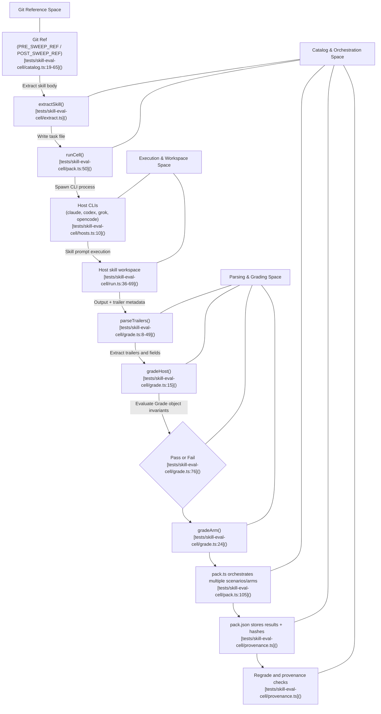

<!-- source: DeepWiki mcp.deepwiki.com · repo EveryInc/compound-engineering-plugin · extra page Skill-Eval Cell Harness · fetched 2026-10-30 -->

# Skill-Eval Cell Harness (Section 11.3.1)

<details>
<summary>Relevant source files</summary>

The following files were used as context for generating this wiki page:

- [skills/ce-noslop/SKILL.md](skills/ce-noslop/SKILL.md)
- [skills/ce-noslop/references/patterns.md](skills/ce-noslop/references/patterns.md)
- [tests/skill-eval-cell/README.md](tests/skill-eval-cell/README.md)
- [tests/skill-eval-cell/catalog.test.ts](tests/skill-eval-cell/catalog.test.ts)
- [tests/skill-eval-cell/catalog.ts](tests/skill-eval-cell/catalog.ts)
- [tests/skill-eval-cell/converse.test.ts](tests/skill-eval-cell/converse.test.ts)
- [tests/skill-eval-cell/converse.ts](tests/skill-eval-cell/converse.ts)
- [tests/skill-eval-cell/fixtures/judged-billing-planned/AGENTS.md](tests/skill-eval-cell/fixtures/judged-billing-planned/AGENTS.md)
- [tests/skill-eval-cell/fixtures/judged-billing-planned/docs/plans/2026-09-20-0900-feat-nightly-invoice-charging-plan.md](tests/skill-eval-cell/fixtures/judged-billing-planned/docs/plans/2026-09-20-0900-feat-nightly-invoice-charging-plan.md)
- [tests/skill-eval-cell/fixtures/judged-billing-planned/src/invoices.ts](tests/skill-eval-cell/fixtures/judged-billing-planned/src/invoices.ts)
- [tests/skill-eval-cell/fixtures/judged-billing-planned/src/payments.ts](tests/skill-eval-cell/fixtures/judged-billing-planned/src/payments.ts)
- [tests/skill-eval-cell/fixtures/noslop-drafts/certainty.md](tests/skill-eval-cell/fixtures/noslop-drafts/certainty.md)
- [tests/skill-eval-cell/fixtures/noslop-drafts/choppy.md](tests/skill-eval-cell/fixtures/noslop-drafts/choppy.md)
- [tests/skill-eval-cell/fixtures/noslop-drafts/release-notes.md](tests/skill-eval-cell/fixtures/noslop-drafts/release-notes.md)
- [tests/skill-eval-cell/fixtures/noslop-drafts/status-update.md](tests/skill-eval-cell/fixtures/noslop-drafts/status-update.md)
- [tests/skill-eval-cell/fixtures/pov-panel-receipts/panel/peer-codex.json](tests/skill-eval-cell/fixtures/pov-panel-receipts/panel/peer-codex.json)
- [tests/skill-eval-cell/grade.test.ts](tests/skill-eval-cell/grade.test.ts)
- [tests/skill-eval-cell/grade.ts](tests/skill-eval-cell/grade.ts)
- [tests/skill-eval-cell/hosts.test.ts](tests/skill-eval-cell/hosts.test.ts)
- [tests/skill-eval-cell/hosts.ts](tests/skill-eval-cell/hosts.ts)
- [tests/skill-eval-cell/integration-reproducibility.test.ts](tests/skill-eval-cell/integration-reproducibility.test.ts)
- [tests/skill-eval-cell/judged/personas/job-planned.md](tests/skill-eval-cell/judged/personas/job-planned.md)
- [tests/skill-eval-cell/judged/rubrics/scoping-confirmation.md](tests/skill-eval-cell/judged/rubrics/scoping-confirmation.md)
- [tests/skill-eval-cell/judged/scenarios.ts](tests/skill-eval-cell/judged/scenarios.ts)
- [tests/skill-eval-cell/pack.ts](tests/skill-eval-cell/pack.ts)
- [tests/skill-eval-cell/packs/ce-brainstorm-scope.md](tests/skill-eval-cell/packs/ce-brainstorm-scope.md)
- [tests/skill-eval-cell/provenance.ts](tests/skill-eval-cell/provenance.ts)
- [tests/skill-eval-cell/reproducibility.test.ts](tests/skill-eval-cell/reproducibility.test.ts)
- [tests/skill-eval-cell/review-integrity.test.ts](tests/skill-eval-cell/review-integrity.test.ts)
- [tests/skill-eval-cell/run.ts](tests/skill-eval-cell/run.ts)
- [tests/skill-eval-cell/scenarios.md](tests/skill-eval-cell/scenarios.md)

</details>


This page provides an in-depth technical overview of the **Skill-Eval Cell Harness** in the `compound-engineering-plugin` repository. It covers the architecture and implementation of the testing infrastructure located primarily under `tests/skill-eval-cell/`. This harness systematically evaluates skills by defining **Scenarios** and **Grades**, orchestrating test execution and grading across multiple coding-agent host CLIs. Key concepts covered include the scenario catalog, test packing, execution, grading with data extracted from trailers, path shimming for command interception, provenance and reproducibility mechanisms, calibration scenarios, and fixture corpora used during tests.

---

## Purpose and Scope

The Skill-Eval Cell Harness automates the testing of individual skills by running fixed prompt tasks against durable skill bodies checked out from specific git references (commonly two arms: pre-change and post-change). It exercises real CLI tooling for several supported coding-agent hosts (e.g., Claude, Codex, Grok, OpenCode), capturing outputs, parsing trailers for machine-readable metadata, and grading the results against declared invariants.

This system enables:

- Precise, reproducible assessment of skill correctness and invariant compliance.
- Cross-host parallel execution and comparative evaluation.
- Fine-grained control of test scenarios from postures simulating read-only judgment to live mutation and delegation.
- Documentation and validation of required read files, expected workspace contents, and disallowed actions.
- Evidence gathering with checksums and fingerprinting to support provenance and rerun reproducibility.
- Calibration of the grading system with dedicated scenarios derived from complex real-world cases.

---

## 1. Scenario and Grade Types

At the core, two data types model tests:

### Scenario

Defines a single skill-eval test case with these key fields:

- `id` — unique identifier string (e.g., `"ce-code-review/report-only-default"`).
- `skill` — the skill under test.
- `cohort` — a label such as `"resized"`, `"in-progress"`, or `"untouched"` indicating scenario origin/status.
- `key_behavior` — categorizes scenario behavior, e.g., `"judgment"`, `"mutation"`, `"delegation"` `[tests/skill-eval-cell/catalog.ts:67-68]()`.
- `read_only` — whether the test forbids mutation effects.
- Git setup fields like `git_init`, `git_untracked` (files untracked), `git_staged` (files staged), and `git_remote` (simulates a remote).
- `fixture` — path to test fixture directory.
- `timeout_secs` — max runtime.
- Descriptive fields `why`, `pre_contract`, and `task` that explain test motivation and the prompt content.
- A `grade` object defining expected outputs and invariants.
- Controls for which git refs to run on: baseline refs for pre-change, preview refs, and post refs.

### Grade

Encodes the expected results against which outputs are measured:

- `files_read_post` — required files that **must** be read on the post arm (failure if missing) `[tests/skill-eval-cell/catalog.ts:70-78]()`.
- `workspace_read` — fixture-relative files that must be mentioned in `FILES_READ` `[tests/skill-eval-cell/catalog.ts:79-84]()`.
- `must_include` / `must_include_any` — text snippets that must appear in the output `[tests/skill-eval-cell/catalog.ts:85-92]()`.
- `must_include_field` — scopes matching to a labeled section of the output `[tests/skill-eval-cell/catalog.ts:93-100]()`.
- `declared` — key-value pairs must appear exactly once as `LABEL: value` lines.
- `classification` — exact answer classification required.
- `must_not_include` / `must_exclude` — text or delegate names that must not appear (fail if present).
- `actions` and `delegates` — flags indicating presence or absence of commands and delegated helpers.
- Checks on git status and committed files.
- Restrictions on shim log contents.

This detailed schema enables fine control and accurate grading of run outputs, including reads, writes, delegation, and correctness of answer contents.

**Sources:**  
`tests/skill-eval-cell/catalog.ts:1-100`

---

## 2. SCENARIOS Catalog and Wave Groupings

The `SCENARIOS` constant catalogs all authored test cases. They are constructed from real skill contract states taken at the `PRE_SWEEP_REF` baseline (a durable git commit before a critical large merge) and re-run against the current working tree or other refs. The aim is to catch regressions or invalid outputs by asserting the expected invariants in the grade.

- Some scenarios define complementary pairs enforcing required reads owned by references or skill bodies.
- Scenarios are grouped by read-only Wave 1 runs for cheaper checks, and others that exercise mutations and delegation.
- Scenario definitions include detailed justification notes (`why`), preconditions (`pre_contract`), and multi-line prompt tasks (`task`) guiding the invocation.

**Example wave-1 scenario:** `"ce-babysit-pr/refuse-unasked-update"` tests branch currency gating without requiring expensive mutation `[tests/skill-eval-cell/scenarios.md:31-35]()`.

**Sources:**  
`tests/skill-eval-cell/catalog.ts:19-45`  
`tests/skill-eval-cell/scenarios.md:1-48`

---

## 3. Test Orchestration: Pack, Run, and Regrade

### 3.1 Packing Tests

The `pack.ts` script is the main orchestrator that:

- Filters scenarios by CLI arguments (`--id`, `--skill`, `--cohort`, `--wave1`) `[tests/skill-eval-cell/pack.ts:105-112]()`.
- Selects which git ref to run on per arm (`pre`, `post`, or `preview`) `[tests/skill-eval-cell/pack.ts:26-31]()`.
- Initializes an output directory for run results, generating a `pack.json` metadata file capturing the full run context, including schema version, scenario snapshots, and grading results.
- For each scenario and arm:
  - Runs `runCell()` to execute the skill prompt task against the specified git ref and host CLIs `[tests/skill-eval-cell/pack.ts:50-103]()`.
  - Verifies evidence output manifests and hashes to detect unintended drift.
  - Runs grading against the collected outputs, writing results into the `pack.json`.

### 3.2 Running Cells

The function `runCell()` invokes the CLI runner (`run.ts`) and:

- Extracts skill skill bodies from the specified git ref.
- Writes the scenario task to a file `[tests/skill-eval-cell/pack.ts:53-55]()`.
- Spawns CLI commands with appropriate arguments (e.g., `--read-only`, `--git-init`, `--fixture`) `[tests/skill-eval-cell/pack.ts:70-87]()`.
- Captures stdout and stderr `[tests/skill-eval-cell/pack.ts:89-96]()`.
- Throws on non-zero exit codes to mark failure `[tests/skill-eval-cell/pack.ts:97-101]()`.

### 3.3 Regrading

A separate regrade mechanism (in `regrade.ts`) applies current grading logic onto existing pack outputs. It supports:

- Mode toggles to re-run original grading or current rules.
- Checks for reproducibility of grading results.
- Produces reports for variance or failures.

This decoupling supports regression-proof grading recalculations.

**Sources:**  
`tests/skill-eval-cell/pack.ts:1-176`  
`tests/skill-eval-cell/run.ts:1-180`

---

## 4. Path-Shim and Trailer Parsing

### 4.1 Path-Shim

To simulate environment effects without polluting the skill's workspace, the test harness installs **path shims** for commands like `git push` or `gh pr`:

- Intercepts specified commands, simulating errors or outputs as scenario preconditions.
- Prevents actual pushes or PR creations during tests.
- Logs every intercepted invocation to a shared `SHIM_LOG` for audit and grading.

This mechanism keeps the skill workspace isolated and stable while preserving behavioral observation of commands issued.

### 4.2 Trailer Parsing

Skills output machine-readable metadata in **trailers** appended to their stdout or stderr. Key trailers include:

- `FILES_READ` — comma-separated list of skill reference or fixture files read.
- `ACTIONS` — list of commands run or `none`.
- `DELEGATES_DISPATCHED` — peer agents invoked or `none`.

The `parseTrailers()` function:

- Parses trailers from stdout first, falling back to stderr if needed `[tests/skill-eval-cell/grade.ts:28-36]()`.
- Skips placeholder values that echo prompt instructions `[tests/skill-eval-cell/grade.ts:35-37]()`.
- Keeps only the **last occurrence** of a trailer to avoid confusion `[tests/skill-eval-cell/grade.ts:39-49]()`.

Additional parsing helpers extract scoped labeled fields (e.g., `RECONCILIATION:`) and declared single-line label values to enable detailed grading.

**Sources:**  
`tests/skill-eval-cell/path-shim.ts:1-70`  
`tests/skill-eval-cell/grade.ts:8-120`

---

## 5. Grade Host and Grade Arm Functions

The grading system evaluates each host's output workspace and trailers:

- `gradeHost()` scores a single host's run output `[tests/skill-eval-cell/grade.ts:15-22]()`. It checks:
  - Presence of required `FILES_READ` items matches those declared in the grade.
  - `ACTIONS` and `DELEGATES_DISPATCHED` trailers comply with inclusion/exclusion.
  - The declared fields (`declared`) match exactly.
  - Secondary conditions like `must_include_any`, `must_exclude`, `workspace_contains`, and git artifact checks.
- `gradeArm()` aggregates grades of all host runs under a single arm (`pre`, `post`, or `preview`) `[tests/skill-eval-cell/grade.ts:24-28]()`.
- Tracks reasons for failure or acceptance.
- Honors flags like `read_only` to validate or forbid mutations.

The grading ensures consistent adherence to scenario invariants across multiple host platforms.

**Sources:**  
`tests/skill-eval-cell/grade.ts:15-28`  
`tests/skill-eval-cell/run.ts:1-180`

---

## 6. Provenance and Reproducibility

To enable auditability and reproducibility:

- Every scenario run packs evidence including `evidence-manifest.json` checksums.
- The test suite fingerprints the grader code and scenario snapshot (`scenario_sha256`) used to verify the grading logic.
- These hashes are stored in `pack.json` to detect drift.
- Mechanisms ensure grading inputs and outputs remain consistent across reruns.
- The harness supports regrading older pack runs against updated graders or scenarios to assess regression or improvements.

This infrastructure is crucial for robust continuous integration and stable historical quality gates.

**Sources:**  
`tests/skill-eval-cell/provenance.ts:1-100`  
`tests/skill-eval-cell/pack.ts:1-176`

---

## 7. Calibration Scenarios

The harness contains a specialized set of **calibration scenarios**:

- Derived from real-world complex use cases, e.g., code review and document review involving evidential reconciliation.
- Used to calibrate grading thresholds and invariant definitions before wider rollout.
- Typically read-only and non-mutative.
- Exercise nuanced grading features like declared multi-line fields or partial matches.

Examples include scenarios like `"ce-doc-review/rejected-evidence-freshness"`, `"ce-doc-review/retained-output-counts"`, and `"ce-code-review/settled-preference-admission"`.

**Sources:**  
`tests/skill-eval-cell/calibration-scenarios.ts:1-73`

---

## 8. Fixture Corpora

To support scenario execution, the harness uses occluded **fixtures**:

- Physical directories with seed files that mimic partial or full skill workspaces.
- Can contain staged or untracked git files, prepared carefully for test immutability.
- Fixtures are referenced by relative paths in the scenario catalog.
- Used in live mutation or delegated scenarios to enable testing of real paths and contents.

Example fixture directories include `tests/skill-eval-cell/fixtures/plan-infra-objective`, `.../review-calibration`, and `.../code-review-live`.

**Sources:**  
`tests/skill-eval-cell/catalog.ts:98-129`  
`tests/skill-eval-cell/fixtures/`

---

## Data Flow and Key Classes/Functions

Data flows from scenario definitions and git references through execution runners and host CLIs, concluding with trailer parsing and strict multi-invariant assertion matching.



**Sources:**  
`tests/skill-eval-cell/run.ts:1-180`  
`tests/skill-eval-cell/pack.ts:1-176`  
`tests/skill-eval-cell/grade.ts:1-152`  
`tests/skill-eval-cell/catalog.ts:1-129`

---

## Mapping Natural Language Concepts to Code Entities

Natural language expressions of evaluation goals map precisely onto codebase entities and test runner scripts.

```mermaid
graph LR
  sub_nl[("Natural Language Space")]
  sub_ce[("Code Entity Space")]

  sub_nl -->|"Skill Evaluation"| CE1("run.ts\n[tests/skill-eval-cell/run.ts:1]()")
  sub_nl -->| "Test Scenario" | CE2("catalog.ts:Scenario\n[tests/skill-eval-cell/catalog.ts:99]()")
  sub_nl -->| "Grade Expectations" | CE3("catalog.ts:Grade\n[tests/skill-eval-cell/catalog.ts:70]()")
  sub_nl -->| "Run Scenario" | CE4("pack.ts:runCell\n[tests/skill-eval-cell/pack.ts:50]()")
  sub_nl -->| "Multiple Hosts Execution" | CE5("hosts.ts:HOSTS\n[tests/skill-eval-cell/hosts.ts:10]()")
  sub_nl -->| "Path Shim for Isolation"| CE6("path-shim.ts:installPathShims\n[tests/skill-eval-cell/path-shim.ts]()")
  sub_nl -->| "Output Trailers" | CE7("grade.ts:parseTrailers\n[tests/skill-eval-cell/grade.ts:8]()")
  sub_nl -->| "Host Grading"| CE8("grade.ts:gradeHost\n[tests/skill-eval-cell/grade.ts:15]()")
  sub_nl -->| "Pack Metadata & Provenance" | CE9("provenance.ts\n[tests/skill-eval-cell/provenance.ts:1]()")
  sub_nl -->| "Calibration Cases" | CE10("calibration-scenarios.ts:CALIBRATION_SCENARIOS\n[tests/skill-eval-cell/calibration-scenarios.ts]()")
  sub_nl -->| "Fixture Data" | CE11("fixtures/* folders\n[tests/skill-eval-cell/fixtures/]()")

  sub_nl --- sub_ce
```

**Sources:**  
`tests/skill-eval-cell/catalog.ts`  
`tests/skill-eval-cell/pack.ts`  
`tests/skill-eval-cell/run.ts`  
`tests/skill-eval-cell/grade.ts`  
`tests/skill-eval-cell/path-shim.ts`  
`tests/skill-eval-cell/calibration-scenarios.ts`

---

## Detailed Implementation Notes

### Scenario Catalog (`catalog.ts`)

- Scenarios are authored as static JavaScript objects specifying all test parameters `[tests/skill-eval-cell/catalog.ts:1-97]()`.
- Baseline refs like `PRE_SWEEP_REF` and `POST_SWEEP_REF` are used to load skill bodies for pre/post arms `[tests/skill-eval-cell/catalog.ts:19-65]()`.
- Sets of scenarios target different cohorts (`"resized"` reflects scenario changes after major merges) `[tests/skill-eval-cell/catalog.ts:67]()`.
- Tests include gating on required read file presence (`files_read_post`), workspace file reads, and forbidden mutations `[tests/skill-eval-cell/catalog.ts:70-90]()`.
- Maintains traceable reasons/logging for grading actions.

### Pack Runner (`pack.ts`)

- Handles CLI arguments and scenario filtering `[tests/skill-eval-cell/pack.ts:105-112]()`.
- Runs each scenario arm by invoking `runCell` with proper git refs and fixture dirs `[tests/skill-eval-cell/pack.ts:50-103]()`.
- Uses Node `child_process.spawn` to invoke `run.ts` `[tests/skill-eval-cell/pack.ts:89-94]()`.
- Writes incremental judgment results into `pack.json` for CI and human review.
- Verifies fingerprint hashes and scenario stability `[tests/skill-eval-cell/pack.ts:22]()`.
- Supports partial run frames (e.g., Wave 1 cheap read-only runs) `[tests/skill-eval-cell/pack.ts:110]()`.

### Cell Run (`run.ts`)

- Prepares isolated workspaces for each host process.
- Extracts skill code from the git ref workload `[tests/skill-eval-cell/run.ts:13]()`.
- Sets up workspace fixtures and git state (including "git init", staged/untracked files) `[tests/skill-eval-cell/run.ts:36-70]()`.
- Installs path shims to sandbox / intercept system commands `[tests/skill-eval-cell/run.ts:16]()`.
- Executes the skill CLI on each enabled host with composed environment `[tests/skill-eval-cell/run.ts:92-153]()`.
- Captures and reports stdout/stderr and process exit code `[tests/skill-eval-cell/run.ts:114-145]()`.
- Collects git log, status, and file listings post run for grading sanity `[tests/skill-eval-cell/run.ts:40-69]()`.

### Path Shim (`path-shim.ts`)

- The shim intercepts critical CLI commands (e.g., `git push`, `gh pr create`).
- Can inject failure/error outputs or precondition checks.
- Logs all intercepted commands into `SHIM_LOG` for later grading `[tests/skill-eval-cell/path-shim.ts:5]()`.
- Ensures no destructive external effects during test runs.

### Trailer Parsing and Grading (`grade.ts`)

- Uses regex and line-based heuristics to extract trailing metadata `[tests/skill-eval-cell/grade.ts:8-49]()`.
- Distinguishes between placeholders and actual output `[tests/skill-eval-cell/grade.ts:35-37]()`.
- Extracts detailed labeled fields for scoped grading (`must_include_field`, `declared`) `[tests/skill-eval-cell/grade.ts:93-147]()`.
- Checks inclusion and exclusion invariants on file reads, actions, delegation.
- Cross-checks workspace files and committed file lists for content expectations `[tests/skill-eval-cell/grade.ts:124-148]()`.
- Returns detailed pass/fail reasons for diagnostics `[tests/skill-eval-cell/grade.ts:15-22]()`.

### Provenance (`provenance.ts`)

- Implements packing versioning: `PACK_SCHEMA_VERSION` annotation `[tests/skill-eval-cell/provenance.ts:22]()`.
- Computes SHA256 hashes over scenario snapshots and grading logic.
- Validates evidence manifests to flag unintended external changes.
- Ensures consistent grading runs, supporting archival and reproducibility.

### Calibration Scenarios (`calibration-scenarios.ts`)

- Specialized subset of scenarios keyed for grading calibrations.
- Source actual workflow states from skill workspaces and complex prompts.
- Target corner cases in review and judgment fidelity.
- Pinpoint regressions or improvements in scoring.

**Sources:**  
`tests/skill-eval-cell/catalog.ts:1-129`  
`tests/skill-eval-cell/pack.ts:1-176`  
`tests/skill-eval-cell/run.ts:1-180`  
`tests/skill-eval-cell/path-shim.ts:1-70`  
`tests/skill-eval-cell/grade.ts:1-152`  
`tests/skill-eval-cell/provenance.ts:1-100`  
`tests/skill-eval-cell/calibration-scenarios.ts:1-73`

---

## Summary Table of Key Components

| Component | Description | File / Location |
|---|---|---|
| Scenario & Grade types | Typed test case and grading definition schema | `tests/skill-eval-cell/catalog.ts:40-129` |
| Scenario catalog & waves | Static array of test scenarios and grouping | `tests/skill-eval-cell/catalog.ts` + `scenarios.md` |
| Pack orchestration | Scenario filtering, running, and packing results | `tests/skill-eval-cell/pack.ts:1-176` |
| Single cell execution | Extract skill ref, run hosts, capture results | `tests/skill-eval-cell/run.ts:1-180` |
| Path-shim for sandboxing | Command intercept and log for safe test runs | `tests/skill-eval-cell/path-shim.ts:1-70` |
| Trailer parsing and grading | Extract metadata from outputs and score results | `tests/skill-eval-cell/grade.ts:1-152` |
| Provenance and reproducibility | Artifact fingerprinting and stable regrading | `tests/skill-eval-cell/provenance.ts:1-100` |
| Calibration Scenarios | Handpicked real-world complex cases for tuning | `tests/skill-eval-cell/calibration-scenarios.ts:1-73` |
| Fixture data | Seed filesystem state for scenario execution | `tests/skill-eval-cell/fixtures/` |

**Sources:**  
`tests/skill-eval-cell/catalog.ts:40-129`  
`tests/skill-eval-cell/scenarios.md:1-184`  
`tests/skill-eval-cell/pack.ts:1-176`  
`tests/skill-eval-cell/run.ts:1-180`  
`tests/skill-eval-cell/path-shim.ts:1-70`  
`tests/skill-eval-cell/grade.ts:1-152`  
`tests/skill-eval-cell/provenance.ts:1-100`  
`tests/skill-eval-cell/calibration-scenarios.ts:1-73`

---

## References and Further Reading

- Scenario definitions and grade schema details: `[tests/skill-eval-cell/catalog.ts:40-129]()`
- Catalog test validations and coverage: `[tests/skill-eval-cell/catalog.test.ts:1-168]()`
- Scenario usage guidelines: `[tests/skill-eval-cell/scenarios.md:1-183]()`
- Pack runner orchestration including CLI args: `[tests/skill-eval-cell/pack.ts:1-176]()`
- Skill eval cell execution flow: `[tests/skill-eval-cell/run.ts:1-180]()`
- Trailer parsing and grading logic: `[tests/skill-eval-cell/grade.ts:1-152]()`
- Path shim installation and tests: `[tests/skill-eval-cell/path-shim.ts:1-70]()`, `[tests/skill-eval-cell/path-shim.test.ts:1-97]()`
- Calibration scenario examples: `[tests/skill-eval-cell/calibration-scenarios.ts:1-73]()`
- Skill-eval cell README for usage: `[tests/skill-eval-cell/README.md:1-63]()`

**Sources:**  
`tests/skill-eval-cell/catalog.ts:40-129`  
`tests/skill-eval-cell/catalog.test.ts:1-168`  
`tests/skill-eval-cell/scenarios.md:1-184`  
`tests/skill-eval-cell/pack.ts:1-176`  
`tests/skill-eval-cell/run.ts:1-180`  
`tests/skill-eval-cell/grade.ts:1-152`  
`tests/skill-eval-cell/path-shim.ts:1-70`  
`tests/skill-eval-cell/calibration-scenarios.ts:1-73`  
`tests/skill-eval-cell/README.md:1-64`

---

